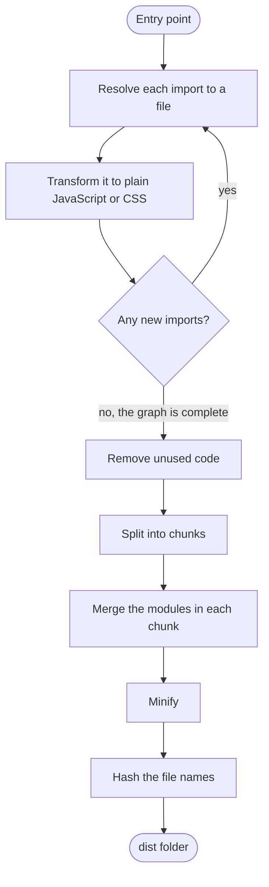
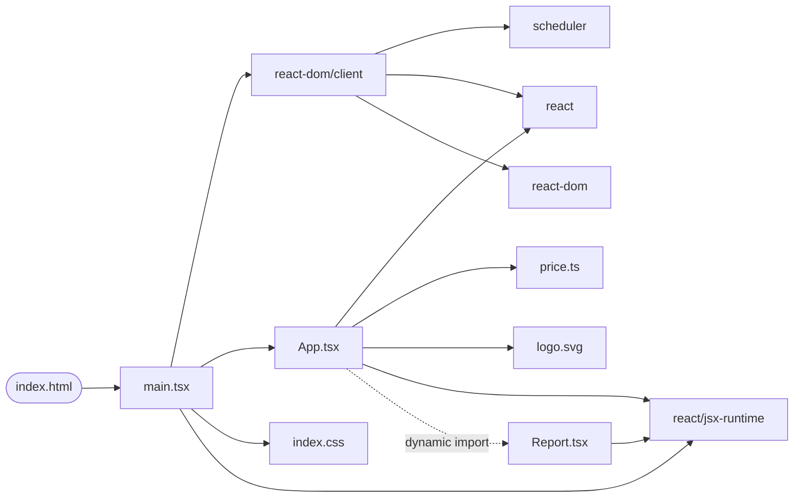
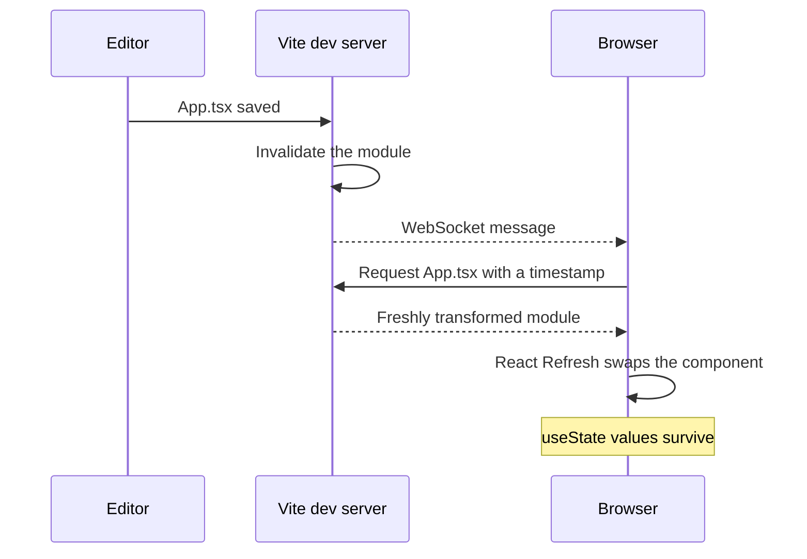
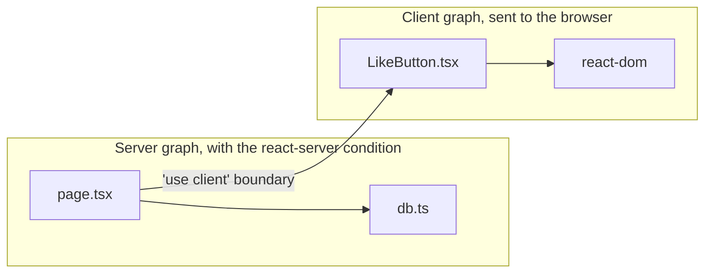

import Note from '../../components/Note.astro';

Browsers can’t run a React project as it sits on your disk. They don’t understand JSX or TypeScript, they have no idea where a package called `react` lives, and `import './index.css'` fails outright. Something has to turn your `src` folder into the HTML, CSS and JavaScript a browser does understand.

We call that something “the bundler”, but it’s really a chain of tools: a resolver, a compiler, a tree shaker, a minifier, a CSS processor, and a development server that works quite differently from the production build. Most of the time they’re just a few lines in `package.json` and a long list of folders in `node_modules`.

This post follows one small app through that whole chain and looks at what comes out of every step. Along the way it covers what each library does, why React needs some of them, and where the bytes in your bundle actually come from.

The output in this post comes from real builds using Vite 8.3 and React 19.3, with webpack 5.112 and Babel 8.1 for the comparison near the end. I’ve only trimmed and formatted it for reading. These tools change quickly, and Vite replaced both of its bundlers earlier this year, so check the versions you’re on. The ideas last longer than the config options.

## The app we’ll bundle

It’s small on purpose, but it has everything that makes bundling interesting: TypeScript, JSX, a stylesheet, an image, a component that loads on demand, and a function nobody calls.

```text title="The project"
index.html
vite.config.ts
src/
  main.tsx      the entry point
  App.tsx       the main component
  Report.tsx    loaded only when a button is clicked
  price.ts      one function we use and one we don't
  index.css
  logo.svg
```

```tsx title="src/main.tsx"
import { createRoot } from 'react-dom/client';
import { App } from './App';
import './index.css';

createRoot(document.getElementById('root')!).render(<App />);
```

```tsx title="src/App.tsx"
import { lazy, Suspense, useState } from 'react';
import { formatPrice } from './price';
import logo from './logo.svg';

const Report = lazy(() => import('./Report'));

export function App() {
  const [showReport, setShowReport] = useState(false);

  return (
    <main>
      
      <p>Total: {formatPrice(1999)}</p>
      <button onClick={() => setShowReport(true)}>Show report</button>
      {showReport && (
        <Suspense fallback={<p>Loading…</p>}>
          <Report />
        </Suspense>
      )}
    </main>
  );
}
```

```ts title="src/price.ts"
export function formatPrice(cents: number): string {
  return `$${(cents / 100).toFixed(2)}`;
}

export function neverCalledAnywhere(): string {
  return 'THIS_STRING_SHOULD_BE_TREE_SHAKEN';
}
```

```tsx title="src/Report.tsx"
export default function Report() {
  return <section className="report">Quarterly numbers go here</section>;
}
```

```css title="src/index.css"
main {
  display: flex;
  gap: 1rem;
  user-select: none;
}

.report {
  color: oklch(60% 0.15 250);
}
```

`index.html` is the usual shell, with a `<div id="root">` and one script tag pointing at `/src/main.tsx`. The Vite config is short:

```ts title="vite.config.ts"
import { defineConfig } from 'vite';
import react from '@vitejs/plugin-react';

export default defineConfig({
  plugins: [react()],
});
```

Building it takes about a quarter of a second:

```bash
npx vite build
```

```text title="Output"
dist/index.html                   0.31 kB │ gzip:  0.22 kB
dist/assets/index-qzjO9g25.css    0.10 kB │ gzip:  0.10 kB
dist/assets/Report-CU_-14MM.js    0.16 kB │ gzip:  0.16 kB
dist/assets/index-BBlewyJN.js   221.68 kB │ gzip: 69.51 kB

✓ built in 245ms
```

Keep that last file in mind. Our own code is about 2 kB, and the other 220 kB is React. We’ll get to why.

## Why a browser can’t run this

Here’s everything in those files that a browser would reject:

| In the code                         | The problem                                                | What deals with it             |
| ----------------------------------- | ---------------------------------------------------------- | ------------------------------ |
| `<App />`                           | JSX isn’t JavaScript.                                      | A compiler                     |
| `cents: number`                     | Neither are type annotations.                              | A compiler                     |
| `import 'react'`                    | Browsers load URLs, and `react` isn’t one.                 | A resolver                     |
| `module.exports` inside React       | React is published as CommonJS, which browsers don’t have. | The bundler’s CommonJS support |
| `process.env.NODE_ENV` inside React | There’s no `process` in a browser.                         | Constant replacement           |
| `import './index.css'`              | A plain import of a CSS file fails.                        | A CSS pipeline                 |
| `import logo from './logo.svg'`     | The same goes for images.                                  | An asset pipeline              |

### Browsers have modules now, so why bundle?

They do, and once your code is compiled you could ship every file separately. Development servers do exactly that, as we’ll see later. (Import maps can even tell a browser where `react` lives, though that’s the only problem in the table they solve.) In production, separate files cost you in several ways:

- **Waterfalls.** A browser only discovers a module’s imports after downloading and parsing it, so a deep import tree turns into round trip after round trip.
- **Compression.** Gzip and Brotli work by finding repetition, and they do better on one large file than on hundreds of small ones.
- **Unused code.** Nothing in the browser removes the parts of a library you never call.
- **Published packages.** A lot of npm, React included, still isn’t written as ES modules.

A bundler fixes all of these at once. It reads your whole app, keeps what’s used, and writes it out as a few files.

## The pipeline at a glance

Here’s the route your code takes through a production build. Each box gets its own section below.



The loop at the top matters most. A bundler doesn’t scan your project for files. It starts at one file and follows imports, so a file nothing imports doesn’t exist as far as the build is concerned.

Different tools fill in those boxes depending on your setup:

| Job                                  | Vite 8                          | A classic webpack setup              |
| ------------------------------------ | ------------------------------- | ------------------------------------ |
| Running the build and the dev server | Vite                            | `webpack`, `webpack-dev-server`      |
| Bundling                             | Rolldown                        | `webpack`                            |
| Resolving imports                    | Oxc’s resolver, inside Rolldown | `enhanced-resolve`                   |
| TypeScript and JSX                   | Oxc                             | Babel, through `babel-loader`        |
| Rewriting syntax for older browsers  | Oxc                             | `@babel/preset-env`                  |
| Processing CSS                       | Vite’s CSS plugins and PostCSS  | `css-loader`, `postcss-loader`       |
| Moving CSS into its own file         | Vite                            | `mini-css-extract-plugin`            |
| Minifying JavaScript                 | Oxc                             | Terser                               |
| Minifying CSS                        | Lightning CSS                   | cssnano                              |
| Writing the final HTML               | Vite                            | `html-webpack-plugin`                |
| Fast Refresh                         | `@vitejs/plugin-react`          | `react-refresh` and a webpack plugin |

In Vite 8, three projects share the work. [Rolldown](https://rolldown.rs/) is the bundler. [Oxc](https://oxc.rs/) is the compiler toolkit underneath it. Vite sits on top and adds the dev server, HTML handling, the CSS pipeline and the plugin system you configure. Installing Vite pulls in Rolldown (with Oxc compiled into its native binary), Lightning CSS and PostCSS, while `esbuild`, `terser` and `sass` are optional extras you add only if you want them.

Until [Vite 8](https://vite.dev/blog/announcing-vite8) came out in March 2026, Vite used esbuild in development and Rollup in production, so you’ll still see both names in older projects and articles.

## Step 1: find the entry point

A bundler needs somewhere to start. Vite starts from `index.html` and treats this tag as the way in:

```html
<script type="module" src="/src/main.tsx"></script>
```

webpack starts from the `entry` option in its config instead. Either way, the entry is the root of a tree, and everything the build produces has to be reachable from it.

## Step 2: resolve each import

Every `import` contains a string, and the resolver’s job is to turn that string into one file on disk.

**Relative paths** like `./App` are the simple case. There’s no extension, so the resolver tries a list. Vite’s default is `.mjs`, `.js`, `.mts`, `.ts`, `.jsx`, `.tsx` and `.json`, and it takes the first file that exists.

**Bare specifiers** like `react` take more work. The resolver walks up the directory tree looking for `node_modules/react`, then reads that package’s `package.json`. Modern packages describe their entry points in an `exports` map:

```json title="node_modules/react/package.json (trimmed)"
{
  "main": "index.js",
  "exports": {
    ".": {
      "react-server": "./react.react-server.js",
      "default": "./index.js"
    },
    "./jsx-runtime": {
      "react-server": "./jsx-runtime.react-server.js",
      "default": "./jsx-runtime.js"
    }
  }
}
```

Each key inside an entry is a condition, a label the bundler either declares or doesn’t. A normal browser build doesn’t declare `react-server`, so `react` resolves to `./index.js`. That condition comes back when we reach [Server Components](#server-rendering-and-server-components).

Here’s the file it lands on, and it’s worth reading in full:

```js title="node_modules/react/index.js"
'use strict';

if (process.env.NODE_ENV === 'production') {
  module.exports = require('./cjs/react.production.js');
} else {
  module.exports = require('./cjs/react.development.js');
}
```

Those six lines explain a lot of what follows. React is published as CommonJS rather than ES modules, and the choice between its development and production builds is made by what looks like an ordinary `if` statement.

Two more things happen at this stage. **Aliases** like `@/components/Button` are also resolved here, through `resolve.alias`. And **duplicate packages** show up here too. If a monorepo or a badly declared dependency resolves two copies of React, hooks break with the “invalid hook call” error, because each copy has its own internal state. `resolve.dedupe` in Vite and `resolve.alias` in webpack are the usual fixes.

## Step 3: transform each file

Once the bundler has a file, it passes it through a chain of plugins until what’s left is plain JavaScript or CSS. A resolved Vite config for this tiny app lists about forty plugins, with names like `vite:oxc`, `vite:css`, `vite:asset` and `vite:define`, though most of them do nothing for most files.

Transforms work on one file at a time. That keeps them fast and easy to run in parallel, and it also gives them some blind spots.

### Removing types

Here’s `price.ts` after the compiler has seen it:

```diff
- export function formatPrice(cents: number): string {
+ export function formatPrice(cents) {
```

For most code, that’s the entire TypeScript step. The compiler deletes the types and never checks them. (A few features do produce code, and `enum` is the one you’re most likely to meet: it compiles to a small object.) You can see the missing check by building a file with an obvious error:

```ts title="src/type-error.ts"
const total: number = 'this is not a number';
console.log(total);
```

Vite builds it without complaint, and the minifier even inlines the value:

```text title="Output"
console.log(`this is not a number`);
```

Type checking is a separate job for `tsc`, the TypeScript compiler, so add `tsc --noEmit` to your build script or CI. In a bundled app it usually produces no JavaScript at all.

The one-file-at-a-time rule causes one specific problem. Given `export { Price } from './types'`, a compiler looking at a single file can’t tell whether `Price` is a value or a type, so it can’t tell whether to keep the line.

```ts
export type { Price } from './types'; // Unambiguous: delete this line
```

Set `isolatedModules` or `verbatimModuleSyntax` in `tsconfig.json`, and TypeScript will flag the cases a single-file compiler can’t handle.

### Compiling JSX

JSX is shorthand for function calls. Here’s one line from `App.tsx` and what the build turns it into:

```tsx
<p>Total: {formatPrice(1999)}</p>
```

```js
/* @__PURE__ */ (0, import_jsx_runtime.jsxs)('p', { children: ['Total: ', formatPrice(1999)] });
```

Each part has a purpose:

| Piece                | What it does                                                                                                                                             |
| -------------------- | -------------------------------------------------------------------------------------------------------------------------------------------------------- |
| `/* @__PURE__ */`    | A hint that the call has no side effects, so it can be deleted if nothing uses the result.                                                               |
| `(0, fn)(...)`       | Calls `fn` as a plain function, so it doesn’t receive the imported module as `this`.                                                                     |
| `import_jsx_runtime` | The `react/jsx-runtime` module. The compiler added this import by itself.                                                                                |
| `jsxs`               | The version of `jsx` for several static children. In development it stops React warning about missing keys. In production the two are the same function. |

That automatic import is why you no longer write `import React from 'react'` at the top of every file. [React 17 introduced it](https://legacy.reactjs.org/blog/2020/09/22/introducing-the-new-jsx-transform.html):

| JSX runtime | What `<p>Hi</p>` becomes               | Notes                                             |
| ----------- | -------------------------------------- | ------------------------------------------------- |
| Classic     | `React.createElement('p', null, 'Hi')` | `React` has to be in scope in every file.         |
| Automatic   | `jsx('p', { children: 'Hi' })`         | The compiler imports `react/jsx-runtime` for you. |

In development, the compiler uses `jsxDEV` from `react/jsx-dev-runtime` instead and still passes the file name, line and column of every element. React 19 ignores those arguments. Its `jsxDEV` captures a real stack trace for each element, and that’s how its error messages point at your source.

### Replacing constants

Now back to that `if` statement in React’s `index.js`. Before a production build reads the file, `process.env.NODE_ENV` is replaced with the literal text `"production"`:

```js
if ('production' === 'production') {
  module.exports = require('./cjs/react.production.js');
} else {
  module.exports = require('./cjs/react.development.js');
}
```

The condition is always true, so the `else` branch is dead and its `require` disappears. That’s why `react.development.js` appears nowhere in the build: the bundler never goes looking for it. React’s dev-only warnings all live in that development file, so they go with it, and the production file goes further by replacing its error messages with a code and a link to `react.dev/errors`.

Getting this wrong is expensive, and the log won’t warn you:

| `NODE_ENV` during the build | Main JavaScript file | Gzipped   |
| --------------------------- | -------------------- | --------- |
| `production` (the default)  | 221.68 kB            | 69.51 kB  |
| `development`               | 429.38 kB            | 130.97 kB |

Both runs print “building client environment for production”. It’s easy to do by accident, with a CI step that exports `NODE_ENV=development` or a script that starts a Vite dev server and runs a build in the same process.

Vite also replaces `import.meta.env.*` the same way, which is where your own configuration goes.

<Note>
  whatever you read through `import.meta.env` is pasted into the bundle as plain text, where anyone can read it. Vite
  only exposes variables prefixed with `VITE_` for this reason. Never put a secret in one.
</Note>

### Rewriting syntax for older browsers

Vite’s default `build.target` is `baseline-widely-available`, which currently means Chrome and Edge 111, Firefox 114, and Safari 16.4. Syntax those browsers already support is left alone. Lower the target and the compiler rewrites what’s missing. In the Babel world, `@babel/preset-env` does this job, and [browserslist](https://browsersl.ist/) is the shared format for saying which browsers you support.

Here’s Babel targeting Chrome 70, which predates `?.` and `??`:

```js title="Input"
const sorted = [3, 1, 2].toSorted();
const name = user?.profile?.name ?? 'Anonymous';
```

```js title="Output"
var _user$profile$name, _user;
const sorted = [3, 1, 2].toSorted();
const name =
  (_user$profile$name =
    (_user = user) === null || _user === void 0 || (_user = _user.profile) === null || _user === void 0
      ? void 0
      : _user.name) !== null && _user$profile$name !== void 0
    ? _user$profile$name
    : 'Anonymous';
```

Notice that `toSorted` came through untouched. A compiler can rewrite syntax, but it can’t invent a method a browser doesn’t have. That takes a polyfill, a runtime implementation of the missing feature, and [core-js](https://github.com/zloirock/core-js) is the standard collection of them.

Babel 8 [removed the old `useBuiltIns` option](https://babeljs.io/blog/2026/06/16/8.0.0), so polyfills now come from a dedicated plugin:

```js title="babel.config.js"
export default {
  targets: 'chrome 90',
  presets: ['@babel/preset-env'],
  plugins: [['babel-plugin-polyfill-corejs3', { method: 'usage-global', version: '3.51' }]],
};
```

```js title="Output for Chrome 90"
import 'core-js/modules/es.array.to-sorted.js';
const sorted = [3, 1, 2].toSorted();
const name = user?.profile?.name ?? 'Anonymous';
```

Vite doesn’t add polyfills for JavaScript features by default. If you need to support older browsers, `@vitejs/plugin-legacy` handles it.

### Optimising components with React Compiler

[React Compiler](https://react.dev/learn/react-compiler) is an optional step that adds memoisation automatically, so you can write fewer `useMemo` and `useCallback` calls by hand. It ships as a Babel plugin, which is the main reason a Vite project might still have Babel in it:

```bash
npm install -D @rolldown/plugin-babel @babel/core babel-plugin-react-compiler
```

```ts title="vite.config.ts"
import { defineConfig } from 'vite';
import babel from '@rolldown/plugin-babel';
import react, { reactCompilerPreset } from '@vitejs/plugin-react';

export default defineConfig({
  plugins: [react(), babel({ presets: [reactCompilerPreset()] })],
});
```

Here’s what happens to `Report`:

```js
function Report() {
  const $ = (0, import_compiler_runtime.c)(1);
  let t0;
  if ($[0] === Symbol.for('react.memo_cache_sentinel')) {
    t0 = /* @__PURE__ */ (0, import_jsx_runtime.jsx)('section', {
      className: 'report',
      children: 'Quarterly numbers go here',
    });
    $[0] = t0;
  } else t0 = $[0];
  return t0;
}
```

`$` is a small per-component cache, so the element gets created once and reused on every later render. `@vitejs/plugin-react` also has an experimental `react({ compiler: true })` option that uses a Rust port of the compiler instead of Babel.

### Processing CSS

Importing a stylesheet from JavaScript is a bundler convention. Vite’s CSS plugins follow `@import` and `url()` references, run your preprocessor and PostCSS plugins, and scope any `.module.css` files. Here’s who does what:

| Tool                 | Job                                                                                   |
| -------------------- | ------------------------------------------------------------------------------------- |
| Sass, Less or Stylus | Compile their own languages to CSS. They’re optional add-ons in Vite.                 |
| PostCSS              | Runs a chain of plugins over your CSS. It’s Vite’s default CSS transformer.           |
| Autoprefixer         | A PostCSS plugin that adds vendor prefixes.                                           |
| Tailwind CSS         | Scans your source for class names and generates only the utilities you used.          |
| CSS Modules          | Rewrites class names so they’re unique to the file, for any file named `.module.css`. |
| Lightning CSS        | A parser, transformer and minifier written in Rust, and Vite’s default CSS minifier.  |
| cssnano              | A minifier built on PostCSS, and the usual choice with webpack.                       |

In production, the styles leave the JavaScript entirely. `index.css` shows up in the module list with zero rendered bytes, and its contents go to a separate file:

```text title="assets/index-qzjO9g25.css"
main{-webkit-user-select:none;user-select:none;gap:1rem;display:flex}.report{color:oklch(60% .15 250)}
```

Lightning CSS added that `-webkit-` prefix on its own, without Autoprefixer, because Safari 16.4 needs it for `user-select`. It left `oklch` alone because every target browser supports it. Vite only runs this step when it minifies, so the prefix doesn’t exist in development, or in a build with `build.cssMinify` set to `false`.

CSS that’s only imported from a lazy component goes into its own file and loads with that component.

### Handling images and other assets

`import logo from './logo.svg'` doesn’t give you an image. It gives you a string to use as a URL. Our logo is under Vite’s 4 KiB `assetsInlineLimit`, so that string is the file itself:

```js
export default "data:image/svg+xml,%3csvg%20xmlns='http://www.w3.org/2000/svg'%20viewBox='0%200%2010%2010'%3e%3ccircle%20cx='5'%20cy='5'%20r='4'/%3e%3c/svg%3e";
```

Larger files get copied to `dist/assets` with a hash in the name, and the import becomes that URL. Query suffixes change the behaviour: `?no-inline` always writes a separate file, `?raw` gives the file’s text, and `?worker` builds a web worker.

If you want an SVG as a React component, that’s not built in. `vite-plugin-svgr` or `@svgr/webpack` compile the file into a component at this stage.

### Who does the compiling

These are the compilers you’re likely to come across:

| Tool    | Written in            | Where you’ll meet it                                                                         |
| ------- | --------------------- | -------------------------------------------------------------------------------------------- |
| Oxc     | Rust                  | Vite 8 and Rolldown. A parser, transformer, minifier and linter in one project.              |
| SWC     | Rust                  | Next.js, Turbopack, Rspack, Parcel and `@vitejs/plugin-react-swc`.                           |
| Babel   | JavaScript            | webpack projects, React Native, and anywhere you need a Babel plugin such as React Compiler. |
| esbuild | Go                    | Vite before version 8, and plenty of libraries and scripts.                                  |
| `tsc`   | Go, from TypeScript 7 | Type checking and generating `.d.ts` files.                                                  |

They all do broadly the same job, so the differences are speed and ecosystem. Babel’s big advantage has always been its plugins. The Rust and Go tools are far faster, because they compile to native code and run in parallel across CPU cores.

## Step 4: build the module graph

After each transform, the bundler parses the result, collects its imports and goes back to step 2. When nothing new turns up, it has a complete map of the app. Ours has 20 modules, and here’s the part that matters:



The remaining modules are the small files that pick between development and production builds, plus a few helpers the bundler adds itself.

### ES modules and CommonJS

The graph mixes two module systems, and the difference between them drives much of the rest of this post.

|                        | ES modules            | CommonJS                         |
| ---------------------- | --------------------- | -------------------------------- |
| Syntax                 | `import` and `export` | `require()` and `module.exports` |
| When imports are known | By reading the file   | Only by running it               |
| Supported by browsers  | Yes                   | No                               |
| Can be tree shaken     | Yes                   | Generally not                    |

Since `require` is an ordinary function, a bundler can’t assume much about it. To include a CommonJS module such as React, Rolldown wraps it in a function and imitates Node’s module system with a one-line helper:

```js title="From the bundle, before minifying"
var __commonJSMin = (cb, mod) => () => (
  mod || (cb((mod = { exports: {} }).exports, mod, mod.exports), (cb = null)),
  mod.exports
);

var require_react_production = /* @__PURE__ */ __commonJSMin((exports) => {
  var REACT_ELEMENT_TYPE = Symbol.for('react.transitional.element');
  // ...the rest of React
});
```

The first time something calls `require_react_production()`, the helper runs the module with a fresh `exports` object. Every later call returns that same object. That’s `require` in one line.

## Step 5: remove unused code

This step is known as tree shaking. It starts at the entry point, marks every binding that’s actually used, follows those into other modules, and drops everything it didn’t mark. Here’s `price.ts` in the bundle:

```js title="From the bundle, before minifying"
function formatPrice(cents) {
  return `$${(cents / 100).toFixed(2)}`;
}
```

`neverCalledAnywhere` is gone, and searching the output for `THIS_STRING_SHOULD_BE_TREE_SHAKEN` finds nothing.

This depends on ES modules being static. `import` and `export` can only appear at the top level with fixed names, so a bundler can work out exactly what’s used without running anything. CommonJS has no such rules:

```js
const mod = require(isAdmin ? './admin' : './guest');
mod[action]();
```

Nobody can tell which module loads or which export gets used until that code runs, so the bundler has to keep all of it. You can measure the cost. Here’s the same function imported from two versions of the same library, minified:

| Import                                 | Bundle size  |
| -------------------------------------- | ------------ |
| `import { debounce } from 'lodash'`    | 71,226 bytes |
| `import { debounce } from 'lodash-es'` | 2,219 bytes  |

`lodash` is CommonJS, so all of it comes along. `lodash-es` is ES modules, so you get `debounce` and what it depends on. React is in the same position as `lodash`: importing only `useState` still brings in the whole library.

### Side effects

Removing an unused export is safe. Removing a whole module isn’t, because importing it might do something:

```js title="src/barrel/analytics.js"
window.analyticsQueue = [];

export function track() {
  return 'unused-track-function';
}
```

```js title="src/barrel/index.js"
export * from './analytics';
export * from './format';
```

```js
import { formatDate } from './barrel';
console.log(formatDate());
```

We never touch `analytics.js`, but it’s still imported by that `index.js`. Here’s the minified result:

```text title="Output"
window.analyticsQueue=[];function e(){return`used-format-function`}console.log(e());
```

`track` is gone, and the assignment stayed, because the bundler can’t prove the rest of your app doesn’t need it. A package can make that promise for the bundler in `package.json`:

```json title="package.json"
{ "sideEffects": false }
```

```text title="Output"
function e(){return`used-format-function`}console.log(e());
```

Now the bundler skips any module you don’t use a value from. Be honest with this field. A package that says `false` and also has `import './styles.css'` will lose its styles, so that case needs `"sideEffects": ["*.css"]`.

Tree shaking usually gets defeated in one of these ways:

- **CommonJS dependencies.** Look for an ES modules version of the library.
- **Top-level code in modules.** Registering things or patching globals on import keeps the module alive.
- **Barrel files without `sideEffects`.** One `index.js` that re-exports everything pulls in the top-level code of all of it.
- **Dynamic property access.** After `import * as icons from './icons'`, using `icons[name]` means every icon has to stay.

## Step 6: split into chunks

A chunk is one output JavaScript file. With no splitting, you’d get a single file holding everything. A dynamic `import()` is the bundler’s cue to start a new one, and that’s what `lazy` is built around:

```js title="From the bundle, before minifying"
var Report = (0, import_react.lazy)(() => __vitePreload(() => import('./Report-C4hIJ9ym.js'), []));
```

`import()` here is the browser’s native function. `__vitePreload` is a small helper Vite wraps around it, which fetches any CSS and shared chunks the lazy module needs at the same time rather than finding out about them one by one.

A module must only exist once, so a chunk imports what it shares with others. `Report` needs the JSX runtime, and that lives in the entry chunk:

```js title="assets/Report-C4hIJ9ym.js, before minifying"
import { t as require_jsx_runtime } from './index-cAdS4M7I.js';
var import_jsx_runtime = require_jsx_runtime();
function Report() {
  return /* @__PURE__ */ (0, import_jsx_runtime.jsx)('section', {
    className: 'report',
    children: 'Quarterly numbers go here',
  });
}
export { Report as default };
```

Splitting by route is the best place to start, since most visitors see only a few pages. After that, look for heavy components that aren’t always on screen, like charts and rich text editors.

### Giving React its own chunk

You can also split code that isn’t lazy. In Vite 8, that’s the `codeSplitting` option. (`manualChunks`, which you’ll see in older configs, is now deprecated.)

```ts title="vite.config.ts"
export default defineConfig({
  plugins: [react()],
  build: {
    rolldownOptions: {
      output: {
        codeSplitting: {
          groups: [{ name: 'react', test: /node_modules[\\/](react|react-dom|scheduler)[\\/]/ }],
        },
      },
    },
  },
});
```

```text title="Output"
dist/assets/index-0pQZjszq.js    3.17 kB
dist/assets/Report-mNNi88dw.js   0.17 kB
dist/assets/react-C85Qt7ft.js  218.73 kB
```

The total barely changes. The benefit is in caching, as [step 9](#step-9-hash-the-file-names) shows. Vite also adds a `<link rel="modulepreload">` for the new chunk to the HTML, so the browser fetches it alongside the entry file instead of after it.

Don’t take this too far. Compression works better on larger files, and very small chunks make that worse, so split where there’s a clear caching or loading reason.

## Step 7: merge the modules in each chunk

Now each chunk’s modules have to become one file. Rolldown uses a technique called scope hoisting: it puts the ES modules side by side in a single scope and removes their `import` and `export` lines. `formatPrice` from step 5 is an ordinary function sitting right next to `App`, with nothing wrapped around it. If two modules declare the same top-level name, one gets renamed, for example to `total$1`.

CommonJS modules can’t be flattened like this, which is why they keep the wrapper from step 4. So a bundle usually holds a flat layer of your own code and a set of wrapped dependencies.

The bundler also adds a few helpers of its own. Ours includes the CommonJS wrapper, `__vitePreload`, and a small polyfill for `modulepreload`. Together they’re about 4.6 kB before minifying.

## Step 8: minify

Before minifying, the `App` component looks like this:

```js
function App() {
  const [showReport, setShowReport] = (0, import_react.useState)(false);
  return /* @__PURE__ */ (0, import_jsx_runtime.jsxs)('main', {
    children: [
      /* @__PURE__ */ (0, import_jsx_runtime.jsx)('img', { src: logo_default, alt: '', width: 32, height: 32 }),
      /* @__PURE__ */ (0, import_jsx_runtime.jsxs)('p', { children: ['Total: ', formatPrice(1999)] }),
      /* @__PURE__ */ (0, import_jsx_runtime.jsx)('button', {
        onClick: () => setShowReport(true),
        children: 'Show report',
      }),
      showReport &&
        /* @__PURE__ */ (0, import_jsx_runtime.jsx)(import_react.Suspense, {
          fallback: /* @__PURE__ */ (0, import_jsx_runtime.jsx)('p', { children: 'Loading…' }),
          children: /* @__PURE__ */ (0, import_jsx_runtime.jsx)(Report, {}),
        }),
    ],
  });
}
```

And here’s the same function after:

```text
function ne(){let[e,t]=(0,l.useState)(!1);return(0,h.jsxs)(`main`,{children:[(0,h.jsx)(`img`,{src:f,alt:``,width:32,height:32}),(0,h.jsxs)(`p`,{children:[`Total: `,d(1999)]}),(0,h.jsx)(`button`,{onClick:()=>t(!0),children:`Show report`}),e&&(0,h.jsx)(l.Suspense,{fallback:(0,h.jsx)(`p`,{children:`Loading…`}),children:(0,h.jsx)(te,{})})]})}
```

A minifier makes a few kinds of change:

- **Removing whitespace and comments.** This is the obvious one.
- **Renaming local variables.** `showReport` becomes `e`, and `App` becomes `ne`.
- **Using shorter syntax.** `false` becomes `!1`, and `true` becomes `!0`.
- **Dropping dead code.** Unused results of those `@__PURE__` calls go away, along with branches that can never run.

Property names like `children` and `onClick` stay as they are. A minifier can rename a local variable because it can see every use of it, but it can’t know who else reads the properties of an object.

Here’s the effect on our main file:

| Stage                          | Size     |
| ------------------------------ | -------- |
| Bundled, not minified          | 571.7 kB |
| Minified                       | 221.7 kB |
| Minified and gzipped           | 69.5 kB  |
| Minified and Brotli compressed | 59.1 kB  |

Compression isn’t part of the build. Your web server or CDN does it on the way out, and the gzip column in Vite’s output is only an estimate of what that will come to.

These are the minifiers you’ll run into:

| Tool                   | Minifies   | Where it’s used                                                  |
| ---------------------- | ---------- | ---------------------------------------------------------------- |
| Oxc minifier           | JavaScript | The default in Vite 8.                                           |
| Terser                 | JavaScript | The default in webpack, and an option in Vite.                   |
| esbuild                | JavaScript | The default in Vite before version 8.                            |
| SWC                    | JavaScript | Next.js.                                                         |
| Lightning CSS          | CSS        | The default in Vite 8 and used by Turbopack.                     |
| cssnano                | CSS        | webpack, through `css-minimizer-webpack-plugin`.                 |
| `html-minifier-terser` | HTML       | `html-webpack-plugin` uses it to minify HTML in production mode. |

## Step 9: hash the file names

`index-BBlewyJN.js` has a hash of its contents in its name. That small detail lets you cache files aggressively and still ship updates straight away:

| File                        | Header                                               | Why                                                                                   |
| --------------------------- | ---------------------------------------------------- | ------------------------------------------------------------------------------------- |
| `/assets/index-BBlewyJN.js` | `Cache-Control: public, max-age=31536000, immutable` | New content gets a new name, so whatever is at this URL will never change.            |
| `/index.html`               | `Cache-Control: no-cache`                            | The name never changes, so the browser must check it. It’s what points to new hashes. |

A file’s name also appears inside other files, so a change ripples outwards. `Report` imports `./index-BBlewyJN.js` by name, which means changing the entry chunk changes the contents of `Report` too. Here’s which JavaScript and CSS files get a new name after a small edit:

| You edit     | With one entry chunk                 | With React in its own chunk |
| ------------ | ------------------------------------ | --------------------------- |
| `price.ts`   | `index.js`, `Report.js`              | `index.js`                  |
| `Report.tsx` | `index.js`, `Report.js`              | `index.js`, `Report.js`     |
| `index.css`  | `index.css`, `index.js`, `Report.js` | `index.css`, `index.js`     |

`react-C85Qt7ft.js` keeps its name in every row of the last column. With React in its own chunk, a returning visitor downloads a few kilobytes after a deploy instead of 220 kB.

There’s one deployment trap. Someone with your app already open is running the old entry chunk, which still points at the old lazy chunk names. If your deploy deletes those files, their next lazy import fails. Keep old assets around for a while, and recover from the failure when it happens. Vite fires an event for exactly this:

```js
window.addEventListener('vite:preloadError', () => {
  window.location.reload();
});
```

## Step 10: write source maps

Minified code is unreadable in a stack trace, so a source map records where each piece of the output came from. They’re off by default in Vite, and `build.sourcemap` turns them on:

```text title="Output with sourcemap: true"
assets/index-BBlewyJN.js       221.7 kB
assets/index-BBlewyJN.js.map  1045.5 kB
```

The bundle gains one comment at the end, `//# sourceMappingURL=index-BBlewyJN.js.map`. Browsers only fetch the map when DevTools is open, so that megabyte doesn’t cost your visitors anything.

<Note>
  a public source map publishes your original source code. If that matters, use `sourcemap: 'hidden'`, which leaves out
  the comment, and upload the maps to your error tracker instead of deploying them.
</Note>

## What ends up in the bundle

Here’s everything that went into the output, measured before minifying:

| Source                    | Size     | Share |
| ------------------------- | -------- | ----- |
| `react-dom`               | 537.6 kB | 94.0% |
| `react`                   | 18.0 kB  | 3.1%  |
| `scheduler`               | 9.7 kB   | 1.7%  |
| Vite and Rolldown helpers | 4.6 kB   | 0.8%  |
| Our own code              | 2.2 kB   | 0.4%  |

So what are those React packages?

| Package             | What it does                                                                                          |
| ------------------- | ----------------------------------------------------------------------------------------------------- |
| `react`             | The public API: hooks, `lazy`, `Suspense`, context. It’s small because it mostly defines interfaces.  |
| `react/jsx-runtime` | The functions JSX compiles to.                                                                        |
| `react-dom/client`  | The renderer. It holds the reconciler, DOM updates and event system, and it’s almost all of the size. |
| `react-dom`         | Smaller shared APIs like portals, `flushSync` and resource hints.                                     |
| `scheduler`         | Breaks rendering work into small tasks so the page stays responsive.                                  |

This is React’s fixed cost of about 70 kB gzipped, and in a small app it’s nearly everything. It doesn’t grow as your app does, and since it’s one CommonJS blob there’s nothing to trim by importing less. Server Components shrink the code you send, but the browser still needs React to run the client parts. If that cost is too much for a page, the answer lies outside the bundler’s settings: ship the page as HTML with small interactive islands, or alias `react` to `preact/compat`.

Finally, the HTML. Vite rewrote the script tag, added the stylesheet and stripped out the development entry:

```html title="dist/index.html"
<!doctype html>
<html lang="en">
  <head>
    <meta charset="UTF-8" />
    <title>Bundle demo</title>
    <script type="module" crossorigin src="/assets/index-BBlewyJN.js"></script>
    <link rel="stylesheet" crossorigin href="/assets/index-qzjO9g25.css" />
  </head>
  <body>
    <div id="root"></div>
  </body>
</html>
```

The script can sit in `<head>` because `type="module"` scripts are deferred. They wait until the HTML has been parsed, so `#root` exists when the code runs.

## Development is a different pipeline

Everything so far describes `vite build`. `vite dev` skips most of it, because waiting for a full bundle on every save would be slow. It serves your files as native ES modules, one at a time, transforming each when the browser asks for it.

|              | `vite dev`                                    | `vite build`              |
| ------------ | --------------------------------------------- | ------------------------- |
| Your code    | Transformed on request and served separately  | Bundled                   |
| Dependencies | Pre-bundled once into `node_modules/.vite`    | Bundled                   |
| Tree shaking | None                                          | Yes                       |
| Minifying    | None                                          | Yes                       |
| CSS          | A JavaScript module that injects a `<style>`  | Extracted to `.css` files |
| JSX          | `jsxDEV`, which records debugging information | `jsx` and `jsxs`          |
| `NODE_ENV`   | `development`                                 | `production`              |

Here’s what the browser receives when it asks for `App.tsx`:

```js title="/src/App.tsx from the dev server (trimmed)"
import { createHotContext as __vite__createHotContext } from '/@vite/client';
import.meta.hot = __vite__createHotContext('/src/App.tsx');
import __vite__cjsImport0_react from '/node_modules/.vite/deps/react.js?v=5e8ff823';
import { formatPrice } from '/src/price.ts';
import logo from '/src/logo.svg?import';

const useState = __vite__cjsImport0_react['useState'];
var _s = $RefreshSig$();

export function App() {
  _s();
  const [showReport, setShowReport] = useState(false);
  // ...
}

_s(App, 'FSiv/fnHi8FcaiwjBEi+HkpZWbQ=');
_c3 = App;
$RefreshReg$(_c3, 'App');
```

Every import has become a URL. Even `logo.svg` is requested as a JavaScript module, and the `?import` query is how Vite’s server knows to send JavaScript rather than the image itself.

| Line                                   | What it does                                                                                     |
| -------------------------------------- | ------------------------------------------------------------------------------------------------ |
| `/@vite/client`                        | Vite’s browser runtime. It holds the WebSocket connection and applies updates.                   |
| `/node_modules/.vite/deps/react.js`    | The pre-bundled copy of React. `?v=` changes when your dependencies do.                          |
| `__vite__cjsImport0_react['useState']` | React was CommonJS, so the named import is rewritten as a property lookup on its default export. |
| `$RefreshReg$(_c3, 'App')`             | Registers the component under a stable name, so a new version can be matched to the old one.     |
| `_s(App, 'FSiv…')`                     | Records a hash of the component’s hooks. If the hooks change, its state can’t be kept.           |

### Pre-bundling dependencies

Your own files can be served one at a time, but `node_modules` can’t, for two reasons that the [Vite docs](https://vite.dev/guide/dep-pre-bundling) set out. CommonJS has to be converted to ES modules before a browser can load it, and a package like `lodash-es` has over 600 internal modules, which would mean over 600 requests.

So on first start Vite runs Rolldown over your dependencies and writes the result to `node_modules/.vite/deps`, leaving files like `react.js`, `react-dom_client.js` and `react_jsx-dev-runtime.js`. It reruns when your dependencies change. This only happens in development.

### Fast Refresh

Hot module replacement swaps a changed module into a running page. Fast Refresh is React’s version of it, and it keeps your component state across the swap.



The `$RefreshReg$` and `$RefreshSig$` calls in that dev output are what make it work. They give React a stable identity for each component and a signature for its hooks. If you edit a component’s JSX, its state stays. If you add a hook, the signature changes and the component remounts.

Vite’s plugin ships the browser runtime and has Oxc add those calls. With webpack, the `react-refresh` package does both jobs, through `react-refresh/babel` and `@pmmmwh/react-refresh-webpack-plugin`. In both cases a file that exports something other than components can stop Fast Refresh from working, and the update falls back to its importers.

### Why you should test the production build

Since development and production run different pipelines, some bugs only exist in one of them: CSS that lands in a different order, code that relied on a side effect that got tree shaken, a CommonJS package that’s handled differently. Run the real output now and then:

```bash
npx vite build && npx vite preview
```

Vite 8’s announcement also describes an experimental Full Bundle Mode that bundles in development too, reducing the number of requests and making those differences smaller.

## The same app with webpack and Babel

A huge number of production apps still use webpack, and it makes every step we’ve covered visible, because each one is a package you install yourself.

```bash
npm install -D webpack webpack-cli babel-loader @babel/core @babel/preset-env @babel/preset-react @babel/preset-typescript css-loader mini-css-extract-plugin css-minimizer-webpack-plugin html-webpack-plugin
```

```js title="webpack.config.mjs"
import path from 'node:path';
import HtmlWebpackPlugin from 'html-webpack-plugin';
import MiniCssExtractPlugin from 'mini-css-extract-plugin';
import CssMinimizerPlugin from 'css-minimizer-webpack-plugin';

export default {
  mode: 'production',
  entry: './src/main.tsx',
  output: {
    path: path.resolve('dist-webpack'),
    filename: '[name].[contenthash:8].js',
    assetModuleFilename: '[name].[contenthash:8][ext]',
    clean: true,
  },
  resolve: { extensions: ['.tsx', '.ts', '.js'] },
  module: {
    rules: [
      {
        test: /\.tsx?$/,
        exclude: /node_modules/,
        loader: 'babel-loader',
        options: {
          presets: [
            '@babel/preset-env',
            ['@babel/preset-react', { runtime: 'automatic', development: false }],
            '@babel/preset-typescript',
          ],
        },
      },
      { test: /\.css$/, use: [MiniCssExtractPlugin.loader, 'css-loader'] },
      { test: /\.svg$/, type: 'asset' },
    ],
  },
  plugins: [
    new HtmlWebpackPlugin({ template: './index.webpack.html' }),
    new MiniCssExtractPlugin({ filename: '[name].[contenthash:8].css' }),
  ],
  optimization: {
    minimizer: ['...', new CssMinimizerPlugin()],
    splitChunks: { chunks: 'all' },
    runtimeChunk: 'single',
  },
};
```

`index.webpack.html` is the same page without the script tag, since the plugin adds its own. `'...'` in `minimizer` means “keep the defaults”, which is how Terser stays in the list. And webpack has two kinds of extension:

- A **loader** transforms one file as it’s imported. They run right to left, so in that CSS rule `css-loader` goes first.
- A **plugin** hooks into the build as a whole, for jobs like writing HTML or extracting CSS.

Here’s every package you’re likely to see in a webpack setup:

| Package                                | Job                                                           |
| -------------------------------------- | ------------------------------------------------------------- |
| `webpack`                              | The bundler.                                                  |
| `webpack-cli`                          | The `webpack` command.                                        |
| `webpack-dev-server`                   | A dev server with hot reloading, serving bundles from memory. |
| `babel-loader`                         | Connects webpack to Babel.                                    |
| `swc-loader`                           | Connects webpack to SWC, as a faster replacement for Babel.   |
| `@babel/core`                          | Babel’s compiler.                                             |
| `@babel/preset-env`                    | Rewrites syntax for your target browsers.                     |
| `@babel/preset-react`                  | Compiles JSX.                                                 |
| `@babel/preset-typescript`             | Removes types.                                                |
| `browserslist`                         | Reads your list of target browsers, for Babel and others.     |
| `core-js`                              | The polyfills themselves.                                     |
| `babel-plugin-polyfill-corejs3`        | Adds only the `core-js` imports your code needs.              |
| `css-loader`                           | Resolves `@import` and `url()` and turns CSS into a module.   |
| `style-loader`                         | Injects CSS through a `<style>` tag, for development.         |
| `postcss-loader`                       | Runs PostCSS plugins such as Autoprefixer or Tailwind.        |
| `sass-loader`                          | Compiles Sass.                                                |
| `mini-css-extract-plugin`              | Moves CSS into its own files, for production.                 |
| `css-minimizer-webpack-plugin`         | Runs cssnano over the CSS.                                    |
| `terser-webpack-plugin`                | Minifies JavaScript. It ships with webpack.                   |
| `html-webpack-plugin`                  | Writes `index.html` with the right script and style tags.     |
| `react-refresh`                        | The Fast Refresh runtime and Babel plugin.                    |
| `@pmmmwh/react-refresh-webpack-plugin` | Connects Fast Refresh to webpack.                             |
| `fork-ts-checker-webpack-plugin`       | Runs type checking in a separate process.                     |

If a project has `react-scripts` in its `package.json`, it’s this same stack hidden behind one dependency. That’s Create React App, which the React team [deprecated in February 2025](https://react.dev/blog/2025/02/14/sunsetting-create-react-app).

### What webpack produces

```text title="Output (condensed)"
asset 179.d1fb4efe.js 214 KiB
asset runtime.51018c84.js 2.71 KiB
asset main.7b12df30.js 785 bytes
asset 325.71285797.js 225 bytes
asset main.1c58e2c4.css 77 bytes
asset index.html 305 bytes
```

The structure differs from Rolldown’s. webpack ships a small runtime with its own module registry, and every wrapped module is a numbered entry in it. A lazy chunk is a classic script that adds itself to a global array:

```js title="325.js, before minifying (trimmed)"
(globalThis['webpackChunkbundle_demo'] ||= []).push([
  [325],
  {
    325(__unused_webpack_module, __webpack_exports__, __webpack_require__) {
      // Report is defined here
    },
  },
]);
```

And `import()` becomes a call into that runtime, which loads the script and then requires the module by number:

```js
const Report = /*#__PURE__*/ (0, react.lazy)(() =>
  __webpack_require__.e(/* import() */ 325).then(() => __webpack_require__(325)),
);
```

webpack still flattens your ES modules, which it reports in the build log as `./src/main.tsx + 3 modules`. React stays wrapped, just as it does in Rolldown.

Tree shaking is split differently here too. With minification off, `THIS_STRING_SHOULD_BE_TREE_SHAKEN` is still in the output, because webpack only marks the export as unused and leaves Terser to delete it.

The results are close, and the difference is in how long they take:

|                      | Vite 8      | webpack 5 with Babel and Terser |
| -------------------- | ----------- | ------------------------------- |
| JavaScript, minified | 221.9 kB    | 222.5 kB                        |
| CSS, minified        | 103 bytes   | 77 bytes                        |
| Build time           | About 0.25s | About 9s                        |

Treat that build time as a rough guide. It’s a toy app on my machine, with no persistent cache, and webpack’s `cache: { type: 'filesystem' }` helps a lot on repeat builds. The webpack CSS is smaller only because nothing in this config adds the `-webkit-` prefix.

### The NODE_ENV trap

Look at `development: false` in that config. It’s there because leaving it out produces a bundle that builds cleanly and then crashes in the browser:

```text
TypeError: (0 , i.jsxDEV) is not a function
```

`mode: 'production'` replaces `process.env.NODE_ENV` in the code being bundled, but it doesn’t set it in the Node process running webpack, and that’s the one Babel reads. With nothing set, Babel assumes `development`, and Babel 8’s `@babel/preset-react` follows that and compiles JSX to `jsxDEV`. The production build of React’s dev runtime has no such function:

```js title="node_modules/react/cjs/react-jsx-dev-runtime.production.js"
exports.Fragment = REACT_FRAGMENT_TYPE;
exports.jsxDEV = void 0;
```

Either set `development` explicitly, as above, or run the build with `NODE_ENV=production`.

## Other bundlers and frameworks

You’ll come across these too:

| Tool      | Written in          | What it’s for                                                                                                                                   |
| --------- | ------------------- | ----------------------------------------------------------------------------------------------------------------------------------------------- |
| Rolldown  | Rust                | The bundler inside Vite 8, with a Rollup-compatible plugin API.                                                                                 |
| Rollup    | JavaScript and Rust | Popularised scope hoisting and is still common for building libraries.                                                                          |
| esbuild   | Go                  | A very fast bundler and compiler, often used for scripts and server code.                                                                       |
| Rspack    | Rust                | A fast bundler with a webpack-compatible API, and the usual migration path from webpack.                                                        |
| Rsbuild   | TypeScript          | A higher-level build tool on top of Rspack, roughly what Vite is to Rolldown.                                                                   |
| Turbopack | Rust                | The [default bundler in Next.js 16](https://nextjs.org/docs/app/api-reference/turbopack). It uses SWC for JavaScript and Lightning CSS for CSS. |
| Parcel    | Rust and JavaScript | A bundler that needs very little configuration.                                                                                                 |
| Metro     | JavaScript          | The bundler for React Native, using Babel.                                                                                                      |

Next.js doesn’t expose much of this directly, but the pipeline is the same. If you need webpack there, `next build --webpack` still works.

### Server rendering and Server Components

Server rendering means building your app twice: a bundle for the browser, and a bundle for Node that turns your components into HTML. The server build keeps most of `node_modules` as ordinary imports and, in Vite, isn’t minified by default, since nobody downloads it.

Server Components go further, because a single app now has two module graphs that refer to each other:



This is where the `react-server` condition from earlier comes in. The bundler builds the server graph with that condition turned on, so `react` resolves to `react.react-server.js`, a version without client-only APIs like `useState`.

When the bundler reaches a file marked `'use client'`, it stops following imports in that graph. It leaves a reference behind, starts the file in the client graph, and writes a manifest mapping references to chunk URLs. Because of that split, code in the server graph, like `db.ts`, never reaches the browser.

This takes close cooperation between React and the bundler, so React publishes a package for each one: `react-server-dom-webpack`, `react-server-dom-turbopack` and `react-server-dom-parcel`, while `@vitejs/plugin-rsc` provides the Vite integration. Those APIs aren’t stable for general use, so this is normally something a framework handles for you.

## Inspecting your own bundle

Don’t guess at what’s in your bundle. A treemap shows you straight away:

```bash
npm install -D rollup-plugin-visualizer
```

```ts title="vite.config.ts"
import { defineConfig } from 'vite';
import react from '@vitejs/plugin-react';
import { visualizer } from 'rollup-plugin-visualizer';

export default defineConfig({
  plugins: [react(), visualizer({ gzipSize: true, open: true })],
});
```

Despite the name, it works with Vite 8. On webpack, use `webpack-bundle-analyzer`. The Coverage panel in Chrome DevTools answers a different question: how much of the code you shipped actually ran.

When a bundle is too big, work through this list in order:

1. Check `NODE_ENV`, and search the output for `jsxDEV`.
2. Open the treemap and find the three biggest things that aren’t React.
3. Replace CommonJS dependencies with ES modules versions.
4. Split by route, then lazy load heavy components.
5. Look for duplicates, such as two versions of a date library or two copies of React.
6. Set `sideEffects` in any internal packages you own.
7. Give React and other slow-changing dependencies their own chunk.

The last one doesn’t make the bundle any smaller, but it does mean your visitors download less of it after each deploy.

A bundler is a compiler for a whole application. Its input is a graph of modules, its output is a few files, and every stage in between has one job. When a build fails or a bundle grows, knowing the stages usually tells you which tool to blame.

## Further reading

- [Announcing Vite 8](https://vite.dev/blog/announcing-vite8), on the move to Rolldown and Oxc
- [Dependency pre-bundling](https://vite.dev/guide/dep-pre-bundling), from the Vite docs
- [Tree shaking](https://webpack.js.org/guides/tree-shaking/), the webpack guide, including `sideEffects`
- [Introducing the new JSX transform](https://legacy.reactjs.org/blog/2020/09/22/introducing-the-new-jsx-transform.html), from the React team
- [Lightning CSS](https://lightningcss.dev/), including how it handles browser targets
- [Server Components](https://react.dev/reference/rsc/server-components), in the React docs
