import Note from '../../components/Note.astro';

Here’s a short program. Before you read on, try to work out what it prints.

```js title="puzzle.mjs"
console.log(a);
var a = 1;

try {
  console.log(b);
} catch (error) {
  console.log(error.message);
}
let b = 2;

function getName() {
  return this?.name;
}

const user = { name: 'Ada', getName, arrow: () => this?.name };
const detached = user.getName;

console.log(user.getName(), detached(), user.arrow());

const original = { tags: ['a'] };
const copy = { ...original };
copy.tags.push('b');
console.log(original.tags);

setTimeout(() => console.log('timeout'), 0);
Promise.resolve().then(() => console.log('promise'));
console.log('sync');
```

```text title="Output"
undefined
Cannot access 'b' before initialization
Ada undefined undefined
[ 'a', 'b' ]
sync
promise
timeout
```

None of that is a bug or a Node quirk. The `undefined` on the first line, the error on the second, the two `undefined`s on the third, the changed array and the order of the last three lines all follow from how JavaScript runs your code.

This post works through those rules from the bottom up: the engine that compiles your code, the contexts it runs in, how names get resolved, what `this` really is, where values live in memory, how that memory gets reclaimed, and how asynchronous code fits on a single thread. At the end we’ll come back to this program.

Every example here was run on Node 24.22, which ships V8 13.6, and I checked the browser-only behaviour in Edge 157. The output blocks are real, though I’ve trimmed them for reading. Engine internals like bytecode, compiler names and flags change between V8 releases, so treat those parts as a snapshot. The language rules they implement are far more stable.

## A high-level overview of JavaScript

JavaScript usually gets summed up with a string of adjectives. Each one describes a real mechanism, and most of this post is about those mechanisms.

| Term                  | What it means                                                                       | Covered in                                                         |
| --------------------- | ----------------------------------------------------------------------------------- | ------------------------------------------------------------------ |
| High-level            | You never deal with memory addresses or CPU registers.                              | [Primitives and objects](#memory-management-primitives-vs-objects) |
| Garbage-collected     | The engine frees memory you can no longer reach.                                    | [Garbage collection](#memory-management-garbage-collection)        |
| Just-in-time compiled | Code is compiled to machine code while the program runs.                            | [The engine](#the-javascript-engine-and-runtime)                   |
| Dynamically typed     | Types belong to values, and a variable can hold any of them.                        | [Speculation](#speculation-and-deoptimisation)                     |
| First-class functions | Functions are values you can store, pass and return.                                | [Closures](#closures)                                              |
| Prototype-based       | Objects inherit directly from other objects, and `class` is syntax on top of that.  | [Prototypes](#prototypes-where-methods-actually-live)              |
| Multi-paradigm        | Procedural, object-oriented and functional styles all work.                         | Throughout                                                         |
| Single-threaded       | One call stack runs your code, so one thing happens at a time.                      | [Call stack](#execution-contexts-and-the-call-stack)               |
| Non-blocking          | Slow work happens outside your code, and a callback gets queued when it’s finished. | [The event loop](#the-event-loop)                                  |

### The language and the host

JavaScript the language is defined by the [ECMAScript specification](https://tc39.es/ecma262/). It says exactly what `let` does and how a promise settles, but it says nothing about bytecode or compilers, and it doesn’t define `setTimeout`, `fetch` or `document` at all. Those come from whatever program is hosting the engine. You can see the split by creating an empty V8 context with no host attached:

```js title="bare-context.js"
const vm = require('node:vm');

const context = vm.createContext({});
const names = ['Array', 'Promise', 'WeakRef', 'setTimeout', 'fetch', 'document', 'process'];

for (const name of names) {
  console.log(name, vm.runInContext(`typeof ${name}`, context));
}
```

```text title="Output"
Array function
Promise function
WeakRef function
setTimeout undefined
fetch undefined
document undefined
process undefined
```

`Promise` and `WeakRef` are part of the language, so they’re there. `setTimeout` isn’t, so it’s missing.

### What “single-threaded” really means

Your JavaScript runs on one thread with one call stack, so only one piece of it executes at a time. That comes with two footnotes. A Worker gets its own thread, stack and heap, and talks to the main thread with messages (`SharedArrayBuffer` is the one deliberate exception to the separate memory). And V8 itself isn’t single-threaded: it compiles code and collects garbage on helper threads, as you’ll see in the traces further down.

## The JavaScript engine and runtime

An **engine** is the program that executes JavaScript. V8 runs Chrome, Edge, Node and Deno, SpiderMonkey runs Firefox, and JavaScriptCore runs Safari and Bun. They differ internally, but each one has two structures you’ll keep meeting in this post:

- The **call stack**, where code runs.
- The **heap**, where objects are stored.

An engine on its own can’t start a timer or read a file. A **runtime** is an engine plus everything around it:

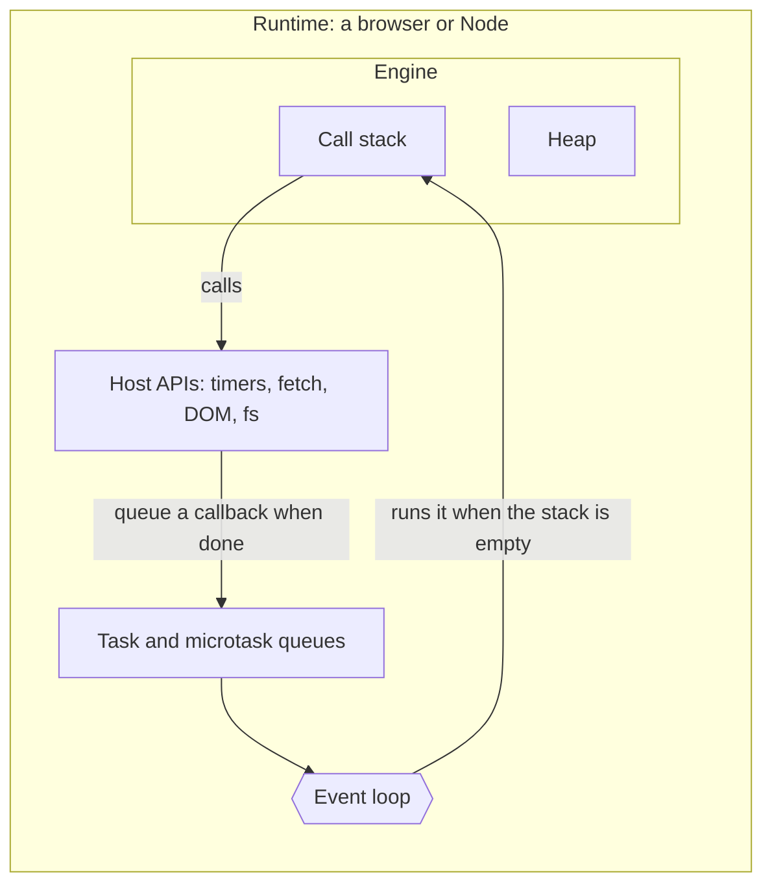

|                  | Browser                                   | Node                            |
| ---------------- | ----------------------------------------- | ------------------------------- |
| Engine           | V8, SpiderMonkey or JavaScriptCore        | V8                              |
| Host APIs        | DOM, `fetch`, timers, storage, Workers    | `fs`, `http`, `process`, timers |
| Top-level object | `window`                                  | `globalThis`, with no `window`  |
| Event loop       | Built into the browser, tied to rendering | libuv, with no rendering        |

We’ll get to the parts outside the engine in [the event loop](#the-event-loop). First, what happens inside it.

### From source text to machine code

There’s no separate compile step you run yourself. V8 compiles your code while it runs, in stages, trading compile time against how fast the result executes:

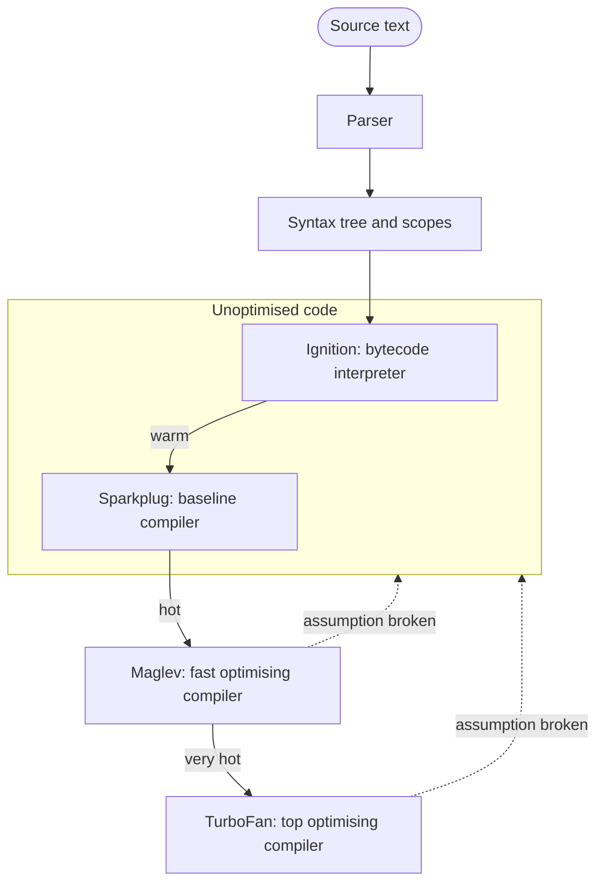

**Parsing** comes first. The parser turns text into a syntax tree. This line:

```js
const total = price * 2;
```

becomes this tree:

```text title="The syntax tree"
Program
└─ VariableDeclaration (const)
   └─ VariableDeclarator
      ├─ id: Identifier (total)
      └─ init: BinaryExpression (*)
         ├─ left: Identifier (price)
         └─ right: Literal (2)
```

That one came from Acorn, the parser many JavaScript tools use, condensed from JSON. V8’s own tree is an internal format, but it has the same structure. The parser also works out which declaration belongs to which scope, and it reports syntax errors, which is why a single syntax error stops a whole file from running, including the lines above it.

Parsing everything fully would be wasteful, since a lot of the code on a typical page never runs. So V8 **pre-parses** most functions: it checks their syntax and scopes, then generates no code until the first call. Ask V8 for the bytecode of a function that’s never called and it prints nothing at all.

**Ignition**, V8’s interpreter, then compiles the tree into bytecode and runs it:

```js title="add.js"
function add(a, b) {
  return a + b;
}

add(1, 2);
```

```bash
node --print-bytecode --print-bytecode-filter=add add.js
```

```text title="Output (trimmed)"
[generated bytecode for function: add]
Bytecode length: 6
Parameter count 3
Register count 0
Ldar a1
Add a0, [0]
Return
```

`Parameter count 3` is `a`, `b` and the hidden `this`, which will matter later. Ignition keeps its working value in a special register called the accumulator: `Ldar a1` loads `b` into it, `Add a0, [0]` adds `a` to it, and `Return` hands back whatever it holds.

The `[0]` is the interesting part. It points to a slot in the function’s **feedback vector**, where V8 records what it has actually seen at this operation. JavaScript’s `+` could mean integer addition, floating-point addition, string concatenation or a call to `valueOf`. After a few calls, the feedback says which one this line really does, and the compilers further up use that.

| Tier      | Kind                | Compiles from       | What it’s for                                                                                                                                                          |
| --------- | ------------------- | ------------------- | ---------------------------------------------------------------------------------------------------------------------------------------------------------------------- |
| Ignition  | Interpreter         | The syntax tree     | Starts instantly, uses little memory, and collects type feedback.                                                                                                      |
| Sparkplug | Baseline compiler   | Bytecode            | Turns bytecode straight into machine code with no optimisation. Its stack frames match the interpreter’s, so switching between them is nearly free.                    |
| Maglev    | Optimising compiler | Bytecode + feedback | Good code quickly. V8’s team describes it as [roughly 10x slower to compile than Sparkplug and 10x faster than TurboFan](https://v8.dev/blog/maglev).                  |
| TurboFan  | Optimising compiler | Bytecode + feedback | The slowest compiler and the fastest code, with heavy inlining. [Its backend now uses a newer design called Turboshaft](https://v8.dev/blog/leaving-the-sea-of-nodes). |

Each tier takes longer to compile and produces faster code, so V8 only pays for one once a function has earned it. You can see what’s enabled with `node --v8-options`. In this version `--sparkplug`, `--maglev`, `--turbofan` and `--turboshaft` are all on, and a `--turbolev` flag, off by default, selects an experimental top tier built from Maglev and Turboshaft. This is the part of V8 that changes fastest.

### Speculation and deoptimisation

The optimising tiers place a bet: whatever this function has seen so far is what it’ll keep seeing. Here’s that bet being placed and lost.

```js title="tier.js"
function add(a, b) {
  return a + b;
}

function run() {
  let total = 0;
  for (let i = 0; i < 50_000_000; i++) {
    total = add(i & 1023, 1);
  }
  return total;
}

run();
add('now a ', 'string');
```

```bash
node --no-use-osr --trace-opt --trace-deopt tier.js | grep 'JSFunction add'
```

```text title="Output (trimmed)"
[marking <JSFunction add> for optimization to MAGLEV, ConcurrencyMode::kConcurrent, reason: hot and stable]
[compiling method <JSFunction add> (target MAGLEV), mode: ConcurrencyMode::kConcurrent]
[completed compiling <JSFunction add> (target MAGLEV) - took 0.001, 0.139, 0.001 ms]
[marking <JSFunction add> for optimization to TURBOFAN_JS, ConcurrencyMode::kConcurrent, reason: hot and stable]
[compiling method <JSFunction add> (target TURBOFAN_JS), mode: ConcurrencyMode::kConcurrent]
[completed compiling <JSFunction add> (target TURBOFAN_JS) - took 0.008, 0.687, 0.015 ms]
[completed optimizing <JSFunction add> (target TURBOFAN_JS)]
[bailout (kind: deopt-eager, reason: not a Smi): begin. deoptimizing <JSFunction add>, <Code TURBOFAN_JS>, opt id 3, bytecode offset 2, ...]
```

V8 notices `add` is hot, compiles it with Maglev, then with TurboFan, on background threads (`kConcurrent`) while the program keeps running. The middle number in each `took` is the compile itself: about 0.14 ms for Maglev and 0.69 for TurboFan, which were also the medians over 15 runs. On a function this small, the gap is well short of the 10x in the table above.

Every call so far passed small integers, so the TurboFan code assumes that, protected by a cheap check. Then a string arrives. The check fails with `not a Smi` (a Smi is V8’s small integer), the optimised code is discarded, and execution carries on in unoptimised code at bytecode offset 2, exactly where `+` happens. Your program never notices, apart from running slower for a while.

The `--no-use-osr` flag makes this repeatable. Without it, V8 usually replaces `run` with optimised code while its loop is still going, which is called on-stack replacement, and inlines `add` into it. The standalone `add` then stops being called and rarely reaches TurboFan: 39 of 40 runs bailed out of Maglev code instead.

### Hidden classes and inline caches

A JavaScript object can gain and lose properties at any time, so in principle reading `object.x` is a hash table lookup. V8 avoids that by giving each object a **hidden class** (internally a _map_) that records its layout: which properties exist, in what order, and at what offset. Objects built the same way share one.

```js title="shapes.js"
const a = { x: 1, y: 2 };
const b = { x: 3, y: 4 };
const c = { y: 5, x: 6 };

console.log(%HaveSameMap(a, b)); // true
console.log(%HaveSameMap(a, c)); // false

const d = { x: 1, y: 2 };
console.log(%HasFastProperties(d)); // true
delete d.x;
console.log(%HasFastProperties(d)); // false
```

```bash
node --allow-natives-syntax shapes.js
```

<Note>
  the `%` functions are V8 internals, and that syntax only parses with `--allow-natives-syntax`. I use them throughout
  this post to look inside the engine. They aren’t JavaScript and they aren’t for real code.
</Note>

`a` and `c` hold the same data but were built in a different order, so they end up with different hidden classes. Each added property is a transition from one hidden class to the next:

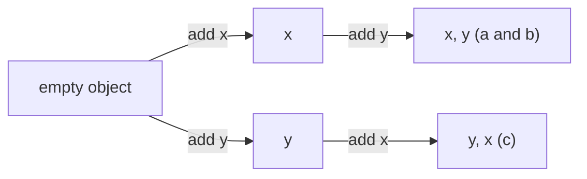

With a hidden class in place, a property read can compile down to two steps: check the hidden class, then load from a known offset. The outcome gets remembered in that read’s feedback slot, which is called an **inline cache**. It’s _monomorphic_ if it has seen one shape, _polymorphic_ for two to four, and _megamorphic_ beyond that, when V8 gives up on tracking shapes at that spot and uses a slower general lookup. The difference is easy to measure:

```js title="shapes-benchmark.js"
const shapes = Number(process.argv[2]);
const objects = Array.from({ length: 1000 }, (_, i) => ({ x: i, ['key' + (i % shapes)]: i }));

function sumX(list) {
  let sum = 0;
  for (let i = 0; i < list.length; i++) sum += list[i].x;
  return sum;
}

const start = performance.now();
let total = 0;
for (let round = 0; round < 100_000; round++) total += sumX(objects);
console.log(`shapes: ${shapes}, time: ${Math.round(performance.now() - start)} ms, total: ${total}`);
```

```bash
for n in 1 2 4 5 20; do node shapes-benchmark.js $n; done
```

| Shapes | Inline cache | Time   |
| ------ | ------------ | ------ |
| 1      | Monomorphic  | 123 ms |
| 2      | Polymorphic  | 181 ms |
| 4      | Polymorphic  | 246 ms |
| 5      | Megamorphic  | 616 ms |
| 20     | Megamorphic  | 608 ms |

Those are medians of seven runs on an idle machine. V8’s `--log-ic` flag confirms the states: the `x` read goes megamorphic on the fifth shape, and after that extra shapes cost nothing more. Each count gets its own process on purpose. When I timed two cases one after the other in a single process, reading the same one-shape array through an identical second function took about six times as long, and running second was the only difference.

That’s still a microbenchmark built to show the effect, so don’t read much into the exact ratio. The practical version is short: create objects with all their properties up front, always in the same order, and avoid `delete` in hot code. It’s what pushed `d` into the slower dictionary mode above.

## Execution contexts and the call stack

Compiled code needs somewhere to run. The engine creates an **execution context** for each piece of code it runs: one for the script or module as a whole, and a new one for every function call, so calling the same function twice creates two of them. An execution context holds everything the engine needs to run that code:

| Part                | What it holds                                                                           |
| ------------------- | --------------------------------------------------------------------------------------- |
| Code position       | How far this code has got, so it can resume after a call returns.                       |
| Function            | The function being run, or nothing for script and module code.                          |
| Realm               | Which set of built-ins this code uses. An iframe has its own `Array`, for example.      |
| LexicalEnvironment  | Where `let`, `const` and `class` live. It changes as the code enters and leaves blocks. |
| VariableEnvironment | Where `var` and function declarations live.                                             |
| PrivateEnvironment  | The `#private` names of the enclosing class.                                            |

An **environment** is a table of names and values, plus a pointer to the environment outside it. The next few sections are really about that structure. The spec stores `this` in the function’s environment too. Arrow functions have no `this` binding in theirs, which explains [most of how they behave](#regular-functions-vs-arrow-functions).

Each context goes through two stages:

1. **Creation.** Before any line runs, the engine creates a binding for every declaration in scope and works out `this` and the arguments.
2. **Execution.** The code runs from top to bottom, assigning values as it goes.

Contexts live on the **call stack**. The one on top is running. Calling a function pushes a new context, and returning pops it.

```js title="invoice.js"
const rate = 0.2;

function addTax(amount) {
  const tax = amount * rate;
  return round(amount + tax);
}

function round(value) {
  return Math.round(value);
}

const total = addTax(100);
console.log(total); // 120
```

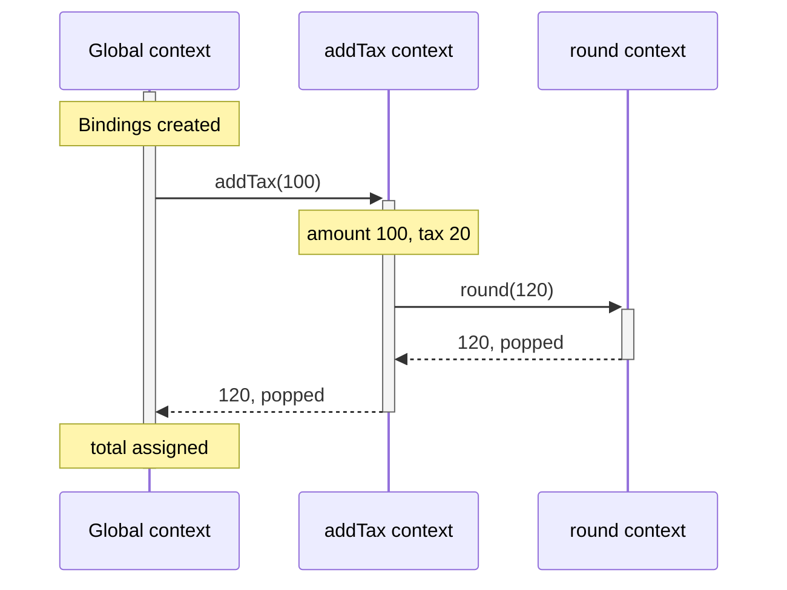

Here’s the stack at the moment `round` is running:

| Context           | Bindings at that moment                                                    |
| ----------------- | -------------------------------------------------------------------------- |
| `round` (running) | `value: 120`                                                               |
| `addTax`          | `amount: 100`, `tax: 20`                                                   |
| Global            | `rate: 0.2`, `addTax: function`, `round: function`, `total: uninitialised` |

You can look at the real stack whenever you like, because a stack trace is a printout of it:

```js title="trace.js"
function first() {
  return second();
}

function second() {
  return third();
}

function third() {
  return new Error('where am I?').stack;
}

console.log(first());
```

```text title="Output (trimmed)"
Error: where am I?
    at third (trace.js:10:10)
    at second (trace.js:6:10)
    at first (trace.js:2:10)
    at Object.<anonymous> (trace.js:13:13)
```

### When the stack runs out

The call stack is a fixed block of memory, so unbounded recursion eventually fills it:

```js title="overflow.js"
let depth = 0;

function recurse() {
  depth++;
  recurse();
}

try {
  recurse();
} catch (error) {
  console.log(error.name + ': ' + error.message);
  console.log('frames:', depth);
}
```

```text title="Output"
RangeError: Maximum call stack size exceeded
frames: 12501
```

There’s no fixed call limit. V8’s default stack in this build is 984 KB (the `--stack-size` flag), and each frame holds that call’s arguments, locals and return address. Giving the function four arguments and ten local variables brought the limit down to about 4,500 frames. The number depends on the engine, the platform and the function, so don’t design around it.

ES2015 specified proper tail calls, which would let `return loop()` reuse the current frame. V8 doesn’t implement them: a strict-mode version of that loop overflowed just the same.

## Scope and the scope chain

An execution context says what’s running. **Scope** says which names that code can see, and it’s decided by where the code is written.

| Scope    | Created by                                       | Contains                                                          |
| -------- | ------------------------------------------------ | ----------------------------------------------------------------- |
| Global   | A classic script                                 | Everything declared at the top level                              |
| Module   | An ES module file                                | Top-level declarations, private to the file unless exported       |
| Function | Each function                                    | Parameters, `var`, and everything declared at the top of the body |
| Block    | Braces in `if`, `for`, `try`, `switch` and so on | `let`, `const` and `class`, but never `var`                       |

A function call creates an execution context, but entering a block doesn’t. A block just gets a new environment within the same context. `var` ignores blocks completely:

```js
function blocks() {
  if (true) {
    var functionScoped = 'var';
    let blockScoped = 'let';
  }

  console.log(functionScoped); // var
  console.log(typeof blockScoped); // undefined
}

blocks();
```

The braces of an object literal don’t create a scope at all, which causes trouble with arrow functions [later on](#regular-functions-vs-arrow-functions).

### Lexical scope

```js title="lexical.js"
const who = 'global';

function printWho() {
  console.log(who);
}

function caller() {
  const who = 'caller';
  printWho();
}

caller(); // global
```

If JavaScript looked up variables through whoever called the function, this would print `caller`. It prints `global`, because `printWho` was _written_ at the top level. When a function is created it stores a reference to the environment it was created in, and every environment points to the one outside it. That linked list is the **scope chain**, and it has nothing to do with the call stack:

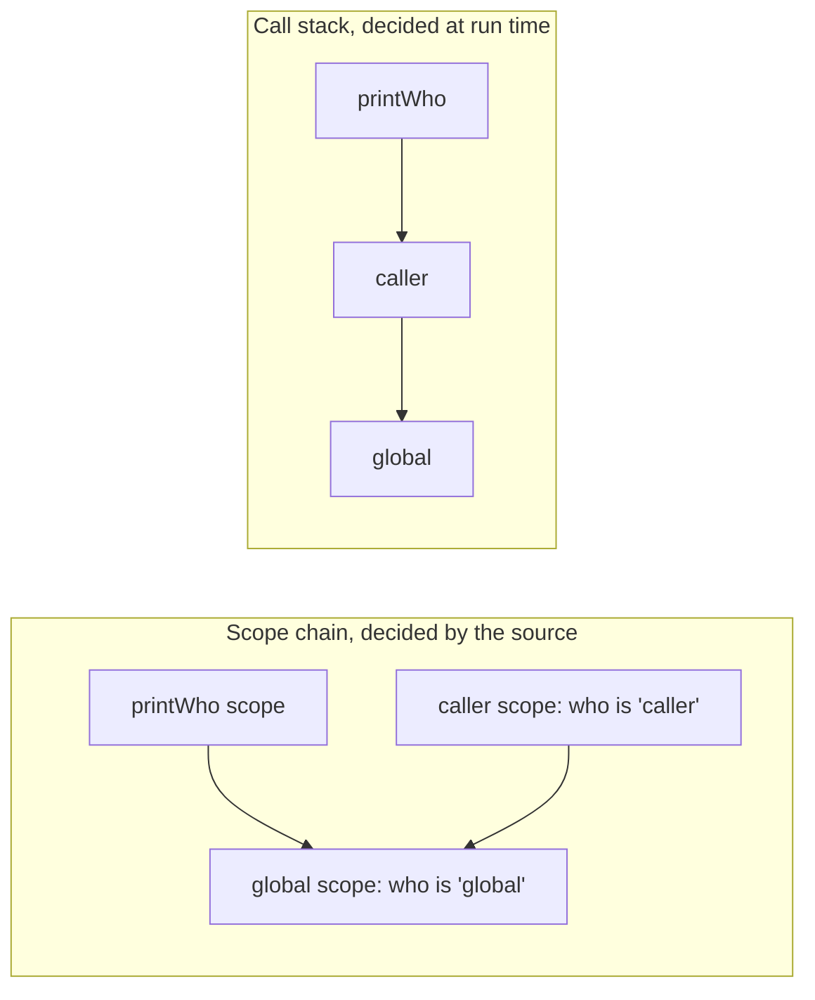

A lookup starts in the current environment and walks outward until it finds the name. It never goes inward, and it stops at the first match, which is how **shadowing** works:

```js
const name = 'outer';

{
  const name = 'inner';
  console.log(name); // inner
}

console.log(name); // outer
```

If the walk reaches the end of the chain you get a `ReferenceError`. Assignment is the odd case. In sloppy mode, assigning to an undeclared name silently creates a global. Strict mode throws, and classes and ES modules are always strict:

```js
function leak() {
  oops = 1;
}

leak();
console.log(globalThis.oops); // 1

function careful() {
  'use strict';
  undeclared = 1;
}

careful(); // ReferenceError: undeclared is not defined
```

### The chain is resolved at compile time

Walking outward is how the language is specified, but engines do most of it ahead of time. Here’s a function reading variables from two outer scopes, and the bytecode V8 generates for it:

```js title="nested.js"
function outer() {
  let a = 1;

  function middle() {
    let b = 2;

    function inner() {
      return a + b;
    }

    return inner;
  }

  return middle;
}

outer()()();
```

```text title="Bytecode for inner (trimmed)"
LdaImmutableContextSlot <context>, [2], [1]
ThrowReferenceErrorIfHole [0]
Star0
LdaImmutableCurrentContextSlot [2]
ThrowReferenceErrorIfHole [1]
Add r0, [0]
Return
```

There are no variable names in there. `a` is slot 2 of the context one level up (that’s the `[1]`), and `b` is slot 2 of the current context. The parser already worked out how many hops each variable takes. (The first two slots of every context are its own bookkeeping, which is why they start at 2.) Global variables, `with` and direct `eval` are the cases that still need a lookup by name.

Now compare `add` from earlier, which read its arguments with `Ldar a1`. A variable no inner function uses can stay in a register and never touch a context. Only variables an inner function captures have to live somewhere longer-lasting.

## Closures

Because a function remembers the environment it was created in, that environment has to outlive the call that made it.

```js title="counter.js"
function makeCounter() {
  let count = 0;

  return function increment() {
    count += 1;
    return count;
  };
}

const first = makeCounter();
const second = makeCounter();

console.log(first(), first(), second()); // 1 2 1
```

`makeCounter` has returned, so its execution context is long gone from the stack, yet `count` is still there. Here’s how, in the bytecode for `makeCounter`:

```text title="Bytecode for makeCounter (trimmed)"
CreateFunctionContext [0], [1]
PushContext r0
LdaTheHole
StaCurrentContextSlot [2]
LdaZero
StaCurrentContextSlot [2]
CreateClosure [1], [0], #2
Return
```

`CreateFunctionContext` allocates an object **on the heap** to hold `count`. `CreateClosure` makes the `increment` function and links it to that object. (`LdaTheHole` gets its own explanation [in a moment](#how-v8-implements-it).) A closure is just a function plus a pointer to a heap-allocated context, and each call to `makeCounter` makes a new pair:

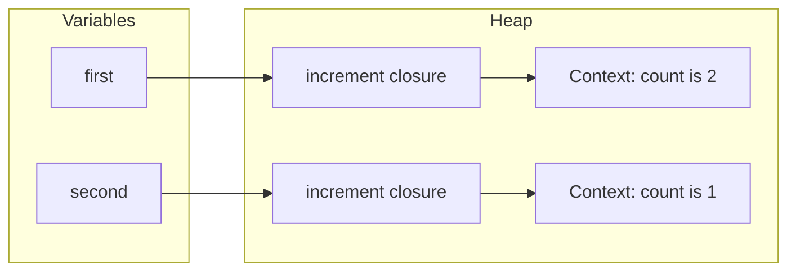

<Note>
  V8’s `Context` objects correspond to the spec’s _environments_, not to execution contexts. The naming is unfortunate.
  An execution context is the entry on the stack, and it goes away when the call returns. A V8 `Context` is the heap
  object holding captured variables, and it stays as long as something points at it.
</Note>

A closure captures the variable itself, not a copy of its value:

```js
function live() {
  let value = 'first';
  const read = () => value;
  value = 'second';
  return read();
}

console.log(live()); // second
```

That explains the classic loop bug. `var` creates one binding for the whole function, so every callback sees the same `i`. `let` in a `for` head creates a fresh binding for each iteration:

```js title="loops.js"
var withVar = [];
for (var i = 0; i < 3; i++) withVar.push(() => i);
console.log(withVar.map((fn) => fn())); // [ 3, 3, 3 ]

const withLet = [];
for (let j = 0; j < 3; j++) withLet.push(() => j);
console.log(withLet.map((fn) => fn())); // [ 0, 1, 2 ]
```

Closures created in the same scope share a single context. That’s useful, since it lets several functions share private state, and it also has a memory cost we’ll [measure later](#the-usual-leaks).

## The variable environment: hoisting and the TDZ

During the creation stage, the engine scans a scope for declarations and creates their bindings before any code runs. **Hoisting** is the name for the visible effect of that. Nothing actually moves. What differs between declarations is what the binding holds before its line runs:

| Declaration                  | Binding created at scope entry? | Value before its line runs | Scope                        | On `window` in a classic script? |
| ---------------------------- | ------------------------------- | -------------------------- | ---------------------------- | -------------------------------- |
| `function` declaration       | Yes                             | The function itself        | Function (block when strict) | Yes                              |
| `var`                        | Yes                             | `undefined`                | Function                     | Yes                              |
| `let`                        | Yes                             | Uninitialised (TDZ)        | Block                        | No                               |
| `const`                      | Yes                             | Uninitialised (TDZ)        | Block                        | No                               |
| `class`                      | Yes                             | Uninitialised (TDZ)        | Block                        | No                               |
| Function expression or arrow | Follows its variable            | Follows its variable       | Follows its variable         | Follows its variable             |

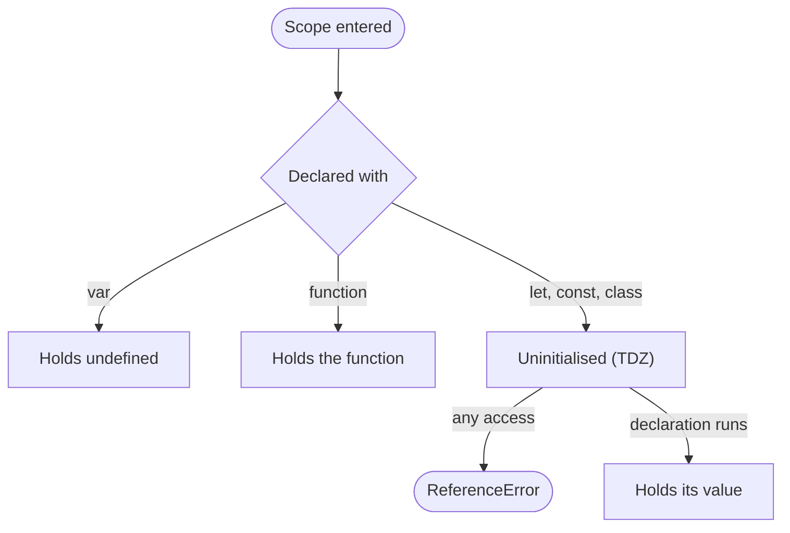

### `let` and `const` are hoisted too

You’ll sometimes read that `let` isn’t hoisted. This shows otherwise:

```js
const limit = 10;

{
  console.log(limit * 2); // ReferenceError: Cannot access 'limit' before initialization
  const limit = 5;
}
```

If the inner `limit` didn’t exist yet, the lookup would carry on outward and print `20`. It throws because the inner binding was created when the block was entered, and it shadows the outer one from the block’s very first line. That stretch, from entering the scope until the declaration runs, is the **temporal dead zone**.

### Why the TDZ exists

`var` has a design flaw. Reading it early gives you `undefined`, which looks like a value and can travel through your program until something far away breaks. The TDZ turns that mistake into an immediate error on the line that made it. It also gives `const` a real meaning: with `var`-style hoisting, a `const` could be seen holding `undefined` and later its actual value.

### How V8 implements it

V8 stores a special internal value called _the hole_ in a binding until it’s initialised. That’s the `LdaTheHole` in the `makeCounter` bytecode above: `count` is set to the hole first, then to `0`. Reads check for it:

```text title="Bytecode for increment (trimmed)"
LdaCurrentContextSlot [2]
ThrowReferenceErrorIfHole [0]
AddSmi [1], [0]
StaCurrentContextSlot [2]
LdaCurrentContextSlot [2]
Return
```

`ThrowReferenceErrorIfHole` is the TDZ, as a single bytecode instruction. V8 can’t tell whether `increment` might run early, so the check stays. When it can prove the binding is initialised, the check disappears:

```js title="direct.js"
function direct() {
  let value = 1;
  return value;
}

direct();
```

```text title="Bytecode for direct (trimmed)"
LdaSmi [1]
Star0
Return
```

### The global scope

At the top level of a classic script, `var` and function declarations become properties of the global object. `let`, `const` and `class` are still global, but they live in a separate record:

```html
<script>
  var viaVar = 1;
  let viaLet = 2;
  function viaFunction() {}

  console.log('viaVar' in window); // true
  console.log('viaFunction' in window); // true
  console.log('viaLet' in window); // false
</script>
```

Inside an ES module, nothing lands on `window`, because the top level is module scope. Node’s CommonJS files behave the same way, since Node wraps each one in a function.

## Hoisting and the TDZ in practice

Each kind of early access fails differently, and the error tells you what went wrong:

| Code                                   | Result                                                        |
| -------------------------------------- | ------------------------------------------------------------- |
| `greet(); function greet() {}`         | Runs                                                          |
| `console.log(x); var x = 1;`           | Prints `undefined`                                            |
| `console.log(x); let x = 1;`           | `ReferenceError: Cannot access 'x' before initialization`     |
| `greet(); var greet = function () {};` | `TypeError: greet is not a function`                          |
| `greet(); const greet = () => {};`     | `ReferenceError: Cannot access 'greet' before initialization` |
| `new Thing(); class Thing {}`          | `ReferenceError: Cannot access 'Thing' before initialization` |
| `console.log(missing);`                | `ReferenceError: missing is not defined`                      |

“Is not defined” means no binding exists anywhere on the scope chain. “Before initialization” means the binding exists and you reached it during its dead zone. The `TypeError` means the `var` was found, still holding `undefined`, and you tried to call that.

The rest of this section is the cases that catch people out.

**The TDZ is about time, not position.** A function can mention a variable declared lower down, as long as it’s called after that line has run. It’s why top-level functions can use constants defined further down a file.

```js
function read() {
  return value;
}

let value = 'ready';
console.log(read()); // ready
```

**`typeof` isn’t safe in the TDZ.** It’s normally the one operator that tolerates missing names, but a binding in its dead zone still throws:

```js
console.log(typeof neverDeclared); // undefined
console.log(typeof later); // ReferenceError: Cannot access 'later' before initialization
let later;
```

**A variable is in its dead zone during its own initialiser**, and default parameters are evaluated left to right with the same rule:

```js
function box(a = b, b = 1) {
  return [a, b];
}

box(); // ReferenceError: Cannot access 'b' before initialization
```

The other order, `function box(a = 1, b = a + 1)`, works fine.

**A `switch` is one block**, however many `case`s it has:

```js
function label(n) {
  switch (n) {
    case 1:
      let text = 'one';
      return text;
    case 2:
      text = 'two';
      return text;
  }
}

label(2); // ReferenceError: Cannot access 'text' before initialization
```

Giving each `case` its own braces fixes it.

**`var` can shadow something from a branch that never runs**, because the declaration is processed before any code executes:

```js
var discount = 10;

function price() {
  console.log(discount); // undefined
  if (false) {
    var discount = 50;
  }
}

price();
```

**Function declarations beat `var` declarations, but assignments beat both.** This follows from the two stages: declarations are all processed during creation, and the assignment happens during execution.

```js
var thing;
function thing() {}
console.log(typeof thing); // function

var other = 1;
function other() {}
console.log(typeof other); // number
```

**Functions in blocks depend on the mode.** In strict mode they’re block-scoped. In sloppy mode, a legacy rule also creates a `var`-like binding in the enclosing function, which stays `undefined` until the block runs:

```js
console.log(typeof hello); // undefined

{
  function hello() {}
}

console.log(typeof hello); // function
```

**Classes are in the TDZ like `let`**, so `class A extends B {}` above `class B {}` throws.

The habits that avoid all this are short: use `const` by default, `let` when you need to reassign, and don’t use `var`. Declare variables before you use them, and write ES modules so strict mode comes for free.

## The `this` keyword

`this` looks like it should describe where a function lives, and that’s the source of most of the confusion. For regular functions, `this` is decided fresh on every call, by **how the function is called**. You can see that in the bytecode. Here’s the same function called two ways:

```js title="call-sites.js"
function callSites(user) {
  user.whoami();

  const detached = user.whoami;
  detached();
}

callSites({ whoami() {} });
```

```text title="Bytecode for callSites (trimmed)"
GetNamedProperty a0, [0], [0]
Star1
CallProperty0 r1, a0, [2]
GetNamedProperty a0, [0], [0]
Star0
CallUndefinedReceiver0 r0, [4]
LdaUndefined
Return
```

Both calls load the function with the same instruction. The only difference is the call itself: `CallProperty0 r1, a0` passes `a0`, which is `user`, as the receiver, and `CallUndefinedReceiver0` passes nothing. `this` is effectively a hidden argument, filled in at the call site. It’s the extra parameter that `Parameter count 3` was counting earlier.

There are only a few ways to call a function:

| How it’s called                             | `this` inside it                                   |
| ------------------------------------------- | -------------------------------------------------- |
| An arrow function, called any way           | The `this` of the scope where it was written       |
| `new Fn()`                                  | The newly created object                           |
| `fn.call(x)`, `fn.apply(x)`, `fn.bind(x)()` | `x`                                                |
| `obj.fn()`                                  | `obj`                                              |
| `fn()`                                      | `undefined` in strict mode, `globalThis` in sloppy |

They apply in that order, which you can follow as a decision:

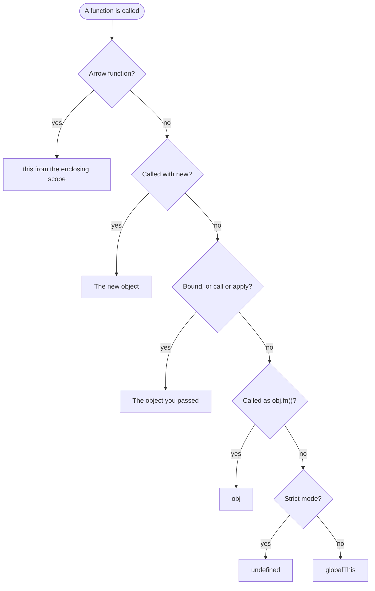

The explicit forms in action:

```js
function whoami() {
  return this.name;
}

const ada = { name: 'Ada', whoami };
const lin = { name: 'Lin' };

console.log(ada.whoami()); // Ada
console.log(whoami.call(lin)); // Lin
console.log(whoami.apply(lin)); // Lin
console.log(whoami.bind(lin)()); // Lin
```

`bind` returns a new function with `this` fixed permanently. Nothing later can change it, except `new`, which ranks higher:

```js
function whoami() {
  return this.name;
}

const bound = whoami.bind({ name: 'Lin' });

console.log(bound.call({ name: 'Grace' })); // Lin
console.log(bound.bind({ name: 'Grace' })()); // Lin
console.log({ name: 'Other', bound }.bound()); // Lin

function Person(name) {
  this.name = name;
}

const BoundPerson = Person.bind({ name: 'ignored' });
console.log(new BoundPerson('Ada').name); // Ada
```

Sloppy mode does two more things. A plain call gets `globalThis`, and a primitive `this` is wrapped in an object:

```js
function sloppyType() {
  return typeof this;
}

function strictType() {
  'use strict';
  return typeof this;
}

console.log(sloppyType.call(5)); // object
console.log(strictType.call(5)); // number
```

At the top level, outside any function, `this` depends on what kind of file you’re in:

| Where                  | Top-level `this` |
| ---------------------- | ---------------- |
| Classic browser script | `window`         |
| ES module, anywhere    | `undefined`      |
| Node CommonJS file     | `module.exports` |

### Why parentheses keep `this` and a comma loses it

`obj.fn()` is a form the language treats specially. Evaluating `user.whoami` produces what the spec calls a Reference, which remembers `user` as well as the name, and the call takes `this` from it. Anything that reads the value out of the reference throws the object away:

```js
'use strict';

const user = {
  name: 'Ada',
  whoami() {
    return this?.name;
  },
};

let fn;

console.log(user.whoami()); // Ada
console.log((0, user.whoami)()); // undefined
console.log((fn = user.whoami)()); // undefined
console.log((true ? user.whoami : null)()); // undefined
```

Plain grouping, as in `(user.whoami)()`, doesn’t read the value, so `this` survives.

## The `this` keyword in practice

Nearly every `this` bug is the same bug: a method got separated from its object, then called without it.

### Detached methods

Destructuring a method or passing it as a callback only copies the function, so the object is forgotten. Class bodies are always strict, so the mistake at least fails loudly:

```js title="lost-this.js"
class Timer {
  ticks = 0;

  tick() {
    this.ticks += 1;
    return this.ticks;
  }
}

const timer = new Timer();
console.log(timer.tick()); // 1

const { tick } = timer;
tick(); // TypeError: Cannot read properties of undefined (reading 'ticks')
```

In a sloppy-mode browser script it’s quieter. A detached method reading `this.name` gets `window.name`, which is a real property holding an empty string, so you get `''` with no error at all.

### Callbacks inside methods

A regular function passed as a callback gets its own `this`, which hides the method’s. Arrow functions are the usual fix:

```js title="callbacks.js"
const scaler = {
  factor: 2,

  broken(numbers) {
    return numbers.map(function (n) {
      return n * this.factor;
    });
  },

  withArrow(numbers) {
    return numbers.map((n) => n * this.factor);
  },

  withThisArg(numbers) {
    return numbers.map(function (n) {
      return n * this.factor;
    }, this);
  },
};

console.log(scaler.broken([1, 2])); // [ NaN, NaN ]
console.log(scaler.withArrow([1, 2])); // [ 2, 4 ]
console.log(scaler.withThisArg([1, 2])); // [ 2, 4 ]
```

In `broken`, the callback is a plain call in sloppy mode, so `this` is `globalThis`, `this.factor` is `undefined`, and the arithmetic gives `NaN`.

### Methods versus arrow fields in classes

If a method will be passed around, an arrow function in a class field keeps `this` bound. It isn’t free, because each instance gets its own copy:

```js title="button.js"
class Button {
  label = 'Save';

  method() {
    return this?.label;
  }

  field = () => this.label;
}

const a = new Button();
const b = new Button();

const { method, field } = a;
console.log(method()); // undefined
console.log(field()); // Save

console.log(a.method === b.method); // true
console.log(a.field === b.field); // false
console.log(Object.hasOwn(Button.prototype, 'method')); // true
console.log(Object.hasOwn(Button.prototype, 'field')); // false
```

Methods live once on the prototype. Arrow fields are created in the constructor, one per object. For a few objects that doesn’t matter. For thousands of list items it might.

### Host-defined `this`

Some functions are called by the host, which decides `this` for you:

```js
const button = document.querySelector('button');

button.addEventListener('click', function () {
  console.log(this === button); // true
});

button.addEventListener('click', () => {
  console.log(this === window); // true in a classic script
});

setTimeout(function () {
  console.log(this === window); // true
}, 0);
```

Hosts don’t all agree. In Node, a regular function passed to `setTimeout` gets the `Timeout` object as `this`.

### Borrowing methods

Since `this` is decided by the call, a method can run on an object it was never attached to, as long as that object looks right:

```js
console.log(Array.prototype.map.call('abc', (c) => c.toUpperCase())); // [ 'A', 'B', 'C' ]
console.log(Array.prototype.join.call({ 0: 'a', 1: 'b', length: 2 }, '-')); // a-b
```

## Regular functions vs. arrow functions

Arrow functions aren’t just shorter syntax. They’re missing several things regular functions have, and each missing piece is resolved through the scope chain instead.

|                          | Regular function       | Arrow function                                        |
| ------------------------ | ---------------------- | ----------------------------------------------------- |
| `this`                   | Set by each call       | From the enclosing scope, and can’t be changed        |
| `arguments`              | Its own                | From the enclosing function, so use `...rest` instead |
| `new.target`             | Its own                | From the enclosing function                           |
| `super`                  | `SyntaxError`          | From the enclosing method                             |
| `new`                    | Works                  | `TypeError`                                           |
| `prototype` property     | Yes                    | No                                                    |
| Generators               | `function*`            | Not possible                                          |
| Duplicate parameters     | Allowed in sloppy mode | `SyntaxError`                                         |
| Hoisted as a declaration | When written as one    | Never, since it’s always an expression                |

The bytecode shows how lexical `this` really works:

```js title="arrow-this.js"
const team = {
  labels() {
    const readThis = () => this;
    return readThis;
  },
};

team.labels()();
```

```text title="Bytecode for labels (trimmed)"
CreateFunctionContext [0], [1]
PushContext r1
Ldar <this>
StaCurrentContextSlot [2]
CreateClosure [1], [0], #2
Star0
Return
```

```text title="Bytecode for readThis (trimmed)"
LdaImmutableCurrentContextSlot [2]
Return
```

`labels` copies its own `this` into a context slot, exactly as if you’d written `const self = this`, and the arrow reads that slot. An arrow’s `this` is an ordinary closure variable. That’s why `call` and `bind` have no effect on it: they set a receiver the arrow never looks at.

```js
function makeArrow() {
  return () => this;
}

const owner = { name: 'owner' };
const arrow = makeArrow.call(owner);

console.log(arrow() === owner); // true
console.log(arrow.call({ name: 'other' }) === owner); // true
console.log(arrow.bind({ name: 'other' })() === owner); // true
```

The same goes for `arguments`:

```js
function outer() {
  const inner = () => arguments[0];
  return inner('arrow argument');
}

console.log(outer('outer argument')); // outer argument

const count = (...items) => items.length;
console.log(count(1, 2, 3)); // 3
```

### Where arrows go wrong

An object literal isn’t a scope, so an arrow written as a property doesn’t get the object as `this`. It sees whatever `this` was around the literal. Use method shorthand for the method, and arrows for callbacks inside it:

```js
const team = {
  name: 'Core',
  members: ['Ada', 'Lin'],

  arrow: () => this?.name,

  labels() {
    return this.members.map((member) => `${member} (${this.name})`);
  },
};

console.log(team.arrow()); // undefined
console.log(team.labels()); // [ 'Ada (Core)', 'Lin (Core)' ]
```

Arrows also can’t be constructors, so they’re the wrong choice for anything called with `new`, and for methods added to a prototype:

```js
const Arrow = () => {};
new Arrow(); // TypeError: Arrow is not a constructor
```

To return an object from a concise arrow, wrap it in parentheses. Otherwise the braces are a function body and `value:` is a label:

```js
const wrong = () => {
  value: 1;
};
const right = () => ({ value: 1 });

console.log(wrong()); // undefined
console.log(right()); // { value: 1 }
```

<Note>
  “regular function” here means one written with the `function` keyword. Method shorthand, class methods and async
  functions sit in between: they have their own `this` and `arguments`, but they can’t be called with `new` and have no
  `prototype`. Of those, only the methods can use `super`.
</Note>

As a rule of thumb, use arrows for callbacks and small helpers, where you want the surrounding `this`. Use method shorthand or class methods for anything that belongs to an object. Use `function` when you need hoisting, a generator, or a `this` the caller controls, such as an event listener that reads `this`.

## Prototypes: where methods actually live

When you read a property, the engine checks the object, then the object’s prototype, then that object’s prototype, and so on until it hits `null`. Classes are a nicer way to set up that chain.

```js title="prototypes.js"
class Animal {
  constructor(name) {
    this.name = name;
  }

  speak() {
    return `${this.name} makes a sound`;
  }
}

class Dog extends Animal {
  speak() {
    return `${super.speak()}: woof`;
  }
}

const rex = new Dog('Rex');

console.log(rex.speak()); // Rex makes a sound: woof
console.log(Object.keys(rex)); // [ 'name' ]
console.log(Object.hasOwn(rex, 'speak')); // false
console.log(typeof Dog); // function
```

`rex` owns one property. Everything else is found by following the chain:

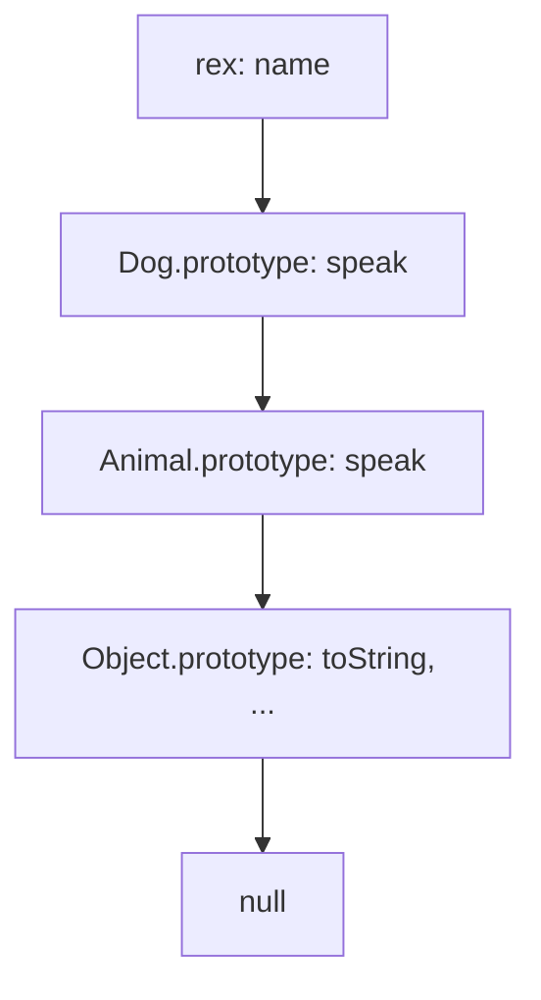

Here’s roughly what `new` does, written as a function:

```js title="what-new-does.js"
function myNew(Constructor, ...args) {
  const instance = Object.create(Constructor.prototype);
  const returned = Constructor.apply(instance, args);
  return returned !== null && typeof returned === 'object' ? returned : instance;
}

function Cat(name) {
  this.name = name;
}

Cat.prototype.speak = function () {
  return `${this.name} meows`;
};

const tom = myNew(Cat, 'Tom');

console.log(tom.speak()); // Tom meows
console.log(tom instanceof Cat); // true
```

Two rules follow from this. Writing to a property creates it on the object itself and shadows the prototype’s version, unless the prototype defines that property with a setter or as read-only. Mutating what a property points to, on the other hand, changes the shared value:

```js
const parent = { count: 1, list: [] };
const child = Object.create(parent);

child.count = 2;
child.list.push('x');

console.log(parent.count, child.count); // 1 2
console.log(parent.list); // [ 'x' ]
console.log(Object.keys(child)); // [ 'count' ]
```

And `this` stays with the object you started from, however far up the chain the method was found:

```js
const account = {
  first: 'Ada',
  last: 'Lovelace',
  get full() {
    return `${this.first} ${this.last}`;
  },
};

const child = Object.create(account);
child.first = 'Byron';

console.log(child.full); // Byron Lovelace
```

## Memory management: primitives vs. objects

JavaScript has seven primitive types: string, number, bigint, boolean, undefined, null and symbol. Everything else is an object, including arrays and functions. Primitives and objects behave differently when you copy them:

```js title="copying.js"
let score = 10;
let copy = score;
copy = 20;
console.log(score, copy); // 10 20

const me = { age: 30 };
const friend = me;
friend.age = 31;
console.log(me.age, friend.age); // 31 31

console.log(me === friend); // true
console.log({ a: 1 } === { a: 1 }); // false
```

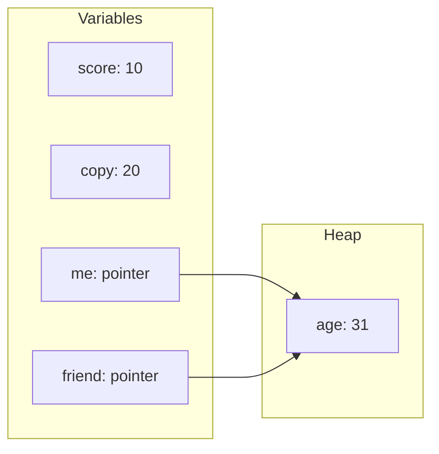

The usual explanation is that primitives live on the stack and objects on the heap. It’s a fine first model, but the spec says nothing of the sort, and V8 doesn’t work that way. Here’s what it does with some primitives:

```js title="representations.js"
%DebugPrint(42);
%DebugPrint(2 ** 31);
%DebugPrint(1.5);
%DebugPrint('hello');
%DebugPrint(true);
%DebugPrint(10n);
```

```text title="Output (trimmed)"
DebugPrint: Smi: 0x2a (42)
DebugPrint: 0000023D24614A31: [HeapNumber]
 - value: 2147483648.0
DebugPrint: 0000023D24614A41: [HeapNumber]
 - value: 1.5
DebugPrint: 0000023D246148B9: [String]: #hello
DebugPrint: 00000263620000B1: [Oddball] in ReadOnlySpace: #true
DebugPrint: 0000023D24614A51: [BigInt]
```

Only the first of those has no heap address. A **Smi** (small integer) is stored directly in the variable’s slot, with a tag bit to tell it from a pointer. Larger integers, floating-point numbers, strings and BigInts are all allocated on the heap. `true`, `false`, `undefined` and `null` are single shared objects in a read-only part of the heap.

| Value                                | Where V8 puts it                                                                                                           |
| ------------------------------------ | -------------------------------------------------------------------------------------------------------------------------- |
| Small integer                        | In the slot itself. 32 bits on Node, [31 with pointer compression](https://v8.dev/blog/pointer-compression), as in Chrome. |
| Large integer or decimal number      | A `HeapNumber` on the heap                                                                                                 |
| String, BigInt, symbol               | On the heap                                                                                                                |
| `true`, `false`, `undefined`, `null` | One shared object each, in read-only space                                                                                 |
| Object, array, function              | On the heap                                                                                                                |
| A local variable                     | In a register or on the stack, unless a closure captures it. Then it’s in a heap `Context`.                                |

So `const s = t` for strings copies a pointer, exactly as it would for an object. You just can’t tell, because **primitives are immutable**. Nothing can change the shared value, so sharing it behaves the same as copying it:

```js
'use strict';

const word = 'hello';

console.log(word.toUpperCase()); // HELLO
console.log(word); // hello

word[0] = 'J'; // TypeError: Cannot assign to read only property '0' of string 'hello'
```

The model I’d keep is this: a variable holds either a small value or a pointer, and objects are the only things you can change through a pointer. Where the variable physically lives is the engine’s business, and an optimising compiler may even remove an allocation altogether if the object never leaves the function.

### JavaScript always passes by value

Function arguments follow the same rule. The value passed for an object is the pointer, so a function can change the object but can’t change the caller’s variable:

```js title="pass-by-value.js"
function rename(person) {
  person.name = 'Changed';
}

function replace(person) {
  person = { name: 'Replaced' };
}

const someone = { name: 'Original' };

rename(someone);
console.log(someone.name); // Changed

replace(someone);
console.log(someone.name); // Changed
```

`const` works at the same level. It makes the binding constant, meaning the pointer can’t be reassigned, and says nothing about the object at the other end:

```js
const settings = { theme: 'dark' };

settings.theme = 'light';
console.log(settings.theme); // light

settings = {}; // TypeError: Assignment to constant variable.
```

## Object references in practice: shallow and deep copies

Assignment never copies an object. To get a separate one you have to ask, and most of the ways of asking only go one level deep.

### Shallow copies

A **shallow copy** creates a new outer object, then copies each property’s value. For a nested object, that value is a pointer.

```js title="shallow.js"
const original = { name: 'Ada', address: { city: 'London' } };
const copy = { ...original };

copy.name = 'Lin';
copy.address.city = 'Paris';

console.log(original.name); // Ada
console.log(original.address.city); // Paris
console.log(copy.address === original.address); // true
```

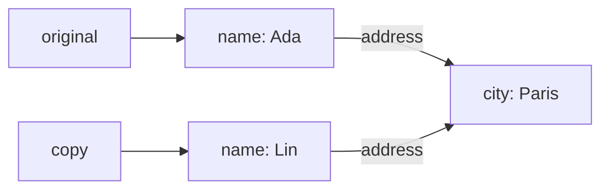

Spread, `Object.assign`, `[...array]`, `slice`, `concat`, `Array.from` and `map((x) => x)` are all shallow. So are the newer non-mutating array methods like `toSorted`, `toReversed` and `with`: you get a new array holding the same objects.

Spread has some other limits. It copies own enumerable properties, so the prototype is lost and a getter gets evaluated into a plain value:

```js title="spread-limits.js"
class Point {
  x = 1;

  move() {}
}

const point = new Point();
const copy = { ...point };

console.log(copy instanceof Point); // false
console.log(typeof copy.move); // undefined

const withGetter = {
  get now() {
    return 'computed';
  },
};

console.log(Object.getOwnPropertyDescriptor({ ...withGetter }, 'now').value); // computed
```

If you need an exact shallow copy, prototype and getters included, use `Object.create(Object.getPrototypeOf(x), Object.getOwnPropertyDescriptors(x))`.

### Deep copies

A **deep copy** follows every pointer and copies what it finds. There are two built-in ways, and they lose different things:

```js title="deep.js"
const source = {
  date: new Date('2026-01-01T00:00:00Z'),
  missing: undefined,
  nan: NaN,
  map: new Map([['a', 1]]),
  nested: { kept: true },
};

console.log(JSON.parse(JSON.stringify(source)));
console.log(structuredClone(source));
```

```text title="Output"
{
  date: '2026-01-01T00:00:00.000Z',
  nan: null,
  map: {},
  nested: { kept: true }
}
{
  date: 2026-01-01T00:00:00.000Z,
  missing: undefined,
  nan: NaN,
  map: Map(1) { 'a' => 1 },
  nested: { kept: true }
}
```

| What’s being copied          | Spread (shallow)             | `JSON.parse(JSON.stringify())` | `structuredClone()`     |
| ---------------------------- | ---------------------------- | ------------------------------ | ----------------------- |
| Nested objects               | Shared                       | Copied                         | Copied                  |
| `Date`                       | Shared                       | Becomes a string               | Copied as a `Date`      |
| `undefined` values           | Kept                         | Dropped                        | Kept                    |
| `NaN`, `Infinity`            | Kept                         | Become `null`                  | Kept                    |
| `Map`, `Set`, `RegExp`       | Shared                       | Become `{}`                    | Copied                  |
| `BigInt`                     | Kept                         | Throws                         | Kept                    |
| Circular references          | Still points at the original | Throws                         | Preserved               |
| Two references to one object | Still shared                 | Duplicated                     | Still shared            |
| Functions                    | Shared                       | Dropped                        | Throws `DataCloneError` |
| Class instances              | Prototype lost               | Prototype lost                 | Prototype lost          |
| Getters                      | Evaluated                    | Evaluated                      | Evaluated               |
| Symbol keys                  | Kept                         | Dropped                        | Dropped                 |

[`structuredClone`](https://developer.mozilla.org/en-US/docs/Web/API/Window/structuredClone) is the better default. It’s a web platform API rather than part of ECMAScript, available in browsers and Node, and it’s the same algorithm used to send data to a Worker. It refuses things it can’t represent:

```js
structuredClone({ fn() {} }); // DataCloneError: fn() {} could not be cloned.
```

DOM nodes throw as well. Class instances come back as plain objects with their data intact, so if you need real instances, give the class a `clone()` method.

### You often don’t need a deep copy

To update nested data without mutating it, you only have to copy the path down to what changed. Everything else can be shared:

```js title="structural-sharing.js"
const state = {
  user: { profile: { name: 'Ada' }, settings: { theme: 'dark' } },
  posts: [],
};

const next = {
  ...state,
  user: {
    ...state.user,
    profile: { ...state.user.profile, name: 'Lin' },
  },
};

console.log(state.user.profile.name, next.user.profile.name); // Ada Lin
console.log(next.user === state.user); // false
console.log(next.user.settings === state.user.settings); // true
console.log(next.posts === state.posts); // true
```

This is called structural sharing, and it’s why reference equality is such a cheap way to detect change. It’s the basis of how React decides what to re-render: an unchanged object keeps its identity.

### `Object.freeze` is shallow too

`Object.freeze` stops changes to an object’s own properties, but a nested object is a different object:

```js title="freeze.js"
'use strict';

const frozen = Object.freeze({ level: 1, nested: { level: 2 } });

frozen.nested.level = 99;
console.log(frozen.nested.level); // 99

frozen.level = 99; // TypeError: Cannot assign to read only property 'level' of object '#<Object>'
```

In sloppy mode, that last assignment fails silently. Freezing the whole tree takes a short recursive function:

```js title="deep-freeze.js"
function deepFreeze(value, seen = new WeakSet()) {
  if (value === null || typeof value !== 'object' || seen.has(value)) return value;
  seen.add(value);
  Object.freeze(value);
  Reflect.ownKeys(value).forEach((key) => deepFreeze(value[key], seen));
  return value;
}

const config = deepFreeze({ list: [{ x: 1 }] });
console.log(Object.isFrozen(config.list[0])); // true
```

## Memory management: garbage collection

You never free memory in JavaScript. The engine works out what you can no longer use and takes it back.

### Reachability

The rule is **reachability**. Some things are always considered alive: the global object, the variables in every frame on the call stack, and references held by the host. Those are the **roots**. Anything you can reach from a root by following pointers stays. Everything else is garbage.

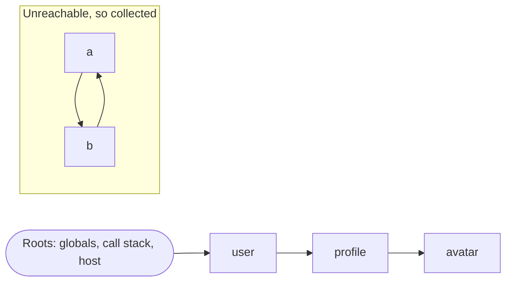

Note the cycle at the bottom. A simple reference counter would keep `a` and `b` forever, since each still has a reference. Tracing from the roots has no such problem. I built 200,000 pairs of objects that point at each other and dropped them all, and after a collection the heap had grown by 0.0 MB.

### Most objects die young

V8’s collector is built around the [generational hypothesis](https://v8.dev/blog/trash-talk): most objects die young. So the heap is split up, and new objects go in a small area that gets collected often. You can list the spaces:

```js title="spaces.js"
const v8 = require('node:v8');

for (const space of v8.getHeapSpaceStatistics()) {
  const mb = (space.space_used_size / 1024 / 1024).toFixed(1);
  console.log(space.space_name.padEnd(24), mb, 'MB');
}
```

```text title="Output (trimmed)"
new_space                0.4 MB
old_space                2.9 MB
code_space               0.0 MB
trusted_space            0.9 MB
large_object_space       0.3 MB
```

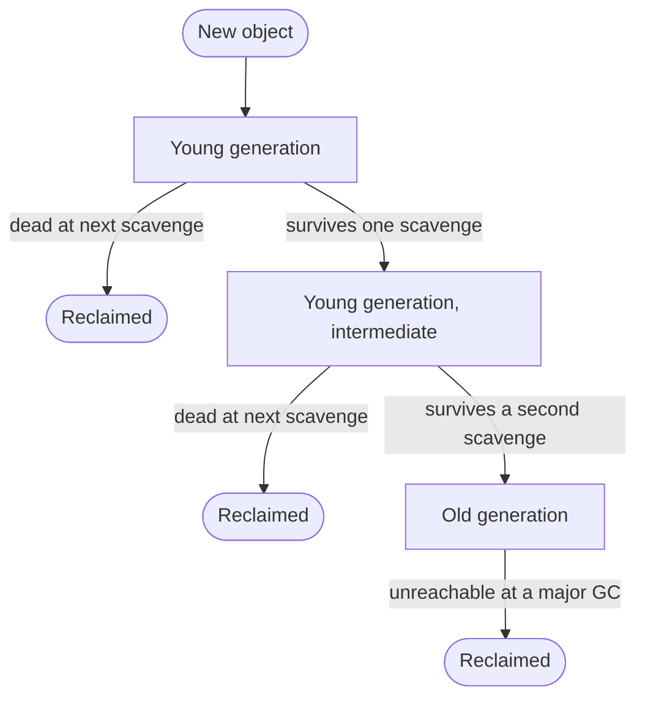

### Minor GC: the Scavenger

The young generation is divided into two halves called semi-spaces. New objects are allocated by bumping a pointer through one of them, which is about as cheap as allocation gets. When it fills up, the **Scavenger** runs:

1. Starting from the roots, it finds the live objects in the full half.
2. It copies them into the empty half, packing them together, and updates every pointer to them.
3. The two halves swap roles, and the old half is now entirely free.

Dead objects are never touched, so [the cost is proportional to how many objects survive](https://v8.dev/blog/trash-talk), not how many were allocated. Since most don’t survive, this is very fast. An object that lives through a second scavenge is moved to the old generation.

One problem remains: an old object might point to a young one, and the Scavenger doesn’t want to scan the whole old generation to find out. So whenever your code stores a pointer into an object, a small piece of generated code called a **write barrier** records old-to-new pointers in a list, and the Scavenger treats those as extra roots.

### Major GC: mark, sweep, compact

The old generation is large and collected less often, in three phases:

1. **Mark.** Trace from the roots and mark everything reachable.
2. **Sweep.** Add the memory of unmarked objects to free lists.
3. **Compact.** Move survivors out of heavily fragmented pages so the free space is usable.

Doing all that in one stop would freeze your app, so V8’s collector, Orinoco, spreads the work around. Three different techniques are involved, and they’re easy to confuse:

| Technique   | How it works                                                   | Where V8 uses it          |
| ----------- | -------------------------------------------------------------- | ------------------------- |
| Parallel    | The main thread pauses, and helper threads share the work.     | Scavenging, compaction    |
| Incremental | The main thread does a little, runs your code, then does more. | Marking                   |
| Concurrent  | Helper threads do the work while your code keeps running.      | Most of marking, sweeping |

Your code can change pointers while a helper thread is marking, so write barriers are used here too, to report those changes.

### Watching it happen

```js title="garbage.js"
const survivors = [];

for (let i = 0; i < 3_000_000; i++) {
  const temporary = { id: i, payload: [i, i + 1, i + 2] };
  if (i % 50 === 0) survivors.push(temporary);
}

console.log('survivors:', survivors.length);
```

```bash
node --trace-gc garbage.js
```

```text title="Output (trimmed)"
32 ms: Scavenge 4.9 (6.0) -> 4.0 (7.0) MB, pooled: 0 MB, 0.39 / 0.00 ms  allocation failure;
33 ms: Scavenge 4.9 (7.0) -> 4.1 (7.0) MB, pooled: 0 MB, 0.32 / 0.00 ms  allocation failure;
...
133 ms: Scavenge 19.9 (29.2) -> 12.2 (29.2) MB, pooled: 0 MB, 0.66 / 0.00 ms  allocation failure;
151 ms: Mark-Compact 12.6 (29.5) -> 11.1 (28.1) MB, pooled: 0 MB, 4.79 / 0.00 ms  (+ 0.2 ms in 4 steps since start of marking, biggest step 0.1 ms, walltime since start of marking 18 ms) finalize incremental marking via stack guard; GC in old space requested
```

`4.9 (6.0) -> 4.0 (7.0)` is memory in use, with the total reserved in brackets, before and after. `allocation failure` is routine, and just means the young generation was full.

The program allocated six million objects and arrays. V8 handled that with 84 scavenges totalling 33 ms, nearly all under a millisecond each, and one major collection. The major collection freed little, because most of what had reached the old generation was still in use: Node’s own startup objects and the 60,000 survivors we deliberately kept. It’s also a good demonstration of the marking work happening away from the main thread: 18 ms of wall time, with a main-thread pause under 5 ms.

### The usual leaks

A garbage collector can’t fix a logic error. A leak in JavaScript is memory that’s still reachable after you’ve stopped needing it:

| Leak                           | Why it stays reachable                        | Fix                                                                |
| ------------------------------ | --------------------------------------------- | ------------------------------------------------------------------ |
| Unbounded `Map` or array cache | A module-level variable is reachable forever  | Limit its size, or use a `WeakMap`                                 |
| A forgotten `setInterval`      | The timer holds the callback and its closure  | `clearInterval`                                                    |
| Event listeners                | The target holds the listener and its closure | `removeEventListener`, or `addEventListener` with an `AbortSignal` |
| Detached DOM nodes             | A variable still holds a removed element      | Drop the reference                                                 |
| A closure sharing a context    | One context holds every captured variable     | Keep large values out of long-lived scopes                         |

The last one is the least obvious, and here’s the proof. As we saw, closures created in one scope share a context, so a variable captured by one of them stays alive for as long as any of them does:

```js title="shared-context.js"
function usedMB() {
  gc();
  return process.memoryUsage().heapUsed / 1024 / 1024;
}

function makeClean() {
  const huge = new Array(1_000_000).fill(0);
  return () => 'hello';
}

function makeLeaky() {
  const huge = new Array(1_000_000).fill(0);
  const unused = () => huge.length;
  return () => 'hello';
}

let before = usedMB();
const clean = makeClean();
console.log('no closure uses huge:', Math.max(0, usedMB() - before).toFixed(1), 'MB', clean());

before = usedMB();
const leaky = makeLeaky();
console.log('a sibling closure uses huge:', Math.max(0, usedMB() - before).toFixed(1), 'MB', leaky());
```

```bash
node --expose-gc shared-context.js
```

```text title="Output"
no closure uses huge: 0.0 MB hello
a sibling closure uses huge: 7.6 MB hello
```

The function we return doesn’t mention `huge` in either case. In the second, a sibling closure that never even runs forces `huge` into the shared context, so it survives. Timers behave the same way: an interval closing over that array kept all 7.6 MB alive until `clearInterval`, when it was freed at the next collection.

### Weak references

Sometimes you want to attach data to an object without keeping the object alive. That’s what a `WeakMap` is for:

```js title="weak-cache.js"
function usedMB() {
  for (let i = 0; i < 6; i++) gc();
  return process.memoryUsage().heapUsed / 1024 / 1024;
}

function fill(cache) {
  for (let i = 0; i < 100_000; i++) {
    cache.set({ id: i }, new Array(10).fill(0));
  }
}

let before = usedMB();
const strong = new Map();
fill(strong);
console.log('Map keeps', (usedMB() - before).toFixed(1), 'MB');

before = usedMB();
const weak = new WeakMap();
fill(weak);
console.log('WeakMap keeps', (usedMB() - before).toFixed(1), 'MB');
```

```bash
node --expose-gc weak-cache.js
```

```text title="Output"
Map keeps 18.8 MB
WeakMap keeps 4.0 MB
```

The 4 MB isn’t entries, it’s the `WeakMap`’s internal table, which grew to fit 100,000 keys and hadn’t shrunk. Making each value ten times bigger took the `Map` to 87.4 MB and left the `WeakMap` at exactly 4.0 MB. Every key was unreachable, so every entry went.

`WeakRef` is the lower-level version, and `FinalizationRegistry` asks for a callback after an object is collected:

```js title="weak-ref.js"
let target = { name: 'cache entry' };
const ref = new WeakRef(target);
const registry = new FinalizationRegistry((label) => console.log('finalized:', label));
registry.register(target, 'token-1');

console.log(ref.deref()); // { name: 'cache entry' }
target = null;

setTimeout(() => {
  gc();
  console.log(ref.deref()); // undefined
}, 0);
```

```bash
node --expose-gc weak-ref.js
```

Look at what’s missing: `finalized: token-1` was never printed, because the process exited before the callback got its turn. That’s allowed. The engine promises nothing about whether or when a finaliser runs, so never use one for cleanup that has to happen. The [MDN page on `WeakRef`](https://developer.mozilla.org/en-US/docs/Web/JavaScript/Reference/Global_Objects/WeakRef) is blunt about avoiding them where you can.

### Finding leaks

Measure before guessing. In Chrome DevTools, the Memory panel can [take heap snapshots](https://developer.chrome.com/docs/devtools/memory-problems/heap-snapshots). Take one, do the thing you suspect, take another, and compare them. The class filter accepts “Detached” to find removed DOM nodes, and the Retainers view shows the exact chain of references keeping an object alive. In Node, run with `--inspect` and use the same tools, or call `v8.writeHeapSnapshot()`.

## The event loop

We now have a single thread and a call stack. So how does a program wait for a network response without freezing?

It doesn’t wait. Your code asks the host to do something and returns. When the host finishes, it puts a callback in a queue. The **event loop** takes things off the queues and runs them, one at a time, whenever the stack is empty.

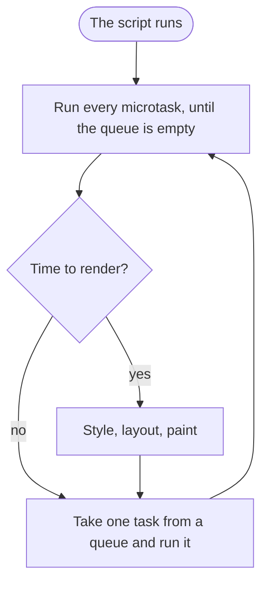

There are two kinds of queue, and the difference between them explains most ordering puzzles:

|              | Tasks                                                          | Microtasks                                                                  |
| ------------ | -------------------------------------------------------------- | --------------------------------------------------------------------------- |
| Examples     | `setTimeout`, `setInterval`, UI events, network, `postMessage` | Promise callbacks, code after `await`, `queueMicrotask`, `MutationObserver` |
| How many run | One per turn of the loop                                       | All of them, including any added along the way                              |

```js title="order.js"
console.log('1. script start');

setTimeout(() => console.log('6. timeout'), 0);

Promise.resolve().then(() => console.log('4. promise'));

(async () => {
  console.log('2. before await');
  await null;
  console.log('5. after await');
})();

console.log('3. script end');
```

```text title="Output"
1. script start
2. before await
3. script end
4. promise
5. after await
6. timeout
```

The whole script is one task, so it finishes first. Then the microtasks drain. The timer has to wait for a later task, even with a delay of zero.

### A timer’s delay is a minimum

A callback can only run when the stack is empty, so nothing can interrupt running code:

```js title="delayed.js"
const start = performance.now();

setTimeout(() => {
  console.log(`fired after ${Math.round(performance.now() - start)} ms`);
}, 0);

while (performance.now() - start < 500) {
  // keep the call stack busy
}
```

```text title="Output"
fired after 500 ms
```

In a browser, that loop also blocks clicks, typing and rendering for half a second. Browsers add one more delay: per the HTML spec, once timers nest more than five levels deep they’re clamped to at least 4 ms. Measuring the gaps between nested zero-delay timers in Edge shows exactly that, with the last few settling at around 4 ms:

```text title="Gaps between nested setTimeout(fn, 0) calls, in ms"
21.6, 0.9, 1.3, 0.1, 0.0, 0.0, 4.3, 4.6, 4.3, 4.7, 4.0, 4.0
```

To keep a page responsive during heavy work, break it up and yield to the loop with `setTimeout` or [`scheduler.yield()`](https://developer.mozilla.org/en-US/docs/Web/API/Scheduler/yield) where it’s available, or move the work to a Worker.

### Microtasks can starve the loop

Because the queue must be empty before anything else happens, a microtask that keeps queueing microtasks blocks everything:

```js title="flood.js"
let count = 0;

setTimeout(() => console.log(`the timer ran after ${count} microtasks`), 0);

function again() {
  if (++count < 100_000) queueMicrotask(again);
}

queueMicrotask(again);
```

```text title="Output"
the timer ran after 100000 microtasks
```

### How `await` leaves the stack

An async function runs synchronously until its first `await`, and only then gives up the thread:

```js title="await.js"
async function loadUser() {
  console.log('A: runs synchronously, up to the first await');
  const user = await Promise.resolve('Ada');
  console.log('C: resumes in a microtask');
  return user;
}

const pending = loadUser();
console.log('B: the caller carries on', pending);
```

```text title="Output"
A: runs synchronously, up to the first await
B: the caller carries on Promise { <pending> }
C: resumes in a microtask
```

But a stack can only pop from the top, so how can a function leave and come back with its local variables intact? The bytecode for `loadUser` has the answer:

```text title="Bytecode for loadUser (trimmed)"
SuspendGenerator r0, r0-r2, [0]
...
ResumeGenerator r0, r0-r2
```

At an `await`, V8 copies the function’s registers into a generator object **on the heap** and removes the frame from the stack. Later, a microtask copies them back and jumps to where it left off. Async functions and generators are the only code whose execution context can leave the stack and come back to it.

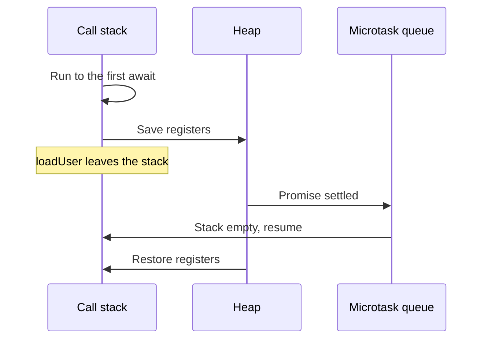

### Node’s event loop

Node has no rendering, and its loop, built on libuv, runs in phases:

| Phase             | What runs there                          |
| ----------------- | ---------------------------------------- |
| Timers            | `setTimeout` and `setInterval` callbacks |
| Pending callbacks | Some deferred system callbacks           |
| Idle, prepare     | Internal use                             |
| Poll              | I/O callbacks, and waiting for new I/O   |
| Check             | `setImmediate` callbacks                 |
| Close callbacks   | `close` events, such as on a socket      |

Node also has `process.nextTick`, a queue that runs ahead of promise microtasks in CommonJS files like this one:

```js title="node-order.js"
setTimeout(() => console.log('timeout'), 0);
setImmediate(() => console.log('immediate'));
Promise.resolve().then(() => console.log('promise'));
process.nextTick(() => console.log('nextTick'));
console.log('sync');
```

```text title="Output"
sync
nextTick
promise
timeout
immediate
```

In CommonJS, the first three are guaranteed. Saved as `.mjs`, the same code prints `promise` before `nextTick`, because an ES module’s body already runs inside the microtask queue. The order of the last two [isn’t guaranteed when called from the main module](https://nodejs.org/en/learn/asynchronous-work/event-loop-timers-and-nexttick), since it depends on how long the process took to get going.

## Back to the puzzle

We can now read the program from the start of this post line by line.

| Output                                    | Why                                                                                                                                                                                                                                                                 |
| ----------------------------------------- | ------------------------------------------------------------------------------------------------------------------------------------------------------------------------------------------------------------------------------------------------------------------- |
| `undefined`                               | `var a` was [created with `undefined`](#the-variable-environment-hoisting-and-the-tdz) before the module ran, and the assignment hadn’t happened yet.                                                                                                               |
| `Cannot access 'b' before initialization` | `let b` was also created early, but stays in its [dead zone](#hoisting-and-the-tdz-in-practice) until its line runs.                                                                                                                                                |
| `Ada undefined undefined`                 | `user.getName()` [passes `user` as the receiver](#the-this-keyword). `detached()` passes nothing, and modules are strict, so `this` is `undefined`. The arrow takes its [`this` from the module](#regular-functions-vs-arrow-functions), which is also `undefined`. |
| `[ 'a', 'b' ]`                            | Spread is [shallow](#object-references-in-practice-shallow-and-deep-copies), so `copy.tags` and `original.tags` are one array.                                                                                                                                      |
| `sync`, `promise`, `timeout`              | The script finishes first, then the [microtasks drain](#the-event-loop), and the timer gets a later task.                                                                                                                                                           |

Most of what looks strange about JavaScript comes from a small number of mechanisms. Bindings are created before code runs. Names resolve through where code was written, while `this` resolves through how it was called. Variables hold values or pointers. Memory stays as long as a path to it exists. And nothing interrupts running code. Once those are in your head, the surprises mostly stop.

## Further reading

- [ECMAScript specification](https://tc39.es/ecma262/), especially the sections on execution contexts and environment records
- [Firing up the Ignition interpreter](https://v8.dev/blog/ignition-interpreter), [Sparkplug](https://v8.dev/blog/sparkplug) and [Maglev](https://v8.dev/blog/maglev), from the V8 blog
- [Land ahoy: leaving the Sea of Nodes](https://v8.dev/blog/leaving-the-sea-of-nodes), on how TurboFan is changing
- [Fast properties in V8](https://v8.dev/blog/fast-properties), on hidden classes and dictionary mode
- [Trash talk: the Orinoco garbage collector](https://v8.dev/blog/trash-talk), the best overview of V8’s GC
- [Event loops in the HTML standard](https://html.spec.whatwg.org/multipage/webappapis.html), the actual rules for tasks and microtasks
- [The Node.js event loop](https://nodejs.org/en/learn/asynchronous-work/event-loop-timers-and-nexttick), including timers and `process.nextTick`
- [`this`](https://developer.mozilla.org/en-US/docs/Web/JavaScript/Reference/Operators/this) and [Memory management](https://developer.mozilla.org/en-US/docs/Web/JavaScript/Guide/Memory_management), on MDN
