import Note from '../../components/Note.astro';

People say Node.js is single-threaded. Here’s a small program that asks the operating system how many threads a Node process has.

```js title="threads.js"
const { execSync } = require('node:child_process');
const crypto = require('node:crypto');

// Windows. On Linux, count the entries in /proc/self/task instead.
const threads = () =>
  execSync(`powershell -NoProfile -Command "(Get-Process -Id ${process.pid}).Threads.Count"`).toString().trim();

console.log('at startup:', threads());

crypto.pbkdf2('password', 'salt', 1, 64, 'sha512', () => {
  console.log('after using the thread pool:', threads());
});
```

```text title="Output"
at startup: 13
after using the thread pool: 17
```

Thirteen threads before the program has done anything, and four more the moment something needed them. Your JavaScript only ever ran on one of those.

“Single-threaded” is true of your JavaScript and of very little else. Node is a C++ program that embeds a JavaScript engine, an event loop and a thread pool, and most of what makes a Node app fast or slow happens where those parts meet.

This post goes through them in order: what Node is made of, which thread does what, how the event loop really runs, then events, streams and the module system. At the end we’ll follow one HTTP request through every layer. It picks up where [How JavaScript works behind the scenes](../how-javascript-works-behind-the-scenes/) left off, so it won’t explain the call stack or closures again.

Everything here ran on Node 24.22 (V8 13.6, libuv 1.52) on a Windows 11 laptop with four physical cores. Where I quote Node’s own JavaScript, it’s the source embedded in that binary, and libuv’s C comes from the matching release tag. The output blocks are real, trimmed for reading. Timings and thread counts will differ on your machine, and Linux and macOS differ from Windows in a few specific ways that I’ll point out.

## Node, V8, libuv and C++

JavaScript has no way to open a file or a socket. The language doesn’t define those things, and V8 doesn’t provide them. Node is the program that fills the gap, and it’s built in layers:

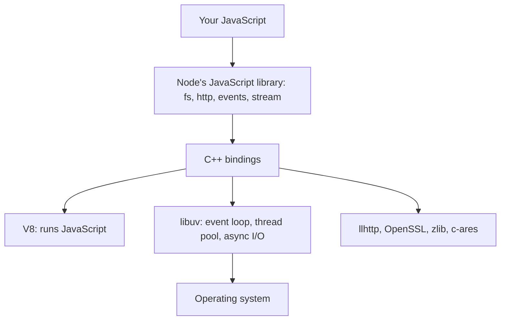

`process.versions` lists the parts in your copy:

```bash
node -p process.versions
```

```text title="Output (trimmed)"
{
  node: '24.22.2',
  v8: '13.6.233.17-node.63',
  uv: '1.52.1',
  llhttp: '9.4.3',
  ares: '1.34.9',
  openssl: '3.5.9',
  zlib: '1.3.2.1-motley-285e94b',
  nghttp2: '1.70.0',
  undici: '7.30.1',
  napi: '10',
  ...
}
```

| Part    | Written in | What it does                                                                                  |
| ------- | ---------- | --------------------------------------------------------------------------------------------- |
| V8      | C++        | Compiles and runs JavaScript, and manages its heap. It knows nothing about files or networks. |
| libuv   | C          | The event loop, the thread pool, and one async I/O API across operating systems.              |
| llhttp  | C          | Parses HTTP messages.                                                                         |
| c-ares  | C          | Asynchronous DNS queries.                                                                     |
| OpenSSL | C          | Cryptography and TLS.                                                                         |
| zlib    | C          | Compression.                                                                                  |
| nghttp2 | C          | HTTP/2.                                                                                       |
| undici  | JavaScript | The implementation behind `fetch`.                                                            |

The C++ bindings are the glue. They expose C++ functions to JavaScript and call back into JavaScript when something finishes.

### Following one call down

Here’s the start of `fs.readFile`, taken from inside the Node binary:

```js title="lib/fs.js (trimmed)"
function readFile(path, options, callback) {
  // ...validate the arguments...
  ReadFileContext ??= require('internal/fs/read/context');
  const context = new ReadFileContext(callback, options);
  // ...
  const req = new FSReqCallback();
  req.context = context;
  req.oncomplete = readFileAfterOpen;
  binding.open(getValidatedPath(path), flagsNumber, 0o666, req);
}
```

`binding` is the C++ layer, which appears to this file as a plain object. `FSReqCallback` is a C++ class. JavaScript creates one, hangs a callback on its `oncomplete` property and passes it to `binding.open`, which returns straight away. Over in `node_file.cc`, that call becomes libuv’s `uv_fs_open`.

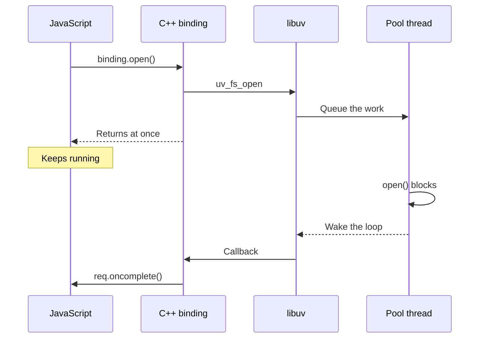

And that’s only the first step. `readFileAfterOpen` queues an `fstat` to learn the file’s size, the read comes after that, and then a close. Each one is another trip through this diagram, which will matter when we fill up the thread pool.

### What’s inside the binary

Node’s JavaScript library isn’t on your disk as loose files. It’s compiled into the executable, and you can list it:

```bash
node --no-warnings -p "Object.keys(process.binding('natives')).length"
```

```text title="Output"
393
```

`process.binding` is deprecated, but it’s fine for poking around. Only some of those modules load when Node starts:

```js title="loaded.js"
const loaded = process.moduleLoadList;

console.log('loaded at startup:', loaded.length);
console.log(loaded.filter((name) => /\bfs$|\bevents$/.test(name)));
```

```text title="Output"
loaded at startup: 111
[ 'NativeModule events', 'Internal Binding fs', 'NativeModule fs' ]
```

`NativeModule fs` is the JavaScript library, and `Internal Binding fs` is the C++ underneath it. The process also records how long it took to get going:

```js title="timing.js"
setImmediate(() => {
  const { nodeStart, v8Start, environment, bootstrapComplete, loopStart } = performance.nodeTiming;
  const stages = { nodeStart, v8Start, environment, bootstrapComplete, loopStart };
  for (const [stage, ms] of Object.entries(stages)) console.log(stage.padEnd(18), ms.toFixed(1), 'ms');
});
```

```text title="Output"
nodeStart          1.4 ms
v8Start            9.8 ms
environment        22.9 ms
bootstrapComplete  30.1 ms
loopStart          34.2 ms
```

About 34 ms to initialise the process and V8, set up the environment, and run the main script up to the point where the event loop starts. Anything your script does synchronously at the top level adds directly to that last number.

You can also add your own native code. A `.node` file is a compiled addon, usually built against Node-API (that’s the `napi` version above) so it keeps working across Node versions, and it’s loaded with the same `require` as anything else.

## Processes, threads and the thread pool

A **process** is a running program with its own memory. A **thread** is one line of execution inside it, sharing that memory with the process’s other threads. When you run `node app.js`, one process starts, and its **main thread** does this:

1. Initialises Node and V8.
2. Runs your script’s top-level code, loading modules as it goes.
3. Registers whatever callbacks that code asked for.
4. Starts the event loop.

Your JavaScript, in every callback, runs on that one thread. The other threads from the opening example are doing different jobs:

| What I ran                     | Threads |
| ------------------------------ | ------- |
| Plain `node`, at startup       | 13      |
| After first using the pool     | 17      |
| `UV_THREADPOOL_SIZE=8`, after  | 21      |
| `--v8-pool-size=8`, at startup | 17      |

The last row shows that four of the startup threads are V8’s, used for background compilation and garbage collection, as the JavaScript post showed. The rest are the main thread and assorted helpers from Node and the operating system, and that number depends on the platform. The pool threads are the interesting ones. libuv starts them all at once the first time anything needs one, which is why they appeared only after the first hash.

### Why there’s a thread pool at all

For network I/O, operating systems offer real asynchronous APIs: epoll on Linux, kqueue on macOS and the BSDs, IOCP on Windows. One thread can watch thousands of sockets and be told when any of them is ready.

[Files have nothing equivalent that works everywhere](https://docs.libuv.org/en/v1.x/design.html), so libuv does the blocking call on a pool of threads and reports back. CPU-heavy native work uses the same pool so it doesn’t hold up the loop.

| Runs on the thread pool                                                   | Doesn’t use the thread pool                        |
| ------------------------------------------------------------------------- | -------------------------------------------------- |
| All async `fs` APIs, except `fs.watch`                                    | TCP, UDP and HTTP sockets                          |
| `dns.lookup`, `dns.lookupService`                                         | `dns.resolve*`, which uses c-ares and the network  |
| `crypto.pbkdf2`, `scrypt`, `randomBytes`, `randomFill`, `generateKeyPair` | Timers                                             |
| Async `zlib`                                                              | Anything synchronous, which blocks the main thread |

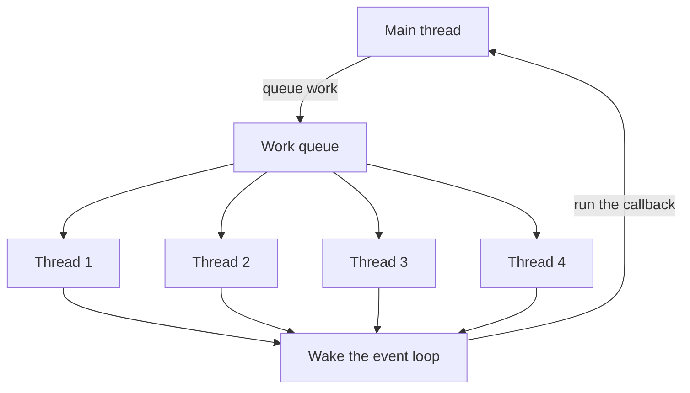

You can see the pool’s size by giving it more work than it has threads:

```js title="pool.js"
const crypto = require('node:crypto');

const start = Date.now();

for (let i = 1; i <= 8; i++) {
  crypto.pbkdf2('password', 'salt', 1_000_000, 64, 'sha512', () => {
    console.log(`hash ${i}: ${Date.now() - start} ms`);
  });
}
```

```text title="Output"
hash 3: 1251 ms
hash 2: 1264 ms
hash 4: 1284 ms
hash 1: 1307 ms
hash 8: 2345 ms
hash 7: 2373 ms
hash 6: 2374 ms
hash 5: 2408 ms
```

Four hashes finish together, and only then do the next four start. The `UV_THREADPOOL_SIZE` environment variable changes the size, up to 1024:

```bash
UV_THREADPOOL_SIZE=8 node pool.js
```

| Pool size | First hash finished | Last hash finished |
| --------- | ------------------- | ------------------ |
| 2         | 763 ms              | 3273 ms            |
| 4         | 1251 ms             | 2408 ms            |
| 8         | 2625 ms             | 2871 ms            |

Doubling the pool to eight made things worse here, because this laptop has four physical cores. Eight threads doing CPU work just take turns, and every hash finishes late. A bigger pool helps when the threads spend their time waiting on a slow disk or DNS server, and much less when they’re computing.

<Note>
  the variable is read once, when the pool is created. Setting `process.env.UV_THREADPOOL_SIZE` at the top of a script
  worked when I tried it, but the [Node docs](https://nodejs.org/api/cli.html) say that isn’t guaranteed, so set it
  before the process starts.
</Note>

### A full pool blocks more than you’d expect

Because the pool is shared, slow work of one kind delays everything else on it. Here four long hashes take every thread, and then we ask for a few other things:

```js title="saturate.js"
const crypto = require('node:crypto');
const dns = require('node:dns');
const fs = require('node:fs');
const net = require('node:net');

const start = performance.now();
const report = (label) => console.log(`${label}: ${Math.round(performance.now() - start)} ms`);

// Keep all four thread pool threads busy.
for (let i = 0; i < 4; i++) {
  crypto.pbkdf2('password', 'salt', 1_000_000, 64, 'sha512', () => report('hash'));
}

setTimeout(() => report('10 ms timer'), 10);
fs.readFile(__filename, () => report('fs.readFile'));
dns.lookup('localhost', () => report('dns.lookup'));

const server = net.createServer((socket) => socket.end('hi'));
server.listen(0, '127.0.0.1', () => {
  const { port } = server.address();
  net.connect(port, '127.0.0.1').on('data', () => report('TCP round trip to 127.0.0.1'));
  net.connect(port, 'localhost').on('data', () => {
    report('TCP round trip to localhost');
    server.close();
  });
});
```

```text title="Output"
10 ms timer: 48 ms
TCP round trip to 127.0.0.1: 54 ms
hash: 1378 ms
dns.lookup: 1390 ms
TCP round trip to localhost: 1396 ms
fs.readFile: 1398 ms
hash: 1476 ms
hash: 1521 ms
hash: 1592 ms
```

The timer and the TCP connection to an IP address never touched the pool, so they were done in about 50 ms. `fs.readFile` and `dns.lookup` had to wait well over a second for a free thread.

The two TCP lines are the surprising part. They’re the same connection to the same machine, but `localhost` is a name, so `net.connect` calls `dns.lookup` first, and that needs the pool. In production this looks like outgoing HTTP calls mysteriously stalling while the server does something heavy with `bcrypt` or `zlib`.

`dns.resolve4` avoids the pool completely, since c-ares does its own network I/O. Under the same load, `dns.resolve4('nodejs.org')` finished in 24 ms and `dns.lookup('nodejs.org')` took 2310 ms. The catch is that `resolve` asks a DNS server directly and ignores your hosts file, so the two aren’t interchangeable.

libuv also protects itself a little. DNS lookups are classed as “slow I/O”, and [its scheduler](https://github.com/libuv/libuv/blob/v1.52.1/src/threadpool.c) lets them occupy only `(threads + 1) / 2` of the pool, so a slow DNS server can’t take every thread on its own.

### Running your own JavaScript on another thread

The thread pool runs Node’s C and C++, and you can’t schedule JavaScript on it. For CPU-heavy JavaScript there’s `worker_threads`, where each worker has its own thread, its own V8 instance and its own event loop:

```js title="worker.js"
const { Worker, isMainThread, parentPort, threadId } = require('node:worker_threads');

if (isMainThread) {
  globalThis.setInMain = true;

  const start = Date.now();
  const tick = setInterval(() => console.log(`main thread free at ${Date.now() - start} ms`), 300);

  new Worker(__filename).on('message', (message) => {
    console.log(message);
    clearInterval(tick);
  });
} else {
  const end = Date.now() + 1000;
  while (Date.now() < end); // blocks this thread only

  parentPort.postMessage({ threadId, sawMainGlobal: globalThis.setInMain === true });
}
```

```text title="Output"
main thread free at 311 ms
main thread free at 623 ms
main thread free at 935 ms
{ threadId: 1, sawMainGlobal: false }
```

The worker blocked for a full second and the main thread never noticed. The worker also couldn’t see the main thread’s global, because they don’t share a heap. Messages are copied, with `SharedArrayBuffer` as the one way to share memory:

```js title="shared.js"
const { Worker, isMainThread, workerData } = require('node:worker_threads');

if (isMainThread) {
  const counter = new Int32Array(new SharedArrayBuffer(4));
  const copy = { value: 0 };

  const worker = new Worker(__filename, { workerData: { counter, copy } });
  worker.on('exit', () => console.log('shared:', counter[0], 'copied:', copy.value));
} else {
  Atomics.add(workerData.counter, 0, 42);
  workerData.copy.value = 42;
}
```

```text title="Output"
shared: 42 copied: 0
```

Those are the options for using more than one core:

| Tool                | What you get                       | Shared memory?               | Use it for                          |
| ------------------- | ---------------------------------- | ---------------------------- | ----------------------------------- |
| libuv’s thread pool | Threads running Node’s native work | Not applicable               | Used for you by `fs`, `crypto` etc. |
| `worker_threads`    | A thread with its own V8 and loop  | Only via `SharedArrayBuffer` | CPU-heavy JavaScript                |
| `child_process`     | A separate OS process              | No                           | Running other programs, isolation   |
| `cluster`           | Several Node processes on one port | No                           | Spreading a server across cores     |

## The Node.js event loop

The event loop is often drawn as a mysterious circle. It’s a C function, and it’s short enough to read:

```c title="libuv 1.52, src/unix/core.c (trimmed)"
int uv_run(uv_loop_t* loop, uv_run_mode mode) {
  r = uv__loop_alive(loop);

  if (mode == UV_RUN_DEFAULT && r != 0 && loop->stop_flag == 0) {
    uv__update_time(loop);
    uv__run_timers(loop);
  }

  while (r != 0 && loop->stop_flag == 0) {
    uv__run_pending(loop);
    uv__run_idle(loop);
    uv__run_prepare(loop);

    timeout = uv__backend_timeout(loop);
    uv__io_poll(loop, timeout);

    uv__run_check(loop);
    uv__run_closing_handles(loop);

    uv__update_time(loop);
    uv__run_timers(loop);

    r = uv__loop_alive(loop);
  }

  return r;
}
```

The Windows version in `src/win/core.c` has the same shape with different function names. Node’s main thread calls this once your top-level code has finished.

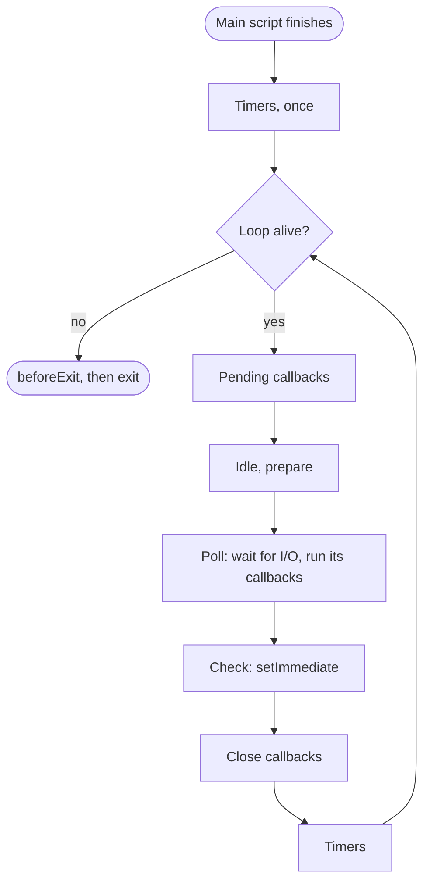

| Phase         | What runs                                                |
| ------------- | -------------------------------------------------------- |
| Timers        | `setTimeout` and `setInterval` callbacks that are due    |
| Pending       | A few I/O callbacks deferred from the previous iteration |
| Idle, prepare | Internal housekeeping                                    |
| Poll          | Waits for I/O, and runs most I/O callbacks               |
| Check         | `setImmediate` callbacks                                 |
| Close         | Close callbacks, such as a socket’s `close` event        |

<Note>
  most diagrams show timers at the top of each iteration, because that’s how it used to work. [Since libuv 1.45 (Node
  20)](https://nodejs.org/en/learn/asynchronous-work/event-loop-timers-and-nexttick), timers run once before the loop
  starts and then after the poll phase in each iteration, which is what the code above does.
</Note>

### Poll is where Node waits

If there’s nothing else to do, the poll phase asks the operating system to put the thread to sleep until something happens. `uv__backend_timeout` works out how long it can sleep: zero if callbacks are already waiting, otherwise until the next timer is due, or indefinitely if there are no timers. That’s why an idle Node server uses no CPU.

A pool thread that finishes its work calls `uv_async_send`, which wakes the sleeping poll phase. That’s the “wake the loop” arrow from the earlier diagram.

### Two queues that aren’t phases

`process.nextTick` and promises aren’t part of libuv at all. They’re handled at the boundary between C++ and JavaScript. Every time C++ calls a JavaScript callback, it drains both queues before returning to the loop, and this is the function it uses:

```js title="lib/internal/process/task_queues.js (trimmed)"
function processTicksAndRejections() {
  let tock;
  do {
    while ((tock = queue.shift()) !== null) {
      // ...run tock.callback...
    }
    runMicrotasks();
  } while (!queue.isEmpty() || (hasRejectionToWarn() && processPromiseRejections()));
  setHasTickScheduled(false);
  setHasRejectionToWarn(false);
}
```

All the `nextTick` callbacks run, then all the microtasks, and the whole thing repeats if any of them queued more. The C++ boundary isn’t the only trigger, though. Node runs a batch of timers or immediates inside one call from C++, and between those its JavaScript drains the queues itself with a helper called `runNextTicks`. So these queues don’t run between phases. They run **between callbacks**, which we’ll prove in a moment.

### How timers really work

Node doesn’t create a libuv timer for each `setTimeout`. A busy server can have huge numbers of them, since every TCP connection has a timeout. Node keeps a single libuv timer for the whole environment, set to the earliest expiry, and manages everything else in JavaScript: one linked list per duration, with a priority queue ordering the lists. All timers in one list share a duration, so a new timer always belongs at the end and insertion is constant time.

A timer’s delay is a minimum, and it can’t be zero. Node turns anything less than 1 into 1:

```js title="zero.js"
const timer = setTimeout(() => {}, 0);
console.log(timer._idleTimeout); // 1
clearTimeout(timer);
```

### When the loop stops

The process exits when the loop has nothing left that could produce a callback. Here’s libuv’s check:

```c title="libuv 1.52, src/unix/core.c"
static int uv__loop_alive(const uv_loop_t* loop) {
  return uv__has_active_handles(loop) ||
         uv__has_active_reqs(loop) ||
         !uv__queue_empty(&loop->pending_queue) ||
         loop->closing_handles != NULL;
}
```

A **handle** is a long-lived thing like a server or a timer. A **request** is a short-lived operation like one file read. Node will tell you what’s keeping it alive:

```js title="resources.js"
const fs = require('node:fs');
const net = require('node:net');

const timeout = setTimeout(() => {}, 1000);

const server = net.createServer().listen(0, '127.0.0.1', () => {
  fs.readFile(__filename, () => {});

  console.log(process.getActiveResourcesInfo());

  clearTimeout(timeout);
  server.close();
});
```

```text title="Output"
[ 'FSReqCallback', 'TCPServerWrap', 'Timeout' ]
```

## The event loop in practice

Let’s check all of that against real behaviour.

### Watching the phases

This callback runs in the poll phase, because a socket has just connected, and it schedules something for every other phase:

```js title="phases.js"
const net = require('node:net');

const server = net.createServer().listen(0, '127.0.0.1', () => {
  const client = net.connect(server.address().port, '127.0.0.1', () => {
    console.log('poll: connected');

    setTimeout(() => console.log('timers: setTimeout'), 0);
    setImmediate(() => console.log('check: setImmediate'));

    client.on('close', () => {
      console.log('close: socket closed');
      server.close();
    });
    client.destroy();

    process.nextTick(() => console.log('nextTick'));
    Promise.resolve().then(() => console.log('promise'));
  });
});
```

```text title="Output"
poll: connected
nextTick
promise
check: setImmediate
close: socket closed
timers: setTimeout
```

I ran that 50 times and got the same order every time. `nextTick` and promises run the moment the current callback ends, and then the phases follow in order: check, close, timers.

### `setTimeout` versus `setImmediate`

The classic puzzle:

```js title="main-race.js"
setTimeout(() => console.log('timeout'), 0);
setImmediate(() => console.log('immediate'));
```

Over 100 runs, `timeout` came first 80 times and `immediate` 20 times. A zero timer really means 1 ms, and timers get checked once as the loop starts, so the order depends on whether a millisecond has passed by then. The answer changes with how busy the machine is.

Put the same two calls in an I/O callback and the race disappears:

```js title="io-race.js"
const fs = require('node:fs');

fs.readFile(__filename, () => {
  setTimeout(() => console.log('timeout'), 0);
  setImmediate(() => console.log('immediate'));
});
```

That printed `immediate` first in 100 runs out of 100. The callback runs in the poll phase, and check always comes next.

### Queues drain between callbacks

```js title="between.js"
setTimeout(() => {
  console.log('timer 1');
  Promise.resolve().then(() => console.log('promise from timer 1'));
  process.nextTick(() => console.log('nextTick from timer 1'));
}, 0);

setTimeout(() => console.log('timer 2'), 0);
```

```text title="Output"
timer 1
nextTick from timer 1
promise from timer 1
timer 2
```

Both timers are due in the same phase, and C++ starts them with a single call, so there’s no trip back through C++ between them. The queues still drain because `listOnTimeout` in `lib/internal/timers.js` calls `runNextTicks()` before every timer after the first. Before Node 11 this printed differently, which is why older articles disagree.

### `nextTick` first, except in ES modules

```js title="queue-order.js"
Promise.resolve().then(() => console.log('promise'));
process.nextTick(() => console.log('nextTick'));
```

```text title="Output when saved as .js"
nextTick
promise
```

```text title="Output when saved as .mjs"
promise
nextTick
```

Same code, opposite order. An ES module’s body runs as part of a promise job, so the microtask queue is already draining when your code runs, and the promise goes first. If code depends on this order, it’s worth rewriting so it doesn’t.

### Starving the loop

Since the `nextTick` queue must empty before the loop can continue, recursive `nextTick` blocks everything:

```js title="starve-tick.js"
let ticks = 0;
const start = Date.now();

setTimeout(() => console.log(`timer ran after ${ticks} ticks, at ${Date.now() - start} ms`), 0);

function spin() {
  if (++ticks < 5_000_000) process.nextTick(spin);
}

process.nextTick(spin);
```

```text title="Output"
timer ran after 5000000 ticks, at 663 ms
```

Recursive `setImmediate` doesn’t have this problem. Immediates queued during the check phase wait for the next iteration, so the loop keeps moving:

```js title="starve-immediate.js"
let immediates = 0;
let fired = false;

setTimeout(() => {
  fired = true;
  console.log(`timer ran after ${immediates} immediates`);
}, 1);

function again() {
  immediates++;
  if (!fired) setImmediate(again);
}

setImmediate(again);
```

```text title="Output"
timer ran after 27 immediates
```

The names are backwards: `nextTick` runs immediately, and `setImmediate` runs on a later tick. Node’s docs admit as much. Prefer `setImmediate` unless you specifically need to run before anything else.

### What blocking really costs

Here’s a server with three routes: one that hashes synchronously, one that hashes on the thread pool, and one that does nothing.

```js title="blocking-server.js"
const crypto = require('node:crypto');
const http = require('node:http');

const hash = (done) => crypto.pbkdf2('password', 'salt', 1_000_000, 64, 'sha512', done);
const hashSync = () => crypto.pbkdf2Sync('password', 'salt', 1_000_000, 64, 'sha512');

http
  .createServer((req, res) => {
    if (req.url === '/sync') {
      hashSync();
      res.end('hashed');
    } else if (req.url === '/async') {
      hash(() => res.end('hashed'));
    } else {
      res.end('fast');
    }
  })
  .listen(3000, '127.0.0.1');
```

From a separate process, I timed `/fast` while each of the others was running:

| `/fast` request           | Response time |
| ------------------------- | ------------- |
| Server idle               | 4 ms          |
| While `/sync` is running  | 637 ms        |
| While `/async` is running | 3 ms          |

One synchronous call made an unrelated request 150 times slower. Every other user of the server waits for it, because there’s only one main thread. The usual culprits are `*Sync` calls in a request handler, `JSON.parse` on a huge string, and a regular expression that backtracks badly.

You can measure this in production. `monitorEventLoopDelay` tracks how late the loop is, and `eventLoopUtilization` tracks how much of the time it’s busy:

```js title="measure.js"
const { monitorEventLoopDelay, performance } = require('node:perf_hooks');

const delay = monitorEventLoopDelay({ resolution: 10 });
delay.enable();
const before = performance.eventLoopUtilization();

setTimeout(() => {
  const end = Date.now() + 300;
  while (Date.now() < end); // simulate a slow synchronous task
}, 200);

setTimeout(() => {
  delay.disable();
  const { utilization } = performance.eventLoopUtilization(before);
  console.log('longest delay:', Math.round(delay.max / 1e6), 'ms');
  console.log('utilization:', (utilization * 100).toFixed(0) + '%');
}, 1000);
```

```text title="Output"
longest delay: 300 ms
utilization: 30%
```

### Breaking up long work

If the work has to stay on the main thread, split it up and let the loop run between the pieces:

```js title="partition.js"
const LIMIT = 300_000_000;
const CHUNK = 20_000_000;

function sumAll() {
  let total = 0;
  for (let i = 0; i < LIMIT; i++) total += i;
  return total;
}

async function sumInChunks() {
  let total = 0;
  for (let i = 0; i < LIMIT; i++) {
    total += i;
    if (i % CHUNK === 0) await new Promise(setImmediate);
  }
  return total;
}

async function countTicksDuring(work) {
  let ticks = 0;
  const timer = setInterval(() => ticks++, 1);
  await new Promise((resolve) => setTimeout(resolve, 20));
  const before = ticks;
  await work();
  await new Promise(setImmediate);
  clearInterval(timer);
  return ticks - before;
}

(async () => {
  console.log('timer ticks during sumAll:', await countTicksDuring(sumAll));
  console.log('timer ticks during sumInChunks:', await countTicksDuring(sumInChunks));
})();
```

```text title="Output"
timer ticks during sumAll: 0
timer ticks during sumInChunks: 16
```

During `sumAll` the loop couldn’t run once. With chunks it ran between each one. Note that the `await` has to wait for something the loop delivers, like `setImmediate`. Awaiting a resolved promise only queues a microtask, which never lets the loop reach another phase.

### Keeping the process alive, or not

A timer normally keeps the process running. `unref()` says “don’t stay alive just for this”. And `beforeExit` fires when the loop has run out of work:

```js title="alive.js"
process.on('beforeExit', () => console.log('beforeExit: nothing left to do'));
process.on('exit', (code) => console.log('exit, code', code));

setInterval(() => console.log('tick'), 100).unref();
setTimeout(() => console.log('done'), 250);
```

```text title="Output"
tick
tick
done
beforeExit: nothing left to do
exit, code 0
```

Scheduling more work in `beforeExit` starts the loop again. In `exit` it’s too late, and only synchronous code will run.

## Events and event-driven architecture

Nearly everything in Node that happens over time is exposed as an event. An **emitter** announces that something happened, and **listeners** react to it. The emitter doesn’t know who’s listening or what they’ll do.

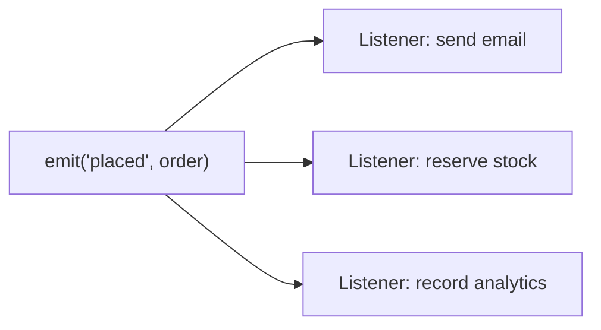

Node’s core objects are built on this, as their prototype chains show:

```js title="chain.js"
const fs = require('node:fs');
const http = require('node:http');

function chain(object) {
  const names = [];
  for (let p = Object.getPrototypeOf(object); p && p !== Object.prototype; p = Object.getPrototypeOf(p)) {
    names.push(p.constructor.name);
  }
  return names.join(' -> ');
}

const server = http.createServer();
const file = fs.createReadStream(__filename);

console.log('http.Server:', chain(server));
console.log('ReadStream:', chain(file));
console.log('process:', chain(process));

file.destroy();
```

```text title="Output"
http.Server: Server -> Server -> EventEmitter
ReadStream: ReadStream -> Readable -> Stream -> EventEmitter
process: process -> EventEmitter
```

The two `Server`s are `http.Server` and the `net.Server` it extends.

### What `emit` actually does

The whole thing is one function:

```js title="lib/events.js (trimmed)"
EventEmitter.prototype.emit = function emit(type, ...args) {
  // ...if there's no 'error' listener, throw (see below)...

  const handler = events[type];

  if (handler === undefined) return false;

  if (typeof handler === 'function') {
    const result = handler.apply(this, args);
    // ...
  } else {
    handler[kEmitting]++;
    try {
      for (let i = 0; i < handler.length; ++i) {
        const result = ReflectApply(handler[i], this, args);
        // ...
      }
    } finally {
      handler[kEmitting]--;
    }
  }

  return true;
};
```

There’s no queue, no scheduler and no event loop involved. `emit` looks up an array and calls each function in a `for` loop. (A single listener is stored as a bare function rather than a one-element array, a small optimisation for the most common case.)

That makes **`emit` synchronous**, which is the most commonly misunderstood thing about events:

```js title="emit-sync.js"
const EventEmitter = require('node:events');

const emitter = new EventEmitter();

emitter.on('ping', () => console.log('2. first listener'));
emitter.on('ping', () => console.log('3. second listener'));

console.log('1. before emit');
const handled = emitter.emit('ping');
console.log('4. after emit, handled:', handled);
```

```text title="Output"
1. before emit
2. first listener
3. second listener
4. after emit, handled: true
```

So a slow listener blocks the emitter and everything after it. And if a listener throws, the exception goes straight up through `emit` to whoever called it, and the remaining listeners don’t run.

### Changing listeners during an emit

That `kEmitting` counter is there so a listener can add or remove listeners safely. While an emit is in progress, any change copies the array first, so the running loop isn’t disturbed:

```js title="mutate.js"
const EventEmitter = require('node:events');

const emitter = new EventEmitter();

function second() {
  console.log('second');
}

emitter.on('tick', () => {
  console.log('first');
  emitter.off('tick', second);
  emitter.on('tick', () => console.log('added during emit'));
});
emitter.on('tick', second);

emitter.emit('tick');
console.log('--- next emit');
emitter.emit('tick');
```

```text title="Output"
first
second
--- next emit
first
added during emit
```

The removal and the addition only take effect from the next emit.

### The `error` event is special

Every other event with no listeners is silently ignored. `error` with no listeners throws, so failures can’t vanish:

```js title="unhandled-error.js"
const EventEmitter = require('node:events');

new EventEmitter().emit('error', new Error('boom'));
```

```text title="Output (trimmed)"
node:events:505
    throw er; // Unhandled 'error' event
    ^

Error: boom
    at Object.<anonymous> (unhandled-error.js:3:34)
```

This is what kills a server when a stream fails and nobody attached an `error` listener. The comment on that `throw` line is deliberate, as Node’s source notes, because it shows up in crash output like this one.

### `EventEmitter` and `EventTarget`

Node also has the web platform’s `EventTarget`, and it’s what `AbortSignal` uses. They look alike and behave differently:

|                           | `EventEmitter`                 | `EventTarget`                                       |
| ------------------------- | ------------------------------ | --------------------------------------------------- |
| Add a listener            | `on`                           | `addEventListener`                                  |
| Fire an event             | `emit(name, ...args)`          | `dispatchEvent(new Event(name))`                    |
| A listener throws         | `emit` throws, later ones skip | Later ones still run, then it’s `uncaughtException` |
| Same listener added twice | Called twice                   | Called once                                         |
| `error` with no listener  | Throws                         | Nothing special                                     |

## Events in practice

Extending `EventEmitter` is how you give your own classes this behaviour:

```js title="orders.js"
const EventEmitter = require('node:events');

class OrderService extends EventEmitter {
  place(order) {
    // ...save the order...
    this.emit('placed', order);
    return order.id;
  }
}

const orders = new OrderService();

orders.on('placed', (order) => console.log(`email: confirmation for order ${order.id}`));
orders.on('placed', (order) => console.log(`stock: reserve ${order.items} items`));
orders.once('placed', () => console.log('analytics: first order of this process'));

console.log('placed', orders.place({ id: 1, items: 3 }));
console.log('placed', orders.place({ id: 2, items: 1 }));
console.log('listeners left:', orders.listenerCount('placed'));
```

```text title="Output"
email: confirmation for order 1
stock: reserve 3 items
analytics: first order of this process
placed 1
email: confirmation for order 2
stock: reserve 1 items
placed 2
listeners left: 2
```

`OrderService` doesn’t need to change when you add a new reaction, and that decoupling is the point. The cost is that the flow is harder to follow: nothing at the `emit` line tells you what will run. Events suit things where several independent parties care. For a single, required next step, a plain function call is clearer.

### Don’t emit before anyone can listen

Since `emit` is synchronous, an event fired in a constructor happens before the caller has had a chance to attach anything:

```js title="late-listener.js"
const EventEmitter = require('node:events');

class TooEarly extends EventEmitter {
  constructor() {
    super();
    this.emit('ready');
  }
}

class Deferred extends EventEmitter {
  constructor() {
    super();
    process.nextTick(() => this.emit('ready'));
  }
}

new TooEarly().on('ready', () => console.log('TooEarly is ready'));
new Deferred().on('ready', () => console.log('Deferred is ready'));
```

```text title="Output"
Deferred is ready
```

This is the legitimate use of `process.nextTick`: run as soon as the current code finishes, but not before.

Listeners written with `function` get the emitter as `this`. Arrow functions don’t, for the reasons in the [previous post](../how-javascript-works-behind-the-scenes/#regular-functions-vs-arrow-functions).

### Events as promises and async iterators

`events.once` turns one event into a promise, and `events.on` turns a stream of events into an async iterator:

```js title="promise-events.js"
const EventEmitter = require('node:events');
const { once, on } = EventEmitter;

async function main() {
  const emitter = new EventEmitter();

  setTimeout(() => emitter.emit('ready', 'first value'), 0);
  const [value] = await once(emitter, 'ready');
  console.log(value);

  const controller = new AbortController();
  setTimeout(() => {
    emitter.emit('item', 1);
    emitter.emit('item', 2);
    controller.abort();
  }, 0);

  try {
    for await (const [item] of on(emitter, 'item', { signal: controller.signal })) console.log('item', item);
  } catch (error) {
    console.log(error.name);
  }
}

main();
```

```text title="Output"
first value
item 1
item 2
AbortError
```

### Async listeners can crash your process

`emit` ignores what a listener returns, so a rejected promise from an `async` listener doesn’t go anywhere near your `error` handler:

```js title="async-listener.js"
const EventEmitter = require('node:events');

const emitter = new EventEmitter();

emitter.on('job', async () => {
  throw new Error('failed inside an async listener');
});
emitter.on('error', (error) => console.log('error listener:', error.message));

emitter.emit('job');
```

This exits with code 1 and an unhandled rejection, and the `error` listener never runs. The `captureRejections` option connects the two:

```js title="capture-rejections.js"
const EventEmitter = require('node:events');

const emitter = new EventEmitter({ captureRejections: true });

emitter.on('job', async () => {
  throw new Error('failed inside an async listener');
});
emitter.on('error', (error) => console.log('error listener:', error.message));

emitter.emit('job');
```

```text title="Output"
error listener: failed inside an async listener
```

### Listener leaks

A listener is a reference from the emitter to your closure, so it [keeps everything that closure captured alive](../how-javascript-works-behind-the-scenes/#the-usual-leaks). Add one per request to a long-lived object and you have a leak. Node warns when an emitter passes ten listeners for one event:

```js title="leak-warning.js"
const EventEmitter = require('node:events');

const emitter = new EventEmitter();
for (let i = 0; i < 11; i++) emitter.on('data', () => {});
```

```text title="Output (trimmed)"
(node:7312) MaxListenersExceededWarning: Possible EventEmitter memory leak detected. 11 data listeners added to [EventEmitter]. MaxListeners is 10. Use emitter.setMaxListeners() to increase limit
```

Raising the limit silences the warning without fixing anything, so first check whether something is failing to call `off`.

### The events behind an HTTP request

Here are the events one request produces:

```js title="http-events.js"
const http = require('node:http');

const server = http.createServer((req, res) => {
  console.log('server: request');
  req.on('end', () => console.log('request: end'));
  req.resume();
  res.on('finish', () => console.log('response: finish'));
  res.end('hello');
});

server.on('connection', (socket) => {
  console.log('server: connection');
  socket.on('close', () => {
    console.log('socket: close');
    server.close(() => console.log('server: close'));
  });
});

server.listen(0, '127.0.0.1', () => {
  console.log('server: listening');
  http.get({ port: server.address().port, host: '127.0.0.1', agent: false }, (res) => res.resume());
});
```

```text title="Output"
server: listening
server: connection
server: request
response: finish
request: end
socket: close
server: close
```

The function you pass to `createServer` is just a listener for `request`.

### There’s no magic in it

An emitter small enough to read in one go, with the same copy-before-change behaviour:

```js title="mini-emitter.js"
class MiniEmitter {
  #listeners = new Map();

  on(type, listener) {
    this.#listeners.set(type, [...(this.#listeners.get(type) ?? []), listener]);
    return this;
  }

  off(type, listener) {
    const remaining = (this.#listeners.get(type) ?? []).filter((l) => l !== listener);
    this.#listeners.set(type, remaining);
    return this;
  }

  once(type, listener) {
    const wrapper = (...args) => {
      this.off(type, wrapper);
      listener.apply(this, args);
    };
    return this.on(type, wrapper);
  }

  emit(type, ...args) {
    const listeners = this.#listeners.get(type) ?? [];
    if (type === 'error' && listeners.length === 0) throw args[0];
    for (const listener of listeners) listener.apply(this, args);
    return listeners.length > 0;
  }
}

const emitter = new MiniEmitter();

emitter.on('greet', (name) => console.log(`hello, ${name}`));
emitter.once('greet', (name) => console.log(`only once, ${name}`));

console.log(emitter.emit('greet', 'Ada'));
console.log(emitter.emit('greet', 'Lin'));
console.log(emitter.emit('nothing'));
```

```text title="Output"
hello, Ada
only once, Ada
true
hello, Lin
true
false
```

## Introduction to streams

A stream lets you process data piece by piece instead of holding all of it in memory. Compare these two ways of reading a 300 MB file:

```js title="read-whole.js"
const fs = require('node:fs');

fs.readFile(process.argv[2], (error, data) => {
  console.log('bytes:', data.length);
  console.log('peak memory:', Math.round(process.resourceUsage().maxRSS / 1024), 'MB');
});
```

```js title="read-stream.js"
const fs = require('node:fs');

let bytes = 0;

fs.createReadStream(process.argv[2])
  .on('data', (chunk) => (bytes += chunk.length))
  .on('end', () => {
    console.log('bytes:', bytes);
    console.log('peak memory:', Math.round(process.resourceUsage().maxRSS / 1024), 'MB');
  });
```

| Approach              | Bytes read  | Peak memory |
| --------------------- | ----------- | ----------- |
| `fs.readFile`         | 314,572,800 | 343 MB      |
| `fs.createReadStream` | 314,572,800 | 75 MB       |

The stream’s memory use has nothing to do with the size of the file, so it would have been about the same for 30 GB. `readFile` refuses anything over 2 GiB with `ERR_FS_FILE_TOO_LARGE`.

There are four kinds of stream:

| Type      | What it does               | Examples                                               |
| --------- | -------------------------- | ------------------------------------------------------ |
| Readable  | Produces data              | `fs.createReadStream`, an HTTP request on the server   |
| Writable  | Consumes data              | `fs.createWriteStream`, an HTTP response on the server |
| Duplex    | Both, independently        | A TCP socket                                           |
| Transform | A Duplex that changes data | `zlib.createGzip`, `crypto.createHash`                 |

All of them are `EventEmitter`s, as the prototype chain above showed.

### What’s in a chunk

Chunks are `Buffer`s by default, and a `Buffer`’s bytes live **outside the V8 heap**:

```js title="buffers.js"
console.log(Buffer.poolSize);

const a = Buffer.allocUnsafe(16);
const b = Buffer.allocUnsafe(16);
const c = Buffer.alloc(16);

console.log(a.buffer === b.buffer);
console.log(a.buffer === c.buffer);

const before = process.memoryUsage();
const big = Buffer.alloc(100 * 1024 * 1024, 1);
const after = process.memoryUsage();

const grew = (key) => (after[key] - before[key]) / 1024 / 1024;
console.log('V8 heap grew by less than 1 MB:', grew('heapUsed') < 1);
console.log('arrayBuffers grew by', grew('arrayBuffers').toFixed(1), 'MB');
console.log('buffer size:', big.length);
```

```text title="Output"
65536
true
false
V8 heap grew by less than 1 MB: true
arrayBuffers grew by 100.0 MB
buffer size: 104857600
```

A 100 MB buffer added nothing to V8’s heap, so V8’s heap limit doesn’t apply to it and the garbage collector doesn’t have to scan its contents. Small `allocUnsafe` buffers are carved out of a shared 64 KiB pool, which makes them cheap to allocate, and it’s why `a` and `b` share the same underlying memory while `alloc` gets its own.

### The internal buffer and `highWaterMark`

Every stream has an internal buffer, and `highWaterMark` is the size at which it wants you to stop adding to it.

```js title="defaults.js"
const fs = require('node:fs');
const { Readable, Writable, getDefaultHighWaterMark } = require('node:stream');

console.log('byte stream default:', getDefaultHighWaterMark(false));
console.log('object mode default:', getDefaultHighWaterMark(true));
console.log('new Readable():', new Readable().readableHighWaterMark);
console.log('new Writable():', new Writable().writableHighWaterMark);

const file = fs.createReadStream(__filename);
console.log('fs.createReadStream:', file.readableHighWaterMark);
file.destroy();
```

```text title="Output"
byte stream default: 16384
object mode default: 16
new Readable(): 16384
new Writable(): 16384
fs.createReadStream: 65536
```

<Note>
  the 16 KiB here is specific to Windows. Node’s source sets the default to `process.platform === 'win32' ? 16 * 1024 :
  64 * 1024`, with a comment saying Windows CI fails with the bigger value. On Linux and macOS you’ll see 65536. File
  streams default to 64 KiB, and in object mode the unit is objects rather than bytes.
</Note>

### Flowing and paused

A readable stream starts out doing nothing, and it has three states:

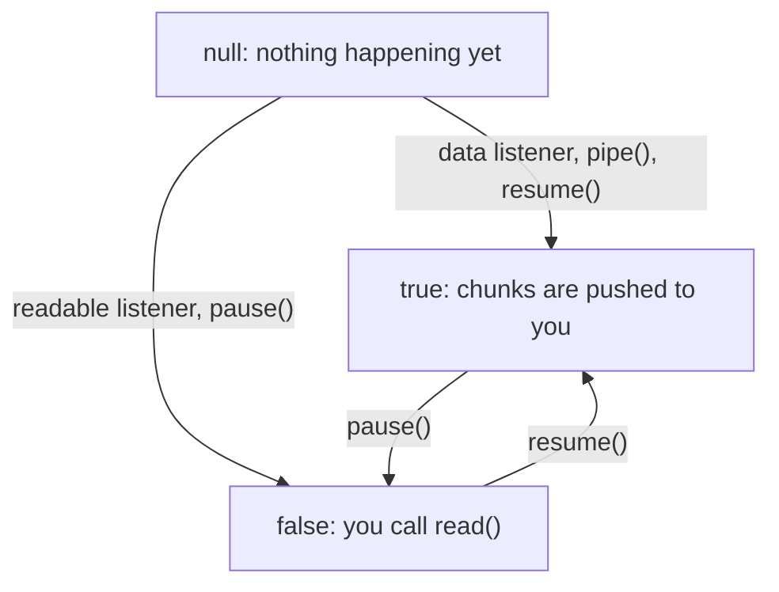

```js title="modes.js"
const { Readable } = require('node:stream');

const stream = Readable.from(['a', 'b']);
console.log('at first:', stream.readableFlowing);

stream.pause();
console.log('after pause():', stream.readableFlowing);

stream.on('data', () => {});
console.log('data listener while paused:', stream.readableFlowing);

stream.resume();
console.log('after resume():', stream.readableFlowing);

const pulled = Readable.from(['c', 'd']);
pulled.on('readable', () => {
  let chunk;
  while ((chunk = pulled.read()) !== null) console.log('read()', chunk);
});
console.log('with a readable listener:', pulled.readableFlowing);
```

```text title="Output"
at first: null
after pause(): false
data listener while paused: false
after resume(): true
with a readable listener: false
read() c
read() d
```

Note that third line. Normally a `data` listener starts the flow, but not after an explicit `pause()`.

### Backpressure

Streams matter most when the two ends run at different speeds. If a file reads at 500 MB/s and the client downloads at 1 MB/s, the difference has to go somewhere. **Backpressure** is how the slow end tells the fast end to wait: `write()` returns `false` once the buffer reaches `highWaterMark`, and the stream emits `drain` when it’s safe to continue.

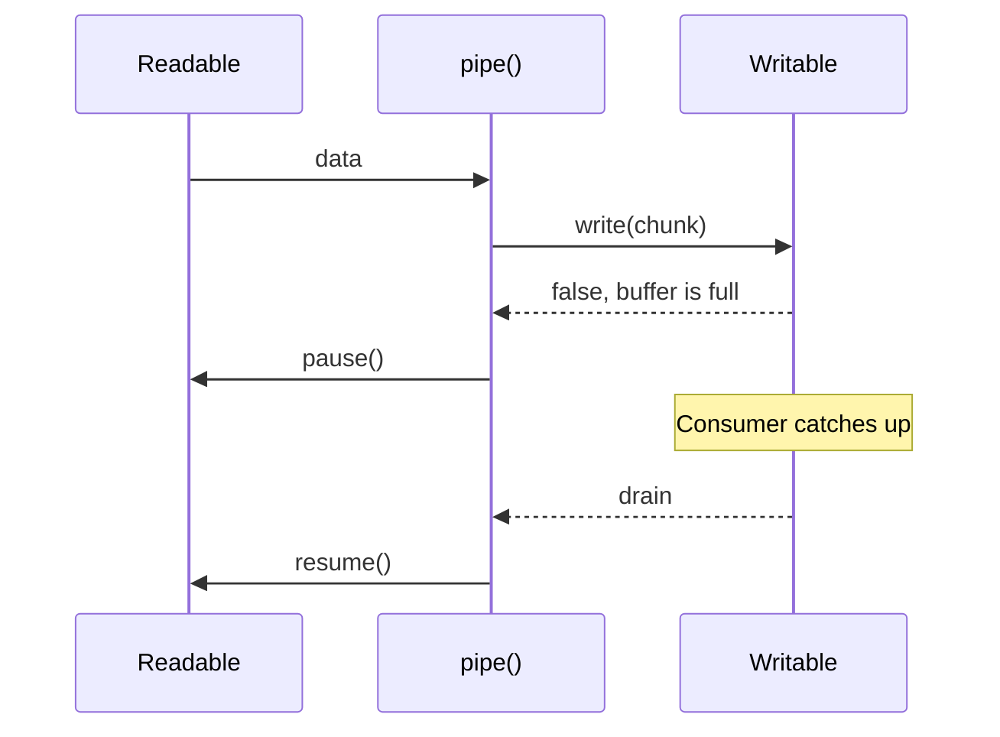

`write()` is only advice. Nothing stops you from ignoring it, and this program measures what happens if you do:

```js title="backpressure.js"
const { Writable } = require('node:stream');

const CHUNK = Buffer.alloc(1024);
const TOTAL = 100_000;

function slowSink() {
  return new Writable({
    highWaterMark: 16 * 1024,
    write(chunk, encoding, done) {
      setImmediate(done); // finishes one chunk per turn of the loop
    },
  });
}

function ignoreBackpressure(sink, finished) {
  let peak = 0;
  for (let i = 0; i < TOTAL; i++) {
    sink.write(CHUNK);
    peak = Math.max(peak, sink.writableLength);
  }
  sink.end(() => finished(peak));
}

function respectBackpressure(sink, finished) {
  let peak = 0;
  let i = 0;

  function pump() {
    while (i < TOTAL) {
      i++;
      const canContinue = sink.write(CHUNK);
      peak = Math.max(peak, sink.writableLength);
      if (!canContinue) {
        sink.once('drain', pump);
        return;
      }
    }
    sink.end(() => finished(peak));
  }

  pump();
}

const mb = (bytes) => (bytes / 1024 / 1024).toFixed(2) + ' MB';

ignoreBackpressure(slowSink(), (ignored) => {
  console.log('ignoring backpressure, peak buffered:', mb(ignored));
  respectBackpressure(slowSink(), (respected) => {
    console.log('respecting backpressure, peak buffered:', mb(respected));
  });
});
```

```text title="Output"
ignoring backpressure, peak buffered: 97.66 MB
respecting backpressure, peak buffered: 0.02 MB
```

Without backpressure, a stream holds as much memory as `readFile` would have, so you’d get none of the benefit. You rarely need to write that loop by hand, since `pipe` and `pipeline` do it for you.

## Streams in practice

### Serving a large file

This server can send a 50 MB file either way:

```js title="serve-file.js"
const fs = require('node:fs');
const http = require('node:http');
const { pipeline } = require('node:stream');

const [, , file, mode] = process.argv;

http
  .createServer((req, res) => {
    if (req.url === '/memory') {
      res.end(String(Math.round(process.resourceUsage().maxRSS / 1024)));
    } else if (mode === 'readFile') {
      fs.readFile(file, (error, data) => res.end(data));
    } else {
      pipeline(fs.createReadStream(file), res, () => {});
    }
  })
  .listen(3001, '127.0.0.1');
```

Here are the results with 20 clients downloading at once:

| Approach      | Data sent | Time  | Server peak memory |
| ------------- | --------- | ----- | ------------------ |
| `fs.readFile` | 1000 MB   | 4.4 s | 1040 MB            |
| `pipeline`    | 1000 MB   | 3.6 s | 99 MB              |

Memory for the `readFile` version grows with the number of clients, since each one gets its own copy of the file. A hundred simultaneous downloads of this 50 MB file could need about 5 GB, while the streaming version only holds a few chunks per client.

### Use `pipeline`, not `pipe`

`pipe` handles backpressure but not errors, and if one side fails, the other is left open. Here the destination fails partway through:

```js title="pipe-vs-pipeline.js"
const { Readable, Writable, pipeline } = require('node:stream');

function parts() {
  const source = new Readable({
    read() {
      this.push('data');
    },
  });
  const sink = new Writable({
    write(chunk, encoding, done) {
      done(new Error('disk full'));
    },
  });
  return { source, sink };
}

{
  const { source, sink } = parts();
  sink.on('error', () => setImmediate(() => console.log('pipe: source destroyed?', source.destroyed)));
  source.pipe(sink);
}

{
  const { source, sink } = parts();
  pipeline(source, sink, (error) => {
    console.log('pipeline:', error.message);
    console.log('pipeline: source destroyed?', source.destroyed);
  });
}
```

```text title="Output"
pipeline: disk full
pipeline: source destroyed? true
pipe: source destroyed? false
```

With `pipe`, a failure on one side leaves the other side open, holding a file descriptor or socket that never gets closed. In a server, that’s also what happens when a client disconnects mid-download. `pipeline` tears down the whole chain and gives you one place to handle the error.

### Compressing a file

The promise version of `pipeline` chains any number of stages:

```js title="gzip.js"
const fs = require('node:fs');
const { pipeline } = require('node:stream/promises');
const { createGzip } = require('node:zlib');

async function main() {
  await pipeline(fs.createReadStream('access.log'), createGzip(), fs.createWriteStream('access.log.gz'));

  const before = fs.statSync('access.log').size;
  const after = fs.statSync('access.log.gz').size;
  console.log(`${before} bytes -> ${after} bytes`);
}

main();
```

```text title="Output"
23000000 bytes -> 78198 bytes
```

That’s a repetitive log file, so it compresses unusually well. The memory use stays flat whatever the size.

### Writing your own

Most custom streams are transforms. Chunks arrive at arbitrary boundaries, so anything that works on lines has to hold on to the incomplete piece at the end. Each stage below can be a class or just an async generator, and the input is this small file:

```text title="orders.csv"
id,customer,total
1,Ada,19.99
2,Zoë,5.00
3,Lin,42.50
```

```js title="transform.js"
const fs = require('node:fs');
const { Transform } = require('node:stream');
const { pipeline } = require('node:stream/promises');

class LineSplitter extends Transform {
  #tail = '';

  constructor() {
    super({ readableObjectMode: true });
  }

  _transform(chunk, encoding, done) {
    const lines = (this.#tail + chunk).split('\n');
    this.#tail = lines.pop();
    for (const line of lines) this.push(line);
    done();
  }

  _flush(done) {
    if (this.#tail) this.push(this.#tail);
    done();
  }
}

async function* toRecords(lines) {
  let columns;
  for await (const line of lines) {
    const values = line.split(',');
    if (!columns) columns = values;
    else yield Object.fromEntries(columns.map((column, i) => [column, values[i]]));
  }
}

async function print(records) {
  for await (const record of records) console.log(record);
}

pipeline(
  fs.createReadStream('orders.csv', { encoding: 'utf8', highWaterMark: 7 }),
  new LineSplitter(),
  toRecords,
  print,
);
```

```text title="Output"
{ id: '1', customer: 'Ada', total: '19.99' }
{ id: '2', customer: 'Zoë', total: '5.00' }
{ id: '3', customer: 'Lin', total: '42.50' }
```

I set `highWaterMark: 7` to force tiny chunks, and the output still comes out whole.

The `encoding` option in there matters too. `ë` takes two bytes, and with this file and these chunks a boundary falls right between them. Converting each chunk to a string separately corrupts the text: without the option, that customer comes out as `Zo��`. `StringDecoder`, which is what the `encoding` option uses, holds back an incomplete character until the rest arrives:

```js title="multibyte.js"
const { StringDecoder } = require('node:string_decoder');

const bytes = Buffer.from('Zoë');
const first = bytes.subarray(0, 3);
const second = bytes.subarray(3);

console.log(String(first), String(second));

const decoder = new StringDecoder('utf8');
console.log(decoder.write(first), decoder.write(second));
```

```text title="Output"
Zo� �
Zo ë
```

Readables and writables follow the same pattern, with one method each:

```js title="custom-streams.js"
const { Readable, Writable } = require('node:stream');
const { pipeline } = require('node:stream/promises');

class Countdown extends Readable {
  #current;

  constructor(from) {
    super({ objectMode: true });
    this.#current = from;
  }

  _read() {
    this.push(this.#current > 0 ? this.#current-- : null);
  }
}

class Printer extends Writable {
  constructor() {
    super({ objectMode: true });
  }

  _write(value, encoding, done) {
    console.log('got', value);
    done();
  }

  _final(done) {
    console.log('all done');
    done();
  }
}

pipeline(new Countdown(3), new Printer());
```

```text title="Output"
got 3
got 2
got 1
all done
```

Pushing `null` signals the end of the data. The `done` callback in `_write` is what drives backpressure: calling it late is how a slow consumer tells the producer to wait.

### Reading with `for await`

Readable streams are async iterable, which is usually the simplest way to consume one. It respects backpressure, because the loop only asks for the next chunk when the body has finished. Leaving the loop early also cleans up:

```js title="for-await.js"
const fs = require('node:fs');

async function main() {
  const file = fs.createReadStream(__filename);

  for await (const chunk of file) {
    console.log('got a chunk');
    break;
  }

  console.log('destroyed after break:', file.destroyed);
}

main();
```

```text title="Output"
got a chunk
destroyed after break: true
```

Node also implements the web platform’s streams. `fetch` returns one as `response.body`, and `Readable.toWeb` and `Readable.fromWeb` convert between the two kinds.

## How requiring modules really works

`require` looks like a built-in keyword. It’s an ordinary function that goes through these steps:

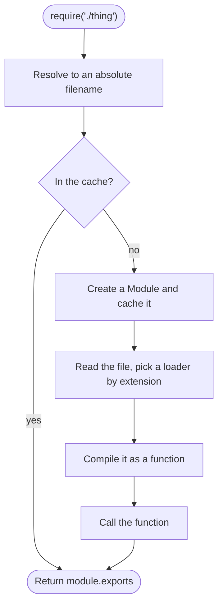

### Step 1: resolving

Node turns the string you passed into one absolute path. Built-in modules are checked first, so they can’t be shadowed. Even with a `node_modules/fs/index.js` present, `require('fs')` returns the real one.

For a relative path, Node tries a fixed list. I created every one of these candidates for `require('./thing')`, then deleted them one at a time to see which won:

```text title="What require('./thing') resolved to, in order"
thing.js
thing.json
thing.node
thing\lib\entry.js    (the "main" field in thing\package.json)
thing\index.js
```

For a bare name like `require('express')`, Node walks up the directory tree, checking `node_modules` at each level. Every module has that list ready in `module.paths`:

```text title="module.paths (shortened)"
C:\app\src\node_modules
C:\app\node_modules
C:\node_modules
```

Inside a package, an `exports` field in `package.json` overrides all of this and acts as a real boundary. Importing a path the package didn’t list fails with `ERR_PACKAGE_PATH_NOT_EXPORTED`, even when the file exists.

### Step 2: wrapping

Your file’s top-level variables don’t become globals, and `require` is available without being defined. Both of those are because your code becomes the body of a function, with these parameters:

```js title="wrapper-source.js"
console.log(require('node:module').wrapper);
```

```text title="Output"
[
  '(function (exports, require, module, __filename, __dirname) { ',
  '\n});'
]
```

You can prove it from inside a module, because a module can see its own arguments, and `return` at the top level is legal:

```js title="wrapper.js"
console.log(arguments.length); // 5
console.log(arguments[0] === exports, arguments[1] === require, arguments[2] === module); // true true true
console.log(arguments[3] === __filename, arguments[4] === __dirname); // true true
console.log(this === module.exports); // true

return; // legal, because this is a function body
```

<Note>
  the string wrapper above is mostly historical. Modern Node doesn’t concatenate strings unless something has patched
  `Module.wrapper`. `wrapSafe` in the loader calls `compileFunctionForCJSLoader`, which compiles your source directly as
  a function with those five parameters. The result is the same, and line numbers in errors don’t need adjusting.
</Note>

### Step 3: executing

Node picks a loader based on the file extension, from a table you can inspect:

```js title="extensions.js"
console.log(Object.keys(require.extensions)); // [ '.js', '.json', '.node' ]
console.log(require.main === module); // true
```

`.js` files are compiled and called. `.json` files go through `JSON.parse`. `.node` files are native addons, loaded with `process.dlopen`. `require.main === module` is the standard way to ask “was this file run directly?”.

Each module gets a `Module` object, which is the `module` you see inside it:

```js title="module-object.js"
console.log(module);
```

```text title="Output (paths shortened, internal symbols removed)"
{
  id: '.',
  path: 'C:\\app',
  exports: {},
  filename: 'C:\\app\\module-object.js',
  loaded: false,
  children: [],
  paths: [ 'C:\\app\\node_modules', 'C:\\node_modules' ]
}
```

### Step 4: returning `module.exports`

`require` returns `module.exports`, and nothing else. `exports` is only a parameter that starts out pointing to the same object. Changing a property on it works, but assigning to it just changes a local variable:

```js title="exports-rebind.js"
function moduleBody(exports, module) {
  exports.kept = 1; // changes the object module.exports points to
  exports = { lost: 2 }; // only changes the local variable
}

const module2 = { exports: {} };
moduleBody(module2.exports, module2);

console.log(module2.exports); // { kept: 1 }
```

That’s the wrapper’s signature with everything else taken away, and it’s the whole explanation for the `exports` versus `module.exports` confusion.

### Step 5: caching

The most important detail is the order of two lines in `Module._load`:

```js title="lib/internal/modules/cjs/loader.js (trimmed)"
Module._load = function (request, parent, isMain) {
  // ...resolve the request to a filename, check the cache...
  const module = cachedModule || new Module(filename, parent);

  if (!cachedModule) {
    Module._cache[filename] = module;
  }

  let threw = true;
  try {
    module.load(filename);
    threw = false;
  } finally {
    if (threw) {
      delete Module._cache[filename];
    }
  }

  return module.exports;
};
```

The module goes in the cache **before** it runs. That one decision is what makes circular dependencies work, or at least not recurse forever, as we’ll see next. If loading throws, the entry is removed so a later `require` can try again.

The cache key is the resolved filename, and that has its own consequences.

## Requiring modules in practice

### A module runs once

```js title="counter.js"
console.log('counter.js is running');

let count = 0;

module.exports = { increment: () => ++count };
```

```js title="use-counter.js"
const first = require('./counter');
const second = require('./counter');

console.log(first === second);
first.increment();
console.log(second.increment());

delete require.cache[require.resolve('./counter')];

const third = require('./counter');
console.log(third === first);
console.log(third.increment());
```

```text title="Output"
counter.js is running
true
2
counter.js is running
false
1
```

Every `require` of a file gets the same object, which makes a module a natural singleton and is why a shared database pool can simply be exported. Deleting from `require.cache` forces a fresh run, which is occasionally useful in tests.

JSON gets cached too, and it’s the same shared object, so changing what you got changes it for everyone:

```js title="use-config.js"
const config = require('./config.json');

config.retries = 99;

console.log(require('./config.json').retries); // 99
```

### Circular dependencies

When two modules require each other, the cache hands back whatever the first one has finished so far:

```js title="circular-a.js"
exports.ready = false;

const b = require('./circular-b');
console.log('in a, b.ready is', b.ready);

exports.ready = true;
```

```js title="circular-b.js"
const a = require('./circular-a');

console.log('in b, a.ready is', a.ready);
console.log('in b, a.missing is', a.missing);

exports.ready = true;
```

```text title="Output of node circular-a.js"
in b, a.ready is false
in b, a.missing is undefined
in a, b.ready is true
(node:836) Warning: Accessing non-existent property 'missing' of module exports inside circular dependency
```

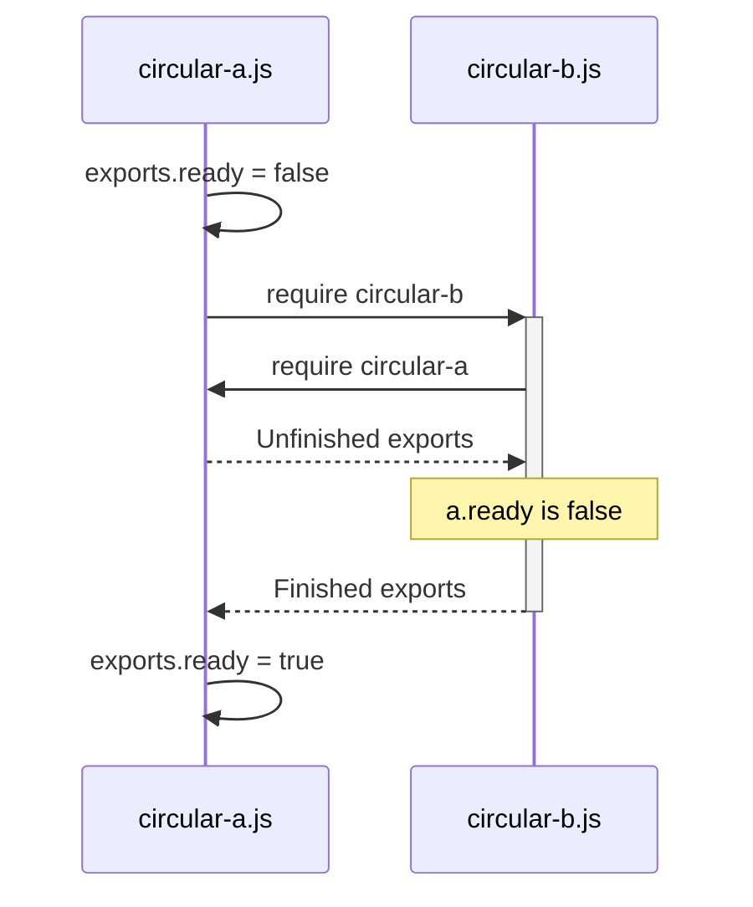

`b` got an incomplete object, and code using it at load time sees missing values. Node warns if you touch a property that isn’t there yet, thanks to a proxy prototype it sets up on exactly this code path. The usual fix is to move the shared code into a third module, or to only use the import inside functions that run later.

### Two copies of the same package

The cache is keyed by path, so the same package installed twice is two separate modules. npm does this when dependencies need incompatible versions:

```text title="The project"
node_modules/
  dep/index.js
  plugin/
    index.js                  module.exports = require('dep')
    node_modules/dep/index.js
```

```js title="two-copies-run.js"
const direct = require('dep');
const viaPlugin = require('plugin');

console.log(direct === viaPlugin);
console.log(new direct.Money() instanceof viaPlugin.Money);
```

```text title="Output"
dep loaded from \node_modules\dep
dep loaded from \node_modules\plugin\node_modules\dep
false
false
```

That second `false` is the bug it produces: an object from one copy fails `instanceof` against the class from the other. It’s the same problem as two copies of React breaking hooks, and `npm ls dep` will show you when it’s happening.

### `require` is synchronous, and it isn’t free

`require` blocks the main thread while it reads and compiles a file. At startup nobody minds, but it’s a bad thing to do inside a request handler. Here’s the cost of loading a big package, on this project’s own `typescript` dependency:

```js title="lazy.js"
const { createRequire } = require('node:module');

const projectRequire = createRequire(process.argv[2]);

console.time('first require');
projectRequire('typescript');
console.timeEnd('first require');

console.time('second require');
projectRequire('typescript');
console.timeEnd('second require');
```

```text title="Output"
first require: 279.226ms
second require: 0.029ms
```

The second call only looks in the cache. For a CLI tool, where those 279 ms come straight out of every run, Node has a compile cache that saves V8’s work to disk. Enable it with `NODE_COMPILE_CACHE=dir` or `module.enableCompileCache()`. With it on, that first `require` dropped from 287 ms to 84 ms on the second run.

### Building `require` yourself

Everything above fits in about 20 lines:

```js title="mini-require.js"
const fs = require('node:fs');
const path = require('node:path');
const vm = require('node:vm');

const cache = {};

function load(filename) {
  if (cache[filename]) return cache[filename].exports;

  const module = { exports: {}, filename, loaded: false };
  cache[filename] = module;

  const dirname = path.dirname(filename);
  const localRequire = (request) => load(path.resolve(dirname, `${request}.js`));

  const source = fs.readFileSync(filename, 'utf8');
  const params = ['exports', 'require', 'module', '__filename', '__dirname'];
  const compiled = vm.compileFunction(source, params, { filename });

  compiled.call(module.exports, module.exports, localRequire, module, filename, dirname);

  module.loaded = true;
  return module.exports;
}

const counter = path.join(__dirname, 'counter.js');

console.log(load(counter).increment());
console.log(load(counter).increment());
```

```text title="Output"
counter.js is running
1
2
```

## ES modules and `require(esm)`

ES modules are the language’s own module system, and they load in a fundamentally different way. `require` runs code as it goes. An ES module graph is processed in three separate phases:

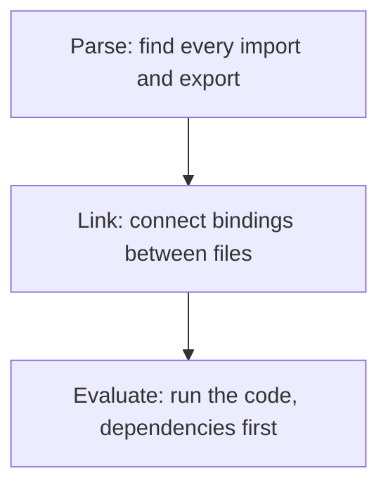

Because imports are all found before anything runs, they’re effectively hoisted:

```js title="esm-dep.mjs"
console.log('dependency runs');

export const value = 1;
```

```js title="esm-main.mjs"
console.log('main runs');

import { value } from './esm-dep.mjs';

console.log(value);
```

```text title="Output"
dependency runs
main runs
1
```

Imports are also **live bindings**: a connection to the exporting module’s variable, where a destructured `require` takes a one-time copy.

```js title="live-counter.mjs"
export let count = 0;

export function increment() {
  count++;
}
```

```js title="live.mjs"
import { count, increment } from './live-counter.mjs';

console.log(count); // 0
increment();
console.log(count); // 1
```

```js title="copy-counter.js"
let count = 0;

module.exports = {
  count,
  increment() {
    count++;
  },
};
```

```js title="copy.js"
const { count, increment } = require('./copy-counter');

console.log(count); // 0
increment();
console.log(count); // 0
```

There’s no wrapper function in an ES module, so the things it used to provide are gone, or have moved:

```js title="esm-facts.mjs"
console.log(this); // undefined
console.log(typeof require, typeof module, typeof __dirname); // undefined undefined undefined
console.log(typeof import.meta.dirname, typeof import.meta.filename); // string string
```

The two systems can work together. Importing CommonJS from an ES module gives you `module.exports` as the default export. Named exports only work where Node can detect them by scanning the source, without running it:

```js title="named.cjs"
exports.detected = 1;

module.exports.alsoDetected = 2;

const name = 'dynamic';
exports[name] = 3;
```

```js title="import-cjs.mjs"
import whole, * as namespace from './named.cjs';

console.log(whole);
console.log(Object.keys(namespace));
```

```text title="Output"
{ detected: 1, alsoDetected: 2, dynamic: 3 }
[ 'alsoDetected', 'default', 'detected', 'module.exports' ]
```

The other direction used to be forbidden. Recent versions of Node allow it, so CommonJS can `require` an ES module, as long as nothing in its graph uses top-level `await`, because `require` has to finish synchronously:

```js title="require-esm.js"
console.log(process.features.require_module); // true
console.log(require('./math.mjs').add(2, 3)); // 5
```

```text title="What happens when the module uses top-level await"
Error [ERR_REQUIRE_ASYNC_MODULE]: require() cannot be used on an ESM graph with top-level await. Use import() instead.
```

For new code, ES modules are the better default. CommonJS still runs an enormous amount of the ecosystem, and understanding how it works is still how you debug it.

## One request through every layer

Here’s everything together. This server streams a 50 MB file, and logs what happens to one request:

```js title="trace-request.js"
const fs = require('node:fs');
const http = require('node:http');
const { pipeline } = require('node:stream');

const start = performance.now();
const log = (message) => console.log(`${(performance.now() - start).toFixed(1).padStart(7)} ms  ${message}`);

const server = http.createServer((req, res) => {
  log(`request event: ${req.method} ${req.url}`);

  let chunks = 0;
  let drains = 0;
  const file = fs.createReadStream(process.argv[2]);

  file.once('open', () => log('file opened'));
  file.on('data', () => chunks++ || log('first chunk read'));
  res.on('drain', () => drains++);
  res.once('finish', () => log(`response finished: ${chunks} chunks, ${drains} waits for drain`));
  res.once('close', () => {
    log('response closed');
    server.close();
  });

  pipeline(file, res, () => log('pipeline complete'));
});

server.on('connection', () => log('connection event'));
server.listen(3002, '127.0.0.1', () => log('listening'));
```

```text title="Output (trimmed)"
  489.0 ms  connection event
  490.9 ms  request event: GET /report
  498.0 ms  file opened
  499.1 ms  first chunk read
  683.7 ms  response finished: 800 chunks, 800 waits for drain
  684.4 ms  response closed
  687.0 ms  pipeline complete
```

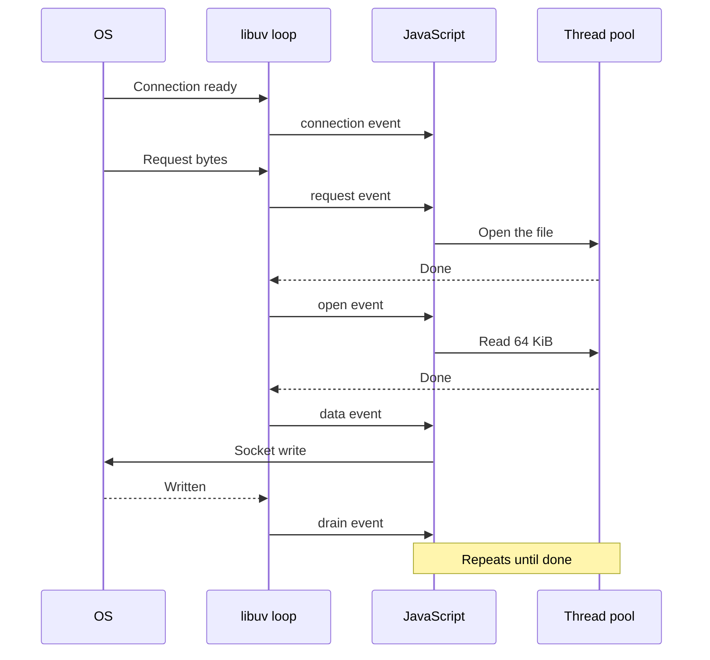

Every part of this post is in that timeline:

- The **poll phase** reported the new connection, with no thread dedicated to it.
- **C++ and llhttp** parsed the HTTP request, then called into JavaScript, and `request` is an ordinary **event**.
- Opening the file went to the **thread pool**, which is why that step took a few milliseconds and blocked nothing.
- The file arrived as a **stream**, in 800 chunks of 64 KiB.
- **Backpressure** paused the file 800 times, once per chunk, so memory stayed flat.
- Between every one of those steps, the **event loop** was free to serve other requests.

At no point in that timeline was the main thread waiting for the disk or the network. Every slow step was handed to the operating system or the thread pool, and the thread only came back when there was something to do. That’s what non-blocking really means, and it’s also why the one thing you can’t do on that thread is make it wait.

## Further reading

- [Design overview](https://docs.libuv.org/en/v1.x/design.html) and [thread pool](https://docs.libuv.org/en/v1.x/threadpool.html), from the libuv docs
- [`uv_run` in the libuv source](https://github.com/libuv/libuv/blob/v1.52.1/src/unix/core.c)
- [The Node.js event loop](https://nodejs.org/en/learn/asynchronous-work/event-loop-timers-and-nexttick), including the timers change in libuv 1.45
- [Don’t block the event loop](https://nodejs.org/en/learn/asynchronous-work/dont-block-the-event-loop), on the thread pool and how to keep it healthy
- [Events](https://nodejs.org/api/events.html), [Stream](https://nodejs.org/api/stream.html) and [Worker threads](https://nodejs.org/api/worker_threads.html), in the Node API docs
- [Modules: CommonJS](https://nodejs.org/api/modules.html) and [Modules: ECMAScript](https://nodejs.org/api/esm.html), the rules behind `require` and `import`
- [Backpressuring in streams](https://nodejs.org/en/learn/modules/backpressuring-in-streams), a longer treatment of `drain` and `highWaterMark`
