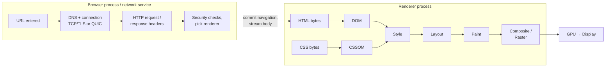
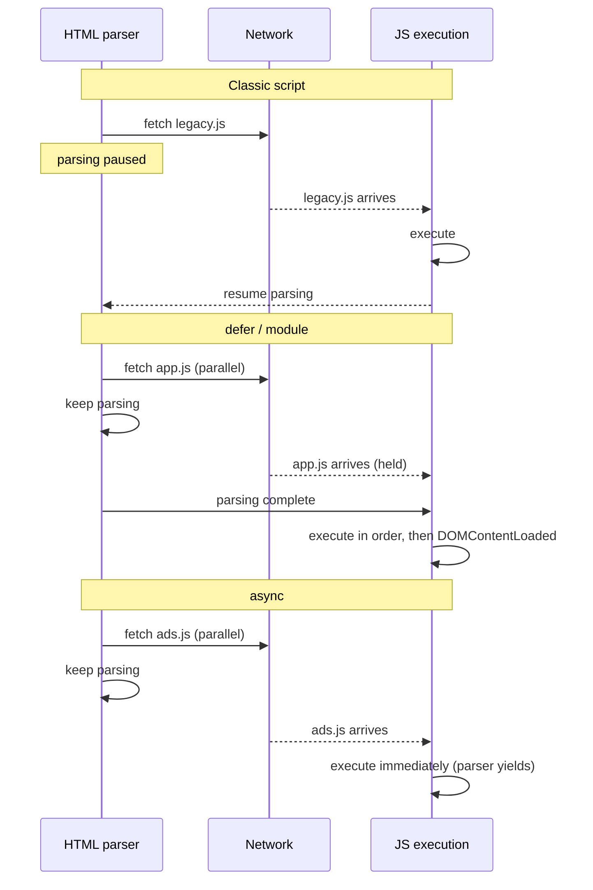
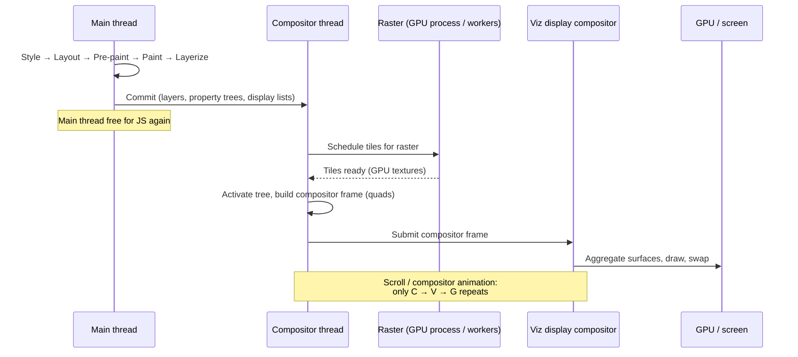
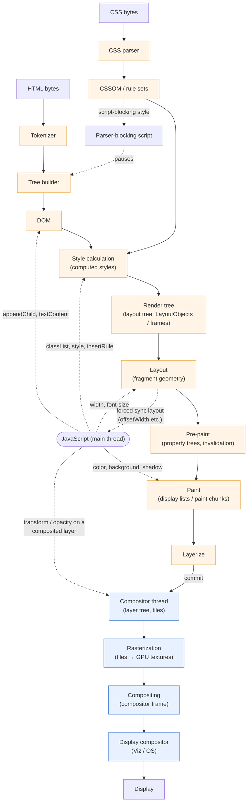
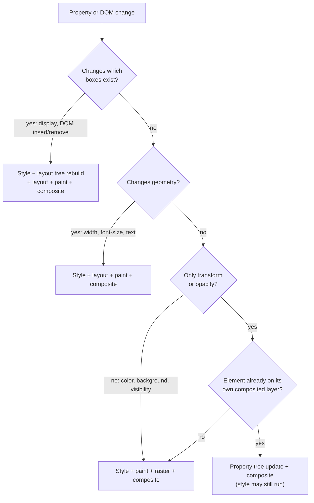

# Inside the Browser Rendering Pipeline: From HTML to Pixels

A browser engine is, at its core, a pipeline of transformations. Bytes become tokens, tokens become a tree, the tree is annotated with styles, styled boxes receive geometry, geometry becomes drawing commands, drawing commands become pixels, and pixels from many sources are assembled into a frame. Each transformation exists because the next stage needs data in a shape the previous stage could not provide.

This article walks that pipeline end to end. Where behaviour is defined by a standard (the WHATWG HTML parsing algorithm, the CSS cascade), it is described as universal. Where it is an engine design choice, it is labelled as such. Most implementation detail here comes from **Chromium** (Blink + `cc` + Viz), because it is the best-documented engine, but Gecko and WebKit solve the same problems with different structures, and those differences are called out where they matter.

> The specifications define *what* the result must be. They say almost nothing about threads, layers, tiles or GPUs. Everything below the "paint" line is engineering, not standard.

---

## 1. Introduction: What Happens After You Enter a URL?

### Navigation before rendering

Before a single byte is parsed, the browser has to decide what the input is (a URL or a search query), resolve DNS, establish a connection (TCP + TLS, or QUIC for HTTP/3), send the request, and handle redirects. In Chromium's multi-process architecture this happens in the **browser process** and the **network service**. Once response headers arrive, the browser inspects the `Content-Type` (and may sniff the body), runs security checks such as Safe Browsing and cross-origin isolation policy, and selects or creates a **renderer process** for the site. The navigation then *commits*: the response stream is handed to that renderer, and the document starts loading.

From this point on, almost everything in this article happens inside the renderer process, and most of it on one thread: the **main thread**.

### The critical rendering path

The **critical rendering path** is the minimal sequence of work required to produce the first frame: fetch HTML, parse it into a DOM, fetch and parse render-blocking CSS into a CSSOM, compute styles, lay out, paint, and composite. Any resource that must be processed before that first frame (blocking stylesheets, parser-blocking scripts) sits on the critical path, and its latency is added directly to the time a user stares at a blank screen.



The rest of the article takes each box in turn and asks: what goes in, what comes out, and what invalidates it.

---

## 2. HTML Parsing: From Bytes to DOM

### Byte decoding

The network delivers bytes, not characters. The parser first determines an encoding using a defined precedence: a byte-order mark, the `charset` parameter of the `Content-Type` header, a `<meta charset>` found by **prescanning** the first 1024 bytes, and finally heuristics or a locale default. If a later `<meta charset>` contradicts the guess, the spec allows the browser to **reparse** the document from scratch, which is why `<meta charset="utf-8">` belongs as the first element in `<head>`.

The decoded character stream is then normalised (for example, CR/LF pairs become LF) and fed to the tokenizer.

### Tokenization

The HTML tokenizer is a **state machine** defined in the WHATWG spec with roughly eighty states: *Data state*, *Tag open state*, *Attribute name state*, *Script data escaped state*, and so on. It consumes characters one at a time and emits tokens: DOCTYPE, start tag, end tag, comment, character, and end-of-file.

The crucial design detail is that the tokenizer is **not independent of the tree builder**. The tree construction stage can switch the tokenizer's state. When the parser inserts a `<script>` or `<style>` element, it switches the tokenizer into a raw-text mode so that `</div>` inside a script string is not treated as markup. When it inserts `<textarea>` or `<title>`, it switches to RCDATA. This feedback loop is one reason HTML cannot be parsed with a generic context-free grammar.

### Tree construction

Tree construction is a second state machine driven by **insertion modes** ("initial", "before html", "in head", "in body", "in table", "in select", and others). Each token is processed according to the current mode, and the builder maintains two key structures:

- **The stack of open elements**: the path from the root to the current insertion point.
- **The list of active formatting elements**: used to reconstruct `<b>`, `<i>`, `<a>` and friends when markup is mis-nested.

The output is the **DOM**: a tree of `Node` objects (`Document`, `Element`, `Text`, `Comment`) that is simultaneously the parser's output and JavaScript's API surface. In Blink these are C++ objects (`blink::Element`, `blink::Text`) wrapped for V8; the DOM *is* the engine's internal data structure, not a copy made for scripts.

### Parser recovery and malformed HTML

HTML has no "syntax error, stop" outcome. The spec defines exact recovery behaviour for every error, so all conforming browsers produce the same DOM from the same broken input. Some examples:

- A missing `<html>`, `<head>` or `<body>` is synthesised.
- `<p>` implicitly closes when a block element such as `<div>` starts.
- Mis-nested formatting like `<b><i></b></i>` is repaired by the **adoption agency algorithm**.
- Content that is not allowed inside a `<table>` is **foster-parented**, moved to just before the table.

```html
<!DOCTYPE html>
<table>
  <tr><td>cell</td></tr>
  Stray text
</table>
<script>
  // "Stray text" is foster-parented: it ends up *before* the table.
  console.log(document.body.firstChild.nodeValue.trim()); // "Stray text"
</script>
```

The practical lesson is that the DOM you inspect in DevTools can differ structurally from the source you wrote, and that interop exists precisely because recovery is specified.

### Incremental parsing

The parser does not wait for the full response. It processes bytes as they arrive, yielding periodically to the event loop, and nodes are appended to the live DOM as soon as they are created. This is why a long HTML document can render its top portion before the bottom has downloaded. Browsers apply heuristics about when to perform the first render (for example, after enough content is parsed or a timer elapses), but the DOM itself grows continuously.

### What happens when the parser meets a script

A classic `<script>` without `async` or `defer` is **parser-blocking**. The tree builder must stop, because the script may call `document.write()` and inject markup at the current insertion point. The parser cannot know what comes next until the script has run.

If the script is external, that stop includes the network fetch. To avoid wasting this time, every major engine runs a **preload scanner** (also called the speculative parser): a lightweight tokenizer that races ahead through the unparsed markup looking for `src` and `href` attributes, and issues fetches for scripts, stylesheets and images it finds. It does not build a DOM, does not execute anything, and cannot see resources that are injected by JavaScript or referenced only from CSS. That last point is why a hero image set as a CSS `background-image`, or inserted by a client-side framework, is discovered late.

---

## 3. CSS Parsing: From Stylesheets to CSSOM

### Discovery and loading

Stylesheets are discovered by the parser (or the preload scanner) via `<link rel="stylesheet">` and `<style>`, and from within CSS via `@import`. `@import` is costly because the nested sheet cannot be discovered until the parent sheet is downloaded and parsed, creating a serial request chain.

### Tokenization and parsing

CSS Syntax Level 3 defines a tokenizer (ident, function, at-keyword, hash, string, number, dimension, whitespace, and so on) and a parser that turns tokens into a list of rules. Unlike HTML, CSS error handling is **forward-compatible by discarding**: an unknown property or invalid value causes only that declaration to be dropped; an invalid selector drops the whole rule. This is what makes progressive enhancement in CSS possible.

### The CSSOM

The **CSSOM** is the object model of parsed stylesheets: `CSSStyleSheet` objects containing `CSSRule` objects (`CSSStyleRule`, `CSSMediaRule`, and so on), each holding selectors and a declaration block. It is what `document.styleSheets` exposes to JavaScript.

It is important to distinguish two things often lumped together as "the CSSOM":

1. **The stylesheet object model**: rules as authored.
2. **The engine's style data**: rule sets indexed for fast matching, and the computed style objects produced per element (covered in Section 5).

In Blink, parsed rules are collected into a `RuleSet` that buckets rules by the rightmost compound selector (by ID, class, tag, or "universal"). When styling an element, the engine only examines buckets that could possibly match.

### Selector matching

Engines match selectors **right to left**. For `.nav li a`, the engine starts at an `<a>` element, then walks ancestors looking for an `li`, then for `.nav`. Matching right to left is efficient because the rightmost compound immediately rules out most elements, and most rules simply do not apply to a given element.

Engines add further optimisations: Blink and WebKit use **Bloom filters** of ancestor identifiers to reject descendant selectors quickly; Gecko's Stylo engine (written in Rust, from Servo) parallelises style computation across threads. These are implementation choices. The standard only defines which elements match.

### Cascade, specificity and inheritance

For every element and every property, several declarations may apply. The **cascade** (CSS Cascading and Inheritance Level 5) picks the winner by comparing, in order:

1. **Origin and importance** (user-agent, user, author; `!important` reverses the order).
2. **Context** (for Shadow DOM encapsulation).
3. **Element-attached styles** (the `style` attribute).
4. **Cascade layers** (`@layer`), where later-declared layers win for normal declarations.
5. **Specificity**: a triple of (ID selectors, class/attribute/pseudo-class selectors, type/pseudo-element selectors).
6. **Order of appearance**.

If no declaration wins, the property is either **inherited** from the parent (for inherited properties such as `color`, `font-family`, `line-height`) or set to its **initial value** (for non-inherited properties such as `margin` or `background-color`).

The cascade produces the *cascaded* value. That is then resolved through a chain: **specified value → computed value → used value → actual value**. `em` units become absolute lengths at computed-value time; percentages that depend on layout (like `width: 50%`) are only resolved to pixels at used-value time, after layout. `getComputedStyle()` returns what the CSSOM spec calls the *resolved value*, which for some properties is the used value. Reading it can therefore force layout.

### Why CSS is render-blocking

A browser could render HTML before CSS arrives, but it would display unstyled content and then restyle it, a **flash of unstyled content**. To avoid that, browsers treat stylesheets in `<head>` as **render-blocking**: no frame is painted until they are loaded and parsed. Stylesheets with a non-matching `media` attribute (`media="print"`) are still downloaded but do not block rendering.

CSS is also **script-blocking**. A classic script might read computed style (`getComputedStyle`, `offsetWidth`), so the HTML spec defines a "style sheet that is blocking scripts": while one is still loading, a parser-blocking script waits for it, and so do deferred and module scripts when parsing finishes. The consequence is a chain: *CSS blocks script execution, and script blocks parsing*, so a slow stylesheet can stall DOM construction even though CSS itself never blocks the parser directly.

| Resource | Blocks HTML parsing? | Blocks rendering? | Blocks script execution? |
|---|---|---|---|
| `<link rel="stylesheet">` in `head` | No | Yes | Yes, for later parser-blocking and deferred scripts |
| `<link rel="stylesheet" media="print">` | No | No | No |
| Classic `<script src>` (parser-inserted) | Yes | Yes (the spec marks it "potentially render-blocking") | Waits for pending stylesheets |
| `<script defer>` / `type="module"` | No | No | Runs after parsing, once pending stylesheets load |
| `<script async>` | No (only while executing) | No | Not ordered |
| `` | No | No | No |

---

## 4. JavaScript and Its Impact on Rendering

### One thread, many responsibilities

In every major engine, JavaScript that touches the DOM runs on the renderer's main thread: the same thread that parses HTML, computes style, runs layout and paints. JavaScript execution therefore competes directly with rendering. While a script is running, the main thread cannot produce a new frame. (Web Workers run JS on other threads, but have no DOM access.)

### Script loading strategies

The `<script>` element's attributes change two independent things: whether **fetching** blocks the parser, and **when** execution happens.

```html
<!DOCTYPE html>
<!-- File names are placeholders. Serve over HTTP: module scripts do not load from file:// URLs. -->
<html>
<head>
  <meta charset="utf-8">
  <link rel="stylesheet" href="app.css">

  <!-- 1. Classic, parser-blocking.
       Parsing stops; fetch; wait for app.css (script-blocking style); execute; resume. -->
  <script src="legacy-analytics.js"></script>

  <!-- 2. defer: fetched in parallel, executed in document order
       after parsing finishes, before DOMContentLoaded. -->
  <script defer src="vendor.js"></script>
  <script defer src="app.js"></script>  <!-- guaranteed to run after vendor.js -->

  <!-- 3. async: fetched in parallel, executed as soon as it arrives,
       interrupting the parser if parsing is still ongoing. No ordering guarantees. -->
  <script async src="ads.js"></script>

  <!-- 4. Module: deferred by default; its import graph is fetched in parallel. -->
  <script type="module" src="main.mjs"></script>

  <!-- 5. Async module: runs as soon as it and its whole import graph are ready. -->
  <script type="module" async src="widget.mjs"></script>
</head>
<body>
  <h1>Content</h1>
</body>
</html>
```



| Strategy | Fetch blocks parser | Execution timing | Order preserved | Typical use |
|---|---|---|---|---|
| Classic | Yes | Immediately on fetch | Yes | Scripts that must run before the rest of the page (rarely needed) |
| `defer` | No | After parsing, before `DOMContentLoaded` | Yes | Application code that needs the full DOM |
| `async` | No | As soon as downloaded | No | Independent third-party scripts |
| `type="module"` | No | Like `defer` | Yes | Modern application code |
| `type="module" async` | No | When module graph ready | No | Independent modules |
| Inline classic | n/a | Immediately (after pending stylesheets) | Yes | Small bootstrap snippets |

Note that `async` and `defer` have no effect on inline classic scripts. They only apply to scripts with `src` (inline *module* scripts do honour `async`). Scripts inserted dynamically via `document.createElement('script')` behave as `async` by default; set `script.async = false` to get ordered execution.

### Manipulating the DOM and CSSOM

When JavaScript changes the DOM (`appendChild`, `textContent`) or styles (`element.style.width`, `classList.add`), the engine does **not** immediately recompute style or layout. It marks affected nodes as dirty and schedules a rendering update. The actual work happens later, either at the next rendering opportunity or immediately if script asks for something that depends on it (Section 6, "forced synchronous layout").

Inserting a stylesheet dynamically is a heavier operation: new rules can match any element, so the engine may need to invalidate style broadly. Engines use **invalidation sets** (Blink) or similar dependency tracking to limit this. A rule like `.dark .card` changing on `<body>` invalidates only descendants with class `card`, not the whole tree.

### Tasks, microtasks, and the rendering opportunity

The HTML event loop processes one **task** at a time (a script execution, a click handler, a `setTimeout` callback, a network callback), then drains the **microtask queue** (promise reactions, `queueMicrotask`, `MutationObserver` callbacks). Then, if it is time for a frame, it runs the **"update the rendering"** steps, which include:

1. Run resize and scroll steps, evaluate media queries, run animations.
2. Run `requestAnimationFrame` callbacks.
3. Recalculate style and layout as needed.
4. Run `ResizeObserver` callbacks (which can loop back to step 3).
5. Paint and hand off to compositing.

Browsers aim for a rendering opportunity at the display's refresh rate (about every 16.7 ms at 60 Hz) but may skip it if nothing changed or the tab is hidden. The consequence is simple: **a task that runs for 200 ms delays the next frame by up to 200 ms.** Nothing inside the main thread can be painted while JavaScript holds it.

```js
// A long task: blocks input handling and rendering for its full duration.
function processAll(items) {
  for (const item of items) expensiveWork(item);
}

// Yielding: break work into chunks so the browser can render and handle input between them.
async function processAllYielding(items) {
  let deadline = performance.now() + 10;
  for (const item of items) {
    expensiveWork(item);
    if (performance.now() >= deadline) {
      // scheduler.yield() ships in Chromium 129+ and Firefox 142+ (not Safari); fall back to a macrotask elsewhere.
      if (globalThis.scheduler?.yield) {
        await scheduler.yield();
      } else {
        await new Promise((resolve) => setTimeout(resolve, 0));
      }
      deadline = performance.now() + 10;
    }
  }
}

function expensiveWork(item) {
  // Placeholder for CPU-heavy work.
  let x = 0;
  for (let i = 0; i < 1e5; i++) x += Math.sqrt(i * item);
  return x;
}
```

Awaiting a resolved promise does **not** yield to rendering, because microtasks run before the rendering steps. Yielding requires returning to the event loop: a new task, or `scheduler.yield()`.

---

## 5. Constructing the Render Tree

### A conceptual tree, an engine-specific structure

Textbooks describe a **render tree**: the subset of DOM nodes that will be displayed, each paired with its computed style. Real engines all build something like this, but they name and shape it differently:

| Engine | Name of the box tree | Node type |
|---|---|---|
| Blink (Chromium) | Layout tree | `LayoutObject` (and immutable `PhysicalFragment` output from LayoutNG) |
| WebKit (Safari) | Render tree | `RenderObject` |
| Gecko (Firefox) | Frame tree | `nsIFrame` |

"Render tree" is a useful concept. "Layout tree" is the more accurate term for modern Chromium, and that is the term used from here on.

### Style calculation

Style calculation (**Recalculate Style** in DevTools) is the step where the cascade from Section 3 is actually executed per element. For each element needing style, the engine:

1. Collects matching rules from the indexed rule sets.
2. Sorts them by cascade order.
3. Applies declarations, resolves inheritance and `var()` substitution, and converts values to computed values.
4. Produces a **computed style object** (`ComputedStyle` in Blink, `ComputedValues` in Stylo).

Engines only restyle dirty subtrees and use caches to avoid recomputing identical results. Gecko's Stylo keeps a style sharing cache that lets siblings with provably identical inputs reuse one computed style; Blink removed its older style sharing cache and relies on a matched-properties cache keyed on the set of declarations that matched. Style cost scales with the *number of elements restyled* multiplied by the *cost of matching*, which is why toggling a class on `<body>` that affects thousands of descendants can be expensive.

### DOM nodes versus layout objects

The DOM tree and the layout tree are not 1:1:

- **No box**: `display: none` elements and their entire subtree, `<head>`, `<script>`, `<meta>`. They have DOM nodes and computed styles (in most cases), but no layout objects.
- **No box for itself, but children render**: `display: contents`.
- **Boxes without DOM elements**: `::before` and `::after` generate layout objects; so do anonymous boxes the engine inserts (for example, an anonymous block wrapping inline content that sits next to a block sibling, or anonymous table parts).
- **One element, many fragments**: an inline element that wraps across lines, or content split across columns, produces multiple fragments in layout output.

### `display: none` versus `visibility: hidden`

| | `display: none` | `visibility: hidden` | `opacity: 0` |
|---|---|---|---|
| Has a layout object | No | Yes | Yes |
| Occupies space | No | Yes | Yes |
| Painted | No | No (but descendants with `visibility: visible` are) | Yes, with alpha 0 |
| Receives pointer events | No | No | Yes |
| In accessibility tree | No | No | Yes |
| Cost to toggle | Layout tree rebuild for subtree + layout | Paint only (geometry unchanged) | Paint or compositing only |

```html
<style>
  .parent { visibility: hidden; }
  .child  { visibility: visible; }   /* This child IS visible. */
  .gone   { display: none; }
  .gone .child { display: block; }   /* This child is NOT rendered: the ancestor has no box. */
</style>
<div class="parent"><span class="child">I appear</span></div>
<div class="gone"><span class="child">I never appear</span></div>
```

The difference is structural. `display` controls *whether a box exists*; `visibility` controls *whether an existing box paints*.

---

## 6. Layout: Calculating Element Geometry

### What layout computes

Layout takes styled boxes and a viewport and produces **geometry**: the position and size of every box and line fragment, and overflow extents. Its inputs are the layout tree and computed styles; its output is what paint and hit-testing need.

In Chromium's **LayoutNG** architecture, layout is structured as a function: a parent passes a **constraint space** (available size, percentage resolution size, fragmentation context) to a child, and the child returns an immutable **fragment** with its size and its children's positions. The output is the **fragment tree**. Immutability makes caching safe: if the constraint space and the node's style have not changed, the previous fragment can be reused.

### The box model and formatting contexts

Every box has content, padding, border and margin areas; `box-sizing` determines whether `width` refers to the content box or border box. How boxes are positioned relative to one another is determined by their **formatting context**:

- **Block formatting context (normal flow)**: block-level boxes stack vertically; vertical margins between adjacent blocks can collapse. A new BFC (from `display: flow-root`, `overflow` other than `visible`/`clip`, flex/grid items, and so on) isolates floats and margin collapsing.
- **Inline formatting context**: inline content is shaped into text runs, broken into **line boxes**, and aligned. Text shaping (via HarfBuzz in Chromium and Firefox, Core Text in WebKit on Apple platforms) and line breaking are often the most expensive parts of layout.
- **Flex and grid formatting contexts**: covered below.

### Positioning

`position: relative` offsets a box *after* normal-flow layout without affecting siblings. `absolute` removes a box from flow and positions it against its **containing block** (the nearest positioned ancestor's padding box). `fixed` uses the viewport (unless an ancestor has a `transform`, `filter` or similar, which makes that ancestor the containing block, a common surprise). `sticky` is laid out in flow and then offset during scrolling, partially resolved on the compositor in Chromium.

### Flexbox, Grid, and intrinsic sizing

Flexbox and Grid are multi-pass algorithms. Flex layout must determine each item's **flex base size**, often by measuring its content, then distribute free space, then possibly lay out items again at their final size. Grid must resolve track sizes, and `auto`, `min-content`, `max-content` and `fr` tracks require measuring items' **intrinsic sizes**.

**Intrinsic sizing** asks "how big would this content be if unconstrained (`max-content`) or as narrow as possible (`min-content`)?" Computing that requires laying out the content, so nested flex/grid containers with content-based sizing can cause the same subtree to be measured multiple times. LayoutNG caches these measurements, but deeply nested content-sized layouts are still a known cost multiplier.

### Layout propagation and invalidation

Geometry is interdependent. A child's height affects its parent's height (for `height: auto`), which affects the parent's siblings' positions. When something changes, the engine marks the changed object as **needing layout** and marks ancestors as having a child that needs layout. On the next layout pass, it walks down from the root, skipping clean subtrees and reusing cached fragments where inputs are unchanged.

**Layout boundaries** limit propagation. If a box has a fixed size and `overflow: hidden`, or uses CSS containment, changes inside cannot affect outside geometry.

```css
/* Tell the engine this widget's internals cannot affect outside layout or paint. */
.widget {
  contain: layout paint;
  /* Or: size it independently so its content doesn't influence its own size. */
  /* contain: strict;  -- implies size, so you must give it explicit dimensions */
}

/* Skip layout and paint for off-screen sections entirely until they approach the viewport. */
.article-section {
  content-visibility: auto;
  contain-intrinsic-size: auto 800px; /* placeholder size to avoid scrollbar jumps */
}
```

**Reflow** is the traditional (Gecko-originated) name for re-running layout; Chromium calls it **Layout**. The terms mean the same thing.

### Forced synchronous layout

Because the engine defers layout, geometry can be *stale* while JavaScript runs. If script then reads a layout-dependent value (`offsetWidth`, `offsetTop`, `clientHeight`, `scrollTop`, `getBoundingClientRect()`, `getComputedStyle()` for layout-dependent properties, `innerText`, `scrollIntoView()`, and others), the engine must bring layout up to date **right now**, synchronously, inside the script. This is a **forced synchronous layout** (or forced reflow).

A single forced layout is not a problem; it would have happened at the next frame anyway. The problem is repeating it.

### Layout thrashing

**Layout thrashing** is interleaving writes and reads in a loop so every read forces a fresh layout:

```html
<!DOCTYPE html>
<html>
<head>
<meta charset="utf-8">
<style>
  .box { height: 20px; margin: 2px 0; background: steelblue; width: 100px; }
</style>
</head>
<body>
<button id="bad">Thrash</button>
<button id="good">Batched</button>
<div id="list"></div>

<script>
  const list = document.getElementById('list');
  for (let i = 0; i < 2000; i++) {
    const div = document.createElement('div');
    div.className = 'box';
    list.appendChild(div);
  }
  const boxes = Array.from(list.children);

  // BAD: read → write → read → write ...
  // Each iteration's write invalidates layout; the next iteration's read forces it again.
  document.getElementById('bad').addEventListener('click', () => {
    console.time('thrash');
    for (const box of boxes) {
      const w = box.offsetWidth;          // READ: forces layout if dirty
      box.style.width = (w + 1) + 'px';   // WRITE: dirties layout
    }
    console.timeEnd('thrash');
  });

  // GOOD: all reads, then all writes. One layout for the reads, one at the next frame.
  document.getElementById('good').addEventListener('click', () => {
    console.time('batched');
    const widths = boxes.map((box) => box.offsetWidth); // READ phase
    boxes.forEach((box, i) => {                          // WRITE phase
      box.style.width = (widths[i] + 1) + 'px';
    });
    console.timeEnd('batched');
  });
</script>
</body>
</html>
```

On a typical machine the first handler triggers about 2,000 layouts; the second triggers one inside the handler (for the first read) and one at the next frame. In real codebases, reads and writes are scattered across components, so common structural fixes are:

- Read geometry in one phase and write in another (libraries like FastDOM formalise this).
- Use `ResizeObserver` and `IntersectionObserver`, which deliver geometry at a point in the frame where layout is already fresh, instead of polling `getBoundingClientRect()`.
- Move writes into `requestAnimationFrame` and keep reads out of it, or read cached values.

---

## 7. Paint: Turning Layout into Drawing Instructions

### Paint does not produce pixels

A common misconception is that "paint" fills a bitmap. In modern engines, paint produces a **display list**: an ordered list of drawing commands ("fill rect at x,y with color", "draw text run with glyphs at positions", "draw image", "clip to rounded rect"). Turning those commands into pixels is **rasterization**, a separate, later step.

Separating them has real benefits: a display list is compact, can be replayed at different scales (for pinch-zoom), can be rasterized in tiles on other threads, and can be diffed to find what changed.

In Chromium, Blink's paint step walks the layout tree and records **display items** grouped into **paint chunks**, each chunk tagged with the **property tree state** (transform, clip, effect, scroll node) it draws under. The recording format is Skia-backed `PaintRecord`s. Gecko builds a display list from the frame tree and hands it to **WebRender**, which converts it into GPU draw calls. WebKit records into graphics layers backed (on Apple platforms) by Core Animation.

### Painting order

Display list order is not DOM order. CSS 2.1 Appendix E defines painting order within each **stacking context**, roughly:

1. Background and borders of the stacking-context root.
2. Child stacking contexts with negative `z-index`.
3. In-flow, non-positioned block descendants (backgrounds, borders).
4. Floats.
5. Inline content: text, images, inline-blocks.
6. Positioned descendants with `z-index: auto` or `0`, and child stacking contexts with `z-index: 0`.
7. Child stacking contexts with positive `z-index`, in order.

Within an element, the order is background color, background image, border, then content, then outline. Shadows (`box-shadow`) paint beneath the background; text shadows beneath text. Blurred shadows and filters are among the more expensive operations to rasterize.

### Stacking contexts

A **stacking context** is an atomic painting group: its descendants are sorted among themselves, and the whole group is then placed as a unit within its parent context. Many properties create one: `relative`/`absolute` positioning with a non-`auto` `z-index`, any `fixed` or `sticky` element, `opacity` less than 1, a non-`none` `transform` (or `translate`/`rotate`/`scale`), `filter`, `backdrop-filter`, `clip-path` or `mask`, `isolation: isolate`, `mix-blend-mode` other than `normal`, `contain: layout` or `paint`, `will-change` naming such a property, top-layer elements, and flex/grid items with a non-`auto` `z-index`.

```html
<style>
  .card    { position: relative; z-index: 1; }          /* new stacking context */
  .tooltip { position: absolute; z-index: 9999; }       /* trapped inside .card's context */
  .header  { position: relative; z-index: 2; }          /* paints above all of .card */
</style>
<div class="card">
  Card
  <div class="tooltip">Tooltip (cannot escape .card, so it's below .header)</div>
</div>
<div class="header">Header</div>
```

A tooltip with `z-index: 9999` inside a context with `z-index: 1` will still render below a sibling context with `z-index: 2`. That is painting order, not a bug.

### Clipping and overflow

`overflow: hidden`, `clip-path`, `border-radius` combined with overflow clipping, and `contain: paint` all clip descendants. In Chromium these become nodes in the **clip property tree** rather than being baked into each display item. Rounded-corner clips are notably more expensive than rectangular ones, since they need masking.

### Paint invalidation and repaint

When a visual-only property changes (`color`, `background-color`, `box-shadow`, `outline`), geometry is unchanged, so layout is skipped. The engine marks the affected objects for **paint invalidation**, re-records only their display items, and computes the **invalidated region**: the screen area whose pixels must be re-rasterized. This is a **repaint**.

**Layout versus paint, precisely:**

- **Layout** answers *where and how big*. Its output is geometry. Changing it can move other elements.
- **Paint** answers *what it looks like and in what order*. Its output is drawing commands. Changing it affects only the pixels of the changed element (plus anything overlapping it).

Every layout change implies a paint change for the moved region. A paint change does not imply layout.

---

## 8. Compositing: Combining Layers

### Why compositing exists

If the whole page were one bitmap, scrolling would require re-rasterizing newly visible content and everything that moved, every frame. Compositing splits the page into independently rasterized **layers** that can be moved, clipped, scaled and faded by the GPU without re-running paint or raster. Scrolling a layer becomes "draw the same texture at a different offset".

### Threads and processes in Chromium

This division of labour is Chromium-specific, but other engines have analogous splits.

- **Main thread (renderer)**: JS, style, layout, pre-paint (building property trees), paint (recording display lists), and in current Chromium, **layerization**: deciding which paint chunks go into which composited layers (the "Composite After Paint" architecture). The Chromium team has said it intends to move layerization off the main thread eventually, but a trace of Chrome 153 still shows `Layerize` on the renderer main thread.
- **Compositor thread (renderer, `cc`)**: receives a **commit** of layers, property trees and display lists from the main thread. It owns the "active tree" used to produce frames, handles scrolling and certain animations, decides which **tiles** need rasterizing, and produces **compositor frames**.
- **Raster work**: tiles (typically a few hundred pixels square) are rasterized by replaying display lists via Skia. In most configurations today this is **GPU rasterization** executed in the **GPU process** ("out-of-process raster"), with raster worker threads in the renderer used for software raster or image decoding.
- **Viz (GPU process)**: the display compositor. It aggregates compositor frames from all renderer processes (the page, cross-origin iframes) and the browser UI, then issues the final draw calls to the GPU and presents the frame.



### Rasterization versus compositing

These are frequently conflated:

| | Rasterization | Compositing |
|---|---|---|
| Input | Display list (drawing commands) | Rasterized layer textures + property trees |
| Output | Pixels in tiles / textures | One final frame |
| Cost driver | Area × drawing complexity (blurs, text, gradients) | Number and size of layers, overdraw |
| Triggered by | Repaint, new tiles scrolled into view, scale changes | Every frame that changes position, opacity, transform, clip |
| Where (Chromium) | GPU process (OOP raster) or raster worker threads | Compositor thread + Viz in GPU process |

Rasterization *creates* pixels. Compositing *arranges* already-created pixels. A frame can involve compositing without any rasterization, which is the whole point of the design.

### Why layers are created

In Chromium's current architecture, composited layers are derived from paint chunks whose property tree nodes have **direct compositing reasons**, for example:

- 3D transforms or `will-change: transform` / `will-change: opacity`.
- Active CSS animations or Web Animations of `transform`, `opacity`, `filter`, or `backdrop-filter`.
- `<video>`, `<canvas>` (accelerated), and cross-process `<iframe>`s.
- Composited scrolling containers.
- `position: fixed` in some contexts, and `backdrop-filter`.

There are also **indirect** reasons: content that paints *above* a composited layer and overlaps it must itself be in a separate layer to preserve painting order. This is **overlap**, and it is the main cause of unexpected layer explosions. Chromium merges ("squashes") overlapping content where it can to limit this.

### Transform and opacity animations

When an element already has its own composited layer, changing `transform` or `opacity` updates a node in the **transform** or **effect property tree**. The layer's existing texture is redrawn with a new matrix or alpha. No style, layout, paint or raster is needed for that frame. Better still, declarative animations (CSS animations/transitions, Web Animations API) on these properties can be **run entirely on the compositor thread**, so they keep running smoothly even if the main thread is blocked by JavaScript.

```css
/* Runs on the compositor in Chromium (and is similarly accelerated in Gecko and WebKit). */
.slide-in {
  animation: slide 300ms ease-out both;
}
@keyframes slide {
  from { transform: translateX(-100%); opacity: 0; }
  to   { transform: translateX(0);     opacity: 1; }
}

/* Triggers layout every frame: avoid animating geometry properties. */
.slide-in-slow {
  position: relative;
  animation: slide-left 300ms ease-out both;
}
@keyframes slide-left {
  from { left: -100%; }
  to   { left: 0; }
}
```

**Caveats** (Requirement: transform and opacity do not *always* avoid layout or paint):

- If the element is **not already composited**, the first change may require a repaint and re-layerization to promote it, and demotion after the animation ends may repaint again.
- Changing `opacity` from 1 to less than 1 creates a stacking context, which can change painting order and require repaint.
- Setting `transform` from `none` to a value creates a stacking context and a containing block for fixed/absolute descendants, which can change layout of those descendants.
- Transforms affect **scrollable overflow**, so an engine may need to recompute overflow.
- Upscaling a composited layer can make it blurry until the engine re-rasterizes at the new scale.
- Animating `transform` via JavaScript (`element.style.transform = ...` each `requestAnimationFrame`) still runs style and commit on the main thread each frame; it avoids layout and paint, but not main-thread involvement.

### Excessive layer promotion

Layers are not free. Each composited layer costs GPU memory roughly equal to width × height × 4 bytes (for its rasterized tiles), plus management overhead in the compositor, and additional overlap testing. Mobile GPUs have tight memory budgets.

```css
/* Anti-pattern: promotes every element to its own layer. */
* { will-change: transform; }

/* Better: promote only what is about to animate, and only for the animation's duration. */
.menu.is-opening { will-change: transform; }
```

`will-change` is a hint for an imminent change, not a generic performance switch. Apply it shortly before an animation and remove it afterward, or rely on the animation itself (which triggers promotion while active).

---

## 9. The Complete Rendering Pipeline

Putting every stage together, here is the full pipeline, with the points at which JavaScript can inject changes:



Orange nodes run on the main thread in Chromium; blue nodes run off the main thread. Each stage's output is the next stage's input, and each stage caches its output. Every change JavaScript makes enters the pipeline at some point and invalidates everything *downstream* of that point, but nothing upstream. The earlier the entry point, the more work is redone.

The data structures, stage by stage, in summary:

| Stage | Output data structure | Answers the question |
|---|---|---|
| HTML parsing | DOM | What content and structure exist? |
| CSS parsing | CSSOM / indexed rule sets | What rules exist? |
| Style | Computed style per element | What are each element's property values? |
| Layout tree build | Layout tree (render tree) | Which elements generate boxes, of what type? |
| Layout | Fragment tree / geometry | Where is each box and how big? |
| Pre-paint | Property trees | Which transform, clip, effect and scroll applies? |
| Paint | Display list | What drawing commands, in what order? |
| Layerize | Composited layer list | Which content moves independently? |
| Raster | Textures (tiles) | What are the pixels of each layer? |
| Composite | Compositor frame | How are layers combined into this frame? |

---

## 10. What Happens When the DOM or CSS Changes?

### The invalidation model

Engines do not re-run the pipeline from the top on every change. Each change sets a dirty bit at the earliest stage it affects; at the next rendering opportunity, the engine runs only the stages with dirty work, only over dirty regions, reusing cached results elsewhere.



### Change by change

**Changing text content.** The text node's data changes, its parent is marked for layout, and text shaping and line breaking re-run for the affected inline formatting context. If the line count changes, the container's height changes and layout propagates to subsequent content. Then the affected region repaints.

**Adding or removing DOM nodes.** New nodes need style (and may affect sibling selectors such as `:nth-child` or `+`, causing wider style invalidation), new layout objects, and layout of the container and potentially everything after it. Removal is similar in reverse.

**Changing width or height.** Style recalc for the element, then layout for the element, its descendants (percent widths, text wrapping) and potentially its ancestors and following siblings, then repaint of everything that moved.

**Changing background-color.** Style recalc, no layout, repaint of the element's area, re-raster of the affected tiles, composite.

**Changing transform.** If the element is already composited (via an animation or `will-change`), this is a property tree update and a composite: no layout or paint. If not, the engine may need to repaint and re-layerize. Changing from `none` creates a stacking context and a containing block, which can trigger more.

**Changing opacity.** Same structure as transform for a composited element. Toggling across the 1 / less-than-1 boundary changes stacking-context status and may require paint.

**Changing visibility.** Geometry is preserved, so no layout. The element's display items are recorded (or omitted) on repaint. It may also affect hit testing and the accessibility tree.

**Changing display.** From `none` to visible (or vice versa), the subtree's layout objects are created or destroyed, then full layout and paint for the affected region. Switching between, say, `block` and `flex` rebuilds the layout objects for that element and re-lays out its children with a different algorithm.

| Change | Style | Layout tree | Layout | Paint | Raster | Composite |
|---|---|---|---|---|---|---|
| `textContent` | ✓ (if needed) | Partial | ✓ | ✓ | ✓ | ✓ |
| Add / remove nodes | ✓ | ✓ | ✓ | ✓ | ✓ | ✓ |
| `width` / `height` | ✓ | | ✓ | ✓ | ✓ | ✓ |
| `background-color` | ✓ | | | ✓ | ✓ | ✓ |
| `visibility` | ✓ | | | ✓ | ✓ | ✓ |
| `display` | ✓ | ✓ | ✓ | ✓ | ✓ | ✓ |
| `transform` (composited layer) | ✓ | | | | | ✓ |
| `transform` (not composited) | ✓ | | Possibly (overflow, containing block) | ✓ | ✓ | ✓ |
| `opacity` (composited layer) | ✓ | | | | | ✓ |
| `opacity` 1 ↔ less than 1 (not composited) | ✓ | | | ✓ | ✓ | ✓ |
| Compositor-driven CSS animation of `transform`/`opacity` | Only at start/end | | | | | ✓ (off main thread) |

This table describes typical Chromium behaviour. The exact set of stages depends on the engine, the element's existing state (composited or not, in a containment boundary or not), and how much of the page is affected. Use DevTools to confirm rather than relying on a property list.

### Batching is automatic until you read

If a handler writes 50 style properties, the engine performs style and layout once, at the next frame. Batching only breaks when script reads layout-dependent state between writes (Section 6). This is why "avoid touching the DOM" is less important than "avoid interleaving reads and writes".

---

## 11. Browser Performance and Core Web Vitals

Core Web Vitals and related metrics are measurements of specific pipeline events. Understanding which stage each metric observes tells you where to look.

| Metric | What it measures | Good threshold (p75) | Pipeline stages that dominate |
|---|---|---|---|
| **FCP** | First frame containing any text, image, non-white canvas or SVG | ≤ 1.8 s | Network, render-blocking CSS/JS, first style/layout/paint |
| **LCP** (Core Web Vital) | When the largest image or text block in the viewport is painted | ≤ 2.5 s | Resource discovery, fetch priority, render blocking, image decode, paint |
| **CLS** (Core Web Vital) | Unexpected layout shifts, scored by impact × distance, worst session window | ≤ 0.1 | Layout: late-arriving content changes geometry |
| **INP** (Core Web Vital) | Latency from an interaction to the next frame presented, near-worst across the visit | ≤ 200 ms | Main-thread availability, event handler cost, style/layout/paint after the handler |

### Critical rendering path, render-blocking resources and FCP

FCP cannot occur until the HTML is parsed far enough to have content, render-blocking stylesheets are applied, and any parser-blocking scripts before that content have executed. Each blocking resource adds at least one network round trip.

- Inline the small amount of **critical CSS** needed for above-the-fold content; load the rest without blocking (for example, with a `media` attribute that is switched after load, or `rel="preload"` plus an `onload` switch).
- Move scripts to `defer` or `type="module"`.
- Avoid `@import` chains.
- Reduce server response time (TTFB), since everything depends on the first HTML byte.

### LCP: discovery, priority, and render delay

LCP time breaks into four sub-parts, according to web.dev's guidance: **TTFB**, **resource load delay** (time until the LCP resource begins downloading), **resource load duration**, and **element render delay** (time from loaded to painted). Each maps to a pipeline mechanism:

- **Load delay** is a discovery problem. If the LCP image is in the HTML as an ``, the preload scanner finds it immediately. If it is a CSS background or inserted by client-side JS, it is found late.
- **Render delay** happens when the image is downloaded but rendering is blocked by CSS, a long JS task, or client-side rendering that hasn't inserted the element yet.

```html
<head>
  <!-- Make a late-discovered LCP image visible to the preload scanner early. -->
  <link rel="preload" as="image" href="/hero.avif" fetchpriority="high">
</head>
<body>
  <!-- Or simply give the LCP  high priority, and never lazy-load it. -->
  
</body>
```

### CLS: layout instability

A **layout shift** is recorded when a visible element's start position changes between two frames without recent user input (shifts within 500 ms of a discrete input are excluded). It is purely a layout-stage phenomenon: something inserted or resized changed the geometry of content that had already been painted. Common causes and fixes:

- Images and iframes without dimensions → set `width`/`height` attributes or `aspect-ratio`, so layout reserves space before the resource arrives.
- Ads, embeds, banners injected above existing content → reserve space with `min-height`, or insert below the fold.
- Web fonts swapping with different metrics → use `size-adjust`, `ascent-override` and related `@font-face` descriptors to match fallback metrics, or `font-display: optional`.
- Animating `top`/`left`/`margin` → animate `transform` instead. Transforms do not change layout position, so they do not count as layout shifts.

### INP, long tasks and main-thread blocking

An interaction's latency is the sum of three phases:

1. **Input delay**: time the event waits because the main thread is busy with another task.
2. **Processing duration**: running the event handlers.
3. **Presentation delay**: style, layout, paint and commit for the next frame, plus compositor and GPU work.

A **long task** is any main-thread task over 50 ms. Long tasks inflate input delay for anything the user does during them. The **Long Animation Frames API** (`PerformanceObserver` with type `long-animation-frame`, available in Chromium) attributes slow frames to specific scripts, including the rendering work in them.

Optimisations that map to the mechanisms:

- **Yield** inside long handlers so the browser can present a frame first (Section 4's `scheduler.yield()` pattern). Do visible feedback first, then defer the heavy work.
- **Shrink presentation delay**: smaller DOMs, cheaper selectors, `content-visibility: auto` for off-screen content, avoiding forced layouts in handlers.
- **Move non-UI work** to Web Workers.
- **Hydration cost** in SSR frameworks often appears as one huge long task. Progressive or selective hydration splits it.

### Compositor-driven smoothness

Because Chromium handles scrolling on the compositor thread, scrolling remains smooth during long tasks, unless a **non-passive** `touchstart`/`wheel` listener forces the compositor to wait for the main thread to see whether `preventDefault()` is called. Declare listeners passive when you don't need to cancel scrolling:

```js
window.addEventListener('wheel', onWheel, { passive: true });
window.addEventListener('touchstart', onTouchStart, { passive: true });

function onWheel(event) { /* read-only handling */ }
function onTouchStart(event) { /* read-only handling */ }
```

---

## 12. Debugging the Rendering Pipeline Using DevTools

### The Performance panel

Chrome DevTools' **Performance** panel records a trace of everything the renderer does. The key tracks:

- **Main**: a flame chart of main-thread tasks. The top bar of each stack is a task; the colors distinguish scripting (yellow), rendering (purple: Recalculate Style, Layout, Pre-paint, Layerize) and painting (green: Paint, Commit).
- **Frames**: each produced frame and whether it was dropped or partially presented.
- **Interactions**: each user interaction with its INP phases.
- **Layout shifts**: each shift and the elements that moved.
- **Compositor**, **Raster** (raster worker threads) and **GPU**: off-main-thread work.

Event names to recognise:

| Event | Stage | What drives its cost |
|---|---|---|
| Parse HTML | DOM construction | Document size, `document.write` |
| Evaluate Script / Function Call | JS | Your code |
| Recalculate Style | Style | Elements affected × selector complexity |
| Layout | Layout | Size of dirty subtree, flex/grid nesting, text |
| Pre-paint | Property trees, paint invalidation | Number of changed objects |
| Paint | Display list recording | Area and complexity of invalidated content |
| Layerize | Composited layer assignment | Number of paint chunks, overlap |
| Commit | Main → compositor handoff | Size of the layer/property-tree update |
| Raster / Rasterize Paint | Raster | Pixel area, blurs, shadows, gradients |

When a Layout or Recalculate Style event happens *inside* a JavaScript call stack (rather than at the end of the frame), DevTools marks it with a red corner and a **"Forced reflow"** warning, showing the line of code that triggered it and the line that invalidated layout earlier.

### The Rendering drawer and Layers panel

Open the Command Menu (Ctrl/Cmd + Shift + P) and run **Show Rendering**:

- **Paint flashing** highlights regions in green when they repaint. If a compositor-only animation is flashing green, it is not compositor-only.
- **Layout shift regions** highlights shifted areas in blue.
- **Layer borders** draws outlines around composited layers and tiles.
- **Frame rendering stats** shows a live frame rate and GPU memory overlay.

The **Layers** panel (More tools → Layers) shows a 3D view of composited layers, each with its **compositing reasons**, memory estimate and paint count. Use it to find accidental layer explosions caused by overlap.

### Hands-on exercise: diagnosing a janky animation

Save this as `jank.html`, open it in Chrome, and follow the steps.

```html
<!DOCTYPE html>
<html lang="en">
<head>
<meta charset="utf-8">
<title>Rendering pipeline exercise</title>
<style>
  body { font-family: system-ui, sans-serif; margin: 0; padding: 16px; }
  .controls { position: sticky; top: 0; background: white; padding: 8px 0; z-index: 1; }
  .track { position: relative; height: 60px; margin: 8px 0; background: #eee; overflow: hidden; }
  .ball {
    position: absolute; top: 10px; left: 0;
    width: 40px; height: 40px; border-radius: 50%;
    background: tomato; box-shadow: 0 4px 12px rgba(0,0,0,.4);
  }
  .item { padding: 4px; border-bottom: 1px solid #ddd; }
</style>
</head>
<body>
  <div class="controls">
    <button id="layoutAnim">A: animate left (layout)</button>
    <button id="compAnim">B: animate transform (composite)</button>
    <button id="stop">Stop</button>
    <label><input type="checkbox" id="thrash"> also thrash layout each frame</label>
  </div>

  <div class="track"><div class="ball" id="ball"></div></div>
  <div id="items"></div>

<script>
  const ball = document.getElementById('ball');
  const items = document.getElementById('items');
  const thrashBox = document.getElementById('thrash');

  // Populate a large DOM so layout is expensive.
  for (let i = 0; i < 3000; i++) {
    const div = document.createElement('div');
    div.className = 'item';
    div.textContent = 'Row ' + i + ' — some text that wraps when the width changes';
    items.appendChild(div);
  }
  const rows = Array.from(items.children);

  let rafId = null;
  let mode = null;
  let start = 0;

  function frame(now) {
    const t = ((now - start) / 1000) % 2;
    const x = (t < 1 ? t : 2 - t) * 400;

    if (mode === 'layout') {
      ball.style.transform = '';
      ball.style.left = x + 'px';               // geometry: style + layout + paint
    } else {
      ball.style.left = '0px';
      ball.style.transform = 'translateX(' + x + 'px)'; // composite (once promoted)
    }

    if (thrashBox.checked) {
      // Interleaved read/write: forced synchronous layout on every row.
      for (let i = 0; i < 200; i++) {
        const h = rows[i].offsetHeight;          // READ forces layout
        rows[i].style.paddingTop = (h % 2) + 'px'; // WRITE invalidates layout
      }
    }
    rafId = requestAnimationFrame(frame);
  }

  function run(newMode) {
    cancelAnimationFrame(rafId);
    mode = newMode;
    ball.style.willChange = newMode === 'composite' ? 'transform' : 'auto';
    start = performance.now();
    rafId = requestAnimationFrame(frame);
  }

  document.getElementById('layoutAnim').onclick = () => run('layout');
  document.getElementById('compAnim').onclick = () => run('composite');
  document.getElementById('stop').onclick = () => cancelAnimationFrame(rafId);
</script>
</body>
</html>
```

**Step 1: Baseline the layout-driven animation.**
Open DevTools → Performance. Set CPU throttling to 4× slowdown to approximate a mid-range phone. Click **A**, then record for 3 seconds. In the Main track, zoom into a single frame: you should see `Animation Frame Fired` → `Recalculate Style` → `Layout` → `Pre-paint` → `Paint` → `Commit` every frame. Enable **Paint flashing** in the Rendering drawer: the ball's track flashes green continuously.

**Step 2: Switch to transform.**
Click **B** and record again. The `Layout` and `Paint` events disappear from the per-frame work; you still see `Recalculate Style`, `Pre-paint`, `Layerize` and `Commit` every frame, because the animation is driven by `requestAnimationFrame` from the main thread. (A trace of this page in Chrome 153 showed exactly that: 90 frames with layout and paint in mode A, and 90 frames with neither in mode B.) Paint flashing stops for the ball after its first frame. In the **Layers** panel, the ball now appears as its own layer with the compositing reason `will-change: transform`.

*Extension:* replace the `requestAnimationFrame` loop for mode B with a CSS `@keyframes` animation on `transform`. Record again: the main thread goes quiet, and the work moves to the Compositor track.

**Step 3: Introduce forced reflows.**
Tick **also thrash layout**, keep mode B running, and record. The Main track now shows many small purple `Layout` blocks *inside* the `Animation Frame Fired` task, each with a red triangle. Click one: the Summary shows **Forced reflow** and links to the `offsetHeight` read in `frame()`. The frame duration is likely well over 16.7 ms, and the Frames track shows dropped frames, even though the animated property itself is compositor-friendly.

**Step 4: Fix and verify.**
Rewrite the thrash loop to read all heights first, then write all paddings (the pattern from Section 6). Record again and confirm that the per-frame forced layouts collapse to at most one.

The lesson of the exercise: a compositor-friendly property does not save a frame whose main thread is busy with forced layouts, and a profile, not a property cheat-sheet, tells you which stage is actually costing time.

---

## 13. Conclusion

The browser rendering pipeline is a sequence of cached transformations, each producing a data structure the next stage needs:

- **HTML parsing** builds the DOM incrementally, with a specified error-recovery algorithm and a preload scanner to hide script-induced stalls.
- **CSS parsing** builds the CSSOM; the **cascade** and **inheritance** resolve one value per property per element during **style calculation**.
- The **layout tree** (render tree) contains only elements that generate boxes; **layout** computes their geometry.
- **Paint** records display lists in stacking-context order; it does not produce pixels.
- **Rasterization** turns display lists into pixel tiles, usually on the GPU; **compositing** assembles layers into frames, off the main thread.
- **JavaScript** shares the main thread with all of the above, so long tasks delay frames, and interleaved reads and writes force layout synchronously.

The reason to understand this as an engineer is leverage. Every performance guideline ("animate transform", "avoid layout thrashing", "defer scripts", "set image dimensions") is a consequence of where a change enters the pipeline and how much downstream work it invalidates. Knowing the mechanism lets you derive the right fix for situations no guideline anticipated, and verify it in a profile.

### Takeaways

1. **Changes invalidate downstream, never upstream.** The earlier a change enters the pipeline, the more work it costs.
2. **CSS blocks rendering and script execution; classic scripts block parsing.** Use `defer`/modules and keep critical CSS small.
3. **Make critical resources discoverable** by the preload scanner, and prioritise the LCP resource.
4. **Batch DOM reads before writes**; prefer observers to polling geometry.
5. **Paint is not raster, and raster is not compositing.** Each has distinct costs and distinct DevTools events.
6. **Transform and opacity are cheap only on an already-composited layer**, and layers cost memory.
7. **Reserve space** for late content to keep CLS low.
8. **Keep tasks short and yield** to keep INP low; scrolling and compositor animations survive a busy main thread, interactions do not.
9. **Profile before and after.** Engine behaviour varies by browser, version and context.

---

## 14. Further Reading

### Specifications

- WHATWG HTML: Parsing HTML documents: https://html.spec.whatwg.org/multipage/parsing.html
- WHATWG HTML: The `script` element: https://html.spec.whatwg.org/multipage/scripting.html#the-script-element
- WHATWG HTML: Event loops and update the rendering: https://html.spec.whatwg.org/multipage/webappapis.html#event-loops
- CSS Syntax Module Level 3: https://www.w3.org/TR/css-syntax-3/
- CSS Cascading and Inheritance Level 5: https://www.w3.org/TR/css-cascade-5/
- Selectors Level 4: https://www.w3.org/TR/selectors-4/
- CSS 2.1, Appendix E: Elaborate description of stacking contexts: https://www.w3.org/TR/CSS21/zindex.html
- CSS Flexible Box Layout Level 1: https://www.w3.org/TR/css-flexbox-1/
- CSS Grid Layout Level 2: https://www.w3.org/TR/css-grid-2/
- CSS Containment Level 2: https://www.w3.org/TR/css-contain-2/
- CSS Object Model (CSSOM): https://www.w3.org/TR/cssom-1/

### Chrome for Developers / Chromium

- Inside look at modern web browser (4-part series): https://developer.chrome.com/blog/inside-browser-part1
- RenderingNG overview: https://developer.chrome.com/docs/chromium/renderingng
- RenderingNG architecture: https://developer.chrome.com/docs/chromium/renderingng-architecture
- Key data structures in RenderingNG: https://developer.chrome.com/docs/chromium/renderingng-data-structures
- LayoutNG: https://developer.chrome.com/docs/chromium/layoutng
- How cc works (Chromium compositor): https://chromium.googlesource.com/chromium/src/+/HEAD/docs/how_cc_works.md
- Blink paint README: https://chromium.googlesource.com/chromium/src/+/HEAD/third_party/blink/renderer/core/paint/README.md
- Performance panel reference: https://developer.chrome.com/docs/devtools/performance/reference
- Rendering tab features: https://developer.chrome.com/docs/devtools/rendering/performance

### web.dev

- Understand the critical path: https://web.dev/learn/performance/understanding-the-critical-path
- Avoid large, complex layouts and layout thrashing: https://web.dev/articles/avoid-large-complex-layouts-and-layout-thrashing
- Stick to compositor-only properties and manage layer count: https://web.dev/articles/stick-to-compositor-only-properties-and-manage-layer-count
- Rendering performance: https://web.dev/articles/rendering-performance
- Largest Contentful Paint: https://web.dev/articles/lcp
- Optimize LCP: https://web.dev/articles/optimize-lcp
- Cumulative Layout Shift: https://web.dev/articles/cls
- Interaction to Next Paint: https://web.dev/articles/inp
- Optimize long tasks: https://web.dev/articles/optimize-long-tasks
- content-visibility: https://web.dev/articles/content-visibility

### MDN Web Docs

- How browsers work: https://developer.mozilla.org/en-US/docs/Web/Performance/Guides/How_browsers_work
- Critical rendering path: https://developer.mozilla.org/en-US/docs/Web/Performance/Guides/Critical_rendering_path
- The `script` element: https://developer.mozilla.org/en-US/docs/Web/HTML/Reference/Elements/script
- Stacking context: https://developer.mozilla.org/en-US/docs/Web/CSS/Guides/Positioned_layout/Stacking_context
- `will-change`: https://developer.mozilla.org/en-US/docs/Web/CSS/Reference/Properties/will-change

### Other engines and references

- Mozilla Hacks, "The whole web at maximum FPS: How WebRender gets rid of jank": https://hacks.mozilla.org/2017/10/the-whole-web-at-maximum-fps-how-webrender-gets-rid-of-jank/
- Mozilla Hacks, "Inside a super fast CSS engine: Quantum CSS (aka Stylo)": https://hacks.mozilla.org/2017/08/inside-a-super-fast-css-engine-quantum-css-aka-stylo/
- Paul Irish, "What forces layout / reflow": https://gist.github.com/paulirish/5d52fb081b3570c81e3a
