import Note from '../../components/Note.astro';

A typical product page references around a hundred resources: one HTML document, a few stylesheets, a dozen scripts, fonts, product images, thumbnails, API responses, analytics beacons and a couple of third-party widgets. The browser does not receive a list of them up front. It finds them one by one, while the HTML is still streaming in, while stylesheets are still downloading and while scripts are still running. At every moment it has to decide which of the requests it knows about deserve the connection right now, and which can wait.

This post answers one question: **when a browser loads a page made of HTML, CSS, JavaScript, images, fonts and other resources, how does it decide what to request first, what to delay and what deserves priority?** The answer has several layers. There is _discovery_ (how the browser learns a resource exists), _prioritization_ (how important the browser thinks it is), _scheduling_ (when the request is actually allowed onto the network), _transport_ (how bytes for competing requests share a connection) and _processing_ (what has to happen to the response before it can affect pixels). Features like `preload`, `fetchpriority`, `preconnect` and `loading="lazy"` are levers on specific layers. They only make sense once you know which layer they act on.

The post builds on earlier ones and avoids repeating them. [Inside the browser rendering pipeline](/blog/inside-the-browser-rendering-pipeline-from-html-to-pixels) covers style, layout, paint and compositing. [Web Performance Metrics: A Deep Dive into Core Web Vitals](/blog/web-performance-metrics-a-deep-dive-into-core-web-vitals) covers how LCP, INP and CLS are measured. [Understanding browser caching](/blog/understanding-browser-caching-memory-cache-disk-cache-and-service-workers) covers HTTP caches and Service Workers, and [Modern Web Image Optimization](/blog/modern-web-image-optimization-formats-delivery-decoding-and-rendering) covers image formats and decoding. Here, the focus is the loading pipeline itself.

<Note>
  three kinds of statement appear in this post, and the difference matters. **Standards** (the [WHATWG HTML
  Standard](https://html.spec.whatwg.org/), the [Fetch Standard](https://fetch.spec.whatwg.org/), W3C specifications and
  IETF RFCs) define behaviour every conforming browser shares: for example, that a classic script without `async` or
  `defer` blocks the parser. **Implementation details** are how a particular engine does it: the priority labels
  "Highest" to "Lowest" are Chromium's, and Firefox and Safari use different internal schemes. **Heuristics** are
  decisions the standards deliberately leave to the browser, such as when a lazy image is close enough to the viewport
  to load. Implementation details and heuristics are described here as current behaviour, mostly in Chromium because it
  is best documented. They are not guarantees and they change between versions.
</Note>

## Why resource loading is a scheduling problem

### What counts as a resource

Anything the browser fetches over the network on behalf of a page is a resource. The Fetch Standard models every one of them as a **request** with a **destination** that says what the response will be used for ([Fetch Standard: request destination](https://fetch.spec.whatwg.org/#concept-request-destination)). The destination is not decoration. It decides which `Accept` header is sent, which Content Security Policy directive applies, whether the response can be used for a particular element, and, in every major browser, how the request is prioritized.

| Resource                 | How it is usually requested                 | Fetch destination         |
| ------------------------ | ------------------------------------------- | ------------------------- |
| HTML document            | Navigation                                  | `document`                |
| Nested document          | `<iframe src>`                              | `iframe`                  |
| Stylesheet               | `<link rel="stylesheet">`, `@import`        | `style`                   |
| Classic or module script | `<script src>`, `import`, `import()`        | `script`                  |
| Image                    | ``, `<picture>`, CSS `url()`, `poster` | `image`                   |
| Font                     | `@font-face src`                            | `font`                    |
| Audio and video          | `<audio>`, `<video>`, `<source>`            | `audio`, `video`          |
| Text tracks              | `<track>`                                   | `track`                   |
| Data                     | `fetch()`, `XMLHttpRequest`                 | empty string (`""`)       |
| Workers                  | `new Worker()`, Service Worker registration | `worker`, `serviceworker` |

The resource types fall into three groups by how they affect the page:

- **Resources that gate rendering or parsing**: the HTML itself, stylesheets in the `<head>`, and classic scripts without `async` or `defer`.
- **Resources that gate specific content**: images, fonts, video posters and the API responses that client-rendered content depends on. They do not stop the page from rendering, but the content they belong to cannot appear without them.
- **Resources that gate nothing visible**: analytics, prefetched resources for future pages, below-the-fold media, and code for interactions that have not happened yet.

### Why not download everything at once?

If bandwidth, latency, CPU and memory were free, the best strategy would be to request every resource the instant it is known. None of them is free.

- **Bandwidth is shared.** All responses on a connection, and usually all connections from a device, compete for the same downstream capacity. On a 1.6 Mbps link, a 400 KB carousel image that downloads in parallel with the 60 KB stylesheet slows the stylesheet down. Sharing bandwidth equally among requests delays _all_ of them compared with sending the important ones first: two 100 KB files that share a link both finish at time 2T, while sending them in sequence finishes one at T and the other at 2T.
- **Latency stacks.** Every new origin needs DNS, TCP and TLS, which on a mobile network can cost several round trips of 100 ms or more each. Requests that depend on other requests stack whole round trips, regardless of bandwidth.
- **The main thread is single-threaded.** Parsing HTML, building the CSSOM, compiling and running JavaScript, style recalculation and layout all share the renderer's main thread. A script that arrives early but is not needed yet can still occupy that thread at the worst possible moment.
- **Memory and decoding cost.** Decoded images take far more memory than their compressed bytes. Fetching and decoding 40 product images that the user never scrolls to wastes memory and battery on low-end phones.
- **Dependencies.** Some resources cannot even be requested until another resource has arrived and been processed. A web font referenced in a stylesheet cannot be requested before the stylesheet is downloaded, parsed and matched against the DOM.

So the browser has to choose. The quality of its choices depends on how early it learns about each resource and how accurately it guesses each resource's importance.

### Critical and non-critical resources

A resource is **critical** when something the user is waiting for cannot appear until it arrives. That is a property of the page, not of the resource type. A stylesheet that styles above-the-fold content is critical; a stylesheet for a print layout is not. A hero image is critical; an identical image in the footer is not. This is why browser heuristics can only approximate importance: the browser sees types and positions, while you know what the user came for.

| Property                | Critical resource                                           | Non-critical resource                                        |
| ----------------------- | ----------------------------------------------------------- | ------------------------------------------------------------ |
| Effect if delayed       | First render, main content or first interaction is delayed  | Something off-screen, invisible or later is delayed          |
| Typical examples        | Head CSS, LCP image, fonts for visible text, hydration code | Analytics, below-the-fold images, chat widget, prefetch      |
| When it should be found | As early as possible, ideally in the initial HTML           | Whenever convenient, often deliberately later                |
| Desired priority        | High, and not competing with junk                           | Low, or not requested until needed                           |
| Useful tools            | Markup discovery, `preload`, `fetchpriority="high"`         | `loading="lazy"`, `defer`, `import()`, `fetchpriority="low"` |

### Perceived loading versus resource completion order

Users do not see network waterfalls. They see a blank screen, then the first content (First Contentful Paint), then the main content (Largest Contentful Paint), then a page that responds to input (Interaction to Next Paint). Two pages that download exactly the same bytes in exactly the same total time can feel completely different: one sends the hero image early and the analytics bundle late, the other the opposite. Loading order matters more than total loading time for the metrics users actually feel. The rest of this post is about how the browser determines that order and how you can influence it.

## The navigation and loading lifecycle

Before looking at any single mechanism, it helps to trace a navigation end to end.

### Navigation initiation

When the user enters a URL or follows a link, the browser process starts a **navigation request** for the document. Several things can happen before the first byte arrives:

1. **Redirects.** Each `301`, `302`, `307` or `308` response restarts the request at a new URL, possibly on a new origin with its own connection setup. A redirect from `example.com` to `www.example.com` to `www.example.com/en/` can cost two or three round trips before any HTML exists.
2. **DNS resolution.** The hostname is resolved to an IP address, from the OS or browser cache when possible. A cold lookup usually costs tens to a little over a hundred milliseconds; web.dev cites "around 20–120 ms" ([web.dev](https://web.dev/articles/preconnect-and-dns-prefetch)). Browsers may also query HTTPS (SVCB) DNS records, which can advertise HTTP/3 support.
3. **Connection establishment.** For HTTP/1.1 and HTTP/2, a TCP handshake (one round trip) followed by a TLS 1.3 handshake (one more round trip, or zero with session resumption and early data). For HTTP/3, the QUIC handshake combines transport and TLS setup into one round trip.
4. **HTTP request and response.** The browser sends the request. The server's think time plus the network trip determines **Time to First Byte (TTFB)**.
5. **Document delivery.** HTML arrives as a stream of bytes. The browser does not wait for the whole document; it starts parsing as soon as the first chunk arrives.

### HTML parsing

The HTML parser has two stages defined by the [HTML Standard's parsing algorithm](https://html.spec.whatwg.org/multipage/parsing.html):

- The **tokenizer** turns characters into tokens: start tags, end tags, text, comments.
- The **tree builder** consumes tokens and builds the DOM, handling the many error-recovery rules that make HTML forgiving.

Parsing is incremental. The DOM grows as bytes arrive, and the browser can render the partially parsed document. Two things interrupt this flow:

- A **parser-blocking script** (a classic `<script>` without `async`, `defer` or `type="module"`) stops the tree builder. The parser cannot continue until the script has been fetched and executed, because the script might call `document.write()` and insert markup at the current position.
- That script, in turn, may have to wait for **stylesheets** that came before it, because it might read computed styles. The HTML Standard calls these "script-blocking style sheets".

When a script finishes, the parser resumes where it stopped. While it is stopped, a second, lighter parser keeps reading ahead: the **speculative preload scanner**, covered in detail below.

### Resource discovery

Resources are found by different subsystems at different times:

- **The HTML parser** finds resources as it creates elements: `<link>`, `<script>`, `` and so on.
- **The preload scanner** finds many of the same resources earlier, by scanning markup the parser has not reached yet.
- **The CSS engine** finds resources referenced from stylesheets (`@import`, `url()` in properties, `@font-face`), but some of them only once the stylesheet is parsed and its rules match elements in the DOM.
- **JavaScript** finds resources at run time: `import()`, `fetch()`, injected elements and client-rendered markup.
- **Nested documents** (iframes) run their own navigation and their own copy of this whole pipeline.

### Resource fetching and processing

Every discovered resource becomes a request that goes through roughly the same steps:

1. **Request creation.** The browser builds a request with a URL, a destination, a mode (`no-cors`, `cors`, `same-origin`), a credentials mode and an initial priority.
2. **Cache lookup.** The memory cache, then the HTTP disk cache (or a Service Worker, if one controls the page). A fresh cache hit never reaches the network, so it is never prioritized against network traffic.
3. **Scheduling.** The request waits in a queue until the browser's scheduler allows it to start. In Chromium, low-priority requests can be held back while more important work is in progress.
4. **Connection.** The request needs a connection: an idle one from the pool, a new one, or a stream on an existing HTTP/2 or HTTP/3 connection.
5. **Download.** Response bytes arrive and are passed back to the renderer.
6. **Processing.** CSS is parsed into rules, scripts are compiled and executed, images are decoded, fonts are validated and loaded.
7. **Dependency resolution.** Processing can unblock the parser, unblock rendering, or reveal new resources, which go back to step 1.

### Rendering

Rendering follows the stages described in the [rendering pipeline post](/blog/inside-the-browser-rendering-pipeline-from-html-to-pixels): style calculation using the CSSOM, layout, paint, and compositing. What matters here is the link back to loading. The browser will not paint the document while render-blocking stylesheets are pending, and will not paint an image or text in a web font until the bytes for it have arrived.

### Everything overlaps

The stages above are not a sequence. While the parser is building the DOM, the preload scanner is discovering resources, the network is downloading several of them, CSS is being parsed, a script is compiling, and the first frame may already be on screen. The sequence diagram shows this concurrency for a small page.

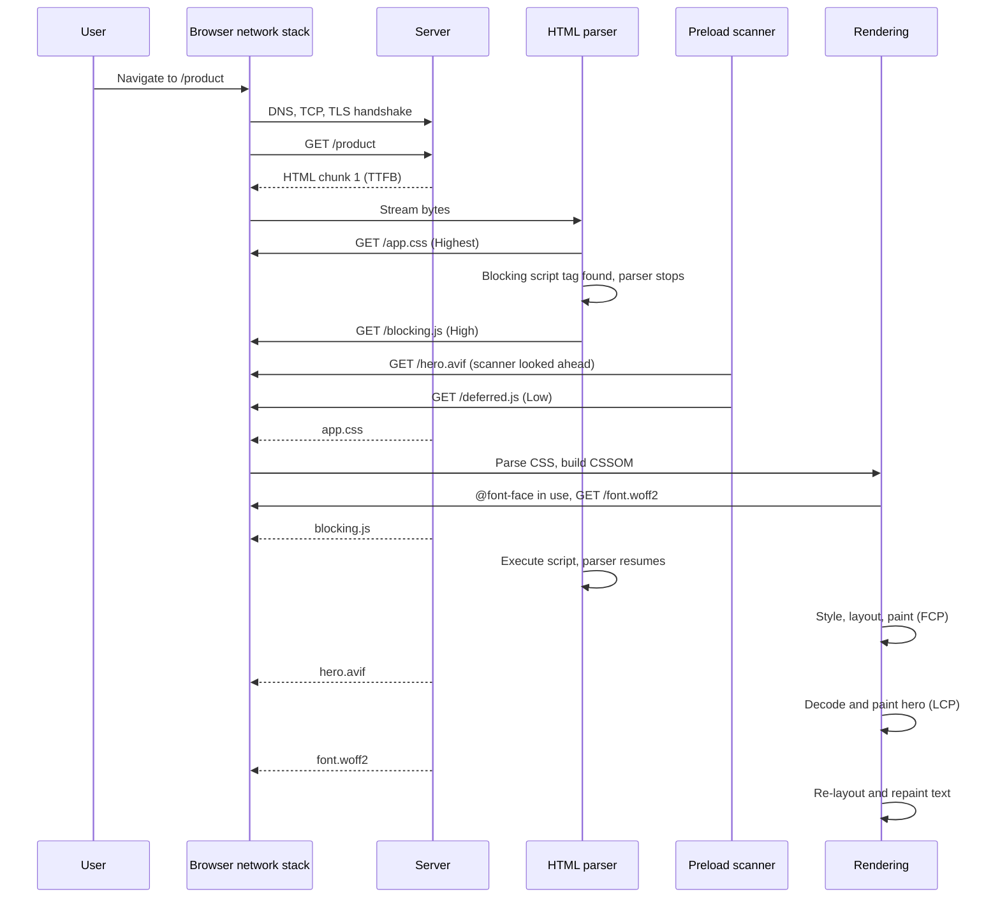

The interesting arrows are the ones that start from somewhere other than the HTML parser. The preload scanner requests the hero image while the parser is stuck. The font request comes from the rendering side, not from the markup, and only after CSS has been processed. Each of those is a place where the order of requests is decided by a mechanism you can understand and influence.

## Resource discovery: how browsers find resources

A browser cannot prioritize a request it does not know about. Discovery is the first and often the largest source of delay, and no priority hint can compensate for a resource that is found late. This section looks at each discovery channel, then at the mechanism that makes HTML discovery fast: the preload scanner.

### HTML-based discovery

When the tree builder inserts an element, the element's own processing model decides whether a fetch starts. The HTML Standard defines this per element:

- **`<link rel="stylesheet">`** starts fetching the stylesheet as soon as the element is inserted into the document (if its `media` and `disabled` state allow it). A stylesheet in the `<head>` whose media matches is **render-blocking**.
- **`<script src>`** starts fetching when the element is "prepared". Without `async`, `defer` or `type="module"`, the parser then waits for it.
- **``** runs the image's "update the image data" algorithm. That algorithm selects a candidate from `src`, `srcset` and `sizes` (and from the parent `<picture>`'s `<source>` elements) and fetches it, unless `loading="lazy"` defers the fetch.
- **`<picture>` and `<source>`** do not fetch anything by themselves. They provide candidates to the `` inside them, and the `` is the element that loads and renders.
- **`<video>`** fetches its `poster` image and, depending on `preload` and `autoplay`, some or all of the media resource. **`<audio>`** works the same way without a poster.
- **`<iframe src>`** starts a nested navigation with its own document, parser and subresources. `loading="lazy"` can defer it.
- **`<link rel="preload">`** fetches the resource named by `href` with the destination given by `as`, without using it.
- **`<link rel="preconnect">`** and **`<link rel="dns-prefetch">`** fetch nothing; they warm up connections or DNS.
- **`<link rel="modulepreload">`** fetches a module script and can also parse and compile it ahead of time.

One consequence matters a lot: the order of elements in the document is the order in which the _parser_ discovers them. A stylesheet referenced at the bottom of the `<body>` is discovered only after everything above it has been parsed, unless the preload scanner finds it first.

### CSS-based discovery

CSS adds resources in a second phase that depends on the first. It has three discovery mechanisms, each with different timing.

**`@import`** is discovered when the importing stylesheet is parsed. The imported sheet is then requested and parsed, and it can contain further imports:

```css
/* main.css: discovered from HTML, downloaded, then parsed */
@import url('/css/base.css'); /* found only after main.css arrives */
@import url('/css/components.css'); /* found at the same time as base.css */

/* base.css can itself contain: */
@import url('/css/typography.css'); /* found only after base.css arrives */
```

Imported sheets join the render-blocking set of the stylesheet that imports them. Three levels of `@import` therefore mean three sequential round trips before the browser can render anything. Chromium's preload scanner can find `@import` rules at the start of inline `<style>` blocks, but it does not read external stylesheets, so imports inside a downloaded `.css` file are always found late.

**`url()` in properties** such as `background-image`, `mask-image`, `list-style-image` or `cursor` is _not_ fetched when the stylesheet is parsed. The browser fetches it only when a rule using it applies to an element being rendered. The stylesheet must be downloaded and parsed, the element must exist in the DOM, and style must be computed for it. A background image on `.hero` is requested only after the CSS is in, the `.hero` element has been parsed, and a style recalculation has matched the rule. This is why a CSS background hero image almost always starts downloading later than the same image as an ``.

**`@font-face`** is lazier still. Declaring a font face does not download it. A font is fetched only when text that will be rendered uses a family that resolves to that face, and only for faces whose `unicode-range` covers characters in that text ([CSS Fonts Level 4](https://www.w3.org/TR/css-fonts-4/#font-face-loading)). Font discovery needs the stylesheet, the DOM text and a style calculation, which puts fonts at the end of the discovery queue unless you intervene.

```html
<!-- Discovery timing for resources referenced only from CSS -->
<head>
  <link rel="stylesheet" href="/css/main.css" />
</head>
<body>
  <section class="hero">
    <!-- .hero { background-image: url('/img/hero.avif') } lives in main.css:
         requested only after main.css is parsed AND this element is styled -->
    <h1>Autumn collection</h1>
    <!-- h1 { font-family: 'Brand Sans' } lives in main.css:
         the font is requested only once this text is styled -->
  </section>
</body>
```

Stylesheets also create indirect dependencies. A slow stylesheet delays every parser-blocking script that follows it, because those scripts wait for script-blocking style sheets. That delays the parser, and with it the discovery of everything after the script.

### JavaScript-based discovery

JavaScript discovers resources only when it runs. Everything it finds is at least one full script download, parse, compile and execution behind the HTML.

```js
// 1. Dynamic import: the browser learns about checkout.js only when this line executes.
const { startCheckout } = await import('/js/checkout.js');

// 2. Script injection: dynamically inserted scripts are async by default.
const s = document.createElement('script');
s.src = 'https://widgets.example.com/reviews.js';
document.head.append(s);

// 3. Data requests: the product image URL is unknown until this response is parsed.
const product = await fetch('/api/products/42').then((r) => r.json());

// 4. Client-side rendering: the  does not exist in the server HTML at all.
document.querySelector('#gallery').innerHTML = ``;
```

`XMLHttpRequest` behaves like `fetch()` for discovery purposes. Static `import` statements in module scripts are slightly better. The browser fetches a module, parses it, finds its static imports and fetches those, so the depth of the import graph becomes a chain of round trips. (`modulepreload`, covered later, exists to flatten that chain.)

The key distinction is between **parser-discovered** resources and **runtime-discovered** resources. Parser-discovered resources appear in the HTML the server returns, so the parser and preload scanner can find them. Runtime-discovered resources exist only after code runs, and they carry three hidden costs: they wait for the script that reveals them to download, they wait for that script to run on a possibly busy main thread, and they are invisible to every early-discovery mechanism the browser has. A single-page application that renders its hero image from JavaScript can easily start the image download a second or more after the HTML arrived on a mid-range phone, even when the image itself is small.

Nested documents add one more level. An iframe's resources are discovered by the iframe's own parser after the iframe's own navigation, so everything inside a third-party embed is at least one document load behind the parent.

### The speculative preload scanner

#### The problem it solves

Consider a page whose `<head>` contains a blocking script, followed by a stylesheet and some images in the body:

```html
<head>
  <script src="/js/legacy-config.js"></script>
  <!-- The parser stops here until legacy-config.js is downloaded and executed -->
  <link rel="stylesheet" href="/css/app.css" />
</head>
<body>
  
  <script src="/js/app.js" defer></script>
</body>
```

A naive parser would request `legacy-config.js`, wait for it, execute it, and only then see `app.css`, `hero.avif` and `app.js`. Every blocking script would serialize the network, and the page would download one script-sized gap at a time.

Browsers solve this with **speculative parsing**. The HTML Standard explicitly allows it: while the parser is blocked on a script, a user agent may speculatively parse the rest of the input to start fetches, as long as speculation never changes the DOM ([HTML Standard: speculative HTML parsing](https://html.spec.whatwg.org/multipage/parsing.html#speculative-html-parsing)). The standard says what speculation may and may not affect; how it is implemented is up to each engine. In WebKit and Blink the component is called the **preload scanner**, the name web.dev uses as well ([web.dev: Don't fight the browser preload scanner](https://web.dev/articles/preload-scanner)). Gecko implements the same idea with its own speculative parser.

#### What it does

web.dev describes the preload scanner as a "secondary HTML parser" that reads raw markup while the primary parser is blocked. It does not build a DOM, run scripts or compute styles. It looks for tokens that obviously reference resources and issues requests for them:

- `<link rel="stylesheet">` with a matching `media`, `<link rel="preload">`, `<link rel="modulepreload">` and preconnect hints.
- `<script src>`, including `async`, `defer` and module scripts.
- ``, plus `srcset` and `sizes`, using the viewport size and device pixel ratio it knows to choose a candidate, and `<picture>` with its `<source>` elements.
- In Chromium, a few extra cases such as `@import` rules at the top of inline `<style>` blocks.

When the main parser later reaches an element whose resource was already requested speculatively, the browser reuses the in-flight or cached response instead of sending the request again.

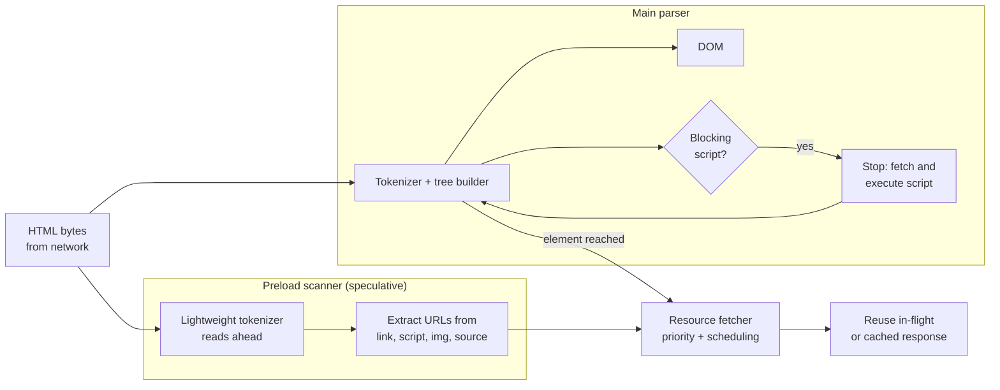

#### What it cannot find

Because it only tokenizes markup, the scanner is blind to anything that requires running code or computing styles:

- **Resources referenced from CSS files**: background images, fonts and `@import` rules inside external stylesheets. In web.dev's words, "the browser preload scanner scans _markup_"; resources in CSS are requested at the time the CSS engine discovers them.
- **Resources created by JavaScript**: injected scripts, `fetch()` calls, dynamically imported modules and any client-rendered element.
- **Images whose URLs are hidden in `data-src`** or similar attributes used by JavaScript lazy loaders. The scanner sees no `src` and fetches nothing.
- **Stylesheets whose `media` does not match.** Chromium does not fetch these speculatively; the parser requests them at the lowest priority when it reaches them ([web.dev: Fetch Priority](https://web.dev/articles/fetch-priority)).
- **Markup that has not arrived yet.** Content in later chunks of a streamed response cannot be scanned until it arrives, and markup produced by `document.write()` can only be scanned once written.

Images with `loading="lazy"` are a special case. The scanner can see their URLs, but early discovery does not help them: by definition, the browser may not request a lazy image until layout shows that it is near the viewport. That is correct for below-the-fold images and harmful for an above-the-fold image marked lazy by mistake.

#### Parser-blocking scripts and speculation

The preload scanner changes the cost of a parser-blocking script from "everything after it is _discovered_ late" to "everything after it is _rendered_ late". The script still stops DOM construction and still delays first paint, but downloads behind it can proceed. Two situations defeat the scanner anyway:

1. **A script that injects the resources the page needs.** If the blocking script inserts the main stylesheet or the hero image itself, there is nothing in the markup for the scanner to find.
2. **`document.write()`.** Content written by a script was never in the original markup. Chromium also intervenes against cross-origin parser-blocking scripts inserted through `document.write()` on slow connections, and may not load them at all ([Chrome for Developers: Intervening against document.write()](https://developer.chrome.com/blog/removing-document-write)).

#### Implementation differences

The concept is shared; the details are not. Engines differ in which elements and attributes the scanner understands, whether it evaluates `srcset` against the real viewport, whether it scans inline `<style>` blocks, which thread it runs on, and how its requests are prioritized. Treat any claim of the form "the scanner fetches X" as engine-specific until you have verified it, for example with [Experiment 2](#experiment-2-observe-the-speculative-preload-scanner).

### Early and late discovery side by side

The same image can be discovered at very different times depending only on how it is referenced:

```html
<!-- EARLY: a real src in the server HTML. The preload scanner finds it in the first chunk. -->


<!-- LATER: CSS background. Needs app.css, the DOM element and a style calculation first. -->
<div class="hero"></div>

<!-- LATER STILL: JS lazy loader. Needs the loader script to download and run. -->


<!-- LATEST: client-rendered. Needs the bundle, an API response and a render. -->
<div id="root"></div>
```

The rest of the loading pipeline can only reorder requests the browser already knows about. Discovery sets the earliest moment a request _could_ start.

## Critical resources and the critical request chain

### What makes a resource critical

Some resources are critical by definition, because the standards make them blocking:

- **Render-blocking CSS.** A stylesheet in the `<head>` with a matching media query blocks rendering of the document until it, and anything it imports, is loaded and parsed. This is deliberate: painting unstyled content and then restyling it would be worse than waiting.
- **Parser-blocking JavaScript.** A classic script without `async` or `defer` blocks the parser, and the parser must get past it before any content below it can exist in the DOM.
- **Explicitly render-blocking resources.** The `blocking="render"` attribute on `<script>`, `<style>` and `<link>` elements lets authors add resources to the render-blocking set ([HTML Standard: blocking attributes](https://html.spec.whatwg.org/multipage/urls-and-fetching.html#blocking-attributes)). Chromium-based browsers and Safari 18.2 and later support it; Firefox does not yet, and ignores the attribute ([caniuse](https://caniuse.com/wf-blocking-render)).

Other resources are critical because of what the page contains, which the browser can only infer:

- **Fonts for visible text**, especially the font of the LCP text element or the main heading.
- **Above-the-fold images**, and above all the **LCP image**.
- **Hydration and interaction code** that must run before the initial UI responds.
- **Critical API responses** in client-rendered pages, where the main content cannot render until data arrives.

### The critical rendering path

The critical rendering path is the dependency graph from the HTML to the first frame.

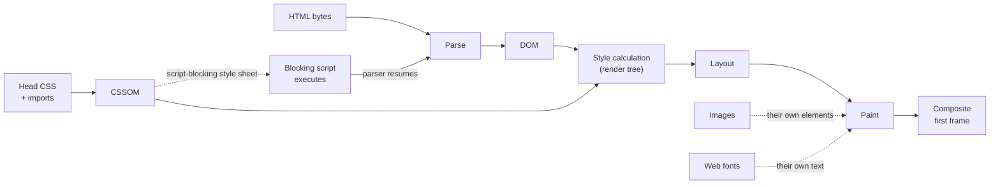

Solid arrows are hard dependencies of the first frame. The dotted arrows from images and fonts are content dependencies: the first frame can be painted without them, but the specific elements they belong to cannot be painted correctly until they arrive. (A font may also hide its text for a short period, depending on `font-display`.) This difference explains why CSS usually gates FCP while images and fonts usually gate LCP.

### Critical request chains

A **critical request chain** is a sequence of requests in which each request is discovered only after the previous one has been downloaded and processed. Each link costs at least one round trip plus processing time, regardless of bandwidth.

A classic CSS and font chain:

```html
<!-- index.html: link 1 of the chain -->
<!doctype html>
<html lang="en">
  <head>
    <meta charset="utf-8" />
    <title>Ridge GTX Trail Shoe</title>
    <link rel="stylesheet" href="/css/main.css" />
    <!-- link 2 -->
  </head>
  <body>
    <h1 class="product-title">Ridge GTX Trail Shoe</h1>
  </body>
</html>
```

```css
/* /css/main.css: link 2 */
@import url('/css/typography.css'); /* link 3: discovered only after main.css is parsed */
```

```css
/* /css/typography.css: link 3 */
@font-face {
  font-family: 'Brand Sans';
  src: url('/fonts/brand-sans.woff2') format('woff2'); /* link 4: needs this CSS AND styled text */
  font-display: swap;
}

.product-title {
  font-family: 'Brand Sans', system-ui, sans-serif;
}
```

And a JavaScript-driven image chain, typical of client-rendered product pages:

```js
// /js/app.js: link 2, loaded by <script type="module" src="/js/app.js">
const { renderGallery } = await import('./gallery.js'); // link 3
const product = await fetch('/api/products/42').then((r) => r.json()); // link 4, starts only after gallery.js
renderGallery(product); // inserts : link 5
```

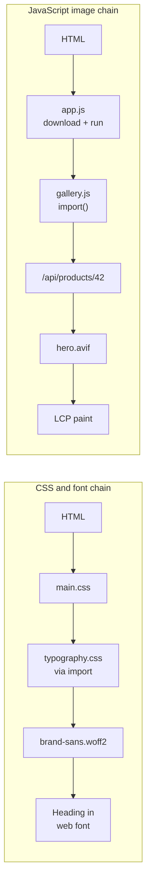

As an illustration (arithmetic, not a measurement): on a connection with a 150 ms round-trip time, each link adds at least 150 ms before its successor can be requested. Four links after the HTML put the hero image request at least 600 ms after the HTML started arriving, before counting download sizes or execution time. The fixes all have the same shape: **shorten the chain** by making later resources discoverable earlier. Put the hero image in the HTML, replace `@import` with `<link>` elements, preload the font, or render the product markup on the server. Shrinking each file barely helps, because the chain is bound by latency, not bandwidth.

### Identifying critical resources and chains

Several tools expose the dependency structure directly:

- **Chrome DevTools Network panel.** The **Initiator** column shows which document, stylesheet or script line caused each request. Holding <kbd>Shift</kbd> while hovering a request highlights its initiators in green and its dependants in red ([Chrome DevTools: Network features reference](https://developer.chrome.com/docs/devtools/network/reference)).
- **Lighthouse and the Performance panel insights.** The network dependency tree insight (which replaced the older "Avoid chaining critical requests" audit) shows the longest chains of render-blocking requests. The LCP request discovery insight checks whether the LCP image is discoverable in the initial HTML, not lazy-loaded, and marked `fetchpriority="high"`.
- **Performance panel.** The LCP marker identifies the LCP element, and the LCP breakdown splits it into TTFB, load delay, load duration and render delay ([Chrome DevTools: Performance features reference](https://developer.chrome.com/docs/devtools/performance/reference)).
- **Resource Timing.** In code, `PerformanceResourceTiming` entries record when each request started and finished, and `initiatorType` says what kind of element or API triggered it ([MDN: PerformanceResourceTiming](https://developer.mozilla.org/en-US/docs/Web/API/PerformanceResourceTiming)).

This snippet, pasted into the console after load, lists each resource with its start time and initiator. Late discovery stands out immediately:

```js
// List resources ordered by start time, with what initiated them.
// renderBlockingStatus is Chromium-only; other browsers report undefined.
performance
  .getEntriesByType('resource')
  .sort((a, b) => a.startTime - b.startTime)
  .forEach((e) => {
    console.log(
      `${e.startTime.toFixed(0).padStart(6)} ms start  ` +
        `${(e.responseEnd - e.startTime).toFixed(0).padStart(5)} ms total  ` +
        `${e.initiatorType.padEnd(10)} ${e.renderBlockingStatus ?? '-'}  ${e.name}`,
    );
  });
```

A font or hero image whose start time sits several hundred milliseconds after the stylesheet's is a chain worth investigating.

## Browser resource prioritization

Discovery puts a request in front of the browser. Prioritization decides how important that request is compared with every other request the browser knows about. This is the heart of the loading pipeline, and also the part where the standards say the least.

### What prioritization is, and what it is not

The Fetch Standard gives every request a **priority** field, but leaves its meaning almost entirely to the user agent. It defines the values `high`, `low` and `auto` (which the `fetchpriority` attribute and the `priority` option set) and says that the user agent may use them, together with its own information, to order requests ([Fetch Standard: request priority](https://fetch.spec.whatwg.org/#request-priority)). There is no standard list of levels, no standard table of defaults, and no requirement that priority does anything observable. Everything below about concrete levels is implementation behaviour.

Inside a browser, priority influences three separate decisions:

1. **Whether the request may start now.** A low-priority request can be queued inside the browser and not sent at all while more important requests are in flight.
2. **How the server is asked to order responses.** On HTTP/2 and HTTP/3, the browser transmits a priority signal with each request so that the server can send bytes for important responses first.
3. **How the browser processes the response.** Some engines also consider priority when scheduling work on the renderer side.

Priority is therefore not the same as discovery order. A low-priority image discovered at 50 ms can sit in a queue while a High-priority script discovered at 120 ms goes straight to the network. Priority is also not static: a request's priority can change after it has been created, for example when layout reveals that an image is in the viewport.

### Chromium priority levels

Chromium's network stack uses five priority levels internally, and DevTools shows them under different names ([web.dev: Fetch Priority](https://web.dev/articles/fetch-priority)):

| Internal (net / Blink) | DevTools label |
| ---------------------- | -------------- |
| `HIGHEST` / VeryHigh   | Highest        |
| `MEDIUM` / High        | High           |
| `LOW` / Medium         | Medium         |
| `LOWEST` / Low         | Low            |
| `IDLE` / VeryLow       | Lowest         |

The mismatch between the internal `net` names and the DevTools labels is a historical artifact, but it matters if you read Chromium source or `chrome://net-export` logs: a request the network stack calls `LOW` is "Medium" in DevTools. This post uses the DevTools labels throughout.

Other engines are organized differently. WebKit has its own `ResourceLoadPriority` scale (VeryLow to VeryHigh), and Firefox combines priority values with "class of service" flags that mark requests as leaders, followers, background, urgent-start and so on. You cannot compare a "High" in Chromium with anything in Safari directly; only relative ordering within one browser is meaningful.

### Typical default priorities in Chromium

web.dev publishes Chromium's default priority table. The following restates it, with the most relevant rows and footnotes ([web.dev: Fetch Priority](https://web.dev/articles/fetch-priority)):

| Resource                                                      | Typical DevTools priority | Notes                                                                                  |
| ------------------------------------------------------------- | ------------------------- | -------------------------------------------------------------------------------------- |
| Main HTML document                                            | Highest                   | The navigation request                                                                 |
| CSS discovered early (before any non-preloaded image request) | Highest                   | Typical `<head>` stylesheets                                                           |
| CSS discovered late                                           | Medium                    | Stylesheets requested after images have started                                        |
| CSS with non-matching `media`                                 | Lowest                    | Not fetched by the preload scanner; fetched when the parser reaches it                 |
| Fonts discovered through CSS                                  | Highest                   | Needed for text that is about to render                                                |
| Fonts via `<link rel="preload" as="font">`                    | High                      |                                                                                        |
| Blocking script discovered early                              | High                      | Classic scripts in the `<head>`                                                        |
| Blocking script discovered late                               | Medium                    | Scripts requested after images have started                                            |
| `async` and `defer` scripts                                   | Low                       | web.dev: "these scripts are also assigned a 'Low' priority"                            |
| Images (default)                                              | Low                       | Boosted to High at layout time if in the viewport                                      |
| First five large images (over 10,000 px²)                     | Medium                    | Since Chrome 117                                                                       |
| Video and audio                                               | Low                       |                                                                                        |
| `fetch()` and asynchronous XHR                                | High                      | A fetch with no specific destination is treated like an async XHR                      |
| Synchronous XHR                                               | Highest                   | Deprecated on the main thread; avoid                                                   |
| `<link rel="preload">`                                        | Depends on `as`           | Uses the priority of its destination: `as="style"` is Highest, `as="image"` starts Low |
| `<link rel="prefetch">`                                       | Lowest                    | Idle priority; for future navigations                                                  |

Two resource types are missing from the web.dev table and are worth checking yourself in the Priority column. Iframe documents are navigation requests rather than subresources, and module scripts, `modulepreload` and preload requests with unusual destinations can have priorities that differ between versions. Treat the table as a starting point, not a contract.

The "early" and "late" distinction in the table deserves attention. Chromium decides whether a stylesheet or script is "early" by checking whether any non-preloaded image has been requested yet. The idea is that resources requested before the body content starts are probably part of the head and important for the first render, while resources requested after images have started are probably not.

### Factors that influence priority

From the table and Chromium's documented behaviour, the browser combines several signals:

- **Resource type and destination.** The starting point for every request. Styles and documents start high, images and media start low.
- **Discovery location and document position.** Early stylesheets and scripts get more priority than late ones.
- **Rendering dependencies.** Render-blocking stylesheets and parser-blocking scripts are treated as more important than non-blocking scripts.
- **Viewport visibility.** Images start at Low, and Chromium raises them to High once layout shows they are in the viewport.
- **Image size.** Since Chrome 117, the first five images larger than 10,000 square pixels start at Medium instead of Low, on the assumption that one of them is probably the main content image.
- **Lazy-loading state.** A `loading="lazy"` image is not requested at all until it nears the viewport, so its priority is moot until then.
- **Explicit hints.** `fetchpriority` and the Fetch API `priority` option nudge the default up or down.
- **Request characteristics.** Synchronous requests, preloads and prefetches each have their own rules.

### Priority changes over time

The initial priority is a guess made with the information available at request time. Two common corrections happen afterwards:

- **Escalation.** An image requested at Low (or Medium) is boosted to High when layout determines it is visible. This is the most important dynamic change for LCP: the browser cannot know where an image will land until it has the CSS and has laid the page out.
- **Demotion.** Priorities can also go down. The most common case you will see is the author's own `fetchpriority="low"`, which lowers the starting point; browser-initiated demotions are possible but rarer in practice.

In DevTools, the Priority column shows both values when they differ: enable **Big request rows** in the Network panel settings and the column shows the initial priority under the final one ([Chrome DevTools: Network features reference](https://developer.chrome.com/docs/devtools/network/reference)).

Escalation is only useful if the request has not already been delayed. An image that starts at Low may be held in the browser's queue during the first phase of loading, as the next section explains. When layout finally promotes it, it may already have lost hundreds of milliseconds. That is the gap `fetchpriority="high"` closes: the browser starts the request at High instead of waiting for layout to prove it matters.

### From priority to scheduling

Priority is an input to scheduling, and scheduling happens in several places.

**In the browser.** Chromium's network service holds requests in a scheduler before they are handed to the network stack. During the first phase of a page load, which Chromium calls **tight mode** and web.dev calls the "layout-blocking phase", lower-priority requests are deliberately throttled: web.dev's table says they are loaded "one at a time" in that phase, and notes that low-priority images are "often held back from being requested while the browser processes critical `<head>` items". Since Chrome 117, two of the first five large images (the Medium ones) can be fetched in parallel during tight mode. The exact thresholds, and the conditions that end tight mode, are implementation details that have changed across versions, so do not design around specific numbers; design around the principle that low-priority requests discovered early in the load may not start immediately.

**On the connection.** On HTTP/1.1, a request needs an idle connection, and a browser opens a limited number per origin. On HTTP/2 and HTTP/3, many requests share one connection, and the browser sends priority signals that the server may use to order its responses. web.dev notes that priorities "are applied both internally within the browser and with protocols that support prioritization (HTTP/2 and HTTP/3)", but also that "CDNs don't implement HTTP/2 prioritization uniformly, and similarly for HTTP/3."

**On the server.** The server decides which response's bytes to write next. A server that ignores priority signals sends in whatever order it prefers, often round-robin or first-come first-served, and the browser's ordering is lost at that point.

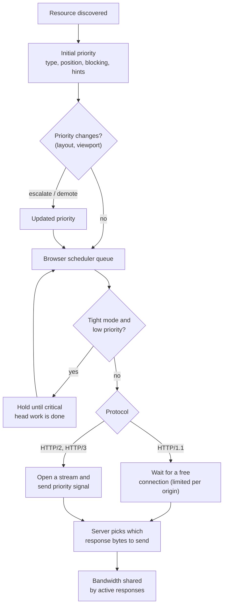

### Why priority does not guarantee completion order

Priority affects the order in which requests _start_ and how bandwidth is _shared_. It cannot guarantee the order in which they finish:

- A High-priority 900 KB image can finish after a Low-priority 2 KB script that started at the same time.
- A request that is already in flight keeps its bytes moving; a newly discovered Highest request usually shares bandwidth with it rather than preempting it completely.
- The server may ignore the priority signal, or a CDN may reorder responses.
- A request to a different origin uses a different connection, with its own congestion window and its own handshake cost.
- A response may come from a cache, which bypasses network priority entirely.

Under constrained bandwidth, priority matters most: with a slow link, every byte sent for an unimportant resource is a byte not sent for an important one. On a fast connection with few resources, priority often makes little visible difference, because everything finishes almost at once. This is why the experiments in this post use network throttling.

## The Fetch Priority API: telling the browser what matters

### Why Fetch Priority exists

The browser's heuristics are good at what can be inferred from markup: types, positions, blocking behaviour. They are poor at what can only be known from the page's meaning: which of five large images is the hero, which of three API calls renders the main content, which script is a polyfill nobody needs yet. The Fetch Priority API lets authors supply that missing knowledge.

It started as "Priority Hints", with an origin trial in 2018 and an `importance` attribute in 2021, and shipped as the `fetchpriority` HTML attribute and the `priority` option of `fetch()` ([web.dev: Fetch Priority](https://web.dev/articles/fetch-priority)). The `importance` attribute is obsolete; use `fetchpriority`. The attribute is now part of the HTML Standard and is supported in Chrome and Edge 102, Firefox 132 and Safari 17.2 according to web.dev's support data ([MDN: fetchpriority](https://developer.mozilla.org/en-US/docs/Web/HTML/Reference/Attributes/fetchpriority)).

### Values and semantics

| Value  | Meaning                                                                      |
| ------ | ---------------------------------------------------------------------------- |
| `high` | Fetch this with high priority _relative to other resources of the same type_ |
| `low`  | Fetch this with low priority relative to other resources of the same type    |
| `auto` | Default. Let the browser decide; equivalent to omitting the attribute        |

The key word is **relative**. web.dev explains that `fetchpriority` "raises or lowers the default priority by an appropriate amount" rather than always landing on a specific level. In Chromium, `fetchpriority="high"` on an image moves it from Low to High; on an `async` script, from Low to High; `fetchpriority="low"` on a `fetch()` call moves it from High to Low; and on early CSS it can only lower Highest to High.

It is a hint. The HTML Standard and the Fetch Standard leave its effect to the user agent, browsers may weigh it against other signals, and even when a browser honours it fully, the server and the network still decide when bytes arrive.

### Fetch Priority on HTML elements

The attribute is defined for ``, `<link>` (including preloads and stylesheets) and `<script>` elements ([MDN](https://developer.mozilla.org/en-US/docs/Web/HTML/Reference/Attributes/fetchpriority)). How much effect it has differs by element and browser.

**The LCP image.** The canonical use case:

```html
<!-- The hero is in the HTML (discoverable) and marked high (no waiting for layout). -->

```

Without the attribute, Chromium requests this image at Medium (if it is one of the first five large images) or Low, and raises it to High only after layout. With it, the request starts at High, which also takes it out of the class of lower-priority requests that tight mode holds back.

**Carousels and secondary images.** Demote what the browser would otherwise treat as equally important:

```html
<div class="carousel">
  <!-- Visible slide: high -->
  
  <!-- Hidden slides: low. They are large images near the top of the page, so depending on the
       carousel's CSS they may otherwise start at Medium or be boosted with the visible slide. -->
  
  
</div>
```

**Scripts.** Raise an `async` script that matters, or lower a non-critical one:

```html
<!-- Async, but important for the first interaction: raise from Low. -->
<script src="/js/cart-button.js" async fetchpriority="high"></script>

<!-- Deferred and unimportant: keep it out of the way. -->
<script src="/js/consent-banner-polyfills.js" defer fetchpriority="low"></script>
```

**Preloads and stylesheets.** A preload fetches at its destination's default priority, so a preloaded CSS background hero image starts at Low unless you say otherwise. web.dev recommends combining the two: "If a critical image is a CSS background image, preload it with fetchpriority = 'high'".

```html
<!-- A CSS background hero: discoverable early AND high priority. -->
<link rel="preload" as="image" href="/img/hero-bg.avif" fetchpriority="high" />

<!-- A non-critical stylesheet preloaded for later use: don't let it compete with the head CSS. -->
<link rel="preload" as="style" href="/css/reviews.css" fetchpriority="low" />
```

### Fetch Priority in JavaScript

The `fetch()` function accepts a `priority` option with the same three values:

```js
// Main content data: keep the default (High in Chromium), or be explicit.
const productPromise = fetch('/api/products/42', { priority: 'high' });

// Background data that must not compete with the hero image or product data.
const recsPromise = fetch('/api/recommendations?product=42', { priority: 'low' });

// An analytics beacon: low priority, and it should survive page unload.
fetch('/collect', {
  method: 'POST',
  body: JSON.stringify({ event: 'pdp_view', product: 42 }),
  keepalive: true,
  priority: 'low',
});
```

The same option exists on the `Request` constructor (`new Request(url, { priority: 'low' })`). Support for the `fetch()` option has not tracked the HTML attribute exactly in every engine, so check the `RequestInit` `priority` entry in [MDN's browser compatibility data](https://developer.mozilla.org/en-US/docs/Web/API/RequestInit#priority) before depending on it. Browsers that do not support it ignore the property, so it is safe to use as a progressive enhancement.

`fetch()` already starts at High in Chromium, which is often higher than the images on the page. That makes `priority: 'low'` the more useful value in practice: recommendations, personalization and telemetry requests are good candidates to demote, especially when they fire during the initial load.

### Strategies

- **Prioritize the LCP image, and only that.** One `fetchpriority="high"` element per page is typical. If there are several candidates (for example, different hero images for mobile and desktop layouts), only the one that is actually rendered should be high.
- **Demote competing images.** Hidden carousel slides, decorative images near the top, and thumbnails that would otherwise compete with the hero.
- **Demote non-critical fetches.** Recommendations and analytics during load.
- **Avoid priority inflation.** Priority is relative. If ten resources are high, none of them is, and the browser is back to arbitrary ordering among them while starving everything else. Excessive high-priority requests also bypass the tight-mode protection the browser applies to non-critical work, which can delay render-blocking CSS ([Experiment 12](#experiment-12-observe-the-effect-of-excessive-high-priority-requests)).
- **Trust the defaults when they are right.** A `<head>` stylesheet is already Highest. A blocking script is already High. A below-the-fold image with `loading="lazy"` does not need `fetchpriority="low"`. web.dev's advice is to look at the priorities assigned in practice and add hints only where they do not match expectations.
- **Do not use it to fix discovery.** As web.dev puts it, "Fetch Priority doesn't help with discoverability." A high-priority hint on an `` that JavaScript inserts after two seconds still starts after two seconds.

### Debugging Fetch Priority

1. Open DevTools, go to the **Network** panel, and right-click any column header to enable **Priority**.
2. Open the Network settings (gear icon) and enable **Big request rows**. The Priority column then shows the final priority on top and the initial priority below when they differ.
3. Hover the waterfall bar of a request to see its timing phases: **Queueing** and **Stalled** before the request is sent, then connection setup, **Request sent**, **Waiting for server response** (time to first byte) and **Content Download**. A long Queueing phase on a Low-priority image during the early load is the visible sign of browser-side throttling.
4. In the **Performance** panel, the network track shows each request's priority on hover, aligned with main-thread activity and the LCP marker.
5. In code, Resource Timing does not expose priority, but it does expose `startTime`, `requestStart`, `responseStart` and `responseEnd`, so you can measure the effect of a hint on when a request started and how long it took.

The reproducible experiment for this is [Experiment 5](#experiment-5-change-image-priority-with-fetchpriority) below.

## Resource hints: preload, preconnect, prefetch and dns-prefetch

Resource hints let a page tell the browser about work it will need before the browser would find out by itself. They act on different layers of the pipeline. `preload` acts on **discovery** for the current page. `preconnect` and `dns-prefetch` act on **connection setup**. `prefetch` and the Speculation Rules API act on **future navigations**. Confusing them is the root of most resource hint misuse.

### Preload

#### What it does and why it exists

`<link rel="preload">` tells the browser: fetch this resource now, at the priority appropriate for its type, because the current page will need it. The browser fetches the resource into its memory cache and does not apply it. Nothing is executed, rendered or styled. When the page later references the same resource through the normal mechanism (a stylesheet's `@font-face`, a CSS background, a script tag), the browser reuses the preloaded response ([MDN: rel=preload](https://developer.mozilla.org/en-US/docs/Web/HTML/Reference/Attributes/rel/preload)).

Preload exists to fix **late discovery**. Fonts discovered through CSS, CSS background images, scripts injected by other scripts, and images rendered by JavaScript all start late because the browser cannot see them in markup. A preload moves their discovery to the point where the browser parses the `<link>` element, which is usually in the first chunk of HTML and visible to the preload scanner. web.dev is explicit that it is not a suggestion: "Preload is a mandatory fetch, not a hint." ([web.dev: Fetch Priority](https://web.dev/articles/fetch-priority)).

#### The attributes

```html
<!-- as: required. Sets the destination, which sets priority, Accept header, CSP directive and cache matching. -->
<link rel="preload" href="/css/above-fold.css" as="style" />

<!-- type: lets the browser skip resources it can't use (e.g. a format it doesn't support). -->
<link rel="preload" href="/fonts/brand-sans.woff2" as="font" type="font/woff2" crossorigin />

<!-- media: conditional preload, evaluated against the current viewport. -->
<link rel="preload" href="/img/hero-mobile.avif" as="image" media="(max-width: 767px)" />

<!-- fetchpriority: adjust the destination's default priority. -->
<link rel="preload" href="/img/hero-bg.avif" as="image" fetchpriority="high" />
```

- **`as`** is required in practice. MDN lists `fetch`, `font`, `image`, `script`, `style` and `track` as valid values. It sets the request's destination, so it decides the priority, the `Accept` header, which CSP directive applies and whether the preloaded response can be matched later. A preload without a valid `as` is fetched as a generic request that the real resource request will not match, which usually means a double download.
- **`type`** lets the browser check whether it supports the MIME type and skip the download if not.
- **`crossorigin`** sets the CORS mode and credentials mode of the preload. MDN notes that "`font` and `fetch` preloading requires the `crossorigin` attribute to be set", and that the attribute must match the resource's CORS and credentials mode even for same-origin requests, because fonts are always fetched in CORS mode.
- **`media`** makes the preload conditional on a media query.
- **`imagesrcset` and `imagesizes`** enable responsive image preloads, covered below.

#### Request matching and double downloads

A preloaded response is only reused if the later request matches it: same URL, same destination (`as`), and same CORS and credentials mode. A mismatch causes the browser to discard the preload and fetch the resource again. Chromium reports both halves of the problem in the console: a warning that a preloaded resource was "not used within a few seconds from the window's load event", and a warning that a preload was found but not used because the request credentials mode does not match.

The classic mistake is a font preload without `crossorigin`:

```html
<!-- WRONG: the preload is a no-cors request; the @font-face request is a CORS request.
     They don't match, so the font is downloaded twice. -->
<link rel="preload" href="/fonts/brand-sans.woff2" as="font" type="font/woff2" />

<!-- RIGHT: the anonymous CORS mode matches how @font-face fetches fonts. -->
<link rel="preload" href="/fonts/brand-sans.woff2" as="font" type="font/woff2" crossorigin />
```

Other common mismatches: preloading `hero.avif` while the `` selects `hero-1200.avif` from its `srcset`; preloading with `as="script"` a module that is loaded as a module (use `modulepreload` instead); and preloading a URL that differs only in a query string or a trailing slash.

#### Fonts, images, scripts and styles

```html
<head>
  <!-- Font used by the LCP heading: otherwise discovered only after CSS + DOM + style. -->
  <link rel="preload" href="/fonts/brand-sans-700.woff2" as="font" type="font/woff2" crossorigin />

  <!-- Hero image referenced from CSS as a background: otherwise discovered after CSS. -->
  <link rel="preload" href="/img/hero-bg.avif" as="image" type="image/avif" fetchpriority="high" />

  <!-- A script that a blocking script would inject: discovered now, executed when injected. -->
  <link rel="preload" href="/js/vendor-config.js" as="script" />

  <!-- A stylesheet loaded later by JS (e.g. for a modal): fetched early, applied when used. -->
  <link rel="preload" href="/css/size-guide-modal.css" as="style" fetchpriority="low" />
</head>
```

Preloads can also be sent as HTTP `Link` headers, which the browser sees even before it parses any HTML. web.dev notes that "including a preload in HTTP headers puts it before everything else in the load order."

```http
HTTP/2 200
content-type: text/html; charset=utf-8
link: </fonts/brand-sans-700.woff2>; rel=preload; as=font; type="font/woff2"; crossorigin
link: </img/hero-1200.avif>; rel=preload; as=image; fetchpriority=high
```

Servers and CDNs that support **103 Early Hints** can send those headers in an informational response while the server is still generating the page, using otherwise idle think time. Chromium-based browsers act on `preload` and `preconnect` in Early Hints responses ([Chrome for Developers: Early Hints](https://developer.chrome.com/docs/web-platform/early-hints)); check the current support of other browsers before relying on it.

```http
HTTP/2 103
link: </css/main.css>; rel=preload; as=style
link: <https://images.example-cdn.com>; rel=preconnect

HTTP/2 200
content-type: text/html; charset=utf-8
...
```

#### The cost of preload

Every preload is a mandatory request at its destination's priority. That is exactly what makes it powerful and dangerous:

- **It competes.** A preloaded font at High, preloaded images and a preloaded script all share bandwidth with the render-blocking CSS and the LCP image. Preloading things that are not needed for the first render pushes things that are needed later.
- **It cannot be cancelled by the page.** A preload for a resource that turns out not to be used wastes the bytes.
- **It can reorder priorities in surprising ways.** A preloaded stylesheet starts at Highest even if it is only used in a modal.
- **It duplicates work if mismatched**, as above.

The rule is: preload only resources that are needed for the current page's initial experience _and_ discovered late. A `<head>` stylesheet or an `` in the HTML is already discovered early; preloading it adds nothing but an extra line.

### Responsive image preloading

A preload for an image with a single `href` defeats responsive images: every device downloads that one URL, and if the `` then picks a different candidate from its `srcset`, the device downloads both. `imagesrcset` and `imagesizes` solve this by giving the preload the same selection inputs as the image ([HTML Standard: link element](https://html.spec.whatwg.org/multipage/semantics.html#the-link-element)). They apply only to `rel="preload"` with `as="image"`.

```html
<head>
  <!-- Same candidates and same sizes as the , so both select the same file. -->
  <!-- href is omitted on purpose: browsers that don't understand imagesrcset then
       download nothing, instead of downloading a URL the  may not use. -->
  <link
    rel="preload"
    as="image"
    imagesrcset="/img/hero-640.avif 640w, /img/hero-960.avif 960w, /img/hero-1280.avif 1280w, /img/hero-1920.avif 1920w"
    imagesizes="(min-width: 1024px) 60vw, 100vw"
    type="image/avif"
    fetchpriority="high"
  />
</head>
<body>
  
</body>
```

The browser evaluates `imagesizes` against the viewport and picks from `imagesrcset` exactly as it would for the ``, so a phone downloads the 640w or 960w file and a desktop the 1280w or 1920w file. The two must stay in sync. If a build tool generates the `` markup, generate the preload from the same data.

For art direction with `<picture>`, where different media conditions select different crops, use one preload per condition with mutually exclusive `media` attributes:

```html
<link
  rel="preload"
  as="image"
  media="(max-width: 767px)"
  imagesrcset="/img/hero-portrait-480.avif 480w, /img/hero-portrait-960.avif 960w"
  imagesizes="100vw"
/>
<link
  rel="preload"
  as="image"
  media="(min-width: 768px)"
  imagesrcset="/img/hero-wide-1280.avif 1280w, /img/hero-wide-1920.avif 1920w"
  imagesizes="60vw"
/>

<picture>
  <source
    media="(max-width: 767px)"
    srcset="/img/hero-portrait-480.avif 480w, /img/hero-portrait-960.avif 960w"
    sizes="100vw"
  />
  
</picture>
```

If the hero is already a plain `` in the server HTML, you usually do not need a preload at all: the preload scanner finds it, and `fetchpriority="high"` handles priority. Responsive preloads are for images that are discovered late, such as CSS backgrounds or client-rendered heroes. web.dev's preload scanner article makes the same point for background images that vary by viewport: those need `imagesrcset`.

### Preconnect

#### What it does

`<link rel="preconnect">` tells the browser to establish a connection to an origin before any request to it exists ([MDN: rel=preconnect](https://developer.mozilla.org/en-US/docs/Web/HTML/Reference/Attributes/rel/preconnect)). A full connection to a new HTTPS origin takes:

1. **DNS resolution**: hostname to IP address.
2. **TCP handshake**: one round trip (for HTTP/1.1 and HTTP/2).
3. **TLS handshake**: one more round trip with TLS 1.3, more with TLS 1.2.

On a mobile connection with a 150 ms round trip time, that can be 300 to 500 ms of pure latency before the first request byte to the origin is sent. A preconnect does that work in parallel with whatever the browser is doing anyway, so the first real request to that origin can go out immediately.

```html
<head>
  <!-- Image CDN for the hero image: requested soon, on a different origin. -->
  <link rel="preconnect" href="https://images.example-cdn.com" />

  <!-- Font host: fonts use CORS, so the connection must be opened in anonymous mode. -->
  <link rel="preconnect" href="https://fonts.example-cdn.com" crossorigin />
</head>
```

#### Why `crossorigin` matters

Browsers keep separate connection pools for requests with and without credentials. Fonts are fetched in CORS anonymous mode, so a preconnect without `crossorigin` opens a connection in the wrong pool and the font request opens another one. web.dev puts it this way: resources such as fonts "are loaded in anonymous mode. For those you must set the `crossorigin` attribute with the `preconnect` hint" ([web.dev](https://web.dev/articles/preconnect-and-dns-prefetch)). If an origin serves both kinds of request, you may need two preconnects, one with and one without `crossorigin`.

#### When it helps and when it hurts

Preconnect helps when all three conditions hold:

- The origin is **different** from the document's origin (or from origins already connected).
- A **critical** request to it will happen **soon**.
- That request is **discovered late enough** that connection setup would otherwise be on the critical path, such as a font from a CSS file or an image URL from an API response.

It hurts when overused. Each connection costs DNS, TCP and TLS work on the device (TLS involves CPU work and certificate data), and competes for bandwidth early in the load. Chrome also closes unused preconnected connections: web.dev notes that "the browser closes any connection that isn't used within 10 seconds." A preconnect for a widget that loads after 15 seconds is pure waste. web.dev's guidance is to "use `preconnect` only for the most important resources, rely on `dns-prefetch` for the rest."

Preconnect is pointless for the document's own origin (the connection already exists) and for origins whose resources the preload scanner will find in the first chunk of HTML anyway.

### DNS-prefetch

`<link rel="dns-prefetch">` performs only the first step: resolving the hostname ([MDN: rel=dns-prefetch](https://developer.mozilla.org/en-US/docs/Web/HTML/Reference/Attributes/rel/dns-prefetch)). It is much cheaper than preconnect, since a DNS query is tiny and opens no connection, and it saves a correspondingly smaller amount of time: the DNS lookup, which web.dev says "usually takes around 20–120 ms".

```html
<!-- Third-party origins used later in the page: cheap insurance. -->
<link rel="dns-prefetch" href="https://reviews.example-widgets.com" />
<link rel="dns-prefetch" href="https://analytics.example-metrics.com" />

<!-- Preconnect plus dns-prefetch fallback for the same critical origin. -->
<link rel="preconnect" href="https://images.example-cdn.com" />
<link rel="dns-prefetch" href="https://images.example-cdn.com" />
```

The pairing in the last example was a common pattern when some browsers supported only `dns-prefetch`; today preconnect is widely supported, so the pair mainly helps very old browsers. Use `dns-prefetch` alone for origins that are likely to be used but not critical, where opening a full connection would be wasted.

DNS prefetching also has a **privacy dimension**: resolving a hostname reveals to the DNS resolver that the user loaded a page referencing it, even if no request is ever made. Browsers may limit or disable DNS prefetching in some contexts, and the `X-DNS-Prefetch-Control` header lets a site turn off implicit prefetching of hostnames found in links in some browsers.

### Prefetch

`<link rel="prefetch">` fetches a resource that is likely to be needed for a **future navigation**, at the lowest priority, and stores it in the HTTP cache ([MDN: rel=prefetch](https://developer.mozilla.org/en-US/docs/Web/HTML/Reference/Attributes/rel/prefetch)). In Chromium it runs at Lowest priority, which means it yields to every request the current page makes.

```html
<!-- On the product page: the user is likely to go to the cart next. -->
<link rel="prefetch" href="/js/cart-route.js" as="script" />
<link rel="prefetch" href="/cart" as="document" />
```

How it differs from preload:

| Aspect      | `preload`                                      | `prefetch`                                           |
| ----------- | ---------------------------------------------- | ---------------------------------------------------- |
| For         | The current page                               | A likely next page                                   |
| Priority    | The destination's priority (often High)        | Lowest                                               |
| Mandatory   | Yes                                            | No, the browser may skip it                          |
| Stored in   | Memory cache, consumed by the current document | HTTP cache, reused by later navigations if cacheable |
| Unused cost | Wasted bytes that competed with critical work  | Wasted bytes, but sent when the network was idle     |

Because a prefetched response goes through the HTTP cache, it is only useful if the response is cacheable for long enough to be reused (Chromium allows a short grace period for prefetched resources even when cache headers would otherwise prevent reuse; see the [caching post](/blog/understanding-browser-caching-memory-cache-disk-cache-and-service-workers) for cache semantics). Prefetching for users on metered connections or with Save-Data enabled spends their data on guesses; respecting `navigator.connection.saveData` where available is a reasonable courtesy.

### Other hints: modulepreload, prerender and Speculation Rules

**`modulepreload`** is preload for JavaScript modules. It fetches the module with the correct CORS mode for module scripts (the fetch mode is always `cors`), and the browser may also parse and compile it, and optionally fetch its dependencies. MDN reports that it has been available across browsers since September 2023 ([MDN: rel=modulepreload](https://developer.mozilla.org/en-US/docs/Web/HTML/Reference/Attributes/rel/modulepreload)).

```html
<script type="module" src="/js/pdp.js"></script>
<!-- pdp.js imports gallery.js, which imports zoom.js. Without hints that's a 3-deep waterfall. -->
<link rel="modulepreload" href="/js/gallery.js" />
<link rel="modulepreload" href="/js/zoom.js" />
```

**`<link rel="prerender">`** was designed to render a whole next page in the background. Chrome replaced its behaviour with NoState Prefetch, which only fetches the page's resources without rendering it, and the Chrome team describes it as kept for that purpose "with a view of retiring this at some point in the future" ([Chrome for Developers: Prerender pages](https://developer.chrome.com/docs/web-platform/prerender-pages)). Do not use it for new work.

**The Speculation Rules API** is its replacement. A JSON script block describes which URLs to prefetch or fully prerender, and how eagerly:

```html
<script type="speculationrules">
  {
    "prerender": [
      {
        "where": { "href_matches": "/products/*" },
        "eagerness": "moderate"
      }
    ],
    "prefetch": [
      {
        "urls": ["/cart"],
        "eagerness": "conservative"
      }
    ]
  }
</script>
```

Eagerness values control when a speculation fires. Chrome documents `conservative` as speculating "on pointer or touch down", `moderate` as speculating on desktop when the pointer rests over a link for about 200 ms (or on pointer down), and `eager` and `immediate` as progressively earlier. A prerendered page has already loaded, run its scripts and rendered in a hidden state, so the navigation can appear instant, at the cost of memory, CPU and bandwidth for pages the user may never open. Speculation Rules are supported in Chromium-based browsers; other engines are at various stages of experimentation, so treat them as a progressive enhancement.

### The levels of preparation

All of these hints sit on one axis: how much work they do in advance.

```mermaid title="How much work each hint does in advance"
flowchart LR
    accTitle: How much work each hint does in advance
    accDescr: The hints are arranged from least to most work done in advance. dns-prefetch resolves the hostname. preconnect also opens TCP and TLS. preload fetches a specific resource for the current page at its normal priority. modulepreload fetches and may compile a module. prefetch fetches a resource or document for a future navigation at lowest priority into the HTTP cache. Speculation Rules prerender loads and renders an entire future page in the background. Cost and potential waste grow from left to right.
    DNS["dns-prefetch<br/>DNS only"] --> PC["preconnect<br/>DNS + TCP + TLS"]
    PC --> PL["preload<br/>fetch one resource<br/>for this page"]
    PL --> MP["modulepreload<br/>fetch + compile<br/>module"]
    MP --> PF["prefetch<br/>fetch for a future<br/>navigation, Lowest"]
    PF --> PR["prerender<br/>load + render a<br/>whole future page"]
```

### Resource hint comparison

| Hint                        | Primary purpose                                      | Typical use                             | Cost if wrong                                      | Scope        |
| --------------------------- | ---------------------------------------------------- | --------------------------------------- | -------------------------------------------------- | ------------ |
| `preload`                   | Fetch a resource the current page needs, early       | Font from CSS, CSS background LCP image | Bandwidth taken from critical requests; duplicates | Current page |
| `preconnect`                | Open a connection to an origin early                 | Image CDN, font host                    | CPU and sockets; closed unused after about 10 s    | Origin       |
| `dns-prefetch`              | Resolve a hostname early                             | Third-party origins used later          | Very low; small privacy leak                       | Origin       |
| `prefetch`                  | Fetch a resource likely needed by a later navigation | Next route's bundle                     | Wasted bytes, at idle priority                     | Next page    |
| `modulepreload`             | Fetch, and possibly compile, a module and deps       | Deep module graph of the current page   | Same as preload                                    | Current page |
| `prerender` (legacy)        | Prepare a next page (now NoState Prefetch in Chrome) | Avoid; use Speculation Rules            | Wasted bytes                                       | Next page    |
| Speculation Rules prerender | Fully load and render a likely next page             | Product listing to product page         | Bandwidth, memory, CPU, analytics side effects     | Next page    |

These hints have different costs and act on different stages. A `preconnect` cannot fix a late-discovered font (the font still has to wait for the CSS), and a `preload` for a resource the preload scanner would have found anyway is just noise.

## Lazy loading: deferring non-critical resources

### Why lazy loading exists

A long product page may contain 60 images, of which 4 are visible on first load. Fetching all 60 immediately spends bandwidth that the visible ones need, decodes images nobody may look at, and uses memory. Lazy loading defers requests for resources until they are likely to be needed, which usually means: until they approach the viewport. It is the opposite of preload. Preload pulls a request earlier; lazy loading pushes it later, or cancels it entirely if the user never scrolls.

### Native lazy loading

The `loading` attribute on `` and `<iframe>` is part of the HTML Standard ([MDN: img loading](https://developer.mozilla.org/en-US/docs/Web/HTML/Reference/Elements/img#loading)). Chromium is also extending it to `<video>` and `<audio>` ([Intent to Ship](https://groups.google.com/a/chromium.org/g/blink-dev/c/HoqdJM4Xqjc)); check current support before relying on that. The values are:

- **`loading="eager"`**: the default. Fetch immediately.
- **`loading="lazy"`**: defer the fetch until the element is close to the viewport, using a distance the browser chooses.

```html
<!-- Above the fold: never lazy. -->


<!-- Below the fold: lazy. width/height reserve space so nothing shifts when it loads. -->


<!-- Third-party embed far down the page: lazy iframe. -->
<iframe
  src="https://video.example.com/embed/ridge-gtx"
  loading="lazy"
  width="560"
  height="315"
  title="Ridge GTX product video"
></iframe>
```

The standard leaves the threshold to the browser. Chromium uses distance-from-viewport thresholds that depend on the effective connection type. In 2020 it reduced them to 1250 px on fast connections (4G) and 2500 px on slower ones (3G or lower) ([web.dev: Browser-level image lazy loading](https://web.dev/articles/browser-level-image-lazy-loading)); the values are hardcoded and cannot be changed by the page. Chrome 121 applied the same thresholds to horizontally scrolling containers such as carousels. Firefox and Safari use their own, generally smaller, margins. Lazy-loaded images whose distance is within the threshold at load time are fetched immediately, which is why a lazy image a few hundred pixels below the fold usually still loads during the initial page load.

Native lazy loading has two notable behaviours. It applies only when JavaScript is enabled (as an anti-tracking measure: otherwise a page could track scroll position through image requests without scripts); and all lazy images and iframes load when the page is printed. Native image lazy loading is supported in all major browsers, and iframe lazy loading is supported in Chromium, Firefox and Safari as well; check MDN's compatibility data for exact versions.

### Intersection Observer-based lazy loading

Before native support, lazy loading was implemented in JavaScript with scroll listeners, and later with the Intersection Observer API ([MDN: Intersection Observer API](https://developer.mozilla.org/en-US/docs/Web/API/Intersection_Observer_API)). Native loading is the better default for images and iframes, but Intersection Observer is still the right tool for things the `loading` attribute does not cover: CSS background images, `<video>` sources, components that should render only when visible, and custom thresholds.

```html
<!-- Markup: the real URL is in data-bg, so nothing is fetched until JS decides. -->
<section class="lifestyle-banner js-lazy-bg" data-bg="/img/lifestyle-banner.avif" style="aspect-ratio: 16 / 5">
  <h2>Built for the long way round</h2>
</section>

<video
  class="js-lazy-video"
  muted
  playsinline
  loop
  width="1280"
  height="720"
  preload="none"
  poster="/img/video-poster.avif"
>
  <source data-src="/video/ridge-gtx.webm" type="video/webm" />
  <source data-src="/video/ridge-gtx.mp4" type="video/mp4" />
</video>
```

```js
// lazy-media.js: lazy-load CSS backgrounds and video sources with IntersectionObserver.
function loadBackground(el) {
  // Setting the property triggers the fetch, because the element is now rendered with a url().
  el.style.backgroundImage = `url("${el.dataset.bg}")`;
  delete el.dataset.bg;
}

function loadVideo(video) {
  for (const source of video.querySelectorAll('source[data-src]')) {
    source.src = source.dataset.src;
    source.removeAttribute('data-src');
  }
  video.load(); // Re-run source selection now that <source> elements have URLs.
  video.play().catch(() => {
    /* Autoplay may be blocked; the poster stays visible. */
  });
}

function initLazyMedia() {
  const targets = document.querySelectorAll('.js-lazy-bg, .js-lazy-video');

  // Without IntersectionObserver support, load everything rather than nothing.
  if (!('IntersectionObserver' in window)) {
    targets.forEach((el) => (el.classList.contains('js-lazy-bg') ? loadBackground(el) : loadVideo(el)));
    return;
  }

  const observer = new IntersectionObserver(
    (entries, obs) => {
      for (const entry of entries) {
        if (!entry.isIntersecting) continue;
        const el = entry.target;
        if (el.classList.contains('js-lazy-bg')) loadBackground(el);
        else loadVideo(el);
        obs.unobserve(el); // Each element loads once; stop watching it.
      }
    },
    {
      root: null, // The viewport.
      rootMargin: '600px 0px', // Start loading 600 px before the element enters the viewport.
      threshold: 0, // Any overlap with the expanded root counts.
    },
  );

  targets.forEach((el) => observer.observe(el));

  // In a single-page app, disconnect when the view is torn down to avoid leaks.
  return () => observer.disconnect();
}

initLazyMedia();
```

- **`root`** is the scroll container whose visible area counts as "visible"; `null` means the viewport.
- **`rootMargin`** grows or shrinks that area. A positive margin starts loading before the element is visible, giving the request time to complete. Too small, and users scroll into blank space; too large, and lazy loading loses its point.
- **`threshold`** sets how much of the element must intersect before the callback fires; `0` means any overlap.
- **Cleanup** matters in long-lived apps: unobserve elements once loaded and disconnect observers when components unmount.

| Aspect               | Native `loading="lazy"`                            | Intersection Observer                                             |
| -------------------- | -------------------------------------------------- | ----------------------------------------------------------------- |
| Applies to           | ``, `<iframe>`                                | Anything: backgrounds, video, components, data                    |
| Threshold            | Browser-chosen, connection-aware, not configurable | Author-chosen through `rootMargin` and `threshold`                |
| Discoverability      | Real `src` in markup; browser knows the URL        | URL hidden in `data-*`; invisible to the preload scanner          |
| Needs JavaScript     | No code, but only defers when JS is enabled        | Yes; nothing loads if the script fails, unless you add a fallback |
| Main-thread cost     | Handled inside the browser                         | Callback runs on the main thread                                  |
| Priority integration | Fetched through the normal image pipeline          | Fetched when the script sets the URL                              |
| Best for             | The default for below-the-fold images and iframes  | Cases the attribute does not cover                                |

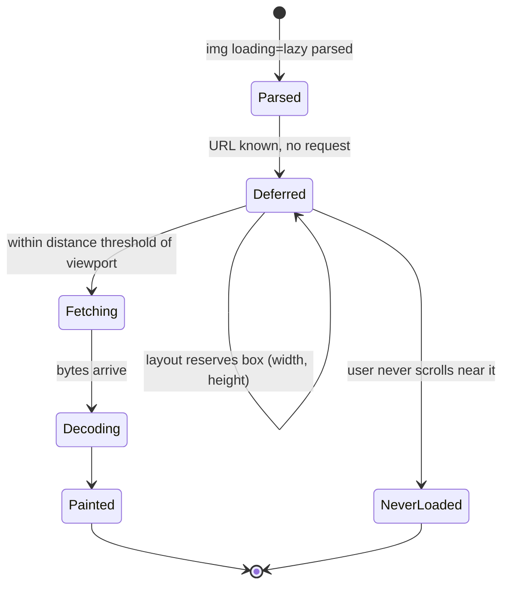

### Lazy loading JavaScript

JavaScript can be deferred too, through **code splitting**: build tools split the bundle at dynamic `import()` boundaries, and the browser fetches each chunk only when the import runs. The [bundling post](/blog/how-a-react-codebase-gets-bundled) covers how bundlers produce these chunks; here the question is when they are requested.

```jsx
import { lazy, Suspense, useState } from 'react';

// Route-level split: each route's code is a separate chunk, fetched on navigation.
const ReviewsSection = lazy(() => import('./ReviewsSection.jsx'));
const SizeGuideModal = lazy(() => import('./SizeGuideModal.jsx'));

// Warm the modal chunk when the user shows intent, so the click itself is fast.
const preloadSizeGuide = () => import('./SizeGuideModal.jsx');

export function ProductPage({ product }) {
  const [showGuide, setShowGuide] = useState(false);

  return (
    <>
      <ProductHero product={product} /> {/* Eager: part of the initial chunk. */}
      <button onPointerEnter={preloadSizeGuide} onFocus={preloadSizeGuide} onClick={() => setShowGuide(true)}>
        Size guide
      </button>
      {showGuide && (
        <Suspense fallback={<div className="modal-skeleton" aria-busy="true" />}>
          <SizeGuideModal onClose={() => setShowGuide(false)} />
        </Suspense>
      )}
      <Suspense fallback={<div className="reviews-skeleton" style={{ minHeight: 480 }} />}>
        <ReviewsSection productId={product.id} /> {/* Fetched when first rendered. */}
      </Suspense>
    </>
  );
}
```

The trade-off is between **initial cost** and **interaction latency**. Everything moved out of the initial bundle downloads, parses and runs later, which reduces the main-thread work competing with the first render and with early interactions. But the first time a deferred feature is used, the user waits for a network round trip and a compile. Interaction-triggered prefetching (on hover, focus or `pointerdown`) hides most of that wait. Code that every user needs in the first seconds, such as the add-to-cart handler, should stay in the initial chunk.

### Lazy loading and performance metrics

- **LCP.** Lazy loading below-the-fold content frees bandwidth for the LCP resource, which helps. Lazy loading the LCP image itself hurts badly: the browser cannot request it until layout confirms it is near the viewport, so early discovery by the preload scanner no longer helps. web.dev's guidance is blunt: "Never lazy-load your LCP image" ([web.dev: Optimize LCP](https://web.dev/articles/optimize-lcp)).
- **FCP.** Mostly unaffected by image lazy loading, since images do not block first render, but code splitting can improve it by shrinking blocking scripts.
- **INP.** Less JavaScript in the initial load means fewer long tasks competing with early interactions. But an interaction that triggers a lazy import can be slow if the code is not ready, and lazy content that arrives later can trigger expensive rendering work.
- **CLS.** Lazy content without reserved space shifts the page when it loads. Native lazy images without `width` and `height` default to 0×0 until loaded, which is why web.dev recommends dimensions on all images.
- **Total Blocking Time.** Code splitting reduces it directly by moving script evaluation out of the load.
- **Network utilization.** Fewer bytes overall, especially for users who never scroll; but some deferred requests happen during scrolling, when they compete with nothing important anyway.

### Lazy loading mistakes

- **Lazy-loading the LCP image.** The most common and most expensive mistake. Often caused by a CMS or framework image component that lazy-loads everything by default.
- **Lazy-loading anything above the fold.** Even a non-LCP above-the-fold image renders later than it should.
- **Lazy-loading everything.** Images just below the fold that most users will see anyway gain nothing, and the browser's thresholds already handle most of the benefit.
- **Delaying critical fonts.** Fonts are not lazily loaded by an attribute, but loading them through a JavaScript font loader after load is effectively lazy loading text rendering.
- **Missing dimensions.** Lazy content without reserved space causes layout shifts when it arrives.
- **JavaScript lazy loaders for ordinary images.** They hide URLs from the preload scanner, depend on script execution, and run on the main thread, for no benefit over the native attribute.
- **Wrong root margins.** Zero margin means users see blank boxes while scrolling; a huge margin means everything loads anyway.

## Script loading and execution strategies

Scripts influence the loading pipeline more than any other resource type, because they can block the parser, wait for stylesheets, discover new resources and occupy the main thread. The HTML Standard defines precisely how each kind of script is fetched and when it runs ([HTML Standard: the script element](https://html.spec.whatwg.org/multipage/scripting.html#the-script-element)).

### Parser-blocking scripts

A classic `<script src>` without `async` or `defer`, inserted by the parser, is **parser-blocking**:

1. The parser reaches the element and starts fetching the script.
2. The parser stops. No more DOM is built.
3. When the script has arrived, it waits until there are no pending **script-blocking style sheets**, because it might read layout or computed style.
4. The script executes.
5. The parser resumes.

```html
<head>
  <link rel="stylesheet" href="/css/main.css" />
  <!-- Waits for main.css (script-blocking style sheet), then runs, then the parser continues.
       Everything below is not in the DOM until then, though the preload scanner can fetch it. -->
  <script src="/js/ab-test.js"></script>
</head>
```

The cost is not only the script's own download. It is the download plus the wait for preceding CSS plus the execution time, during which nothing below the script exists in the DOM and nothing can render. Inline classic scripts block the parser too, without a download, but still wait for preceding stylesheets. Parser-blocking scripts are occasionally necessary (A/B testing tools that must run before first paint to avoid flicker), but every one of them is a decision to delay rendering.

### Async scripts

```html
<script src="/js/analytics.js" async></script>
```

An `async` script is fetched in parallel with parsing and executes as soon as it has arrived, interrupting the parser briefly at whatever point it has reached ([MDN: async](https://developer.mozilla.org/en-US/docs/Web/HTML/Reference/Elements/script#async)).

- **Execution order is not guaranteed.** Two `async` scripts run in whichever order they finish downloading.
- **Execution timing is unpredictable.** A fast or cached `async` script can run before the parser has finished, even before `DOMContentLoaded`. It can also run before first paint and delay it.
- **It does not wait for stylesheets.** Classic `async` scripts are not blocked by script-blocking style sheets.
- **Priority is Low in Chromium** by default.

`async` suits independent scripts that do not touch the DOM in order-dependent ways and that nothing depends on: analytics, error reporting, some third-party tags. Scripts inserted dynamically with `document.createElement('script')` behave as `async` by default; set `script.async = false` to get in-order execution among dynamically inserted scripts.

### Defer scripts

```html
<script src="/js/vendor.js" defer></script>
<script src="/js/app.js" defer></script>
```

A `defer` script is fetched in parallel with parsing and executes after the document has been fully parsed, in document order, just before `DOMContentLoaded` fires ([MDN: defer](https://developer.mozilla.org/en-US/docs/Web/HTML/Reference/Elements/script#defer)).

- **Order is preserved.** `vendor.js` always runs before `app.js`, regardless of which finishes first.
- **The parser is never blocked.** The document is complete before any deferred script runs.
- **`DOMContentLoaded` waits for them.** It fires after all deferred scripts have executed.
- **Priority is Low in Chromium** by default.
- **`defer` has no effect on inline scripts** or scripts without `src`.

`defer` is the right default for application code: it keeps the parser running, preserves dependencies between scripts, and lets scripts assume the full DOM exists.

### Module scripts

```html
<script type="module" src="/js/pdp.js"></script>
<script type="module">
  // Inline modules are deferred too, unlike inline classic scripts.
  import { initReviews } from '/js/reviews.js';
  initReviews();
</script>
<script type="module" src="/js/telemetry.js" async></script>
```

Module scripts are **deferred by default**: fetched in parallel, executed after parsing, in order ([HTML Standard](https://html.spec.whatwg.org/multipage/scripting.html#the-script-element)). `defer` has no effect on them; `async` makes a module (including an inline one) run as soon as it and its dependencies are ready. Modules are always fetched in CORS mode, so cross-origin modules need the right `Access-Control-Allow-Origin` header.

The difference from classic scripts is the **module graph**. The browser must fetch a module, parse it to find its static `import` declarations, fetch those, parse them, and so on. Nothing executes until the whole static graph is fetched and instantiated. An unbundled graph that is five levels deep is a five-step request chain:

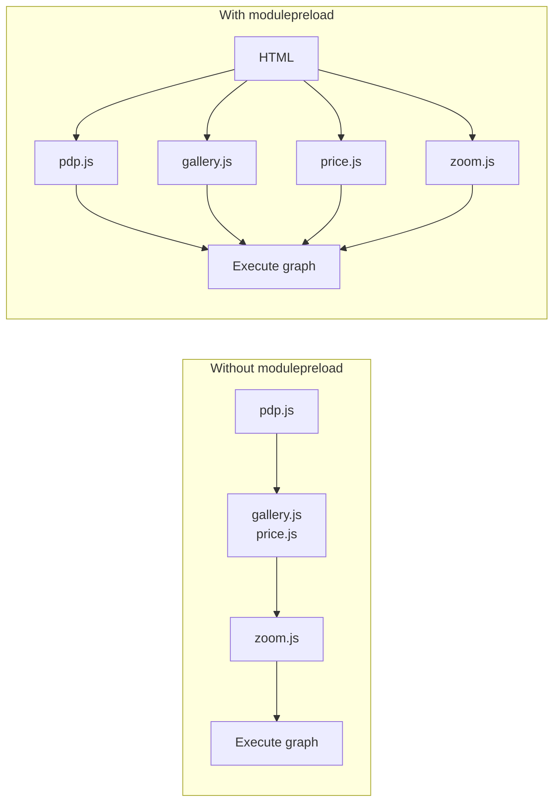

Bundlers flatten most of this in production. `modulepreload` handles what remains, typically the shared chunks of a split bundle: Vite, for example, injects `modulepreload` links for a chunk's dependencies automatically.

**Dynamic `import()`** works in both classic and module scripts. It returns a promise and fetches the module (and its static dependencies) only when called. It is the mechanism behind code splitting and the reason runtime-discovered JavaScript exists at all.

### Script strategy comparison

| Strategy           | Discovered by                             | Fetch                       | Executes                                   | Order                            | Blocks parser            | Before `DOMContentLoaded` | Typical Chromium priority   |
| ------------------ | ----------------------------------------- | --------------------------- | ------------------------------------------ | -------------------------------- | ------------------------ | ------------------------- | --------------------------- |
| Classic (default)  | Parser, preload scanner                   | Immediately                 | When fetched, after preceding CSS          | Document order                   | Yes                      | Yes                       | High (early), Medium (late) |
| `async`            | Parser, preload scanner                   | In parallel                 | As soon as fetched                         | None                             | Briefly, while executing | Maybe                     | Low                         |
| `defer`            | Parser, preload scanner                   | In parallel                 | After parsing                              | Document order                   | No                       | Yes                       | Low                         |
| `type="module"`    | Parser, preload scanner; deps after parse | In parallel, graph by graph | After parsing (or when ready with `async`) | Document order (without `async`) | No                       | Yes (without `async`)     | Check in DevTools           |
| Dynamic `import()` | Runtime only                              | When called                 | When fetched and instantiated              | Promise order                    | No                       | Not related               | Check in DevTools           |

```mermaid title="When each kind of script fetches and runs"
gantt
    accTitle: When each kind of script fetches and runs
    accDescr: An illustrative timeline, not a measurement. HTML parsing runs from 0 to 100 ms except where a classic script blocks it from 20 to 50 ms while that script downloads and executes. An async script downloads from 10 to 40 ms and executes immediately at 40 ms, interrupting parsing. A defer script and a module script download in parallel during parsing and execute in order after parsing finishes at 100 ms, before DOMContentLoaded.
    dateFormat x
    axisFormat %L ms
    section HTML parser
    Parse                       :p1, 0, 20
    Blocked by classic script   :crit, 20, 50
    Parse                       :p2, 50, 100
    section Classic script
    Download                    :20, 45
    Execute                     :crit, 45, 50
    section async script
    Download                    :10, 40
    Execute                     :40, 44
    section defer script
    Download                    :12, 60
    Execute                     :100, 106
    section module script
    Download graph              :15, 80
    Execute                     :106, 112
```

The timeline is illustrative, not measured. Its point is the shape: only the classic script stops the parser, only `async` runs at an arbitrary moment, and `defer` and module scripts line up after parsing.

## CSS and font loading

### Stylesheet discovery and render blocking

A stylesheet linked in the `<head>` is discovered by the preload scanner in the first chunk of HTML and requested at Highest priority in Chromium. The browser then has to download it, parse it into rules and add them to the CSSOM before it can calculate styles. Until every render-blocking stylesheet is ready, the document is not rendered.

The `media` attribute changes this. A stylesheet whose media query does not currently match is not render-blocking, and Chromium fetches it at Lowest priority:

```html
<!-- Render-blocking: matches now. -->
<link rel="stylesheet" href="/css/main.css" />

<!-- Not render-blocking on screens: fetched at low priority, applied when printing. -->
<link rel="stylesheet" href="/css/print.css" media="print" />

<!-- Render-blocking only on wide viewports. -->
<link rel="stylesheet" href="/css/desktop-layout.css" media="(min-width: 1024px)" />
```

Stylesheets inserted in the `<body>` behave differently between browsers. Chromium blocks rendering of content after the `<link>` until the stylesheet loads, which allows progressive CSS per section, but this behaviour is not guaranteed elsewhere.

### `@import` and why to avoid it in critical CSS

Every `@import` adds a link to the critical request chain, as shown earlier. Replace them with parallel `<link>` elements in the HTML, or let a build tool inline the imports into one file:

```html
<!-- Instead of main.css with @import base.css and components.css: -->
<link rel="stylesheet" href="/css/base.css" />
<link rel="stylesheet" href="/css/components.css" />
<!-- Both are discovered at once by the preload scanner and downloaded in parallel. -->
```

### Critical CSS and splitting

**Critical CSS** inlines the rules needed for above-the-fold content in a `<style>` block, so the first render needs no stylesheet request at all, and loads the rest without blocking rendering. The common non-blocking pattern uses `media="print"` to get a low-priority, non-blocking fetch, then switches the media on load:

```html
<head>
  <style>
    /* Critical CSS: layout shell, header, hero, product title and price.
       Generated at build time for the page template; kept small (typically a few KB). */
    :root {
      --brand: #0b5;
    }
    body {
      margin: 0;
      font-family: 'Brand Sans', system-ui, sans-serif;
    }
    .pdp-hero {
      display: grid;
      grid-template-columns: 1fr;
      gap: 1rem;
    }
    @media (min-width: 1024px) {
      .pdp-hero {
        grid-template-columns: 3fr 2fr;
      }
    }
  </style>

  <!-- Full stylesheet: fetched without blocking render, applied once loaded. -->
  <link rel="stylesheet" href="/css/pdp.css" media="print" onload="this.media='all'" />
  <noscript><link rel="stylesheet" href="/css/pdp.css" /></noscript>
</head>
```

The trade-offs are real. Inlined CSS cannot be cached separately and is downloaded with every HTML response. The deferred stylesheet arrives after first render and may restyle content, causing layout shifts if the critical CSS was incomplete. And the pattern depends on JavaScript (`onload`). For many sites, a single well-cached, reasonably small stylesheet in the `<head>` is simpler and nearly as fast; critical CSS pays off most on first visits over slow connections.

**CSS splitting** is the middle ground: one render-blocking file for what every page needs, plus page- or component-specific files that load with the component (CSS modules in bundlers do this automatically).

### Font discovery and loading

Fonts sit at the end of a dependency chain: HTML, then CSS, then DOM text, then style calculation, then the font request. In Chromium, fonts discovered this way are requested at Highest priority, because they are needed for text that is about to render. The problem is not their priority; it is how late they are discovered.

A **font preload** moves discovery up to the HTML:

```html
<head>
  <!-- Preload only the faces used above the fold: here, the bold weight for the product title. -->
  <link rel="preload" href="/fonts/brand-sans-700.woff2" as="font" type="font/woff2" crossorigin />
  <link rel="stylesheet" href="/css/main.css" />
</head>
```

```css
/* main.css */
@font-face {
  font-family: 'Brand Sans';
  src: url('/fonts/brand-sans-700.woff2') format('woff2');
  font-weight: 700;
  font-display: swap;
}

@font-face {
  font-family: 'Brand Sans';
  src: url('/fonts/brand-sans-400.woff2') format('woff2');
  font-weight: 400;
  font-display: swap;
  /* Not preloaded: discovered when body text is styled, which is still early. */
}
```

The URL in the preload must exactly match the `src` URL that the browser selects, and `crossorigin` is mandatory, even for same-origin fonts.

### `font-display`, FOIT and FOUT

When text needs a font that has not loaded yet, the browser has two bad options: show nothing (a **Flash of Invisible Text**, FOIT) or show a fallback font and switch later (a **Flash of Unstyled Text**, FOUT). `font-display` chooses between them by defining a **block period** (text is invisible) and a **swap period** (fallback is shown, and the web font replaces it if it arrives) ([CSS Fonts Level 4: font-display](https://www.w3.org/TR/css-fonts-4/#font-display-desc), [MDN: font-display](https://developer.mozilla.org/en-US/docs/Web/CSS/@font-face/font-display)):

| Value      | Block period                               | Swap period       | Behaviour                                                                                               |
| ---------- | ------------------------------------------ | ----------------- | ------------------------------------------------------------------------------------------------------- |
| `auto`     | Browser-defined                            | Browser-defined   | Usually like `block`                                                                                    |
| `block`    | Short (spec recommends about 3 s)          | Infinite          | Invisible text while loading, then swap whenever it arrives                                             |
| `swap`     | Extremely small                            | Infinite          | Fallback immediately, swap whenever the font arrives                                                    |
| `fallback` | Extremely small (about 100 ms recommended) | Short (about 3 s) | Fallback quickly; if the font is late, keep the fallback                                                |
| `optional` | Extremely small (about 100 ms recommended) | None              | Use the font only if it is available almost immediately; otherwise keep the fallback for this page view |

- `swap` gives the fastest text rendering but guarantees a visible swap, which can shift layout if the fallback has different metrics.
- `optional` avoids late swaps and layout shifts entirely, at the cost of sometimes showing the fallback for a whole page view. The font still downloads and is cached, so the next page view usually uses it. Combined with a preload, `optional` often gets the web font on the first view too.
- `block` is appropriate mainly for icon fonts, where fallback glyphs would be meaningless.

### Reducing font cost

- **Subsetting** removes glyphs the site never uses. A Latin subset of a font that ships Cyrillic, Greek and Vietnamese glyphs can be a fraction of the size.
- **`unicode-range`** lets the browser download only the subset files whose characters actually appear on the page:

```css
@font-face {
  font-family: 'Brand Sans';
  src: url('/fonts/brand-sans-latin.woff2') format('woff2');
  unicode-range: U+0000-00FF, U+0131, U+0152-0153, U+2000-206F, U+20AC;
  font-display: swap;
}

@font-face {
  font-family: 'Brand Sans';
  src: url('/fonts/brand-sans-cyrillic.woff2') format('woff2');
  unicode-range: U+0400-045F, U+0490-0491;
  font-display: swap;
  /* Downloaded only if Cyrillic text is rendered with this family. */
}
```

- **Variable fonts** put several weights and widths in one file. One variable file can replace four static files, which means one request instead of four, although the single file is larger than any one static face. It is a win when a page uses several weights, and a loss when it uses one.
- **Fallback metric overrides** (`size-adjust`, `ascent-override`, `descent-override`, `line-gap-override`) make the fallback font occupy the same space as the web font, so the swap does not move anything:

```css
@font-face {
  font-family: 'Brand Sans Fallback';
  src: local('Arial');
  size-adjust: 104%;
  ascent-override: 92%;
  descent-override: 24%;
  line-gap-override: 0%;
}

body {
  font-family: 'Brand Sans', 'Brand Sans Fallback', sans-serif;
}
```

The exact percentages depend on the two fonts and should be computed with a tool rather than guessed; the values above are placeholders.

### Cross-origin fonts and CORS

Fonts are always requested in CORS mode, even same-origin ([CSS Fonts Level 4](https://www.w3.org/TR/css-fonts-4/#font-fetching-requirements)). A font on a different origin needs an `Access-Control-Allow-Origin` header from the font server, or the browser refuses to use it. This is why font preloads and font preconnects need `crossorigin`: without it, the preload or the connection is in the wrong mode, and the font request cannot use it.

### Fonts and the metrics

- **FCP** can be delayed by fonts with a long block period, because text painted invisibly does not count as contentful in the same way.
- **LCP** is often a text element on content pages. With `swap`, the fallback text renders first and can become the LCP; when the web font swaps in, the text may be re-rendered and become a new, later LCP candidate if it changes size. With `block`, LCP waits for the font.
- **CLS** suffers when a swap changes text metrics enough to reflow content. Metric overrides and `optional` are the two fixes.

## Image and media prioritization

The image optimization post covers formats, candidate selection and decoding in depth. This section looks at how those choices interact with discovery and priority.

### `` versus CSS background images

| Aspect                      | `` in server HTML                         | CSS `background-image`                                   |
| --------------------------- | ---------------------------------------------- | -------------------------------------------------------- |
| Discovery                   | Preload scanner, first chunk of HTML           | After CSS download and parse, DOM construction and style |
| Initial priority (Chromium) | Low, or Medium for the first five large images | Low                                                      |
| Responsive selection        | `srcset`, `sizes`, `<picture>`                 | `image-set()`, media queries                             |
| `fetchpriority`             | On the element                                 | Only through a preload                                   |
| `loading="lazy"`            | Supported                                      | Not applicable; needs Intersection Observer              |
| LCP eligible                | Yes                                            | Yes, as a background image                               |

For content images, and above all for the LCP image, `` wins on every loading dimension. Background images remain fine for decoration.

### Responsive selection and priority

`srcset`, `sizes` and `<picture>` decide _which_ URL is fetched; they do not change _when_. The preload scanner performs selection itself, using the viewport and device pixel ratio, so a responsive `` in the HTML is fetched as early as a plain one. Two things go wrong in practice:

- A missing or wrong `sizes` attribute makes the browser assume `100vw` and fetch a much larger candidate than needed, which increases load duration.
- Art-directed `<picture>` elements with many sources make preloads harder to keep in sync.

### `decoding`

`decoding="async"` hints that the image can be decoded off the critical path of presenting other content; `sync` asks the browser to decode it together with other content; `auto` (the default) lets the browser choose ([HTML Standard: decoding](https://html.spec.whatwg.org/multipage/embedded-content.html#dom-img-decoding)). It does not affect when the image is fetched. Modern browsers already decode most images off the main thread, so the attribute has limited impact; it is mostly relevant for avoiding a delayed paint of other content while a large image decodes.

### Putting the attributes together for the LCP image

```html

```

Each attribute acts on a different stage: `src`/`srcset` makes it discoverable, `sizes` makes selection correct, `fetchpriority` sets priority, `loading="eager"` (the default, shown for clarity) prevents deferral, `width`/`height` reserve layout space, and `decoding` hints at decode scheduling.

### Video, posters and iframes

- **Poster images** are fetched as images when the `<video>` is parsed. A poster above the fold can be the LCP element: the [LCP specification](https://w3c.github.io/largest-contentful-paint/) includes video poster images among its candidates. If the poster is the main visual, consider a preload with `fetchpriority="high"` because there is no `fetchpriority` attribute on `<video>`.
- **`preload` on `<video>` and `<audio>`** controls how much of the media is fetched before playback: `none`, `metadata` (dimensions, duration, first frames) or `auto`. Browsers treat it as a hint. `preload="none"` for below-the-fold video avoids spending bandwidth on media that may never play.
- **Media requests** are Low priority in Chromium and are often made as HTTP range requests, so a video's bytes arrive in pieces as playback needs them.
- **Iframes** start whole navigations with their own subresources. A YouTube-style embed above the fold is a significant amount of work; below the fold, use `loading="lazy"` or a facade (a static image that loads the real embed on click).

## Browser network scheduling and resource fetching

Priorities and hints are browser-side decisions. They meet reality at the network layer, where connections, protocols and servers determine when bytes actually move.

### Request scheduling in the browser

Every request goes through a scheduling step before it reaches the network:

- **Queueing.** Requests wait in the browser's scheduler. In DevTools, the **Queueing** phase in a request's timing breakdown shows this wait. Reasons include priority-based throttling (tight mode), waiting for a connection, and, on HTTP/1.1, the per-origin connection limit.
- **Stalled.** The request is ready but cannot proceed, for example because it is waiting for a connection to become available.
- **Connection.** DNS lookup, initial connection and SSL phases appear only for requests that open a new connection.

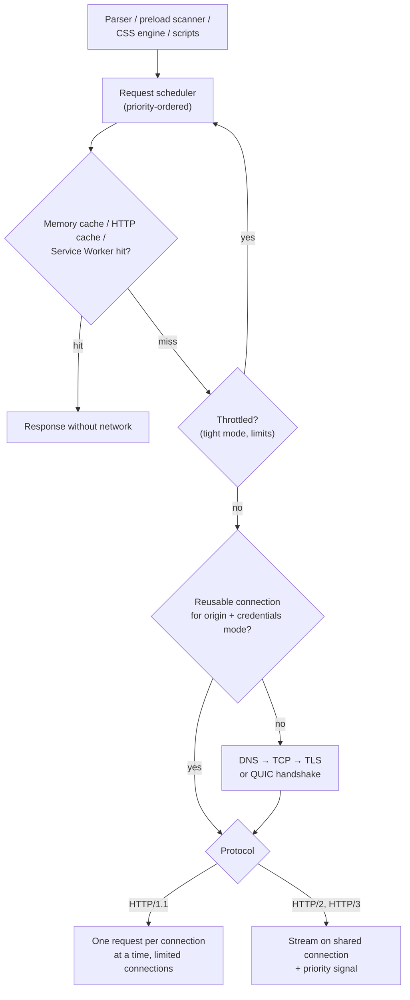

Bandwidth allocation is not controlled by the browser alone. The browser chooses which requests are in flight and what priority signals to send; TCP or QUIC congestion control and the server's scheduling decide how the available bandwidth is divided among them.

### HTTP/1.1

HTTP/1.1 sends one request at a time per connection, and the response must be fully delivered before the next one can start on that connection (pipelining exists in the specification but is effectively unused by browsers). To parallelize, browsers open multiple connections per origin; Chromium's limit is six per host. Consequences:

- **Application-level head-of-line blocking.** A slow response blocks every request queued behind it on that connection.
- **The seventh request waits.** On a page with 40 same-origin images, most of them queue for a free connection, and priority decides which goes next.
- **Every connection pays setup costs** and starts with a small TCP congestion window.
- Old optimizations such as domain sharding (spreading assets across hostnames to get more connections) and spriting were workarounds for these limits. They are counterproductive on HTTP/2 and HTTP/3.

On HTTP/1.1, browser-side prioritization is the _only_ prioritization: the browser decides which request gets the next free connection.

### HTTP/2

HTTP/2 multiplexes many requests as **streams** over one connection, with binary framing and HPACK header compression ([RFC 9113](https://www.rfc-editor.org/rfc/rfc9113)). The browser can send all its requests at once, and the server interleaves response frames. This removes the per-origin connection limit as a bottleneck and makes connection reuse the norm.

It moves the prioritization problem to the server. With all requests in flight at once, the server decides whose bytes to send next. The original HTTP/2 specification (RFC 7540) defined a dependency tree with weights for this, but implementations were inconsistent and many servers ignored it; RFC 9113 deprecated that scheme. Its replacement is the **Extensible Prioritization Scheme** of [RFC 9218](https://www.rfc-editor.org/rfc/rfc9218): a `priority` request header (and a `PRIORITY_UPDATE` frame for changes) carrying an **urgency** from 0 (most urgent) to 7, default 3, and an **incremental** flag that says whether the response is useful in pieces (like a progressive image) or only when complete (like a script).

```http
:method: GET
:path: /css/main.css
priority: u=0

:method: GET
:path: /img/thumb-07.avif
priority: u=4, i
```

You can see the `priority` header Chrome sends in DevTools' request headers for HTTP/2 and HTTP/3 requests. How Chromium maps its five internal levels to urgency values is an implementation detail; what matters is that the signal is advisory. Servers and CDNs that implement it well send the CSS before the thumbnails; servers that do not may send them round-robin, letting thumbnails steal bandwidth from render-blocking resources.

HTTP/2 still runs over TCP, so a single lost packet stalls **all** streams on the connection until it is retransmitted: **transport-level head-of-line blocking**. On lossy mobile networks, this can make one HTTP/2 connection perform worse than several HTTP/1.1 connections.

### HTTP/3 and QUIC

HTTP/3 maps HTTP semantics onto **QUIC**, a transport built on UDP with TLS 1.3 integrated ([RFC 9114](https://www.rfc-editor.org/rfc/rfc9114), [RFC 9000](https://www.rfc-editor.org/rfc/rfc9000)). The differences that matter for loading:

- **Independent streams.** Packet loss on one stream delays only that stream. TCP-level head-of-line blocking between streams disappears.
- **Faster setup.** Transport and cryptographic handshakes are combined into one round trip, and resumed connections can send data in the first flight (0-RTT, with replay caveats).
- **Connection migration.** Connections survive network changes such as Wi-Fi to cellular.
- **Prioritization.** HTTP/3 uses the RFC 9218 scheme from the start; it has no legacy dependency tree.
- **Discovery.** Browsers typically learn that an origin supports HTTP/3 from an `Alt-Svc` response header or an HTTPS DNS record, so a first visit may use HTTP/2 and later requests HTTP/3. Networks that block UDP fall back to HTTP/2.

HTTP/3 does not remove the need for prioritization. Bandwidth is still finite, the server still decides send order, and a page that sends its hero image request late gets it late regardless of protocol.

| Aspect                     | HTTP/1.1                                   | HTTP/2                                         | HTTP/3                                         |
| -------------------------- | ------------------------------------------ | ---------------------------------------------- | ---------------------------------------------- |
| Transport                  | TCP (+ TLS)                                | TCP + TLS                                      | QUIC over UDP (TLS 1.3 built in)               |
| Requests per connection    | One at a time                              | Many concurrent streams                        | Many concurrent streams                        |
| Connections per origin     | Several (six in Chromium)                  | Usually one                                    | Usually one                                    |
| Head-of-line blocking      | Per connection, at the application level   | At the TCP level, across all streams           | Per stream only                                |
| Header compression         | None                                       | HPACK                                          | QPACK                                          |
| Prioritization             | Browser chooses which request to send next | RFC 7540 tree (deprecated) or RFC 9218 signals | RFC 9218 signals                               |
| Handshake (new connection) | TCP + TLS                                  | TCP + TLS                                      | Combined, one round trip (0-RTT on resumption) |
| Where ordering is decided  | Browser                                    | Browser and server                             | Browser and server                             |

### Connection management

- **Connection pools.** Browsers keep connections open (HTTP keep-alive for HTTP/1.1, long-lived connections for HTTP/2 and HTTP/3) and reuse them for subsequent requests. Pools are partitioned by origin, by credentials mode, and in modern browsers by top-level site, for privacy.
- **Connection coalescing.** An HTTP/2 or HTTP/3 connection can be reused for a different hostname if the hostname resolves to the same server and the server's certificate covers it ([RFC 9113, section 9.1.1](https://www.rfc-editor.org/rfc/rfc9113#section-9.1.1)). Serving `static.example.com` and `www.example.com` from the same CDN with a shared certificate can avoid a second handshake. Browsers apply coalescing rules differently.
- **Third-party origins.** Each third-party origin costs a fresh DNS lookup, handshake and congestion window ramp-up, and connection pools are not shared across sites. Self-hosting critical assets (fonts in particular) on the document's origin removes that cost entirely; preconnect reduces it.

Transport and connection setup decide how quickly bytes can flow once requests are made. They do not decide which requests are important. A perfectly tuned HTTP/3 deployment still delivers a late-discovered, low-priority hero image late.

## Resource loading and Core Web Vitals

The [Core Web Vitals post](/blog/web-performance-metrics-a-deep-dive-into-core-web-vitals) explains how each metric is measured. Here the question is narrower: which loading decisions move which metric.

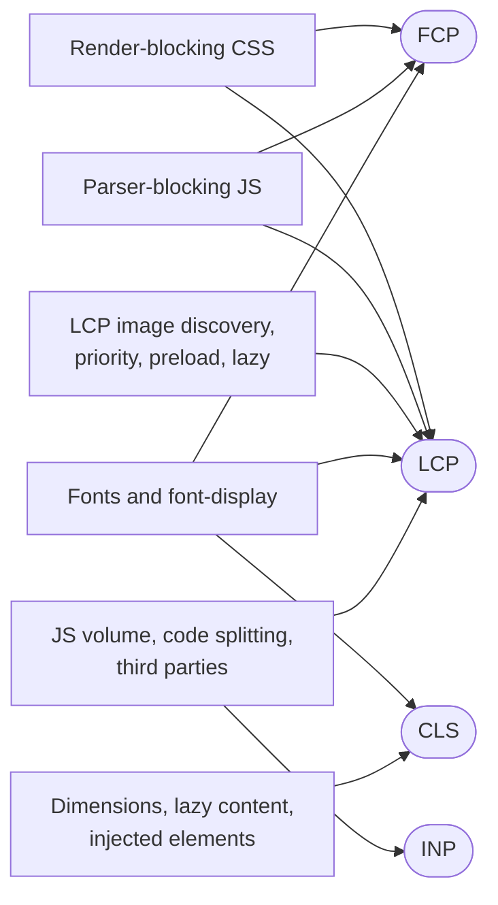

### LCP

web.dev splits LCP into four subparts, with recommended proportions that it calls "guidelines, not strict rules" ([web.dev: Optimize LCP](https://web.dev/articles/optimize-lcp)):

| Subpart                | What it covers                                     | Rough target share | Loading levers                                           |
| ---------------------- | -------------------------------------------------- | ------------------ | -------------------------------------------------------- |
| Time to First Byte     | Navigation start to first HTML byte                | About 40%          | Server, CDN, redirects, Early Hints                      |
| Resource load delay    | TTFB to the moment the LCP resource starts loading | Under 10%          | Discovery: `` in HTML, preload, no lazy loading     |
| Resource load duration | Time to download the LCP resource                  | About 40%          | Size, priority, contention, connection reuse             |
| Element render delay   | Resource loaded to LCP element rendered            | Under 10%          | Render-blocking CSS and JS, main-thread work, font block |

The rule of thumb from web.dev is that the LCP resource "should start loading at the same time as the first resource loaded by that page". Every loading mechanism in this post maps onto one of these subparts:

- **Late discovery** (CSS background, JavaScript rendering, `data-src` lazy loaders) inflates **resource load delay**.
- **Low priority** inflates load delay (held back in tight mode) and **load duration** (sharing bandwidth with less important requests).
- **Connection setup** to a separate image origin adds to load delay; preconnect reduces it.
- **Render-blocking resources that are slower than the image** inflate **element render delay**: the image is ready but cannot be painted until CSS arrives or a blocking script finishes. The same is true when client-side code must run before inserting the image.
- **Lazy loading the LCP image** inflates load delay, because the request waits for layout.

### FCP

FCP is gated by everything on the critical rendering path: the HTML, render-blocking stylesheets and their imports, parser-blocking scripts in the `<head>`, and for text-only first paints, the font block period. Loading levers: fewer and smaller render-blocking stylesheets, no `@import` chains, `defer` instead of blocking scripts, critical CSS where it pays off, and `font-display` values with short block periods.

### INP

Resource loading affects INP mostly through the main thread. Every script that arrives must be parsed, compiled and executed, and large scripts execute as long tasks. An interaction that happens while a long task runs waits for it to finish (input delay). Loading decisions that help:

- **Code splitting and `defer`** keep execution out of the window where users first interact.
- **Interaction-triggered imports with intent prefetching** keep rarely used code out of the initial load without making the interaction slow.
- **Async third-party scripts still execute on the main thread.** `async` changes when they run, not how much they cost.
- **Lazy-loaded content arriving during an interaction** can add rendering work to the next frame.

### CLS

Loading causes layout shifts whenever something arrives later and takes up space it was not given:

- **Images without dimensions.** Set `width` and `height` (or `aspect-ratio` in CSS) so the box is reserved before the bytes arrive.
- **Font swaps** with different metrics reflow text. Use metric overrides, or `font-display: optional`.
- **Lazy-loaded and injected content** (ads, recommendation widgets, cookie banners inserted above content) pushes existing content down. Reserve space with `min-height` or placeholders.

### Trade-offs between metrics

Loading optimizations often trade one metric against another:

- **`font-display: swap`** improves FCP and can improve LCP, but risks CLS. **`optional`** avoids CLS but sometimes shows the fallback font.
- **Critical CSS with deferred full CSS** improves FCP, but the late stylesheet can restyle content (CLS) and its application costs main-thread time.
- **Aggressive code splitting** improves load metrics and early INP, but the first interaction with a deferred feature can be slow.
- **Preloading many resources** may speed up one resource while delaying render-blocking CSS, hurting FCP.
- **Prerendering next pages** makes navigations instant but spends bandwidth and CPU on the current page, which can hurt its INP on low-end devices.
- **Lazy loading below-the-fold images** improves LCP through less contention, but can cause shifts and blank areas while scrolling if dimensions or margins are wrong.

## Practical experiments

These experiments are designed to be reproducible with a local server and Chrome DevTools. They describe what to look for and why, based on the documented behaviour above. **No results are reported here as measurements**: where a section says "expected", it is a prediction you should verify, and the outcome can differ by browser, version and machine.

### A delay server for the experiments

Most effects are invisible on localhost without artificial latency. DevTools throttling helps, but per-resource delays make waterfalls much easier to read. This small Node.js server (Node 18 or later, no dependencies) serves files from a directory and delays any request with a `delay` query parameter:

```js
// server.mjs: run with `node server.mjs`, then open http://localhost:8080/
import { createServer } from 'node:http';
import { readFile } from 'node:fs/promises';
import { extname, join, normalize } from 'node:path';

const ROOT = join(process.cwd(), 'public');
const TYPES = {
  '.html': 'text/html; charset=utf-8',
  '.css': 'text/css; charset=utf-8',
  '.js': 'text/javascript; charset=utf-8',
  '.mjs': 'text/javascript; charset=utf-8',
  '.json': 'application/json',
  '.avif': 'image/avif',
  '.webp': 'image/webp',
  '.jpg': 'image/jpeg',
  '.png': 'image/png',
  '.svg': 'image/svg+xml',
  '.woff2': 'font/woff2',
};

const sleep = (ms) => new Promise((resolve) => setTimeout(resolve, ms));

createServer(async (req, res) => {
  const url = new URL(req.url, 'http://localhost');
  const delay = Number(url.searchParams.get('delay') ?? 0);
  // Normalize and keep the path inside ROOT.
  const rel = normalize(url.pathname === '/' ? '/index.html' : url.pathname).replace(/^(\.\.[/\\])+/, '');
  const file = join(ROOT, rel);
  if (!file.startsWith(ROOT)) {
    res.writeHead(403).end();
    return;
  }
  try {
    const body = await readFile(file);
    if (delay > 0) await sleep(delay);
    res.writeHead(200, {
      'content-type': TYPES[extname(file)] ?? 'application/octet-stream',
      'cache-control': 'no-store', // Every reload hits the network.
      'access-control-allow-origin': '*', // Allows the font and module experiments across ports.
    });
    res.end(body);
  } catch {
    res.writeHead(404).end('Not found');
  }
}).listen(Number(process.env.PORT ?? 8080), () => console.log('Listening on', process.env.PORT ?? 8080));
```

Put test pages and assets in a `public/` folder next to it. Use real images of a realistic size (a few hundred KB for heroes) so download time is visible. This server speaks HTTP/1.1 only, which keeps the per-origin connection limit in play; Experiment 11 uses a different server for HTTP/2 and HTTP/3.

General DevTools setup for all experiments:

1. Open DevTools, **Network** panel, tick **Disable cache**.
2. Right-click the column headers and enable **Priority**, **Initiator** and **Protocol**.
3. In Network settings (gear icon), enable **Big request rows** to see initial and final priority.
4. Use the throttling dropdown (**Fast 4G** or **Slow 4G**) when the experiment says so.
5. Use the **Performance** panel with CPU throttling for main-thread experiments.

### Experiment 1: Compare parser-blocking, async and defer scripts

**Objective.** See how each script type affects parsing, execution order and `DOMContentLoaded`.

**Setup.** Three scripts that log when they run, with different delays.

```html
<!-- public/scripts.html -->
<!doctype html>
<html lang="en">
  <head>
    <meta charset="utf-8" />
    <title>Script strategies</title>
    <script>
      const t0 = performance.now();
      const log = (msg) => console.log(`${(performance.now() - t0).toFixed(0).padStart(5)} ms  ${msg}`);
      document.addEventListener('DOMContentLoaded', () => log('DOMContentLoaded'));
      window.addEventListener('load', () => log('load'));
    </script>
    <!-- Switch the attributes between runs: none / async / defer -->
    <script src="/js/a.js?delay=800"></script>
    <script src="/js/b.js?delay=200"></script>
  </head>
  <body>
    <p id="first">First paragraph</p>
    <script>
      log('inline script after #first; #last exists? ' + !!document.getElementById('last'));
    </script>
    <p id="last">Last paragraph</p>
  </body>
</html>
```

```js
// public/js/a.js
log('a.js executed; #last exists? ' + !!document.getElementById('last'));
```

```js
// public/js/b.js
log('b.js executed; #last exists? ' + !!document.getElementById('last'));
```

**Steps.** Load the page three times: with no attributes, with `async` on both external scripts, and with `defer` on both. Read the console and the Network waterfall each time.

**Expected observations.**

- _No attributes_: both scripts download in parallel (the preload scanner finds `b.js` while the parser waits for `a.js`), but `a.js` runs first, then `b.js`, then the inline script; `#last` does not exist yet for any of them. Nothing renders until about 800 ms.
- _`async`_: `b.js` likely runs first because it finishes first. The inline script and paragraphs may be processed before either. Order follows network completion.
- _`defer`_: both run after parsing, in document order (`a.js` then `b.js`), both see `#last`, and `DOMContentLoaded` comes after them. The paragraphs can render before the scripts run.

**DevTools.** In the Performance panel, the classic case shows a gap in "Parse HTML" tasks while the parser waits. Compare the Priority column: classic scripts in the head versus `async`/`defer`.

**Explanation.** This is the HTML Standard's script processing model described above. **Compatibility.** The ordering rules are standard and should match in all modern browsers; priority labels are Chromium-specific.

### Experiment 2: Observe the speculative preload scanner

**Objective.** Show that resources after a blocking script are requested before the script finishes, and that resources hidden from markup are not.

```html
<!-- public/scanner.html -->
<!doctype html>
<html lang="en">
  <head>
    <meta charset="utf-8" />
    <title>Preload scanner</title>
    <script src="/js/slow.js?delay=2000"></script>
  </head>
  <body>
    
    
    <div class="bg" style="width: 800px; height: 533px; background-image: url('/img/inline-bg.jpg')"></div>
    <script>
      // Reveal the hidden image the way a JS lazy loader would.
      for (const img of document.querySelectorAll('.js-lazy')) img.src = img.dataset.src;
    </script>
  </body>
</html>
```

```js
// public/js/slow.js
console.log('slow.js ran');
```

**Steps.** Load the page with throttling off (the 2 s server delay is the variable). Look at the **Start time** of each request in the waterfall and its **Initiator**.

**Expected observations.** `visible.jpg` starts right after the HTML arrives, during the 2 s wait, with the document as its initiator. `hidden.jpg` starts only after `slow.js` has run and the inline script has executed. `inline-bg.jpg` also waits: its URL is in a `style` attribute, which the scanner does not evaluate, and it can only be fetched after style calculation for that element.

**Explanation.** The scanner tokenizes markup and recognizes `src` attributes on known elements, but it does not run scripts or compute styles. **Compatibility.** All major engines speculate, but which elements and attributes they recognize differs; repeat in Firefox and Safari to compare.

### Experiment 3: Compare image discovery through HTML and CSS

**Objective.** Measure how much later a CSS background image starts than the same image in an ``.

```html
<!-- public/discovery-img.html -->
<link rel="stylesheet" href="/css/plain.css?delay=300" />

```

```html
<!-- public/discovery-bg.html -->
<link rel="stylesheet" href="/css/hero-bg.css?delay=300" />
<div class="hero"></div>
```

```css
/* public/css/hero-bg.css */
.hero {
  width: 1200px;
  height: 800px;
  background: url('/img/hero.jpg?v=bg') center / cover;
}
```

`plain.css` can be empty. **Steps.** Load each page with **Fast 4G** throttling. Record the hero image's start time in the waterfall, and record LCP in the Performance panel.

**Expected observations.** In the `` version, the image starts almost immediately after the HTML, in parallel with the stylesheet. In the background version, it starts only after the stylesheet has downloaded (300 ms plus transfer) and style has been calculated, and its Initiator column points at `hero-bg.css`.

**Explanation.** CSS `url()` values are fetched only when a matching element is styled. **Compatibility.** The discovery order is consistent across engines because it follows from how CSS works.

### Experiment 4: Inspect initial resource priorities

**Objective.** Build a reference page and compare its Priority column with the table earlier in this post.

```html
<!-- public/priorities.html -->
<!doctype html>
<html lang="en">
  <head>
    <meta charset="utf-8" />
    <title>Priorities</title>
    <link rel="stylesheet" href="/css/plain.css" />
    <link rel="stylesheet" href="/css/print.css" media="print" />
    <link rel="preload" href="/fonts/test.woff2" as="font" type="font/woff2" crossorigin />
    <script src="/js/blocking.js"></script>
    <script src="/js/async.js" async></script>
    <script src="/js/defer.js" defer></script>
    <script type="module" src="/js/module.mjs"></script>
    <link rel="prefetch" href="/js/next-page.js" />
  </head>
  <body>
    
    
    <div style="height: 3000px"></div>
    
    <iframe src="/frame.html" width="400" height="300" title="Frame"></iframe>
    <script src="/js/late.js"></script>
    <script>
      fetch('/data.json');
      fetch('/data.json?low', { priority: 'low' });
    </script>
  </body>
</html>
```

**Steps.** Load with Big request rows enabled. For each row, note the final and initial priorities.

**Expected observations, based on the documented Chromium defaults.** Highest for the document and `plain.css`; Lowest for `print.css` and the prefetch; High for the preloaded font, the blocking script and the plain `fetch()`; Low for `async.js` and `defer.js`; Low for the `priority: 'low'` fetch; Medium for `late.js` (requested after images); Medium initially for the large images, with the in-viewport one escalated to High after layout. Record what you actually see for the module script and the iframe, since the web.dev table does not cover them.

**Compatibility.** Only Chromium-based browsers show this column with these labels. Firefox's Network panel and Safari's Web Inspector expose priority differently, if at all.

### Experiment 5: Change image priority with fetchpriority

**Objective.** See whether `fetchpriority="high"` changes when the LCP image starts and finishes when it competes with other images.

```html
<!-- public/fp.html -->
<!doctype html>
<html lang="en">
  <head>
    <meta charset="utf-8" />
    <title>Fetch Priority</title>
    <link rel="stylesheet" href="/css/plain.css?delay=500" />
    <script src="/js/blocking.js?delay=500"></script>
  </head>
  <body>
    <!-- Six large images; the third is the "hero". Toggle fetchpriority between runs. -->
    
    
    
    
    
    
    <script>
      new PerformanceObserver((list) => {
        const last = list.getEntries().at(-1);
        console.log('LCP', last.startTime.toFixed(0), 'ms', last.url);
      }).observe({ type: 'largest-contentful-paint', buffered: true });
    </script>
  </body>
</html>
```

**Steps.** Throttle to **Slow 4G**. Run five loads without the attribute and five with it, recording the hero's initial priority, start time, end time and the logged LCP. Compare medians, not single runs.

**Expected observations.** Without the hint, the hero starts at Medium or Low and may queue behind the head resources. With it, the initial priority is High and the request should start without that wait. Whether LCP improves depends on how much contention there is: with six competing images on a slow link, the effect should be visible; on an unthrottled connection, it may not be.

**Compatibility.** `fetchpriority` is supported in Chromium 102+, Firefox 132+ and Safari 17.2+; the internal effect differs per engine. The LCP API is available in Chromium, Firefox and recent Safari.

### Experiment 6: Compare preload with ordinary discovery

**Objective.** Show what preload fixes (late discovery) and what it cannot fix.

Use the background-image page from Experiment 3 and add, as the first element in the `<head>`:

```html
<link rel="preload" as="image" href="/img/hero.jpg?v=bg" fetchpriority="high" />
```

**Steps.** Compare three versions under Fast 4G: background without preload, background with preload, and the `` version. Then repeat with a deliberate mismatch: preload `/img/hero.jpg?v=other` instead.

**Expected observations.** With a matching preload, the image starts as early as the `` version, and the Initiator column shows the preload line. With the mismatched URL, there are two image requests, and Chrome's console warns that the preloaded resource was not used within a few seconds of the load event.

**Compatibility.** `preload` is supported in all modern browsers. The warning text is Chromium's.

### Experiment 7: Compare preconnect and dns-prefetch

**Objective.** Observe connection setup costs for a second origin.

**Setup.** Run a second instance of the server on another port to act as a "third-party" origin: `PORT=8081 node server.mjs` (in PowerShell, `$env:PORT=8081; node server.mjs`). Localhost connections are almost free, so for meaningful numbers use a real remote origin you control (for example, a static file on a CDN) instead.

```html
<!-- public/connect.html: try each variant of the hint line separately -->
<link rel="preconnect" href="https://cdn.your-test-origin.example" crossorigin />
<!-- <link rel="dns-prefetch" href="https://cdn.your-test-origin.example"> -->
<link rel="stylesheet" href="/css/uses-remote-font.css?delay=600" />
```

```css
/* public/css/uses-remote-font.css: the remote font is discovered only after this CSS arrives */
@font-face {
  font-family: 'Remote';
  src: url('https://cdn.your-test-origin.example/fonts/test.woff2') format('woff2');
}
body {
  font-family: 'Remote', sans-serif;
}
```

**Steps.** Under Fast 4G, load with no hint, with `dns-prefetch`, with `preconnect` without `crossorigin`, and with `preconnect` with `crossorigin`. Hover the font request's waterfall bar and compare the DNS Lookup, Initial connection and SSL phases.

**Expected observations.** With no hint, the font request includes all three phases. With `dns-prefetch`, the DNS phase should disappear or shrink. With `preconnect crossorigin`, the font request should show no connection phases at all. With `preconnect` without `crossorigin`, the font request should still open a new connection, because the preconnected one is in the credentialed pool.

**Compatibility.** Both hints are widely supported. Connection pool partitioning rules differ by browser, so the `crossorigin` mismatch may behave differently outside Chromium.

### Experiment 8: Compare eager and lazy images

**Objective.** See which images are requested at load time when below-the-fold images are lazy.

```html
<!-- public/lazy.html -->
<!doctype html>
<html lang="en">
  <head>
    <meta charset="utf-8" />
    <title>Lazy loading</title>
    <style>
      img {
        display: block;
        margin-bottom: 400px;
      }
    </style>
  </head>
  <body>
    
    
    
    
    
    
    
    
  </body>
</html>
```

**Steps.** Load without throttling, do not scroll, and count image requests. Then scroll slowly and watch new requests appear. Repeat with all `loading="lazy"` removed.

**Expected observations.** With lazy loading, only images within the browser's distance threshold of the viewport load initially; each image plus margin is roughly 930 px tall, so with Chromium's 1250 px threshold on a fast connection, expect the first two or three images. The rest load as you scroll toward them. Without lazy loading, all eight load immediately.

**Compatibility.** Thresholds differ by browser and connection type, so the count will vary.

### Experiment 9: Observe lazy loading under network throttling

**Objective.** See Chromium's connection-dependent thresholds.

**Steps.** Repeat Experiment 8 three times: no throttling, **Fast 4G**, and **Slow 4G** or **3G**. Reload with each setting and count initial image requests.

**Expected observations.** On slower effective connection types, Chromium uses its larger 2500 px threshold, so more images may load initially. Whether DevTools throttling changes Chromium's effective connection type estimate can depend on the version, so treat a lack of difference as a result to note, not as a mistake.

**Compatibility.** Connection-aware thresholds are Chromium behaviour.

### Experiment 10: Preload a font and inspect font loading

**Objective.** Measure how far a preload moves a font request, and see the `crossorigin` double-download.

```html
<!-- public/font.html -->
<!doctype html>
<html lang="en">
  <head>
    <meta charset="utf-8" />
    <title>Font loading</title>
    <!-- Run 1: comment this out. Run 2: as written. Run 3: remove crossorigin. -->
    <link rel="preload" href="/fonts/test.woff2" as="font" type="font/woff2" crossorigin />
    <link rel="stylesheet" href="/css/font.css?delay=600" />
  </head>
  <body>
    <h1>The quick brown fox</h1>
    <script>
      document.fonts.ready.then(() => console.log('fonts ready at', performance.now().toFixed(0), 'ms'));
    </script>
  </body>
</html>
```

```css
/* public/css/font.css */
@font-face {
  font-family: 'Test';
  src: url('/fonts/test.woff2') format('woff2');
  font-display: swap;
}
h1 {
  font-family: 'Test', Georgia, serif;
}
```

**Steps.** Under Fast 4G, compare the three runs. Watch the font request start time, the number of font requests, the console timing and the visual swap in the Performance panel's screenshots.

**Expected observations.** Without the preload, the font starts after the 600 ms stylesheet. With it, the font starts with the stylesheet. Without `crossorigin`, there are two font requests and Chrome warns that the preload was not used because the credentials mode does not match.

**Compatibility.** The behaviour follows the CSS Fonts and Fetch specifications and should be consistent; warning text is Chromium-specific.

### Experiment 11: Compare HTTP/2 and HTTP/3

**Objective.** Observe protocol differences, where an environment allows it.

**Setup.** HTTP/3 requires TLS and a server that supports QUIC. [Caddy](https://caddyserver.com/) enables HTTP/1.1, HTTP/2 and HTTP/3 by default and generates local certificates:

```text
# Caddyfile
localhost {
	root * ./public
	file_server
}
```

Run `caddy run`, open `https://localhost`, and enable the **Protocol** column. Chrome may use HTTP/2 for the first requests and switch to HTTP/3 after seeing the `Alt-Svc` header, so reload a few times. To compare, you can disable HTTP/3 in Caddy's global `servers` options and reload.

**Steps.** Load a page with many images (for example 30 thumbnails) under the same throttling with each protocol. Compare the waterfall shape and total load time over several runs.

**Expected observations.** Both protocols multiplex, so both waterfalls should show many concurrent requests rather than HTTP/1.1's groups of six. DevTools throttling operates on top of the browser's network stack and does not simulate packet loss, so the HTTP/3 advantage under loss is unlikely to appear locally; differences in this setup may be small or noise. For loss experiments, use OS-level tools (such as `tc netem` on Linux) and treat the results as specific to your setup.

**Compatibility.** HTTP/3 is supported by all major browsers, but whether it is used depends on the network, the server and the browser's discovery of `Alt-Svc` or HTTPS DNS records.

### Experiment 12: Observe the effect of excessive high-priority requests

**Objective.** See how priority inflation affects the resource that matters.

**Setup.** Use the page from Experiment 5 and add `fetchpriority="high"` to all six images, and add three preloads for large images that are not on the page.

**Steps.** Under Slow 4G, compare three variants: no hints, hint on the hero only, and hints everywhere. Record the hero's end time, the stylesheet's end time and LCP over several runs.

**Expected observations.** With hints everywhere, the hero no longer stands out from the other images, so its download should be shared with them again, and the unnecessary preloads compete with the stylesheet. Expect the hero-only variant to perform best. The size of the effect depends on how much bandwidth is constrained.

**Compatibility.** The mechanism (relative priority) is general; the specific queueing effects are Chromium's.

### Experiment 13: Measure LCP before and after optimizing hero discovery

**Objective.** Measure each LCP subpart before and after moving the hero from client-side rendering to server HTML.

**Setup.** Two versions of a product page. Version A renders the hero image from JavaScript after fetching JSON; version B has the `` in the HTML with `fetchpriority="high"`.

```html
<!-- public/lcp-a.html: client-rendered hero -->
<div id="hero"></div>
<script type="module">
  const product = await fetch('/product.json?delay=400').then((r) => r.json());
  document.querySelector('#hero').innerHTML =
    ``;
</script>
```

```html
<!-- public/lcp-b.html: hero in the server HTML -->
<div id="hero">
  
</div>
```

```json
{ "name": "Ridge GTX", "hero": "/img/hero.jpg" }
```

Add this script to both pages to log the LCP subparts in the same way the Performance panel breaks them down:

```js
// lcp-breakdown.js: log TTFB, load delay, load duration and render delay for the LCP element.
new PerformanceObserver((list) => {
  const lcp = list.getEntries().at(-1);
  const nav = performance.getEntriesByType('navigation')[0];
  const res = performance.getEntriesByType('resource').find((r) => r.name === lcp.url);

  const ttfb = nav.responseStart;
  // Text LCP elements have no resource; their load delay and duration are zero.
  const loadStart = res ? Math.max(ttfb, res.requestStart || res.startTime) : ttfb;
  const loadEnd = res ? Math.max(loadStart, res.responseEnd) : ttfb;
  const render = Math.max(loadEnd, lcp.startTime);

  console.table({
    'Time to First Byte': ttfb.toFixed(0),
    'Resource load delay': (loadStart - ttfb).toFixed(0),
    'Resource load duration': (loadEnd - loadStart).toFixed(0),
    'Element render delay': (render - loadEnd).toFixed(0),
    LCP: lcp.startTime.toFixed(0),
  });
}).observe({ type: 'largest-contentful-paint', buffered: true });
```

**Steps.** Under Slow 4G with 4x CPU throttling, load each version several times and compare the medians of each subpart.

**Expected observations.** Version A should show a large resource load delay (module download, JSON fetch, render) while load duration is similar between versions. That is the signature of a discovery problem: making the image smaller would barely help A.

**Compatibility.** `requestStart` is zero for cross-origin resources without `Timing-Allow-Origin`, which is why the code falls back to `startTime`. The LCP API is supported in Chromium, Firefox and Safari 26.2 and later.

### Experiment 14: Investigate JavaScript-driven discovery chains

**Objective.** Visualize a JavaScript request chain and shorten it.

**Setup.** An entry module that dynamically imports a gallery module, which fetches data and inserts an image:

```js
// public/js/entry.mjs
const { renderGallery } = await import('./gallery.mjs?delay=300');
await renderGallery();
```

```js
// public/js/gallery.mjs
export async function renderGallery() {
  const data = await fetch('/product.json?delay=300').then((r) => r.json());
  const img = new Image(1200, 800);
  img.alt = data.name;
  img.src = data.hero;
  document.body.append(img);
}
```

```html
<!-- public/chain.html -->
<script type="module" src="/js/entry.mjs?delay=300"></script>
```

**Steps.** Load it and hold <kbd>Shift</kbd> while hovering the image request in the Network panel to see its initiator chain. Then add `<link rel="modulepreload" href="/js/gallery.mjs?delay=300">` and `<link rel="preload" as="fetch" href="/product.json?delay=300" crossorigin>` to the head and compare. Finally, put the `` directly in the HTML.

**Expected observations.** The first version shows a four-step staircase: entry, gallery, JSON, image. The preloads let the gallery module and JSON load in parallel with the entry, leaving a two-step chain. Server-rendered markup removes the chain entirely. The preloaded fetch is only reused if the `fetch()` call matches its mode and credentials: a same-origin `fetch()` with default options uses `same-origin` credentials, which matches a preload with `crossorigin` (anonymous); if you see a double request, check this first.

**Compatibility.** `modulepreload` is widely available since 2023. Preload matching for `as="fetch"` is a common source of double requests; verify in your browser.

## Debugging resource loading with Chrome DevTools

### The tools and what each one tells you

**Network panel** ([Chrome DevTools: Network reference](https://developer.chrome.com/docs/devtools/network/reference)):

- **Waterfall.** The horizontal position of a bar is its start time; its length is total duration. Late starts mean discovery or queueing problems; long bars mean size or contention problems.
- **Initiator.** What caused the request: the parser (with a line number), a stylesheet, a script (with a stack trace), a preload or the preload scanner. <kbd>Shift</kbd>+hover shows initiator chains.
- **Priority.** Final priority, with initial priority below it when Big request rows is on.
- **Timing tab** (click a request): Queueing, Stalled, DNS Lookup, Initial connection, SSL, Request sent, Waiting for server response, Content Download. Long Queueing on Low-priority requests early in the load points at browser-side throttling; long connection phases point at missing connection reuse or preconnect.
- **Size column.** Transferred size versus resource size. "(memory cache)", "(disk cache)" or "(ServiceWorker)" means no network.
- **Protocol column.** `http/1.1`, `h2` or `h3`.
- **Disable cache** and **throttling** for reproducible cold loads.

**Performance panel** ([Chrome DevTools: Performance reference](https://developer.chrome.com/docs/devtools/performance/reference)):

- **Network track**, aligned with the **Main** thread track, so you can see a request complete and then wait for the main thread.
- **LCP marker** and **LCP breakdown** insight, which identifies the LCP element and splits LCP into its subparts.
- **Long tasks**, marked in red, which block parsing, rendering and input handling.
- **Insights sidebar**, including render-blocking requests, LCP request discovery, network dependency tree and third parties.

**Lighthouse** reports the same insights in a lab run. It is a starting point, not a verdict: one synthetic run on one simulated device.

### Case study: a product page with poor LCP and an optimized hero image

**Scenario (hypothetical).** A product detail page reports a poor LCP in field data. The hero image is already AVIF, correctly sized at 95 KB for mobile. The team's first instinct is to add `<link rel="preload">` for it. Instead, investigate in order of the LCP subparts, because each candidate cause has a distinct signature.

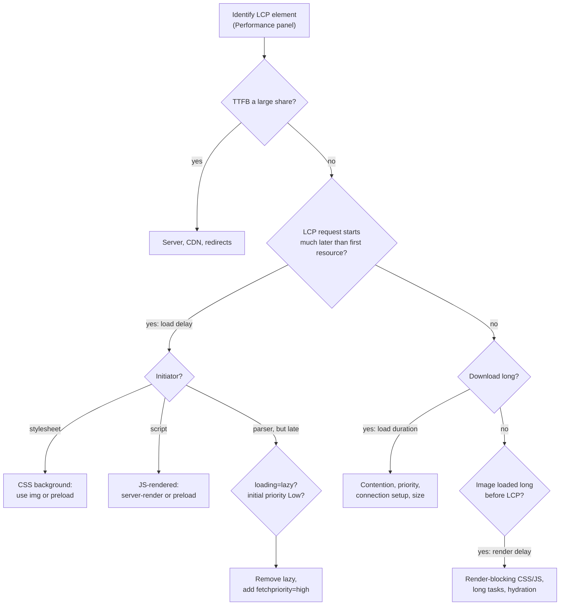

**Step 1: Identify the LCP element.** Record a load in the Performance panel with Slow 4G and 4x CPU throttling. Click the LCP marker. Confirm the element is the hero `` and not, say, a text block or a cookie banner. If it is a different element, everything else in the investigation changes.

**Step 2: Look at the LCP breakdown.** Suppose TTFB is small, resource load duration is reasonable, but resource load delay is a large share. That rules out image size (already optimized) and points at discovery, priority or connection setup.

**Step 3: Check the initiator.** In the Network panel, find the hero request.

- If the Initiator is a stylesheet, the hero is a CSS background: **late discovery through CSS**. The fix is an `` element, or a preload with `fetchpriority="high"` if the design requires a background.
- If the Initiator is a script, the hero is rendered by JavaScript: **runtime discovery**. Server-render the markup, or at least preload the image.
- If the Initiator is the document, but the start is still late, keep going.

**Step 4: Check for lazy loading.** Inspect the element. A `loading="lazy"` attribute, often added by a framework's image component default, means the browser waited for layout before requesting it. Remove it. In Chromium, Lighthouse's LCP request discovery insight flags this directly.

**Step 5: Check the priority.** With Big request rows on, look at initial and final priority. If it started at Low or Medium and became High later, the browser only learned its importance at layout. Look at the Queueing time in the Timing tab: a long queue during the early load indicates it was held back. `fetchpriority="high"` fixes this.

**Step 6: Check connection setup.** If the hero is on a separate image CDN, look at its Timing tab for DNS, Initial connection and SSL phases. If they add hundreds of milliseconds and the image is the first request to that origin, add `<link rel="preconnect">` for the image origin, or serve the hero from the document's origin.

**Step 7: Check render delay.** If the image finished downloading but LCP happens much later, the image was ready and waiting. Look at the Main track around the image's completion:

- Render-blocking stylesheets still downloading (check the render-blocking insight).
- A long task, such as a hydration bundle or third-party script, occupying the main thread.
- Client-side rendering that inserts the image only after framework code runs, or that hides the hero until hydration.

**Step 8: Verify the fix.** Apply one change at a time, record again under the same throttling, and compare subparts. Then confirm in field data, since lab conditions are not your users' conditions.

In this hypothetical, suppose step 3 showed a stylesheet initiator and step 5 showed an initial Low priority. Adding a preload alone would fix the discovery delay but keep the request at Low; the team's original idea would have helped only partly. Replacing the background with an `` fixes both causes with no extra hint at all. The point of the investigation is to find the cause before choosing the hint.

## A real-world resource loading architecture

This section designs a loading strategy for a **hypothetical** e-commerce product detail page. Sizes, origins and module names are illustrative assumptions, not measurements.

### The page

- HTML, server-rendered, with the product title, price and hero image markup.
- Critical CSS for the above-the-fold layout, and a full stylesheet.
- A JavaScript application bundle that hydrates the add-to-cart form, size picker and gallery.
- A hero product image (the LCP element on mobile and desktop), on an image CDN.
- Eight product thumbnails, the first four visible.
- Two web font weights for headings and body text, self-hosted.
- A product information API (stock and price updates) used by the hydrated components.
- A recommendations API and carousel, below the fold.
- Analytics and tag manager scripts.
- Third-party widgets: reviews and live chat.
- Below-the-fold content: details, reviews, recommendations, footer.

### Classification

| Class                         | Resources                                                                         | Strategy                                                        |
| ----------------------------- | --------------------------------------------------------------------------------- | --------------------------------------------------------------- |
| 1. Critical                   | HTML, critical CSS, hero image, heading font                                      | In HTML or inline, discoverable immediately, high priority      |
| 2. Important but non-blocking | Full CSS, app bundle (`defer`/module), visible thumbnails, body font, product API | Discovered early, default priorities, never blocking the parser |
| 3. Deferred                   | Below-the-fold images, reviews widget, recommendations API, analytics             | Lazy, low priority, or loaded after load                        |
| 4. Speculative                | Cart route bundle, likely next product pages                                      | Prefetch or Speculation Rules, conservative eagerness           |
| 5. On demand                  | Size guide modal, zoom viewer, chat widget                                        | Dynamic import on interaction, prefetch on intent               |

### Discovery map and critical request chain

```mermaid title="Product page resource loading architecture"
flowchart TB
    accTitle: Product page resource loading architecture
    accDescr: The HTML document contains inline critical CSS, a preconnect to the image CDN, a font preload, the hero img with fetchpriority high, the full stylesheet, and the deferred app bundle with modulepreload links. Critical resources are the HTML, critical CSS, hero image and heading font. Important non-blocking resources are the full CSS, app bundle, visible thumbnails and product API. Deferred resources are lazy images, the reviews widget, recommendations API and analytics, loaded after load or when near the viewport. Speculative resources are prefetched or prerendered next pages. On-demand resources are the size guide and zoom viewer, imported on interaction.
    HTML["HTML (server-rendered)"]
    subgraph C1["1. Critical"]
        CCSS["Inline critical CSS"]
        HERO["Hero img<br/>fetchpriority=high"]
        HFONT["Heading font<br/>preload"]
    end
    subgraph C2["2. Important, non-blocking"]
        FCSS["Full CSS<br/>(non-blocking)"]
        APP["App bundle<br/>type=module + modulepreload"]
        THUMB["Visible thumbnails"]
        API["Product API<br/>(from app)"]
    end
    subgraph C3["3. Deferred"]
        LAZY["Below-fold images<br/>loading=lazy"]
        REV["Reviews widget<br/>(near viewport)"]
        RECS["Recommendations API<br/>priority=low"]
        ANA["Analytics<br/>(after load)"]
    end
    subgraph C4["4. Speculative"]
        SPEC["Speculation Rules<br/>prefetch / prerender"]
    end
    subgraph C5["5. On demand"]
        MOD["Size guide, zoom,<br/>chat: import()"]
    end
    HTML --> CCSS
    HTML --> HERO
    HTML --> HFONT
    HTML --> FCSS
    HTML --> APP
    HTML --> THUMB
    HTML --> LAZY
    APP --> API
    APP --> RECS
    APP --> REV
    APP --> MOD
    HTML --> ANA
    HTML --> SPEC
```

The critical chain is deliberately one link deep: HTML, then the hero image, the heading font and the full CSS in parallel. Nothing critical depends on CSS or JavaScript to be discovered.

### Decisions

- **Priorities.** `fetchpriority="high"` only on the hero ``. `fetchpriority="low"` on thumbnails five to eight (they sit in the carousel, possibly in the viewport). `priority: 'low'` on the recommendations fetch. Everything else keeps browser defaults.
- **Preconnect.** One preconnect, to the image CDN, because the hero is on that origin and is critical. Fonts are self-hosted, so no font preconnect. No preconnects for third parties, which load late; `dns-prefetch` for the reviews and chat origins.
- **Preload.** The heading font weight only. The hero needs no preload because it is a real `` in the HTML; the body font is discovered early enough by the stylesheet and uses `swap` with metric overrides.
- **Lazy loading.** Native `loading="lazy"` on all below-the-fold images; Intersection Observer for the reviews widget and recommendations carousel (components, not images); never on the hero or visible thumbnails.
- **Scripts.** The app bundle as a module (deferred by default) with `modulepreload` for its shared chunks. No parser-blocking scripts. Analytics loaded after the `load` event. Chat loaded on first interaction with its button.
- **Fonts.** Two WOFF2 weights, Latin subset with `unicode-range`, `font-display: swap` for body text with fallback metric overrides, `optional` considered for the heading if layout shift is observed.
- **Speculation.** `prefetch` with `conservative` eagerness for product links in the recommendations, and `prefetch` for the cart route.

### Expected benefits and trade-offs

Expected benefits, stated as reasoning rather than measured results: the hero image starts with the first resources (small load delay); render-blocking work is limited to inline CSS (fast FCP); the main thread is free of third-party code during load (better early INP); dimensions and metric overrides prevent shifts (low CLS).

Trade-offs to accept consciously: inline critical CSS is not cached separately and must be maintained; deferring analytics loses some very short sessions from analytics data; lazy-loading the reviews widget means reviews appear slightly after scrolling to them; prefetching uses bandwidth on guesses; `swap` fonts produce a visible font change.

### The complete HTML

```html
<!doctype html>
<html lang="en">
  <head>
    <meta charset="utf-8" />
    <meta name="viewport" content="width=device-width, initial-scale=1" />
    <title>Ridge GTX Trail Shoe – Trailhead Running</title>
    <meta name="description" content="Waterproof trail running shoe with a grippy outsole." />

    <!-- 1. Connection to the image CDN, needed for the LCP image. The only preconnect. -->
    <link rel="preconnect" href="https://images.trailhead-cdn.example" />
    <!-- Third parties used later: DNS only. -->
    <link rel="dns-prefetch" href="https://reviews.widgets.example" />
    <link rel="dns-prefetch" href="https://chat.widgets.example" />

    <!-- 2. Heading font: discovered late through CSS otherwise. crossorigin is mandatory for fonts. -->
    <link rel="preload" href="/fonts/brand-sans-700-latin.woff2" as="font" type="font/woff2" crossorigin />

    <!-- 3. Critical CSS inline: no render-blocking request for the first paint. -->
    <style>
      @font-face {
        font-family: 'Brand Sans';
        src: url('/fonts/brand-sans-700-latin.woff2') format('woff2');
        font-weight: 700;
        font-display: swap;
        unicode-range: U+0000-00FF, U+2000-206F, U+20AC;
      }
      @font-face {
        font-family: 'Brand Sans';
        src: url('/fonts/brand-sans-400-latin.woff2') format('woff2');
        font-weight: 400;
        font-display: swap;
        unicode-range: U+0000-00FF, U+2000-206F, U+20AC;
      }
      @font-face {
        /* Placeholder values: compute real overrides for your font pair. */
        font-family: 'Brand Sans Fallback';
        src: local('Arial');
        size-adjust: 104%;
        ascent-override: 92%;
        descent-override: 24%;
      }
      body {
        margin: 0;
        font-family: 'Brand Sans', 'Brand Sans Fallback', sans-serif;
      }
      .pdp {
        display: grid;
        gap: 1.5rem;
        padding: 1rem;
      }
      @media (min-width: 1024px) {
        .pdp {
          grid-template-columns: 3fr 2fr;
        }
      }
      .pdp__hero img {
        width: 100%;
        height: auto;
        display: block;
      }
      .pdp__thumbs {
        display: flex;
        gap: 0.5rem;
        overflow-x: auto;
      }
      .pdp__title {
        font-weight: 700;
        font-size: 1.75rem;
      }
    </style>

    <!-- 4. Full stylesheet without blocking render. -->
    <link rel="stylesheet" href="/css/pdp.4f9a2c.css" media="print" onload="this.media='all'" />
    <noscript><link rel="stylesheet" href="/css/pdp.4f9a2c.css" /></noscript>

    <!-- 5. Application code: module scripts are deferred; modulepreload flattens the import chain. -->
    <script type="module" src="/js/pdp.8c1e7d.js"></script>
    <link rel="modulepreload" href="/js/chunks/vendor.31aa0b.js" />
    <link rel="modulepreload" href="/js/chunks/cart-form.92bd14.js" />

    <!-- 6. Speculative: likely next navigations, triggered only on strong intent. -->
    <script type="speculationrules">
      {
        "prefetch": [
          { "where": { "href_matches": "/products/*" }, "eagerness": "conservative" },
          { "urls": ["/cart"], "eagerness": "moderate" }
        ]
      }
    </script>
  </head>
  <body>
    <main class="pdp">
      <section class="pdp__hero">
        <!-- LCP image: in the HTML, responsive, high priority, eager, dimensions set. -->
        
        <div class="pdp__thumbs">
          <!-- Visible thumbnails: default priority. -->
          
          
          
          
          <!-- Scrolled out of the strip: low priority. -->
          
          
          
          
        </div>
      </section>

      <section class="pdp__buy">
        <h1 class="pdp__title">Ridge GTX Trail Shoe</h1>
        <p class="pdp__price" data-price>€149.00</p>
        <!-- Server-rendered form: usable before hydration, enhanced by cart-form.js. -->
        <form action="/cart" method="post" class="pdp__form" data-cart-form>
          <input type="hidden" name="sku" value="RIDGE-GTX-SLATE" />
          <label
            >Size
            <select name="size" required>
              <option>42</option>
              <option>43</option>
              <option>44</option>
            </select></label
          >
          <button type="submit">Add to cart</button>
          <button type="button" data-size-guide>Size guide</button>
        </form>
      </section>
    </main>

    <section class="pdp__details">
      <h2>Details</h2>
      <!-- Below the fold: lazy, async decoding, dimensions reserve space. -->
      
      
    </section>

    <!-- Reviews and recommendations: placeholders reserve space; JS loads them near the viewport. -->
    <section class="pdp__reviews" data-lazy-component="reviews" style="min-height: 480px">
      <h2>Reviews</h2>
    </section>
    <section class="pdp__recs" data-lazy-component="recommendations" style="min-height: 360px">
      <h2>You may also like</h2>
    </section>

    <button type="button" class="chat-launcher" data-chat>Chat with us</button>

    <script>
      // Analytics after load: never competes with critical resources or early interactions.
      addEventListener('load', () => {
        const s = document.createElement('script');
        s.src = 'https://analytics.metrics.example/tag.js';
        s.async = true;
        document.head.append(s);
      });
    </script>
  </body>
</html>
```

And the part of the app bundle that implements the deferred and on-demand classes:

```js
// /js/pdp.js: entry module source, deferred by default.
// The build emits hashed file names (pdp.8c1e7d.js, chunks/cart-form.92bd14.js) for these modules.
import { enhanceCartForm } from './chunks/cart-form.js';

enhanceCartForm(document.querySelector('[data-cart-form]'));

// Product API: important for fresh stock and price, default (High) priority.
fetch('/api/products/ridge-gtx/availability')
  .then((r) => r.json())
  .then(({ price }) => (document.querySelector('[data-price]').textContent = price));

// Deferred components: load near the viewport.
const loaders = {
  reviews: () => import('./chunks/reviews.js'),
  recommendations: () => import('./chunks/recommendations.js'),
};
const io = new IntersectionObserver(
  (entries) => {
    for (const entry of entries) {
      if (!entry.isIntersecting) continue;
      io.unobserve(entry.target);
      loaders[entry.target.dataset.lazyComponent]().then((m) => m.mount(entry.target));
    }
  },
  { rootMargin: '400px 0px' },
);
document.querySelectorAll('[data-lazy-component]').forEach((el) => io.observe(el));
// recommendations.js fetches with { priority: 'low' }.

// On demand: size guide, prefetched on intent.
const sizeGuideButton = document.querySelector('[data-size-guide]');
const loadSizeGuide = () => import('./chunks/size-guide.js');
sizeGuideButton.addEventListener('pointerenter', loadSizeGuide, { once: true });
sizeGuideButton.addEventListener('focus', loadSizeGuide, { once: true });
sizeGuideButton.addEventListener('click', async () => (await loadSizeGuide()).open());

// On demand: chat widget only after the user asks for it.
document
  .querySelector('[data-chat]')
  .addEventListener('click', async () => (await import('./chunks/chat-loader.js')).openChat(), { once: true });
```

## Common resource loading misconceptions

**"The first resource discovered is downloaded first."** Discovery only makes a request possible. A Low-priority image discovered early can be held in the browser's queue while a High-priority script discovered later goes out first, and on HTTP/2 or HTTP/3 the server decides whose bytes travel first.

**"`fetchpriority="high"` guarantees immediate downloading."** It changes the request's relative priority. The request still needs to be discovered, still needs a connection, still shares bandwidth with requests already in flight, and the server may ignore the signal. The standards define it as a hint.

**"Preload always improves performance."** Preload makes a request mandatory and early. That helps only when the resource is critical and discovered late. Otherwise it adds competition for bandwidth with render-blocking resources, and mismatched preloads download twice.

**"Preconnect and dns-prefetch do the same thing."** `dns-prefetch` resolves a hostname. `preconnect` also performs the TCP and TLS handshakes, saves more time and costs more, and Chrome closes the connection if it is not used within about 10 seconds.

**"Lazy loading every image is beneficial."** Lazy loading delays the request until layout shows the image is near the viewport. For above-the-fold images, and especially the LCP image, that is a pure delay, and it cancels the benefit of the preload scanner having found the image early.

**"`async` and `defer` are interchangeable."** `async` runs as soon as the script arrives, in no particular order, possibly before parsing finishes. `defer` runs after parsing, in document order, before `DOMContentLoaded`. Swapping one for the other breaks dependencies or changes when the main thread is busy.

**"CSS does not affect resource discovery."** CSS reveals fonts, background images and imported stylesheets, all late; blocks rendering; and delays parser-blocking scripts that wait for it, which delays the parser and everything it would discover.

**"JavaScript loading cannot block other work."** Parser-blocking scripts stop DOM construction. Every script, including `async` and `defer` ones, executes on the main thread, delaying rendering and input handling. Scripts also inject resources that compete for bandwidth.

**"More parallel downloads always mean faster loading."** Bandwidth is shared. Downloading ten resources in parallel delays each of them compared with downloading the important ones first. Extra connections also add handshake costs and slow-start penalties.

**"HTTP/2 eliminates prioritization concerns."** HTTP/2 removes the per-origin connection limit but moves ordering to the server, whose prioritization support varies. It does nothing about late discovery, and TCP head-of-line blocking still affects all its streams. HTTP/3 fixes the transport-level blocking but not the rest.

**"A high Lighthouse score proves loading is optimal."** Lighthouse runs one simulated device and network in a clean state. Real users have different devices, networks, caches, consent banners and personalization. Field data, and investigation of the specific LCP element, is the evidence.

**"Every resource should be explicitly assigned a priority."** Browser defaults are correct for most resources. Hints are relative; assigning priorities to everything flattens them and removes the information. Add hints where the defaults are demonstrably wrong.

**"Preloading every font improves performance."** Each font preload is a High-priority request competing with CSS and the LCP image, and preloaded fonts are downloaded even if the page never uses them. Preload only the one or two faces needed for above-the-fold text.

## Putting everything together

So, when a browser loads a page, how does it decide what to request first, what to prioritize and what to defer?

It cannot request what it has not found, so **discovery** comes first. The HTML parser finds resources as it builds the DOM. The speculative preload scanner reads ahead while the parser is blocked and finds most resources in markup early. The CSS engine finds fonts, background images and imports only after stylesheets are parsed and matched. JavaScript finds resources only when it runs. Discovery sets the earliest moment any request can start, and **critical request chains** are what happen when important resources hide behind other resources.

Each discovered request gets a **priority** from browser heuristics: its destination, its position in the document, whether it blocks parsing or rendering, and, for images, whether layout puts it in the viewport. Those heuristics are implementation details, documented best for Chromium, and they change over time; for example, when an image is promoted to High after layout. **Fetch Priority** lets authors adjust that guess where they know better. **Resource hints** move discovery earlier (`preload`, `modulepreload`), prepare connections (`preconnect`, `dns-prefetch`), or prepare future navigations (`prefetch`, Speculation Rules). **Lazy loading** and **script strategies** (`defer`, modules, dynamic imports) take resources out of the critical window altogether.

The browser's **scheduler** then decides when each request may go: important requests immediately, less important ones possibly held during the critical first phase. The request needs a **connection**, whose setup cost depends on DNS, TCP, TLS or QUIC and on whether one can be reused. The **transport** shares bandwidth among active requests, with HTTP/2 and HTTP/3 relaying the browser's priority signals to a server that may or may not honour them. Finally, the response is **processed**: CSS into the CSSOM, scripts executed on the main thread, images decoded, fonts loaded. Only then does **rendering** turn it all into pixels, and the order in which those pixels appear is what users and Core Web Vitals measure.

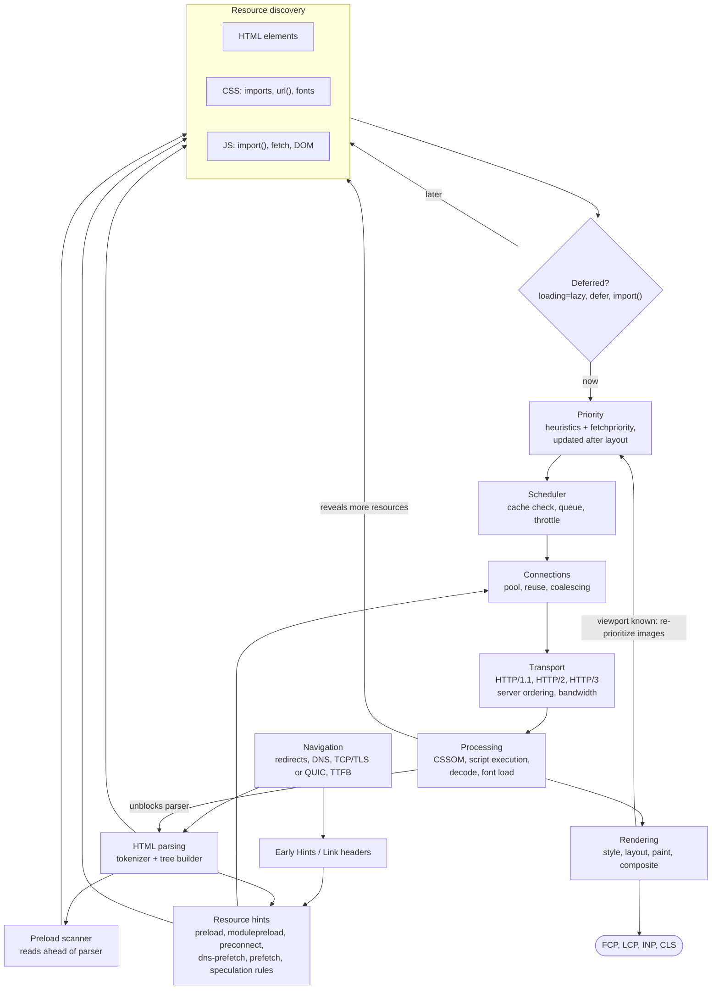

The diagram has three feedback loops, and they explain most loading behaviour: processing reveals new resources (the source of request chains), processing unblocks the parser (the cost of blocking scripts and CSS), and rendering informs priority (the reason images are promoted late).

### Engineering principles

1. **Make critical resources discoverable in the initial HTML.** Discovery is the delay no hint can fully recover. Server-render the LCP element as a real ``.
2. **Keep critical request chains short.** Replace `@import` with `<link>`, preload late-discovered fonts, flatten module graphs, and avoid hiding critical content behind data fetches.
3. **Let the browser's defaults work, and correct them only where they are wrong.** One `fetchpriority="high"` on the LCP image; `low` on what competes with it; nothing elsewhere.
4. **Choose hints by the layer they act on.** Late discovery: preload. Late connection: preconnect. Future navigation: prefetch or Speculation Rules. They are not interchangeable.
5. **Defer what is not needed now, and only that.** Lazy-load below-the-fold media, `defer` scripts, split rarely used code, never lazy-load the LCP image.
6. **Protect the main thread.** Bytes are not the only cost; execution competes with rendering and input. Load third parties late.
7. **Reserve space for everything that arrives late.** Dimensions, aspect ratios, font metric overrides and placeholders.
8. **Measure the cause, not the symptom.** Start from the LCP element and its subparts, check initiator, priority and timing, change one thing at a time, and confirm in field data.
9. **Treat browser internals as moving targets.** Priority tables, thresholds and scheduling rules are implementation details. Design around the principles, and verify the specifics in DevTools for the browsers your users run.
