import Note from '../../components/Note.astro';

An image on a web page looks like one thing: a `` tag with a URL. In practice it is the output of a long pipeline that crosses three very different systems. A **build or media pipeline** decides how pixels are compressed. A **delivery system** of origin storage, image CDNs and HTTP caches decides which bytes travel. The **browser** discovers the image, picks a candidate, schedules the request, decodes the bytes into pixels, lays the element out, and paints and composites it into a frame. Each system has its own failure modes, and the user sees only the sum.

This post follows one image through that entire pipeline and answers a single question: **what happens between a developer selecting an image and its pixels appearing on a user's screen, and how can each stage be optimized?** It goes deep on the formats (JPEG, PNG, WebP and AVIF, with a look at JPEG XL), on responsive image selection with `srcset`, `sizes` and `<picture>`, on loading and prioritization, and on the decoding and rendering work that happens after the last byte arrives.

The post assumes you know HTML, CSS and JavaScript well. It builds on three earlier posts: [Inside the browser rendering pipeline](/blog/inside-the-browser-rendering-pipeline-from-html-to-pixels) for style, layout, paint and compositing, [Web Performance Metrics: A Deep Dive into Core Web Vitals](/blog/web-performance-metrics-a-deep-dive-into-core-web-vitals) for how LCP, INP and CLS are measured, and [Understanding browser caching](/blog/understanding-browser-caching-memory-cache-disk-cache-and-service-workers) for HTTP caching. When those topics come up here, the focus is on what is specific to images.

<Note>
  three kinds of statement appear in this post, labelled where it matters. **Standards** (the WHATWG HTML and Fetch
  standards, W3C specifications, and the format specifications for JPEG, PNG, WebP and AVIF) define behaviour that every
  conforming implementation shares. **Implementation details** (mostly Chromium's, because it is the best documented)
  can differ between browsers and change between versions. **Heuristics**, such as lazy-loading distance thresholds or
  which candidate to pick from a `srcset`, are deliberately left to the browser by the standards. They are described as
  current behaviour, not as guarantees.
</Note>

## The complete image lifecycle

Before looking at any single technique, it helps to see every stage an image passes through. Each stage turns one representation into another and has its own costs.

1. **Original image creation.** A camera, design tool or renderer produces a source: often a 24-megapixel photo, a 4K export or a layered design file. The source is almost never what you want to ship.
2. **Dimensions and colour information.** The source has pixel dimensions, a bit depth, a colour space (sRGB, Display P3, Adobe RGB) and possibly an embedded ICC profile, an alpha channel or HDR metadata. Every later decision depends on these.
3. **Compression and encoding.** An encoder turns pixels into a compressed bitstream. It is lossless if the pixels can be reconstructed exactly, and lossy if information is discarded in exchange for size.
4. **Format selection.** The bitstream lives in a container format (JPEG, PNG, WebP, AVIF, JPEG XL). The format fixes which compression tools are available and which browsers can decode the result.
5. **Storage and CDN delivery.** Variants are stored at an origin, often generated on demand by an image CDN, and cached at edge locations near users.
6. **HTML image discovery.** The browser finds out the image exists. That can happen early (the preload scanner sees an `` in the HTML) or late (a stylesheet or a JavaScript framework reveals it).
7. **Responsive candidate selection.** If the markup offers several candidates through `srcset`, `sizes` or `<picture>`, the browser picks one using the viewport, the device pixel ratio and its own heuristics.
8. **Network prioritization and download.** The request is queued with a priority, competes with other resources for the connection, and streams bytes back.
9. **Browser caching.** The response may be stored in the memory cache, the HTTP disk cache or a Service Worker cache, and later loads may skip the network entirely.
10. **Image decoding.** Compressed bytes are parsed and decoded into a bitmap in memory, with colour conversion applied.
11. **Layout.** The element's box size and position are computed from its intrinsic dimensions, its HTML attributes and its CSS.
12. **Painting and compositing.** The decoded bitmap is drawn into the element's box, scaled and possibly cropped, rasterized into tiles or textures and composited into a frame.
13. **Visible pixels.** The frame is presented to the display.

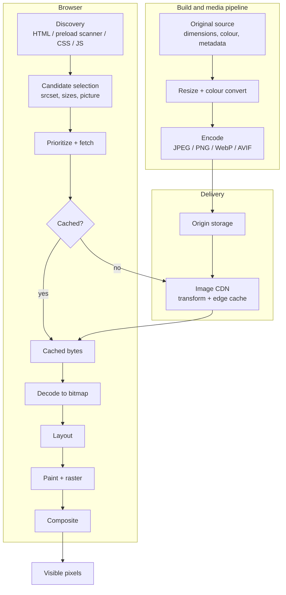

The important property of this diagram is that it is a **pipeline**. The time until the pixels appear is roughly the sum of the time spent in each stage that sits on the critical path, and the user's experience is bounded by the slowest stage. Optimizing one stage moves the bottleneck to the next one; it does not necessarily make the image appear sooner.

A common example: a team converts its hero image from JPEG to AVIF and cuts it from 380 KB to 140 KB, yet Largest Contentful Paint does not improve. The reason is that the image was never bandwidth-bound. It was set as a CSS `background-image` in a stylesheet loaded by a JavaScript bundle, so the browser did not know it existed until 1.8 seconds into the load, and it was then fetched at low priority behind a dozen scripts. The smaller file shaved a few hundred milliseconds off a download that was only a small part of the delay. Image optimization is a systems problem, and the rest of this post treats it that way.

## Digital image fundamentals

Image formats are easier to compare once you know what they are trying to represent and which parts of that representation can safely be thrown away.

### Raster images and pixels

A **raster image** is a rectangular grid of samples called pixels. A **vector image**, such as SVG, is a description of shapes (paths, fills, strokes, text) that the renderer rasterizes at whatever resolution it needs. Vectors scale without loss and are often tiny for logos, icons and diagrams. For photographs and anything with continuous tone and texture they are impractical, because describing every variation in a photo with shapes takes far more data than sampling it.

Each raster pixel stores one or more **channels**:

- **Greyscale**: one channel of luminance.
- **RGB**: red, green and blue intensities, combined additively.
- **RGBA**: RGB plus an **alpha** channel giving opacity, where 0 is fully transparent and the maximum value is fully opaque.

**Bit depth** is the number of bits per channel. Most web images are 8 bits per channel, giving 256 levels per channel and about 16.7 million colours for RGB. Ten- and twelve-bit images give 1,024 and 4,096 levels. The extra precision matters for smooth gradients (where 8 bits can produce visible banding) and for HDR content, which spreads its levels over a much larger brightness range.

**Alpha transparency** comes in two flavours. Binary transparency (a pixel is either fully transparent or fully opaque, as in GIF) is cheap but produces jagged edges. A full alpha channel stores per-pixel opacity and allows soft edges and shadows, at the cost of a fourth channel to compress. Internally, renderers often store colour **premultiplied** by alpha, because compositing math is simpler and filtering behaves correctly at edges. This is an internal representation choice; formats store straight (unpremultiplied) alpha.

### Dimensions, aspect ratio, resolution and density

The **intrinsic dimensions** of an image are its pixel width and height as encoded, for example 3000 × 2000. Its **intrinsic aspect ratio** is width divided by height: 3:2 in that case. The browser uses both to size an `` when CSS does not dictate a size, and uses the aspect ratio to compute one dimension when CSS fixes only the other.

"Resolution" is an overloaded word. In print it means pixels per inch (PPI or DPI), and image files often carry a DPI field. **Browsers ignore that field for layout** in nearly all cases (Chromium has a narrow exception that honours EXIF resolution for some JPEGs, which is an implementation detail). On the web, what matters is how many image pixels map to each CSS pixel at render time.

That mapping depends on the **device pixel ratio** (DPR): the number of physical display pixels per CSS pixel along one axis. A DPR of 2 means a 400 CSS-pixel-wide box covers 800 physical pixels across. To look sharp, an image drawn in that box needs about 800 image pixels across. The responsive images section returns to this in detail.

### Colour representation

Pixel values are only numbers. A **colour space** defines what they mean: which real-world red is "full red" (the **primaries**), what "white" is (the **white point**), and how stored values map to light intensity (the **transfer function**, often loosely called gamma).

- **sRGB** is the web's default colour space, defined in 1996 to match typical CRT monitors. An untagged image (one with no embedded colour profile) is assumed to be sRGB by browsers.
- **Display P3** uses wider primaries, especially in reds and greens, and is common on Apple devices and many modern phones and laptops. Its gamut is about 25 % larger than sRGB.
- **Wide-gamut images** are encoded in spaces larger than sRGB (Display P3, Adobe RGB, Rec. 2020). On a wide-gamut display they show colours an sRGB image cannot express. On an sRGB display they must be mapped down.

A **colour profile** (an ICC profile, or in newer formats a compact signal such as CICP code points) is metadata that tells the decoder which colour space the pixels are in. When the image's space differs from the display's, the browser performs **colour conversion** (colour management). If a profile is stripped from a wide-gamut image, the decoder assumes sRGB and colours shift, typically looking dull or oversaturated. This is why "strip all metadata" is good advice for EXIF camera data and bad advice for colour profiles on non-sRGB images.

**HDR images** encode brightness beyond the standard dynamic range, using a high-bit-depth signal with an HDR transfer function such as PQ (SMPTE ST 2084) or HLG. Rendering them correctly requires an HDR-capable display and browser support. An increasingly common alternative is a **gain map**: an SDR base image plus a secondary map describing how to brighten it on HDR displays (Ultra HDR JPEG, and the ISO 21496-1 gain map standard usable in JPEG, AVIF and others). Gain maps degrade gracefully: browsers that do not understand them show the SDR base image. Support for HDR rendering and gain maps varies by browser, operating system and display, so check current support before depending on them. The `dynamic-range: high` media query lets you serve HDR variants only to capable screens.

### Compression fundamentals

An uncompressed 1600 × 1200 RGB image is 1600 × 1200 × 3 = 5,760,000 bytes. Compression exploits two facts: images contain **redundancy** (neighbouring pixels are similar) and **irrelevance** (detail the human visual system does not notice).

**Lossless compression** removes only redundancy. The decoder reproduces the original bit for bit. Typical tools are **prediction** (guess each pixel from its neighbours and store only the error), **dictionary coding** (LZ77: replace repeated sequences with back-references) and **entropy coding**.

**Lossy compression** also removes irrelevance. The decoder reproduces an approximation. The main tools:

- **Colour transform and chroma subsampling.** Human vision resolves brightness detail much better than colour detail. Lossy encoders convert RGB to a luma/chroma space such as **Y′CbCr**, where Y′ carries brightness and Cb/Cr carry colour difference. They then often store chroma at lower resolution. **4:4:4** keeps full chroma resolution; **4:2:2** halves it horizontally; **4:2:0** halves it in both directions, so each chroma plane has a quarter of the luma samples. 4:2:0 cuts the raw data by half before any other compression, and on photos it is usually invisible. On sharp coloured edges such as red text on blue, it produces colour bleeding.
- **Transform coding.** Instead of storing pixels, the encoder transforms blocks of pixels into frequency coefficients using a transform such as the **Discrete Cosine Transform (DCT)**. In natural images most energy ends up in a few low-frequency coefficients, while high-frequency coefficients (fine detail and noise) are small.
- **Quantization.** Each coefficient is divided by a step size and rounded to an integer. Larger steps produce more zeros and fewer distinct values, so the data compresses better, but the rounding error cannot be undone. **Quantization is where information is lost.** Quality settings in encoders ultimately control quantization step sizes, usually more aggressively for high frequencies and for chroma.
- **Entropy coding.** The quantized values are coded losslessly using variable-length codes (Huffman coding) or arithmetic coding, which assign fewer bits to common values. Both lossy and lossless formats end with an entropy-coding stage.

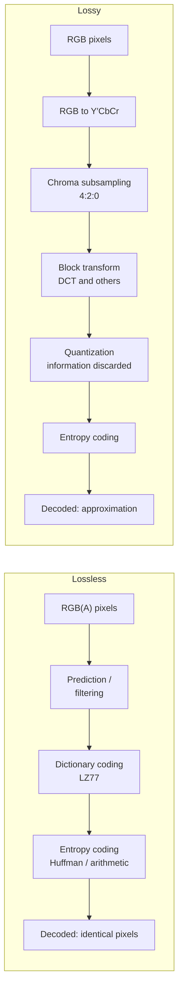

Discarded information shows up as **compression artifacts**:

- **Blocking**: visible block boundaries at low quality, because each block was quantized independently.
- **Ringing**: halos near sharp edges, caused by losing the high-frequency coefficients that describe the edge.
- **Blurring and smearing**: loss of texture such as skin pores, grass or fabric, typical of modern codecs that prefer to smooth rather than block.
- **Banding**: steps in smooth gradients, made worse by low bit depth.
- **Colour bleeding**: chroma smearing across edges caused by subsampling.

**Perceptual quality** is what a person judges, and it is not the same as numerical error. Encoders exploit this with psychovisual tuning: spending more bits where the eye is sensitive (smooth areas, faces, edges) and fewer in busy textures where errors are masked.

Two complexity costs are easy to confuse. **Encoding complexity** is the CPU time to produce the file. It is paid once per variant, at build time or at the CDN, and modern encoders let you trade it for compression efficiency. **Decoding complexity** is the CPU time to turn the file back into pixels. It is paid on every device that displays the image, including slow phones, and it is mostly fixed by the format and the coding tools the encoder chose to use.

### Measuring image quality

Choosing a quality setting needs some way to judge "good enough". There are several families of metric, and each fails in a characteristic way.

- **PSNR** (peak signal-to-noise ratio) is derived from the mean squared error between original and compressed pixels, expressed in decibels. It is cheap and well understood. It treats every pixel error equally, so it rates a slight shift of a whole image as worse than visible blocking in one area, and it is blind to whether errors fall where the eye notices them.
- **SSIM** (structural similarity) compares local luminance, contrast and structure in sliding windows, producing a score up to 1.0. It correlates with perception much better than PSNR, but it is computed at one scale and is usually applied to luma only.
- **MS-SSIM** (multi-scale SSIM) evaluates SSIM at several downsampled scales, which better approximates viewing distance and is more robust across image sizes.
- **Perceptual metrics** model human vision more closely. **Butteraugli** (from Google, used to tune JPEG XL and Guetzli) estimates the most visible difference. **SSIMULACRA 2** (from the JPEG XL project) was designed for still images and calibrated against subjective test data. **DSSIM** is a perceptual SSIM variant. **VMAF** was built by Netflix for video and is sometimes applied to images.

No objective metric replaces looking at the result. They all summarize a whole image as one number, so a face ruined by blocking in a large image of sky can still score well. Metrics also reward fidelity, not appeal: a slightly blurred image may score higher than one that preserves texture with a little noise, even though many viewers prefer the latter. And scores are not comparable across metrics, or always across formats, because codecs make different kinds of errors. Use metrics to automate comparisons and catch regressions, for example "find the lowest quality whose SSIMULACRA 2 score stays above a threshold". Then check representative images by eye, at the size and DPR they will actually be displayed.

## Image formats: JPEG, PNG, WebP and AVIF

Each format is a bundle of compression tools plus a container, and each was designed for a different era and different content.

### JPEG

JPEG (ITU-T T.81, 1992) is still the most widely used photographic format on the web, because it decodes fast everywhere and its encoders keep improving.

**Architecture.** A typical JPEG encoder:

1. Converts RGB to Y′CbCr.
2. Optionally subsamples chroma, usually 4:2:0 at web qualities (many encoders switch to 4:4:4 at very high quality).
3. Splits each plane into **8 × 8 blocks**. With 4:2:0, a 16 × 16 pixel region forms a **minimum coded unit** of four luma blocks and one block for each chroma plane.
4. Applies a 2D **Discrete Cosine Transform** to each block. The result is 64 coefficients: one **DC** coefficient (the block's average) and 63 **AC** coefficients for increasing horizontal and vertical frequencies.
5. **Quantizes** each coefficient by dividing it by the matching entry in an 8 × 8 quantization table and rounding. The "quality" setting scales the tables: higher quality, smaller divisors. Separate tables are used for luma and chroma.
6. Reorders coefficients in a **zigzag** from low to high frequency, so that the many zero high-frequency coefficients form long runs.
7. **Entropy codes** the result: DC coefficients as differences from the previous block, AC coefficients as run-length/value pairs, using Huffman coding. The standard also defines arithmetic coding, which compresses better but was avoided for years because of patents, and browser support for it is not universal.

The 8 × 8 block structure explains JPEG's signature artifacts: at low quality the blocks become visible, and edges inside a block ring because their high-frequency coefficients were quantized away.

**Baseline vs. progressive.** A **baseline** (sequential) JPEG stores each block completely, top to bottom, so a partially downloaded image renders as a top strip. A **progressive** JPEG stores the coefficients in several **scans**: first the DC coefficients of every block (a blocky preview of the whole image), then successively more AC coefficients (**spectral selection**) and more precision bits (**successive approximation**). The browser can render a full-size, low-detail image early and refine it as bytes arrive. Progressive JPEGs are often slightly smaller than baseline because the scans group similar statistics together. They need a little more memory and CPU to decode, since the decoder must keep coefficients for every block until the final scan.

Modern encoders matter as much as the format. **MozJPEG** (Mozilla's libjpeg-turbo fork) adds trellis quantization, tuned quantization tables and optimized progressive scan scripts, and produces noticeably smaller files than default libjpeg at the same visual quality while staying fully standard-compatible. **Jpegli** (from Google's JPEG XL team) applies JPEG XL-derived adaptive quantization to classic JPEG output.

**Use JPEG** for photographs where universal compatibility and fast, cheap decoding matter, as a fallback in a `<picture>` element, and in email and other non-browser contexts. **Avoid it** for images with transparency (it has none), text, line art or flat graphics (ringing around edges), and images that will be re-edited and re-saved (generational loss).

### PNG

PNG (Portable Network Graphics, a W3C Recommendation, with a third edition published in 2025) was designed in the mid-1990s as a patent-free, **lossless** replacement for GIF.

**How it compresses.** PNG compression has two stages.

1. **Filtering** (prediction). Each scanline is preceded by a filter type byte, and the encoder may choose a different filter per row. The five filters store each byte as the difference from a prediction: **None** (no prediction), **Sub** (the pixel to the left), **Up** (the pixel above), **Average** (the mean of left and above), and **Paeth** (whichever of left, above or upper-left is closest to a linear estimate). In smooth regions the differences cluster near zero, which compresses well.
2. **DEFLATE**: LZ77 back-references to repeated byte sequences, followed by Huffman coding. This is the same algorithm used by zlib and gzip.

PNG cannot exploit perceptual irrelevance, and DEFLATE operates on bytes, not on two-dimensional image structure, so it captures only redundancy that the row filters happen to expose.

**Colour types.** PNG supports greyscale, **truecolor** (RGB), **indexed colour** (each pixel is an index into a palette of up to 256 entries, stored in a `PLTE` chunk, with optional per-entry alpha in `tRNS`), greyscale with alpha, and truecolor with alpha. Bit depths range from 1 to 16 bits per channel. PNG also supports Adam7 **interlacing**, which delivers a coarse image first, at a cost in compression; it is rarely worth using.

**Why PNG files get large.** For photographs, PNG has to preserve camera noise and fine texture exactly. Noise is, by definition, unpredictable, so filters leave large residuals and DEFLATE finds few repeats. A photo saved as PNG is commonly several times larger than a good JPEG of it. Truecolor with alpha adds a fourth channel. Encoders also vary widely: tools such as `oxipng` and `zopflipng` try many filter strategies and run a stronger DEFLATE search, and can shrink a PNG substantially without changing a single pixel.

A powerful lossy trick for PNG is **palette quantization**. Tools such as `pngquant` reduce an RGBA image to 256 or fewer colours with careful dithering and save an indexed PNG with alpha. For UI graphics and illustrations this often cuts the size drastically while looking identical.

**Use PNG** for screenshots, UI elements, diagrams and illustrations with flat colour and sharp edges, images that need exact pixels, and transparent graphics when WebP or AVIF are not options. Use it as a lossless master in pipelines. **Avoid it** for photographic content on the web.

### WebP

Google released **WebP** in 2010 to give the web a single format covering what JPEG, PNG and GIF did separately, with better compression than each. It is two quite different codecs sharing a RIFF-based container.

**Lossy WebP** is based on intra-frame (key frame) coding from the **VP8** video codec:

- The image is split into 16 × 16 luma **macroblocks** (with 8 × 8 chroma blocks). Lossy WebP always uses **4:2:0** chroma subsampling and 8-bit samples.
- Each block is first **predicted** from already-decoded neighbouring pixels, using one of several intra-prediction modes (horizontal, vertical, DC, TrueMotion, and directional modes for 4 × 4 sub-blocks). Only the **residual**, the difference between prediction and reality, is coded. This is the main structural advance over JPEG, which codes each block from scratch.
- Residuals are transformed with a **4 × 4 integer DCT approximation**, plus a Walsh-Hadamard transform over the DC coefficients of a macroblock's sub-blocks.
- Coefficients are quantized, with the image divided into up to four **segments** that can each have its own quantizer and filter strength, so the encoder can spend bits unevenly.
- A **boolean arithmetic coder** entropy codes everything, which compresses better than JPEG's Huffman coding.
- A **loop filter** smooths block edges after decoding.

The result tends to blur rather than block at low quality. 4:2:0 with no 4:4:4 option is a real limitation: saturated colour edges and fine coloured text suffer. `cwebp -sharp_yuv` mitigates this with a smarter RGB-to-YUV conversion that preserves edges better.

**Lossless WebP** (VP8L) is a separate codec designed specifically for images. It applies a sequence of reversible **transforms** before entropy coding:

- **Predictor transform**: like PNG filters, but chosen per tile from 14 predictors.
- **Colour transform**: decorrelates R, G and B within each tile.
- **Subtract green**: subtracts green from red and blue, because the channels are strongly correlated in natural images.
- **Colour indexing**: palette mode for images with few colours, with pixel packing.

The transformed data is coded with **LZ77 backward references** that understand 2D distances, a **colour cache** of recently used colours, and Huffman coding with separate codes per region. Google's [WebP compression study](https://developers.google.com/speed/webp/docs/webp_lossless_alpha_study) and [WebP overview](https://developers.google.com/speed/webp) report lossless WebP as about 26 % smaller than PNG and lossy WebP as 25–34 % smaller than JPEG at equivalent SSIM. Those are Google's figures for its test corpora; your results depend on your images and encoder settings.

**Alpha transparency.** Lossy WebP can carry an alpha channel in a separate `ALPH` chunk, compressed losslessly (optionally after quantizing alpha levels). Lossy colour plus lossless alpha is something neither JPEG nor PNG can do, and it often beats a truecolor PNG with alpha by a wide margin for photographic cut-outs such as product shots on a transparent background.

**Animation.** WebP supports animation with per-frame lossy or lossless coding, alpha, and frame blending. It is usually far smaller than GIF. For anything long or large, a real video (`<video>` with AV1, VP9 or H.264) is smaller still, and decoding can use hardware.

**Encoding and decoding.** Lossy WebP encoding is fast. The `-m` method parameter (0–6) trades speed for efficiency. Decoding is a little slower than JPEG but cheap enough not to matter in most cases. Maximum dimensions are 16,383 × 16,383 pixels. Lossy WebP has **no progressive mode**: partial downloads render incrementally from the top, like a baseline JPEG.

**Browser compatibility.** WebP is supported in all current major browsers, including Safari since version 14 (macOS Big Sur and later, iOS 14). It is Baseline Widely available, and fallbacks are now needed only for very old clients and non-browser consumers.

### AVIF

**AVIF** (AV1 Image File Format), specified by the Alliance for Open Media in 2019, stores images coded with the **AV1** video codec inside a **HEIF** container.

**AV1 intra-frame coding.** An AVIF image is essentially one or more AV1 intra frames. AV1 is a much newer codec than VP8 (finalized in 2018), and its intra coding toolset is far richer:

- **Flexible partitioning.** The frame is split into **superblocks** of 64 × 64 or 128 × 128 pixels, recursively partitioned in many patterns (including rectangular and T-shaped splits) down to 4 × 4. Large flat areas get large blocks; detailed areas get small ones.
- **Rich intra prediction.** Directional prediction at 56 angles, smooth and Paeth predictors, **chroma-from-luma** (predicting chroma as a linear function of the reconstructed luma), **palette mode** for blocks with few colours (good for screen content), and **intra block copy** for repeated patterns (in screen-content mode).
- **Multiple transforms.** Transform sizes from 4 × 4 to 64 × 64, including rectangular ones, and several transform types (DCT, ADST, flipped ADST and identity), chosen per block and per direction. The identity transform suits sharp synthetic edges where a DCT would ring.
- **Adaptive multi-symbol arithmetic coding** with context modelling.
- **In-loop filters** after reconstruction: a deblocking filter, **CDEF** (constrained directional enhancement filter, which removes ringing along edges), and **loop restoration** (Wiener and self-guided filters).
- **Film grain synthesis**: the encoder can strip noise, code the clean image cheaply, and send parameters so the decoder re-synthesizes statistically similar grain. Whether encoders use this for still images depends on settings.

**Container.** HEIF is built on the ISO Base Media File Format (the box structure of MP4). AVIF uses HEIF's image items: a primary image item, an optional **alpha** auxiliary image item, optional **grid** items that tile multiple coded images into one large image, colour information (ICC or CICP code points), and EXIF/XMP metadata. An AVIF sequence can store animation as AV1 video. The **MIAF** profile constrains HEIF so decoders know what to expect.

**Lossy and lossless.** Lossy AVIF is the common case. Lossless AVIF exists but requires 4:4:4 and typically the identity matrix (coding RGB directly), and it is often larger than lossless WebP. AVIF's strength is lossy.

**Chroma subsampling.** AVIF supports 4:2:0, 4:2:2, 4:4:4 and monochrome (4:0:0). 4:4:4 avoids the colour bleeding that lossy WebP cannot avoid, which makes AVIF a reasonable lossy choice for graphics with saturated colour edges.

**Alpha.** The alpha channel is a separate AV1-coded monochrome image, lossy or lossless, with its own quality setting.

**HDR and wide gamut.** AVIF supports 8, 10 and 12 bits per channel and signals colour primaries, transfer functions (including PQ and HLG) and matrix coefficients through CICP, so it can carry Display P3, Rec. 2020 and HDR content natively. Gain-map support for AVIF is newer and less consistently supported.

**Encoding complexity.** AV1's huge search space (partitions × prediction modes × transforms) makes high-efficiency encoding slow. Encoders such as **libaom**, **SVT-AV1** and **rav1e**, driven through libavif's `avifenc`, expose a **speed** setting from 0 (slowest, best) to 10 (fastest). At slow speeds a large image can take seconds of CPU time, far longer than JPEG or WebP. That matters for build pipelines with thousands of images, and especially for on-demand CDN transformation, where encode time is added to the first request's latency.

**Decoding performance.** AVIF decoding (through dav1d or libgav1 in browsers) is more CPU-intensive per pixel than JPEG or WebP. On modern devices this is usually acceptable for typical web image sizes. On low-end devices, for very large images, or with many images decoded at once, it can be noticeable. Hardware AV1 decoders exist in recent GPUs and SoCs, but browsers generally decode still images in software. Progressive AVIF rendering is defined through layered (progressive) image items, but encoder and browser support is limited, so in practice an AVIF usually appears only once fully downloaded and decoded. On a slow connection, a progressive JPEG can show a recognizable preview much earlier, even if it is larger.

**Browser support.** AVIF is supported in Chrome 85+, Firefox 93+, Safari 16+ (animation and some features arrived in later releases) and Edge 121+. It became Baseline Newly available in January 2024 when Edge shipped it, so a `<picture>` fallback is still prudent for older browsers.

**Practical limitations.** In addition to slow encoding and the lack of practical progressive rendering, AVIF can over-smooth fine texture at aggressive settings (the "plastic skin" look), and AV1 level limits mean very large images are usually tiled with grid items at encode time. Tooling outside browsers (some image editors, social platforms, email clients, older operating systems) is less consistent than for JPEG and PNG.

### Other formats

**GIF** (1987) is palette-based, limited to 256 colours per frame, with binary transparency and LZW compression. Its only lasting web use is animation, which is almost always better served by `<video>` (much smaller, hardware-decoded) or animated WebP/AVIF.

**SVG** is a vector format and an XML document. It is ideal for logos, icons and illustrations: resolution-independent, often tiny, and compressible with gzip or Brotli on the wire. Complex SVGs can be expensive to rasterize, and SVGs from untrusted sources carry security risks covered in [How to render an SVG safely](/blog/how-to-render-an-svg-safely).

**JPEG XL** (ISO/IEC 18181) combines a modern VarDCT lossy mode, an excellent lossless mode (Modular), true progressive decoding, high bit depth and HDR, and **lossless JPEG recompression**: an existing JPEG can be converted to JPEG XL about 20 % smaller and converted back to the original file bit for bit. Its browser history is turbulent. Chrome removed an experimental implementation in 2022. Safari added decoding in Safari 17. Chromium then reversed course with a Rust-based decoder, `jxl-rs`: [Chrome 155's release notes](https://chromestatus.com/release-notes/155) list JPEG XL decoding as shipped (October 2026). Firefox support is in progress at the time of writing. Treat JPEG XL as a progressive-enhancement format behind a `<picture>` fallback, and check current support before relying on it.

**HEIC/HEIF** is the same HEIF container as AVIF but with HEVC (H.265) coding, used by default for photos on iPhones. HEVC patent licensing has kept it out of most browsers. Safari supports it (since Safari 17), and others do not, so convert HEIC uploads to JPEG, WebP or AVIF on ingestion.

**Animated WebP and animated AVIF** both replace GIF for short loops with full colour and alpha. Animated AVIF uses an AV1 sequence and can be dramatically smaller than GIF, but decoding many frames in software costs CPU and memory. For anything longer than a few seconds, `<video autoplay muted loop playsinline>` gives better compression, hardware decoding, and playback controls when you need them.

### Format comparison

The table below compares formats qualitatively. "Efficiency" refers to typical lossy photographic content at web quality levels with modern encoders. The ranking can change for specific images, especially graphics, very high qualities, or very small files.

| Property                     | JPEG                                         | PNG                                             | WebP                                        | AVIF                                            | JPEG XL                                           |
| ---------------------------- | -------------------------------------------- | ----------------------------------------------- | ------------------------------------------- | ----------------------------------------------- | ------------------------------------------------- |
| Lossy compression efficiency | Baseline reference; good with MozJPEG/Jpegli | Not lossy (lossless only, palette tricks aside) | Better than JPEG                            | Often best at low-to-medium bitrates            | Strong, especially at high quality                |
| Lossless                     | No (in practice)                             | Yes                                             | Yes, usually smaller than PNG               | Yes, often weaker than WebP lossless            | Yes, strong; lossless JPEG recompression          |
| Transparency                 | No                                           | Full alpha                                      | Full alpha, lossy or lossless               | Full alpha                                      | Full alpha                                        |
| Animation                    | No                                           | APNG                                            | Yes                                         | Yes (AV1 sequence)                              | Yes                                               |
| Bit depth / HDR / wide gamut | 8-bit typical, ICC profiles, gain maps       | Up to 16-bit, ICC                               | 8-bit, 4:2:0 only (lossy), ICC              | 8/10/12-bit, CICP, PQ/HLG, 4:4:4                | Up to 32-bit float, HDR                           |
| Progressive rendering        | Yes (progressive JPEG)                       | Adam7 interlacing                               | No                                          | Limited support                                 | Yes                                               |
| Encoding cost                | Low                                          | Low to high (optimizers)                        | Low to moderate                             | High at efficient speeds                        | Moderate                                          |
| Decoding cost                | Very low                                     | Low                                             | Low                                         | Moderate to high                                | Moderate                                          |
| Browser support              | Universal                                    | Universal                                       | All current browsers                        | All current browsers; fallback still advised    | Safari 17+, Chrome 155+; others vary              |
| Good fit                     | Photos, universal fallback                   | Screenshots, UI, lossless masters               | General photos and graphics, alpha cut-outs | Photos where bytes matter most, HDR, wide gamut | Progressive enhancement, archival, JPEG migration |

No format wins everywhere. The right choice depends on:

- **Content.** Photographs favour transform codecs (JPEG, WebP, AVIF). Flat graphics with few colours favour lossless or palette coding, or SVG. Screenshots with text are hard for 4:2:0 codecs.
- **Quality target.** AVIF's advantage is largest at low and medium bitrates. At very high quality, the gap narrows and other formats can win.
- **Device capability.** A smaller AVIF can still take longer to decode than a larger JPEG on a weak CPU. For most web images this is small compared with network time, but for galleries of large images on low-end phones, it is worth measuring.
- **Encoding pipeline.** If you transform on demand at the edge, AVIF's encode cost adds latency to cache misses. If you encode at build time, it adds CI time.
- **Rendering behaviour.** Progressive JPEG shows something early on slow networks. AVIF and lossy WebP do not.
- **Support and fallbacks.** Serving modern formats through `<picture>` or content negotiation makes support a solvable problem, at the price of more variants to generate and cache.

In practice most sites serve AVIF with WebP and JPEG fallbacks for photographic content, WebP or PNG for lossless graphics, and SVG for vector art, and they validate quality settings per content category rather than per site.

## Image encoding and compression under the hood

Encoding is where you decide how many pixels to ship and how many bits each pixel gets. Browsers only decode, so mistakes here cannot be fixed later in the pipeline.

### The encoding pipeline

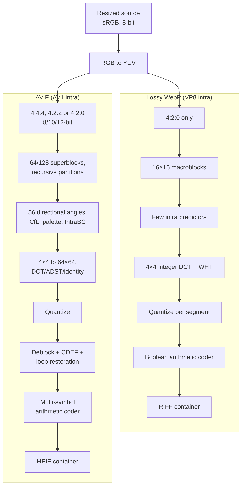

A production encoder pipeline runs these steps for every image:

1. **Source ingestion.** Read the master: a camera JPEG, a PNG export, a TIFF, a HEIC upload. Apply EXIF **orientation** so the pixels are upright, because metadata stripping later would otherwise remove the rotation flag and leave the image sideways.
2. **Resizing.** Scale down to each target width using a good resampling filter (Lanczos3 is a common default). Downscaling in linear light is more accurate than in gamma-encoded sRGB, although most pipelines skip that.
3. **Colour conversion.** Convert to the output colour space. For most web delivery that means sRGB, either embedding a profile or relying on the untagged-means-sRGB default. Wide-gamut variants keep a P3 profile.
4. **Chroma subsampling.** Choose 4:2:0 for photos. Consider 4:4:4 for graphics and text in AVIF or high-quality JPEG.
5. **Quantization.** Controlled through the quality parameter, which every encoder maps differently onto its internal quantizers.
6. **Entropy coding.** Mostly automatic, with knobs such as Huffman optimization or progressive scan scripts in JPEG.
7. **Alpha encoding.** A separate plane in WebP and AVIF, with its own quality setting. Opaque images should be saved without an alpha channel.
8. **Metadata handling.** Remove EXIF (camera model, GPS coordinates, thumbnails), XMP and comments, which add bytes and can leak private data. Keep the ICC profile when the image is not sRGB.

**Quality settings are not portable.** "Quality 80" means different things in libjpeg, MozJPEG, cwebp, libavif and sharp, because each maps the number onto different quantizers. A WebP at 80 is not "the same quality" as a JPEG at 80, and AVIF typically reaches similar perceived quality at a much lower number. Calibrate each encoder separately against a metric threshold and a visual check.

**Speed vs. efficiency.** Every modern encoder trades CPU for bytes: `cwebp -m 0..6`, `avifenc --speed 0..10`, sharp's `effort`. Higher effort searches more modes and partitions to produce smaller files at the same quality. The returns diminish, and the slowest settings can take many times longer than the defaults for a few percent of savings. Use slow settings for build-time assets that are encoded once and served millions of times. Use faster settings for on-demand transformation.

**Repeated lossy compression** (generational loss) happens when an already-lossy image is decoded and re-encoded lossily, for example when a CMS recompresses an uploaded JPEG or a pipeline resizes from a previous derivative. Each pass quantizes again, with different block alignments after resizing, so artifacts accumulate. Keep a high-quality or lossless master and generate every derivative from it, never from another derivative.

**Multi-resolution generation.** Responsive images need several widths of the same image. Choose them with diminishing returns in mind. Too few widths wastes bytes on devices between steps. Too many fragments caches and multiplies storage and encode cost. A common approach is to pick widths so that consecutive files differ by roughly a fixed byte budget (for example 20–30 KB) or a fixed ratio, plus explicit widths for common layout breakpoints at 1x and 2x.

### Resize before you encode

No amount of compression compensates for shipping pixels the user never sees. Compressed size scales roughly with pixel count, so a 4000-pixel-wide image shown in a 400 CSS-pixel slot at DPR 2 carries about (4000 / 800)² = **25 times** the pixels it needs. Even at a very aggressive quality, it will be larger than a properly sized image at a comfortable quality, and the browser must also decode all 25 times the pixels and downsample them during paint. The decoded-memory section quantifies that cost. Resizing is the single highest-leverage step in the encoding pipeline; format choice and quality tuning come after it.

### Command-line encoding with cwebp

`cwebp` ships with Google's libwebp. Run `cwebp -longhelp` for every option.

```bash title="WebP encoding with cwebp"
# Lossy WebP at quality 78, slowest/most thorough method (6),
# sharper RGB-to-YUV conversion for crisper colour edges,
# no metadata (the default is already "none", stated here for clarity).
cwebp -q 78 -m 6 -sharp_yuv -metadata none hero-1600.png -o hero-1600.webp

# Resize during encoding: width 800, height computed from the aspect ratio (0).
cwebp -q 78 -m 6 -resize 800 0 hero-master.png -o hero-800.webp

# Lossless WebP. -z 9 is the strongest lossless preset (slow);
# -z sets both method and quality for lossless mode.
cwebp -lossless -z 9 dashboard-screenshot.png -o dashboard-screenshot.webp

# Near-lossless: lossless coding after a small, controlled pixel adjustment.
# Lower values change more pixels and save more bytes (100 = off).
cwebp -near_lossless 60 dashboard-screenshot.png -o dashboard-near-lossless.webp

# Photographic cut-out with transparency: lossy colour, alpha quality 90.
cwebp -q 80 -alpha_q 90 -m 6 product-cutout.png -o product-cutout.webp
```

`-q` controls quantization for lossy mode. `-m` is effort. `-sharp_yuv` is slower but reduces colour fringing caused by 4:2:0. `-resize` lets you produce variants without a separate tool, although resizing in a dedicated library gives you more control over the filter. Expect the lossless screenshot to be considerably smaller than the source PNG, and compare the near-lossless result by eye at 100 % zoom. `cwebp` prints the output size and PSNR at the end of each run, which is a quick sanity check (PSNR's limitations still apply).

### Command-line encoding with avifenc

`avifenc` ships with libavif and uses whichever AV1 encoder libavif was built with (usually libaom, sometimes SVT-AV1 or rav1e). The flags below apply to libavif 1.x; run `avifenc --help` for your version.

```bash title="AVIF encoding with avifenc"
# Lossy AVIF: colour quality 55 on libavif's 0-100 scale,
# alpha quality 80, encoder speed 4 (0 = slowest/best, 10 = fastest),
# 4:2:0 chroma, 8-bit, using all CPU cores.
avifenc -q 55 --qalpha 80 -s 4 -y 420 -d 8 -j all hero-1600.png hero-1600.avif

# Graphics with saturated edges: keep full chroma resolution.
avifenc -q 60 -s 4 -y 444 pricing-chart.png pricing-chart.avif

# 10-bit output, useful for smooth gradients (helps prevent banding).
avifenc -q 55 -s 4 -d 10 gradient-hero.png gradient-hero.avif

# Lossless AVIF (implies 4:4:4 and the identity matrix). Often larger than lossless WebP.
avifenc --lossless -s 4 diagram.png diagram-lossless.avif

# Strip metadata explicitly while keeping the ICC profile for wide-gamut sources.
avifenc -q 55 -s 4 --ignore-exif --ignore-xmp photo-p3.png photo-p3.avif
```

Note how the quality number for AVIF is lower than for WebP for a similar visual result: the scales are not comparable. Time the commands with `time` at `-s 4` and at `-s 8` to see the encoding cost difference on your machine, and compare the output sizes. `avifenc` takes PNG, JPEG or Y4M input, so resize first with another tool.

### Resizing and comparing with ImageMagick

ImageMagick 7 uses the `magick` command. Its format support depends on the delegate libraries it was built with; check `magick -list format | grep -Ei "avif|webp"`.

```bash title="Resizing, stripping and comparing with ImageMagick"
# Resize to 1200px wide (height from aspect ratio). The trailing '>' means
# "only shrink, never enlarge". Strip profiles/metadata, encode a progressive JPEG.
magick hero-master.jpg -auto-orient -resize '1200x>' -strip \
  -sampling-factor 4:2:0 -interlace Plane -quality 80 hero-1200.jpg

# Generate several widths in one pass, keeping an sRGB colour profile by converting first.
for w in 480 800 1200 1600 2400; do
  magick hero-master.jpg -auto-orient -colorspace sRGB -resize "${w}x>" \
    -strip -quality 80 "hero-${w}.jpg"
done

# Quality comparison against the resized original. The metric is printed on stderr.
# SSIM: 1.0 means identical. DSSIM: 0 means identical. PSNR in dB: higher is closer.
magick hero-master.jpg -resize 1200x ref-1200.png
magick compare -metric SSIM  ref-1200.png hero-1200.jpg null: 2>&1; echo
magick compare -metric DSSIM ref-1200.png hero-1200.jpg null: 2>&1; echo
magick compare -metric PSNR  ref-1200.png hero-1200.jpg null: 2>&1; echo

# Visual difference map: highlights changed pixels in red.
magick compare ref-1200.png hero-1200.jpg diff-1200.png
```

`-auto-orient` applies EXIF rotation before `-strip` removes the EXIF tag. `-strip` also removes ICC profiles, which is why the loop converts to sRGB first. `-interlace Plane` produces a progressive JPEG. Compare the metric output across quality values, and open the diff map: it shows where the encoder spent its errors, usually on edges and texture.

### Sharp in Node.js

[sharp](https://sharp.pixelplumbing.com/) wraps libvips. It is fast and memory-efficient because libvips processes images in a streaming, demand-driven way. It can output JPEG (through MozJPEG settings), PNG, WebP, AVIF and more. The script below generates a responsive set from one master. It runs on Node.js 18+ with `npm install sharp`, as an ES module (`.mjs`).

```js title="generate-variants.mjs"
import sharp from 'sharp';
import { mkdir } from 'node:fs/promises';
import path from 'node:path';

const WIDTHS = [480, 800, 1200, 1600, 2400];
const input = process.argv[2] ?? 'hero-master.jpg';
const outDir = 'dist/images';
const name = path.parse(input).name;

await mkdir(outDir, { recursive: true });

// Read metadata once to avoid generating variants wider than the source.
const meta = await sharp(input).metadata();
console.log(`source: ${meta.width}x${meta.height}, ${meta.format}, space=${meta.space}`);

for (const width of WIDTHS.filter((w) => w <= meta.width)) {
  // .rotate() with no arguments applies EXIF orientation, so pixels stay upright
  // even though sharp drops EXIF metadata from the output by default.
  const base = sharp(input).rotate().resize({ width, withoutEnlargement: true });

  await Promise.all([
    // AVIF: low "quality" numbers are normal. effort 0-9 (higher = slower, smaller).
    base.clone().avif({ quality: 50, effort: 6, chromaSubsampling: '4:2:0' }).toFile(`${outDir}/${name}-${width}.avif`),
    // WebP: effort 0-6. smartSubsample improves chroma edges (similar to -sharp_yuv).
    base.clone().webp({ quality: 75, effort: 6, smartSubsample: true }).toFile(`${outDir}/${name}-${width}.webp`),
    // JPEG through mozjpeg presets: trellis quantization, progressive scans.
    base.clone().jpeg({ quality: 78, mozjpeg: true }).toFile(`${outDir}/${name}-${width}.jpg`),
  ]);
}
console.log('done');
```

A few details matter. By default sharp removes metadata from the output and converts to sRGB, which suits most web delivery. When you need to keep the colour profile, `keepIccProfile()` exists in recent versions (`keepMetadata()` keeps everything). `clone()` lets one decoded input feed several encoders. `withoutEnlargement` prevents upscaling a small master, which would add bytes without detail. When processing user uploads, sharp's `limitInputPixels` option (enabled by default) rejects decompression bombs. Check the [output options](https://sharp.pixelplumbing.com/api-output) for your sharp version; option names have changed between releases.

Running the script on a 24-megapixel photo produces 15 files. Compare their sizes with `ls -l dist/images`. Typically AVIF is smallest at each width, the gap between formats is largest at small widths, and size grows faster than linearly with width, roughly with pixel count.

### Squoosh

[Squoosh](https://squoosh.app/) is a browser-based tool from Google Chrome Labs that runs real codecs (MozJPEG, libwebp, libavif, JPEG XL, OxiPNG) compiled to WebAssembly. Its value is the side-by-side slider: you can drag between the original and the encoded result at the real output size, adjusting quality, subsampling and resize filters interactively. Use it to **calibrate** quality settings for a content category, then encode those settings into your pipeline. The old `@squoosh/cli` and `@squoosh/lib` packages are no longer maintained (see the [repository](https://github.com/GoogleChromeLabs/squoosh)), so use sharp, `cwebp` or `avifenc` for automation.

### Encoding is not decoding

Everything in this section happens **once per variant**, on your machines or your CDN's. Its cost is CPU time and latency on cache misses. **Decoding** happens on every user's device, every time the image is displayed and its decoded pixels are not already in memory. The two are linked: encoder choices (format, dimensions, bit depth, coding tools) determine how expensive decoding will be. But they are optimized differently. A slow encoder setting is often a good trade, because it costs you once and saves every user bytes. A format with expensive decoding is a cost every user pays, on hardware you do not control.

## Responsive images: srcset, sizes and picture

Encoding produces a set of variants. Responsive image markup tells the browser what they are, so it can pick the right one for each device before it has laid out the page.

### The problem with fixed image assets

A single `` gives every device the same file. If that file is sized for a 27-inch desktop at DPR 2 (perhaps 3200 pixels wide), a phone showing it 390 CSS pixels wide at DPR 3 needs about 1170 pixels across. It downloads, decodes and holds in memory roughly (3200 / 1170)² ≈ 7.5 times the pixels it can display. On a cellular connection those extra bytes delay everything else that shares the connection, and the phone pays for them in data, CPU and battery.

Sizing the file for the phone instead fails the other way: the desktop gets a blurry image.

CSS does not solve this. `width: 100%` or `max-width: 400px` changes the **rendered** size of the element. It has no effect on which **resource** is downloaded, because the request for `src` was issued (often by the preload scanner) long before CSS was applied. The browser downloads the full file and scales it down at paint time. The **intrinsic dimensions** of a resource are fixed when it is encoded; the **rendered dimensions** are decided by layout. Responsive images exist to bring the two close together by choosing among several resources.

### Device pixel ratio

A **CSS pixel** is the unit of CSS layout: a reference length designed so that `1px` looks about the same size across devices at typical viewing distances. A **physical pixel** (device pixel) is one dot on the display. The ratio between them along one axis is the **device pixel ratio**, exposed as `window.devicePixelRatio`.

```js title="Inspecting the device pixel ratio"
// 1 on a classic desktop monitor, 2 on most "Retina" laptops,
// often 2.625, 3 or more on phones. Non-integer values are common.
console.log('DPR:', window.devicePixelRatio);

// The physical pixels needed to fill a box sharply:
const box = document.querySelector('.product-card img');
const cssWidth = box.getBoundingClientRect().width;
console.log(`rendered ${cssWidth}px CSS -> needs ~${Math.round(cssWidth * devicePixelRatio)} image px`);

// DPR can change at runtime: moving a window between monitors, or page zoom
// in Chromium and Firefox. A resolution media query fires when it does.
function watchDpr(onChange) {
  const mq = matchMedia(`(resolution: ${window.devicePixelRatio}dppx)`);
  mq.addEventListener(
    'change',
    () => {
      onChange(window.devicePixelRatio);
      watchDpr(onChange); // re-arm with the new value
    },
    { once: true },
  );
}
watchDpr((dpr) => console.log('DPR changed to', dpr));
```

Open the console on a laptop, zoom the page to 200 % (Ctrl/Cmd and +), and the logged DPR doubles in Chromium and Firefox. Page zoom works by making CSS pixels larger in device pixels, so it is reported through DPR. **Pinch zoom** on touch devices does not change DPR. It magnifies the already-rendered page, which is why a pinch-zoomed image can look soft. Browsers differ in whether page zoom updates `devicePixelRatio`, so treat this as implementation behaviour.

Because of DPR, a 400 CSS-pixel image slot needs a source about 400 × DPR pixels wide: 800 at DPR 2, 1200 at DPR 3. Above about DPR 2, the returns diminish quickly. At typical phone viewing distances most people cannot distinguish 2x from 3x for photographic content, but the 3x file has (3/2)² = 2.25 times the pixels. Several large sites cap the density they serve at 2x for this reason, and you can do the same by not offering candidates beyond 2x for a slot.

### srcset

`srcset` gives the browser a list of **candidates**: URLs, each with a descriptor saying something about it. The browser chooses one. The HTML Standard defines the syntax and the parsing; the **choice itself is left to the user agent** ([HTML Standard: selecting an image source](https://html.spec.whatwg.org/multipage/images.html#selecting-an-image-source)).

There are two descriptor types, and one `srcset` may use only one of them.

**Density descriptors (`x`)** say "this candidate is for this pixel density". They suit images rendered at a **fixed CSS size**, such as avatars, logos and fixed-width thumbnails.

```html title="Density descriptors for a fixed-size avatar"
<!-- The avatar is always 64x64 CSS pixels. Offer 1x, 2x and 3x versions.
     `src` is the fallback and is treated as the 1x candidate if srcset has no 1x entry. -->

```

On a DPR 2 screen the browser picks the `2x` file. A browser may also use a cached higher-density file instead of fetching a lower one, because the selection is a judgement about suitability, not a contract.

**Width descriptors (`w`)** say "this candidate is this many pixels wide". They describe the resource, not the device, and suit images whose CSS size **varies with the layout**.

```html title="Width descriptors with sizes"
<!-- Candidates describe the files' intrinsic widths. `sizes` (next section)
     tells the browser how wide the image will be rendered. -->

```

With width descriptors, the browser computes an **effective density** for each candidate: the candidate's width divided by the expected rendered width from `sizes`. If `sizes` resolves to 720 CSS pixels, the 1600w file has density 1600 / 720 ≈ 2.22x. The browser then chooses as if you had written density descriptors. This is the key mechanism: **width descriptors plus `sizes` reduce to density selection**.

Why not use `x` descriptors everywhere? Because an image whose CSS width depends on the viewport would need a different `x` list per breakpoint. Width descriptors let you describe the files once and describe the layout separately.

**Candidate construction rules** from the standard:

- Candidates are separated by commas. A comma followed by whitespace ends a candidate, so avoid commas in image URLs.
- A candidate with no descriptor is `1x`.
- With density descriptors, `src` contributes an implicit `1x` candidate if no other candidate claims 1x. If `srcset` uses width descriptors, `src` is not added as a candidate. In both cases it is what browsers without `srcset` support load.
- Mixing `w` and `x` in one `srcset` is invalid, and duplicate descriptors are dropped.
- If any candidate uses `w`, the `sizes` attribute is used. Without it, `sizes` defaults to `100vw`.

**`srcset` alone does not describe the display size.** A list of widths tells the browser what files exist, not how big the image will be. The browser cannot read your CSS at selection time (see the next major section), so without `sizes` it assumes the image fills the viewport. For a thumbnail in a four-column grid, that assumption makes the browser download a file about four times wider than needed.

### sizes

`sizes` is the developer's **prediction of the rendered width**, written as a list of media conditions and lengths:

```text
sizes="(media-condition) length, (media-condition) length, ..., default-length"
```

The browser evaluates the media conditions **in order** and uses the length paired with the **first** one that matches. The last entry has no condition and is the default. Lengths can be absolute (`720px`), viewport-relative (`50vw`), font-relative (`em` and `rem`, resolved as in media queries against the initial font size rather than the element's) or math functions such as `calc()`, `min()`, `max()` and `clamp()`. **Percentages are not allowed**, because there is no containing block at selection time.

Then, as above: the effective density of each candidate is its width divided by the chosen `sizes` length, and the browser picks by DPR.

**Default behaviour.** If `sizes` is omitted, it behaves as `100vw`. The special value `sizes="auto"` (covered below) behaves differently for lazy-loaded images.

**Incorrect `sizes` is one of the most common responsive image bugs**, and it fails silently: the image still looks fine because CSS scales it.

- **Too large** (for example, the default `100vw` on a grid thumbnail): the browser downloads a much larger file than needed. This wastes bandwidth and decode work, and on an LCP image it adds directly to load time.
- **Too small** (for example, `sizes="300px"` copied from a component that is later used full width): the browser picks a small file that CSS then upscales, so it looks blurry.
- **Ordering mistakes**: `(min-width: 640px) 50vw, (min-width: 1024px) 33vw, 100vw` never reaches the 33vw entry, because any viewport at least 1024px wide also matches the first condition. Order `min-width` conditions from largest to smallest, or `max-width` conditions from smallest to largest.
- **Forgetting gutters and padding**: `33vw` for a three-column grid ignores gaps and container padding, overestimating each slot by tens of pixels. Small, but it can tip selection to the next larger candidate.
- **Forgetting the max-width container**: on a 2560px monitor, a "full-width" image inside a `max-width: 1200px` container is 1200px, not `100vw`.

### Deriving sizes from CSS layout

The reliable method is to read `sizes` directly off the layout rules: for each breakpoint, write the rendered width as a formula.

**Responsive product grid.** The CSS:

```css title="product-grid.css"
.product-grid {
  display: grid;
  gap: 16px;
  padding-inline: 16px;
  max-width: 1280px;
  margin-inline: auto;
  grid-template-columns: repeat(2, 1fr); /* phones: 2 columns */
}
@media (min-width: 768px) {
  .product-grid {
    grid-template-columns: repeat(3, 1fr);
  }
}
@media (min-width: 1200px) {
  .product-grid {
    grid-template-columns: repeat(4, 1fr);
  }
}
.product-grid img {
  width: 100%;
  height: auto;
  aspect-ratio: 1; /* square tiles */
  object-fit: cover;
}
```

The width of one column is (available width − gaps) / columns, where the available width is the viewport minus 32px of padding, capped at 1280 − 32 = 1248px:

- Below 768px: (100vw − 32px − 16px) / 2
- 768–1199px: (100vw − 32px − 32px) / 3
- 1200px and up: (min(100vw, 1280px) − 32px − 48px) / 4, which stops growing at (1280 − 80) / 4 = 300px once the viewport reaches 1280px.

```html title="A product tile with sizes derived from the grid"

```

On a 390px phone at DPR 3, the slot is (390 − 48) / 2 = 171px, so the needed width is 513 pixels. The 600w candidate has an effective density of 600 / 171 ≈ 3.5x and the 450w about 2.6x, so a browser targeting 3x picks 600w. With the default `100vw`, the target would have been 390 × 3 = 1170 pixels, and the browser would have fetched the 1200w file, about four times the pixels, for each of possibly dozens of tiles.

**Full-width hero image.** If the hero really spans the viewport, `100vw` is correct, and the candidate list must reach high enough for large, dense screens. Capping the top candidate at around 2400–2880 pixels is a reasonable trade-off: a 1440px laptop at DPR 2 would ideally want 2880.

```html title="Full-width hero"

```

`100vw` includes the vertical scrollbar width on desktop browsers with classic scrollbars, so it overestimates by about 15px. That is harmless for selection.

**Two-column layout.** A content area sits beside a 320px sidebar from 1024px upward, inside a 1440px container with 24px padding on each side and a 32px gap:

```html title="Image in the main column of a two-column layout"

```

At 1440px and wider, the main column is fixed: 1440 − 48 − 320 − 32 = 1040px.

**Responsive article images.** Blog posts typically constrain body images to a reading measure, here at most 720px wide, with 20px page padding on small screens:

```html title="Article body image"

```

Keeping `sizes` in sync with CSS is a maintenance burden. Component libraries often generate `sizes` from the same layout tokens as the CSS. You can verify it at runtime with a debug script that compares each image's intrinsic width with its rendered width (Experiment 5 includes one). Lighthouse and the DevTools **Improve image delivery** insight flag images whose downloaded size is much larger than their rendered size, which catches most `sizes` mistakes after the fact ([Chrome for Developers](https://developer.chrome.com/docs/performance/insights/image-delivery)).

### sizes="auto" for lazy-loaded images

The HTML Standard now allows `sizes="auto"` on images with `loading="lazy"`. Because a lazy image is not requested until layout has run, the browser can use the image's **actual laid-out width** instead of a prediction. To support browsers that do not understand `auto`, put it first and follow it with a normal `sizes` list:

```html title="sizes=auto with a fallback list"
<!-- Requires loading="lazy" and a width set by CSS or the width attribute.
     Browsers without support ignore "auto" and use the rest of the list. -->

```

Chromium supports `sizes="auto"` from Chrome 126, and Firefox added support more recently. Safari had not shipped it at the time of writing ([caniuse](https://caniuse.com/mdn-html_elements_img_sizes_auto)). It cannot help eagerly loaded images, including your LCP image, because those are requested before layout. The element also needs a width that does not depend on the image itself, from the `width` attribute or CSS.

### picture and source

`` lets the browser choose between **resolutions of the same image**. Sometimes you need to give **instructions** instead: "use this format only if you can decode it", or "use this crop on narrow screens". That is the job of `<picture>`.

```html title="picture with AVIF, WebP and JPEG fallback"
<picture>
  <!-- The browser walks <source> elements in order and takes the FIRST one
       whose type it supports and whose media (if any) matches. -->
  <source
    type="image/avif"
    srcset="/img/coast-800.avif 800w, /img/coast-1200.avif 1200w, /img/coast-1600.avif 1600w"
    sizes="(min-width: 960px) 720px, 100vw"
  />
  <source
    type="image/webp"
    srcset="/img/coast-800.webp 800w, /img/coast-1200.webp 1200w, /img/coast-1600.webp 1600w"
    sizes="(min-width: 960px) 720px, 100vw"
  />
  <!-- The  is required. It is the element that renders and that carries
       alt, width, height, loading, decoding, fetchpriority, class and events.
       Its own srcset/src is the fallback when no <source> matches. -->
  
</picture>
```

How it works, per the standard ([MDN: picture](https://developer.mozilla.org/en-US/docs/Web/HTML/Reference/Elements/picture), [MDN: source](https://developer.mozilla.org/en-US/docs/Web/HTML/Reference/Elements/source)):

- `<picture>` renders nothing itself. It is a container that gives its `` a list of alternative sources. The `` is the only element that is laid out and painted, and styles and event listeners belong on it.
- When selecting, the browser considers each `<source>` in document order. A source is **skipped** if its `type` is a MIME type the browser does not support, or its `media` query does not match. The first source that survives supplies the `srcset` and `sizes` used for selection. If none survives, the ``'s own `srcset` and `src` are used.
- Within the chosen `<source>`, normal `srcset`/`sizes` selection picks a resolution.
- The selection is **not** "try AVIF, and if decoding fails, try WebP". The decision is made from the `type` string alone, before any bytes are fetched. If the file behind a `type="image/avif"` source turns out to be corrupt or mislabelled, the image fails; there is no fallback to the next source.
- `<source>` may carry `width` and `height` attributes, which replace the ``'s dimensions for aspect-ratio reservation when that source is chosen. This matters for art direction with different aspect ratios.

`media` on `<source>` is a **directive**: when the query matches, that source must be used. That is why `<picture>` media queries belong to art direction, not to resolution switching. A `srcset` with `sizes` leaves the browser free to apply its own heuristics (cached files, data saving); `media` does not.

**Format selection without `<picture>`.** An image CDN can choose the format server-side from the request's `Accept` header and serve AVIF, WebP or JPEG from one URL, as covered in the delivery architecture section. That keeps markup simple but moves the complexity into caching.

### Art direction vs. resolution switching

These two problems look similar and are routinely confused.

- **Resolution switching**: the **same composition** at different pixel dimensions. The browser should be free to choose based on DPR, viewport and its own heuristics. Use ``.
- **Art direction**: a **different composition** (a tighter crop, a different aspect ratio, a different image) for different layouts. You need the browser to obey. Use `<picture>` with `<source media>`.

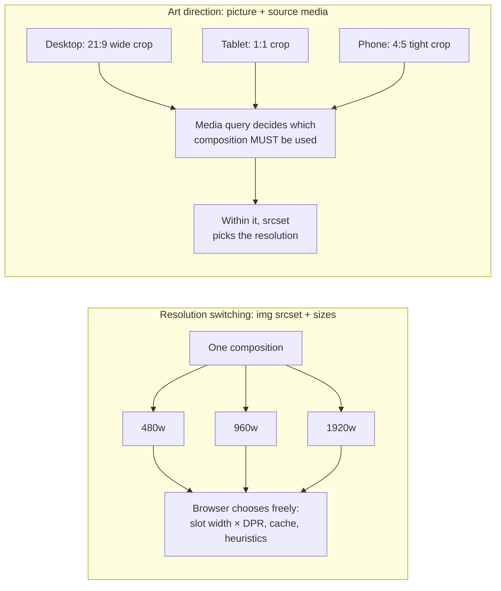

An art-directed hero with a different crop per layout, each with its own resolution variants and aspect ratio:

```html title="Art direction with per-crop resolutions and dimensions"
<picture>
  <!-- Desktop: wide crop showing the whole scene. -->
  <source
    media="(min-width: 1024px)"
    srcset="/hero/team-wide-1600.jpg 1600w, /hero/team-wide-2400.jpg 2400w"
    sizes="100vw"
    width="2400"
    height="1029"
  />
  <!-- Tablet: square crop. -->
  <source
    media="(min-width: 600px)"
    srcset="/hero/team-square-900.jpg 900w, /hero/team-square-1400.jpg 1400w"
    sizes="100vw"
    width="1400"
    height="1400"
  />
  <!-- Phone: tight 4:5 crop on the faces. Also the fallback for old browsers. -->
  
</picture>
```

```css title="Let the selected source's aspect ratio drive the box"
picture img {
  display: block;
  width: 100%;
  height: auto; /* height follows the chosen source's width/height ratio */
}
```

Resize the viewport across 600px and 1024px and the image swaps crops. Because each `<source>` declares `width` and `height`, the browser reserves the right box for whichever crop is active, so there is no layout shift while the image loads. `<source width height>` is supported in current versions of all major browsers; older browsers apply the ``'s ratio to every crop.

You can combine both axes: first by `media` (composition), then by `type` (format), then by `srcset` (resolution). Every combination is a file to generate and cache, so the variant count grows multiplicatively. Three crops × three formats × four widths is 36 files per image, which is where on-demand image CDNs earn their keep.

| Need                                    | Use                                             |
| --------------------------------------- | ----------------------------------------------- |
| Same image, layout-dependent size       | `` with `srcset` (`w`) and `sizes`         |
| Same image, fixed CSS size              | `` with `srcset` (`1x`, `2x`)              |
| Modern formats with fallback, in markup | `<picture>` with `<source type>`                |
| Different crop or image per layout      | `<picture>` with `<source media>`               |
| HDR variant for capable screens         | `<source media="(dynamic-range: high)">`        |
| Dark-mode-specific artwork              | `<source media="(prefers-color-scheme: dark)">` |

## Browser image candidate selection

So far we have looked at the markup. This section covers what the browser does with it, and when.

### Discovery happens before layout

When HTML bytes arrive, the parser tokenizes them and builds the DOM. In parallel, a **preload scanner** (also called the speculative or lookahead parser) scans ahead in the raw markup for resource URLs: ``, ``, `<source>` inside `<picture>`, stylesheets, scripts and preload links. It requests them before the main parser reaches them, which matters most when the main parser is blocked on a synchronous script ([web.dev: Don't fight the browser preload scanner](https://web.dev/articles/preload-scanner)). Every major engine has one, but its exact capabilities are implementation-defined.

At that moment the browser knows:

- The **viewport size** and **DPR**, which come from the window, not the page.
- The `srcset`, `sizes`, `type` and `media` attributes in the markup.
- Which MIME types it can decode.

It does **not** know the layout: CSS may not have been downloaded yet, let alone applied. This is the fundamental reason `sizes` exists. The browser cannot measure the image's slot, so the author must predict it. It also explains why the HTML Standard **does not use the laid-out width** for selection, apart from `sizes="auto"` on lazy images. Using layout would mean blocking image requests on CSS and layout, which would make every image later.

### The selection algorithm

The standard's processing model for an ``, simplified from "update the image data" and "select an image source":

1. If the `` is in a `<picture>`, walk the `<source>` children in order. Skip any whose `type` is unsupported or whose `media` does not match. The first remaining source provides the **source set**. Otherwise, the ``'s own `srcset` and `src` provide it.
2. Parse `srcset` into candidates (URL plus descriptor). Parse `sizes` into a **source size**: evaluate its media conditions in order and take the first matching length, or `100vw` if `sizes` is absent (or the laid-out width for `sizes="auto"` on lazy images).
3. Normalize: for `w` candidates, density = width / source size. Candidates without descriptors are 1x.
4. **Choose a candidate.** The standard says the user agent "may" choose any candidate and explicitly lets it consider screen density, zoom level, network conditions or user preferences. Picking the candidate whose density best matches the DPR is the expected behaviour, but it is not mandated.
5. Fetch the chosen URL (subject to lazy loading). When the image loads, the browser records the candidate's density. That is how it knows that a 1600-pixel file chosen at 2x should be laid out as 800 CSS pixels wide when CSS does not set a size: the **density-corrected intrinsic size** is the file's pixel size divided by its effective density. It is also what `naturalWidth` and `naturalHeight` return for such images, so they are not the file's pixel dimensions. The experiments below include a helper that measures the real ones.

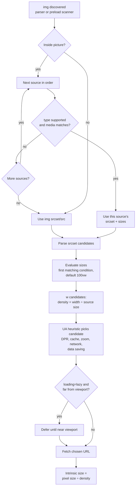

### Browser-specific heuristics

Because step 4 is left to the user agent, browsers differ, and their behaviour changes over time. Known behaviours, all **implementation details**:

- **Rounding between candidates.** Chromium does not simply take the smallest candidate at or above the target density. Since 2014 its selection logic has compared the DPR against the **geometric mean** of adjacent candidates' densities. On high-DPR screens it may pick a slightly lower-density candidate when the target is closer to it, while avoiding that downgrade at DPR 1 ([Eric Portis: Chrome srcset selection](https://observablehq.com/@eeeps/chrome-srcset-selection)). Firefox and WebKit use their own rules, so do not write tests that assume an exact candidate across browsers.
- **Cached candidates.** If a higher-density candidate is already in the memory cache, browsers may use it rather than fetch a smaller one.
- **No downgrade on resize.** When the viewport grows, browsers re-run selection and may fetch a larger candidate. When it shrinks, they typically keep the larger image they already have, because a smaller download would waste bandwidth for no visual gain. The standard allows re-selection when the environment changes but does not require it.
- **Data saving.** The standard permits choosing lower densities when the user wants to save data, but no major browser documents such behaviour as a stable feature today.

For `<picture>` with `media`, a change of matching `<source>` is different: when another source starts matching, the browser switches to it. That is why art-directed images swap crops while resizing, even to a smaller crop.

### A reproducible experiment: watching candidate selection

To see which candidate was chosen without guessing from file names, generate test images that **print their own width**. This script uses sharp's SVG input, so no source photo is needed. Later experiments reuse it.

```js title="lab/make-labelled-images.mjs"
// Generates img/test-<width>.<ext> next to this script, with the width drawn
// into each image, so you can see which candidate the browser chose.
// Output goes beside the script, so it works from any working directory.
import sharp from 'sharp';
import { mkdir } from 'node:fs/promises';
import { fileURLToPath } from 'node:url';

const WIDTHS = [320, 480, 640, 800, 1200, 1600, 2400];
const OUT = fileURLToPath(new URL('./img', import.meta.url));
await mkdir(OUT, { recursive: true });

for (const w of WIDTHS) {
  const h = Math.round(w / 1.5); // 3:2 aspect ratio
  const svg = `
    <svg xmlns="http://www.w3.org/2000/svg" width="${w}" height="${h}">
      <defs>
        <linearGradient id="g" x1="0" y1="0" x2="1" y2="1">
          <stop offset="0" stop-color="#1e3a8a"/><stop offset="1" stop-color="#0ea5e9"/>
        </linearGradient>
      </defs>
      <rect width="100%" height="100%" fill="url(#g)"/>
      <text x="50%" y="50%" font-family="sans-serif" font-size="${Math.round(w / 6)}"
            fill="white" text-anchor="middle" dominant-baseline="middle">${w}w</text>
    </svg>`;
  const img = sharp(Buffer.from(svg));
  await img.clone().jpeg({ quality: 80 }).toFile(`${OUT}/test-${w}.jpg`);
  await img.clone().webp({ quality: 75 }).toFile(`${OUT}/test-${w}.webp`);
  await img.clone().avif({ quality: 50 }).toFile(`${OUT}/test-${w}.avif`);
}
console.log('labelled images written to', OUT);
```

```html title="lab/srcset.html"
<!doctype html>
<meta name="viewport" content="width=device-width, initial-scale=1" />
<title>srcset lab</title>
<style>
  body {
    margin: 0;
    font: 14px system-ui;
  }
  img {
    display: block;
    width: 100%;
    height: auto;
  }
  pre {
    padding: 8px;
    background: #111;
    color: #0f0;
    margin: 0;
    white-space: pre-wrap;
  }
</style>
<pre id="log"></pre>

<script>
  const img = document.getElementById('probe');
  const log = document.getElementById('log');
  function report() {
    // currentSrc is the URL of the candidate actually selected.
    // naturalWidth is density-corrected (file width ÷ effective density), so it
    // tracks the rendered width here. The file's real width is in its name.
    log.textContent =
      `viewport ${innerWidth}px · DPR ${devicePixelRatio}\n` +
      `needed ≈ ${Math.round(innerWidth * devicePixelRatio)}px · chose ${img.currentSrc.split('/').pop()}` +
      ` (naturalWidth ${img.naturalWidth}px, rendered ${Math.round(img.getBoundingClientRect().width)}px)`;
  }
  img.addEventListener('load', report);
  addEventListener('resize', report);
</script>
```

**Steps.** Run `node lab/make-labelled-images.mjs`, then serve the `lab` folder (`npx serve lab` or `python -m http.server -d lab 8080`). Open `srcset.html` in Chrome with DevTools open, and tick **Disable cache** in the Network panel. Enable the **Device Toolbar** (Ctrl/Cmd+Shift+M), choose "Responsive", and show the DPR control from the toolbar's ⋮ menu if it is hidden. For each combination below, set the width and DPR, then reload.

| Viewport × DPR | Needed pixels | Likely choice                                       |
| -------------- | ------------- | --------------------------------------------------- |
| 375 × 1        | 375           | 480w                                                |
| 375 × 2        | 750           | 800w                                                |
| 375 × 3        | 1125          | 1200w                                               |
| 1280 × 1       | 1280          | 1600w, or 1200w depending on the browser's rounding |
| 1280 × 2       | 2560          | 2400w (the largest available)                       |

**What to observe.** The image shows the label of the chosen file, and the log confirms it through `currentSrc`. Notice that `naturalWidth` reports roughly the rendered width (375 for the 800w file at 375 × 2), not 800. That is the density correction from step 5 above, and it is a common trap in debugging scripts. In the Network panel, filtered to **Img**, expect one candidate per load. With **Disable cache** on, Chromium occasionally lists the same file twice; that is a cache side effect, not a second candidate. Next, without reloading, drag the viewport wider: a larger candidate is fetched once the needed width exceeds the current one. Drag it narrower: no new request, because Chromium keeps the larger image. Finally, untick **Disable cache**, load at 1280 × 2, switch to 375 × 1 and reload. Chromium may reuse the cached 2400w file instead of fetching 480w, which is the cache heuristic at work. The "likely choice" column is deliberately approximate: choices near a boundary depend on each browser's rounding.

## Image loading and network prioritization

Choosing a candidate decides **which** bytes to fetch. Loading strategy and priority decide **when** they are fetched and **how urgently** they compete with everything else.

### Normal image loading

An `` in the initial HTML is usually requested by the preload scanner within milliseconds of its bytes arriving. Image requests are not render-blocking: the browser does not wait for images before painting the first frame, and it is free to deprioritize them in favour of CSS, synchronous scripts and fonts that do block rendering.

In **Chromium**, the best documented case, resources get one of five priority levels, shown in DevTools as Lowest, Low, Medium, High and Highest. All of the following is implementation-specific:

- Render-blocking CSS in `<head>`: Highest.
- Synchronous scripts in `<head>` and fonts: High.
- Images: **Low** by default. Once layout runs, images found to be **in the viewport are boosted to High**. Since Chrome 117, the **first five images larger than 10,000 px²** (bigger than 100 × 100) start at **Medium**, so likely hero images are not stuck at Low before layout ([web.dev: Fetch Priority](https://web.dev/articles/fetch-priority)). An image without `width` and `height` attributes is assumed to be large for this purpose.
- Images with `fetchpriority="high"`: High from the start.

Priority matters most on **HTTP/2 and HTTP/3**, where many requests share one connection and scheduling decides the order of bytes. Chromium also **holds back low-priority requests** during an early phase of the load (sometimes called tight mode) to keep bandwidth for render-blocking resources, so a Low-priority hero image may not be sent until critical CSS and scripts are done. Firefox and Safari have their own prioritization schemes that differ in detail.

The interaction with CSS and JavaScript is the second key factor. An image discovered by the preload scanner is requested early but may sit behind render-blocking CSS. An image that appears only when JavaScript runs (client-side rendering, or a carousel library that injects slides) is invisible to the preload scanner and is requested only after the script has downloaded, parsed and executed. On a mobile load, that alone can add seconds.

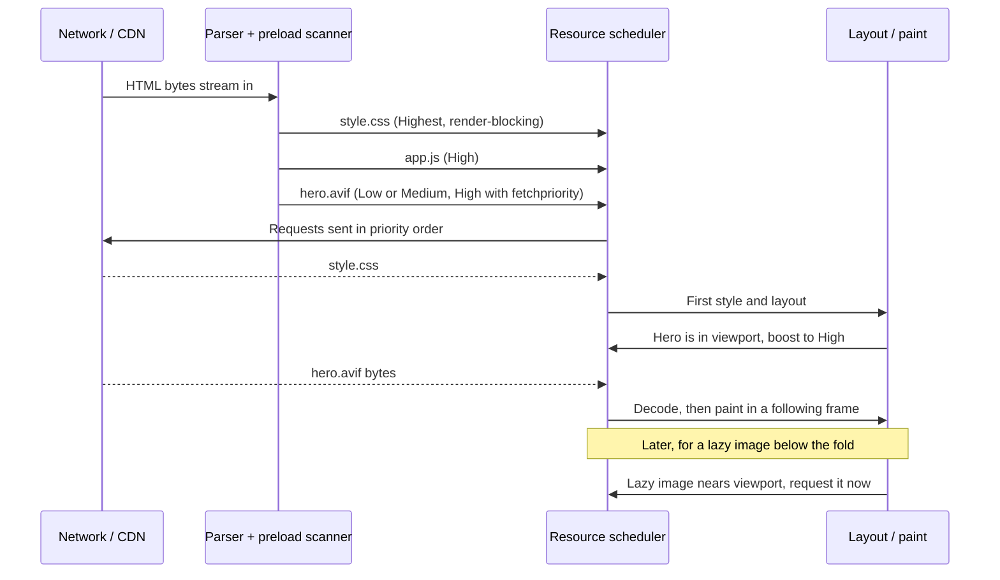

### Native lazy loading

`loading="lazy"` tells the browser to defer fetching an image until it is likely to be needed, which in practice means until it comes within some distance of the viewport. `loading="eager"`, the default, means load immediately regardless of position ([MDN: img loading](https://developer.mozilla.org/en-US/docs/Web/HTML/Reference/Elements/img#loading)).

The HTML Standard defines lazy loading in terms of an intersection observation with a **lazy load root margin**, and the margin is **implementation-defined** so browsers can adapt it. As documented on web.dev, Chromium uses a distance-from-viewport threshold of **1250px** on fast connections and **2500px** on slower ones ([web.dev: browser-level lazy loading](https://web.dev/articles/browser-level-image-lazy-loading)). Firefox and Safari use their own values. These numbers are not guarantees, and Chromium has changed them before.

The standard also says user agents should not lazy-load when scripting is disabled, as a privacy measure: otherwise image requests could reveal how far a user scrolled even with JavaScript off.

```html title="Lazy loading below-the-fold images"
<!-- Above the fold: never lazy. -->


<!-- Below the fold: let the browser defer. Always give dimensions so the
     placeholder box has the right size before the image arrives. -->


```

Lazy loading is valuable on **long pages**: feeds, galleries, long articles and search results. Images the user never scrolls to are never downloaded, and early bandwidth goes to what is visible.

It is harmful **above the fold**. A lazy image cannot be requested until layout has run and its position is known, so its request is delayed past CSS download and layout. That delay goes straight into LCP's resource load delay, and the preload scanner's head start is lost. This is why frameworks and CMSs (WordPress among them) now try to avoid lazy-loading the first images on a page.

The difficulty is that "above the fold" depends on the viewport. An image in the third row of a product grid is visible on a desktop and far below the fold on a phone. Reasonable rules: never lazy-load the likely LCP image; eager-load the first few images in a list, or decide per breakpoint on the server; lazy-load the rest. Because of the distance threshold, lazy images just below the fold usually arrive before the user reaches them.

**CSS background images cannot use `loading="lazy"`.** The attribute exists only on `` and `<iframe>`. Browsers do apply an implicit kind of laziness to backgrounds: a `background-image` is generally fetched only once an element using it is styled and rendered, so a background on a `display: none` element is typically not fetched. But there is no viewport-distance deferral. Deferring backgrounds requires an `IntersectionObserver` that adds a class as the element approaches the viewport.

### Image preloading

`<link rel="preload" as="image" href="…">` tells the browser to fetch a resource early, regardless of where (or whether) the document references it. Its purpose is to fix **late discovery**: images referenced from CSS, injected by JavaScript, or otherwise invisible to the preload scanner.

```html title="Preloading a CSS background hero"
<head>
  <!-- The hero is a CSS background, so the preload scanner cannot see it.
       This preload starts the fetch while the stylesheet is still downloading.
       type= makes browsers that can't decode AVIF skip the preload entirely. -->
  <link rel="preload" as="image" href="/hero/summer-1600.avif" type="image/avif" fetchpriority="high" />
  <link rel="stylesheet" href="/styles.css" />
</head>
```

For responsive images, a fixed `href` would fetch the wrong file on many devices. **Responsive preloads** use `imagesrcset` and `imagesizes`, which mirror `srcset` and `sizes` ([web.dev: Preload responsive images](https://web.dev/articles/preload-responsive-images)):

```html title="Responsive image preloading"
<head>
  <!-- Must match the 's srcset and sizes exactly, or the browser may
       select different candidates for the preload and the image: two downloads. -->
  <link
    rel="preload"
    as="image"
    imagesrcset="/hero/summer-640.jpg 640w, /hero/summer-1280.jpg 1280w, /hero/summer-2000.jpg 2000w"
    imagesizes="100vw"
    fetchpriority="high"
  />
</head>
<body>
  <!-- The hero  is rendered later by client-side JavaScript,
       so the preload scanner can't see it. The preload compensates. -->
  <div id="app"></div>
</body>
```

For art direction, add a `media` attribute to each preload so that only the matching crop is fetched:

```html title="Preloading art-directed sources"
<link
  rel="preload"
  as="image"
  media="(min-width: 1024px)"
  imagesrcset="/hero/team-wide-1600.jpg 1600w, /hero/team-wide-2400.jpg 2400w"
  imagesizes="100vw"
/>
<link
  rel="preload"
  as="image"
  media="(min-width: 600px) and (max-width: 1023.98px)"
  imagesrcset="/hero/team-square-900.jpg 900w, /hero/team-square-1400.jpg 1400w"
  imagesizes="100vw"
/>
<link
  rel="preload"
  as="image"
  media="(max-width: 599.98px)"
  imagesrcset="/hero/team-portrait-600.jpg 600w, /hero/team-portrait-1200.jpg 1200w"
  imagesizes="100vw"
/>
```

The media queries must be mutually exclusive, or several preloads fire. Format negotiation through `<picture>` cannot be fully expressed in a preload. A preload with `type="image/avif"` fetches AVIF in browsers that support it and nothing elsewhere, which is usually an acceptable trade. Adding a second WebP preload would make browsers that support both formats download both.

**Duplicate downloads** happen when the preload and the element disagree: different `srcset` or `sizes`, a different URL (even only a query string), or a mismatched `crossorigin` attribute. Chromium logs a console warning when a preloaded resource is not used within a few seconds of the load event. Check for it whenever you add a preload.

**Preload misuse** is common:

- **Preloading images the preload scanner can already see.** An `` in server-rendered HTML is discovered almost immediately. Preloading it adds little, and a preload placed above render-blocking resources can steal bandwidth from them. For such images, `fetchpriority="high"` on the `` is the right tool.
- **Preloading many images.** Each preload is a high-importance request. Preloading five carousel slides makes all five compete with the first slide, the CSS and the fonts. Preload the one image that is the LCP candidate.
- **Preloading below-the-fold or conditional images**, which spends early bandwidth on content the user may never see.

### Fetch priority

`fetchpriority` (on ``, `<link>`, `<script>` and `<iframe>`, plus the `priority` option of `fetch()`) is a hint about the **relative** importance of a request compared with others of the same type. It accepts `high`, `low` and `auto`, the default. It is supported in Chromium, Safari 17.2+ and Firefox 132+, so it is Baseline Newly available ([web.dev: Fetch Priority API](https://web.dev/articles/fetch-priority)).

```html title="Fetch priority on images"
<!-- The LCP hero: request at High priority from the start,
     instead of waiting for layout to find out it is in the viewport. -->


<!-- Slides 2-3 of a carousel are in the DOM and inside the viewport rectangle
     (stacked inside an overflow container) but not visible yet. -->


```

Key properties:

- **It is a hint, not a guarantee.** The Fetch Standard maps it to the request's priority, and browsers decide what that means. A high-priority image still waits for a connection, shares bandwidth, and may still be queued behind render-blocking resources, depending on the engine.
- **It changes priority, not discovery.** `fetchpriority="high"` on an image that JavaScript inserts late makes that late request urgent; it does not make it early. Only discovery fixes (server-rendered HTML, preload) do that.
- **It is not a loading strategy.** `loading` decides **whether** to fetch now. `fetchpriority` decides **how urgently** to fetch once the request exists. `loading="lazy" fetchpriority="high"` is valid, but contradictory for a hero image.
- **Overuse cancels out.** If every image is `high`, none is. Use it on one or two elements.

### CSS background images vs. HTML images

A `background-image` URL lives in a stylesheet. The browser must download the stylesheet, parse it, match the rule to an element in the DOM and compute style before it knows the image is needed. The preload scanner does not parse CSS, so these images cannot be discovered early. Background images in inline `style` attributes are not reliably discovered by preload scanners either. The result is that a CSS background hero is typically requested after the CSS (and sometimes after a JavaScript-rendered DOM), later than an equivalent ``.

There are semantic differences too:

- An `` with `alt` is **content**. Assistive technology announces it, it appears in reader modes, it can be saved or shared, and search engines index it.
- A `background-image` is **decoration**. It is invisible to assistive technology and has no alternative text.
- `` gets `srcset`, `sizes`, `<picture>`, `loading`, `decoding`, `fetchpriority`, and `width`/`height` for layout reservation. Backgrounds get `image-set()` for density and format selection, and neither native lazy loading nor priority hints.

```css title="image-set() for background images"
.promo-banner {
  /* Fallback for browsers without image-set() type() support. */
  background-image: url('/banner/promo-1x.jpg');
  /* image-set() chooses by resolution and, with type(), by format. */
  background-image: image-set(
    url('/banner/promo-1x.avif') type('image/avif') 1x,
    url('/banner/promo-2x.avif') type('image/avif') 2x,
    url('/banner/promo-1x.jpg') type('image/jpeg') 1x,
    url('/banner/promo-2x.jpg') type('image/jpeg') 2x
  );
  background-size: cover;
  background-position: center;
}
```

Unprefixed `image-set()` with `type()` works in current major browsers. It has no `sizes` equivalent, so it can only choose by density, not by layout width.

**Use ``** for meaningful content and for any image that might be the LCP element. **Use `background-image`** for decorative textures, patterns and purely visual flourishes. When a design needs text over a hero photo, use an absolutely positioned `` with `object-fit: cover` behind the text rather than a background image. You keep discovery, `srcset` and priority, and lose nothing visually:

```html title="A hero as img instead of background-image"
<section class="hero">
  
  <div class="hero__content"><h1>Summer collection</h1></div>
</section>
<style>
  .hero {
    position: relative;
    isolation: isolate;
    min-height: 60vh;
    display: grid;
    place-items: center;
  }
  /* Decorative here (empty alt), but discoverable and prioritizable. */
  .hero__bg {
    position: absolute;
    inset: 0;
    width: 100%;
    height: 100%;
    object-fit: cover;
    z-index: -1;
  }
</style>
```

The empty `alt=""` marks the image as decorative for assistive technology, so you keep the semantics of a background while gaining the loading behaviour of an ``. `isolation: isolate` keeps the negative `z-index` inside the hero's stacking context.

### Choosing a loading strategy

| Technique                              | What it does                                              | Useful when                                               | Hurts when                                                                                         |
| -------------------------------------- | --------------------------------------------------------- | --------------------------------------------------------- | -------------------------------------------------------------------------------------------------- |
| Eager (`loading="eager"`, the default) | Fetches as soon as discovered                             | Above-the-fold and LCP images                             | Many below-the-fold images compete for early bandwidth                                             |
| Lazy (`loading="lazy"`)                | Defers until near the viewport (browser-defined distance) | Long pages, galleries, feeds, below-the-fold content      | Applied to the LCP or other above-the-fold images: the request waits for layout                    |
| Preload (`rel="preload" as="image"`)   | Fetches early, independent of discovery                   | Late-discovered LCP images (CSS backgrounds, JS-rendered) | Images already in the HTML, many preloads, or mismatched `srcset`/`sizes` causing double downloads |
| Fetch priority (`fetchpriority`)       | Raises or lowers relative priority                        | The LCP image (`high`), hidden carousel slides (`low`)    | Applied widely, or expected to fix late discovery                                                  |

## Image decoding: from compressed bytes to pixels

When the last byte of an image arrives, the browser holds a compressed bitstream, not pixels. Turning it into something that can be drawn is a separate stage with its own CPU and memory costs, and its own scheduling.

### The decoding pipeline

1. **Network response.** Bytes arrive, often in chunks, and are buffered by the loader. The `Content-Type` header is a hint; browsers **sniff** the first bytes (the "magic numbers") to identify image formats, so a WebP served as `image/jpeg` usually still decodes.
2. **Format parsing.** The decoder reads the header: dimensions, bit depth, colour type, colour profile, orientation, animation frame count. This happens early and cheaply. It is what lets the browser know an image's intrinsic size, and so lay it out, before the image is fully downloaded.
3. **Decoder selection.** The engine instantiates a decoder for the format: libjpeg-turbo for JPEG, libpng or a Rust PNG decoder, libwebp, dav1d or libgav1 for AVIF, jxl-rs for JPEG XL in Chromium. The libraries vary by browser and version.
4. **Pixel buffer generation.** The decoder entropy-decodes, dequantizes, applies inverse transforms and filters, and writes pixels into a buffer, usually 8-bit RGBA (or BGRA), sometimes a YUV planar format for GPU upload, or a higher-precision format for HDR content.
5. **Colour conversion.** If the image has a colour profile that differs from the output colour space, pixels are transformed. Engines may defer this to rasterization or the GPU.
6. **Memory allocation.** The decoded buffer is allocated in the renderer's memory or as a GPU texture, and is usually tracked in a decoded-image cache that can evict entries under memory pressure.
7. **Image readiness.** The element now has decodable data. Rendering it still requires layout, paint, raster and compositing.

Progressive and incremental decoding complicate this. Browsers decode **partial data** for formats that support it (progressive JPEG, interlaced PNG, and top-to-bottom for baseline JPEG and WebP), painting intermediate versions as bytes arrive. AVIF is typically shown only once complete.

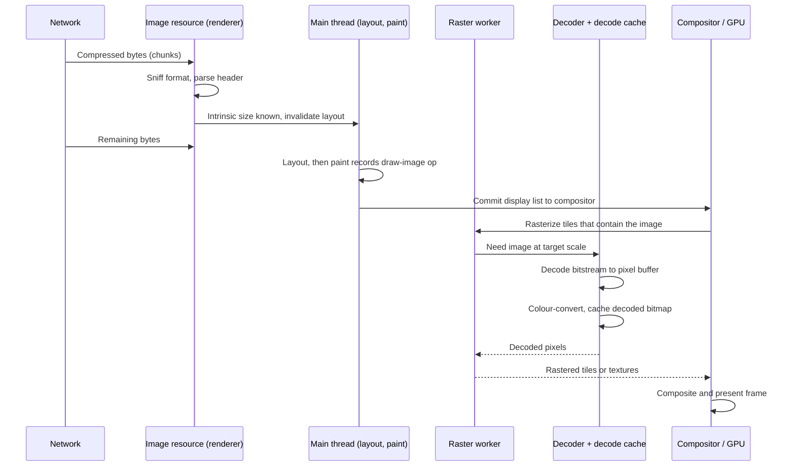

The diagram reflects Chromium's architecture, which is a documented **implementation detail**: paint records a reference to the image, and the actual decode happens during rasterization through the compositor's `ImageDecodeCache`, with decode tasks run on worker threads ([Chromium source: `cc/tiles/image_decode_cache.h`](https://chromium.googlesource.com/chromium/src.git/+/main/cc/tiles/image_decode_cache.h)). Firefox decodes images off the main thread on its own decode pool. WebKit has its own asynchronous image decoding paths. The standards say nothing about threads.

### Synchronous and asynchronous decoding

Even when decoding happens off the main thread, there is a scheduling question: should the browser **wait** for an image to decode before presenting a frame that contains it, or **present the frame without it** and draw the image in a later frame?

- Waiting means the frame shows everything together (atomically), but if the decode is slow, the whole frame is delayed, including text, scrolling or a hover effect.
- Not waiting keeps the rest of the page responsive, but the image can appear a frame or more after its surroundings, briefly showing a blank or stale area.

The `decoding` attribute gives the browser a hint about which you prefer ([HTML Standard: decoding images](https://html.spec.whatwg.org/multipage/images.html#decoding-images), [MDN](https://developer.mozilla.org/en-US/docs/Web/API/HTMLImageElement/decoding)):

- `decoding="sync"`: decode synchronously with other content, for atomic presentation.
- `decoding="async"`: decode asynchronously, allowing other content to be presented first.
- `decoding="auto"` (the default): no preference; the browser decides.

All three are **hints**. The standard explicitly allows the browser to ignore them. `async` does not guarantee a particular thread, and `sync` does not mean the main thread blocks. In practice, browsers already decode most images off the main thread, so the attribute mostly affects whether a frame waits for the decode. Chromium's compositor, for example, has an image "checkering" mechanism that can let frames proceed without a large image that is still decoding, and the hint influences it. That is an implementation detail and changes over time.

Practical guidance:

- Leave the default for most images.
- `decoding="async"` on below-the-fold or non-critical images is harmless and can prevent a large decode from delaying an unrelated frame.
- Avoid `decoding="async"` on an image that must appear together with surrounding content in the same frame. For a hero image that you are swapping in JavaScript, `decode()` gives more control than the attribute.

### HTMLImageElement.decode()

`img.decode()` returns a **promise that resolves when the image has been fetched and decoded enough that it can be appended to the DOM without a decode delay** on the next frame. It rejects with an `EncodingError` `DOMException` if the image cannot be fetched or decoded ([MDN: HTMLImageElement.decode()](https://developer.mozilla.org/en-US/docs/Web/API/HTMLImageElement/decode)).

```js title="Decode before inserting"
// Build an off-DOM image, wait for decode, then insert.
// The decoded pixels are ready, so inserting it does not produce
// a frame where the box is present but empty.
async function loadDecodedImage(src, { alt = '', width, height } = {}) {
  const img = new Image();
  if (width) img.width = width; // reserve layout box as soon as it is inserted
  if (height) img.height = height;
  img.alt = alt;
  img.src = src; // starts the fetch

  try {
    await img.decode(); // resolves after fetch AND decode
  } catch (err) {
    // EncodingError: network failure, 404, unsupported format or corrupt data.
    console.warn('Image failed to load/decode:', src, err);
    throw err;
  }
  return img;
}

const container = document.querySelector('#preview');
loadDecodedImage('/img/coast-1200.jpg', { alt: 'Coastline at dusk', width: 1200, height: 800 })
  .then((img) => container.replaceChildren(img))
  .catch(() => container.classList.add('preview--error'));
```

The key property is ordering: by the time the promise resolves, the costly decode has already happened, so DOM insertion leads to a frame that includes the image. Without `decode()`, inserting an image as soon as `onload` fires can still show an empty box for a frame while the browser decodes it, particularly with large images.

**Product image transitions.** A product page replaces its main image when the user picks a colour. Swapping `src` directly shows the old image disappearing, sometimes a blank frame, then the new image. Decoding first gives a clean swap:

```js title="Flicker-free image swap in a product gallery"
const main = document.querySelector('.gallery__main');
let latestRequest = 0;

async function showVariant(src, srcset, sizes) {
  const requestId = ++latestRequest;
  const next = new Image();
  next.sizes = sizes; // set sizes BEFORE srcset so selection uses it
  next.srcset = srcset;
  next.src = src;
  next.alt = main.alt;
  next.className = main.className;
  next.width = main.width;
  next.height = main.height;

  main.setAttribute('aria-busy', 'true');
  try {
    await next.decode();
  } catch {
    main.removeAttribute('aria-busy');
    return; // keep the current image if the new one fails
  }
  // A faster later click may have finished first. Ignore stale results.
  if (requestId !== latestRequest) return;
  main.replaceWith(next);
  next.removeAttribute('aria-busy');
}

document.querySelectorAll('[data-variant]').forEach((button) => {
  button.addEventListener('click', () =>
    showVariant(button.dataset.src, button.dataset.srcset, '(min-width: 1024px) 50vw, 100vw'),
  );
});
```

The `requestId` check matters: if a user clicks "red" then "blue" quickly and red decodes last, without the check the gallery would end on red. Setting `sizes` before `srcset` ensures the browser has the right sizes when it selects a candidate; browsers delay selection until the current task ends, which makes the order less critical in practice, but it costs nothing to get it right.

**Preloading images before display.** For a lightbox or a carousel, decode the next slide while the user looks at the current one:

```js title="Warm the next slide"
function warmUp(src) {
  const img = new Image();
  img.src = src;
  // decode() keeps the work off the critical path of the next click.
  // Errors are ignored here; the real display path handles them.
  return img.decode().then(
    () => img,
    () => null,
  );
}

let nextSlide = warmUp(slides[1]);
nextButton.addEventListener('click', async () => {
  const img = await nextSlide; // usually already resolved
  if (img) stage.replaceChildren(img);
  nextSlide = warmUp(slides[currentIndex + 2]);
});
```

Two caveats are implementation-dependent. First, browsers can **discard decoded data** for images that are not in the DOM, or under memory pressure, and decode again later. `decode()` makes the next frame likely to be fast, not guaranteed. Second, decoding an image you never show wastes CPU and memory, so warm only what is likely to be needed next.

`decode()` works on images with `srcset`, and for images already in the DOM it resolves once the current source is decoded. Calling it on an `` with no `src` rejects.

### Decoding cost and memory

**Compressed file size tells you almost nothing about decoded memory.** Decoded memory depends on pixel count and pixel format:

```text
decoded bytes ≈ width × height × bytes per pixel
```

For the common 8-bit RGBA format, that is 4 bytes per pixel, even for an opaque JPEG, because many engines decode to 32-bit pixels for alignment and compositing. Some engines decode opaque JPEGs to YUV planes for GPU upload (4:2:0 YUV needs about 1.5 bytes per pixel), and HDR images may use 8 bytes per pixel (16-bit float RGBA). These are implementation choices.

A worked example with a photo straight from a 12-megapixel phone camera:

| Quantity                       | Value                       |
| ------------------------------ | --------------------------- |
| Intrinsic size                 | 4032 × 3024 pixels          |
| Pixels                         | 12,192,768                  |
| Decoded as RGBA (4 B/px)       | 48,771,072 bytes ≈ 46.5 MiB |
| Compressed JPEG size (example) | 2.5 MB                      |
| Expansion factor               | about 20×                   |

The same image resized to 1200 × 900 for a 600 CSS-pixel slot at DPR 2:

| Quantity                | Value                     |
| ----------------------- | ------------------------- |
| Pixels                  | 1,080,000                 |
| Decoded as RGBA         | 4,320,000 bytes ≈ 4.1 MiB |
| Reduction vs. full size | about 11× less memory     |

Compression format does not change this arithmetic. A 140 KB AVIF and a 380 KB JPEG of the same 4032 × 3024 image both decode to about 46.5 MiB of RGBA. A smaller file means faster download; it does not mean a smaller bitmap, and AVIF's decode is typically more CPU-intensive per pixel.

```js title="Estimating decoded memory for images on the page"
// Paste into the DevTools console. Estimates RGBA decoded size per image
// and compares the file's real pixels with what the layout actually needs.

// naturalWidth/naturalHeight are density-corrected for srcset images: a 1600px
// file chosen as 2x reports 800. Loading currentSrc on its own (no srcset, so
// density 1) reveals the file's real pixel dimensions. Usually served from cache.
async function filePixels(img) {
  const probe = new Image();
  probe.src = img.currentSrc;
  await probe.decode();
  return { w: probe.naturalWidth, h: probe.naturalHeight };
}

(async () => {
  const loaded = [...document.images].filter((img) => img.complete && img.naturalWidth);
  const rows = await Promise.all(
    loaded.map(async (img) => {
      const { w, h } = await filePixels(img);
      const rect = img.getBoundingClientRect();
      const neededW = Math.round(rect.width * devicePixelRatio);
      const neededH = Math.round(rect.height * devicePixelRatio);
      const decodedMiB = (w * h * 4) / 2 ** 20;
      const neededMiB = (neededW * neededH * 4) / 2 ** 20;
      return {
        src: img.currentSrc.split('/').pop().slice(0, 40),
        filePixels: `${w}×${h}`,
        needed: `${neededW}×${neededH}`,
        decodedMiB: +decodedMiB.toFixed(1),
        wasteMiB: +Math.max(0, decodedMiB - neededMiB).toFixed(1),
      };
    }),
  );
  rows.sort((a, b) => b.decodedMiB - a.decodedMiB);
  console.table(rows);
  console.log('Total estimated decoded RGBA:', rows.reduce((s, r) => s + r.decodedMiB, 0).toFixed(1), 'MiB');
})();
```

These are estimates of the decoded bitmap only. Engines can hold fewer bytes (by decoding at a reduced scale or into YUV) or more (GPU texture copies, multiple scales, animation frames). Use the numbers to find outliers, not as exact memory accounting.

Why this matters:

- **Memory pressure.** A product listing page with 60 oversized 4-megapixel thumbnails could need nearly a gigabyte of decoded pixels if all were decoded at full size. Browsers mitigate this with decoded-image caches that evict offscreen images and decode again on demand, which costs CPU during scrolling. On low-memory phones, the operating system may kill background tabs or the renderer process, which the user experiences as a reload.
- **Decode CPU.** Decode time scales roughly with pixel count. A 12-megapixel decode can take tens of milliseconds even with optimized decoders on fast hardware, and much longer on a low-end phone. With many images, decoding competes with other raster and worker tasks.
- **Downscale work.** Drawing a 4032-pixel image into an 800-pixel box requires resampling at raster time. Engines may cache a downscaled copy, which costs more memory, or resample every time it is rastered.

Some decoders can reduce the cost at the source. libjpeg-turbo can decode a JPEG directly at 1/2, 1/4 or 1/8 scale by skipping DCT coefficients, and Chromium uses reduced-scale decoding for JPEG when an image is drawn much smaller than its intrinsic size. This is an engine optimization you cannot control and should not rely on; other formats and browsers behave differently. The portable fix is to serve properly sized images.

### Download completion is not visibility

Several distinct events are often treated as one:

| Milestone                     | What it means                                                                                             | Observable through                              |
| ----------------------------- | --------------------------------------------------------------------------------------------------------- | ----------------------------------------------- |
| Download complete             | All bytes received                                                                                        | Resource Timing `responseEnd`                   |
| `load` event / `img.complete` | Bytes received and the image is "available" (the header parsed successfully). Decode may not have run yet | `load` event, `complete`, `naturalWidth`        |
| Decode complete               | Pixels exist in a buffer                                                                                  | `decode()` resolving                            |
| Layout                        | The element's box has its final size and position                                                         | `getBoundingClientRect()`, ResizeObserver       |
| Paint                         | Draw commands recorded for the frame                                                                      | DevTools Performance panel                      |
| Raster and composite          | Pixels written into tiles or textures and combined into a frame                                           | DevTools Performance panel                      |
| Visible pixels                | Frame presented to the display                                                                            | LCP `renderTime` and paint timing (approximate) |

The `load` event does not mean the image has been decoded or painted. A large image's `load` can fire, and its first appearance come a frame or more later, after decode and raster. LCP measures paint time precisely because it reflects what the user saw. The gap between `responseEnd` and LCP render time for an image is the **element render delay** covered in the Core Web Vitals section.

## Image rendering: from pixels to the screen

A decoded bitmap still has to be placed, scaled, clipped and composited.

### Intrinsic dimensions and CSS sizing

An `` is a **replaced element**: its content comes from outside the CSS formatting model, and it has intrinsic dimensions and an intrinsic aspect ratio (from the image data, corrected by `srcset` density). CSS sizing combines them as follows ([CSS Images Level 3](https://www.w3.org/TR/css-images-3/)):

- With no CSS size, the box takes the density-corrected intrinsic size. A 1600-pixel file chosen as 2x lays out at 800 CSS pixels.
- With only one dimension specified (for example `width: 100%; height: auto`), the other is computed from the intrinsic aspect ratio.
- With both specified, the box has exactly that size, and the image is fitted into it according to `object-fit`.

The HTML `width` and `height` attributes are presentational hints that map to CSS `width` and `height`. More importantly for layout stability, browsers also map them to an `aspect-ratio: auto W / H` value, so the ratio is known **before the image loads** ([web.dev: Optimize CLS](https://web.dev/articles/optimize-cls)). Once the image loads, the real intrinsic ratio takes over (that is what `auto` means), which is why the attributes should match the image's actual ratio.

```css title="Responsive images with reserved space"
/* The standard responsive image rule. width:100% fills the container,
   height:auto derives height from the aspect ratio, which is known
   before load thanks to the width/height attributes. */
img {
  max-width: 100%;
  height: auto;
}

/* When the box ratio is set by design rather than by the image. */
.card__media {
  aspect-ratio: 4 / 3;
  width: 100%;
  object-fit: cover;
}
```

### object-fit and object-position

When the box and the image have different aspect ratios, `object-fit` decides how the image is fitted into the box ([MDN: object-fit](https://developer.mozilla.org/en-US/docs/Web/CSS/object-fit)):

- `fill` (the default): stretch to fill the box, distorting the image.
- `contain`: scale to fit entirely inside the box, preserving ratio (letterboxing).
- `cover`: scale to cover the whole box, preserving ratio, and crop the overflow.
- `none`: draw at intrinsic size, centred, cropped by the box.
- `scale-down`: the smaller of `none` and `contain`.

`object-position` sets the alignment within the box, default `50% 50%`, which also chooses the visible part of a `cover` crop.

```css title="Cropping with object-fit and object-position"
/* Square product tiles from 3:2 photos: crop the sides, keep the product centred. */
.tile img {
  aspect-ratio: 1;
  width: 100%;
  height: auto;
  object-fit: cover;
  object-position: 50% 50%;
}

/* Portrait avatars from arbitrary photos: bias the crop upward, where faces usually are. */
.avatar {
  width: 96px;
  height: 96px;
  border-radius: 50%;
  object-fit: cover;
  object-position: 50% 25%;
}

/* Logos: never crop or distort. */
.partner-logo {
  width: 160px;
  height: 64px;
  object-fit: contain;
}
```

Remember that **CSS cropping does not reduce downloaded or decoded pixels**. If a `cover` crop shows only the middle third of a wide image, the whole image is still fetched and decoded. For heavy crops, art direction (a pre-cropped file per layout) or CDN-side cropping is cheaper.

### Painting, rasterization and compositing

Once layout is done, the image's role in the [rendering pipeline](/blog/inside-the-browser-rendering-pipeline-from-html-to-pixels) is as follows.

- **Paint** records a display item like "draw image X, source rectangle S, into destination rectangle D, clipped to C". It does not decode or draw pixels.
- **Rasterization** executes the display list into tiles (Chromium) or layer surfaces. This is where the decoded bitmap is fetched from the decode cache (decoding it if needed) and **resampled** into the destination size.
- **Compositing** combines rastered layers into the final frame, applying transforms, opacity and clipping on the GPU, and presents it.

**Scaling and interpolation.** Image pixels rarely line up 1:1 with device pixels. Downscaling uses filtering (bilinear or higher-quality filters, sometimes with mipmaps) to avoid aliasing and moiré; upscaling interpolates new pixels and looks soft. `image-rendering` lets you request a different strategy:

```css title="image-rendering for pixel art and QR codes"
/* Pixel art or QR codes scaled up: keep hard pixel edges instead of blurring. */
.pixel-art {
  image-rendering: pixelated;
}
/* "auto" (the default) lets the browser choose a smooth scaling algorithm. */
```

**DPR at raster time.** Rasterization happens at device resolution. A 400 × 300 CSS-pixel image box at DPR 3 rasterizes to 1200 × 900 device pixels. If the source is 800 pixels wide, it is upscaled 1.5× and looks slightly soft. If it is 4000 pixels wide, it is downscaled 3.3×, which is expensive and gains nothing visible.

**GPU considerations.** Decoded images are uploaded to GPU memory as textures (in Chromium, through the GPU image decode cache when GPU rasterization is enabled). Textures have maximum sizes, commonly 8192 or 16384 pixels per side depending on the GPU, so very large images may be tiled or rastered differently. GPU memory is a shared and limited budget, particularly on mobile, where it is the same physical RAM.

**Animations and transforms.** Animating `transform` or `opacity` on an image that has its own compositor layer is cheap: the compositor moves or fades an existing texture without re-rastering. Scaling an image up with `transform: scale()` magnifies the existing raster, which can look blurry until the browser re-rasters at the new scale (engines differ on when they do). Animating `width`, `height` or `object-position` forces layout or paint and re-raster on each frame, which is much more expensive for large images. For zoom effects in galleries, consider rastering a larger source up front, or animating `transform` and swapping to a higher-resolution image when the animation ends.

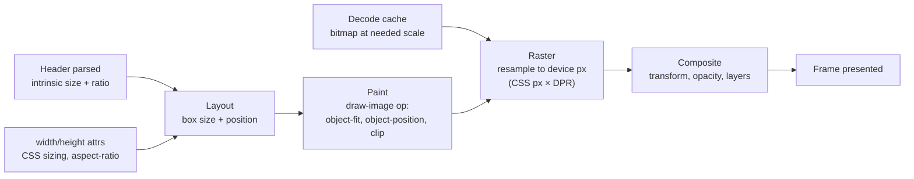

## Image optimization and Core Web Vitals

Images touch all three Core Web Vitals, but in different ways. This section focuses on the image-specific parts; [the Core Web Vitals deep dive](/blog/web-performance-metrics-a-deep-dive-into-core-web-vitals) covers how each metric is measured.

### LCP

Images (including `<image>` inside SVG, video poster images and CSS background images loaded with `url()`) are among the elements eligible as Largest Contentful Paint candidates, and on most pages the LCP element is an image ([web.dev: LCP](https://web.dev/articles/lcp)). For an image LCP, the time from navigation start to LCP divides into four sub-parts ([web.dev: Optimize LCP](https://web.dev/articles/optimize-lcp)):

1. **Time to First Byte (TTFB)**: until the first byte of HTML arrives.
2. **Resource load delay**: from TTFB until the browser starts requesting the image. This is a **discovery and priority** problem.
3. **Resource load duration**: the time to download the image. This is a **bytes and network** problem.
4. **Element render delay**: from the end of the download until the image is painted. This is a **rendering** problem.

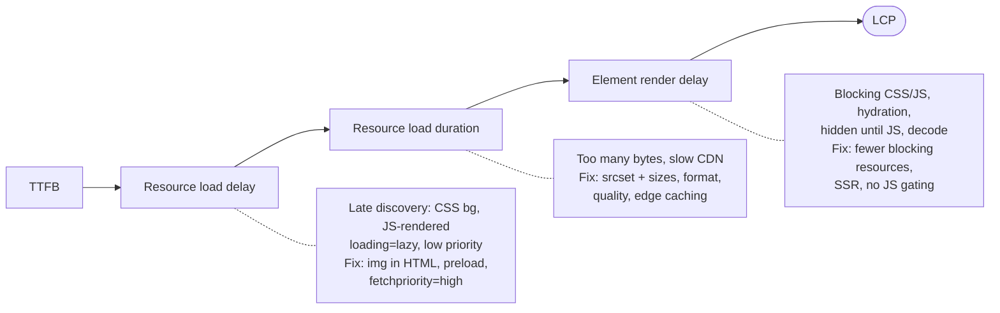

How each image technique maps to the sub-parts:

- **Discovery** (load delay): put the LCP image in server-rendered HTML as an ``, and avoid CSS backgrounds and client-side rendering for it. If it must be late-discovered, preload it.
- **Priority** (load delay, and duration under contention): `fetchpriority="high"` on the LCP image, and never `loading="lazy"`.
- **Bytes** (load duration): correct `srcset` and `sizes` so the right candidate is fetched; an efficient format with a calibrated quality; resized variants. A 400 KB hero on a 1.6 Mbps effective connection takes about 2 seconds to download; at 100 KB it takes about 0.5 seconds. These figures are arithmetic, not measurements.
- **Delivery** (load duration): a nearby CDN edge with a warm cache, connection reuse (serve images from the same origin as the HTML, or `preconnect` to the image CDN), and long cache lifetimes for repeat visits.
- **Rendering** (render delay): the image may be downloaded but not yet painted because render-blocking CSS or synchronous scripts have not finished, because the element is hidden until JavaScript runs (carousel libraries, A/B testing scripts, fade-in animations starting at `opacity: 0`), or because hydration is gating it. Decode time also falls here, but for typical LCP images it is rarely the largest component.

To **diagnose** which sub-part dominates, use the attribution build of the `web-vitals` library in the field, or measure directly:

```js title="lcp-image-breakdown.js"
// Logs LCP sub-parts for an image LCP element. Run early in the page (before load).
// Cross-origin images need Timing-Allow-Origin for full Resource Timing detail.
new PerformanceObserver((list) => {
  const lcp = list.getEntries().at(-1); // latest LCP candidate
  const nav = performance.getEntriesByType('navigation')[0];
  const res = lcp.url ? performance.getEntriesByType('resource').find((r) => r.name === lcp.url) : undefined;

  const ttfb = nav.responseStart;
  // Prefer requestStart; fall back to startTime when TAO hides detail (requestStart = 0).
  const loadStart = res ? res.requestStart || res.startTime : ttfb;
  const loadEnd = res ? res.responseEnd : ttfb;
  const lcpTime = lcp.renderTime || lcp.startTime;

  console.table({
    element: lcp.element?.tagName,
    url: lcp.url || '(text or no image)',
    ttfb: Math.round(ttfb),
    resourceLoadDelay: Math.round(Math.max(0, loadStart - ttfb)),
    resourceLoadDuration: Math.round(Math.max(0, loadEnd - loadStart)),
    elementRenderDelay: Math.round(Math.max(0, lcpTime - loadEnd)),
    lcp: Math.round(lcpTime),
    initiator: res?.initiatorType, // "img", "css", "link" (preload), "fetch"...
    transferKB: res ? Math.round(res.transferSize / 1024) : undefined,
  });
}).observe({ type: 'largest-contentful-paint', buffered: true });
```

Read it this way: a large **resource load delay** means discovery or priority is the problem, so format work will not help. A large **load duration** means bytes or delivery. A large **render delay** means look at blocking resources, JavaScript gating and hydration. The `initiator` field is a quick discovery check: `css` means the image was found in a stylesheet. In DevTools, the Performance panel's LCP breakdown insight shows the same sub-parts for a recorded trace.

**Correctly sizing the LCP image** means doing all of the above at once: server-rendered `` (or `<picture>`), accurate `srcset` and `sizes`, `fetchpriority="high"`, no `loading="lazy"`, `width` and `height` set, and no JavaScript between the HTML and its first paint.

### CLS

An image without reserved space has a 0 × 0 box (or one based on alt text) until its header is parsed. When the intrinsic size becomes known, layout grows the box, and everything below it moves. Each such movement is a layout shift ([web.dev: CLS](https://web.dev/articles/cls)).

The fixes all come down to **making the box size known before the image arrives**:

- **Explicit `width` and `height` attributes.** Browsers turn them into an `aspect-ratio` used before load. Combined with `width: 100%; height: auto` (or `max-width: 100%`), the box gets the right height for any rendered width. This is the default fix.
- **CSS `aspect-ratio`** when the box ratio is defined by the design (cards, tiles), with `object-fit` handling mismatched images.
- **`<source width height>`** for art-directed images with different ratios.
- **Reserved containers** for images whose ratio is unknown until runtime (user content, ad slots): reserve a `min-height` or a fixed-ratio container and fit the image inside with `object-fit: contain`.

```html title="Explicit dimensions prevent layout shift"
<!-- width/height give an aspect ratio of 3:2 before any bytes arrive.
     CSS below makes the image responsive while keeping that ratio. -->


<style>
  img {
    max-width: 100%;
    height: auto;
  }
</style>
```

**Dynamic image content** is the harder case: images injected by JavaScript after first render (recommendation carousels, late-loaded banners, ads) push content down when they appear, regardless of dimensions, if no space was reserved. Layout shifts within 500 ms of a user input are excluded from CLS, so an image that appears in response to a click does not count. An image that appears on its own after a fetch does. Reserve the space in the initial layout (with a skeleton of the right size), or insert such content below the viewport.

**Responsive layout stability** depends on keeping the ratio correct across breakpoints. If CSS sets a fixed `height` on an image at some breakpoint, the attributes' ratio no longer applies there. Use `aspect-ratio` plus `object-fit: cover` rather than fixed heights.

### INP

Images rarely cause poor Interaction to Next Paint directly, but image-related work can be the slow part of an interaction:

- **Expensive image processing in JavaScript.** Client-side resizing or filtering of uploads with canvas, `getImageData` loops, or JavaScript-based decoders on the main thread can run for hundreds of milliseconds. Move it to a worker with `createImageBitmap()` and `OffscreenCanvas`, or do it on the server.
- **Gallery interactions.** A click handler that sets 20 thumbnail `src` values, recreates a large DOM subtree, or forces synchronous layout by reading `offsetWidth` after each write makes the processing phase long. Batch DOM writes and avoid layout thrashing.
- **Dynamic image switching.** Swapping a large image's `src` on click and waiting for the new pixels in the same frame can lengthen the **presentation delay**: the next frame may wait on a large decode or raster. Use `img.decode()` to prepare the image, update cheap UI immediately (a selected state, a spinner), and swap when ready.
- **Image-related layout work.** Images without dimensions inserted in response to an interaction trigger relayout as they load. That is rarely part of the interaction itself, but it adds main-thread work around it.
- **Deferring non-critical work.** Analytics, prefetching the next gallery images, or warming decodes can wait until after the next paint with `requestIdleCallback`, `scheduler.yield()` where supported, or a `setTimeout` after `requestAnimationFrame`.

```js title="Responsive feedback first, image work after"
thumbnail.addEventListener('click', async () => {
  // 1. Cheap visual feedback in this interaction's frame.
  thumbnails.forEach((t) => t.classList.toggle('is-selected', t === thumbnail));
  stage.classList.add('is-loading');

  // 2. Let the browser paint that feedback before doing more work.
  await new Promise((resolve) => requestAnimationFrame(() => setTimeout(resolve, 0)));

  // 3. Fetch and decode off the critical path, then swap atomically.
  const img = new Image();
  img.src = thumbnail.dataset.full;
  try {
    await img.decode();
    stage.replaceChildren(img);
  } finally {
    stage.classList.remove('is-loading');
  }
});
```

### Which optimizations move which metric

| Optimization                             | LCP                                            | CLS                         | INP                                         |
| ---------------------------------------- | ---------------------------------------------- | --------------------------- | ------------------------------------------- |
| Correct `srcset`/`sizes`, resizing       | Load duration                                  | No effect                   | Less decode and raster work                 |
| Modern formats, tuned quality            | Load duration                                  | No effect                   | Possibly more decode CPU (AVIF)             |
| `` in server HTML instead of CSS/JS | Load delay                                     | No effect                   | No effect                                   |
| `fetchpriority="high"`, preload          | Load delay                                     | No effect                   | No effect                                   |
| No lazy loading above the fold           | Load delay                                     | No effect                   | No effect                                   |
| Lazy loading below the fold              | Indirect (less contention)                     | No effect (with dimensions) | Less main-thread work early on              |
| `width`/`height`, `aspect-ratio`         | No effect                                      | Prevents shifts             | Avoids relayouts                            |
| `decode()` before swapping               | No effect                                      | No effect                   | Shorter presentation delay, no blank frames |
| Moving image processing to workers       | No effect                                      | No effect                   | Shorter processing time                     |
| CDN edge caching                         | Load duration (and TTFB if HTML is cached too) | No effect                   | No effect                                   |

## Image delivery architecture: CDNs and dynamic transformations

With a handful of images, you can generate every variant at build time. With millions of user uploads, product photos or editorial assets, the combinations of width × format × quality × crop explode, and generating them all ahead of time is impractical. Large applications use **image CDNs**: CDNs with an image transformation service in the request path.

### Architecture

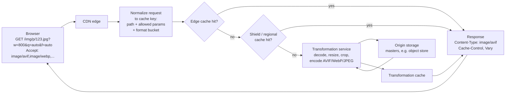

The pieces:

- **Origin storage** holds masters: high-quality originals in an object store such as S3 or GCS, or an application server. Masters should be large enough for the biggest variant you will ever serve, and ideally lossless or high-quality lossy to avoid generational loss.
- **The transformation service** decodes a master, applies operations (resize, crop, rotate, sharpen, background fill, format conversion, quality selection, metadata stripping) and encodes the result. It runs at the edge or in regional data centres.
- **Caches at several levels**: the browser's HTTP cache, CDN edge caches, an optional shield or regional tier, and a store of transformed derivatives so that a cache eviction at the edge does not cost a re-encode.

**On-demand resizing** means a variant is created the first time it is requested, then cached. The first user to request a new width pays for the decode, resize and encode in latency. For AVIF at slow encoder settings that can be significant, which is why image CDNs generally use faster AVIF settings than you would at build time, or serve a quickly encoded format on the first request and upgrade later.

### URL-based transformations

Most image CDNs express transformations in the URL. A hypothetical but representative example:

```text
https://img.example.com/products/sku-1042/main.jpg?w=800&h=800&fit=cover&gravity=auto&q=auto&f=auto&dpr=2
```

| Parameter        | Meaning                                                                                          |
| ---------------- | ------------------------------------------------------------------------------------------------ |
| `w=800`, `h=800` | Target box in CSS pixels (some services interpret these as image pixels)                         |
| `fit=cover`      | Scale to cover the box and crop, like CSS `object-fit: cover`                                    |
| `gravity=auto`   | Choose the crop focus automatically (saliency or face detection), or `center`, `north` and so on |
| `q=auto`         | Let the service choose a quality per image, often by targeting a perceptual metric               |
| `f=auto`         | Choose the format from the request's `Accept` header                                             |
| `dpr=2`          | Multiply dimensions by 2, so the output is 1600 × 1600                                           |

Every major image CDN (Cloudinary, imgix, Cloudflare Images, Akamai Image & Video Manager, Fastly Image Optimizer, Vercel and Netlify image services) has its own parameter names, but the concepts are the same. Markup generates `srcset` from such URLs:

```html title="srcset built on an image CDN"

```

### Format negotiation and Vary

With `f=auto`, one URL returns different bytes to different browsers. This uses **HTTP content negotiation**: the browser declares what it accepts, and the server picks.

Browsers send an `Accept` header on image requests listing supported formats. Chromium-based browsers such as Edge 157, for example, send:

```http
Accept: image/avif,image/webp,image/apng,image/svg+xml,image/*,*/*;q=0.8
```

Firefox and Safari send their own lists, and the exact strings change between versions. The server responds with the chosen format and must tell caches that the response depends on `Accept`:

```http
HTTP/2 200
content-type: image/avif
cache-control: public, max-age=31536000, immutable
vary: Accept
content-length: 48213
```

`Vary: Accept` instructs any cache, browser or shared, to store separate responses per `Accept` value and to serve a cached response only to requests with a matching value. Without it, a shared cache could store an AVIF response and serve it to a browser that cannot decode AVIF.

`Vary: Accept` creates **cache fragmentation** if applied naively. Accept strings differ across browsers, versions and request types, so a generic cache keyed on the raw header would store many copies of identical content and hit rarely. Image CDNs solve this by **normalizing**: they parse `Accept` into a small number of buckets ("supports AVIF", "supports WebP", "neither"), use the bucket in the cache key, and keep it consistent. If you build your own negotiation on a generic CDN, normalize `Accept` in an edge function before it reaches the cache key.

**Quality negotiation and device variants** can use **client hints**. With `Accept-CH: Sec-CH-DPR, Sec-CH-Width, Sec-CH-Viewport-Width`, Chromium-based browsers send the device pixel ratio, the intended image width (from `sizes`) and the viewport width on subsequent requests, and the server can resize accordingly. Client hints are Chromium-only, so treat them as an optimization layered on explicit `srcset` URLs, not a replacement. `Save-Data: on` and `ECT` (effective connection type) let a server reduce quality for users on constrained connections. Each hint you vary on is another cache dimension, so you need `Vary: Sec-CH-DPR` and the corresponding fragmentation management.

### Caching

- **Browser caching.** Transformed images are ideal for long-lived caching (`Cache-Control: public, max-age=31536000, immutable`) when the URL changes whenever the content changes, for example through a content hash or version in the path. If image URLs are stable but content can change (a user replaces their avatar at the same URL), you need shorter lifetimes or revalidation (`no-cache` with `ETag`). See [Understanding browser caching](/blog/understanding-browser-caching-memory-cache-disk-cache-and-service-workers) for the mechanics.
- **CDN caching.** Edge hit ratio is the key metric. A miss costs at least a trip to origin or shield, and possibly a full transformation.
- **Transformation caching.** Storing derivatives separately from the edge means an edge eviction costs only a fetch, not a re-encode.
- **Cache keys** should include only parameters that change the output. If marketing links add `utm_source` to image URLs, or two parameter orders produce the same image, strip and sort parameters in the key, or every variant is cached many times over.
- **Cache fragmentation** grows with every dimension: widths × formats × qualities × DPRs × crops. Limit the allowed widths to a fixed set (for example, steps of 100 or 200 pixels, or a fixed list) and snap requested widths to the nearest allowed value. Next.js does this with `deviceSizes` and `imageSizes`; most image CDNs offer equivalent allowlists.

### Security for user-supplied transformations

A transformation endpoint is a public CPU-heavy service that takes arbitrary inputs. Treat it like one.

- **Parameter abuse.** Unbounded `w`, `h` and `q` allow attackers to request millions of unique variants, defeating caches and exhausting CPU: a cache-busting denial of service. Allowlist dimensions and qualities, or require **signed URLs** (an HMAC over the path and parameters, generated server-side) so only URLs your application created are served.
- **Decompression bombs.** A tiny file can declare enormous dimensions (for example, a PNG of 50,000 × 50,000 pixels that compresses to a few kilobytes) and exhaust memory when decoded. Enforce pixel limits before decoding, as sharp's `limitInputPixels` does.
- **SSRF.** Services that fetch remote source URLs (`?url=https://...`) can be pointed at internal addresses such as cloud metadata endpoints. Allowlist source hosts, resolve DNS and block private ranges, and limit redirects. This is why Next.js requires `remotePatterns`.
- **Active content.** SVG can contain scripts and external references. Either rasterize SVG uploads, sanitize them, or serve them from an isolated origin with a strict Content Security Policy. Never serve user SVG as `image/svg+xml` from your main origin.
- **Decoder vulnerabilities.** Image decoders are a classic attack surface (for example, the 2023 libwebp heap overflow, CVE-2023-4863, which affected browsers and countless applications). Keep libvips, libwebp, libavif and other decoders patched, and run transformations in sandboxed or isolated processes.
- **Metadata leakage.** Strip EXIF from user uploads, which can contain GPS coordinates.

### Build-time, on-demand and pre-generated variants

| Approach                         | How it works                                                                                                           | Strengths                                                                                                             | Weaknesses                                                                                                                           |
| -------------------------------- | ---------------------------------------------------------------------------------------------------------------------- | --------------------------------------------------------------------------------------------------------------------- | ------------------------------------------------------------------------------------------------------------------------------------ |
| Build-time optimization          | A build step (sharp, a bundler plugin, Astro or Next.js static export) generates variants for images in the repository | No runtime infrastructure; slowest, best encoder settings; fully cacheable static files; predictable                  | Build time grows with image count; unsuitable for user uploads or CMS content; adding a width means rebuilding                       |
| On-demand CDN transformation     | Variants generated at first request, then cached                                                                       | Handles any number of images and variants; new widths or formats without rebuilds; format negotiation; smart cropping | First-request latency; per-transformation cost; cache-fragmentation management; security surface; vendor lock-in through URL formats |
| Pre-generated variants at upload | An upload pipeline (queue + workers) generates a fixed set of variants when an image is uploaded                       | No first-request latency; slow encoder settings possible; no public transformation endpoint                           | Fixed variant set; storage cost for variants never requested; backfilling all images when you add a variant                          |

Many systems mix them: static assets at build time, user content through upload-time generation of common variants with on-demand transformation as the fallback for rare ones.

## Image optimization in React and Next.js

Frameworks wrap browser capabilities. It is important to know which layer provides what.

### What React does and does not do

React renders the `` and `<picture>` elements you write. It **does not resize, compress, convert or otherwise optimize images**. Everything about loading, selection, decoding and rendering is the browser's behaviour. React's contributions are about **when** markup exists:

- With **server-side rendering** (SSR) or static generation, image markup is in the initial HTML, so the preload scanner can discover it immediately.
- With **client-side rendering**, image markup exists only after the JavaScript bundle runs, so every image is late-discovered. This is the single biggest image problem in client-rendered applications.

JSX uses camelCase for some attributes: `srcSet`, `fetchPriority` (React 19 recognizes it; React 18 warns about it in development), `crossOrigin`, `referrerPolicy`.

```jsx title="A responsive image component in React"
// A thin component that renders standard markup. All optimization comes from
// the attributes it emits and the variants your pipeline or CDN provides.
const WIDTHS = [320, 480, 640, 960, 1280, 1920];

function cdnUrl(path, width, format) {
  return `https://img.example.com${path}?w=${width}&f=${format}&q=auto`;
}

export function ResponsiveImage({ path, alt, width, height, sizes, priority = false }) {
  const srcSet = (format) => WIDTHS.map((w) => `${cdnUrl(path, w, format)} ${w}w`).join(', ');
  return (
    <picture>
      <source type="image/avif" srcSet={srcSet('avif')} sizes={sizes} />
      <source type="image/webp" srcSet={srcSet('webp')} sizes={sizes} />
      
    </picture>
  );
}
```

React 19 also provides resource hint APIs in `react-dom`, including `preload()`, which can be called during rendering to emit a `<link rel="preload">` into the document head. It is useful when a component knows its LCP image but renders deep in the tree:

```jsx title="Preloading from a component with React 19"
import { preload } from 'react-dom';

export function ProductHero({ image }) {
  // Emits <link rel="preload" as="image" imagesrcset=... imagesizes=... fetchpriority="high">
  // in the head during SSR. Must match the  below exactly.
  preload(image.fallback, {
    as: 'image',
    imageSrcSet: image.srcSet,
    imageSizes: '100vw',
    fetchPriority: 'high',
  });
  return (
    
  );
}
```

**Hydration and image loading.** During hydration, React attaches to existing DOM; it does not re-create server-rendered `` elements, so images already loading are not refetched. A subtle trap: an `onLoad` handler attached during hydration can miss the `load` event if the image finished loading before hydration completed. Check `complete` in a ref callback as well:

```jsx title="Handling images that loaded before hydration"
function FadeInImage(props) {
  const [loaded, setLoaded] = useState(false);
  const ref = useCallback((img) => {
    // If the image finished before React attached its handler, onLoad won't fire.
    if (img?.complete && img.naturalWidth > 0) setLoaded(true);
  }, []);
  return  setLoaded(true)} className={loaded ? 'img img--loaded' : 'img'} />;
}
```

Avoid fade-in effects on the LCP image. An image that starts at `opacity: 0` and waits for a hydrated `onLoad` to become visible turns hydration time into element render delay.

### The Next.js Image component

`next/image` is the most widely used image abstraction, and it shows clearly how the work splits between layers ([Next.js docs: Image component](https://nextjs.org/docs/app/api-reference/components/image)). The details below follow Next.js 16; check the docs for your version, since defaults have changed between majors.

**What the component does (framework, at render time):**

- Generates `srcset` from configured widths. With a `sizes` prop, it emits width descriptors from `deviceSizes` and `imageSizes`. Without `sizes`, it emits only `1x` and `2x` density descriptors based on the `width` prop, which suits fixed-size images.
- Emits `width` and `height` attributes (or, with `fill`, absolute positioning in a sized parent), which prevents CLS.
- Defaults to `loading="lazy"` and `decoding="async"`.
- `placeholder="blur"` shows a blurred low-resolution preview (automatically generated for statically imported images, or from `blurDataURL`) as a CSS background until the image loads.
- In Next.js 16, the `preload` prop inserts a `<link rel="preload">` in the head and replaces the deprecated `priority` prop. The docs recommend `loading="eager"` or `fetchPriority="high"` for most LCP images instead, with `preload` reserved for cases where that is not enough.
- Statically imported images (`import hero from './hero.jpg'`) give the build their intrinsic dimensions automatically.

**What the image optimizer does (server, at request time):**

- The default loader points `src` and `srcset` at the `/_next/image?url=…&w=…&q=…` endpoint, a built-in on-demand transformation service. It resizes with sharp, chooses the output format from the `Accept` header and `images.formats` (WebP by default; add `'image/avif'` to enable AVIF), and caches the result on disk or in the hosting platform's cache.
- Widths are snapped to the configured `deviceSizes` and `imageSizes` lists, and in Next.js 16 qualities must come from the `images.qualities` allowlist. Both limit cache fragmentation and abuse.
- Remote images must match `images.remotePatterns`, which mitigates SSRF and arbitrary-host abuse. Local images with query strings require `images.localPatterns`.
- `images.minimumCacheTTL` sets a floor for how long optimized images are cached. Next.js 16 raised the default from 60 seconds to 4 hours.

**What still requires your infrastructure or a CDN:**

- If you deploy somewhere without the optimizer (static export), or you want a dedicated image CDN, use a custom `loader` (or `loaderFile`) that produces CDN URLs:

```js title="image-loader.js"
// next.config.js: images: { loader: 'custom', loaderFile: './image-loader.js' }
// Next.js calls this for every srcset entry. The CDN does the actual work.
export default function cdnLoader({ src, width, quality }) {
  const params = new URLSearchParams({ w: String(width), q: String(quality || 'auto'), f: 'auto' });
  return `https://img.example.com${src}?${params}`;
}
```

```jsx title="next/image for a hero and a grid tile"
import Image from 'next/image';
import hero from '../public/hero/summer.jpg'; // static import: dimensions + blur placeholder

export function Hero() {
  return (
    <Image
      src={hero}
      alt="Two people walking a dog along a beach"
      sizes="100vw"
      loading="eager" // never lazy for the LCP image
      fetchPriority="high"
      placeholder="blur"
      style={{ width: '100%', height: 'auto' }}
    />
  );
}

export function Tile({ product }) {
  return (
    <div style={{ position: 'relative', aspectRatio: '1' }}>
      <Image
        src={product.imageUrl} // must match images.remotePatterns
        alt={product.name}
        fill // absolutely fills the parent; the parent's aspect-ratio reserves space
        sizes="(min-width: 1280px) 300px, (min-width: 768px) calc((100vw - 64px) / 3), calc((100vw - 48px) / 2)"
        style={{ objectFit: 'cover' }}
      />
    </div>
  );
}
```

With `fill`, `sizes` is essential: without it, Next.js assumes `100vw` and generates width descriptors, so grid tiles download viewport-wide images.

### Placeholders

Placeholders improve perceived performance while the real image loads. Options, from cheapest to richest:

- **A solid background colour** (often the image's dominant colour) on the image or its container. Costs a few bytes.
- **A blurred tiny image (LQIP)**: a 10–40 pixel version, inlined as a data URI and scaled up with blur. Next.js's `placeholder="blur"` uses this approach.
- **Compact hash encodings** such as BlurHash or ThumbHash, decoded to a canvas or data URI on the client.

Placeholders do not change LCP for the image itself: LCP counts the real image's paint, not the placeholder's. Large inline data URIs also add bytes to the HTML, which delays everything after them, so keep them tiny.

### Product image galleries

A typical product page combines most of this post:

- The main image is the LCP candidate: server-rendered, `fetchpriority="high"`, eager, correct `sizes`.
- Thumbnails below it are small and fixed-size: `x` descriptors, and lazy only if they are below the fold.
- Alternate main images (other angles and colours) are not loaded until needed, then decoded before swapping with `decode()`.
- Zoom uses a separate high-resolution variant, fetched on hover or tap intent rather than up front.
- Carousel slides after the first get `fetchpriority="low"` or `loading="lazy"`, depending on whether they are inside the viewport rectangle.

### Which layer provides what

| Capability                                            | Browser                                  | Framework (React, Next.js)                     | Server / CDN                                      |
| ----------------------------------------------------- | ---------------------------------------- | ---------------------------------------------- | ------------------------------------------------- |
| Candidate selection (`srcset`, `sizes`, `<picture>`)  | Yes                                      | Generates the markup                           | Provides the variants                             |
| Lazy loading, `fetchpriority`, `decoding`, `decode()` | Yes                                      | Sets attributes and defaults                   | No                                                |
| Resizing, compression, format conversion              | No                                       | No (Next.js delegates to its server optimizer) | Yes                                               |
| Format negotiation by `Accept`                        | Sends `Accept`                           | No                                             | Yes                                               |
| Early discovery                                       | Preload scanner                          | SSR puts markup in HTML; preload APIs          | Can add `Link` preload headers or 103 Early Hints |
| Layout stability                                      | Uses `width`/`height` and `aspect-ratio` | Enforces dimensions (`next/image`)             | No                                                |
| Caching                                               | HTTP cache                               | Next.js optimizer cache                        | CDN and transformation caches                     |

## Practical experiments

The experiments below reproduce the main claims in this post. They use the labelled test images from `lab/make-labelled-images.mjs` (see the candidate selection section) plus one real photograph, and they all run against a local static server. Where values depend on your image, device or network, the expected observations describe the pattern, not a number.

**Common setup.**

```bash title="Lab setup"
mkdir lab && cd lab
npm init -y && npm install sharp
# Add "type": "module" to package.json, or keep .mjs extensions.
node make-labelled-images.mjs   # writes img/test-<w>.{jpg,webp,avif}
# Place any large photo at img/photo.jpg (at least 3000px wide).
npx serve .                      # or: python -m http.server 8080
```

Install `cwebp` (libwebp) and `avifenc` (libavif) from your package manager, for example `brew install webp libavif` on macOS, `apt install webp libavif-bin` on Debian or Ubuntu, or the official binaries on Windows.

In Chrome DevTools, the panels used most are **Network** (with **Disable cache** ticked unless stated otherwise, and the **Priority** column enabled by right-clicking the header row) and **Performance**.

### Experiment 1: JPEG, WebP and AVIF at similar visual quality

**Objective.** See how much file size differs between formats at a similar perceived quality, and why quality numbers do not transfer between encoders.

**Setup and code.**

```bash title="experiment-1.sh"
# Resize once, so every format starts from identical pixels.
magick img/photo.jpg -auto-orient -resize 1600x -strip ref.png

# Produce a quality ladder for each format.
for q in 60 70 80 90; do magick ref.png -quality $q -interlace Plane "e1-jpg-q$q.jpg"; done
for q in 60 70 80 90; do cwebp -quiet -q $q -m 6 ref.png -o "e1-webp-q$q.webp"; done
for q in 40 50 60 70; do avifenc -q $q -s 4 ref.png "e1-avif-q$q.avif" > /dev/null; done
ls -l e1-*

# Objective comparison: decode each back to PNG, then compute SSIM against ref.png.
for f in e1-*.jpg e1-*.webp e1-*.avif; do
  magick "$f" "tmp-$f.png"
  printf "%-22s SSIM=" "$f"; magick compare -metric SSIM ref.png "tmp-$f.png" null: 2>&1; echo
done
rm tmp-*.png
```

If your ImageMagick build cannot read AVIF or WebP, decode with `avifdec` and `dwebp` first.

**Steps.** Run the script. Pick a target SSIM (for example, the SSIM of the JPEG at quality 80). For each format, find the lowest quality that reaches it. Then open the three chosen files side by side at 100 % zoom (Squoosh is convenient for this) and judge whether they look equivalent.

**Expected observations.** At matched SSIM, WebP and especially AVIF files are usually smaller than JPEG for photographs, and the AVIF quality number at the match point is much lower than the JPEG one. Visual inspection may disagree with SSIM: AVIF may look smoother (lost texture) where JPEG shows slight ringing, which is the metric-versus-perception gap described earlier.

**DevTools inspection.** Make a page with three `` elements pointing at the chosen files. In the Network panel, compare the **Size** column (transferred) and the response `Content-Type`.

**Explanation.** The newer formats use prediction, larger and more flexible transforms, and better entropy coding, so they need fewer bits for the same error. The amount of savings depends on the image content.

**Performance implications.** Calibrate quality per format and per content type; do not reuse one number across encoders. Weigh AVIF's savings against its encode cost and lack of practical progressive rendering.

### Experiment 2: lossy vs. lossless WebP

**Objective.** See when lossless WebP is the right choice and when it is wasteful.

**Setup and code.**

```bash title="experiment-2.sh"
# A screenshot-like graphic: flat colours and text. Take a real UI screenshot, or:
magick -size 1200x800 xc:white -fill '#1e3a8a' -draw 'rectangle 0,0 1200,80' \
  -fill black -pointsize 28 -annotate +40+160 'Monthly revenue: $48,210' \
  -fill '#0ea5e9' -draw 'rectangle 40,220 400,700' ui.png

for src in ui.png ref.png; do
  cwebp -quiet -lossless -z 9 "$src" -o "${src%.png}-lossless.webp"
  cwebp -quiet -q 80 -m 6 "$src" -o "${src%.png}-lossy.webp"
done
ls -l ui.png ui-*.webp ref.png ref-*.webp
```

**Steps.** Compare sizes. Open `ui-lossy.webp` at 200 % zoom and look at the text and the coloured edges.

**Expected observations.** For the UI graphic, lossless WebP is far smaller than the PNG and often competitive with lossy WebP, while the lossy version shows smudging around text and colour fringing on blue edges (4:2:0 chroma subsampling). For the photograph, lossless WebP is many times larger than lossy WebP.

**DevTools inspection.** Not needed; this is an encoding experiment. Optionally, load both in a page and compare sizes in the Network panel.

**Explanation.** Lossless coding exploits repetition and flat areas, which UI graphics have plenty of and photographs do not. Lossy coding discards high-frequency detail and chroma resolution, which is invisible in photos and obvious on text.

**Performance implications.** Choose the coding mode by content type, not by site-wide policy. For graphics, try lossless WebP, near-lossless WebP, or AVIF with 4:4:4.

### Experiment 3: srcset selection at different viewport widths

**Objective.** Observe width-descriptor selection as viewport and DPR change.

**Setup.** `lab/srcset.html` from the candidate selection section. That section lists the steps, the expected choices, and what to look for.

**DevTools inspection.** Network panel filtered to **Img**. The **Name** column shows the selected file; in the Elements panel, hover the `` to see its rendered and intrinsic sizes, and run `$0.currentSrc` in the console.

**Explanation.** With `sizes="100vw"`, the target is viewport width × DPR, and the browser picks a candidate near that target, subject to its own rounding and cache heuristics.

**Performance implications.** Your users' devices determine which candidates are actually used. Check your CDN logs for requested widths and adjust the candidate list where large gaps exist.

### Experiment 4: density-based selection with x descriptors

**Objective.** Confirm that `x` descriptors ignore viewport width and depend only on DPR.

**Code.**

```html title="lab/density.html"
<!doctype html>
<meta name="viewport" content="width=device-width, initial-scale=1" />
<title>density lab</title>
<!-- Rendered at a fixed 320 CSS px. The browser only needs to match DPR. -->

<p id="out"></p>
<script>
  const img = document.getElementById('d');
  img.onload = () => {
    document.getElementById('out').textContent =
      `DPR ${devicePixelRatio} → ${img.currentSrc.split('/').pop()}, rendered ${img.width}px`;
  };
</script>
```

**Steps.** With Disable cache on, load the page at DPR 1, 2 and 3 (Device Toolbar), at a narrow and a wide viewport for each.

**Expected observations.** The choice changes with DPR (320w, 640w, then 1200w, whose label shows it is really a 3.75x file) but not with viewport width. The rendered width stays 320 CSS pixels in every case, because the browser divides each file's pixel width by its declared density.

**DevTools inspection.** The Elements panel shows the image at 320 × 213. The Network panel shows a single image request.

**Explanation.** `x` descriptors state density directly, so no `sizes` is involved. The 3x candidate here is mislabelled (1200 / 320 = 3.75), and the browser trusts the descriptor, which is why descriptors must be accurate.

**Performance implications.** Use `x` descriptors for fixed-size images. Consider omitting 3x: the extra pixels are costly and the visual gain is small.

### Experiment 5: change sizes and inspect the selected dimensions

**Objective.** Show that `sizes`, not CSS, drives selection, and detect `sizes` mistakes.

**Code.**

```html title="lab/sizes.html"
<!doctype html>
<meta name="viewport" content="width=device-width, initial-scale=1" />
<title>sizes lab</title>
<style>
  .grid {
    display: grid;
    grid-template-columns: repeat(4, 1fr);
    gap: 8px;
  }
  .grid img {
    width: 100%;
    height: auto;
  }
</style>
<div class="grid">
  <!-- A: default sizes (100vw), wrong for a 4-column grid -->
  
  <!-- B: sizes matching the layout -->
  
  <!-- C: sizes far too small -->
  
</div>
<script type="module">
  // Debug audit: compares downloaded pixels with what the layout needs.
  await Promise.all([...document.images].map((i) => i.decode().catch(() => {})));

  // Don't use img.naturalWidth here: for srcset images it is density-corrected
  // (file width ÷ chosen density) and roughly equals the rendered width.
  // A standalone Image() for currentSrc has density 1, so its naturalWidth is the real file width.
  async function fileWidth(img) {
    const probe = new Image();
    probe.src = img.currentSrc;
    await probe.decode();
    return probe.naturalWidth;
  }

  const rows = await Promise.all(
    [...document.querySelectorAll('.probe')].map(async (img) => {
      const fileW = await fileWidth(img);
      const needed = Math.round(img.getBoundingClientRect().width * devicePixelRatio);
      return {
        case: img.dataset.label,
        chosen: img.currentSrc.split('/').pop(),
        fileW,
        neededW: needed,
        ratio: +(fileW / needed).toFixed(2), // >1.5 means oversized, <0.8 blurry
      };
    }),
  );
  console.table(rows);
</script>
```

**Steps.** Open the page at 1280px and DPR 1 with Disable cache on, then check the console table and the Network panel. Repeat at DPR 2.

**Expected observations.** All three images render at the same CSS width (about 310px at a 1280px viewport). A downloads a candidate sized for the whole viewport: the 2400w file, a ratio of about 7.7 at DPR 1 and about 3.9 at DPR 2. B downloads the candidate closest to the slot (320w at DPR 1, 640w at DPR 2), a ratio near 1. C always gets the smallest file, 320w. At DPR 1 that happens to be just wide enough, but at DPR 2 its ratio drops to about 0.5 and it looks visibly soft. That is why a too-small `sizes` value can pass a review done on a 1x monitor.

**DevTools inspection.** In the Network panel, compare the three requests' sizes. In Lighthouse or the Performance panel's **Improve image delivery** insight, A is flagged as larger than necessary.

**Explanation.** The browser never measured the grid; it believed `sizes`. CSS scaled every result to fit the column.

**Performance implications.** Wrong `sizes` costs bandwidth (too large) or quality (too small), silently. Add a check like this audit to your development builds or visual tests.

### Experiment 6: picture format selection and fallback

**Objective.** See `type`-based selection, and what happens with an unsupported or mislabelled source.

**Code.**

```html title="lab/picture.html"
<!doctype html>
<title>picture lab</title>
<picture id="p1">
  <source type="image/jxl" srcset="img/does-not-exist.jxl" />
  <source type="image/avif" srcset="img/test-800.avif" />
  <source type="image/webp" srcset="img/test-800.webp" />
  
</picture>
<picture id="p2">
  <!-- Mislabelled: a WebP file declared as a made-up type. Browsers skip it. -->
  <source type="image/x-unknown" srcset="img/test-480.webp" />
  
</picture>
<script>
  addEventListener('load', () => {
    for (const id of ['p1', 'p2']) {
      const img = document.querySelector(`#${id} img`);
      console.log(id, '→', img.currentSrc.split('/').pop());
    }
  });
</script>
```

**Steps.** Load in Chrome, Firefox and Safari if available. Check the console and the Network panel.

**Expected observations.** For `p1`, a browser that supports JPEG XL (Chrome 155+, Safari 17+) picks the `.jxl` source and fails to load it, because the file does not exist and there is no fallback to the next source. That shows a broken image. Browsers without JPEG XL support skip to AVIF. That includes Microsoft Edge: although it is built on Chromium, Edge 157 still skips `type="image/jxl"` sources, a reminder that a Chromium version number does not tell you which formats a Chromium-based browser enables. For `p2`, every browser skips the unknown type and loads the JPEG. Remove the JPEG XL source and every current browser loads the AVIF.

**DevTools inspection.** The Network panel shows only one request per `<picture>`, plus the failed `.jxl` request where applicable. The **Type** column shows the format.

**Explanation.** `<source>` selection uses the declared `type` before any fetch. A source is skipped only if its type is unsupported or its media does not match; once chosen, it is final.

**Performance implications.** `<picture>` costs nothing extra in requests, but every `<source>` URL must exist and be correctly typed. Order sources from most to least preferred.

### Experiment 7: lazy loading on a long page

**Objective.** Observe when lazy images are requested relative to scroll position.

**Code.**

```html title="lab/lazy.html"
<!doctype html>
<meta name="viewport" content="width=device-width, initial-scale=1" />
<title>lazy lab</title>
<style>
  img {
    display: block;
    width: 100%;
    height: auto;
    margin-bottom: 600px;
  }
</style>
<div id="list"></div>
<script>
  const list = document.getElementById('list');
  // Unique query strings so each image is a distinct request.
  for (let i = 0; i < 30; i++) {
    list.insertAdjacentHTML(
      'beforeend',
      ``,
    );
  }
  new PerformanceObserver((list) => {
    for (const e of list.getEntries()) {
      if (e.initiatorType === 'img') {
        console.log(
          `${e.name.split('?')[1]} requested at ${Math.round(e.startTime)} ms, scrollY=${Math.round(scrollY)}`,
        );
      }
    }
  }).observe({ type: 'resource', buffered: true });
</script>
```

**Steps.** Load with the Network panel open. Scroll slowly. Then throttle the network to "Slow 4G" or "3G" and reload.

**Expected observations.** Only the first few images are requested on load. As you scroll, requests start well before each image enters the viewport, about one to two screens ahead. With a slower network profile, the lookahead distance may increase (Chromium adjusts its threshold by effective connection type).

**DevTools inspection.** The Network panel's **Waterfall** column shows requests spread over time. Cross-check the console log of `scrollY` at request time.

**Explanation.** The browser observes each lazy image's distance from the viewport and starts the fetch once it falls within an implementation-defined margin.

**Performance implications.** On long pages, lazy loading saves bytes that would compete with visible content. Margins are not under your control, so do not rely on them for timing-critical images.

### Experiment 8: eager vs. lazy loading for an above-the-fold image

**Objective.** Measure the LCP cost of lazy-loading a hero image.

**Code.**

```html title="lab/hero-lazy.html (variant A) and lab/hero-eager.html (variant B)"
<!doctype html>
<meta name="viewport" content="width=device-width, initial-scale=1" />
<title>hero loading lab</title>
<link rel="stylesheet" href="style.css?delay" />
<!-- Variant A: loading="lazy". Variant B: remove loading, add fetchpriority="high". -->

<script>
  new PerformanceObserver((l) => {
    const e = l.getEntries().at(-1);
    console.log('LCP', Math.round(e.startTime), 'ms', e.url.split('/').pop());
  }).observe({ type: 'largest-contentful-paint', buffered: true });
</script>
```

Create an empty `style.css`. In DevTools, use **network request blocking** or a custom throttling profile so the stylesheet is slow (for example, "Slow 4G").

**Steps.** Load variant A five times and note LCP. Repeat for variant B. Compare medians.

**Expected observations.** In A, the image request starts only after the stylesheet has loaded and layout has run. In B, it starts almost immediately and downloads in parallel with the CSS. B's LCP is consistently earlier, by roughly the time the stylesheet took to load.

**DevTools inspection.** In the Network waterfall, compare the start of the image request with the end of `style.css`. In the **Initiator** column, both show the document, but the timing differs. The Performance panel's LCP breakdown shows a large **resource load delay** for A.

**Explanation.** Lazy images wait for layout to find out where they are. Layout waits for render-blocking CSS.

**Performance implications.** Never lazy-load the LCP image or other above-the-fold images.

### Experiment 9: preloading an LCP image and reading the Performance timeline

**Objective.** See preload fix late discovery of a CSS background hero.

**Code.**

```html title="lab/bg-hero.html"
<!doctype html>
<meta name="viewport" content="width=device-width, initial-scale=1" />
<title>preload lab</title>
<!-- Toggle this line between runs. -->
<link rel="preload" as="image" href="img/test-1600.jpg" fetchpriority="high" />
<link rel="stylesheet" href="bg.css" />
<div class="hero"></div>
```

```css title="lab/bg.css"
.hero {
  height: 70vh;
  background: url('img/test-1600.jpg') center / cover no-repeat;
}
```

**Steps.** Throttle to "Slow 4G". Record a Performance profile of a reload, with and without the preload line.

**Expected observations.** Without preload, the image request starts only after `bg.css` has downloaded and been applied. With preload, it starts during HTML parsing, in parallel with the CSS. LCP moves earlier by approximately the CSS load time. The console shows no unused-preload warning, because the background uses the preloaded response.

**DevTools inspection.** In the Performance panel, the **Network** track shows request bars; the **Timings** track shows the LCP marker. The LCP breakdown and **LCP request discovery** insights show the change in resource load delay and indicate whether the LCP request was discoverable in the initial HTML.

**Explanation.** Preload makes a resource discoverable regardless of where it is referenced.

**Performance implications.** Preload is the right tool for late-discovered LCP images. For an `` already in the HTML, it adds little; use `fetchpriority` there instead.

### Experiment 10: fetch priority and resource prioritization

**Objective.** Observe how Chrome assigns and changes image priorities.

**Code.**

```html title="lab/priority.html"
<!doctype html>
<meta name="viewport" content="width=device-width, initial-scale=1" />
<title>priority lab</title>
<link rel="stylesheet" href="style.css" />


```

**Steps.** Enable the **Priority** column in the Network panel, and enable **Big request rows** in the panel settings to show both the initial and final priority. Reload.

**Expected observations (in current Chromium).** `b` starts at High. `a` starts at Medium (one of the first five images over 10,000 px²) and is raised to High once layout finds it in the viewport. `c` is smaller than the threshold and starts at Low. `d` starts at Medium and stays below High because it is outside the viewport. The Medium → High boost happens only if the request is still in flight when layout runs. On a fast local server the images may finish first and stay at Medium, so apply network throttling to see it. Other browsers do not expose priorities in the same way, and Chromium's heuristics may change.

**DevTools inspection.** With big request rows, the Priority column shows "Medium → High" for boosted requests. The Performance panel's network track shows priorities in the request tooltip.

**Explanation.** Chromium assigns initial priorities from type and position heuristics, adjusts them after layout, and treats `fetchpriority` as a strong hint.

**Performance implications.** `fetchpriority="high"` matters most early in the load, before layout, when the LCP image would otherwise be Low or Medium.

### Experiment 11: HTMLImageElement.decode() and image readiness

**Objective.** Show the gap between `load` and decode for a large image, and how `decode()` affects insertion.

**Code.**

```html title="lab/decode.html"
<!doctype html>
<title>decode lab</title>
<button id="a">Insert on load</button>
<button id="b">Insert after decode()</button>
<div id="stage"></div>
<script>
  const SRC = 'img/photo.jpg'; // use a large photo (12 MP or more)
  const stage = document.getElementById('stage');

  function load(variant) {
    const img = new Image();
    img.style.width = '600px';
    img.src = `${SRC}?v=${variant}-${Date.now()}`; // bypass the decoded-image cache
    const t0 = performance.now();
    return { img, t0 };
  }

  document.getElementById('a').onclick = () => {
    const { img, t0 } = load('a');
    img.onload = () => {
      console.log('A load event', Math.round(performance.now() - t0), 'ms');
      stage.replaceChildren(img);
      requestAnimationFrame(() =>
        requestAnimationFrame(() => console.log('A ~2 frames after insert', Math.round(performance.now() - t0), 'ms')),
      );
    };
  };

  document.getElementById('b').onclick = async () => {
    const { img, t0 } = load('b');
    await img.decode();
    console.log('B decode resolved', Math.round(performance.now() - t0), 'ms');
    stage.replaceChildren(img);
  };
</script>
```

**Steps.** Apply 4× CPU throttling in the Performance panel's settings. Record a profile while clicking A, then B.

**Expected observations.** For A, the `load` event fires once the bytes arrive, and the decode appears afterwards in the trace (in Chromium, as an image decode task on a raster or worker thread), with the image painted after it completes. For B, the decode happens before `decode()` resolves, and the frame after insertion includes the image without a separate decode delay. The exact timing and threads depend on the browser.

**DevTools inspection.** In the Performance panel, look for **Decode Image** events on the raster or worker threads (in Chromium) and the frames they precede. The **Frames** track shows when the image first appears.

**Explanation.** `load` signals availability of the data, not decoded pixels. `decode()` resolves after decoding, which makes the next frame cheap.

**Performance implications.** Use `decode()` for dynamic swaps where a blank or late frame would be noticeable. Do not use it on initial page images, where the browser's own scheduling is better.

### Experiment 12: calculating decoded memory usage

**Objective.** Compare compressed size with estimated decoded memory for several dimensions.

**Code.**

```js title="lab/decoded-memory.mjs"
import sharp from 'sharp';
import { statSync } from 'node:fs';

const sizes = [
  [4032, 3024],
  [2400, 1600],
  [1600, 1067],
  [800, 533],
];
for (const [w, h] of sizes) {
  const file = `mem-${w}.avif`;
  await sharp('img/photo.jpg').resize(w, h, { fit: 'cover' }).avif({ quality: 50 }).toFile(file);
  const compressedKB = statSync(file).size / 1024;
  const decodedMiB = (w * h * 4) / 2 ** 20; // RGBA, 8 bits per channel
  console.log(
    `${w}×${h}`.padEnd(10),
    `compressed ${compressedKB.toFixed(0).padStart(6)} KB`,
    `decoded ≈ ${decodedMiB.toFixed(1).padStart(5)} MiB`,
    `ratio ≈ ${((decodedMiB * 1024) / compressedKB).toFixed(0)}×`,
  );
}
```

**Steps.** Run `node decoded-memory.mjs`. Then load a page with the 4032-pixel image displayed at 400 CSS pixels and run the console snippet from the decoding section.

**Expected observations.** Decoded size scales exactly with pixel count (4032 × 3024 gives about 46.5 MiB; 800 × 533 gives about 1.6 MiB), while compressed size varies with content and format. The expansion ratio is usually tens of times, and is higher for more efficient formats. These decoded figures are arithmetic; actual browser memory may be lower or higher depending on engine optimizations.

**DevTools inspection.** Chrome's **Task Manager** (Shift+Esc on Windows and Linux, or **More tools → Task Manager**) shows the tab's memory footprint. Compare a page with 20 full-size images and one with properly sized images. Engine caching makes this noisy, so look for large differences, not exact numbers.

**Explanation.** Decoders produce raw pixels; compression ratios are irrelevant once decoded.

**Performance implications.** Resize for the slot, especially for galleries and long lists on low-memory devices.

### Experiment 13: image-induced layout shifts

**Objective.** Measure CLS from images without dimensions, and the fix.

**Code.**

```html title="lab/cls.html"
<!doctype html>
<meta name="viewport" content="width=device-width, initial-scale=1" />
<title>CLS lab</title>
<style>
  img {
    max-width: 100%;
    height: auto;
  }
</style>
<h1>Headline</h1>
<!-- Variant A: no width/height. Variant B: add width="1600" height="1067". -->

<p>Paragraph text that moves when the image loads in variant A.</p>
<script>
  let cls = 0;
  new PerformanceObserver((list) => {
    for (const e of list.getEntries()) {
      if (!e.hadRecentInput) cls += e.value;
      console.log(
        'shift',
        e.value.toFixed(4),
        'CLS so far',
        cls.toFixed(4),
        e.sources?.map((s) => s.node?.nodeName),
      );
    }
  }).observe({ type: 'layout-shift', buffered: true });
</script>
```

**Steps.** Throttle to "Slow 4G" so the image arrives after first paint. Load variant A, then B.

**Expected observations.** In A, the paragraph renders, then jumps down when the image header is decoded, and the console logs a shift attributed to the paragraph. In B, the space is reserved from the first frame and no shift is logged. The Layout Instability API is Chromium-only, so run this in a Chromium browser.

**DevTools inspection.** In the Performance panel, the **Layout shifts** track shows the shift cluster, and the **Layout shift culprits** insight names the image without dimensions. The Rendering drawer's **Layout Shift Regions** option flashes shifted areas live.

**Explanation.** Without dimensions, the box has no height until the header is parsed. With them, the browser derives an aspect ratio before load.

**Performance implications.** Always set `width` and `height` (or `aspect-ratio`). It costs nothing and prevents the most common CLS source.

### Experiment 14: CSS background vs. HTML image discovery

**Objective.** Compare when the request starts for the same image as a background and as an ``.

**Code.**

```html title="lab/discovery-bg.html and lab/discovery-img.html"
<!doctype html>
<meta name="viewport" content="width=device-width, initial-scale=1" />
<title>discovery lab</title>
<script src="slow.js"></script>
<!-- a parser-blocking script; make it slow with throttling -->
<link rel="stylesheet" href="bg.css" />
<!-- discovery-bg.html: -->
<div class="hero"></div>
<!-- discovery-img.html: replace the div with

-->
```

Create an empty `slow.js`. Reuse `bg.css` from Experiment 9.

**Steps.** Throttle to "Slow 4G" and record the Network waterfall for both pages.

**Expected observations.** In the `` version, the image request starts while `slow.js` is still downloading: the preload scanner found it. In the background version, the request starts only after `slow.js` has run and `bg.css` has been fetched and applied to the `.hero` element.

**DevTools inspection.** The **Initiator** column shows `discovery-img.html` (the parser or preload scanner) for the ``, and `bg.css` for the background. The waterfall makes the start-time difference obvious.

**Explanation.** The preload scanner reads HTML, not CSS. Backgrounds wait for style calculation.

**Performance implications.** Use `` for LCP candidates, or preload backgrounds that must stay backgrounds. For decorative backgrounds, the late discovery is a feature: they do not compete with critical resources.

### Experiment 15: investigating a slow hero image

**Objective.** Apply a systematic diagnosis to a realistic slow hero, as described in detail in the debugging case study below.

**Setup.** Create `lab/slow-hero.html` that combines the problems of the earlier experiments: a client-rendered hero (inserted by a script after a 1-second `setTimeout`, standing in for a framework bundle), `loading="lazy"`, `sizes` missing on a 50 %-width image, and a 2400w AVIF as the largest candidate.

```html title="lab/slow-hero.html"
<!doctype html>
<meta name="viewport" content="width=device-width, initial-scale=1" />
<title>slow hero lab</title>
<link rel="stylesheet" href="style.css" />
<main style="display:grid;grid-template-columns:1fr 1fr;gap:24px;padding:24px">
  <div id="hero-slot"></div>
  <div>
    <h1>Trail Runner 4</h1>
    <p>Lightweight shoe for technical terrain.</p>
  </div>
</main>
<script>
  // Simulates a framework rendering the hero after its bundle loads.
  setTimeout(() => {
    document.getElementById('hero-slot').innerHTML = `
      `;
  }, 1000);
</script>
```

**Steps.**

1. Run Lighthouse (mobile) in DevTools and read the LCP-related insights.
2. Record a Performance profile with "Slow 4G" and 4× CPU throttling. Expand the LCP breakdown insight.
3. Check the Network panel: Initiator, Priority, Size, and the image's start time relative to the HTML.
4. Fix the problems one at a time: move the `` into the HTML, remove `loading="lazy"`, add `fetchpriority="high"`, add `sizes="(min-width: 768px) calc(50vw - 36px), 100vw"`, and add `width` and `height`. Re-measure after each fix.

**Expected observations.** Initially, **resource load delay** dominates: the image request starts after the timeout plus layout, and the LCP request discovery insight reports that it was not discoverable from the HTML and was lazy-loaded. Lighthouse also flags the oversized download and the missing dimensions. Each fix removes one cause. Moving the image into the HTML and removing `loading="lazy"` produce the largest improvements, and adding `sizes` reduces the downloaded bytes.

**Explanation and implications.** The format was AVIF throughout and was never the problem. Discovery, laziness and sizing were. That is the pattern the debugging section below generalizes.

## Debugging image performance with Chrome DevTools

### Network panel

- **Filtering.** Click **Img** in the type filter bar, or type `mime-type:image/avif` or `larger-than:100k` in the filter box. `-domain:` excludes third parties.
- **Response headers.** Click a request and check `content-type` (did negotiation produce the expected format?), `cache-control`, `vary`, `age` and CDN-specific headers such as `x-cache` or `cf-cache-status` (was it an edge hit?), `content-length`, and `timing-allow-origin` (needed for detailed cross-origin timing).
- **Transferred size vs. resource size.** The **Size** column shows the bytes transferred over the network (including headers) on top and the resource size (decoded body) underneath. For images they are nearly equal, because images are already compressed and not gzipped. "(memory cache)" or "(disk cache)" means no network transfer.
- **Timing.** The **Timing** tab breaks a request into queueing, stalled, DNS, connection, request sent, waiting for server response (TTFB) and content download. Long **queueing** on an image usually means low priority or connection contention. A long **waiting** time on an image CDN often means a cache miss and an on-demand transformation.
- **Priority column.** Right-click the column header to enable **Priority**. With **Big request rows** enabled, it shows the initial and final priority.
- **Initiator column.** Shows what triggered the request: the HTML document (parser or preload scanner), a stylesheet (CSS background), a script (JavaScript-inserted), or a preload link. Hover for the full chain. This is the fastest way to diagnose discovery.

### Performance panel

- **Recording.** Reload with recording enabled, using the capture settings (gear icon) for **CPU throttling** (4× or 6× approximates mid-range phones on a fast laptop) and **network throttling**.
- **Timings track.** Shows **FCP**, **LCP** and DCL markers. Click LCP to highlight the element and see its details.
- **Insights sidebar.** Shows the **LCP breakdown** (the four sub-parts), **LCP request discovery** (was the image discoverable in the HTML, was it lazy-loaded, did it have `fetchpriority="high"`), **Render-blocking requests**, **Improve image delivery** (oversized dimensions, inefficient formats or compression), **Layout shift culprits** (including unsized images), and cache lifetime insights. Insight names have changed between Chrome versions.
- **Network track.** Request bars with priority and timing in the tooltip, aligned with main-thread activity, which makes it easy to see an image request waiting for a script.
- **Main and raster threads.** **Decode Image**, **Paint** and **Rasterize Paint** events show image decode and raster work, and which thread did it.
- **Layout shifts track.** Shift clusters with the moved elements.

### Rendering drawer, Lighthouse, device emulation and caching

- **Rendering** (⋮ → More tools → Rendering): **Paint flashing** shows repaints (useful for spotting image re-rasters during animations), **Layout Shift Regions** highlights shifts live, and **Emulate CSS media feature** lets you test `prefers-color-scheme` and other media queries used by `<picture>` sources.
- **Lighthouse** runs a throttled lab load. Its image findings are now largely surfaced through the same insights as the Performance panel (Improve image delivery, LCP request discovery, Layout shift culprits) ([Chrome for Developers: Improve image delivery](https://developer.chrome.com/docs/performance/insights/image-delivery)). Lab results are one device and one network profile, so confirm with field data.
- **Device emulation** (Device Toolbar) sets viewport width and DPR, which is enough to test `srcset` and `sizes`. It does not emulate a phone's CPU, GPU, memory or real network.
- **Network throttling** profiles add latency and limit bandwidth at the browser level. They are approximate and do not model packet loss or HTTP/2 prioritization at the server.
- **Cache behaviour.** **Disable cache** (while DevTools is open) gives a first-visit view. Test repeat visits with it off, and remember the memory cache, which survives normal reloads within a tab. To inspect the Service Worker's role, use **Application → Service workers**, and in the Network panel watch for requests served "(ServiceWorker)".

### Case study: a product detail page with poor LCP despite AVIF

**The report.** A product detail page has a large hero image. Field data from CrUX and RUM shows a p75 LCP of 4.1 seconds on mobile. The team already serves AVIF through an image CDN, and the hero averages 160 KB. The proposed fix is to lower the AVIF quality further. Before anyone does that, we investigate. All timings below are **hypothetical**, chosen to illustrate the method.

**Step 0: field attribution.** The RUM pipeline uses the `web-vitals` attribution build, and its LCP attribution for mobile at p75 shows:

| Sub-part               | p75 (hypothetical) |
| ---------------------- | ------------------ |
| TTFB                   | 600 ms             |
| Resource load delay    | 1,900 ms           |
| Resource load duration | 700 ms             |
| Element render delay   | 900 ms             |

The image download, the only part that file size affects directly, is 700 ms of 4.1 s. Halving the file would save about 350 ms at best. The two big buckets are load delay and render delay. This alone reframes the problem.

**1. Image discovery.** In a lab trace, the hero's Network request shows **Initiator: `app.[hash].js`**. The page is server-rendered, but the gallery component renders the hero only on the client, after it fetches product media through an API call. The preload scanner never sees the image. The LCP request discovery insight confirms: "LCP request not discoverable in the initial document". **Fix:** render the hero `` on the server in the initial HTML, with the gallery's interactive features hydrated around it. If that is impossible, emit a responsive preload from the server.

**2. `srcset` and `sizes`.** The component emits `srcset` with widths 640–2560 but no `sizes`. On desktop, the hero occupies the left 55 % of a 1280px container. On mobile, it is full width. Without `sizes`, desktop at DPR 2 requests the 2560w file (targeting 1280 × 2 = 2560 pixels for `100vw`) when about 1408 pixels would do. On mobile the default happens to be right, which is why mobile and desktop numbers differ less than expected. **Fix:** `sizes="(min-width: 1280px) 704px, (min-width: 768px) 55vw, 100vw"`, derived from the layout.

**3. Resource priority.** With big request rows, the hero shows **Low → High**: it started Low, because the image was inserted with `loading="lazy"` copied from the generic gallery component, and was boosted only after layout. **Fix:** no `loading="lazy"` on the first gallery image; add `fetchpriority="high"`.

**4. CDN latency.** In the Timing tab, the hero spends 450 ms "waiting for server response" in some runs and 30 ms in others. Response headers show `x-cache: MISS` on the slow runs. The CDN cache key includes the full `Accept` header unnormalized, and an analytics script appends a session parameter to image URLs, so the hit ratio is poor. **Fix:** normalize `Accept` to format buckets in the cache key, strip unknown query parameters, and keep a fixed width allowlist. Also, the image CDN lives on a separate origin, so add `<link rel="preconnect" href="https://img.example.com">`. Leave out `crossorigin` unless the images themselves are fetched in CORS mode, because browsers keep separate connections for CORS and non-CORS requests.

**5. Image dimensions.** The console audit from the decoding section shows the hero's intrinsic width as 2560 on desktop for a 704 CSS-pixel slot at DPR 2: about 3.3 times the necessary pixels, and about 10 times the decoded memory. This is the `sizes` problem again, visible from another angle.

**6. Decoding.** In a 4× CPU-throttled trace, a **Decode Image** event of about 120 ms appears on a raster thread for the 2560-pixel AVIF before the first paint of the hero. With the correctly sized 1408-pixel file, it drops roughly in proportion to the pixel count. Decode was a minor contributor, but a real one, and the fix is the same as step 5.

**7. Render delay.** After the bytes arrive, the hero still waits about 900 ms. The trace shows two causes. A third-party A/B testing script in `<head>` hides the page with an anti-flicker snippet (`opacity: 0` on `<html>`) until its experiment configuration loads. And the gallery component applies a fade-in that starts at `opacity: 0` and waits for a hydrated `onLoad`. **Fix:** remove the hero from the A/B test's scope, or load the experiment configuration server-side; drop the fade-in for the first image.

**8. Browser cache.** Repeat visits are expected to be fast, but the hero's response has `cache-control: max-age=300`, so returning visitors after five minutes revalidate or refetch. Product images use content-hashed URLs, so **fix:** `cache-control: public, max-age=31536000, immutable`.

**9. CSS and JavaScript dependencies.** A 140 KB render-blocking stylesheet and two synchronous scripts in `<head>` delay the first render. Even with an early image request, the image cannot be painted before the first render. **Fix:** inline critical CSS for the above-the-fold layout, `defer` the scripts, and load the A/B script asynchronously.

**Result.** Format and quality were never changed. The fixes targeted discovery (server-rendered ``), priority (`fetchpriority`, no lazy), bytes (`sizes`), delivery (cache keys, preconnect, cache lifetime) and rendering (anti-flicker, fade-in, blocking resources). The lesson generalizes: **measure the LCP breakdown first, then fix the largest sub-part**. Format work only helps resource load duration, and only when that sub-part matters.

## Common image optimization misconceptions

**"AVIF is always better than WebP."** AVIF often produces smaller files at the same perceived quality for photographs at low and medium bitrates. But it encodes far more slowly, which matters for on-demand transformation and large builds; it decodes more slowly, which matters on weak devices and in large galleries; it lacks practical progressive rendering; its lossless mode is often worse than WebP's; and at very high quality the gap narrows. Choose per content type and pipeline, and measure.

**"Smaller file size always means faster rendering."** File size affects only the download. If the image is discovered late, queued at low priority, or blocked by render-blocking resources or JavaScript, a smaller file changes little (see the case study). A smaller file in a heavier format can also decode more slowly.

**"CSS width automatically reduces the downloaded image size."** CSS changes the rendered size after the resource has been chosen and usually requested. Only `srcset`/`sizes`, `<picture>`, or server-side selection change which bytes are downloaded.

**"`srcset` and `sizes` are interchangeable."** `srcset` describes the available files. `sizes` describes the layout. With width descriptors, the browser needs both, and omitting `sizes` means it assumes `100vw`.

**"Lazy loading every image improves performance."** Lazy loading above-the-fold images delays them until after layout, increasing LCP. Lazy loading is for images far enough below the fold that deferring them saves bandwidth without anyone waiting.

**"Preloading every important image improves performance."** Preloads are high-priority requests that compete with each other and with render-blocking CSS and fonts. Preload the single late-discovered LCP image; use `fetchpriority` for images already in the HTML.

**"`decoding="async"` guarantees background decoding."** It is a hint about whether presentation should wait for the decode, not a threading guarantee. Most engines already decode off the main thread; the standard allows the hint to be ignored, and behaviour varies by browser.

**"Image file size represents decoded memory usage."** Decoded memory is roughly width × height × 4 bytes for RGBA, whatever the file size. A 150 KB AVIF of a 12-megapixel photo decodes to about 46.5 MiB.

**"All images should use the same format."** Photographs, screenshots, illustrations, icons and animations favour different formats and coding modes: lossy AVIF or WebP for photos, lossless WebP or PNG for screenshots, SVG for vector art, video for animation.

**"CSS background images are always slower."** They are discovered later, which matters for LCP candidates. For decorative images, late discovery is often a benefit because it keeps them out of the critical path. With preload, a background can be fetched as early as an ``.

**"High-DPR screens always require the highest-resolution image."** Beyond about 2x, the visible gain for photographs is small at normal viewing distances, while pixel count (bytes, decode time, memory) grows with the square of density. Capping at 2x is a deliberate and common trade-off.

**"Download completion means an image is ready to render."** After download comes decode, then raster and compositing, and possibly waits for render-blocking resources or JavaScript that hides the element. `load` fires before the pixels are visible; LCP's render time reflects when they actually were.

**"Image optimization only affects LCP."** Images without dimensions cause CLS. Image processing and swaps can lengthen INP. Oversized images waste data, memory and battery, can push low-memory devices into tab discards, and add CDN and egress costs.

## Bringing everything together

The lifecycle of an image, revisited as an architecture:

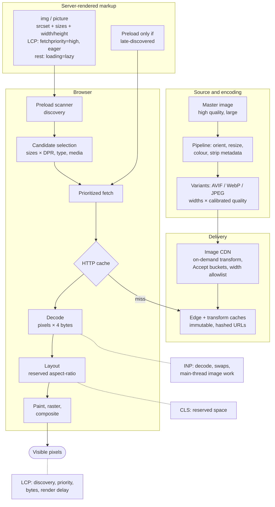

Each layer has a distinct responsibility:

- **Compression** decides how many bits each pixel costs. It is the domain of formats, encoders and quality settings, and it pays off in download time only to the extent that download is on the critical path.
- **Resource selection** decides how many pixels are sent. `srcset`, `sizes` and `<picture>` (or server-side negotiation) bring the delivered pixels close to the displayed pixels, which reduces bytes, decode time and memory together.
- **Network delivery** decides how quickly those bytes arrive: CDN proximity, cache hit ratio, connection reuse and long cache lifetimes.
- **Browser loading** decides when the request starts and how urgently it competes: discovery by the preload scanner, `loading`, `fetchpriority` and preload.
- **Decoding** turns bytes into pixels at a cost set by pixel count and format, scheduled by the engine and influenced by `decoding` and `decode()`.
- **Rendering** places, scales and composites those pixels, with layout stability set by whether the space was reserved.
- **User experience** is the outcome of all of them: LCP for when the main image appears, CLS for whether it moves things, INP for whether interacting with images feels immediate.

Practical principles for building and maintaining image-efficient applications:

1. **Diagnose before optimizing.** Break LCP into its sub-parts and fix the largest one. Most "image problems" are discovery, priority or render-delay problems.
2. **Make the LCP image boring.** An `` in server-rendered HTML, with accurate `srcset` and `sizes`, `width` and `height`, `fetchpriority="high"`, never lazy, never hidden behind JavaScript.
3. **Ship the pixels you display.** Resize before encoding, generate a sensible width ladder, and derive `sizes` from the layout rather than guessing. Cap density around 2x for large photos.
4. **Choose formats by content and pipeline.** AVIF or WebP with fallbacks for photos, lossless WebP or PNG for UI graphics, SVG for vectors, video for animation. Calibrate quality per encoder with a metric and your own eyes.
5. **Reserve space for every image.** Dimensions or `aspect-ratio` everywhere, including art-directed sources and dynamic content.
6. **Lazy-load the long tail, not the head.** Below-the-fold images only, with dimensions set.
7. **Treat image delivery as infrastructure.** Hashed URLs with immutable caching, normalized cache keys, width and quality allowlists, signed URLs or strict allowlists, pixel limits, patched decoders and stripped metadata.
8. **Keep masters, not derivatives.** Generate every variant from a high-quality master to avoid generational loss, and so you can adopt new formats later.
9. **Put guardrails in CI and RUM.** Audit oversized images in tests, track LCP sub-parts and image byte budgets in the field, and alert on regressions. Images are added by many people over a product's life, and they drift.

## Further reading

**Standards and specifications**

- [HTML Standard: Images](https://html.spec.whatwg.org/multipage/images.html) (srcset, sizes, selection, decoding)
- [HTML Standard: Lazy loading attributes](https://html.spec.whatwg.org/multipage/urls-and-fetching.html#lazy-loading-attributes)
- [Fetch Standard](https://fetch.spec.whatwg.org/) (request priority, destinations)
- [CSS Images Module Level 3](https://www.w3.org/TR/css-images-3/) (object-fit, image-rendering, sizing)
- [Largest Contentful Paint](https://w3c.github.io/largest-contentful-paint/) and [Layout Instability](https://wicg.github.io/layout-instability/)
- [AVIF specification](https://aomediacodec.github.io/av1-avif/) and [WebP container and bitstream documentation](https://developers.google.com/speed/webp/docs/riff_container)
- [PNG Specification (Third Edition)](https://www.w3.org/TR/png-3/)

**MDN Web Docs**

- [``](https://developer.mozilla.org/en-US/docs/Web/HTML/Reference/Elements/img), [`<picture>`](https://developer.mozilla.org/en-US/docs/Web/HTML/Reference/Elements/picture), [`<source>`](https://developer.mozilla.org/en-US/docs/Web/HTML/Reference/Elements/source)
- [HTMLImageElement.decode()](https://developer.mozilla.org/en-US/docs/Web/API/HTMLImageElement/decode) and [HTMLImageElement.decoding](https://developer.mozilla.org/en-US/docs/Web/API/HTMLImageElement/decoding)
- [Responsive images guide](https://developer.mozilla.org/en-US/docs/Web/HTML/Guides/Responsive_images)
- [Image file type and format guide](https://developer.mozilla.org/en-US/docs/Web/Media/Guides/Formats/Image_types)
- [object-fit](https://developer.mozilla.org/en-US/docs/Web/CSS/object-fit) and [image-set()](https://developer.mozilla.org/en-US/docs/Web/CSS/image/image-set)

**web.dev**

- [Learn Images](https://web.dev/learn/images)
- [Serve images in modern formats](https://web.dev/articles/serve-images-webp)
- [Preload responsive images](https://web.dev/articles/preload-responsive-images)
- [Browser-level image lazy loading](https://web.dev/articles/browser-level-image-lazy-loading)
- [Optimize resource loading with the Fetch Priority API](https://web.dev/articles/fetch-priority)
- [Don't fight the browser preload scanner](https://web.dev/articles/preload-scanner)
- [Optimize LCP](https://web.dev/articles/optimize-lcp) and [Optimize CLS](https://web.dev/articles/optimize-cls)

**Chrome for Developers**

- [Improve image delivery insight](https://developer.chrome.com/docs/performance/insights/image-delivery)
- [Properly size images (Lighthouse)](https://developer.chrome.com/docs/lighthouse/performance/uses-responsive-images/)
- [Performance panel overview](https://developer.chrome.com/docs/devtools/performance/overview)
- [Chrome 155 release notes](https://chromestatus.com/release-notes/155) (JPEG XL decoding)

**Tools and libraries**

- [sharp](https://sharp.pixelplumbing.com/) and its [output options](https://sharp.pixelplumbing.com/api-output)
- [Squoosh](https://squoosh.app/) and its [repository](https://github.com/GoogleChromeLabs/squoosh)
- [libwebp / cwebp](https://developers.google.com/speed/webp/docs/cwebp) and [libavif / avifenc](https://github.com/AOMediaCodec/libavif)
- [ImageMagick compare](https://imagemagick.org/script/compare.php)
- [Next.js Image component](https://nextjs.org/docs/app/api-reference/components/image)
- [Eric Portis: Chrome srcset selection](https://observablehq.com/@eeeps/chrome-srcset-selection)
