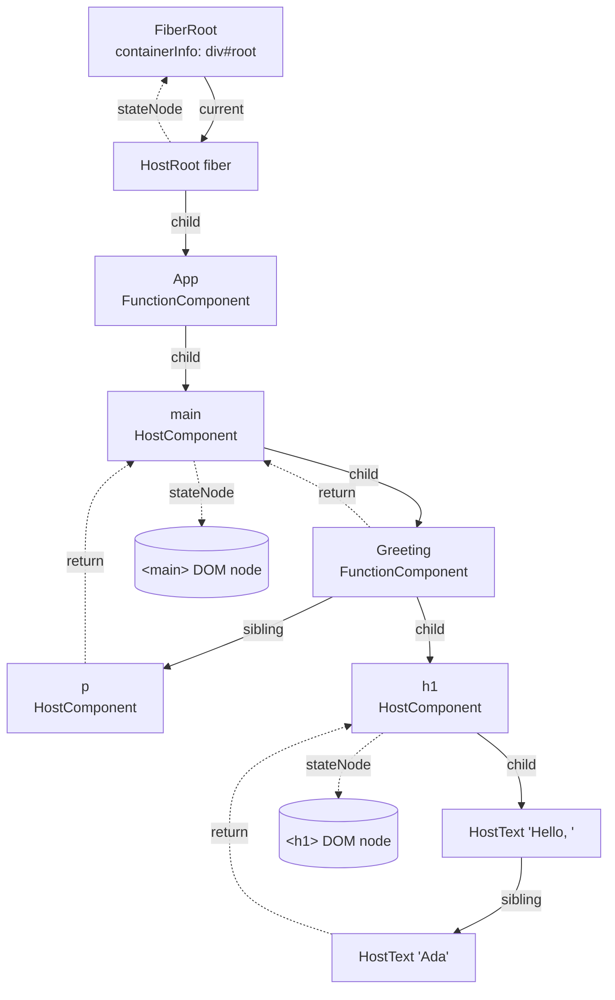
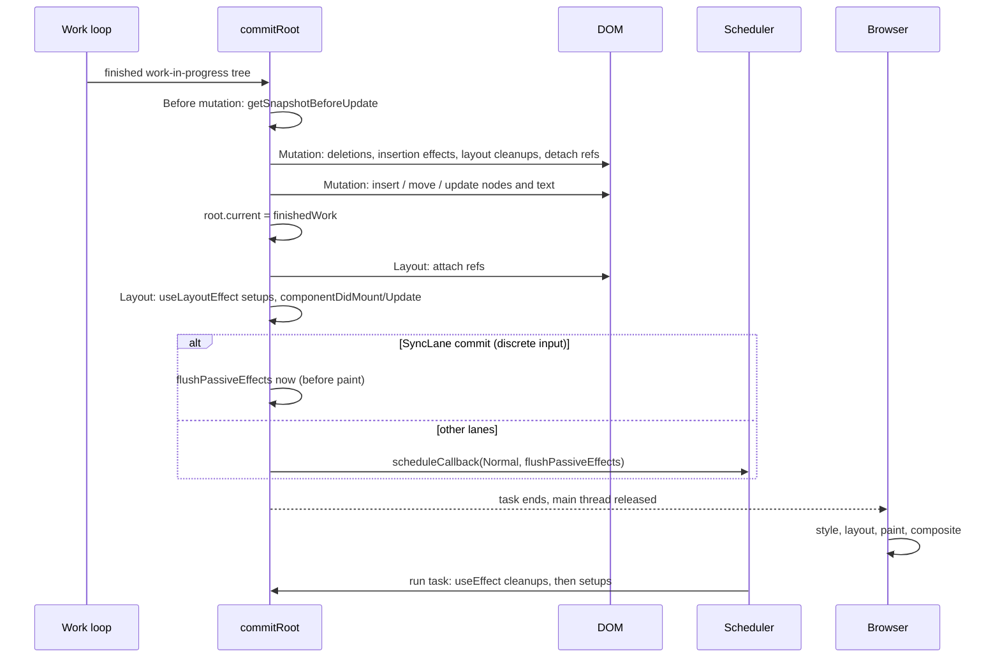
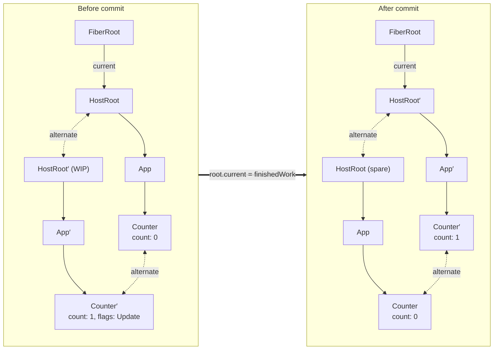
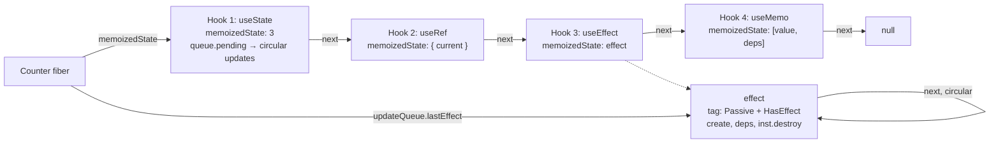

import Note from '../../components/Note.astro';

When a component calls `setCount(count + 1)`, nothing on screen changes at that moment. The setter does not touch the DOM, does not re-run the component, and does not even update `count`. It appends an object to a queue and asks React to come back later. Everything interesting happens afterwards: React picks a priority for the update, walks a tree of **Fiber** nodes, re-runs some components, compares what they return with what they returned last time, records a minimal set of host operations, applies them in one synchronous burst, runs effects, and finally hands control back to the browser, which does style, layout, paint and compositing.

This post follows that path end to end. The goal is a mental model precise enough to explain _why_ React behaves the way it does: why render logic must be pure, why keys are about identity rather than speed, why a component can render without touching the DOM, why `useEffect` sometimes runs before paint, and what "concurrent" really means.

<Note>
  everything here describes the **React 19** line (19.3 at the time of writing) and the `main` branch of
  [facebook/react](https://github.com/facebook/react). Public behaviour is cited from [react.dev](https://react.dev).
  Internal names such as `beginWork`, `memoizedState`, `lanes` or `subtreeFlags` are **implementation details**: they
  are not APIs, they change between minor releases, and source links point at `main`, which may drift from the version
  you run.
</Note>

## 1. What does "rendering" mean in React?

The word "render" is overloaded. Inside React it has a narrow meaning, and most confusion about performance comes from mixing it up with the browser's meaning.

| Term                  | What actually happens                                                                                   | Who does it          | Touches the DOM? |
| --------------------- | ------------------------------------------------------------------------------------------------------- | -------------------- | ---------------- |
| **Trigger**           | Something calls `root.render()`, a state setter, a reducer `dispatch`, or a store notifies a subscriber | Your code / React    | No               |
| **Render**            | React calls your components to get a description of the UI (React elements)                             | React (render phase) | No               |
| **Reconciliation**    | React compares new elements with the existing Fiber tree and decides what changed                       | React (render phase) | No               |
| **Commit**            | React applies the recorded changes to the host (DOM), attaches refs, runs effects                       | React (commit phase) | Yes              |
| **Browser rendering** | Style, layout, paint, composite: turning the mutated DOM into pixels                                    | The browser          | It reads it      |

The official docs frame this as three steps: **trigger → render → commit** ([Render and Commit](https://react.dev/learn/render-and-commit)). Browser rendering is a fourth step that React does not control; it happens after React yields the main thread. (For what that step involves, see [Inside the browser rendering pipeline](/blog/inside-the-browser-rendering-pipeline-from-html-to-pixels).)

The key consequence: **"rendering a component" means calling a function**. Whether that call leads to DOM mutation is decided later, during reconciliation, and very often the answer is "no".

## 2. Initial rendering: from JSX to DOM

### What JSX compiles into

JSX is syntax for function calls. With the automatic runtime (the default in modern Babel, TypeScript, SWC and esbuild configurations), this:

```jsx
// main.jsx
import { createRoot } from 'react-dom/client';

function Greeting({ name }) {
  return <h1 className="title">Hello, {name}</h1>;
}

function App() {
  return (
    <main>
      <Greeting name="Ada" />
      <p>Welcome back.</p>
    </main>
  );
}

createRoot(document.getElementById('root')).render(<App />);
```

compiles to roughly this:

```js
import { jsx as _jsx, jsxs as _jsxs } from 'react/jsx-runtime';
import { createRoot } from 'react-dom/client';

function Greeting({ name }) {
  return _jsxs('h1', { className: 'title', children: ['Hello, ', name] });
}

function App() {
  return _jsxs('main', {
    children: [_jsx(Greeting, { name: 'Ada' }), _jsx('p', { children: 'Welcome back.' })],
  });
}

createRoot(document.getElementById('root')).render(_jsx(App, {}));
```

`jsx()` returns a **React element**: a plain, immutable object ([source](https://github.com/facebook/react/blob/main/packages/react/src/jsx/ReactJSXElement.js)). In React 19 its shape is essentially:

```js
{
  $$typeof: Symbol.for('react.transitional.element'), // was 'react.element' before React 19
  type: Greeting,        // a function, a class, a string like 'h1', or a special symbol
  key: null,
  props: { name: 'Ada' },
  // plus dev-only fields such as _owner and _store
}
```

An element is a _description_. It has no state, no DOM node and no identity across renders. Calling `App()` twice produces two different element objects. Three different kinds of objects are involved in rendering, and keeping them separate is the foundation of everything else:

| Object            | Created by                        | Lifetime                                   | Holds                                                    |
| ----------------- | --------------------------------- | ------------------------------------------ | -------------------------------------------------------- |
| **React element** | `jsx()` during a component call   | One render; discarded after reconciliation | `type`, `key`, `props`                                   |
| **Fiber node**    | The reconciler                    | As long as the component stays mounted     | State, hooks, effects, flags, lanes, tree pointers       |
| **DOM node**      | React DOM during the render phase | As long as the host fiber stays mounted    | Real browser state: attributes, focus, selection, layout |

### `createRoot()` and root initialization

[`createRoot(container)`](https://react.dev/reference/react-dom/client/createRoot) calls `createContainer` in [ReactFiberReconciler.js](https://github.com/facebook/react/blob/main/packages/react-reconciler/src/ReactFiberReconciler.js), which creates two linked objects in [ReactFiberRoot.js](https://github.com/facebook/react/blob/main/packages/react-reconciler/src/ReactFiberRoot.js):

- A **FiberRoot**: a non-Fiber object that represents the whole React tree mounted into the container. It stores the container DOM node, `current` (pointer to the committed tree), pending lanes, and the scheduled callback.
- A **HostRoot fiber**: the top fiber of the tree. `fiberRoot.current = hostRootFiber` and `hostRootFiber.stateNode = fiberRoot`. Its update queue is initialized so it can receive "render this element" updates.

React DOM also attaches its delegated event listeners to the container at this point, which is why events work for every element in the tree without per-node listeners.

`root.render(<App />)` calls `updateContainer`. That function does not render anything. It picks a lane, creates an update whose payload is `{ element: <App /> }`, enqueues it on the HostRoot fiber, and calls `scheduleUpdateOnFiber`. From here, the initial render goes through exactly the same machinery as every later update.

### Traversing the tree and creating DOM nodes

When the work runs, React builds the Fiber tree depth-first. For the example above:

| Step | Fiber (tag)                    | `beginWork`                                                        | `completeWork`                                                 |
| ---- | ------------------------------ | ------------------------------------------------------------------ | -------------------------------------------------------------- |
| 1    | HostRoot                       | Process update queue → `element = <App />`; create `App` fiber     |                                                                |
| 2    | `App` (FunctionComponent)      | Call `App()`; reconcile the returned `<main>` element              |                                                                |
| 3    | `main` (HostComponent)         | Reconcile `props.children` → `Greeting` and `p` fibers             |                                                                |
| 4    | `Greeting` (FunctionComponent) | Call `Greeting({ name: 'Ada' })`; create `h1` fiber                |                                                                |
| 5    | `h1` (HostComponent)           | Children are an array of strings → two HostText fibers             |                                                                |
| 6    | `"Hello, "` (HostText)         | No children                                                        | `document.createTextNode('Hello, ')`                           |
| 7    | `"Ada"` (HostText)             | No children                                                        | `document.createTextNode('Ada')`                               |
| 8    | `h1`                           |                                                                    | `createElement('h1')`, append both text nodes, set `className` |
| 9    | `Greeting`                     |                                                                    | Nothing host-related; bubble flags                             |
| 10   | `p` (HostComponent)            | Single string child: no text fiber; it will be set as text content |                                                                |
| 11   | `p`                            |                                                                    | `createElement('p')`, set text content                         |
| 12   | `main`                         |                                                                    | `createElement('main')`, append `h1` and `p`                   |
| 13   | `App`, then HostRoot           |                                                                    | Bubble flags up                                                |

Two details are worth noticing:

1. **DOM nodes are created during the render phase**, in `completeWork`, but they are _detached_. Each host node gets its host children appended as React climbs back up the tree, so by the time the root completes there is a fully built, off-document DOM subtree. Nothing is visible yet.
2. **Only one fiber is marked for insertion.** During the initial mount, child fibers are created without per-node `Placement` flags (the reconciler's "mount" mode does not track side effects). Only the `App` fiber, the child of the already existing HostRoot, gets `Placement`.

### The initial commit

The commit phase sees one `Placement` flag, finds the nearest host parent (the container), and inserts `<main>` with a single `appendChild`. The whole subtree enters the document in one operation, then the browser performs style, layout and paint once. After the commit, `fiberRoot.current` points at the newly built tree.

## 3. React's internal representation: Fiber architecture

### Why Fiber exists

Before React 16, the reconciler (now called the "stack reconciler") walked the component tree recursively. Recursion uses the JavaScript call stack, which cannot be paused: once React started updating a large tree, it had to finish before the browser could handle input or paint.

Fiber, introduced in React 16, re-implemented the reconciler around an explicit data structure. Each unit of work is a heap-allocated object with pointers to its parent, first child and next sibling, so traversal is a loop rather than recursion. A loop can stop after any iteration, remember where it was (`workInProgress`), and continue later. That single property is what makes priorities, time slicing, Suspense and transitions possible. Andrew Clark's [React Fiber Architecture](https://github.com/acdlite/react-fiber-architecture) notes describe the original goals; it predates the current code but the concepts still hold.

### What a Fiber node represents

A fiber is created for each element React mounts: function and class components, host components (`div`), host text, fragments, context providers, Suspense boundaries, and so on. It is simultaneously a node in a tree, a record of component instance state, and a unit of work. The constructor lives in [ReactFiber.js](https://github.com/facebook/react/blob/main/packages/react-reconciler/src/ReactFiber.js). The most important fields:

| Field                                 | Meaning                                                                                                                                                                                                                              |
| ------------------------------------- | ------------------------------------------------------------------------------------------------------------------------------------------------------------------------------------------------------------------------------------ |
| `tag`                                 | Kind of fiber: `FunctionComponent`, `ClassComponent`, `HostRoot`, `HostComponent`, `HostText`, `SuspenseComponent`… ([ReactWorkTags.js](https://github.com/facebook/react/blob/main/packages/react-reconciler/src/ReactWorkTags.js)) |
| `type`, `elementType`, `key`          | Copied from the element; together they define identity                                                                                                                                                                               |
| `stateNode`                           | The "instance": a DOM node for host fibers, a class instance for classes, the FiberRoot for HostRoot, `null` for function components                                                                                                 |
| `return`, `child`, `sibling`, `index` | Tree pointers: parent, first child, next sibling, position among siblings                                                                                                                                                            |
| `pendingProps`, `memoizedProps`       | Props for the render in progress vs props used in the last completed render                                                                                                                                                          |
| `memoizedState`                       | Last rendered state: for function components, the head of the **hooks linked list**                                                                                                                                                  |
| `updateQueue`                         | Pending updates (class/HostRoot) or the effect list and other per-fiber data (function components)                                                                                                                                   |
| `dependencies`                        | Contexts this fiber read, used to find consumers when a context value changes                                                                                                                                                        |
| `flags`, `subtreeFlags`, `deletions`  | Side effects this fiber needs during commit, a summary of its descendants' flags, and children to delete                                                                                                                             |
| `lanes`, `childLanes`                 | Pending update priorities on this fiber, and anywhere in its subtree                                                                                                                                                                 |
| `alternate`                           | The corresponding fiber in the other tree (current ↔ work-in-progress)                                                                                                                                                               |
| `ref`, `mode`                         | The ref to attach; mode bits such as `ConcurrentMode` and `StrictLegacyMode`                                                                                                                                                         |



The child/sibling/return representation means a node has only one `child` pointer. Its other children are reached by following `sibling`. Every child points back to its parent through `return` (named for where work "returns" to after finishing a node, like a return address on a call stack).

### Current and work-in-progress trees

React keeps up to two fibers per component: the **current** fiber, which represents what is on screen, and the **work-in-progress** (WIP) fiber, which represents the next version being computed. They point to each other through `alternate`. Section 8 covers this in depth; for now, remember that render-phase work only mutates WIP fibers.

### Flags and lanes

**Flags** ([ReactFiberFlags.js](https://github.com/facebook/react/blob/main/packages/react-reconciler/src/ReactFiberFlags.js)) are a bitmask of commit work: `Placement` (insert or move), `Update` (props changed or effects/lifecycles to run), `ChildDeletion`, `Ref`, `Passive` (has `useEffect` work), `Snapshot`, `Visibility`, and more. During `completeWork`, each fiber ORs its own and its children's flags into `subtreeFlags`, so the commit phase can skip any subtree whose `subtreeFlags` is zero. (React 17 and earlier used a linked "effect list" for this; React 18 replaced it with `subtreeFlags`.)

**Lanes** ([ReactFiberLane.js](https://github.com/facebook/react/blob/main/packages/react-reconciler/src/ReactFiberLane.js)) are a 31-bit bitmask of update priorities. A fiber's `lanes` says "this fiber has pending updates at these priorities". Its `childLanes` says "something below me does". These two fields let React skip whole subtrees that have no pending work.

## 4. What triggers a re-render?

A component renders again for one of a small number of reasons:

1. **Its own state changed**: a `useState` setter or `useReducer` dispatch was called.
2. **Its parent rendered**: the parent produced a new element for it, with a new `props` object.
3. **A context it reads changed**: a provider above it received a new `value` (compared with `Object.is`).
4. **An external store it subscribes to changed**: via [`useSyncExternalStore`](https://react.dev/reference/react/useSyncExternalStore).

Class components add `this.setState` and `forceUpdate`, but the mechanism is the same: an update object goes into a queue and the fiber is marked with a lane.

### Setters schedule; they do not assign

From [the `useState` reference](https://react.dev/reference/react/useState#setstate): "The set function only updates the state variable for the next render. If you read the state variable after calling the set function, you will still get the old value." State is a snapshot per render ([State as a Snapshot](https://react.dev/learn/state-as-a-snapshot)).

This is why direct and functional updates behave differently:

```jsx
import { useState } from 'react';

export default function Counter() {
  const [count, setCount] = useState(0);

  function addThreeWrong() {
    // `count` is 0 in this render's closure for all three calls.
    // Queue: [replace with 1, replace with 1, replace with 1] → next state is 1.
    setCount(count + 1);
    setCount(count + 1);
    setCount(count + 1);
  }

  function addThree() {
    // Queue: [c => c + 1, c => c + 1, c => c + 1] → 0 → 1 → 2 → 3.
    setCount((c) => c + 1);
    setCount((c) => c + 1);
    setCount((c) => c + 1);
  }

  return (
    <>
      <p>{count}</p>
      <button onClick={addThreeWrong}>+3 (direct)</button>
      <button onClick={addThree}>+3 (functional)</button>
    </>
  );
}
```

Both handlers enqueue three updates. When React next renders `Counter`, it folds the queue starting from the current state. A non-function value means "replace"; a function means "compute from the previous result" ([Queueing a Series of State Updates](https://react.dev/learn/queueing-a-series-of-state-updates)). `useState` is in fact implemented as `useReducer` with a built-in reducer, `basicStateReducer`, that does exactly this check.

### Tracing a `setState` call through the reconciler

Here is what `setCount((c) => c + 1)` does internally, following `dispatchSetState` in [ReactFiberHooks.js](https://github.com/facebook/react/blob/main/packages/react-reconciler/src/ReactFiberHooks.js):

1. **Pick a lane.** `requestUpdateLane(fiber)` returns a transition lane if called inside `startTransition`, otherwise the current update priority. React DOM derives that from the event being dispatched: `click`, `keydown` and `input` are discrete (`SyncLane`), `mousemove` and `scroll` are continuous (`InputContinuousLane`), and anything outside a React event, such as a `setTimeout` callback, gets `DefaultLane` ([ReactDOMEventListener.js](https://github.com/facebook/react/blob/main/packages/react-dom-bindings/src/events/ReactDOMEventListener.js), `getEventPriority`).
2. **Create an update object**: `{ lane, action, hasEagerState, eagerState, next }`.
3. **Try an eager bailout.** If the fiber (and its alternate) currently has no pending updates, React can compute the next state immediately using the last rendered reducer. If `Object.is(eagerState, currentState)`, the update is queued for consistency, but **no render is scheduled at all**.
4. **Enqueue.** Otherwise the update is staged in a module-level buffer ([ReactFiberConcurrentUpdates.js](https://github.com/facebook/react/blob/main/packages/react-reconciler/src/ReactFiberConcurrentUpdates.js)) and the fiber's `lanes` gets the update lane. When the next render starts, staged updates are appended to the hook's circular `queue.pending` list and the lane is propagated into `childLanes` on every ancestor up to the root.
5. **Schedule the root.** `scheduleUpdateOnFiber(root, fiber, lane)` marks the lane as pending on the FiberRoot and calls `ensureRootIsScheduled` ([ReactFiberRootScheduler.js](https://github.com/facebook/react/blob/main/packages/react-reconciler/src/ReactFiberRootScheduler.js)).
6. **Return.** The setter returns `undefined`. Your event handler continues running. The DOM is untouched.

### Batching

Because the setter only enqueues, multiple updates from one event naturally collapse into one render. Since React 18, this **automatic batching** applies everywhere: event handlers, promises, timeouts and native listeners ([React 18 release notes](https://react.dev/blog/2022/03/29/react-v18#new-feature-automatic-batching)). `ensureRootIsScheduled` schedules a microtask to process the root schedule; any number of updates arriving before that microtask become a single render.

```jsx
import { useState } from 'react';
import { flushSync } from 'react-dom';

export default function Batching() {
  const [a, setA] = useState(0);
  const [b, setB] = useState(0);
  console.log('render', a, b);

  function batched() {
    setTimeout(() => {
      setA((x) => x + 1);
      setB((x) => x + 1); // One render, logs "render 1 1" (not "1 0" then "1 1")
    }, 0);
  }

  function unbatched() {
    flushSync(() => setA((x) => x + 1)); // Renders and commits before flushSync returns
    setB((x) => x + 1); // Second, separate render
  }

  return (
    <>
      <button onClick={batched}>batched</button>
      <button onClick={unbatched}>flushSync</button>
    </>
  );
}
```

[`flushSync`](https://react.dev/reference/react-dom/flushSync) is the opt-out: it forces synchronous render and commit of the updates inside its callback. Use it sparingly, typically when you must read layout immediately after a state change.

### Identical state and bailouts

If you set state to a value that is `Object.is`-equal to the current one, React skips the work. There are two layers:

- The **eager bailout** from step 3 above avoids scheduling anything, but only applies when the fiber has no other pending updates.
- Otherwise React renders the component, discovers during `updateReducer` that the resulting state is unchanged, and **bails out** of reconciling its children. The docs warn about this: "React may still need to call your component before skipping the children" ([useState caveats](https://react.dev/reference/react/useState#setstate)).

Mutating an object and setting it again never triggers a render, because the reference is identical:

```jsx
const [todo, setTodo] = useState({ done: false });

// No re-render: same object reference, Object.is(prev, next) === true
todo.done = true;
setTodo(todo);

// Re-render: new object
setTodo({ ...todo, done: true });
```

### Parent, context and external store updates

**Parent updates** need no queue on the child. The parent's render creates a new element, and `pendingProps` on the child's WIP fiber is a new object. In `beginWork`, React compares `oldProps !== newProps` **by reference**, so a re-rendered parent re-renders its children by default, even if every prop is the same value.

**Context updates** go through the provider. When a provider renders with a value that differs by `Object.is`, React finds fibers whose `dependencies` include that context and schedules the render lane on them and their ancestors' `childLanes` ([ReactFiberNewContext.js](https://github.com/facebook/react/blob/main/packages/react-reconciler/src/ReactFiberNewContext.js)). This is how a consumer re-renders even when every component between it and the provider is memoized.

**External stores** use `useSyncExternalStore`. On a store notification React calls `getSnapshot`, compares with `Object.is`, and schedules a `SyncLane` render if it changed. External store updates cannot be time-sliced: the docs note that if the store mutates during a non-blocking transition, React falls back to a blocking update to avoid tearing ([caveats](https://react.dev/reference/react/useSyncExternalStore#caveats)).

## 5. The render phase: reconciliation

### Scheduling render work

`ensureRootIsScheduled` adds the root to a schedule and, in a microtask, decides what to do with it. `getNextLanes` picks the highest-priority pending lanes. Then:

- For **`SyncLane`** work (discrete input, `flushSync`, layout-effect updates), React performs the render synchronously at the end of that microtask, without going through the Scheduler package.
- For everything else, React posts a task to the Scheduler package with a matching priority (`UserBlockingPriority`, `NormalPriority`, `IdlePriority`…), whose callback is `performWorkOnRootViaSchedulerTask`.

`performWorkOnRoot` in [ReactFiberWorkLoop.js](https://github.com/facebook/react/blob/main/packages/react-reconciler/src/ReactFiberWorkLoop.js) then chooses between two loops. Blocking lanes (`SyncLane`, `InputContinuousLane`, `DefaultLane`) and expired lanes use `renderRootSync`; transitions, retries and idle work use `renderRootConcurrent`:

```js
// Simplified from ReactFiberWorkLoop.js
function workLoopSync() {
  while (workInProgress !== null) {
    performUnitOfWork(workInProgress);
  }
}

function workLoopConcurrent() {
  while (workInProgress !== null && !shouldYield()) {
    performUnitOfWork(workInProgress);
  }
}
```

This is an important correction to a common belief: **only non-blocking updates are time-sliced**. A click handler's update renders to completion in one go, even under `createRoot`. Concurrency is opt-in per update, through transitions and deferred values.

### Creating the work-in-progress tree

Before the loop starts, `prepareFreshStack` calls `createWorkInProgress(root.current, null)`. That function either reuses the existing `alternate` of the current HostRoot fiber (resetting its flags and copying fields) or allocates one. As traversal proceeds, each WIP child is produced the same way, so in steady state React allocates almost no new fibers: it recycles the previous tree's buffers.

### `performUnitOfWork`, `beginWork` and `completeWork`

```js
// Simplified from ReactFiberWorkLoop.js
function performUnitOfWork(unitOfWork) {
  const current = unitOfWork.alternate;
  const next = beginWork(current, unitOfWork, renderLanes);
  unitOfWork.memoizedProps = unitOfWork.pendingProps;
  if (next === null) {
    completeUnitOfWork(unitOfWork); // no child: complete this node, then move to sibling or parent
  } else {
    workInProgress = next; // descend
  }
}
```

**[`beginWork`](https://github.com/facebook/react/blob/main/packages/react-reconciler/src/ReactFiberBeginWork.js)** is the "going down" step. It answers: _does this fiber need to render, and what are its children?_

1. If there is a current fiber and `oldProps === newProps` (same reference), no context changed, and `fiber.lanes` does not include the render lanes, it tries an **early bailout**. Then it checks `childLanes`: if no descendant has work either, it returns `null` and **the entire subtree is skipped**. If a descendant has work, it clones the children without rendering this component and continues down.
2. Otherwise it dispatches on `tag`: `updateFunctionComponent` calls the component through `renderWithHooks`, `updateClassComponent` calls `render()`, `updateHostComponent` just takes `props.children`, and so on.
3. It passes the resulting elements to `reconcileChildren`, which creates or reuses child fibers (Section 6), and returns the first child.

**[`completeWork`](https://github.com/facebook/react/blob/main/packages/react-reconciler/src/ReactFiberCompleteWork.js)** is the "going up" step. It runs once all of a fiber's children are complete:

- For a new **HostComponent**, it calls the host config's `createInstance`, appends all child host nodes (`appendAllChildren`) and sets initial properties. For an existing one whose props object changed, it marks `Update`. (In React 19's DOM host config, the property-by-property diff happens at commit time in `commitUpdate`, which receives old and new props. React 18 computed an `updatePayload` here instead.)
- For a **HostText**, it creates a text node or marks `Update` if the string differs.
- For every fiber, `bubbleProperties` merges children's `flags`/`subtreeFlags` into this fiber's `subtreeFlags` and children's lanes into `childLanes`.

`completeUnitOfWork` then moves to `sibling` if there is one (which goes back to `beginWork`), or to `return` (which completes the parent). When it returns to the HostRoot, the WIP tree is finished and handed to the commit phase.

### A step-by-step trace

Consider a re-render where only `Counter` has pending state:

```jsx
function App() {
  return (
    <Layout>
      <Header />
      <Counter />
    </Layout>
  );
}
```

Assuming `Layout` passes `children` through unchanged:

1. `beginWork(HostRoot)`: no own update, but `childLanes` includes `SyncLane` → clone children, go to `App`.
2. `beginWork(App)`: props unchanged, no own lanes, `childLanes` has work → **bail out without calling `App`**, clone children.
3. `beginWork(Layout)`: same as `App`. `Layout` is not called.
4. `beginWork(Header)`: props unchanged, no lanes, no `childLanes` → return `null`. **Header's whole subtree is skipped.**
5. `completeWork(Header)`, move to sibling.
6. `beginWork(Counter)`: `lanes` includes `SyncLane` → call `Counter()`. Hooks process the queue, `count` becomes 1. Reconcile returned elements.
7. `beginWork` / `completeWork` on `Counter`'s host children: the `<p>` text changed from `"0"` to `"1"` → `Update` flag on the text fiber.
8. Complete back up through `Layout`, `App` and HostRoot, bubbling `subtreeFlags`.

Only `Counter` ran. This is why "state should live as low as possible" is real advice: it narrows which components React must call, independently of memoization.

### Interruptible rendering: yield, resume, abandon

In the concurrent loop, `shouldYield()` asks the Scheduler whether the current time slice (5 ms by default in the Scheduler package) is used up. If so, the loop exits with `workInProgress` still pointing at the next fiber, and the Scheduler task returns a continuation. The browser gets the main thread back to handle input and paint, then the Scheduler resumes the same WIP tree where it left off. That is **yielding and resuming**.

**Abandoning** is different. If a higher-priority update arrives while a transition render is paused, React notices on its next scheduling pass that the next lanes differ from the lanes being rendered. It calls `prepareFreshStack`, which throws away the partially built WIP tree, renders and commits the urgent update, and then **restarts** the transition from the root, on top of the new state. React does not merge a half-built tree with new updates; it recomputes.

Render work can also be discarded when a component suspends, when an error is thrown and an error boundary must re-render, or simply because the work was speculative. The docs state the contract: React may render a component more than once, and work that is never committed must have no observable effect.

### Why render logic must be pure

Everything above depends on one assumption: calling a component has no side effects. If rendering mutated an external variable, sent a request, or wrote to the DOM, then:

- An abandoned render would leak effects for UI that never appeared.
- A restarted render would apply them twice.
- A yielded render could expose a half-applied state.

That is why [Keeping Components Pure](https://react.dev/learn/keeping-components-pure) and the [Rules of React](https://react.dev/reference/rules) are not stylistic preferences: they are what lets React separate _computing_ the next UI (render phase, interruptible, repeatable) from _applying_ it (commit phase, once). Side effects belong in event handlers or effects, which only run for committed work.

React also guards against runaway render loops: calling a setter unconditionally during render hits a limit of 25 re-renders ("Too many re-renders"), and repeated updates scheduled from commit-phase code hit a nested update limit of 50 ("Maximum update depth exceeded"). Both constants live in the reconciler source.

## 6. Reconciliation and the diffing algorithm

### Why heuristics, not tree edit distance

The minimum number of operations to turn one tree into another is a well-studied problem; general algorithms are around O(n³) in the number of nodes. For a 1,000-element tree that is on the order of a billion comparisons per update. React instead uses an O(n) heuristic built on two assumptions, described in the legacy [Reconciliation](https://legacy.reactjs.org/docs/reconciliation.html) docs:

1. Elements of **different types** produce different trees.
2. The developer can mark which children are stable across renders with a **`key`**.

React never searches for an optimal edit script. It compares children of the same parent, position by position or key by key, and never moves a subtree across parents. The result is not minimal in general, but it is predictable, which is what developers need to reason about state.

### Type comparison and component identity

For each child, `reconcileChildFibers` in [ReactChildFiber.js](https://github.com/facebook/react/blob/main/packages/react-reconciler/src/ReactChildFiber.js) compares the new element with the existing fiber at that slot:

- **Same `type` and same `key`**: reuse the fiber (`useFiber` → `createWorkInProgress`) with new `pendingProps`. State, hooks, refs and the DOM node are preserved.
- **Different `type` or different `key`**: mark the old fiber for deletion (added to the parent's `deletions` array, parent flagged `ChildDeletion`) and create a new fiber with `Placement`. The entire old subtree unmounts; its state is gone.

A component's **identity** is therefore "this type, with this key, at this position in the parent". It is not the variable name, and not the JSX location in your source code ([Preserving and Resetting State](https://react.dev/learn/preserving-and-resetting-state)).

```jsx
import { useState } from 'react';

function Counter({ person }) {
  const [score, setScore] = useState(0);
  return (
    <div>
      {person}: {score} <button onClick={() => setScore(score + 1)}>+1</button>
    </div>
  );
}

export default function Scoreboard() {
  const [isTaylor, setIsTaylor] = useState(true);
  return (
    <>
      {/* Same type at the same position: state is PRESERVED when switching */}
      {isTaylor ? <Counter person="Taylor" /> : <Counter person="Sarah" />}

      {/* Different keys: React treats them as different components, state RESETS */}
      {isTaylor ? <Counter key="taylor" person="Taylor" /> : <Counter key="sarah" person="Sarah" />}

      <button onClick={() => setIsTaylor(!isTaylor)}>Switch</button>
    </>
  );
}
```

Before and after clicking "Switch":

```text
Before                                   After
Scoreboard                               Scoreboard
├─ Counter (person=Taylor, score=3)      ├─ Counter (person=Sarah, score=3)   ← same fiber, new props
├─ Counter key=taylor (score=3)          ├─ Counter key=sarah  (score=0)      ← old deleted, new placed
└─ button                                └─ button
```

The same rule explains a classic bug: declaring a component inside another component. Each render creates a new function, so `type` differs every time, and the inner component's subtree is unmounted and remounted on every parent render, losing state and DOM focus.

### List reconciliation

Arrays go through `reconcileChildrenArray`, which works in passes:

1. **Walk both lists in order** while keys match, updating fibers in place. Most updates (append, change props) finish here.
2. If the **new list ran out**, delete the remaining old fibers. If the **old list ran out**, create the remaining new ones.
3. Otherwise, put the remaining old fibers in a `Map` keyed by `key` (or index when there is no key), then walk the remaining new elements, looking each one up. Matches are reused; leftovers in the map are deleted.

Moves are detected with a single number, `lastPlacedIndex`: the largest old index among fibers kept so far. When a reused fiber's old index is smaller than `lastPlacedIndex`, it must have moved right relative to something before it, so it gets `Placement` (which, for an existing node, means "move"). Otherwise it stays and `lastPlacedIndex` advances.

```text
Old: [A0, B1, C2, D3]      New: [D, A, B, C]

D → old index 3, lastPlacedIndex = 0 → stays,  lastPlacedIndex = 3
A → old index 0 < 3                  → MOVE
B → old index 1 < 3                  → MOVE
C → old index 2 < 3                  → MOVE
```

Moving the last item to the front produces three DOM moves instead of one. The algorithm is optimised for the common case (items appended, removed, or shifted rightward) and accepts being suboptimal elsewhere. That is the heuristic trade-off in a nutshell.

### Keys are about identity

Keys tell React which old fiber corresponds to which new element. With a stable key, an item's fiber, and therefore its state, DOM node, focus and uncontrolled input value, follows the item wherever it moves. Without one (or with the index as key), identity is tied to position.

```jsx
import { useState } from 'react';

const initial = [
  { id: 'a', name: 'Apples' },
  { id: 'b', name: 'Bread' },
  { id: 'c', name: 'Coffee' },
];

export default function ShoppingList() {
  const [items, setItems] = useState(initial);
  const reverse = () => setItems([...items].reverse());

  return (
    <>
      <button onClick={reverse}>Reverse</button>
      <h3>key=index (buggy)</h3>
      {items.map((item, index) => (
        <label key={index} style={{ display: 'block' }}>
          {item.name} <input placeholder="note" />
        </label>
      ))}
      <h3>key=id (correct)</h3>
      {items.map((item) => (
        <label key={item.id} style={{ display: 'block' }}>
          {item.name} <input placeholder="note" />
        </label>
      ))}
    </>
  );
}
```

Type "organic" next to Apples in both lists, then click Reverse. In the index-keyed list, the fiber at index 0 is reused for Coffee: React updates its text from "Apples" to "Coffee" but the `<input>` DOM node, with "organic" in it, stays in place. The note now belongs to the wrong item. In the id-keyed list, React moves the existing `<label>` nodes and the note travels with Apples. Index keys are only safe when the list is never reordered, filtered or inserted into, and items hold no state ([Rendering Lists](https://react.dev/learn/rendering-lists#why-does-react-need-keys)).

Keys also work outside lists: `<Profile key={userId} />` is the idiomatic way to reset all state when the user changes.

## 7. The commit phase: applying changes

### Why a separate phase

The render phase can be paused, restarted or thrown away. The DOM cannot: if React mutated it incrementally, the user would see half-updated UI between slices. So React computes the full set of changes first, then applies all of them in one uninterruptible pass. The entry point is `commitRoot` in [ReactFiberWorkLoop.js](https://github.com/facebook/react/blob/main/packages/react-reconciler/src/ReactFiberWorkLoop.js); per-fiber logic lives in [ReactFiberCommitWork.js](https://github.com/facebook/react/blob/main/packages/react-reconciler/src/ReactFiberCommitWork.js) and helper files next to it.

The commit traverses the finished tree depth-first, but uses `subtreeFlags` to skip any subtree with nothing to do. It runs in sub-phases, each a full traversal:

### 1. Before mutation

Runs work that must observe the DOM _before_ it changes. For class components this is `getSnapshotBeforeUpdate` (the `Snapshot` flag). Function components have no equivalent hook.

### 2. Mutation

The actual host operations:

- **Deletions** first: for each fiber in a parent's `deletions` list, React recursively unmounts the subtree. It detaches refs, runs `useLayoutEffect` and `useInsertionEffect` cleanups and `componentWillUnmount`, then removes the top-most host nodes from their parent. Removing one DOM node removes its descendants, so React does not call `removeChild` for every node.
- **Placement**: inserts or moves host nodes using `insertBefore`/`appendChild`, finding the nearest host parent and the next stable host sibling.
- **Update**: `commitUpdate` diffs old and new props and writes only changed attributes, styles and event props; `commitTextUpdate` sets new text.
- **Refs** on fibers whose ref changed are detached here (old ref set to `null`, or a React 19 ref cleanup function called).
- **Insertion effects** (`useInsertionEffect`) run here, and layout effect cleanups for updated components run here too.

After mutation, React performs the **tree switch**: `root.current = finishedWork`. The WIP tree is now the current tree. It happens here, between mutation and layout, so that `componentWillUnmount` saw the old tree and `componentDidMount`/layout effects see the new one.

### 3. Layout

Runs synchronously after the DOM is mutated, still in the same JavaScript task:

- **Refs are attached**: `ref.current = domNode` or callback refs are called.
- `useLayoutEffect` setup functions run, as do `componentDidMount` and `componentDidUpdate`.

Because this is still the same task, the browser has not painted. Reading layout (`getBoundingClientRect`) here forces a synchronous layout of the new DOM, and a state update scheduled here gets `SyncLane` and is rendered and committed before the browser paints. This is the documented use case for `useLayoutEffect`: measure, then re-render, without a visible flicker ([useLayoutEffect](https://react.dev/reference/react/useLayoutEffect)).

### 4. Passive effects

`useEffect` work is _not_ run during the commit traversal. If any fiber has the `Passive` flag, `commitRoot` schedules `flushPassiveEffects` as a normal-priority Scheduler task. When it runs, React first runs **all** passive cleanups (from unmounts and from effects whose deps changed), then **all** passive setups, in tree order (children before parents).

The timing has three cases that matter:

1. **Normal case**: passive effects run in a separate task, after the commit task ends. The browser usually paints in between, so `useEffect` "generally" runs after paint ([useEffect caveats](https://react.dev/reference/react/useEffect#caveats)).
2. **Discrete input**: since React 18, if the commit came from a discrete event such as a click or keydown (a `SyncLane` commit), React flushes passive effects **synchronously at the end of the commit, before paint** ([React 18 release notes](https://react.dev/blog/2022/03/29/react-v18#other-breaking-changes), "consistent useEffect timing"). The docs phrase this as: if your Effect is caused by an interaction, React may run it before the browser paints.
3. **Forced flush**: before React starts rendering or committing anything new, it flushes pending passive effects of the previous commit, so effects always run in order and never pile up.

Even in case 2, a state update inside the effect is a new update; the docs note the browser may repaint before processing it. If you must block paint, `useLayoutEffect` is the only guarantee.

| Hook                 | Runs during                      | Relative to paint                                      | Typical use                                                    |
| -------------------- | -------------------------------- | ------------------------------------------------------ | -------------------------------------------------------------- |
| `useInsertionEffect` | Mutation sub-phase               | Before; before layout effects; refs not yet attached   | CSS-in-JS libraries injecting `<style>` rules                  |
| `useLayoutEffect`    | Layout sub-phase (sync)          | Always before paint                                    | Measuring DOM, synchronously correcting layout, tooltips       |
| `useEffect`          | Separate task (or end of commit) | Usually after; before paint for discrete-input commits | Subscriptions, network, logging, syncing with external systems |

### The commit lifecycle



### Why the commit is synchronous

Interrupting a commit would show the user a DOM that matches neither the old nor the new state. Once a commit starts, it runs to completion. (React 19 can _delay the start_ of a commit in some concurrent cases, for example waiting for a suspensey stylesheet to load during a transition, but it never splits a commit.) The cost is that a commit with thousands of DOM mutations or slow layout effects is one long task; the render phase can be sliced, the commit cannot.

## 8. Current tree vs work-in-progress tree

React uses **double buffering**, the graphics technique of drawing the next frame into a back buffer while the front buffer stays on screen, then swapping.

- The **current tree** (`fiberRoot.current`) mirrors what is committed in the DOM. Event handlers, refs and effects you see belong to it.
- The **work-in-progress tree** is built during render. Every WIP fiber is either a fresh fiber or the recycled `alternate` of its current counterpart.



This design delivers several properties at once:

- **The committed UI stays consistent during render.** The render phase only writes WIP fibers. Event handlers firing during a yield read the current tree's props and state; nothing is half-updated.
- **Abandoning work is cheap.** Throwing away a WIP tree means resetting a pointer. The current tree was never touched.
- **Commit is a pointer swap.** After mutation, `root.current = finishedWork` makes the WIP tree current. The old current fibers become the next render's WIP buffers.
- **Allocations are minimal.** At most two fibers exist per mounted component, and `createWorkInProgress` reuses the alternate rather than allocating.

One subtlety: an update queue is shared between both fibers in a way that lets updates survive abandoned renders. A hook's queue keeps a `baseState` and a `baseQueue`; if a render skips an update because its lane was not included, the update stays in the base queue and is reapplied, in order, in a later render. That is how a low-priority update can be "rebased" on top of a high-priority one without losing either.

## 9. React Scheduler and concurrent rendering

### Cooperative scheduling on one thread

JavaScript on the main thread is single-threaded. While React renders, the browser cannot process input or paint. React cannot preempt itself, so it **cooperates**: it does a small amount of work, checks whether it should yield, and if so returns control to the browser and asks to be called again.

**Concurrent rendering does not mean components run in parallel on multiple CPU cores.** It means React can have multiple versions of the UI "in progress" and can interleave, pause, prioritise and abandon render work on the single main thread. At any instant, exactly one component function is executing.

### Lanes and priorities

Every update is assigned a lane. `getNextLanes` always picks the highest-priority pending lanes, and related lanes can be **entangled** so they render together.

| Lane (internal)             | Typical source                                                                    | Time-sliced? | Interruptible by higher priority? |
| --------------------------- | --------------------------------------------------------------------------------- | ------------ | --------------------------------- |
| `SyncLane`                  | Discrete events (`click`, `keydown`, `input`), `flushSync`, layout-effect updates | No           | No                                |
| `InputContinuousLane`       | Continuous events (`pointermove`, `scroll`, `wheel`)                              | No           | No                                |
| `DefaultLane`               | Updates outside React events (timeouts, fetch callbacks), `root.render`           | No           | No                                |
| Transition lanes            | `startTransition`, `useTransition`, `useDeferredValue` background render          | Yes          | Yes                               |
| Retry lanes                 | Suspense boundaries retrying after data resolves                                  | Yes          | Yes                               |
| `IdleLane`, `OffscreenLane` | Idle work; pre-rendering hidden content (`<Activity mode="hidden">`)              | Yes          | Yes                               |

Lanes are bit flags so React can do set operations cheaply: "is this update's lane included in what we are rendering?" is `(renderLanes & updateLane) === updateLane`. Lanes also **expire**: if a transition is starved for too long by higher-priority work, it is marked expired and rendered synchronously, so it cannot be postponed forever.

### The Scheduler package and the event loop

React's [Scheduler](https://github.com/facebook/react/blob/main/packages/scheduler/src/forks/Scheduler.js) is a separate package that keeps a min-heap of tasks ordered by expiration time, with five priority levels (`ImmediatePriority` through `IdlePriority`). To run tasks, it posts a message to itself through a `MessageChannel` (falling back to `setImmediate` in Node or `setTimeout` elsewhere). Each message is a **macrotask**, so the browser can process input events, run `requestAnimationFrame` callbacks and render a frame between two Scheduler slices. `shouldYield()` returns true once the current slice exceeds the frame interval (5 ms by default).

So there are two distinct schedulers stacked on each other:

| Concern                 | React (reconciler + Scheduler package)                       | Browser event loop                                         |
| ----------------------- | ------------------------------------------------------------ | ---------------------------------------------------------- |
| Unit of work            | A fiber (`performUnitOfWork`), a Scheduler task              | A task (macrotask), microtask checkpoints, rendering steps |
| Priorities              | Lanes → Scheduler priorities; purely internal to React       | Task sources; `scheduler.postTask` priorities (if used)    |
| Preemption              | Cooperative: React checks `shouldYield()` between fibers     | None within a task; tasks run to completion                |
| Visibility to the other | The browser sees React work as ordinary tasks and microtasks | React sees the browser only through time and new events    |

Sync work is flushed in a **microtask** after the event handler (in current React 19 builds), which runs before the browser gets a chance to render. Concurrent work runs in Scheduler **macrotasks**. The browser has no idea which of React's tasks are "urgent": that knowledge exists only in React. (The repo also contains a `postTask`-based Scheduler fork, but the default build uses `MessageChannel`.)

### Transitions

[`startTransition`](https://react.dev/reference/react/startTransition) and [`useTransition`](https://react.dev/reference/react/useTransition) mark updates as non-urgent. Internally, the transition is stored on React's shared internals while the callback runs, and `requestUpdateLane` returns a transition lane for any update scheduled inside it.

```jsx
import { memo, useState, useTransition } from 'react';

const SlowPosts = memo(function SlowPosts() {
  const items = [];
  for (let i = 0; i < 300; i++) items.push(<SlowPost key={i} index={i} />);
  return <ul>{items}</ul>;
});

function SlowPost({ index }) {
  const start = performance.now();
  while (performance.now() - start < 1) {} // Simulate 1 ms of render work
  return <li>Post #{index + 1}</li>;
}

export default function Tabs() {
  const [tab, setTab] = useState('about');
  const [isPending, startTransition] = useTransition();

  function select(next) {
    startTransition(() => setTab(next));
  }

  return (
    <>
      {['about', 'posts', 'contact'].map((t) => (
        <button key={t} onClick={() => select(t)} disabled={tab === t}>
          {t}
        </button>
      ))}
      <div style={{ opacity: isPending ? 0.6 : 1 }}>
        {tab === 'about' && <p>About</p>}
        {tab === 'posts' && <SlowPosts />}
        {tab === 'contact' && <p>Contact</p>}
      </div>
    </>
  );
}
```

Click "posts", then immediately "contact". What happens:

1. The first click schedules `isPending = true` at `SyncLane` and `tab = 'posts'` at a transition lane. The sync render commits immediately (dimmed UI).
2. The transition render starts in `workLoopConcurrent`, rendering `SlowPost`s about five per slice and yielding between them.
3. The second click is processed between slices. It schedules another sync update and a new transition.
4. React sees new lanes, **abandons** the partially rendered "posts" tree, commits the urgent update, and renders the "contact" transition, which is cheap. The "posts" tab never commits.

Without the transition, the first click would block the main thread for ~300 ms and the second click would wait.

### `useDeferredValue`

[`useDeferredValue(value)`](https://react.dev/reference/react/useDeferredValue) is the "receiving end" version: instead of wrapping the setter, you defer a value. During an urgent render it returns the **previous** value, and schedules a background render (at a transition-like lane) in which it returns the new one. If the value changes again before that finishes, the background render is abandoned and restarted.

```jsx
import { memo, useDeferredValue, useState } from 'react';

const Results = memo(function Results({ query }) {
  const rows = [];
  for (let i = 0; i < 250; i++) {
    const start = performance.now();
    while (performance.now() - start < 1) {} // 1 ms per row
    rows.push(
      <li key={i}>
        {query} result {i}
      </li>,
    );
  }
  return <ul>{rows}</ul>;
});

export default function Search() {
  const [query, setQuery] = useState('');
  const deferredQuery = useDeferredValue(query);
  const isStale = query !== deferredQuery;

  return (
    <>
      <input value={query} onChange={(e) => setQuery(e.target.value)} />
      <div style={{ opacity: isStale ? 0.5 : 1 }}>
        <Results query={deferredQuery} />
      </div>
    </>
  );
}
```

The input updates at `SyncLane` on every keystroke and stays responsive. `Results` is memoized, so in the urgent render it receives the same old `deferredQuery` and bails out. The expensive list renders only in the interruptible background pass. Note that `memo` is essential here: without it, the urgent render would re-render `Results` anyway.

## 10. React hooks internals

### Hooks are a linked list on the fiber

A function component has no instance, so its state lives on its fiber. `fiber.memoizedState` points to the first **hook object**, and each hook points to the next. In [ReactFiberHooks.js](https://github.com/facebook/react/blob/main/packages/react-reconciler/src/ReactFiberHooks.js) a hook looks like:

```js
// Internal shape, not an API
const hook = {
  memoizedState: null, // the hook's value: state, effect object, [value, deps], ref object…
  baseState: null, // state before any skipped updates
  baseQueue: null, // updates skipped in a previous render, kept for rebasing
  queue: null, // { pending, dispatch, lastRenderedReducer, lastRenderedState }
  next: null, // next hook in call order
};
```

What `memoizedState` holds depends on the hook: the current state for `useState`/`useReducer`, `{ current }` for `useRef`, `[value, deps]` for `useMemo`, `[fn, deps]` for `useCallback`, and an effect object for `useEffect`/`useLayoutEffect`. Effects are also linked into a circular list on `fiber.updateQueue.lastEffect`, so the commit phase can iterate them without walking hooks.



### Dispatchers and call order

When `renderWithHooks` calls your component, it installs a **dispatcher** on React's shared internals (`ReactSharedInternals.H` in React 19). On mount it is `HooksDispatcherOnMount`, whose `useState` calls `mountWorkInProgressHook` to append a new hook. On update it is `HooksDispatcherOnUpdate`, whose `useState` calls `updateWorkInProgressHook`, which advances one step along the **current** fiber's hook list and clones that hook into the WIP list.

There is no name, no key, no ID: **the only thing connecting a `useState` call to its stored state is its position in the call sequence**. If a hook call is skipped conditionally, every later hook reads the wrong slot:

```jsx
import { useEffect, useState } from 'react';

export default function Broken({ showName }) {
  // ❌ Breaks the Rules of Hooks
  const [name, setName] = showName ? useState('Ada') : [null, () => {}];
  const [count, setCount] = useState(0);

  useEffect(() => {
    document.title = `${name ?? 'anon'}: ${count}`;
  });

  return <button onClick={() => setCount(count + 1)}>{count}</button>;
}
```

If `showName` flips from `true` to `false`, the `count` call to `useState` becomes the first hook and reads slot 0, which holds `'Ada'`, and `useEffect` reads slot 1, which holds `count`'s state hook. Here the hook count also drops from three to two, so React throws "Rendered fewer hooks than expected"; but when the order changes and the count stays the same, nothing checks the hook _types_ in production, and state silently ends up in the wrong place. That is the whole reason for the [Rules of Hooks](https://react.dev/reference/rules/rules-of-hooks): call hooks unconditionally, at the top level, in the same order every render. (React 19's [`use`](https://react.dev/reference/react/use) is the deliberate exception: it is not stored in a positional hook slot and may be called conditionally.)

### How `useState` and `useReducer` process updates

On a render, `updateReducer` takes the hook's `queue.pending` (a circular singly linked list, so appending is O(1)), merges it into `baseQueue`, and walks it:

- If the update's lane is included in the current render lanes, apply it: `newState = reducer(newState, update.action)`. (Eagerly computed state is reused when the reducer has not changed.)
- If not, **skip it**: clone it into the new base queue, and freeze `baseState` at the state before the first skipped update. All later updates are also kept in the base queue, even those applied, so they can be replayed in order later.

After the loop, if `!Object.is(newState, hook.memoizedState)`, React calls `markWorkInProgressReceivedUpdate()`. If no hook marks an update and props did not change, `updateFunctionComponent` bails out: hooks are reset to the current ones and children are not reconciled. That is the "render, then bail out" path from Section 4.

`useReducer` is the same code with your reducer. `useState` passes `basicStateReducer`, defined as `typeof action === 'function' ? action(state) : action`.

### Effects and dependency comparison

On every render, `useEffect(create, deps)` creates an effect object and pushes it to the fiber's effect list. On update, it compares new `deps` with the previous ones using `areHookInputsEqual`, which checks each element with **`Object.is`**:

- If all equal, the effect is pushed _without_ the `HasEffect` tag. The commit phase will skip it.
- If any differ (or there are no deps), the effect gets `HasEffect` and the fiber gets the `Passive` flag (or `Update` for layout effects).

During commit, an effect with `HasEffect` first runs the previous cleanup (`inst.destroy`), then `create()`, storing its return value as the new cleanup. On unmount, every effect's cleanup runs regardless of tags.

`Object.is` semantics matter: `NaN` equals `NaN`, `+0` does not equal `-0`, and two object or array literals are never equal. An object created during render as a dependency makes the effect run every render, which is the most common reason for "effect runs too often". Remedies are, in order of preference: depend on primitives, move the object inside the effect, or memoize it ([Removing Effect Dependencies](https://react.dev/learn/removing-effect-dependencies)).

## 11. Component re-renders vs DOM updates

A "re-render" is a function call plus reconciliation. A DOM update happens only if reconciliation finds a difference in host output. The two are routinely conflated.

### A component that renders without touching the DOM

```jsx
import { useEffect, useRef, useState } from 'react';

function Static({ label }) {
  console.log('Static rendered');
  return <p className="static">{label}</p>;
}

export default function Demo() {
  const [ticks, setTicks] = useState(0);
  const boxRef = useRef(null);

  useEffect(() => {
    const observer = new MutationObserver((records) => {
      for (const r of records) {
        const el = r.target.nodeType === Node.TEXT_NODE ? r.target.parentNode : r.target;
        console.log('DOM mutation:', r.type, el.nodeName);
      }
    });
    observer.observe(boxRef.current, {
      subtree: true,
      childList: true,
      attributes: true,
      characterData: true,
    });
    return () => observer.disconnect();
  }, []);

  return (
    <div ref={boxRef}>
      <button onClick={() => setTicks(ticks + 1)}>tick</button>
      <span>{ticks}</span>
      <Static label="I never change" />
    </div>
  );
}
```

Each click logs `Static rendered` (because its parent rendered and passed a new `props` object), but the only mutation the observer reports is the `characterData` change of the `<span>` text. `Static` produced an element tree whose host props and text are equal to the previous ones, so the commit phase writes nothing to its `<p>`.

The render still cost something: calling `Static`, creating elements, and reconciling. For a `<p>` that cost is negligible. For a subtree of thousands of components it is not.

### Why components re-render

| Cause           | Mechanism                                                | Skippable with                                            |
| --------------- | -------------------------------------------------------- | --------------------------------------------------------- |
| Own state       | Update queued on the fiber's hook, lane on `fiber.lanes` | Not skippable (unless state is `Object.is`-equal)         |
| Parent rendered | New `pendingProps` object, compared by reference         | `memo` (shallow props compare), passing children as props |
| Context changed | Consumer fiber marked via `dependencies`                 | Splitting contexts, memoizing provider values             |
| External store  | `useSyncExternalStore` snapshot changed                  | Selecting smaller snapshots                               |

### Referential equality and the memoization tools

- [`memo(Component)`](https://react.dev/reference/react/memo) replaces the reference comparison of props with a shallow `Object.is` comparison of each prop. If equal, React bails out of that fiber (children with pending work still render).
- [`useMemo`](https://react.dev/reference/react/useMemo) caches a computed value between renders until deps change. Its main use, besides avoiding expensive recomputation, is keeping an object reference stable so a `memo` child or an effect does not see a "new" value.
- [`useCallback`](https://react.dev/reference/react/useCallback) is `useMemo` for functions: same reasons, same caveats.

```jsx
import { memo, useCallback, useMemo, useState } from 'react';

const Chart = memo(function Chart({ options, onSelect }) {
  console.log('Chart rendered');
  return <button onClick={() => onSelect(options.type)}>Chart: {options.type}</button>;
});

export default function Dashboard() {
  const [count, setCount] = useState(0);
  const [type, setType] = useState('bar');

  // Without these, each Dashboard render creates new references and memo is useless.
  const options = useMemo(() => ({ type }), [type]);
  const onSelect = useCallback((t) => setType(t === 'bar' ? 'line' : 'bar'), []);

  return (
    <>
      <button onClick={() => setCount(count + 1)}>clicked {count}</button>
      <Chart options={options} onSelect={onSelect} />
    </>
  );
}
```

### Trade-offs

Memoization has costs: it stores values, compares deps on every render, and adds code that is easy to get wrong (one unstable prop silently defeats `memo`). It is worth it when a component is measurably slow to render and frequently receives the same props. Often a structural fix is better:

- **Move state down** so fewer components sit under the state owner.
- **Lift content up**: pass expensive subtrees as `children`. Elements created by a grandparent are the same objects when the parent re-renders, so React bails out on them through the reference comparison, with no `memo` needed.
- **Split contexts** by update frequency.

[React Compiler](https://react.dev/learn/react-compiler) (1.0 released in October 2025) automates much of this by memoizing components and values at build time. It does not change the runtime model: it emits code that produces stable references, so the same bailout paths described above fire more often.

### Finding unnecessary renders

Turn on "Highlight updates when components render" in React DevTools settings, interact, and look for components flashing that should not. Then use the Profiler (Section 14) with "Record why each component rendered" to see whether the cause is props, state, hooks or context. A `console.log` in the component body is fine for quick checks, but remember Strict Mode doubles it in development.

## 12. Strict Mode and development behaviour

[`<StrictMode>`](https://react.dev/reference/react/StrictMode) enables extra checks, **in development only**. Production builds ignore it entirely. In development it:

- **Double-invokes render logic**: component bodies, `useState`/`useReducer`/`useMemo` initializers and reducers, and class `constructor`, `render` and `setState` updaters. Only one result is used. In React 19, `useMemo` and `useCallback` reuse the result from the first call during the second.
- **Runs an extra setup → cleanup → setup cycle** for every effect when a component mounts, and an extra cycle for callback refs.
- **Warns about deprecated APIs**.

The double render is a cheap simulation of what concurrent React can do for real: render a component, throw the result away, and render it again. Impure code reveals itself:

```jsx
import { StrictMode, useEffect, useState } from 'react';
import { createRoot } from 'react-dom/client';

const seen = []; // module-level mutable state: a render-time side effect target

function Impure({ id }) {
  seen.push(id); // ❌ side effect during render
  return <p>Rendered {seen.length} times</p>; // Shows 2 in dev Strict Mode on mount
}

function ChatRoom({ roomId }) {
  const [status, setStatus] = useState('connecting');
  useEffect(() => {
    console.log('connect', roomId);
    const timer = setTimeout(() => setStatus('connected'), 500);
    return () => {
      console.log('disconnect', roomId); // Strict Mode proves this cleanup exists and works
      clearTimeout(timer);
    };
  }, [roomId]);
  return (
    <p>
      {roomId}: {status}
    </p>
  );
}

createRoot(document.getElementById('root')).render(
  <StrictMode>
    <Impure id="a" />
    <ChatRoom roomId="general" />
  </StrictMode>,
);
```

In development the console shows `connect`, `disconnect`, `connect` on mount. That is not a bug: it tests that your cleanup symmetrically undoes setup, which is required for features like `<Activity>`, Fast Refresh and future reuse of state. If an effect cannot survive that cycle, it would leak in production on remounts.

Common misconceptions:

- **"My component renders twice in production."** It does not, unless something else causes it. Strict Mode double rendering is development-only.
- **"Strict Mode causes two commits."** The second render call is discarded internally; there is no second commit for the double render. The effect cycle is a simulated unmount/remount of effects.
- **"I should use a ref to prevent the effect from running twice."** That hides missing cleanup instead of fixing it. See [How to handle the Effect firing twice in development](https://react.dev/learn/synchronizing-with-effects#how-to-handle-the-effect-firing-twice-in-development).

React DevTools dims (or can hide) console logs from the second render, so check for duplicates there before assuming a bug.

## 13. Server rendering and hydration

### SSR produces HTML, not fibers

On the server, [`renderToPipeableStream`](https://react.dev/reference/react-dom/server/renderToPipeableStream) (Node) or [`renderToReadableStream`](https://react.dev/reference/react-dom/server/renderToReadableStream) (Web Streams) runs your components and writes HTML. There is no Fiber tree, no commit and no effects on the server: `useEffect` and `useLayoutEffect` do not run there, and state setters do nothing.

### Hydration connects HTML to a Fiber tree

On the client, [`hydrateRoot`](https://react.dev/reference/react-dom/client/hydrateRoot) runs a normal render phase, but in hydration mode ([ReactFiberHydrationContext.js](https://github.com/facebook/react/blob/main/packages/react-reconciler/src/ReactFiberHydrationContext.js)). Instead of creating DOM nodes, each host fiber tries to **claim** the next existing DOM node at that position. If the tag matches, the existing node becomes the fiber's `stateNode`; properties and event handlers are attached during `completeWork`. The commit then has very little DOM work, mostly refs and effects.

```jsx
// client.jsx
import { hydrateRoot } from 'react-dom/client';
import App from './App.jsx';

hydrateRoot(document.getElementById('root'), <App />, {
  onRecoverableError(error, errorInfo) {
    // Hydration mismatches that React recovered from land here.
    console.warn('Recoverable:', error, errorInfo.componentStack);
  },
});
```

### Mismatches

Hydration requires the first client render to produce the **same output** as the server. Typical causes of mismatches: `Date.now()` or `Math.random()` during render, `typeof window !== 'undefined'` branches, locale-dependent formatting, invalid HTML nesting that the browser parser "fixes" (a `<div>` inside a `<p>`), and browser extensions modifying the DOM.

When React cannot reconcile a difference, it throws away the server HTML for the nearest Suspense boundary (or the whole root) and client-renders that part, reporting the error through `onRecoverableError`. The docs caution that "there are no guarantees that attribute differences will be patched up in case of mismatches" ([hydrateRoot caveats](https://react.dev/reference/react-dom/client/hydrateRoot#caveats)). For intentionally different content, render the server version first and switch in an effect, or use `suppressHydrationWarning` for a single element's text.

```jsx
import { useEffect, useState } from 'react';

export function LocalTime() {
  const [time, setTime] = useState(null); // Same on server and first client render
  useEffect(() => setTime(new Date().toLocaleTimeString()), []);
  return <span>{time ?? '--:--'}</span>;
}
```

### Streaming and selective hydration

With streaming SSR, `<Suspense>` boundaries become streaming boundaries. The server sends the shell with fallbacks immediately, then streams each boundary's HTML when its data resolves, together with a small inline script that swaps it into place. On the client, each boundary hydrates independently: React hydrates boundaries in roughly document order, but if the user interacts with a not-yet-hydrated boundary, React raises its priority and hydrates it first (**selective hydration**), then replays the discrete event. Hydration lanes (`SyncHydrationLane`, `DefaultHydrationLane`, `SelectiveHydrationLane`, …) exist for exactly this. The design is explained in [New Suspense SSR Architecture in React 18](https://github.com/reactwg/react-18/discussions/37).

### React Server Components

[Server Components](https://react.dev/reference/rsc/server-components) move part of the render phase to the server entirely. They run at build time or per request, never ship their code to the client, and output a serialized element tree, the **RSC payload**. In that payload, Client Components (modules marked with [`'use client'`](https://react.dev/reference/rsc/use-client)) appear as references to client modules plus their serialized props.

On the client, the RSC runtime deserializes the payload into ordinary React elements. From that point on, the reconciler treats them like any other elements: Client Components get fibers, state and effects; host elements become host fibers. Server Components themselves do not exist as stateful client fibers; their output is already resolved. On navigation, a framework fetches a new payload and React reconciles it against the current tree, so client state in components whose identity is preserved survives. The boundary rule follows from this: props passed from a Server to a Client Component must be serializable, because they cross the network.

## 14. Profiling and debugging React rendering

### Two profilers, two questions

| Question                                      | Tool                                                          | What it shows                                                   |
| --------------------------------------------- | ------------------------------------------------------------- | --------------------------------------------------------------- |
| Which components rendered, why, and how long? | React DevTools Profiler, `<Profiler>`                         | Per-commit flame/ranked charts, render durations, render causes |
| What is the main thread doing?                | Browser Performance panel                                     | Long tasks, scripting vs style/layout/paint, GC, frames         |
| Where does React's scheduling fit in?         | Performance panel with React Performance Tracks (React 19.2+) | Scheduler priorities and component render spans on the timeline |

The React Profiler measures the render phase per component. It does not show the browser's style and layout cost caused by your commit, nor time spent in other scripts. A commit that takes 2 ms in React but triggers 80 ms of layout looks fine in the React Profiler and terrible in the Performance panel. Use both.

In the React DevTools Profiler ([introduction](https://legacy.reactjs.org/blog/2018/09/10/introducing-the-react-profiler.html), [DevTools docs](https://react.dev/learn/react-developer-tools)):

- The bar chart at the top has one bar per **commit**; height and color reflect duration.
- The **flame graph** shows the tree for the selected commit. Colored bars rendered in this commit; grey bars did not render.
- The **ranked chart** sorts components by render time in that commit.
- With "Record why each component rendered while profiling" enabled, selecting a component shows the cause: props changed (which ones), hooks changed, parent rendered, or context changed.

Production builds strip profiling. To profile a production bundle, alias `react-dom/client` to `react-dom/profiling` (see the [`<Profiler>` docs](https://react.dev/reference/react/Profiler)).

### Hands-on exercise

Create this component in any React 19 app (Vite works well) and render it.

```jsx
import { Profiler, useState } from 'react';

function slowCompute(n) {
  const start = performance.now();
  while (performance.now() - start < 2) {} // 2 ms of fake work per row
  return n * 2;
}

function Row({ value }) {
  return <li>{slowCompute(value)}</li>;
}

function List({ items }) {
  return (
    <ul>
      {items.map((v) => (
        <Row key={v} value={v} />
      ))}
    </ul>
  );
}

const ITEMS = Array.from({ length: 100 }, (_, i) => i);

function onRender(id, phase, actualDuration, baseDuration, startTime, commitTime) {
  console.log(`${id} ${phase}: actual ${actualDuration.toFixed(1)} ms, base ${baseDuration.toFixed(1)} ms`);
}

export default function ProfilingLab() {
  const [text, setText] = useState('');
  return (
    <Profiler id="lab" onRender={onRender}>
      <input value={text} onChange={(e) => setText(e.target.value)} placeholder="type here" />
      <List items={ITEMS} />
    </Profiler>
  );
}
```

**Step 1: feel the problem.** Type quickly into the input. It lags: every keystroke re-renders 100 rows at 2 ms each, a ~200 ms synchronous render (it is a `SyncLane` update, so it is not time-sliced).

**Step 2: React Profiler.** Open the Profiler tab, enable "Record why each component rendered", click record, type three characters, stop. You should see three commits of roughly 200 ms. In the ranked chart, `Row` dominates. Select a `Row`: the reason is "The parent component rendered". Its props did not change.

**Step 3: browser Performance panel.** Record the same interaction. Each keystroke appears as a long task (red corner) under the `input` event, almost entirely scripting. With React 19.2+ the React tracks label it as a blocking-priority render. Style, layout and paint are tiny, which confirms the bottleneck is React render work, not the browser.

**Step 4: fix the cause.** `List` re-renders because `ProfilingLab` re-renders, and `ITEMS` is already a stable module-level constant. Wrap `List` in `memo`:

```jsx
import { memo } from 'react';

const List = memo(function List({ items }) {
  return (
    <ul>
      {items.map((v) => (
        <Row key={v} value={v} />
      ))}
    </ul>
  );
});
```

Re-record. Commits drop to well under a millisecond, the flame graph shows `List` grey, and `onRender` logs a small `actualDuration` while `baseDuration` (the cost of rendering the whole subtree without memoization) stays near 200 ms. The gap between those two numbers is exactly what memoization saved.

**Step 5: when memo is not enough.** If the list genuinely depended on `text` (filtering, say), `memo` could not help. Pass `useDeferredValue(text)` to the list instead, as in Section 9: the input stays at `SyncLane` and responsive, and the list renders in an interruptible background pass. Repeat the Performance recording and you will see the single long task replaced by many short Scheduler tasks.

### A debugging workflow

1. **Reproduce** the slow interaction and record in the Performance panel first. Decide whether time goes to scripting (React or other JS) or to style/layout/paint.
2. If scripting under React, **record in the React Profiler**. Find the slowest commits and the components dominating them.
3. For each hot component, ask **why it rendered**. Parent render with unchanged props → structural fix or `memo`. Context → split it. Own state → is the update needed at this frequency?
4. If renders are necessary but large, consider **transitions or deferred values** to make them interruptible, or **virtualization** to render fewer rows.
5. If the commit is slow, look at **layout effects** and DOM size; the commit cannot be time-sliced.
6. **Measure again** after every change.

## 15. Putting everything together: a complete rendering walkthrough

Here is the full journey for one click, with every subsystem from this article in order.

```jsx
import { useEffect, useLayoutEffect, useRef, useState } from 'react';

export default function LikeButton() {
  const [likes, setLikes] = useState(0);
  const buttonRef = useRef(null);

  useLayoutEffect(() => {
    // Runs after DOM mutation, before paint
    buttonRef.current.dataset.width = String(buttonRef.current.offsetWidth);
  }, [likes]);

  useEffect(() => {
    // Runs after commit; for a click-driven commit, before paint (React 18+)
    document.title = `${likes} likes`;
  }, [likes]);

  return (
    <button ref={buttonRef} onClick={() => setLikes((n) => n + 1)}>
      ♥ {likes}
    </button>
  );
}
```

1. **User clicks the button.** The browser dispatches a native `click` event, which bubbles to React's listener on the root container.
2. **Event handler executes.** React DOM finds the target fiber from the DOM node, collects `onClick` handlers along the fiber path, sets the current update priority to discrete, and calls your handler.
3. **State update is scheduled.** `setLikes(fn)` runs `dispatchSetState`. `requestUpdateLane` returns `SyncLane` (a `click` is discrete).
4. **Update is added to the queue.** The fiber has no other pending work, so React tries an eager computation: `fn(0) = 1`, not equal to `0`, so no eager bailout. The update is staged; `LikeButton.lanes |= SyncLane`.
5. **React determines priority.** `scheduleUpdateOnFiber` marks `SyncLane` pending on the root; `ensureRootIsScheduled` queues a microtask. The handler returns, and React finishes dispatching the event.
6. **Render work begins.** In the microtask, React sees pending `SyncLane` work and calls `performWorkOnRoot` → `renderRootSync`. `prepareFreshStack` creates the WIP HostRoot from its alternate; staged updates are attached to the hook queue and `childLanes` propagate to the root.
7. **React processes the component.** `beginWork` bails out down the path (`childLanes` only) until it reaches `LikeButton`, whose `lanes` include `SyncLane`. `renderWithHooks` installs the update dispatcher and calls `LikeButton()`. `useState` folds the queue: `likes = 1`. `useRef` returns the same object. Both effects see deps `[1]` vs `[0]` and are tagged `HasEffect`; the fiber gets `Update | Passive`.
8. **Reconciliation compares elements.** The returned `<button>` has the same type at the same position as before → its fiber is reused. Its children change from `['♥ ', 0]` to `['♥ ', 1]`: two HostText fibers matched by position; the second one's text differs.
9. **The WIP tree completes.** `completeWork` marks `Update` on the changed HostText fiber (and on the `<button>` fiber because its props object is new). `bubbleProperties` carries `subtreeFlags` to the root. The finished tree is handed to `commitRoot`.
10. **Commit begins.** Before-mutation finds nothing to snapshot.
11. **DOM mutations are applied.** The mutation pass finds the text fiber and sets the text node to `"1"`. The button's prop diff finds no attribute changes, so nothing is written to it. Then `root.current = finishedWork`.
12. **Effects and refs are processed.** The layout pass runs the `useLayoutEffect` setup (its previous run returned no cleanup), which reads `offsetWidth` (forcing a synchronous layout of the updated DOM) and writes a `data-width` attribute. Because this was a `SyncLane` commit, passive effects are flushed synchronously at the end of the commit: `document.title` is updated.
13. **The browser renders.** The task (and its microtasks) ends. The event loop reaches a rendering opportunity: style recalculation for the changed text and attribute, layout (already partially done by the forced read), paint of the button's damaged area, and compositing.
14. **Updated pixels appear on screen.** The compositor submits the frame, and on the next display refresh the user sees "♥ 1".

```mermaid title="One click, end to end"
flowchart TD
    accTitle: One click, end to end
    accDescr: A user click becomes a native event that bubbles to React's root listener, which sets discrete priority and calls onClick. setLikes calls dispatchSetState, which requests SyncLane, creates an update, tries an eager bailout, enqueues it and calls scheduleUpdateOnFiber. ensureRootIsScheduled queues a microtask. The handler returns. In the microtask React picks lanes and runs renderRootSync. The work loop runs beginWork, which bails out on ancestors and calls LikeButton, whose hooks process the queue, and reconciles children; completeWork marks flags and bubbles subtreeFlags. The finished tree goes to commitRoot: before mutation, mutation updating the text node, root.current switch, layout attaching refs and running useLayoutEffect, then passive effects flushed synchronously because the lane is SyncLane. The task ends, the browser runs style, layout, paint and composite, and pixels show on screen.
    A["User clicks"] --> B["Native click event bubbles<br/>to root container listener"]
    B --> C["React DOM: discrete priority,<br/>calls onClick"]
    C --> D["setLikes → dispatchSetState"]
    D --> E["requestUpdateLane → SyncLane"]
    E --> F{"Eager state equal?"}
    F -->|yes| Z["No render scheduled"]
    F -->|no| G["Enqueue update,<br/>fiber.lanes gets SyncLane"]
    G --> H["scheduleUpdateOnFiber →<br/>ensureRootIsScheduled (microtask)"]
    H --> I["Handler returns,<br/>event dispatch ends"]
    I --> J["Microtask: getNextLanes →<br/>performWorkOnRoot → renderRootSync"]
    subgraph Render["Render phase (interruptible for non-blocking lanes)"]
        J --> K["prepareFreshStack:<br/>WIP tree from alternates"]
        K --> L["beginWork: bail out on ancestors<br/>via childLanes"]
        L --> M["renderWithHooks: call LikeButton,<br/>fold queue, compare deps"]
        M --> N["reconcileChildren:<br/>same type → reuse fibers"]
        N --> O["completeWork: mark Update,<br/>bubble subtreeFlags"]
    end
    subgraph Commit["Commit phase (synchronous)"]
        O --> P["Before mutation"]
        P --> Q["Mutation: set text node '1'"]
        Q --> R["root.current = finishedWork"]
        R --> S["Layout: attach refs,<br/>run useLayoutEffect"]
        S --> T["SyncLane: flush passive effects<br/>(useEffect)"]
    end
    T --> U["Task + microtasks end"]
    U --> V["Browser: style → layout →<br/>paint → composite"]
    V --> W["Pixels on screen"]
```



## 16. Conclusion

The rendering lifecycle compresses into six ideas:

- **Trigger.** State setters, dispatches, context changes and store notifications enqueue updates and mark fibers with lanes. They never touch the DOM directly.
- **Scheduling.** Lanes decide priority. Blocking updates render synchronously; transitions and deferred values render in interruptible 5 ms slices coordinated by the Scheduler on the single main thread.
- **Render.** React walks a work-in-progress Fiber tree with `beginWork` and `completeWork`, calling only components that have work, bailing out on subtrees that do not, and building detached DOM for new nodes. This phase is pure, repeatable and disposable.
- **Reconciliation.** An O(n) heuristic compares elements by type, key and position. Identity determines whether state is preserved; keys exist to tell React what is the "same" thing.
- **Commit.** A synchronous pass applies flagged mutations, swaps `root.current`, attaches refs, runs layout effects, then schedules or flushes passive effects.
- **Browser rendering.** Only after React releases the main thread can the browser compute style, layout and paint, and only then do pixels change.

Knowing this changes how you debug. A component logging twice is a render, not a DOM update. A janky input is a blocking render that could be a transition. Lost input text after a reorder is an identity problem. An effect that runs every render is an `Object.is` problem. A smooth React profile with a janky frame is a browser-side cost. Each symptom maps to one part of the pipeline, and each part has specific tools.

## 17. Further reading

### Official React documentation

- [Render and Commit](https://react.dev/learn/render-and-commit)
- [State as a Snapshot](https://react.dev/learn/state-as-a-snapshot) and [Queueing a Series of State Updates](https://react.dev/learn/queueing-a-series-of-state-updates)
- [Preserving and Resetting State](https://react.dev/learn/preserving-and-resetting-state)
- [Rendering Lists: why React needs keys](https://react.dev/learn/rendering-lists#why-does-react-need-keys)
- [Keeping Components Pure](https://react.dev/learn/keeping-components-pure) and [Rules of React](https://react.dev/reference/rules)
- [Synchronizing with Effects](https://react.dev/learn/synchronizing-with-effects) and [You Might Not Need an Effect](https://react.dev/learn/you-might-not-need-an-effect)
- API references: [`useState`](https://react.dev/reference/react/useState), [`useEffect`](https://react.dev/reference/react/useEffect), [`useLayoutEffect`](https://react.dev/reference/react/useLayoutEffect), [`useTransition`](https://react.dev/reference/react/useTransition), [`useDeferredValue`](https://react.dev/reference/react/useDeferredValue), [`useSyncExternalStore`](https://react.dev/reference/react/useSyncExternalStore), [`memo`](https://react.dev/reference/react/memo), [`<StrictMode>`](https://react.dev/reference/react/StrictMode), [`<Profiler>`](https://react.dev/reference/react/Profiler)
- [`createRoot`](https://react.dev/reference/react-dom/client/createRoot), [`hydrateRoot`](https://react.dev/reference/react-dom/client/hydrateRoot), [`flushSync`](https://react.dev/reference/react-dom/flushSync)
- [Server Components](https://react.dev/reference/rsc/server-components) and [`'use client'`](https://react.dev/reference/rsc/use-client)
- [React Developer Tools](https://react.dev/learn/react-developer-tools)
- [React Compiler](https://react.dev/learn/react-compiler)

### Release notes

- [React v18.0](https://react.dev/blog/2022/03/29/react-v18): automatic batching, concurrent features, effect timing changes
- [React v19](https://react.dev/blog/2024/12/05/react-19)
- [React 19.2](https://react.dev/blog/2025/10/01/react-19-2): `<Activity>`, Performance Tracks

### Source code (facebook/react, `main`)

- [ReactFiber.js](https://github.com/facebook/react/blob/main/packages/react-reconciler/src/ReactFiber.js): the Fiber constructor, `createWorkInProgress`
- [ReactFiberWorkLoop.js](https://github.com/facebook/react/blob/main/packages/react-reconciler/src/ReactFiberWorkLoop.js): `scheduleUpdateOnFiber`, `performWorkOnRoot`, work loops, `commitRoot`
- [ReactFiberRootScheduler.js](https://github.com/facebook/react/blob/main/packages/react-reconciler/src/ReactFiberRootScheduler.js): `ensureRootIsScheduled`, microtask processing
- [ReactFiberBeginWork.js](https://github.com/facebook/react/blob/main/packages/react-reconciler/src/ReactFiberBeginWork.js) and [ReactFiberCompleteWork.js](https://github.com/facebook/react/blob/main/packages/react-reconciler/src/ReactFiberCompleteWork.js)
- [ReactChildFiber.js](https://github.com/facebook/react/blob/main/packages/react-reconciler/src/ReactChildFiber.js): child and list reconciliation
- [ReactFiberCommitWork.js](https://github.com/facebook/react/blob/main/packages/react-reconciler/src/ReactFiberCommitWork.js): commit sub-phases
- [ReactFiberHooks.js](https://github.com/facebook/react/blob/main/packages/react-reconciler/src/ReactFiberHooks.js): dispatchers, `dispatchSetState`, `updateReducer`, effects
- [ReactFiberLane.js](https://github.com/facebook/react/blob/main/packages/react-reconciler/src/ReactFiberLane.js) and [ReactFiberFlags.js](https://github.com/facebook/react/blob/main/packages/react-reconciler/src/ReactFiberFlags.js)
- [ReactFiberHydrationContext.js](https://github.com/facebook/react/blob/main/packages/react-reconciler/src/ReactFiberHydrationContext.js)
- [Scheduler.js](https://github.com/facebook/react/blob/main/packages/scheduler/src/forks/Scheduler.js): the Scheduler package
- [ReactFiberConfigDOM.js](https://github.com/facebook/react/blob/main/packages/react-dom-bindings/src/client/ReactFiberConfigDOM.js): React DOM's host config

### Architecture notes, articles and talks

- [React Fiber Architecture](https://github.com/acdlite/react-fiber-architecture), Andrew Clark
- [Reconciliation](https://legacy.reactjs.org/docs/reconciliation.html) (legacy docs; still the clearest statement of the diffing heuristics)
- [New Suspense SSR Architecture in React 18](https://github.com/reactwg/react-18/discussions/37), React 18 Working Group
- [Automatic batching for fewer renders in React 18](https://github.com/reactwg/react-18/discussions/21), React 18 Working Group
- [Introducing the React Profiler](https://legacy.reactjs.org/blog/2018/09/10/introducing-the-react-profiler.html)
- [React as a UI Runtime](https://overreacted.io/react-as-a-ui-runtime/) and [A Complete Guide to useEffect](https://overreacted.io/a-complete-guide-to-useeffect/), Dan Abramov
- [A Cartoon Intro to Fiber](https://www.youtube.com/watch?v=ZCuYPiUIONs), Lin Clark, React Conf 2017
