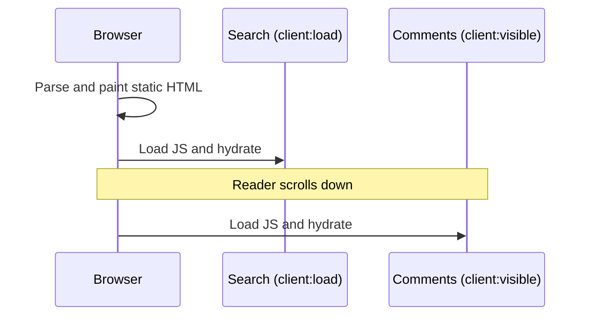

import Note from '../../components/Note.astro';

Most pages on a content site are static: a header, some prose, a footer. Yet many frameworks ship a runtime to hydrate all of it. Astro flips the default — every component renders to HTML on the server, and only the parts you mark as interactive get JavaScript.

## What is an island?

An island is an interactive component embedded in otherwise static HTML. Each island hydrates on its own, so a slow widget at the bottom of a page never blocks the search box at the top.

```astro title="src/pages/index.astro"
---
import Layout from '../layouts/Layout.astro';
import Search from '../components/Search.tsx';
import Comments from '../components/Comments.tsx';
---

<Layout title="Home">
  <!-- Hydrates immediately -->
  <Search client:load />

  <!-- Hydrates when scrolled into view -->
  <Comments client:visible />
</Layout>
```

The page above ships two small bundles: one for `Search`, one for `Comments`. The layout, the header and every paragraph around them are plain HTML with no runtime attached.

## Choosing a client directive

The directive decides when an island’s JavaScript loads. Pick the latest moment that still feels instant to the reader.

- `client:load` — hydrate as soon as the page loads. Use it for above-the-fold UI.
- `client:idle` — wait until the main thread is idle.
- `client:visible` — hydrate when the element enters the viewport.
- `client:media` — hydrate only when a media query matches.

For the page above, the timeline looks like this:



<Note>a component without any `client:*` directive renders to static HTML and ships no JavaScript at all.</Note>

A useful rule of thumb: if the reader has to scroll to reach it, it can almost always be `client:visible`. If it only matters on small screens — a hamburger menu built as a framework component, say — `client:media="(max-width: 767px)"` keeps it off desktop entirely.

## Measuring the difference

Run `astro build` and look inside `dist/_astro`. Each island becomes its own chunk, so you can see exactly what every interactive component costs — and which ones could move to a later directive.

```bash
npx astro build
ls -lh dist/_astro/*.js
```

Start with everything static, then add islands one at a time. It is much easier to justify each kilobyte when you add it than to find it later.
