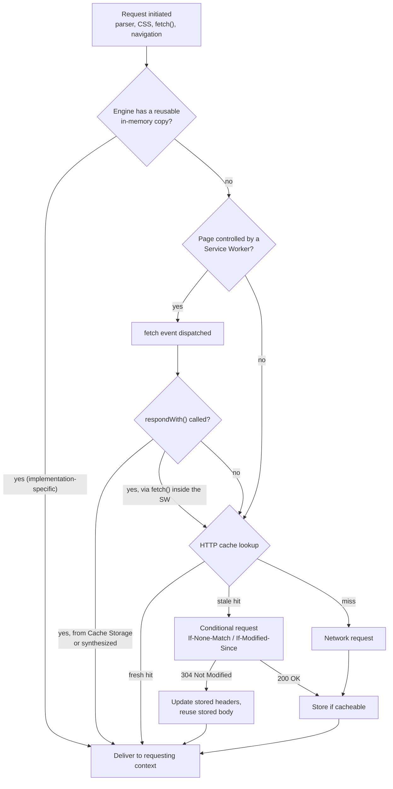
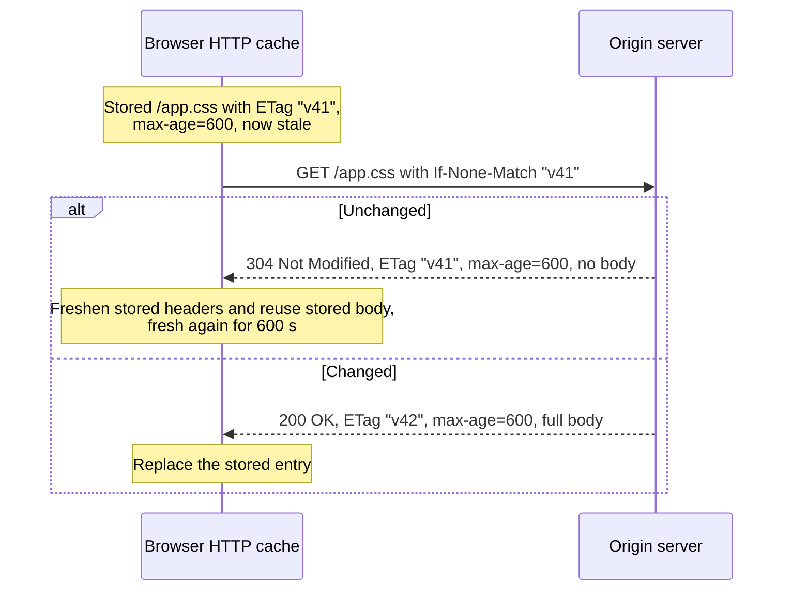
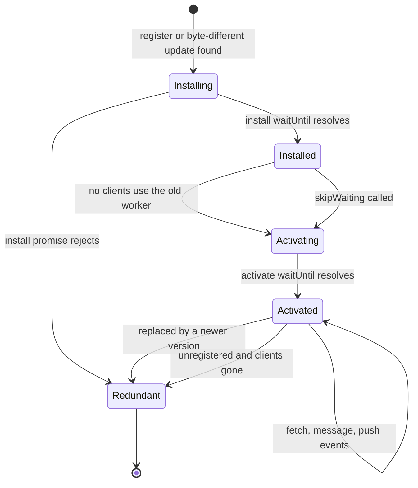
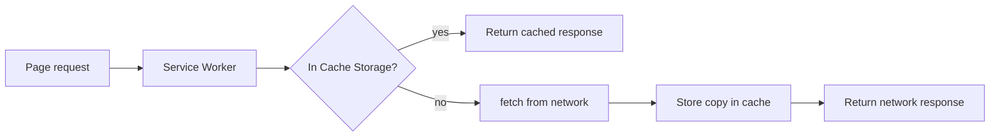
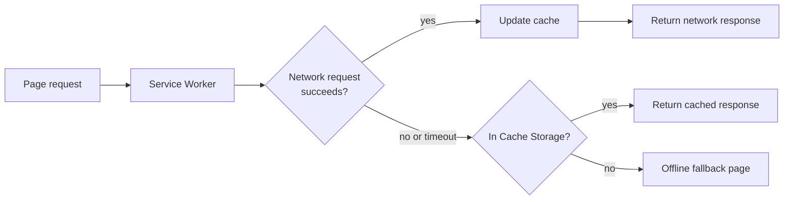
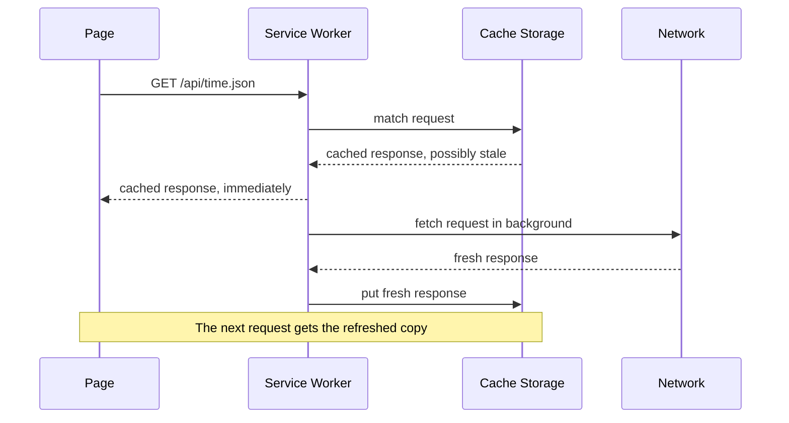
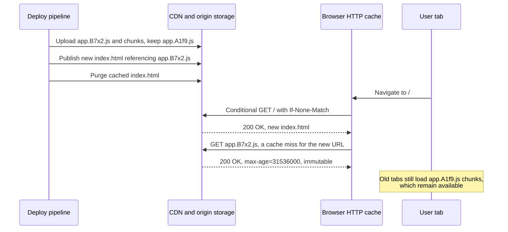
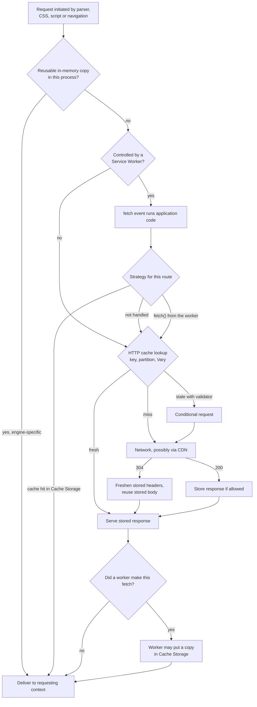

import Note from '../../components/Note.astro';

Open the Network panel in Chrome DevTools, reload a page a few times, and the Size column fills up with labels: `(memory cache)`, `(disk cache)`, `(ServiceWorker)`, a status of `304`, sometimes a plain byte count. They look like answers, but they raise more questions than they settle. Why did the logo come from memory on one reload and from disk on the next? Why did a script that was "cached" still produce a request? Why does a user keep seeing last week's JavaScript after a deploy when the developer's own browser shows the new version?

All of those questions reduce to one:

**When a browser requests a resource, how does it decide whether to retrieve it from memory cache, disk cache, Service Worker Cache Storage, or the network?**

The short answer is that these are not four stops on a single lookup ladder. Two of them (memory cache and disk cache) are names for where a browser's own implementation happens to keep things. One (the HTTP cache) is a set of rules, standardized in [RFC 9111](https://www.rfc-editor.org/rfc/rfc9111), that decides whether a stored response may be reused. And one (Service Worker Cache Storage) is a programmable store that your JavaScript fills and reads, sitting in front of all the others only when a Service Worker controls the page. The long answer is this post.

It builds on two earlier posts. [Inside the browser rendering pipeline](/blog/inside-the-browser-rendering-pipeline-from-html-to-pixels) covers how the preload scanner and parser discover resources in the first place, and [The browser security model](/blog/the-browser-security-model-same-origin-policy-cors-and-csp) covers origins, sites, CORS and opaque responses, which come up again when we look at cache keys and Cache Storage. [Web performance metrics](/blog/web-performance-metrics-a-deep-dive-into-core-web-vitals) explains why the cache decisions described here show up so directly in LCP.

<Note>
  three kinds of statement appear in this post and they are labelled where it matters. **Standards** (RFC 9110, RFC
  9111, the WHATWG Fetch and HTML standards, the W3C Service Workers specification) define behaviour every conforming
  browser should share. **Implementation details** (mostly Chromium's, because Chrome DevTools is what most readers will
  use to observe them) are how a particular engine happens to work today and can change between versions without notice.
  **Application behaviour** is whatever your own code, framework, server or CDN decides to do. Most confusion about
  caching comes from mixing these three up.
</Note>

## What browser caching is and why it exists

### The underlying problem

Every resource a page needs has to arrive from somewhere. Over the network, that means DNS resolution (if not already resolved), a TCP or QUIC handshake, a TLS handshake, the request itself, server processing time, and the transfer of the response body. On a good connection with a warm connection pool the fixed part of that cost might be a single round trip of 20 to 50 ms. On a mobile network it can be several hundred milliseconds before the first byte arrives, and the body then competes for limited bandwidth with every other resource on the page.

Most of those resources do not change between visits. A site's logo, its fonts and the JavaScript bundle produced by last Tuesday's build are byte-for-byte identical on the first visit and the fiftieth. Fetching them again is pure waste: the user waits, their data plan pays, and the server (or CDN) does work whose output is already sitting on the user's machine from last time.

Caching is the answer to that waste: keep a copy of a response, and under the right conditions reuse it instead of asking again. The hard part is "the right conditions". A stale copy of a logo is harmless. A stale copy of `index.html` that references JavaScript files the server deleted an hour ago breaks the site. Most of this post is about how browsers, servers and application code agree on those conditions.

### What caching improves

- **Page load performance.** A response served from a local cache has no connection setup, no server time and no transfer time. For resources on the critical rendering path (render-blocking CSS, the LCP image, synchronous scripts) that translates directly into earlier first paint and earlier LCP.
- **Network utilization.** Bytes that are not transferred do not consume bandwidth. This matters doubly on constrained connections, where avoiding a 300 KB font download frees the pipe for the resources that actually changed.
- **Server and CDN load.** Every cache hit in the browser is a request the origin and CDN never see. Even a successful revalidation (a `304 Not Modified`) is cheaper for the server than generating and sending a full body.
- **Repeat navigation performance.** The second page view on a site typically reuses most of the subresources from the first: the same CSS, the same framework chunks, the same fonts. Good caching is why multi-page sites can feel nearly instant after the first load.
- **Offline and unreliable-network experiences.** With a Service Worker, an application can decide to serve stored responses when the network is unavailable, turning "No internet" into a usable (if possibly slightly out of date) application.

### Browser caching versus CDN caching versus server-side caching

The word "cache" covers several layers that a single request may pass through.

- **Browser caching** happens on the user's device. The browser's HTTP cache is a _private_ cache in RFC 9111 terms: it serves exactly one user, so it may store responses that are personalized for that user.
- **CDN and proxy caching** happens in intermediaries between the user and the origin. These are _shared_ caches: one stored response may be served to many different users, so they must be careful never to store or serve a response that is personal to someone else.
- **Server-side caching** happens behind the origin: a reverse proxy like Varnish or Nginx, an in-memory store like Redis caching database results, a framework's rendered-page cache, a database's own buffer pool. These are invisible to HTTP clients. From the browser's point of view the server just responded quickly.

Each layer has its own key, its own eviction policy and its own invalidation story. A deploy that purges the CDN does nothing to a response already sitting in a user's browser cache with six months of freshness left.

### Client-side caching versus application-level caching

Inside the browser there is a second split. Some caching is done _by the browser_ on behalf of the page: the HTTP cache, the in-memory resource caches, the back/forward cache. Page JavaScript cannot list, read or delete those entries directly, and the browser makes the decisions according to standards and its own heuristics.

Other caching is done _by your application_ using storage APIs: Service Worker Cache Storage, IndexedDB, `localStorage`, or a plain JavaScript object holding API results in memory (which is what data libraries such as TanStack Query, SWR, Apollo Client and framework routers do). These caches obey whatever rules your code implements. The browser stores the bytes, but it does not decide when they are stale.

### Caching a resource versus caching an HTTP response

It is natural to speak of "caching `app.js`", but HTTP caches do not store files. They store **responses to requests**: a status code, a set of response headers, a body, and enough information about the request that produced it to decide whether a future request can be satisfied by it. The cache key starts with the URL but can include more (the method, selected request headers named by `Vary`, and in modern browsers the site that made the request). Two requests for the same URL can map to different cache entries, and a single cache entry can be useless for a request that differs in a header the response varied on.

That distinction becomes important later. It is why `Vary` exists, why Cache Storage stores `Request`/`Response` pairs, and why the same font fetched by two different sites is downloaded twice.

### First request and subsequent requests

On the very first visit, the browser has nothing stored. A request for `https://shop.example/assets/app.3f9a1c.js` goes to the network. When the response arrives, the browser looks at its status code and headers, decides whether it is allowed to store it, and if so writes it to its HTTP cache along with metadata: when it was received, what the validators (`ETag`, `Last-Modified`) were, how long it stays fresh.

On a subsequent request for the same URL, the browser has options:

1. Reuse a copy it still holds in memory from earlier in the same session, without consulting the HTTP cache rules again (this is the in-memory reuse that shows up as `(memory cache)` in Chrome).
2. Find a stored response in the HTTP cache that is still _fresh_ and serve it with no network activity at all.
3. Find a stored response that is _stale_, and send a _conditional request_ asking the server whether it is still valid. If the server answers `304 Not Modified`, the stored body is reused.
4. Find nothing usable and fetch the full response again.

And if a Service Worker controls the page, all of that may be preceded by a fifth option: the Service Worker answers the request itself, from Cache Storage or by synthesizing a response, and the browser's HTTP cache is never consulted for that request.

### The mechanisms at a glance

| Mechanism                    | What it is                                                                                 | Who decides reuse                         | Standardized?                                                             |
| ---------------------------- | ------------------------------------------------------------------------------------------ | ----------------------------------------- | ------------------------------------------------------------------------- |
| Memory cache                 | In-process reuse of recently loaded resources, often already decoded or parsed             | The browser engine                        | Mostly no; a few pieces (such as the HTML "list of available images") are |
| Disk cache                   | The persistent storage backing the browser's HTTP cache                                    | The browser, following HTTP caching rules | The rules are (RFC 9111); the storage is not                              |
| HTTP cache                   | The logical private cache defined by RFC 9111 semantics, regardless of where bytes live    | The browser, from response headers        | Yes                                                                       |
| Service Worker Cache Storage | Named stores of `Request`/`Response` pairs, read and written by script                     | Your code                                 | Yes (the API); the policy is yours                                        |
| Back/forward cache (bfcache) | A snapshot of an entire page, including its JavaScript heap, kept for instant back/forward | The browser, from page eligibility        | Partly (the HTML standard describes it; eligibility varies)               |
| IndexedDB and other storage  | Application data storage                                                                   | Your code                                 | Yes                                                                       |

These are related, but they are not the same kind of thing. Memory and disk describe _where_. The HTTP cache describes _whether_. Cache Storage is _your code's_ store. bfcache stores _pages_, not responses. Keeping those categories separate is most of the battle.

## The big picture: how a request finds its response

### Where requests come from

Requests enter the browser's loading machinery from many places:

- **The HTML parser and preload scanner**, for `<script src>`, `<link rel="stylesheet">`, ``, `<link rel="preload">`, `<iframe>` and so on. The preload scanner reads ahead of the parser so that resources are requested before the parser reaches them.
- **The CSS engine**, for `url()` references in stylesheets (background images, fonts via `@font-face`, `@import`ed stylesheets). These are only requested when a style rule actually needs them; a font is fetched when text using it is laid out, not when the stylesheet is parsed.
- **JavaScript**, through `fetch()`, `XMLHttpRequest`, dynamic `import()`, `new Image()`, `new Worker()` and DOM insertion of elements with URLs.
- **Navigations**, when the user clicks a link, submits a form, types a URL or a script sets `location.href`.

Each of these becomes, in the vocabulary of the [WHATWG Fetch Standard](https://fetch.spec.whatwg.org/), a _request_ with properties that affect caching:

- **destination** (`document`, `script`, `style`, `image`, `font`, an empty string for `fetch()`, and others) says what the response will be used for. It influences prioritization, the `Accept` header the browser sends, Content Security Policy checks and, in Chromium, which in-memory caches can hold the result.
- **mode** (`navigate`, `same-origin`, `no-cors`, `cors`) determines what the requesting context is allowed to read. A `no-cors` cross-origin request produces an _opaque_ response whose body and headers the page cannot inspect, which matters for Cache Storage later.
- **cache mode** (`default`, `no-store`, `reload`, `no-cache`, `force-cache`, `only-if-cached`) tells the HTTP cache how to behave for this one request. Browser actions set it implicitly (a hard reload is roughly `reload`), and `fetch()` lets you set it explicitly.
- **credentials mode** and **referrer** affect which cookies and headers are sent, and therefore what response a server may return.

### The lookup, step by step

The Fetch Standard describes the processing in layers. Simplified, and leaving out security checks that do not affect caching, it goes like this:

1. **Service Worker interception.** If the request's client (the document or worker that made it) is controlled by a Service Worker, and the request is one Service Workers may handle, the browser dispatches a `fetch` event to that Service Worker. If the Service Worker calls `event.respondWith()` with a response, that is the response. Everything below is skipped for this request. If the Service Worker does not call `respondWith()`, processing continues as though it were not there.
2. **HTTP-network-or-cache fetch.** The request reaches the HTTP cache. Depending on the cache mode and on what is stored, the cache either serves a fresh stored response, sends a conditional request to revalidate a stale one, or forwards the request to the network.
3. **Network fetch.** The request goes over a connection. The response comes back and, if it is storable, is written to the HTTP cache on the way up.
4. **Response processing.** The response is checked (CORS, CORB/ORB, CSP, integrity metadata) and handed to the requesting context: the parser, the image decoder, the stylesheet engine, or a JavaScript promise.

Notice what is absent from that list: "memory cache" and "disk cache". The standards define an HTTP cache without saying where its bytes live. Browser engines then add their own optimizations in front of and underneath that logical cache.



The first diamond deserves a caveat. In Chromium, an engine-level in-memory reuse can happen before the Service Worker is consulted for some subresources in a document that already loaded the same resource, because the resource is already present in the renderer and does not need to be fetched at all. Whether that happens, and for which resource types, is implementation behaviour, not something the standards promise. The rest of the diagram follows the Fetch Standard.

### A Service Worker is not another HTTP cache layer

It is tempting to picture the Service Worker as "cache level zero" in front of the HTTP cache. That picture is wrong in an important way. The HTTP cache is a passive mechanism with fixed rules: given a request and stored responses, RFC 9111 determines the outcome. A Service Worker is _code_. On each `fetch` event it can:

- return a response from Cache Storage, regardless of how old it is or what its `Cache-Control` header says;
- call `fetch()` itself, possibly with a modified request, which goes through the normal HTTP cache and network path;
- race the two, or try one and fall back to the other;
- synthesize a response from scratch (`new Response('...')`), or assemble one from IndexedDB data;
- do nothing and let the browser handle the request normally.

So the answer to "where did this response come from?" for a controlled page always starts with "what does the Service Worker's code do for this URL?", and only then reaches HTTP caching rules, which apply to whatever `fetch()` calls the Service Worker makes (and to requests it declines to handle).

### Hits, misses, validation, fallback and eviction

A few terms recur throughout the post:

- A **cache hit** means a stored response was found that may satisfy the request. A **fresh hit** is served without contacting the server. A **stale hit** needs validation first, unless something (such as `stale-while-revalidate` or a history navigation) permits serving it stale.
- A **cache miss** means nothing suitable was stored: no entry for the key, or an entry whose `Vary`-selected headers do not match the new request.
- **Validation** (or revalidation) is the conditional request that asks the origin whether a stored response is still current.
- **Network fallback** is what happens on a miss: the request goes to the origin. In Service Worker strategies, the term is also used the other way around (cache as a fallback when the network fails).
- **Eviction** is the removal of stored entries to free space, independent of freshness. A response with a year of freshness left can still be evicted tomorrow if the cache is full.

## Memory cache: in-process resource reuse

### What memory cache is

"Memory cache" is not a single standardized component. It is the collective name for the ways a browser engine keeps recently used resources in RAM, inside a process, so that a second use does not have to go through the full loading path. In Chromium the most visible piece is Blink's `MemoryCache`, which holds loaded resources (images, scripts, stylesheets, fonts) so that a later request in a renderer for the same resource can be satisfied from the already-loaded object. When Chrome DevTools labels a request `(memory cache)`, it means the request was satisfied this way and never reached the network stack, the Service Worker or the HTTP cache.

The motivation is speed in two senses. RAM access is orders of magnitude faster than reading from an SSD, and much faster again than a spinning disk. More importantly, a resource held in memory has often already been _processed_: a stylesheet already parsed, an image already decoded into a bitmap, a font already parsed into glyph tables. Reusing that object skips not just I/O but CPU work.

There are a few places where the standards do describe in-memory reuse explicitly:

- The HTML Standard's [list of available images](https://html.spec.whatwg.org/multipage/images.html#list-of-available-images) is a per-document list that lets the same image URL (with matching CORS mode and origin) be reused immediately, even synchronously, without re-fetching. This is why inserting a second `` with an already-loaded URL can render instantly.
- The HTML Standard's handling of `<link rel="preload">` holds preloaded responses in a [map of preloaded resources](https://html.spec.whatwg.org/multipage/links.html#map-of-preloaded-resources) until a matching request consumes them. A preload whose response is never used produces the familiar "preloaded but not used within a few seconds" console warning in Chrome.

Everything else about memory caches is implementation-specific.

### What lives in memory

Engines keep different representations of a resource:

- **Response bytes.** The encoded body as it arrived (after decompression of the transfer encoding), for example the PNG or the UTF-8 text of a script.
- **Decoded or processed forms.** A decoded image bitmap, which for a 2000×1500 photo is around 12 MB of RGBA pixels regardless of how small the JPEG was. A parsed stylesheet. Compiled JavaScript bytecode. Parsed font tables.

These forms are cached separately and evicted on different schedules. An image decoder cache, for example, may discard a decoded bitmap that is off-screen while the encoded bytes stay in the resource cache, ready to be decoded again if the image scrolls back into view. When people say "the image came from memory cache", they usually mean the resource object; whether the decoded pixels were also still around is a separate question with no DevTools label.

### How memory cache behaves

**Within a page.** If a document references the same image URL in ten places, it is fetched once. If a script inserts an element whose URL was already loaded, it is typically served from memory. This is the most reliable form of memory-cache reuse.

**Across navigations.** In Chromium, a renderer process may keep its memory cache across same-site navigations handled by that process, so a resource loaded on page A may be served from memory on page B. Whether that happens depends on whether the navigation stays in the same renderer process, which depends on site isolation, process reuse heuristics and memory pressure. A cross-site navigation generally lands in a different process with an empty memory cache.

**Across tabs.** Two tabs do not share a memory cache unless they share a renderer process, which modern browsers increasingly avoid for security reasons. Cross-tab reuse normally goes through the HTTP cache (disk or the network stack's own in-memory layer), not through the renderer's memory cache.

**Identity and request characteristics.** A memory-cache hit requires that the new request be compatible with the cached resource, not merely the same URL. A resource loaded in `no-cors` mode is not reusable for a `crossorigin="anonymous"` request to the same URL, because the second request needs a CORS-checked response the first did not perform. Credentials mode, integrity metadata, and the HTTP cache's own rules for responses marked `no-store` all play a role. The details are engine-specific, but the principle is universal: memory reuse must not grant a request something it would not have received from a real fetch.

**Memory pressure and eviction.** Memory caches are bounded, and browsers trim them aggressively when the system or the tab is under memory pressure, when a tab moves to the background, or simply on a least-recently-used basis. On a low-memory Android device, a resource may be gone from memory seconds after it stopped being visible.

**Browser differences.** Firefox, Safari and Chromium all have in-memory caching, but with different architectures. Firefox's network cache has its own memory pool in front of disk storage, and its image library keeps decoded images in a separate surface cache. Safari's WebKit has its own `MemoryCache` with different sizing. None of them document cache sizes or eviction order as a contract.

### Investigating memory cache in Chrome DevTools

Open DevTools, select the Network panel, and load a page that references the same image twice, or that inserts an image dynamically after load. Requests satisfied from memory show `(memory cache)` in the **Size** column (with "Transferred" mode enabled, the column shows the transferred size and the resource size on separate lines). Their Time is typically `0 ms`. They have no timing breakdown worth reading, because no network stack was involved.

A few things are worth knowing when you interpret the label:

- **"Disable cache" disables memory-cache reuse too.** With the checkbox ticked (and DevTools open), Chrome bypasses both its HTTP cache and in-memory reuse for the page, so you will not see `(memory cache)` at all. That is useful for simulating a first visit, and misleading if you forget it is on.
- **Normal reload versus hard reload.** On a normal reload, Chrome revalidates the main document and, since a 2017 change, generally reuses subresources according to their freshness instead of revalidating all of them ([Chromium blog: Reload, reloaded](https://blog.chromium.org/2017/01/reload-reloaded-faster-and-leaner-page_26.html)). Some of those subresources may come from memory if the renderer kept them. A hard reload (Ctrl+Shift+R, Cmd+Shift+R) asks every request to bypass caches, so memory and disk labels disappear.
- **Variation between navigations is expected.** The same resource may show `(memory cache)` on one navigation and `(disk cache)` on the next, because the renderer process was swapped or the memory cache was trimmed in between. That is not a misconfiguration.

The appearance of `(memory cache)` tells you how this particular request was satisfied in this browser at this moment. It is not a standardized API, there is no header that forces it, and its absence on another browser or another visit does not indicate a problem.

## Disk cache: persistent HTTP response storage

### What disk cache is

The disk cache is where a browser persists its HTTP cache entries so they survive beyond the lifetime of a renderer process, a tab or the browser itself. When you close Chrome, reopen it the next day and visit a site you used yesterday, the fonts and hashed bundles that load with `(disk cache)` were read from files in your browser profile directory.

The relationship to the HTTP cache is the key point. The **HTTP cache** is the logical thing RFC 9111 describes: a store of responses, keyed by request, governed by freshness and validation rules. The **disk cache** is an implementation of its storage. Browsers also keep part of the HTTP cache in memory at the network-stack level (Chromium can run its HTTP cache entirely in memory for Incognito profiles, for example), so even the HTTP cache is not always "on disk". DevTools' `(disk cache)` label specifically means that the response came from the network stack's HTTP cache rather than from the renderer's memory cache or the network.

Unlike the memory cache, the disk cache is shared across all tabs and renderer processes of a profile, subject to partitioning (discussed below).

### What gets stored

A disk cache entry contains:

- **The response body**, as received (typically still content-encoded, for example gzip or Brotli compressed, so it can be served for a future request that accepts that encoding).
- **The response headers**, including `Cache-Control`, `Expires`, `Date`, `Age`, `Content-Type`, validators and `Vary`.
- **Metadata about the exchange**: when the request was sent and the response received (needed for age calculation), the request headers named in `Vary` (needed for matching), and the cache key.
- **Validators**: the `ETag` and `Last-Modified` values used to build conditional requests.
- **Engine-specific side data.** Chromium, for example, stores V8's compiled code cache for frequently used scripts alongside the cached script response, so that a repeat visit can skip parsing and compiling ([V8: Code caching for JavaScript developers](https://v8.dev/blog/code-caching-for-devs)). That compiled code is tied to the HTTP cache entry; if the entry changes, the code cache is discarded.

The cache key has also changed in recent years. To prevent cross-site tracking and timing attacks that probe whether another site's resources are cached, modern browsers **partition** the HTTP cache. Chrome since version 86 keys entries not only by URL but also by the top-level site and the frame's site ([Chrome for Developers: Gaining security and privacy by partitioning the cache](https://developer.chrome.com/blog/http-cache-partitioning)). Safari and Firefox partition too, with different details. The practical consequence is that the old advice to load popular libraries or fonts from a shared public CDN "because users will already have them cached" no longer holds: a copy cached while visiting `site-a.example` will not be used on `site-b.example`.

### The disk cache lifecycle

1. **Entry creation.** When a response arrives from the network, the browser decides whether it may store it. RFC 9111 §3 forbids storing responses to requests with `no-store`, responses marked `no-store`, and (for shared caches) `private` responses. It also requires the response to have something that makes it reusable: an explicit freshness lifetime, a validator, or a status code that is heuristically cacheable. Browsers apply their own size limits too; a very large response may not be written to disk at all.
2. **Lookup.** On a later request, the key (partition, method, URL) is looked up. If an entry exists, its stored `Vary` request headers are compared against the new request.
3. **Freshness evaluation.** The browser computes the entry's freshness lifetime and current age (the arithmetic is in the HTTP section below). If it is fresh and the request's cache mode allows it, the stored response is served with no network traffic.
4. **Revalidation.** If it is stale, or the response or request demands validation (`no-cache`), the browser sends a conditional request.
5. **Update.** A `304 Not Modified` updates the stored headers (refreshing the entry's age and possibly its freshness lifetime) while keeping the stored body. A `200 OK` replaces the entry.
6. **Eviction.** Independently of freshness, the cache has a size budget. When it is exceeded, entries are removed, broadly least-recently-used first, though engines use their own scoring. The size budget itself is often a function of available disk space and is not something a site can influence.
7. **Clearing.** The user can clear it (Settings → Privacy → Clear browsing data → Cached images and files), a site can ask for its own entries to be cleared with the `Clear-Site-Data: "cache"` response header ([MDN](https://developer.mozilla.org/en-US/docs/Web/HTTP/Reference/Headers/Clear-Site-Data)), and storage pressure can cause the browser to discard it.

### Memory cache versus disk cache

| Aspect      | Memory cache                                                         | Disk cache                                                        |
| ----------- | -------------------------------------------------------------------- | ----------------------------------------------------------------- |
| Storage     | RAM, inside a renderer or network process                            | Persistent storage in the browser profile                         |
| Access      | Typically faster; may hold already-decoded or parsed forms           | Typically slower; bytes must be read and processed again          |
| Persistence | Generally short-lived: the lifetime of a document or process         | Can survive navigations, tab closes and browser restarts          |
| Scope       | Usually one renderer process                                         | Shared across tabs of a profile, subject to cache partitioning    |
| Capacity    | Constrained by memory budgets; trimmed under memory pressure         | Managed by the browser's own size budget, often tied to free disk |
| Eviction    | Memory pressure, backgrounding, engine-specific LRU policies         | Cache size limits, storage pressure, explicit clearing            |
| Governed by | Engine policy, constrained so it never violates HTTP cache semantics | HTTP caching rules (RFC 9111) plus the engine's storage policy    |

Every row in this table describes typical behaviour, not a guarantee. An engine is free to keep a disk-cache entry in an OS page cache that makes it effectively as fast as memory, to skip memory caching for some resource types, or to never write large media responses to disk. The standards only constrain the observable result: whichever storage an engine uses, it must not serve a response that HTTP caching rules (or the request's cache mode) forbid.

### Investigating disk cache in Chrome DevTools

A request served from the HTTP cache shows `(disk cache)` in the Size column of the Network panel, usually with a small but non-zero time (a few milliseconds of read latency). Hover or click the request to see the stored response headers in the Headers tab; the "Status Code" line is annotated with `(from disk cache)`.

To see disk-cache behaviour clearly:

- Load a page, then open the same URL in a new tab, or close the browser entirely and reopen it. The renderer's memory cache is gone, so fresh responses come from disk.
- Leave **Disable cache** unticked. With it ticked, the HTTP cache is bypassed for requests from that tab while DevTools is open.
- Compare a normal reload (fresh subresources are served from cache; the document is revalidated) with a hard reload (everything bypasses the cache) and with **Empty Cache and Hard Reload** (right-click the reload button while DevTools is open), which clears the HTTP cache first.

Several things can explain why a resource you saw cached earlier is fetched again:

- Its freshness lifetime expired, so the browser sent a conditional request (you will see a `304`, or a `200` if it changed).
- The response varied on a request header that changed (`Vary`), so the stored entry did not match.
- The request came from a different top-level site, so it used a different cache partition.
- The entry was evicted, or the user or a `Clear-Site-Data` header cleared the cache.
- The request used a cache mode that bypasses the cache (`fetch(url, { cache: 'no-store' })`, a hard reload, or DevTools' Disable cache).
- A Service Worker handled the request and returned a network response through its own logic.

## HTTP caching: the rules behind every reuse decision

Memory and disk describe storage. HTTP caching describes _permission_: whether a stored response may be used to satisfy a new request, for how long, and what must happen once that time is up. The current specification is [RFC 9111: HTTP Caching](https://www.rfc-editor.org/rfc/rfc9111) (June 2022), which obsoletes RFC 7234, together with [RFC 9110: HTTP Semantics](https://www.rfc-editor.org/rfc/rfc9110), which defines validators, conditional requests and status codes. Two directives commonly used with them come from separate RFCs: `stale-while-revalidate` and `stale-if-error` from [RFC 5861](https://www.rfc-editor.org/rfc/rfc5861), and `immutable` from [RFC 8246](https://www.rfc-editor.org/rfc/rfc8246).

### Fundamentals

**Cacheable versus non-cacheable.** RFC 9111 §3 lets a cache store a response only if, among other conditions, the request method is understood and cacheable (in practice `GET`), the status code is final, neither the request nor the response contains `no-store`, and the response has explicit freshness information, a validator, or a status code that is cacheable by default (200, 203, 204, 206, 300, 301, 308, 404, 405, 410, 414 and 501, per RFC 9110 §15.1). `POST` responses are effectively never reused by browser caches.

**Fresh versus stale.** A stored response is _fresh_ while its current age is less than its freshness lifetime. A fresh response can be served without contacting the origin. A _stale_ response must normally be validated first. Being stale does not mean being deleted: a stale entry with a validator is still valuable, because a `304` lets the cache reuse its body.

**Private versus shared caches.** A _private cache_ serves a single user; the browser's HTTP cache is the canonical example. A _shared cache_ serves many users: CDNs, corporate proxies, reverse proxies. Several directives exist only because of this distinction: `private` forbids shared caches from storing a response, `s-maxage` gives shared caches a different lifetime, and `proxy-revalidate` applies `must-revalidate` only to shared caches.

**Directives in requests and responses.** `Cache-Control` appears in both. Response directives are the server's instructions for how the response may be cached. Request directives are the client's wishes for this one request. Browsers send request directives themselves in specific situations: a hard reload sends `Cache-Control: no-cache` (and the legacy `Pragma: no-cache`) so that intermediaries revalidate too. By contrast, `fetch(url, { cache: 'no-store' })` instructs the browser's own HTTP cache; the Fetch Standard has the browser add `Cache-Control` request headers for some cache modes so intermediaries behave consistently.

### Cache-Control directives in practice

Each example below shows a response header, what it achieves and who it is aimed at.

**`max-age=N`** sets the freshness lifetime to N seconds, measured from when the response was generated (accounting for `Age`, see below). It applies to all caches.

```http title="A stylesheet that stays fresh for ten minutes"
HTTP/1.1 200 OK
Content-Type: text/css
Cache-Control: max-age=600
ETag: "a1b2c3"
```

For ten minutes, requests for this stylesheet are served from cache with no network activity. After that, the browser sends `If-None-Match: "a1b2c3"` and reuses the body if the server replies `304`.

**`s-maxage=N`** overrides `max-age` (and `Expires`) for shared caches only. Browsers ignore it.

```http title="Short in the browser, long at the CDN"
Cache-Control: max-age=60, s-maxage=86400
```

The browser treats the response as fresh for one minute. The CDN keeps it for a day, which is safe only if the CDN can be purged when the content changes.

**`no-cache`** allows storing but forbids reusing the stored response without successful validation. Every use costs a round trip, but an unchanged response costs only headers.

```http title="An HTML document that must always be checked"
HTTP/1.1 200 OK
Content-Type: text/html; charset=utf-8
Cache-Control: no-cache
ETag: "home-7d1e"
```

**`no-store`** forbids caches from storing the request or response at all.

```http title="A bank statement page"
Cache-Control: no-store
```

The difference between these two is one of the most commonly misunderstood points in web development. `no-cache` does not mean "don't cache"; it means "don't use the cache without asking". `no-store` means "don't cache". For a page that changes on every deploy but is not sensitive, `no-cache` with an `ETag` gives you freshness with cheap revalidation. `no-store` throws that benefit away, forces a full download on every request and, in most browsers, also keeps the page out of the back/forward cache (Chrome now relaxes this in limited cases, covered in the bfcache section). Reserve it for genuinely sensitive responses.

**`public`** marks a response as storable by any cache, even when it would not otherwise be (for example, a response to a request carrying an `Authorization` header, which shared caches would otherwise refuse to store). For ordinary responses with `max-age`, `public` adds nothing: they are already storable.

**`private`** says the response is intended for a single user. The browser may store it; shared caches must not.

```http title="A personalized account summary"
Cache-Control: private, max-age=0, must-revalidate
ETag: "acct-91f2"
```

**`must-revalidate`** says that once the response is stale, a cache must not use it without successful validation, even if it cannot reach the origin (in which case it must return an error such as `504 Gateway Timeout`). Without it, RFC 9111 §4.2.4 allows caches to serve stale responses in limited circumstances, such as when disconnected from the origin. `max-age=0, must-revalidate` is close to `no-cache` in effect.

**`proxy-revalidate`** is `must-revalidate` for shared caches only. It is rarely used.

**`immutable`** tells the cache that the response body will never change while it is fresh, so there is no point revalidating it, even on a user-initiated reload ([RFC 8246](https://www.rfc-editor.org/rfc/rfc8246)).

```http title="A content-hashed bundle"
Cache-Control: public, max-age=31536000, immutable
```

Firefox and Safari honour `immutable` on reload. Chrome does not implement the directive; since its 2017 reload change it already avoids revalidating fresh subresources on a normal reload, which achieves the same result for most pages.

**`stale-while-revalidate=N`** lets a cache serve a stale response for up to N seconds past its freshness lifetime _while_ it revalidates in the background ([RFC 5861](https://www.rfc-editor.org/rfc/rfc5861)). The user gets the fast stale response; a later request gets the refreshed one.

```http title="An avatar image that may be slightly out of date"
Cache-Control: max-age=600, stale-while-revalidate=86400
```

Fresh for ten minutes. For the following day, a request is served from cache immediately and triggers a background revalidation. After that window, the response is treated as plain stale. Chrome (since 75), Firefox (since 68) and Safari (since 14) implement it in their HTTP caches ([MDN compatibility data](https://developer.mozilla.org/en-US/docs/Web/HTTP/Reference/Headers/Cache-Control#browser_compatibility)). CDNs widely support it.

**`stale-if-error=N`** lets a cache serve a stale response for up to N seconds if revalidation fails with a server error (500, 502, 503, 504) or cannot reach the origin. It is mainly implemented by CDNs and proxies; browser HTTP caches generally do not act on it.

**How directives interact.** A few rules resolve most combinations:

- `no-store` wins over everything: nothing else matters if the response may not be stored.
- `no-cache` with `max-age` is legal; `no-cache` still forces validation on every reuse.
- For shared caches, `s-maxage` overrides `max-age`, which overrides `Expires`. Browsers skip `s-maxage`.
- `private` restricts _who_ may store; `max-age` controls _how long_. They combine freely.
- When directives conflict (for example `max-age` together with `no-cache`), RFC 9111 §4.2.1 says the most restrictive one should be honoured. When the same directive appears more than once with different values, a cache should either use the first occurrence or treat the response as stale.

| Directive                | Applies to         | Effect                                                   | Typical use                                 |
| ------------------------ | ------------------ | -------------------------------------------------------- | ------------------------------------------- |
| `max-age=N`              | All caches         | Fresh for N seconds after generation                     | Most cacheable resources                    |
| `s-maxage=N`             | Shared caches only | Overrides `max-age` and `Expires` at CDNs and proxies    | Longer CDN lifetime with purge-on-deploy    |
| `no-cache`               | All caches         | May store; must validate before every reuse              | HTML documents, frequently changing JSON    |
| `no-store`               | All caches         | Must not store                                           | Sensitive, personal responses               |
| `public`                 | All caches         | Explicitly storable, even if the request was authorized  | Rarely needed                               |
| `private`                | Shared caches      | Shared caches must not store; the browser may            | Personalized pages and API responses        |
| `must-revalidate`        | All caches         | Never serve stale without successful validation          | Correctness-critical data                   |
| `proxy-revalidate`       | Shared caches only | `must-revalidate` for shared caches                      | Rare                                        |
| `immutable`              | All caches         | Do not revalidate while fresh, even on reload            | Content-hashed static assets                |
| `stale-while-revalidate` | All caches         | Serve stale during background revalidation for N seconds | Avatars, non-critical JSON, CDN-cached HTML |
| `stale-if-error`         | All caches         | Serve stale for N seconds if the origin fails            | CDN resilience                              |

### Freshness and expiration

The core question a cache asks of a stored response is: **is its current age less than its freshness lifetime?** RFC 9111 §4.2 defines both.

**Freshness lifetime** (§4.2.1) is taken from the first of these that applies:

1. For a shared cache, `s-maxage`.
2. `max-age`.
3. `Expires` minus `Date`. `Expires` is an absolute HTTP date such as `Expires: Wed, 11 Nov 2026 18:00:00 GMT`. Because it depends on clocks agreeing, `max-age` is preferred and wins if both are present. An invalid `Expires` value (including `0`) means "already expired".
4. Otherwise, a **heuristic** lifetime, if the response is heuristically cacheable.

**Heuristic freshness** (§4.2.2) applies when a server sends no explicit lifetime. RFC 9111 suggests, but does not require, using a fraction of the time since `Last-Modified`, with 10% as the typical value. A file last modified 30 days ago could then be considered fresh for 3 days without any `Cache-Control` header at all. Browsers do implement heuristics, which is why "we never set caching headers" often produces stale-content bugs rather than no caching: the server sent `Last-Modified` (most static file servers do), and the browser computed a lifetime from it. Always send an explicit `Cache-Control`.

**Current age** (§4.2.3) estimates how long ago the origin generated the response. It must account for time spent in other caches before reaching this one, and for clock skew:

```text title="RFC 9111 §4.2.3 age calculation"
apparent_age          = max(0, response_time - date_value)
response_delay        = response_time - request_time
corrected_age_value   = age_value + response_delay
corrected_initial_age = max(apparent_age, corrected_age_value)
resident_time         = now - response_time
current_age           = corrected_initial_age + resident_time
```

Here `date_value` is the `Date` header (when the origin generated the response), `age_value` is the `Age` header (how long the response sat in upstream caches such as a CDN), and `request_time` and `response_time` are the local clock readings when the request was sent and the response received.

The `Age` header is what makes CDN caching and browser caching compose correctly. Suppose an origin sends `Cache-Control: max-age=3600`, and a CDN stores the response. Fifty minutes later a user requests it, and the CDN serves its copy with `Age: 3000`. The browser computes a current age of at least 3000 seconds, so the response is fresh in the browser for only about ten more minutes, not a full hour. Without `Age`, a chain of caches could each extend a response's life by its full `max-age`.

**Stale responses.** Once `current_age >= freshness_lifetime`, the response is stale. A cache may then validate it (the normal case); serve it stale if `stale-while-revalidate` or `stale-if-error` allows it, or, for a disconnected cache without `must-revalidate`, under RFC 9111 §4.2.4; or redisplay it for history navigation. RFC 9111 §6 notes that a user agent's history mechanism is not a cache, so it may show a previously retrieved representation without regard to freshness. Browsers commonly use this latitude for back/forward navigations that miss the bfcache, preferring stored responses even when stale.

```mermaid title="How the HTTP cache decides whether to contact the server"
flowchart TD
    R["Request arrives at HTTP cache"] --> M{"Stored response matches<br/>key and Vary?"}
    M -- no --> N["Forward to network"]
    M -- yes --> NC{"no-cache on response<br/>or request?"}
    NC -- yes --> V["Send conditional request"]
    NC -- no --> F{"current_age less than<br/>freshness_lifetime?"}
    F -- yes --> S["Serve stored response,<br/>no network traffic"]
    F -- no --> SWR{"Within stale-while-revalidate<br/>window?"}
    SWR -- yes --> SS["Serve stale now,<br/>revalidate in background"]
    SWR -- no --> HV{"Has a validator?<br/>ETag or Last-Modified"}
    HV -- yes --> V
    HV -- no --> N
    V --> R304{"Server response"}
    R304 -- "304 Not Modified" --> U["Freshen stored headers,<br/>serve stored body"]
    R304 -- "200 OK" --> RP["Replace stored response,<br/>serve new body"]
```

### Validators and conditional requests

A **validator** is metadata that lets a client ask "has this changed?" without downloading it again. RFC 9110 §8.8 defines two.

**`ETag`** (entity tag) is an opaque identifier for a specific version of a representation, chosen by the server. It can be a content hash, a revision number or anything else that changes when the content changes.

```http
ETag: "33a64df551425fcc55e4d42a148795d9f25f89d4"
ETag: W/"0815"
```

The `W/` prefix marks a _weak_ validator: two representations with the same weak ETag are semantically equivalent but may not be byte-identical (the same JSON with different whitespace, for example). Strong ETags promise byte-for-byte identity, which range requests require. For cache validation with `If-None-Match`, RFC 9110 §13.1.2 uses _weak comparison_, so both work.

A common production pitfall: some servers derive ETags from file inode numbers and modification times. Behind a load balancer, two servers with identical files can generate different ETags, so revalidation against a different server returns a full `200`. Content-hash ETags avoid this.

**`Last-Modified`** is the time the origin believes the resource last changed, with one-second resolution.

```http
Last-Modified: Tue, 10 Nov 2026 08:12:31 GMT
```

It is weaker than an ETag: changes within the same second are invisible, and deploying identical files with new timestamps makes everything look modified. Most static servers send both.

When a stored response is stale (or `no-cache` requires validation), the browser sends a **conditional GET**: the same request with the stored validators attached.

- **`If-None-Match`** carries the stored ETag. The server returns `304` if the current representation's ETag matches.
- **`If-Modified-Since`** carries the stored `Last-Modified` date. The server returns `304` if the resource has not changed since then.

If both are present, RFC 9110 §13.2.2 says the server must evaluate `If-None-Match` and ignore `If-Modified-Since`.

The server then responds with one of:

- **`304 Not Modified`**: no body. It carries the headers that would have accompanied a `200` and that affect caching (`Cache-Control`, `ETag`, `Expires`, `Date`, `Vary`, `Content-Location`). The cache uses them to _freshen_ the stored response (RFC 9111 §4.3.4), resetting its age and possibly giving it a new lifetime, and serves the stored body.
- **`200 OK`**: a complete new response, which replaces the stored one.



Here is the full exchange as it appears on the wire:

```http title="First request"
GET /app.css HTTP/1.1
Host: shop.example
Accept: text/css,*/*;q=0.1
Accept-Encoding: gzip, br

HTTP/1.1 200 OK
Content-Type: text/css
Content-Encoding: br
Cache-Control: max-age=600
ETag: "v41"
Last-Modified: Mon, 09 Nov 2026 10:00:00 GMT
Date: Wed, 11 Nov 2026 12:00:00 GMT
Content-Length: 18234

(18 KB of compressed CSS)
```

```http title="Twenty minutes later: revalidation"
GET /app.css HTTP/1.1
Host: shop.example
Accept: text/css,*/*;q=0.1
Accept-Encoding: gzip, br
If-None-Match: "v41"
If-Modified-Since: Mon, 09 Nov 2026 10:00:00 GMT

HTTP/1.1 304 Not Modified
Cache-Control: max-age=600
ETag: "v41"
Date: Wed, 11 Nov 2026 12:20:00 GMT
```

The second exchange transferred a few hundred bytes of headers instead of 18 KB. But it still required a round trip: a connection (reused or new), the request, server processing and the response headers. On a 300 ms mobile round trip, a page whose render-blocking CSS and JavaScript all revalidate with `304`s waits at least one round trip before it can render, and more if those requests are discovered in sequence. **A `304` saves bytes; only a fresh hit saves time.** That is why long-lived, content-hashed asset URLs, which never need validation, beat short lifetimes plus ETags for static assets.

### Variation, cache keys and Vary

A URL does not always map to one response. A server might return Brotli-compressed bytes to one client and gzip to another, English to one user and German to another, AVIF to one browser and JPEG to another. If a cache stored the German response and served it to the next English-speaking user who requested the same URL, it would be wrong.

The `Vary` response header solves this. It names the request headers that the server used to select the response (RFC 9110 §12.5.5). The cache stores those request header values with the response, and a future request matches the stored response only if its values for those headers match (RFC 9111 §4.1).

```http title="A response that depends on the client's encoding and language"
HTTP/1.1 200 OK
Content-Type: text/html; charset=utf-8
Content-Encoding: br
Content-Language: de
Vary: Accept-Encoding, Accept-Language
Cache-Control: max-age=300
```

- **`Vary: Accept-Encoding`** is close to universal for compressible resources. It is nearly free in a browser, because a given browser sends the same `Accept-Encoding` every time. At a CDN it is essential, otherwise a Brotli response could be served to a client that cannot decode it. Many CDNs normalize `Accept-Encoding` into a few buckets to keep the number of variants small.
- **`Vary: Accept-Language`** splits the cache by language. `Accept-Language` strings are diverse (`en-US,en;q=0.9,de;q=0.8` and countless variants), so at a CDN this fragments the cache into many variants with a low hit rate. Language-specific URLs (`/de/`, `/en/`) usually work better.
- **`Vary: Cookie`** effectively makes a response uncacheable in shared caches, because cookies differ per user. In a browser it means the response is reused only while the cookie header stays identical.
- **`Vary: *`** means the response depends on something outside the request headers. It can never be matched, so it is never reused from cache.

A cache key in practice is therefore something like (partition, method, URL) plus the `Vary`-selected request header values. Getting `Vary` wrong fails in two directions:

- **Missing `Vary`** when the response depends on a header. A CDN serves the German page to an English user, a compressed body to a client that cannot decode it, the mobile layout to desktop users, or one user's personalized page to another. The last one is a security incident.
- **Over-broad `Vary`**, such as `Vary: User-Agent`. Responses are technically correct but almost never reused, because nearly every client sends a slightly different value.

CDNs also maintain their own cache-key configuration, often independent of `Vary` (include or ignore query strings, specific cookies, device-class headers). The browser's key and the CDN's key can therefore differ, and a CDN configured to ignore a header the origin varies on is a classic source of "works for me, broken for them" reports.

### Cache invalidation

Phil Karlton's quip that the two hard things in computer science are cache invalidation and naming things lands because of HTTP. Once a response with `max-age=31536000` has been stored in a browser, the server has **no way to reach out and remove it**. There is no push channel from the origin into a user's HTTP cache. `Clear-Site-Data` only works when the user makes another request that reaches the server, and it clears the site's whole cache, not one entry. A CDN can be purged; a million browsers cannot.

The industry's answer is to avoid needing invalidation for long-lived resources: **change the URL whenever the content changes**.

- **Content-hashed filenames** (fingerprinting): the build tool names each file after a hash of its content, such as `app.3f9a1c.js` or `index-B7xQ2kL1.css`. Change one byte and the hash, and therefore the URL, changes. Nobody will request the old URL again, so its cache entry stops mattering. Vite, webpack, Rollup, esbuild and Turbopack all do this for production builds. These files can safely be served with `max-age=31536000, immutable`.
- **Versioned URLs** such as `/v42/app.js` or `app.js?v=42`. They work the same way, but a release-wide version changes for every file on every release, so users redownload files that did not change.
- **Timestamp cache busting** (`app.js?t=1731324000`) is the crude variant. If the timestamp is generated per page render, it defeats caching entirely.

Content hashing moves the problem rather than eliminating it. The HTML document that _references_ `app.3f9a1c.js` must itself change when the bundle changes, and its URL (`/`, `/products/42`) cannot be hashed. So the standard split is:

- **HTML documents**: `Cache-Control: no-cache` (always validate), or a short `max-age` chosen deliberately. The HTML is small, and validating it is how users discover new asset URLs.
- **Hashed static assets**: `Cache-Control: public, max-age=31536000, immutable`. Never validated, effectively never stale, replaced by URL change.
- **Unhashed files that need stable URLs** (`/favicon.ico`, `/robots.txt`, `/og-image.png`, `/sw.js`, `/manifest.webmanifest`): a short `max-age` or `no-cache`.
- **API responses**: depends on the data. Often `private, no-cache` with an ETag for user data, or `max-age` with `stale-while-revalidate` for public, slowly changing data.

With this split, a deploy becomes visible when the browser next revalidates the HTML, at which point it receives new asset URLs and fetches only the files whose content changed. The deployment section later in the post covers what still goes wrong: deleted old assets, mixed versions, CDNs and Service Workers.

## Service Workers: application-controlled caching

### The problem Service Workers solve

Everything so far is driven by the server. The origin sets headers; the browser obeys them. That model cannot express several things applications need:

- "If the network is unavailable, show the last version of this page instead of the browser's error screen."
- "Serve the app shell instantly from local storage, then check for updates."
- "Use this cached response even though it is stale, but only for the next 30 seconds and only for this route."
- "Cache these twenty files together as one atomic version of the app."

HTTP caching has no notion of "offline", no programmable fallback, and no way to group entries into versions. Earlier attempts to fill the gap, notably the declarative AppCache manifest, failed because a fixed declarative format could not cover real applications' edge cases ([Jake Archibald's critique](https://alistapart.com/article/application-cache-is-a-douchebag/) is the classic account). Service Workers took the opposite approach: give the application a programmable proxy and let it decide.

### Architecture

A Service Worker is a JavaScript worker that the browser runs separately from any page ([W3C Service Workers](https://w3c.github.io/ServiceWorker/), [MDN](https://developer.mozilla.org/en-US/docs/Web/API/Service_Worker_API)). Its properties follow from that role:

- **It is event-driven and has no DOM.** It runs in a `ServiceWorkerGlobalScope`. It responds to events (`install`, `activate`, `fetch`, `message`, `push`, `sync`) and has access to `fetch()`, Cache Storage, IndexedDB and `clients`, but not to `document`, `window` or synchronous storage such as `localStorage`.
- **It is not tied to a page's lifetime.** The browser starts it when an event needs handling and terminates it when it has been idle for a while (in Chrome, on the order of tens of seconds). Global variables do not survive termination, so durable state belongs in Cache Storage or IndexedDB.
- **It has a scope.** A registration covers a URL prefix, such as `https://shop.example/` or `https://shop.example/app/`. Pages whose URLs fall within the scope become its _clients_ and are _controlled_ by it. By default the maximum scope is the directory containing the script; a server can widen it with the `Service-Worker-Allowed` response header on the script.
- **It requires a secure context.** Service Workers only register over HTTPS, or on `http://localhost` for development, because a component that can intercept and rewrite every request in its scope must not be injectable by a network attacker.
- **It sits between the page and the network for controlled clients.** For each request a controlled client makes (navigations within scope, and subresource requests from controlled pages, including cross-origin ones), the browser fires a `fetch` event at the worker.
- **It communicates by messages.** Pages and workers exchange data with `postMessage()`, via `navigator.serviceWorker.controller` or a `ServiceWorker` object on the page side and `clients` on the worker side.

One registration controls a page for the page's entire lifetime, with one exception: `clients.claim()` can make a newly activated worker take over pages that were uncontrolled. A page never switches from one worker version to another mid-life on its own; a new version takes over existing pages only through `claim()` after activation.

### The lifecycle

The lifecycle is the part of Service Workers that surprises people most, and it is designed around one goal: **a page should never run against two incompatible versions of its worker**. The [web.dev article on the Service Worker lifecycle](https://web.dev/articles/service-worker-lifecycle) explains the design rationale in depth.

**1. Registration.** The page calls `navigator.serviceWorker.register('/sw.js', { scope: '/' })`. The browser downloads and parses the script. If it fails to download or throws during its initial evaluation, registration fails.

**2. Installation.** The browser fires `install` at the new worker. This is where it typically precaches the app's files. `event.waitUntil(promise)` tells the browser installation is not finished until the promise settles. If the promise rejects, installation fails and the worker is discarded; the previous version (if any) keeps running. That is what makes precaching atomic: either the whole version is cached, or the version is not installed.

**3. Waiting.** If no worker currently controls any client in the scope (a first install), the new worker moves straight on to activation. If an older version is still controlling clients, the new one enters the `installed` state and **waits**. It will not activate until every client controlled by the old version is gone: every tab closed or navigated outside the scope. Reloading a single tab is usually not enough, because the new page load begins before the old page is unloaded, so there is never a moment with zero clients.

**4. Activation.** The browser fires `activate`. This is where old caches are deleted, since the previous version can no longer be using them. `event.waitUntil()` again extends the event until cleanup finishes. Fetch events are queued, not dropped, while activation is in progress.

**5. Controlling and fetch interception.** After activation, the worker controls new navigations within scope. Pages that were open before activation (including the page that registered the worker on the first visit) stay uncontrolled until they are reloaded, unless the worker calls `self.clients.claim()`.

**6. Updates.** The browser checks for a new version when a navigation into scope occurs, when certain events fire and no check has happened in the past 24 hours, and when the page calls `registration.update()`. It re-fetches the script and compares it byte for byte with the installed one. If anything differs, the new script goes through install and waiting. Two details matter for caching:

- The main worker script is fetched bypassing the HTTP cache by default (`updateViaCache: 'imports'` is the default, which means only `importScripts()` dependencies may come from the HTTP cache). Historically a long `max-age` on `sw.js` could delay updates; the spec now caps that effect at 24 hours, and the modern default avoids it entirely. Serving `sw.js` with `Cache-Control: no-cache` remains a sensible belt-and-braces choice.
- Only the worker script and its imports are compared. Changing `styles.css` without changing `sw.js` does not create a new worker version, so a cache-first worker keeps serving the old stylesheet. That is why workers embed a version string or a manifest of file hashes.

**7. `skipWaiting()`.** Calling `self.skipWaiting()` (usually in `install`, or in response to a message from the page) lets the new worker activate without waiting for old clients to close. Those old pages then become controlled by the new worker mid-life, which is safe only if the new worker can serve requests from pages built for the old version. More on that in the deployment section.

**8. Redundancy and unregistration.** A worker that fails to install, or that is replaced by a newer activated version, becomes `redundant`. `registration.unregister()` removes the registration; the current worker keeps controlling existing pages until they close, and future navigations are uncontrolled. Unregistering does _not_ delete Cache Storage; caches belong to the origin, not to the registration.



### The key event APIs

- **`install`**: fired once per worker version. Precache here, inside `event.waitUntil()`.
- **`activate`**: fired once when the version takes over. Delete old caches and run migrations here, inside `event.waitUntil()`.
- **`fetch`**: fired for every request from a controlled client. Call `event.respondWith(promiseOfResponse)` **synchronously** during the event dispatch (you may not call it after an `await`) to take control of the response. If you do not call it, the browser handles the request as if no worker existed.
- **`event.waitUntil(promise)`**: available on extendable events (`install`, `activate`, `fetch`, `message`, and others). It keeps the worker alive until the promise settles. In a `fetch` handler, it is how you finish background work (such as writing to the cache) after you have already responded.
- **`self.skipWaiting()`**: lets an installed worker activate without waiting.
- **`self.clients.claim()`**: lets an activated worker take control of uncontrolled clients in its scope immediately. Pages see this as a `controllerchange` event on `navigator.serviceWorker`.

## The Cache Storage API

### What Cache Storage is

[Cache Storage](https://developer.mozilla.org/en-US/docs/Web/API/CacheStorage) is a set of named caches per origin (more precisely, per storage key, which in modern browsers also includes the top-level site for third-party contexts). Each [`Cache`](https://developer.mozilla.org/en-US/docs/Web/API/Cache) holds pairs of `Request` and `Response` objects. It is available as `caches` in Service Workers and, in secure contexts, on pages too.

The name invites confusion with the HTTP cache, but the two are very different:

- **Nothing is added automatically.** An entry exists only because your code called `add()`, `addAll()` or `put()`.
- **Nothing expires automatically.** An entry stays until your code deletes it, the user clears site data, or the browser evicts the whole origin's storage under pressure. Stored `Cache-Control`, `Expires` and `ETag` headers are kept as part of the `Response`, but the Cache API does not act on them.
- **Nothing is revalidated automatically.** `cache.match()` returns the stored response or `undefined`. It never sends a conditional request.
- **Nothing is consulted automatically.** Cache Storage is not on the browser's fetch path. It affects page loads only when a Service Worker's `fetch` handler reads from it and calls `respondWith()`.

Your code owns the policy. That is the whole point, and it is also how stale-app bugs are born.

### The API surface

```js title="cache-storage-api.js"
// Open (or create) a named cache. Names are arbitrary strings; include a version.
const cache = await caches.open('static-v3');

// add(): fetch a URL and store the response. Rejects if the response is not ok (2xx).
await cache.add('/styles.css');

// addAll(): fetch several URLs and store them atomically.
// If any one fails, none are stored and the promise rejects.
await cache.addAll(['/', '/app.js', '/offline.html']);

// put(): store a response you already have. Accepts any status, including opaque responses.
// A Response body can be read only once, so clone it if you also need to use it.
const response = await fetch('/api/config.json');
await cache.put('/api/config.json', response.clone());

// match(): find a stored response. Resolves to undefined on a miss.
const hit = await cache.match('/styles.css');

// Matching options: ignore the query string, the method, or the Vary header.
const anyVariant = await cache.match('/search?q=shoes', { ignoreSearch: true });

// caches.match(): search every cache in this origin, oldest-created cache first.
const fromAnyCache = await caches.match('/offline.html');

// delete(): remove one entry. Resolves to true if something was deleted.
await cache.delete('/api/config.json');

// cache.keys(): list the Request objects stored in one cache (insertion order).
const requests = await cache.keys();

// caches.keys(): list cache names. caches.delete(name): drop a whole cache.
for (const name of await caches.keys()) {
  if (name !== 'static-v3') await caches.delete(name);
}
```

A few behaviours are worth calling out:

- **Keys are requests, not URLs.** A string passed to these methods is converted to a `GET` `Request`. Matching compares the URL (including the query string, unless `ignoreSearch` is set) and the method (only `GET` is matched unless `ignoreMethod` is set). If the stored response has a `Vary` header, the named request headers must match too, unless `ignoreVary` is set. `put()` rejects non-`GET` requests.
- **`add()` and `addAll()` are strict; `put()` is not.** The former reject when the response status is outside 200–299. `put()` stores whatever you give it, including a 404 or a 500, so check `response.ok` before storing.
- **Opaque responses.** A cross-origin `no-cors` request (an `` from a CDN without `crossorigin`, for example) yields an opaque response with `status` 0 and an unreadable body. You cannot tell whether it succeeded, so caching it risks storing an error permanently. Browsers also count opaque responses against quota with large padding to prevent size-based information leaks; in Chromium each opaque response is charged several megabytes regardless of its real size. Prefer CORS requests (`crossorigin="anonymous"` plus `Access-Control-Allow-Origin`) for cross-origin resources you intend to cache. The [security model post](/blog/the-browser-security-model-same-origin-policy-cors-and-csp) covers opaque responses in detail.
- **Bodies are streams.** A `Response` body can be consumed once. To both return a response to the page and store it, call `response.clone()` before either use consumes it.

### Versioning, cleanup and quotas

Because entries never expire, every Service Worker that uses Cache Storage needs an explicit versioning scheme:

- Put a version in the cache name (`static-v3`, `precache-2026-11-11`), and create a new cache when the version changes.
- Precache the new version in `install`, so the old version keeps working until the new one is complete.
- Delete caches that belong to old versions in `activate`, once no page uses them.
- Bound runtime caches (for example, keep the most recent 50 images) so they do not grow forever.

Cache Storage shares the origin's storage quota with IndexedDB, OPFS and other storage APIs ([MDN: Storage quotas and eviction criteria](https://developer.mozilla.org/en-US/docs/Web/API/Storage_API/Storage_quotas_and_eviction_criteria)). Quotas are generous in all modern browsers but vary by engine and free disk space, so query rather than assume:

```js title="storage-estimate.js"
const { usage, quota } = await navigator.storage.estimate();
console.log(`Using ${(usage / 1e6).toFixed(1)} MB of ${(quota / 1e6).toFixed(0)} MB`);

// Ask the browser to exempt this origin from automatic eviction.
// The browser decides; it may grant silently, prompt, or refuse.
const persisted = await navigator.storage.persist();
console.log(persisted ? 'Storage is persistent' : 'Storage is best-effort');
```

By default storage is _best-effort_: when the device runs low on space, the browser may evict an origin's entire storage, typically least-recently-used origins first. Safari additionally deletes script-writable storage, including Cache Storage and Service Worker registrations, for sites the user has not interacted with in seven days of Safari use, except for web apps added to the Home Screen ([WebKit blog](https://webkit.org/blog/10218/full-third-party-cookie-blocking-and-more/)). No browser promises that cached data will be there next time; an offline-capable app must always be able to recover from an empty cache.

## A complete Service Worker cache, step by step

The example below is a small but complete application that you can run locally. It precaches an app shell, cleans up old versions, handles navigations with network-first plus an offline fallback, serves static assets cache-first, and serves an API endpoint stale-while-revalidate. The same files are used in the experiments later in the post.

The files live under `public/sw-demo/` and are served by a small Node server (shown in the experiments section) at `http://localhost:8080/sw-demo/`. `localhost` counts as a secure context, so no certificate is needed.

```html title="public/sw-demo/index.html"
<!doctype html>
<html lang="en">
  <head>
    <meta charset="utf-8" />
    <meta name="viewport" content="width=device-width, initial-scale=1" />
    <title>Service Worker cache demo</title>
    <link rel="stylesheet" href="/sw-demo/styles.css" />
  </head>
  <body>
    <h1>Service Worker cache demo</h1>
    <p>Controlled by a Service Worker: <strong id="controlled">checking…</strong></p>
    <button id="load-data" type="button">Fetch /sw-demo/api/time.json</button>
    <pre id="output"></pre>
    <script type="module" src="/sw-demo/app.js"></script>
  </body>
</html>
```

```css title="public/sw-demo/styles.css"
/* Change this colour to see which strategy serves the stylesheet. */
body {
  font-family: system-ui, sans-serif;
  margin: 2rem;
  background: #eef6ff;
}
```

```html title="public/sw-demo/offline.html"
<!doctype html>
<html lang="en">
  <head>
    <meta charset="utf-8" />
    <title>Offline</title>
    <link rel="stylesheet" href="/sw-demo/styles.css" />
  </head>
  <body>
    <h1>You are offline</h1>
    <p>This page was served from Cache Storage by the Service Worker.</p>
  </body>
</html>
```

### Registering the worker

```js title="public/sw-demo/app.js"
const controlledEl = document.querySelector('#controlled');
const output = document.querySelector('#output');

function showControlState() {
  // navigator.serviceWorker.controller is the worker controlling this page, or null.
  controlledEl.textContent = navigator.serviceWorker?.controller ? 'yes' : 'no';
}

if ('serviceWorker' in navigator) {
  showControlState();

  // Fires when a worker starts controlling this page (for example after clients.claim()).
  navigator.serviceWorker.addEventListener('controllerchange', showControlState);

  try {
    // The script URL and scope are absolute paths; the scope cannot be wider than
    // the script's directory unless the server sends Service-Worker-Allowed.
    const registration = await navigator.serviceWorker.register('/sw-demo/sw.js', {
      scope: '/sw-demo/',
    });
    console.log('Service Worker registered with scope', registration.scope);
  } catch (error) {
    // Typical causes: not a secure context, script 404, or a syntax error in sw.js.
    console.error('Service Worker registration failed:', error);
  }
} else {
  controlledEl.textContent = 'not supported';
}

document.querySelector('#load-data').addEventListener('click', async () => {
  const response = await fetch('/sw-demo/api/time.json');
  output.textContent = JSON.stringify(await response.json(), null, 2);
});
```

`app.js` is loaded as a module so it can use top-level `await`; registration is cheap and does not block rendering. On the first visit, the page shows "no": the worker installs and activates, and our worker calls `clients.claim()` during activation, so the label flips to "yes" via `controllerchange` without a reload. Without `claim()`, the page would remain uncontrolled until the next navigation.

### The worker

```js title="public/sw-demo/sw.js"
// Bump VERSION whenever any precached file changes. Changing this string also
// changes the bytes of sw.js, which is what makes the browser install a new version.
const VERSION = 'v1';
const PREFIX = 'sw-demo';
const PRECACHE = `${PREFIX}-precache-${VERSION}`;
const RUNTIME = `${PREFIX}-runtime-${VERSION}`;

// The app shell. '/sw-demo/' is the navigation URL for the start page.
const PRECACHE_URLS = ['/sw-demo/', '/sw-demo/styles.css', '/sw-demo/app.js', '/sw-demo/offline.html'];

// ---------- install: precache the app shell atomically ----------
self.addEventListener('install', (event) => {
  event.waitUntil(
    (async () => {
      const cache = await caches.open(PRECACHE);
      // cache: 'reload' bypasses the HTTP cache, so a stale HTTP-cached copy
      // cannot sneak into the new precache.
      const requests = PRECACHE_URLS.map((url) => new Request(url, { cache: 'reload' }));
      // addAll is all-or-nothing: if any request fails, installation fails
      // and the previous worker version keeps running.
      await cache.addAll(requests);
    })(),
  );
  // Deliberately no skipWaiting() here: a new version waits until old tabs close,
  // or until the page asks it to take over (see the message handler below).
});

// ---------- activate: remove caches from previous versions ----------
self.addEventListener('activate', (event) => {
  event.waitUntil(
    (async () => {
      const current = new Set([PRECACHE, RUNTIME]);
      for (const name of await caches.keys()) {
        // Only touch caches this worker owns; other code on the origin may use Cache Storage too.
        if (name.startsWith(`${PREFIX}-`) && !current.has(name)) {
          await caches.delete(name);
        }
      }
      // Navigation preload starts the navigation request in parallel with worker startup.
      if (self.registration.navigationPreload) {
        await self.registration.navigationPreload.enable();
      }
      // Take control of pages that loaded before this worker activated.
      await self.clients.claim();
    })(),
  );
});

// ---------- message: let the page tell a waiting worker to activate ----------
self.addEventListener('message', (event) => {
  if (event.data?.type === 'SKIP_WAITING') self.skipWaiting();
});

// ---------- fetch: route each request to a strategy ----------
self.addEventListener('fetch', (event) => {
  const { request } = event;
  const url = new URL(request.url);

  // Leave non-GET requests and other origins to the browser's normal handling.
  if (request.method !== 'GET' || url.origin !== self.location.origin) return;

  if (request.mode === 'navigate') {
    event.respondWith(networkFirst(event));
  } else if (url.pathname.startsWith('/sw-demo/api/')) {
    event.respondWith(staleWhileRevalidate(event));
  } else {
    event.respondWith(cacheFirst(event));
  }
});

// Network first, for HTML navigations: fresh when online, cached when offline.
async function networkFirst(event) {
  try {
    // Use the navigation preload response if there is one; otherwise fetch normally.
    const response = (await event.preloadResponse) ?? (await fetch(event.request));
    if (response.ok) {
      const copy = response.clone();
      event.waitUntil(caches.open(RUNTIME).then((cache) => cache.put(event.request, copy)));
    }
    return response;
  } catch {
    // Network failed: try any cached copy of this page, then the offline page.
    return (
      (await caches.match(event.request)) ??
      (await caches.match('/sw-demo/offline.html')) ??
      new Response('Offline and no cached page available', {
        status: 503,
        headers: { 'Content-Type': 'text/plain; charset=utf-8' },
      })
    );
  }
}

// Cache first, for static assets: instant when cached, network on a miss.
async function cacheFirst(event) {
  const cached = await caches.match(event.request);
  if (cached) return cached;

  // A network failure here rejects, and the page sees a normal network error.
  const response = await fetch(event.request);
  if (response.ok) {
    const copy = response.clone();
    event.waitUntil(caches.open(RUNTIME).then((cache) => cache.put(event.request, copy)));
  }
  return response;
}

// Stale while revalidate, for API data that may be slightly out of date.
async function staleWhileRevalidate(event) {
  const cache = await caches.open(RUNTIME);
  const cached = await cache.match(event.request);

  const network = fetch(event.request).then(async (response) => {
    if (response.ok) await cache.put(event.request, response.clone());
    return response;
  });

  if (cached) {
    // Respond now; keep the worker alive until the background update finishes.
    // Swallow network errors so an offline update attempt is not an unhandled rejection.
    event.waitUntil(network.catch(() => {}));
    return cached;
  }
  return network;
}
```

The important parts, in order:

- **`VERSION` and cache names.** The version appears in the cache names and is the reason `sw.js` changes when the app changes. Forgetting to bump it is the most common cause of a Service Worker serving old assets forever, because `cacheFirst` will keep answering from the old precache.
- **`cache: 'reload'` during install.** Without it, `addAll()` might be satisfied by a fresh entry in the browser's HTTP cache, which could be an older file than the one on the server. This is the first of several places where Cache Storage and the HTTP cache interact.
- **`addAll()` inside `waitUntil()`.** Install either fully succeeds or fails. A partially cached shell is never activated.
- **Prefix-scoped cleanup.** `caches.keys()` returns every cache on the origin, including caches created by other scripts or libraries. Deleting only names with our prefix avoids wiping someone else's data.
- **`respondWith()` called synchronously.** Each branch calls `event.respondWith()` during dispatch with a promise; the async work happens inside the promise.
- **`event.waitUntil()` for cache writes.** The response is returned to the page without waiting for the write, but the worker is kept alive until the write completes.
- **`response.clone()`.** One copy goes to the page, the other into Cache Storage.
- **Navigation preload.** With preload enabled, the browser starts the navigation request at the same time as it boots the worker. The preload request carries a `Service-Worker-Navigation-Preload: true` header so the server can tell it apart if needed. If a worker enables preload but never awaits `event.preloadResponse`, the preload is wasted and Chrome logs a warning.
- **Failure handling.** `networkFirst` falls back to any cached copy, then to the offline page, then to a synthesized 503. `cacheFirst` deliberately lets a network failure surface as an error for uncached assets, which is what the browser would have done without a worker.

Compatibility notes: Service Workers, Cache Storage and navigation preload are supported in all current major browsers, but older Safari versions lacked navigation preload, hence the feature check. Module workers (`register(url, { type: 'module' })`) are now broadly supported too; this example uses a classic script to keep it portable. And remember that a page loaded with a hard reload is not controlled by its Service Worker, so test with normal reloads.

## Service Worker caching strategies

A _strategy_ is a policy for one class of request: where to look first, what to do on failure, and when to update. The [Workbox caching strategies overview](https://developer.chrome.com/docs/workbox/caching-strategies-overview/) names the common ones, and those names have become the shared vocabulary even for hand-written workers. The implementations above cover three of them; here is what each one actually does and when it fits.

### Cache First

Check Cache Storage; if a response is there, return it. Otherwise fetch from the network, store the result and return it.



- **Use it for** content-hashed static assets (`app.3f9a1c.js`, fonts, versioned images), where a URL's content never changes, so a cached copy is by definition correct.
- **Freshness.** None, by design. A cached response is served until code deletes it. For a URL whose content can change (`/styles.css` without a hash), Cache First will serve the old version until the worker version changes and its cache is replaced.
- **Offline.** Excellent for anything already cached; uncached URLs fail.
- **Trade-off.** Fastest on a hit, but only correct for immutable URLs or precached files tied to a worker version.

### Network First

Try the network; on success, update the cache and return the network response. If the network fails (or takes too long, if you add a timeout), return the cached copy.



- **Use it for** HTML documents and frequently updated data, where the latest version matters but something is better than nothing when offline.
- **Freshness.** As fresh as the network allows, with one subtlety discussed below: the `fetch()` inside the worker goes through the HTTP cache.
- **Offline.** Falls back to the last successful response.
- **Trade-off.** Every request waits for the network. On a slow but technically connected network ("lie-fi"), the user waits for a timeout before getting the cached copy. A network timeout (for example, 3 seconds using `Promise.race` with an `AbortController`) mitigates this at the cost of more complex code.

### Stale While Revalidate

Return the cached response immediately if there is one, and in parallel fetch a fresh one to update the cache for next time. If nothing is cached, wait for the network.



- **Use it for** content where a slightly stale response is acceptable and speed matters: avatars, non-critical API data, configuration, article lists.
- **Freshness.** Always one request behind. The user sees the version from the previous visit.
- **Offline.** Serves whatever was last cached.
- **Trade-off.** Fast and resilient, but every request also costs a network fetch, and users may see old data on the first view after a change. Pages that care can listen for an update notification (for example via `postMessage` or a `BroadcastChannel` from the worker) and re-render.

This is the application-level analogue of the HTTP `stale-while-revalidate` directive, with an important difference: the HTTP directive has a bounded window, while this strategy will serve a year-old cached response if that is the last one it has.

### Network Only

Always use the network; never read from or write to Cache Storage. In code, this is simply not calling `respondWith()` (or calling `respondWith(fetch(event.request))`).

- **Use it for** non-`GET` requests, authentication endpoints, payments, analytics beacons, and any data where a stale answer is worse than an error.

### Cache Only

Return only from Cache Storage; if there is nothing cached, fail.

- **Use it for** resources guaranteed to be precached in `install`, such as the offline page itself, or assets of a fully offline app.

### Advanced strategies

**Cache then network** is a page-level pattern rather than a worker strategy: the page asks the cache for data and renders it, simultaneously requests fresh data from the network, and re-renders when it arrives. The user sees content instantly and the latest content shortly after. It requires the UI to handle two renders and to avoid overwriting newer data with older (if the network wins the race, ignore the late cache response).

**Racing cache and network** returns whichever answers first. It helps on devices where reading from storage is slow (some low-end Android devices have slower storage than a good network), at the cost of always using the network.

```js title="race-strategy.js"
async function cacheNetworkRace(event) {
  const fromCache = caches.match(event.request).then((response) => {
    // Promise.any ignores rejections, so turn a cache miss into a rejection.
    if (!response) throw new Error('cache miss');
    return response;
  });
  const fromNetwork = fetch(event.request);
  // Resolves with the first fulfilled promise; rejects only if both fail.
  return Promise.any([fromCache, fromNetwork]);
}
```

**Navigation preload** addresses a specific cost of controlled pages: the worker has to start (tens to hundreds of milliseconds if it was terminated) before its `fetch` handler can even begin a network request. Preload lets the browser start the navigation request in parallel with worker startup, and hands it to the worker as `event.preloadResponse` ([web.dev: Speed up service worker with navigation preloads](https://web.dev/blog/navigation-preload)). It only matters for network-first or network-only navigations; a cache-first navigation does not use it.

**Static routing** is a newer, Chromium-only API (`event.addRoutes()` in the `install` event) that lets a worker declare up front that certain URL patterns should go straight to the network or to a named cache, without starting the worker at all ([Chrome for Developers: Static routing API](https://developer.chrome.com/blog/service-worker-static-routing)). Feature-detect it and treat it as a progressive enhancement.

**Runtime caching** means caching responses as they are fetched (as `cacheFirst` and `networkFirst` above do), as opposed to precaching in `install`. Runtime caches need bounds, or they grow until the browser's quota or eviction intervenes:

```js title="trim-cache.js"
// Keep only the newest maxEntries responses in a runtime cache.
// cache.keys() returns requests in insertion order, so the oldest come first.
async function trimCache(cacheName, maxEntries) {
  const cache = await caches.open(cacheName);
  const keys = await cache.keys();
  for (const request of keys.slice(0, Math.max(0, keys.length - maxEntries))) {
    await cache.delete(request);
  }
}

// Usage inside a fetch handler, after storing a new image:
// event.waitUntil(trimCache('sw-demo-images-v1', 50));
```

Insertion order is not access order, so this is a FIFO bound, not true LRU. Libraries such as Workbox's expiration plugin track timestamps in IndexedDB to implement maximum age and LRU-style limits.

**Route-specific strategies** put this together. A typical production worker routes like this:

| Request type                       | Strategy                                            | Why                                                                |
| ---------------------------------- | --------------------------------------------------- | ------------------------------------------------------------------ |
| HTML navigations                   | Network First, offline fallback, navigation preload | Latest HTML references the latest assets; offline still works      |
| Hashed JS and CSS                  | Cache First (precached or runtime)                  | URL changes when content changes, so cache hits are always correct |
| Fonts                              | Cache First                                         | Rarely change; usually versioned                                   |
| Images                             | Cache First or Stale While Revalidate, bounded      | Large and numerous; bound the cache size                           |
| Public, slowly changing API data   | Stale While Revalidate                              | Instant response, refreshed in the background                      |
| User-specific or critical API data | Network First or Network Only                       | Correctness over speed                                             |
| Non-GET, auth, payments, analytics | Network Only (no `respondWith`)                     | Must never be cached                                               |

### Comparing the strategies

| Strategy               | Speed on repeat visits               | Freshness                           | Offline behaviour              | Best for                              |
| ---------------------- | ------------------------------------ | ----------------------------------- | ------------------------------ | ------------------------------------- |
| Cache First            | Fastest on a hit                     | Only as fresh as the worker version | Works for cached URLs          | Hashed assets, fonts, precached shell |
| Network First          | Network-bound; slow on poor networks | Latest available                    | Falls back to last cached copy | HTML, important data                  |
| Stale While Revalidate | Fast on a hit                        | One request behind                  | Works for cached URLs          | Avatars, non-critical data            |
| Network Only           | Network-bound                        | Always latest                       | Fails                          | Auth, payments, non-GET               |
| Cache Only             | Fastest                              | Fixed at precache time              | Works for precached URLs only  | Offline page, fully offline apps      |
| Cache/network race     | Fastest of the two                   | Mixed                               | Works for cached URLs          | Slow-storage devices                  |

**Cache First is not automatically the fastest.** Starting a terminated worker, reading Cache Storage and streaming the body has real cost. For a resource that the browser's own HTTP cache or memory cache would have served instantly, routing it through a worker can be _slower_. Measure with and without the worker before routing everything through it.

## Browser HTTP cache versus Service Worker Cache Storage

Developers frequently treat these as one thing. They are two independent stores with different owners, rules and lifetimes, which happen to interact at one point: a `fetch()` call inside a Service Worker.

| Aspect            | Browser HTTP cache                                                          | Service Worker Cache Storage                                                      |
| ----------------- | --------------------------------------------------------------------------- | --------------------------------------------------------------------------------- |
| Owner             | The browser                                                                 | Your application code                                                             |
| Storage           | Browser's network cache (memory and disk), per profile and partition        | Origin storage (storage key), shares quota with IndexedDB and other storage APIs  |
| Entry creation    | Automatic, for storable responses                                           | Explicit: `add()`, `addAll()`, `put()`                                            |
| Retrieval         | Automatic, on every fetch through the HTTP cache layer                      | Only when code calls `match()`, usually in a `fetch` handler                      |
| Matching          | Partition, method, URL, `Vary` headers                                      | URL and method, `Vary` headers, with `ignoreSearch`, `ignoreMethod`, `ignoreVary` |
| Freshness         | `Cache-Control`, `Expires`, `Age`, heuristics                               | None; headers are stored but ignored                                              |
| HTTP directives   | Obeyed                                                                      | Not interpreted by the API; your code may read them                               |
| Revalidation      | Automatic conditional requests with `ETag` and `Last-Modified`              | None, unless your code makes the request                                          |
| Eviction          | Browser's size budget, LRU-style, user clearing, `Clear-Site-Data: "cache"` | Your code, user clearing site data, origin-wide eviction under storage pressure   |
| Offline behaviour | Fresh entries work; stale entries generally need the network                | Whatever your code implements                                                     |
| Developer control | Indirect, through response headers                                          | Direct and programmatic                                                           |
| DevTools          | Network panel: `(memory cache)`, `(disk cache)`, `304`                      | Application panel → Cache storage; Network panel: `(ServiceWorker)`               |
| Survives          | Until evicted or cleared                                                    | Until deleted, cleared or evicted; not removed by unregistering the worker        |

### Bypassing the HTTP cache: responding from Cache Storage

When a `fetch` handler calls `event.respondWith(caches.match(request))` and the match succeeds, the response goes from Cache Storage straight back to the page. The HTTP cache is never consulted, so its freshness rules never apply. A response stored with `Cache-Control: max-age=60` three months ago is served without complaint. DevTools shows the request with `(ServiceWorker)` in the Size column.

That is both the power and the risk of Cache Storage. It lets you serve a page offline, which the HTTP cache cannot do for stale entries. It also lets you serve content that the server explicitly said should expire.

### Going through the HTTP cache: fetch() inside the worker

When the worker calls `fetch(request)`, that request goes through the same Fetch machinery a page request would, minus Service Worker interception (a worker's own fetches are not routed back to itself). That means it passes through the browser's HTTP cache. Concretely:

- A "network first" strategy whose `fetch()` hits a fresh HTTP cache entry gets that cached response, not a network response. If the page's HTML is served with `max-age=600`, "network first" returns ten-minute-old HTML without touching the network.
- A stale HTTP cache entry triggers a normal conditional request, and a `304` produces the stored body.
- Passing `event.request` through preserves the request's original cache mode, so a request the page made with `cache: 'no-store'` behaves the same through the worker.
- You can choose the HTTP cache behaviour explicitly: `fetch(request, { cache: 'no-cache' })` forces revalidation, `cache: 'reload'` bypasses the HTTP cache and updates it, `cache: 'no-store'` bypasses it without updating.

In Chrome's Network panel, requests that the worker itself makes appear as separate rows, with a gear icon before the name. You will often see two rows for one logical request: the page's request marked `(ServiceWorker)`, and the worker's own `fetch()` beneath it, which can itself be a `(disk cache)` hit or a `304`.

The practical upshot: if you want a Service Worker strategy to reflect the server's state, give the resources it fetches sensible HTTP caching headers too. The two layers compose, and a long `max-age` on HTML combined with a network-first worker still gives you stale HTML.

## Other browser mechanisms that are not the HTTP cache

Several other browser features are described as "caching" or store data locally. They are worth understanding mainly so they are not confused with the mechanisms above.

### The back/forward cache (bfcache)

When you navigate away from a page, the browser normally destroys it: it runs `pagehide`, tears down the DOM and the JavaScript heap, and frees the memory. If you then press Back, the page is loaded again, with its resources hopefully coming from the HTTP cache, and its scripts re-executed from scratch.

The bfcache avoids that. Instead of destroying an eligible page, the browser **freezes** it, keeping the entire page in memory: DOM, JavaScript heap, scroll position, form state, pending timers (paused). On Back or Forward, the browser **restores** the frozen page instantly, with no network requests, no parsing and no script execution ([web.dev: Back/forward cache](https://web.dev/articles/bfcache), [MDN](https://developer.mozilla.org/en-US/docs/Glossary/bfcache)).

This differs from the HTTP cache in kind, not degree:

- The HTTP cache stores **responses**; bfcache stores **live pages**.
- An HTTP cache hit still requires parsing, styling, layout and script execution. A bfcache restore requires none of that.
- HTTP caching is driven by response headers. bfcache eligibility is driven by what the page is doing.
- bfcache entries live only in memory, only for a limited time (minutes), and only for history navigation.

The lifecycle events tell you which happened:

```js title="bfcache-events.js"
window.addEventListener('pageshow', (event) => {
  // persisted is true when the page was restored from bfcache,
  // false on a normal load.
  if (event.persisted) {
    console.log('Restored from bfcache');
    // Refresh anything time-sensitive: prices, auth state, notifications.
  }
});

window.addEventListener('pagehide', (event) => {
  // persisted is true if the browser is trying to keep the page in bfcache.
  // Use pagehide (not unload) for end-of-session work such as sending analytics.
  console.log('pagehide, may enter bfcache:', event.persisted);
});
```

Common reasons a page cannot use bfcache:

- **An `unload` event listener.** Historically the most common blocker. Firefox and Chrome desktop treat it as a blocker, and Chrome is in the process of deprecating `unload` altogether. Use `pagehide` or `visibilitychange` instead.
- **`Cache-Control: no-store` on the document.** Browsers historically refused to bfcache such pages, because they may contain sensitive data. Chrome now allows bfcache for some `no-store` pages, but evicts them if cookies change and uses a shorter timeout, and other browsers may still block them ([Chrome for Developers: Enabling bfcache for Cache-Control: no-store](https://developer.chrome.com/docs/web-platform/bfcache-ccns)). Using `no-cache` for non-sensitive HTML avoids the question entirely.
- **Open connections** such as WebSockets or WebRTC peer connections at the time of navigation, and some in-progress network requests.
- **A `window.opener` relationship** with another window that could script it.
- **Various APIs in use**, which differ by browser and change over time.

To debug eligibility in Chrome, open DevTools → **Application** → **Back/forward cache**, and click **Test back/forward cache**. DevTools navigates away and back, and reports whether the page was restored and, if not, the blocking reasons, categorized as actionable (your code), pending browser support, or not actionable. In the field, the `notRestoredReasons` property on navigation timing entries (Chromium) reports the same reasons from real users:

```js title="not-restored-reasons.js"
const [nav] = performance.getEntriesByType('navigation');
if (nav?.type === 'back_forward' && nav.notRestoredReasons) {
  console.log('Not restored from bfcache because:', nav.notRestoredReasons);
}
```

### IndexedDB

[IndexedDB](https://developer.mozilla.org/en-US/docs/Web/API/IndexedDB_API) is a transactional, asynchronous database of structured JavaScript values (objects, arrays, `Blob`s, `ArrayBuffer`s), with indexes for querying. It is available in pages and workers, including Service Workers.

It is not a response cache. Cache Storage is keyed by `Request` and stores `Response`s; IndexedDB stores application data keyed however you like. Choose IndexedDB when you need to query, update or partially read data: a list of draft emails, a sync queue of pending mutations, a normalized store of API records, metadata such as cache timestamps for an expiration policy. Choose Cache Storage when you want to replay a whole HTTP response later. Many offline-capable apps use both: Cache Storage for the shell and assets, IndexedDB for data.

Both share the origin's quota and are equally subject to eviction.

### localStorage and sessionStorage

The [Web Storage API](https://developer.mozilla.org/en-US/docs/Web/API/Web_Storage_API) stores string key/value pairs. `localStorage` persists per origin (and per partition in third-party contexts); `sessionStorage` lasts for the lifetime of a tab and is not shared between tabs.

Two properties make them unsuitable as a resource cache:

- **They are synchronous.** Every read and write blocks the main thread, and the first access may require loading the whole store from disk. Storing a large JSON payload or base64-encoded scripts in `localStorage` (a trick some sites used before Service Workers) can cause measurable jank.
- **They are small.** Typically around 5 MB per origin, strings only.

They are also unavailable in Service Workers. Use them for small preferences such as a theme or a dismissed banner. They are not a substitute for HTTP caching, which is asynchronous, handled off the main thread, and integrated with the loading pipeline.

### CDN and intermediary caches

A CDN is a shared cache distributed across many edge locations. From the browser's point of view it is just the server; from the origin's point of view it is a client that caches. Several HTTP features exist primarily for this layer:

- **`s-maxage`** gives the CDN its own freshness lifetime. A common pattern for HTML is `Cache-Control: public, max-age=0, s-maxage=300, stale-while-revalidate=60`: the browser always revalidates (with the CDN, not the origin), while the CDN serves its copy for five minutes and refreshes in the background.
- **`Age`** tells downstream caches, including the browser, how long the response has already been cached upstream, so freshness lifetimes are not double-counted.
- **`Via`** records the intermediaries a message passed through. Many CDNs also add their own diagnostic headers such as `X-Cache: HIT` or a standardized `Cache-Status` header ([RFC 9211](https://www.rfc-editor.org/rfc/rfc9211)) describing whether each cache hit or missed.
- **Purging.** Unlike browser caches, CDN caches can be invalidated on demand through the provider's API, by URL, prefix or surrogate tag. Many CDNs also support dedicated headers (such as `CDN-Cache-Control`, standardized as [RFC 9213](https://www.rfc-editor.org/rfc/rfc9213), or provider-specific `Surrogate-Control`) that set CDN behaviour without affecting browsers.

The coordination rule is simple: **only give the browser lifetimes you can live with, because you cannot purge browsers.** Give the CDN longer lifetimes only for content you can purge on deploy. For hashed assets, long lifetimes everywhere are safe. For HTML, short or zero browser lifetimes plus CDN caching with purge-on-deploy is the common pattern.

### Comparing browser storage and caching mechanisms

| Mechanism                    | Stores                         | Controlled by                   | API access from JS                  | Persistence                              | Typical use                           |
| ---------------------------- | ------------------------------ | ------------------------------- | ----------------------------------- | ---------------------------------------- | ------------------------------------- |
| Memory cache                 | Loaded resources, decoded data | Browser engine                  | None                                | Process or document lifetime             | Instant reuse within a session        |
| HTTP cache (disk and memory) | HTTP responses                 | Browser, via response headers   | Indirect, via `fetch()` cache modes | Until evicted or cleared                 | Repeat visits, revalidation           |
| Cache Storage                | `Request`/`Response` pairs     | Application code                | Full, async                         | Until deleted, cleared or origin evicted | Offline support, app shells           |
| bfcache                      | Frozen live pages              | Browser, via page eligibility   | `pageshow` / `pagehide` only        | Minutes, memory only                     | Instant back/forward navigation       |
| IndexedDB                    | Structured data and blobs      | Application code                | Full, async, transactional          | Until deleted, cleared or origin evicted | Offline data, sync queues             |
| localStorage                 | Small strings                  | Application code                | Full, synchronous                   | Until cleared or origin evicted          | Preferences                           |
| sessionStorage               | Small strings                  | Application code                | Full, synchronous                   | Tab lifetime                             | Per-tab UI state                      |
| CDN cache                    | HTTP responses (shared)        | CDN config and response headers | None from the browser               | Until expired or purged                  | Offloading the origin, global latency |

## Cache invalidation across deployments

The individual mechanisms are straightforward. Production problems come from their interaction during a deploy, when some users hold old HTML, some hold old assets, the CDN holds a mixture, and a Service Worker holds whatever it precached last week.

### The goal: consistent versions

A frontend build is a set of files that must be used together: an HTML document references specific hashed JavaScript and CSS files, the entry chunk references specific lazy chunk URLs, and the client code expects a particular API shape. The failure modes all involve **mixing versions**:

- **New HTML, missing assets.** The HTML is updated and references `app.NEW.js`, but the CDN has not received the file yet, or the file is still propagating. The page loads without JavaScript.
- **Old HTML, deleted assets.** A user has a tab open from before the deploy, or has cached HTML. Their code requests a lazy chunk `settings.OLD.js` that the deploy deleted. The dynamic `import()` fails with a 404 and the route crashes ("ChunkLoadError" in webpack, "Failed to fetch dynamically imported module" in Vite-built apps).
- **Old client, new API.** An old tab sends requests in the old format to a new API.
- **Stale application shell.** A Service Worker keeps serving cached HTML that references assets that no longer exist anywhere.

### The deploy sequence that avoids most of it

1. **Build with content hashing.** Every JS, CSS, font and image asset gets a hashed filename. Only the HTML (and a few fixed-URL files such as `sw.js` and `manifest.webmanifest`) keep stable URLs.
2. **Upload assets first, HTML last.** Upload the new hashed assets alongside the old ones. Because filenames differ, there is no conflict. Only after every asset is in place, publish the new HTML. At no moment does a published HTML document reference a missing asset.
3. **Keep old assets for a while.** Do not delete the previous build's assets on deploy. Keep at least the last few releases (or everything from the past several days or weeks) so old tabs, cached HTML and Service Worker precaches can still fetch the chunks they reference.
4. **Set headers by file type.** Hashed assets: `public, max-age=31536000, immutable`. HTML: `no-cache` in the browser (optionally `s-maxage` at the CDN with purge on deploy). `sw.js`: `no-cache`.
5. **Purge the CDN for HTML** (and other stable-URL files) after publishing. Hashed assets never need purging.
6. **Roll back by republishing old HTML.** Because old assets were kept, a rollback is just pointing the HTML back at the previous build's asset URLs, which are still present and probably still cached by most users.



### Old tabs and version skew

A tab opened yesterday may stay open for days, running yesterday's JavaScript. It is not affected by your headers at all; it already has its code. The remaining exposure is anything it loads later: lazy chunks, API calls and assets.

Useful defences, from simplest to most involved:

- **Keep old assets available**, as above. This alone fixes most lazy-chunk failures.
- **Recover from chunk load failures.** When a dynamic import fails, reload the page once to pick up new HTML. Vite emits a `vite:preloadError` event on `window` when a preloaded dynamic import fails, which is a convenient hook:

```js title="chunk-error-recovery.js"
// Vite-built apps: reload once when a lazily loaded chunk cannot be fetched,
// which usually means a deploy removed the chunk this tab was built against.
window.addEventListener('vite:preloadError', (event) => {
  const key = 'reloaded-after-chunk-error';
  if (!sessionStorage.getItem(key)) {
    sessionStorage.setItem(key, '1');
    event.preventDefault(); // Do not rethrow; we are handling it.
    window.location.reload();
  }
});
```

- **Detect new versions.** Embed the build ID in the HTML, poll a small `/version.json` (served `no-cache`) or check a response header on API calls, and prompt the user to refresh, or refresh automatically at a safe moment such as the next route change.
- **Version the API** or keep it backwards compatible for at least as long as old clients may live.
- **Platform skew protection.** Some hosting platforms route requests from an old client to the matching old deployment based on a deployment ID; Next.js supports this through its `deploymentId` option on platforms that implement it.

### Service Worker versioning and stale shells

A Service Worker adds one more cache that does not respect your headers, and one more lifecycle. Two rules prevent most problems:

1. **Every deploy must change the bytes of `sw.js`** if it changes any precached file. Build tools that generate the precache manifest (Workbox's build plugins, `vite-plugin-pwa`, `@serwist/next`) embed file hashes into the worker, so this happens automatically. A hand-written worker needs a `VERSION` bump, ideally injected by the build.
2. **Choose deliberately when a new worker takes over.** There are three common policies:
   - **Wait (default).** The new worker activates when all old tabs close. Safest: no page ever switches workers mid-life. Slowest to roll out, because many users keep tabs open for days.
   - **`skipWaiting()` immediately.** The new worker activates at once and starts serving old pages too. This is risky with a precache: an old page that lazily requests `settings.OLD.js` asks a worker whose `activate` handler just deleted the old precache. If the asset is also gone from the server, the request fails. It is safe only when old assets remain on the server and the worker falls back to the network on a cache miss (as `cacheFirst` above does).
   - **Prompt, then skip waiting and reload.** The page notices a waiting worker, shows "A new version is available", and on confirmation tells the worker to `skipWaiting()`, then reloads once the new worker takes control. The user moves to the new version as a unit.

```js title="update-prompt.js"
// Page-side code for the "prompt then reload" policy.
const registration = await navigator.serviceWorker.register('/sw.js');

function promptUserToRefresh(worker) {
  // Replace confirm() with your own UI.
  if (confirm('A new version is available. Reload now?')) {
    worker.postMessage({ type: 'SKIP_WAITING' }); // handled by the worker's message listener
  }
}

// A worker may already be waiting from an earlier visit.
if (registration.waiting && navigator.serviceWorker.controller) {
  promptUserToRefresh(registration.waiting);
}

// Or one may be found while this page is open.
registration.addEventListener('updatefound', () => {
  const installing = registration.installing;
  installing?.addEventListener('statechange', () => {
    // 'installed' with an existing controller means: new version waiting, old one in charge.
    if (installing.state === 'installed' && navigator.serviceWorker.controller) {
      promptUserToRefresh(installing);
    }
  });
});

// When the new worker takes control, reload so HTML, JS and worker all match.
let reloading = false;
navigator.serviceWorker.addEventListener('controllerchange', () => {
  if (reloading) return;
  reloading = true;
  window.location.reload();
});
```

Long-lived single-page apps can also call `registration.update()` periodically (say, hourly) so that users who never navigate still discover new versions.

**Stale app shells** happen when a worker serves HTML cache-first: the cached HTML references old asset URLs, and the worker keeps serving it until a new worker version replaces it. If the new worker never installs (because `sw.js` did not change, or because its precache failed when one asset 404'd), the old shell lives on indefinitely. Use network-first for HTML unless you are building a deliberately offline-first app with a solid update flow.

**The kill switch.** If a broken worker is deployed, the fix is to deploy a new `sw.js` at the same URL that does nothing harmful: a worker that deletes its caches and unregisters itself, or one with no `fetch` handler. Because the browser re-checks `sw.js` on navigation and bypasses the HTTP cache for it, the replacement reaches users on their next visit. Never rename the worker script as a fix; the old registration keeps pointing at the old URL. A `Clear-Site-Data: "storage"` header on an HTML response is a heavier alternative that clears Cache Storage and unregisters workers for the whole origin.

```js title="sw.js (kill switch)"
// Emergency replacement for a broken worker: clean up and get out of the way.
self.addEventListener('install', () => self.skipWaiting());

self.addEventListener('activate', (event) => {
  event.waitUntil(
    (async () => {
      for (const name of await caches.keys()) await caches.delete(name);
      await self.registration.unregister();
      // Reload controlled pages so they load without a worker.
      for (const client of await self.clients.matchAll({ type: 'window' })) {
        client.navigate(client.url);
      }
    })(),
  );
});
```

### A worked example: deploying a Next.js application

Consider a Next.js App Router application deployed behind a CDN.

**Build output.** `next build` emits hashed assets under `/_next/static/` (JS chunks, CSS, media imported from code) with a build ID embedded in the paths. Files in `public/` keep their names. Pages are either prerendered to static HTML at build time, regenerated on a schedule (Incremental Static Regeneration), or rendered per request.

**Headers Next.js sets by default.** When self-hosted with `next start`, Next.js serves `/_next/static/` assets with `Cache-Control: public, max-age=31536000, immutable` ([Next.js docs: headers](https://nextjs.org/docs/app/api-reference/config/next-config-js/headers#cache-control)). Prerendered and ISR pages get `s-maxage` with `stale-while-revalidate` so that a CDN can cache them while the browser revalidates, and dynamically rendered pages get `private, no-cache, no-store, max-age=0, must-revalidate`. Files in `public/` are not hashed and are served with a conservative policy by default; give them explicit headers if they need longer caching.

**Deploy strategy.**

1. Upload the new `/_next/static/` assets to the CDN or object storage alongside the previous build's assets. Do not delete old builds immediately.
2. Start the new server instances (or publish the new serverless functions), which render HTML referencing the new build's assets.
3. Shift traffic to the new deployment, then purge the CDN's cached HTML and ISR pages (or let platform integration do it).
4. Old tabs keep working: their client-side navigations request RSC payloads and chunks from the old build. If those chunks are gone, the Next.js router falls back to a full page load of the target URL, which picks up the new version. Keeping old assets around makes that fallback rare. Configuring `deploymentId` lets platforms that support skew protection route old clients to the old deployment.
5. Rollback is shifting traffic back to the previous deployment; its assets are still present.

**Adding a Service Worker** to such an app (for offline support) means precaching `/_next/static/` assets produced by the build, network-first for navigations and RSC requests, and the prompt-then-reload update policy above. Use a build integration that generates the precache manifest from the build output rather than hand-maintaining a list; Next.js chunk names change on every build.

## Caching in modern frontend frameworks

### React does not have an HTTP cache

React is a UI library. It renders components and reconciles changes ([React rendering under the hood](/blog/react-rendering-under-the-hood-fiber-reconciliation-and-scheduling) goes deep on that). It does not fetch your JavaScript bundles, does not decide whether a stylesheet comes from disk, and has no influence over `Cache-Control`. Those are the browser's and the server's jobs.

What frameworks _do_ provide is **application-level data caching**, which is a different layer entirely:

- **Data libraries** (TanStack Query, SWR, Apollo Client, RTK Query) keep API results in JavaScript memory, keyed by query keys you define, with their own staleness timers, refetch-on-focus rules and invalidation APIs. "SWR" the library is named after the HTTP directive and borrows its idea, but it is a JavaScript object in memory, not the HTTP cache. A full page reload wipes it unless you persist it to IndexedDB or `localStorage` yourself.
- **Router caches.** Client-side routers may keep rendered route payloads in memory so that Back navigation within the SPA is instant. The Next.js App Router's client-side router cache holds React Server Component payloads for visited and prefetched routes for a configurable time.
- **Server-side framework caches.** Next.js can cache `fetch()` results and rendered output on the server, with revalidation by time or tag (what is cached by default has changed across major versions, so check the docs for yours). These caches live on the server (or the platform's storage), and the browser never sees them except as faster responses.
- **React's own `cache()`** in Server Components memoizes function results for the duration of a single server render. It is request-scoped deduplication, not persistent caching.

All of these sit above the browser. When TanStack Query refetches data, the underlying `fetch()` still passes through the Service Worker (if any) and the HTTP cache. A response marked `Cache-Control: max-age=300` can be served from the HTTP cache to a data library that believes it is refetching "fresh" data. Debugging stale data in a React app therefore often means checking several caches in order: the library's cache, the Service Worker, the HTTP cache and the CDN.

### Static assets, code splitting and lazy chunks

Bundlers (Vite, webpack, Turbopack, Rspack) produce one entry chunk plus many smaller chunks for routes, dynamic `import()` calls and shared dependencies, each with a content hash in its filename ([How a React codebase gets bundled](/blog/how-a-react-codebase-gets-bundled) covers how). Caching consequences:

- **Granular chunks improve cache reuse across deploys.** A change to one route invalidates that route's chunk and perhaps the entry chunk, not the vendor chunk containing React. Users redownload only what changed.
- **Hash stability matters.** If a small change cascades into new hashes for many chunks (because chunk IDs or import maps are embedded in other chunks), cache reuse suffers. Modern bundlers use deterministic, content-based IDs to limit this.
- **Lazy chunks are loaded later, often much later**, which is exactly why they are exposed to version skew: the chunk URL was decided at build time, and the request happens hours later from an old tab.
- **Prefetching** (`<link rel="prefetch">`, router prefetch) fetches likely-needed chunks at low priority and stores them in the HTTP cache for later use. Chrome DevTools shows such prefetched responses later served as `(prefetch cache)` in some cases.

### SSR, SSG and HTML caching

- **SSG and ISR** produce HTML that is the same for every user, so it can be cached at the CDN (`s-maxage`, purge or revalidation on change) and revalidated cheaply by the browser.
- **SSR with personalized content** must be `private` (or `no-store` if sensitive) so that a CDN never serves one user's HTML to another. If only a small part of the page is personalized, render the shared shell statically and fetch the personal part on the client, so the shell remains cacheable.
- **Hydration and stale assets.** Server-rendered HTML must hydrate with the JavaScript from the same build. If cached HTML from build A loads JavaScript from build B (possible when HTML is cached too long, or when assets are served from a stable unhashed URL), React's hydration sees markup it did not produce and either logs hydration mismatches or crashes. Hashed assets referenced by HTML that is always revalidated keep the pair consistent.

### PWAs and Service Worker integration

A Progressive Web App typically means a manifest plus a Service Worker providing offline support. Framework integrations (`vite-plugin-pwa`, Serwist for Next.js, Angular's `@angular/service-worker`) generate the worker and its precache manifest from build output, which is the most reliable way to keep the precache, the hashes and the version string in sync. The principles from the previous section apply unchanged: network-first HTML, cache-first hashed assets, an explicit update flow and old assets kept on the server.

## Hands-on experiments

These experiments make the behaviour described above visible in Chrome. They use one small Node.js server with no dependencies, so every header is under your control. Results for memory and disk cache depend on the browser version, the process model and memory pressure, so treat the "expected" notes as typical rather than guaranteed, and repeat a step if you see something different.

### The experiment server

Create a folder with this layout:

```text title="Project layout"
caching-lab/
├── server.mjs
└── public/
    ├── index.html
    ├── page2.html
    ├── bfcache.html
    ├── img/
    │   └── badge.svg
    └── sw-demo/
        ├── index.html
        ├── offline.html
        ├── app.js
        ├── styles.css
        └── sw.js
```

The `sw-demo` files are the ones from the complete Service Worker example earlier in the post.

```js title="server.mjs"
// Minimal static server with explicit caching headers. Run: node server.mjs
// Requires Node.js 18 or later. Visit http://localhost:8080/
import { createServer } from 'node:http';
import { createHash } from 'node:crypto';
import { readFile } from 'node:fs/promises';
import { extname, join, normalize } from 'node:path';
import { fileURLToPath } from 'node:url';

const PORT = 8080;
const ROOT = fileURLToPath(new URL('./public/', import.meta.url));
const TYPES = {
  '.html': 'text/html; charset=utf-8',
  '.js': 'text/javascript; charset=utf-8',
  '.css': 'text/css; charset=utf-8',
  '.svg': 'image/svg+xml',
  '.json': 'application/json',
};

// Visiting /bump changes the content of the generated experiment scripts.
let version = 1;
let versionChangedAt = new Date();

// Generated scripts and the Cache-Control header each one is served with.
const EXPERIMENTS = {
  '/exp/max-age.js': 'max-age=60', // fresh for 60 s, then needs validation
  '/exp/etag.js': 'max-age=10', // becomes stale quickly, then revalidates with ETag
  '/exp/no-cache.js': 'no-cache', // stored, but validated on every use
  '/exp/no-store.js': 'no-store', // never stored
};

function cacheControlForFile(path) {
  if (path.startsWith('/img/')) return 'max-age=3600';
  if (path.startsWith('/assets/')) return 'public, max-age=31536000, immutable';
  return 'no-cache'; // HTML, sw.js and everything else: always revalidate
}

const etagFor = (body) => `"${createHash('sha1').update(body).digest('hex').slice(0, 16)}"`;

function isNotModified(req, etag, lastModified) {
  const ifNoneMatch = req.headers['if-none-match'];
  if (ifNoneMatch) {
    // If-None-Match wins over If-Modified-Since (RFC 9110 §13.2.2), using weak comparison.
    return ifNoneMatch
      .split(',')
      .map((tag) => tag.trim().replace(/^W\//, ''))
      .some((tag) => tag === '*' || tag === etag);
  }
  const ifModifiedSince = req.headers['if-modified-since'];
  if (!ifModifiedSince || !lastModified) return false;
  // HTTP dates have one-second resolution.
  return Date.parse(ifModifiedSince) >= Math.floor(lastModified.getTime() / 1000) * 1000;
}

function send(req, res, { body, type, cacheControl, lastModified }) {
  const cacheHeaders = { 'Cache-Control': cacheControl };
  const etag = cacheControl === 'no-store' ? undefined : etagFor(body);
  if (etag) cacheHeaders.ETag = etag;
  if (lastModified) cacheHeaders['Last-Modified'] = lastModified.toUTCString();

  if (etag && isNotModified(req, etag, lastModified)) {
    // A 304 repeats the caching headers but has no body.
    res.writeHead(304, cacheHeaders);
    return res.end();
  }
  res.writeHead(200, { ...cacheHeaders, 'Content-Type': type });
  res.end(req.method === 'HEAD' ? undefined : body);
}

createServer(async (req, res) => {
  const { pathname } = new URL(req.url, `http://${req.headers.host}`);
  const conditional = req.headers['if-none-match'] ? `  If-None-Match: ${req.headers['if-none-match']}` : '';
  console.log(`${new Date().toISOString()}  ${req.method} ${pathname}${conditional}`);

  if (pathname === '/bump') {
    version += 1;
    versionChangedAt = new Date();
    res.writeHead(200, { 'Content-Type': 'text/plain', 'Cache-Control': 'no-store' });
    return res.end(`Experiment scripts are now at version ${version}\n`);
  }

  if (pathname in EXPERIMENTS) {
    const body = `console.log(${JSON.stringify(`${pathname} version ${version}`)});\n`;
    return send(req, res, {
      body,
      type: TYPES['.js'],
      cacheControl: EXPERIMENTS[pathname],
      lastModified: versionChangedAt,
    });
  }

  if (pathname === '/sw-demo/api/time.json') {
    const body = JSON.stringify({ version, servedAt: new Date().toISOString() });
    return send(req, res, { body, type: TYPES['.json'], cacheControl: 'no-cache' });
  }

  // Static files, with directory index and a guard against path traversal.
  const relative = pathname.endsWith('/') ? `${pathname}index.html` : pathname;
  const filePath = normalize(join(ROOT, relative));
  if (!filePath.startsWith(ROOT)) {
    res.writeHead(403);
    return res.end();
  }
  try {
    const body = await readFile(filePath);
    send(req, res, {
      body,
      type: TYPES[extname(filePath)] ?? 'application/octet-stream',
      cacheControl: cacheControlForFile(pathname),
    });
  } catch {
    res.writeHead(404, { 'Content-Type': 'text/plain', 'Cache-Control': 'no-store' });
    res.end('Not found');
  }
}).listen(PORT, () => console.log(`Caching lab running at http://localhost:${PORT}/`));
```

The server logs every request it receives. That log is the ground truth for every experiment: if a request does not appear in the terminal, it did not reach the server.

```html title="public/index.html"
<!doctype html>
<html lang="en">
  <head>
    <meta charset="utf-8" />
    <title>Caching lab</title>
  </head>
  <body>
    <h1>Caching lab</h1>
    
    <p><button id="add-image" type="button">Insert the same image again</button></p>
    <p><a href="/page2.html">Go to page 2</a></p>
    <div id="images"></div>

    <!-- Experiment scripts: each logs its version to the console. -->
    <script src="/exp/max-age.js"></script>
    <script src="/exp/etag.js"></script>
    <script src="/exp/no-cache.js"></script>
    <script src="/exp/no-store.js"></script>

    <script>
      document.querySelector('#add-image').addEventListener('click', () => {
        const img = new Image(120, 120);
        img.alt = 'Badge again';
        img.src = '/img/badge.svg';
        document.querySelector('#images').append(img);
      });
    </script>
  </body>
</html>
```

```html title="public/page2.html"
<!doctype html>
<html lang="en">
  <head>
    <meta charset="utf-8" />
    <title>Page 2</title>
  </head>
  <body>
    <h1>Page 2</h1>
    
    <p><a href="/">Back to the lab</a></p>
  </body>
</html>
```

```html title="public/img/badge.svg"
<svg xmlns="http://www.w3.org/2000/svg" viewBox="0 0 120 120">
  <circle cx="60" cy="60" r="56" fill="#2563eb" />
  <text x="60" y="70" font-family="sans-serif" font-size="28" fill="#fff" text-anchor="middle">cache</text>
</svg>
```

Start it with `node server.mjs`, open `http://localhost:8080/` in Chrome, and open DevTools on the Network panel. Make sure **Disable cache** is unticked unless an experiment says otherwise. Right-click the column headers and enable **Size**, **Time** and, under "Response Headers", **Cache-Control** for quicker reading.

### Experiment 1: loading an image twice

- **Objective:** see in-document resource reuse.
- **Setup:** the lab page, which references `/img/badge.svg` and has a button that inserts the same image again.
- **Steps:** load the page. Click **Insert the same image again** several times.
- **Expected observations:** the initial load shows one request for `badge.svg` from the network (or from cache on later visits). Clicking the button typically shows either no new row, or a row with `(memory cache)` in the Size column and `0 ms` time. The server log shows no new request.
- **Explanation:** the image is already loaded in this document. The HTML Standard's list of available images lets the same URL be reused within a document, and Chromium's memory cache serves the resource without going to the network stack. Nothing about `max-age` was consulted; that is memory-cache reuse, not HTTP freshness.

### Experiment 2: navigating away and back, and starting fresh

- **Objective:** see the difference between memory-cache and disk-cache reuse.
- **Setup:** the lab page and page 2, both referencing the badge, which is served with `max-age=3600`.
- **Steps:**
  1. Load the lab page, then click **Go to page 2**. Tick **Preserve log** so you can see both navigations.
  2. Now copy `http://localhost:8080/page2.html`, close the tab, open a new tab with DevTools already open, and paste the URL.
  3. Optionally, quit Chrome completely, restart it and load page 2 again.
- **Expected observations:** in step 1 the badge on page 2 often shows `(memory cache)` because the same renderer process still holds it, though `(disk cache)` is also possible. In steps 2 and 3, it typically shows `(disk cache)` with a few milliseconds of time. In all cases, the server log shows no request for the badge until the hour is up. The HTML documents themselves are revalidated each time (`no-cache`), so they appear in the log as conditional requests answered with `304`.
- **Explanation:** a new tab or a restarted browser has no renderer memory cache for this page, so the fresh response comes from the persistent HTTP cache. Which label you see in step 1 depends on Chrome's process reuse; neither is wrong.

### Experiment 3: Cache-Control max-age and fresh hits

- **Objective:** observe freshness and expiry.
- **Setup:** `/exp/max-age.js` is served with `Cache-Control: max-age=60`.
- **Steps:**
  1. Open the lab page in a new tab (not a reload).
  2. Within 60 seconds, navigate to `http://localhost:8080/` again by pressing Enter in the address bar.
  3. Visit `http://localhost:8080/bump` in another tab to change the script's content.
  4. Navigate to the lab page again within the 60 seconds, then again after 60 seconds.
- **Expected observations:** in step 2, `max-age.js` comes from `(memory cache)` or `(disk cache)` and the server log shows no request for it. In step 4, before the minute is up, the console still logs `version 1`, even though the server now has version 2. After the minute, the log shows a conditional request; the server answers `200` with the new body, and the console logs `version 2`.
- **Explanation:** a fresh response is served without asking the server, even if the server's content has changed. That is exactly what `max-age` promises, and why it must only be long when the URL changes with the content. Also notice that a normal reload of the page may revalidate the main document but not fresh subresources.

### Experiment 4: ETag and conditional requests

- **Objective:** see a conditional request and a `304`.
- **Setup:** `/exp/etag.js` is served with `Cache-Control: max-age=10` and an `ETag`.
- **Steps:**
  1. Load the lab page. Click `etag.js` in the Network panel and note its `ETag` response header.
  2. Wait more than 10 seconds and navigate to the page again.
  3. Visit `/bump`, then wait 10 seconds and navigate to the page again.
- **Expected observations:** in step 2, `etag.js` shows status `304` and a small transferred size (a few hundred bytes). The request headers include `If-None-Match` with the stored ETag, and the server log prints the same value. In step 3, the status is `200` with a new `ETag`.
- **Explanation:** after the response became stale, the browser validated it rather than redownloading it. The `304` cost a full round trip but no body. You can compare the request's **Timing** tab for a `304` with that of a fresh cache hit from experiment 3 to see the round-trip cost.

### Experiment 5: no-cache versus no-store

- **Objective:** see that `no-cache` stores and validates, while `no-store` never stores.
- **Setup:** `/exp/no-cache.js` (`no-cache` with an ETag) and `/exp/no-store.js` (`no-store`, no validators).
- **Steps:** load the lab page, then navigate to it several more times.
- **Expected observations:** on every navigation, both scripts appear in the server log. `no-cache.js` is sent with `If-None-Match` and returns `304` with a tiny transfer. `no-store.js` is sent without any conditional header and always returns a full `200`.
- **Explanation:** `no-cache` kept a stored copy and asked every time whether it was still valid. `no-store` kept nothing, so there was nothing to validate and nothing to reuse. The name `no-cache` is misleading; the behaviour is "always revalidate".

### Experiment 6: a basic Service Worker with Cache Storage

- **Objective:** see requests served by a Service Worker from Cache Storage.
- **Setup:** the `sw-demo` files from earlier.
- **Steps:**
  1. Open `http://localhost:8080/sw-demo/`. The page says "Controlled by a Service Worker: no" briefly, then "yes" after `clients.claim()`.
  2. Open **Application** → **Service workers**: the worker is listed as activated and running.
  3. Open **Application** → **Cache storage**: you should see `sw-demo-precache-v1` with four entries, and later `sw-demo-runtime-v1`.
  4. Reload the page normally and look at the Network panel.
- **Expected observations:** after the reload, `styles.css` and `app.js` show `(ServiceWorker)` in the Size column. The document request also shows `(ServiceWorker)`, and beneath it a row with a gear icon: the worker's own network request (the navigation preload or its `fetch()`). The server log shows requests for the HTML document and for `/sw-demo/sw.js` (the browser's update check, which happens on navigation and on every `register()` call), but not for the cache-first assets.
- **Explanation:** the worker answered asset requests from Cache Storage directly, without consulting the HTTP cache, while the network-first navigation went to the network through the worker.

### Experiment 7: Cache First versus Network First

- **Objective:** see how strategy affects freshness.
- **Setup:** in the demo, navigations are network-first and `styles.css` is cache-first.
- **Steps:**
  1. With the demo controlled, edit `public/sw-demo/index.html` (change the heading text) and `public/sw-demo/styles.css` (change the background colour). Do not change `sw.js`.
  2. Reload the page normally a few times.
- **Expected observations:** the new heading appears immediately, but the old background colour persists on every reload.
- **Explanation:** the HTML is fetched network-first, so it reflects the server. The stylesheet is cache-first, so the worker keeps serving the precached copy; the HTTP caching header on `styles.css` is irrelevant because the request never reaches the HTTP cache. The stylesheet will change only when a new worker version precaches it (experiment 9). This is precisely why cache-first is safe for hashed URLs and dangerous for unhashed ones.

### Experiment 8: simulating offline mode

- **Objective:** see offline fallback behaviour.
- **Steps:**
  1. With the demo controlled, click **Fetch /sw-demo/api/time.json** once while online so the runtime cache has a copy.
  2. In the Network panel's throttling dropdown, choose **Offline** (or tick **Offline** in Application → Service workers).
  3. Reload `/sw-demo/`. Then click the fetch button. Then navigate to `/sw-demo/missing-page`.
  4. For comparison, open `http://localhost:8080/` (outside the worker's scope) while offline.
- **Expected observations:** `/sw-demo/` loads from the runtime or precache copy. The API button shows the previously cached JSON (stale-while-revalidate serves the cache; the background update fails silently). The missing page shows `offline.html`. The lab page outside scope shows Chrome's offline error page, because no worker controls it and its HTML is `no-cache`, which needs the network.
- **Explanation:** offline capability is something the worker implements, not something the HTTP cache provides for revalidated resources. Remember to switch back to **No throttling** afterwards.

### Experiment 9: updating a Service Worker and cleaning up caches

- **Objective:** see the waiting phase and cache cleanup.
- **Steps:**
  1. Change `const VERSION = 'v1'` to `'v2'` in `sw.js` (keep the colour change from experiment 7).
  2. Reload `/sw-demo/` once.
  3. Look at **Application** → **Service workers**, then at **Cache storage** (right-click and refresh the list if needed).
  4. Click **skipWaiting** next to the waiting worker (or close every tab of the demo and reopen one).
  5. Refresh the Cache storage view again, then reload the page.
- **Expected observations:** after step 2, two workers are listed: the old one "activated and is running" and the new one "waiting to activate". Both `v1` and `v2` caches exist, because the new worker precached during install. The page still shows the old colour, because the old worker is still in control. After step 4, the new worker activates, `v1` caches disappear, and after a reload the new colour appears.
- **Explanation:** the browser found a byte-different `sw.js`, installed it alongside the old one, and held it in waiting so open pages never switched versions unexpectedly. Activation deleted the old caches. Tick **Update on reload** in the same panel during development to skip this dance, but remember that real users do not have that checkbox.

### Experiment 10: investigating bfcache

- **Objective:** distinguish a bfcache restore from an HTTP cache load.

```html title="public/bfcache.html"
<!doctype html>
<html lang="en">
  <head>
    <meta charset="utf-8" />
    <title>bfcache test</title>
  </head>
  <body>
    <h1>bfcache test</h1>
    <p>Loaded at <strong id="loaded"></strong></p>
    <p>Counter (kept in the JavaScript heap): <strong id="count">0</strong></p>
    <button id="inc" type="button">Increment</button>
    <p><a href="/page2.html">Navigate away</a></p>
    <pre id="log"></pre>
    <script>
      const log = (msg) => (document.querySelector('#log').textContent += msg + '\n');
      document.querySelector('#loaded').textContent = new Date().toLocaleTimeString();

      let count = 0;
      document.querySelector('#inc').addEventListener('click', () => {
        document.querySelector('#count').textContent = ++count;
      });

      window.addEventListener('pageshow', (e) => log(`pageshow persisted=${e.persisted}`));
      window.addEventListener('pagehide', (e) => log(`pagehide persisted=${e.persisted}`));

      // Uncomment to add a common bfcache blocker in browsers that still honour unload:
      // window.addEventListener('unload', () => {});
    </script>
  </body>
</html>
```

- **Steps:**
  1. Open `http://localhost:8080/bfcache.html`, click **Increment** a few times, then click **Navigate away**.
  2. Press the browser's Back button.
  3. Open **Application** → **Back/forward cache** and click **Test back/forward cache**.
  4. Uncomment the `unload` listener, reload, and repeat.
- **Expected observations:** after Back, the counter keeps its value, the "Loaded at" time is unchanged, the log shows `pageshow persisted=true`, and the server log shows no request for `bfcache.html`. The DevTools test reports a successful restore. With the `unload` listener, Chrome may report it as a blocking reason (depending on platform and the state of its `unload` deprecation), in which case Back reloads the page: the counter resets and `persisted=false`.
- **Explanation:** a bfcache restore resumes the frozen page, heap and all. An HTTP cache load, even one served entirely from cache, re-runs the page from the start.

## Debugging caching with Chrome DevTools

### The tools

**Network panel.**

- The **Size** column shows the transferred size, or a label when no network transfer occurred: `(memory cache)`, `(disk cache)`, `(ServiceWorker)`, `(prefetch cache)`. With **Big request rows** enabled, it shows the transferred size above the resource size.
- The **Status** column shows `304` for successful revalidations. A `200` with `(disk cache)` means a fresh hit; a `200` with a byte count means a full download.
- Selecting a request shows request and response headers. Check `Cache-Control`, `ETag`, `Last-Modified`, `Age`, `Vary` and any CDN headers (`Cache-Status`, `X-Cache`, `Via`) on the response, and `If-None-Match` or `If-Modified-Since` on the request.
- A **gear icon** before a request's name marks a request made by a Service Worker.
- **Disable cache** bypasses the HTTP cache and memory cache for this tab while DevTools is open. It does **not** bypass a Service Worker.
- **Preserve log** keeps entries across navigations, which you need for any multi-page investigation.
- **Throttling** includes an **Offline** preset.

**Reload variants.**

- **Normal reload** (F5, Ctrl+R / Cmd+R): revalidates the main document; subresources follow their freshness. Service Worker remains in control.
- **Hard reload** (Ctrl+Shift+R / Cmd+Shift+R): asks the browser to bypass caches for the page's requests and loads the page _without_ its Service Worker controlling it. It does not clear anything, and resources loaded later by script may still hit caches.
- **Empty Cache and Hard Reload** (right-click the reload button with DevTools open): clears the HTTP cache for the browser profile, then hard reloads. It does not clear Cache Storage or unregister workers.

**Application panel.**

- **Service workers**: state of each registration (activated, waiting, installing), with buttons for **Update**, **Unregister**, **skipWaiting**, and checkboxes for **Offline**, **Update on reload** and **Bypass for network** (which makes the browser skip the worker for requests).
- **Cache storage**: every named cache and its entries, with response headers and a preview. You can delete individual entries or whole caches.
- **Storage**: usage per storage type, and **Clear site data**, which clears Cache Storage, IndexedDB, Service Worker registrations, cookies and more for the origin in one click.
- **Back/forward cache**: the bfcache test described in experiment 10.

### Scenario: "We deployed a JavaScript fix, but users still get the old version"

A developer fixes a bug in a JavaScript file and deploys. Their own browser shows the fix. Support tickets say users still see the bug. Guessing at fixes ("tell users to clear their cache") wastes time; the systematic approach is to follow the request path from the user's tab back to the origin and find the first layer that returns the old bytes.

**Step 1: Establish which version the user is running.** Ask for, or reproduce, the URL of the script the page loads. If filenames are hashed, compare the hash in the page's HTML against the new build's manifest. If the user's page references `app.A1f9.js` and the new build produced `app.B7x2.js`, the problem is the HTML, not the script. If the URL is unhashed (`/js/app.js`), the problem could be any layer. Expose a build ID somewhere (a `data-build` attribute, a `window.__BUILD__` value, a `/version.json` endpoint) so this question takes seconds in future.

**Step 2: Check for a Service Worker.** In a browser profile that has used the site before (not a fresh one), open Application → Service workers. If a worker controls the page:

- Look at the Network panel: are the script and document marked `(ServiceWorker)`?
- Is there a waiting worker? Then users have the new worker installed but not active, because they have old tabs open. The fix is an update flow (prompt and `skipWaiting`), not a cache header.
- Is the worker's `sw.js` actually changed in the deploy? If the precache is versioned by hand and nobody bumped the version, the browser sees an identical script and never installs a new worker. Check Cache storage for the cache name and the stored script's content.
- Is the HTML served cache-first by the worker? Then old HTML keeps referencing old hashed scripts.

Use **Bypass for network** or a hard reload to confirm: if the fix appears without the worker, the worker is the culprit.

**Step 3: Check the browser HTTP cache.** With no worker involved, select the document and the script in the Network panel:

- If the script shows `(disk cache)` or `(memory cache)`, read its stored `Cache-Control`. An unhashed `/js/app.js` with `max-age=86400` will be served stale for up to a day, and there is nothing you can do for users who already cached it except wait (or, if you control the HTML, change the URL).
- If the document is served from cache without revalidation, look at its headers. HTML with `max-age` or no `Cache-Control` at all (heuristic freshness from `Last-Modified`) can be reused without asking the server, and old HTML references old scripts.
- If you see `304` for the script while expecting new content, the server thinks the validator still matches: check whether the ETag is derived from something that did not change, or whether the old file is still deployed.

**Step 4: Check the CDN.** Request the URLs directly, bypassing the browser:

```bash title="Inspect what the CDN is serving"
# -s silent, -I headers only (HEAD), -H for a realistic Accept-Encoding.
curl -sI -H 'Accept-Encoding: br, gzip' https://shop.example/
curl -sI -H 'Accept-Encoding: br, gzip' https://shop.example/js/app.js
```

Look at `Age` (how long the CDN has held it), `Cache-Status` or `X-Cache` (hit or miss), `ETag` and `Last-Modified`. A large `Age` on the HTML after a deploy means the CDN was not purged, or the purge missed a variant (for example, a different `Accept-Encoding` bucket or a query-string variant). Request through several edge locations if your CDN routes by geography; propagation is not instantaneous.

**Step 5: Check the origin and the deploy itself.** Request the origin directly (bypassing the CDN) and confirm it serves the new HTML and script. Check that all server instances run the new build; during a rolling deploy, or with a stuck instance, some requests return old HTML. Check that the build actually included the fix (a cached CI build step can produce an old bundle with a new deploy).

**Step 6: Consider old tabs.** If the HTML, CDN and worker are all correct, the remaining users may simply have a tab that loaded before the deploy. They are running old code in memory; no cache header can change that. Version detection and a refresh prompt are the only remedy.

**Typical root causes and the durable fix for each:**

| Finding                                         | Durable fix                                                                 |
| ----------------------------------------------- | --------------------------------------------------------------------------- |
| Unhashed script URL with a long `max-age`       | Content-hash asset filenames; long lifetimes only for hashed URLs           |
| HTML cached by the browser without revalidation | `Cache-Control: no-cache` on HTML                                           |
| HTML cached at the CDN and not purged           | Purge HTML on deploy, or use short `s-maxage` with `stale-while-revalidate` |
| Service Worker version not bumped               | Generate the precache manifest and version from the build                   |
| New worker waiting behind old tabs              | Update prompt with `skipWaiting()` and reload on `controllerchange`         |
| Worker serves HTML cache-first                  | Network-first for navigations                                               |
| Mixed server instances                          | Atomic deploys; upload assets before publishing HTML                        |
| Old tabs requesting deleted chunks              | Keep old assets; recover from chunk load errors with a reload               |

## Common caching misconceptions

**"Memory cache and disk cache can be controlled from JavaScript."** They cannot. There is no API to list, read, write or evict entries in the browser's memory or disk caches. You influence the HTTP cache through response headers and `fetch()` cache modes. Memory-cache behaviour is an engine optimization you cannot control at all. The JavaScript-controllable cache is Cache Storage, which is a different thing.

**"Every cached response is stored on disk."** Some responses live only in memory (in a renderer's memory cache or the network stack's in-memory layer), some are never written to disk because of size limits, and private browsing modes typically keep the entire HTTP cache in memory. `(memory cache)` responses may never have touched the disk cache at all.

**"`no-cache` means do not cache."** It means "store, but revalidate before every use". `no-store` means do not cache.

**"A 304 response means no network request happened."** A `304` _is_ a network response. The browser sent a conditional request and waited for the server's answer; only the body transfer was avoided. Only a fresh hit avoids the network.

**"Cache Storage automatically obeys Cache-Control."** The Cache API stores the headers but never interprets them. A response with `max-age=60` stays in Cache Storage until your code deletes it.

**"Clearing the HTTP cache also clears Service Worker caches."** "Empty Cache and Hard Reload" and the "Cached images and files" option of Clear browsing data target the HTTP cache. Cache Storage and worker registrations are site data, cleared through Application → Clear site data, the browser's site-data settings, or `Clear-Site-Data: "storage"`.

**"Service Workers and the HTTP cache are the same thing."** A Service Worker is a programmable proxy; Cache Storage is a store your code manages; the HTTP cache is a browser mechanism following RFC 9111. A worker's own `fetch()` calls pass through the HTTP cache; responses it serves from Cache Storage bypass it.

**"A hard reload bypasses every caching layer."** It bypasses the HTTP cache for the page's requests and loads the page without its Service Worker, but it does not clear anything, does not affect CDNs (the CDN may honour the `no-cache` request header and revalidate with the origin, or may not), and does not affect other tabs. The next normal reload is controlled by the worker again.

**"Cache First is always the fastest and best strategy."** It is fastest only on a hit and only if worker startup and storage reads are cheap. For unhashed URLs it serves stale content indefinitely. For resources the HTTP cache already serves fresh, adding a worker in front can add latency.

**"Browser caching and CDN caching are interchangeable."** They have different scopes (one user versus many), different directives (`private`, `s-maxage`), and different invalidation (CDNs can be purged; browsers cannot). You need both, configured differently.

**"bfcache is another name for disk cache."** bfcache keeps whole live pages in memory for history navigation. It stores no HTTP responses and survives only minutes.

**"Cache invalidation is solved by setting a short max-age."** Short lifetimes trade performance for a smaller staleness window, and they do not remove the window: for the length of the `max-age`, users can still get old content, and for HTML combined with long-cached unhashed assets, still get mismatched versions. Revalidation also costs a round trip per resource. The robust solution is URL-based versioning (content hashing) for assets, always-revalidated HTML, and an explicit update path for Service Workers.

## Putting everything together

Back to the question this post started with: **when a browser requests a resource, how does it decide whether to retrieve it from memory cache, disk cache, Service Worker Cache Storage, or the network?**

The answer is a sequence of decisions made by different parties:

1. **The engine** first checks whether the resource is already loaded and reusable in the requesting process (the memory cache, including standardized pieces such as the list of available images and the preload map). If so, it reuses it. This is an optimization with engine-specific rules, and it never violates HTTP semantics.
2. **The page's Service Worker**, if one controls the page, receives a `fetch` event and runs **your code**. That code may answer from Cache Storage (ignoring HTTP freshness entirely), make its own `fetch()`, synthesize a response, or decline to handle the request.
3. **The HTTP cache**, following RFC 9111, handles any request that reaches it, whether from the page directly or from the worker's `fetch()`. It matches the request against stored responses using the URL, the partition and `Vary`; computes freshness from `Cache-Control`, `Expires`, `Date` and `Age`; serves a fresh response directly (from memory or disk, which DevTools reports as `(disk cache)`), revalidates a stale one with `If-None-Match` or `If-Modified-Since`, or forwards the request to the network.
4. **The network** (possibly a CDN, which runs its own shared-cache logic) returns a `200` or a `304`, and the HTTP cache stores or freshens its entry on the way back.
5. **Your code**, if a worker is involved, may store the result in Cache Storage for future requests.



The exact path depends on whether a Service Worker controls the page, on the request's type and cache mode, on the response's caching headers, and on browser implementation details that the standards deliberately leave open. That is why a DevTools label is an observation, not a policy: it tells you what happened to this request in this browser at this moment.

### Principles for a production caching strategy

- **Hash every static asset and cache it forever.** `Cache-Control: public, max-age=31536000, immutable` on content-hashed URLs eliminates both revalidation and staleness for the bulk of your bytes.
- **Always revalidate HTML.** `Cache-Control: no-cache` with an `ETag` costs one cheap round trip and guarantees users discover new asset URLs. Use CDN caching for HTML only with purge-on-deploy or short `s-maxage` plus `stale-while-revalidate`.
- **Always send explicit `Cache-Control`.** Missing headers mean heuristic freshness, which means unpredictable staleness.
- **Reserve `no-store` for sensitive responses.** It disables revalidation and can cost you bfcache.
- **Be deliberate with `Vary`.** Vary on what actually changes the response, and check that the CDN's cache key agrees.
- **Make deploys atomic and additive.** Upload assets before HTML, keep old assets for days or weeks, roll back by republishing old HTML.
- **Treat a Service Worker as an application, not a setting.** Generate its precache from the build, version it on every deploy, use network-first for HTML, cache-first only for hashed URLs, bound runtime caches, implement an update flow, and keep a kill switch ready.
- **Remember that the layers compose.** A worker's `fetch()` goes through the HTTP cache; a data library's fetch goes through the worker; the browser's request goes through the CDN. When something is stale, walk the layers in order.
- **Measure, don't assume.** Test with DevTools and real-user data on representative devices. Caching that looks optimal on a fast laptop may behave differently on a low-memory phone.

## Further reading

**Specifications**

- [RFC 9111: HTTP Caching](https://www.rfc-editor.org/rfc/rfc9111)
- [RFC 9110: HTTP Semantics](https://www.rfc-editor.org/rfc/rfc9110) (validators, conditional requests, status codes)
- [RFC 5861: HTTP Cache-Control Extensions for Stale Content](https://www.rfc-editor.org/rfc/rfc5861)
- [RFC 8246: HTTP Immutable Responses](https://www.rfc-editor.org/rfc/rfc8246)
- [RFC 9211: The Cache-Status HTTP Response Header Field](https://www.rfc-editor.org/rfc/rfc9211)
- [RFC 9213: Targeted HTTP Cache Control](https://www.rfc-editor.org/rfc/rfc9213)
- [WHATWG Fetch Standard](https://fetch.spec.whatwg.org/)
- [W3C Service Workers](https://w3c.github.io/ServiceWorker/)

**MDN Web Docs**

- [HTTP caching](https://developer.mozilla.org/en-US/docs/Web/HTTP/Caching)
- [Cache-Control](https://developer.mozilla.org/en-US/docs/Web/HTTP/Reference/Headers/Cache-Control)
- [Service Worker API](https://developer.mozilla.org/en-US/docs/Web/API/Service_Worker_API) and [Using Service Workers](https://developer.mozilla.org/en-US/docs/Web/API/Service_Worker_API/Using_Service_Workers)
- [Cache](https://developer.mozilla.org/en-US/docs/Web/API/Cache) and [CacheStorage](https://developer.mozilla.org/en-US/docs/Web/API/CacheStorage)
- [Storage quotas and eviction criteria](https://developer.mozilla.org/en-US/docs/Web/API/Storage_API/Storage_quotas_and_eviction_criteria)
- [Clear-Site-Data](https://developer.mozilla.org/en-US/docs/Web/HTTP/Reference/Headers/Clear-Site-Data)
- [bfcache](https://developer.mozilla.org/en-US/docs/Glossary/bfcache)

**web.dev and Chrome for Developers**

- [The service worker lifecycle](https://web.dev/articles/service-worker-lifecycle)
- [Back/forward cache](https://web.dev/articles/bfcache)
- [Speed up service worker with navigation preloads](https://web.dev/blog/navigation-preload)
- [Workbox: Strategies for service worker caching](https://developer.chrome.com/docs/workbox/caching-strategies-overview/)
- [Gaining security and privacy by partitioning the cache](https://developer.chrome.com/blog/http-cache-partitioning)
- [Enabling bfcache for Cache-Control: no-store](https://developer.chrome.com/docs/web-platform/bfcache-ccns)
- [Reload, reloaded: faster and leaner page reloads](https://blog.chromium.org/2017/01/reload-reloaded-faster-and-leaner-page_26.html)
- [Network features reference (Chrome DevTools)](https://developer.chrome.com/docs/devtools/network/reference)
- [Code caching for JavaScript developers (V8)](https://v8.dev/blog/code-caching-for-devs)
