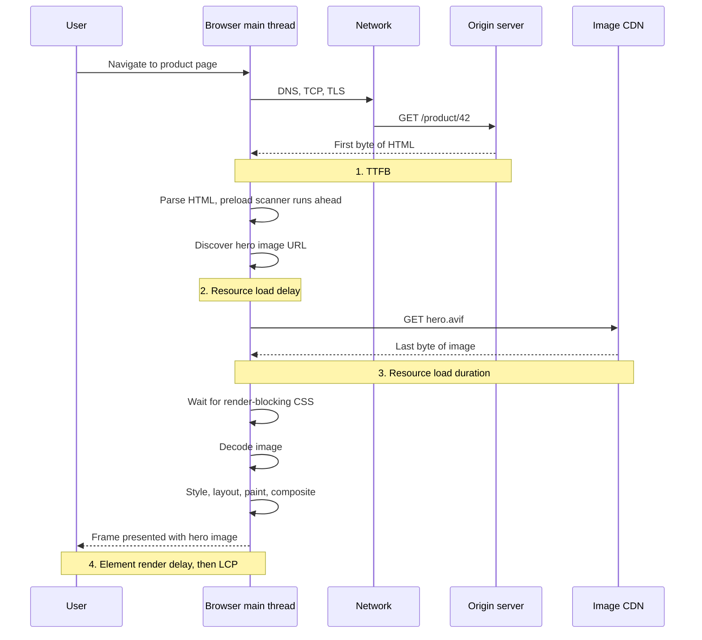
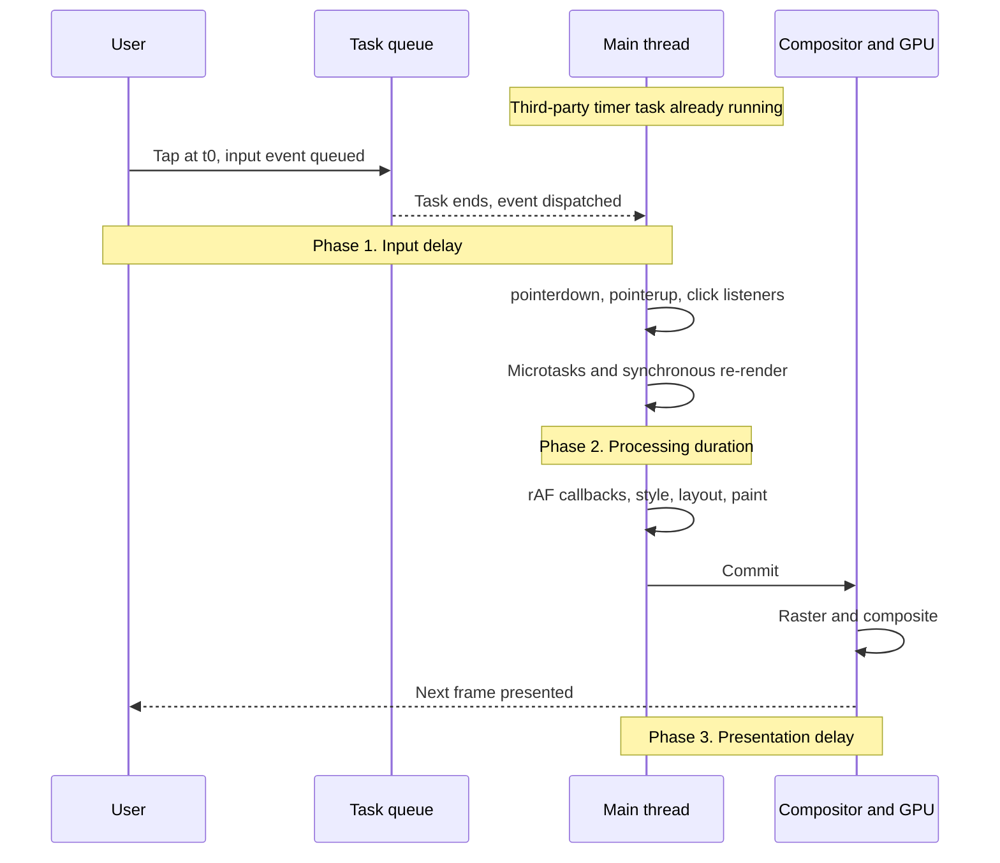
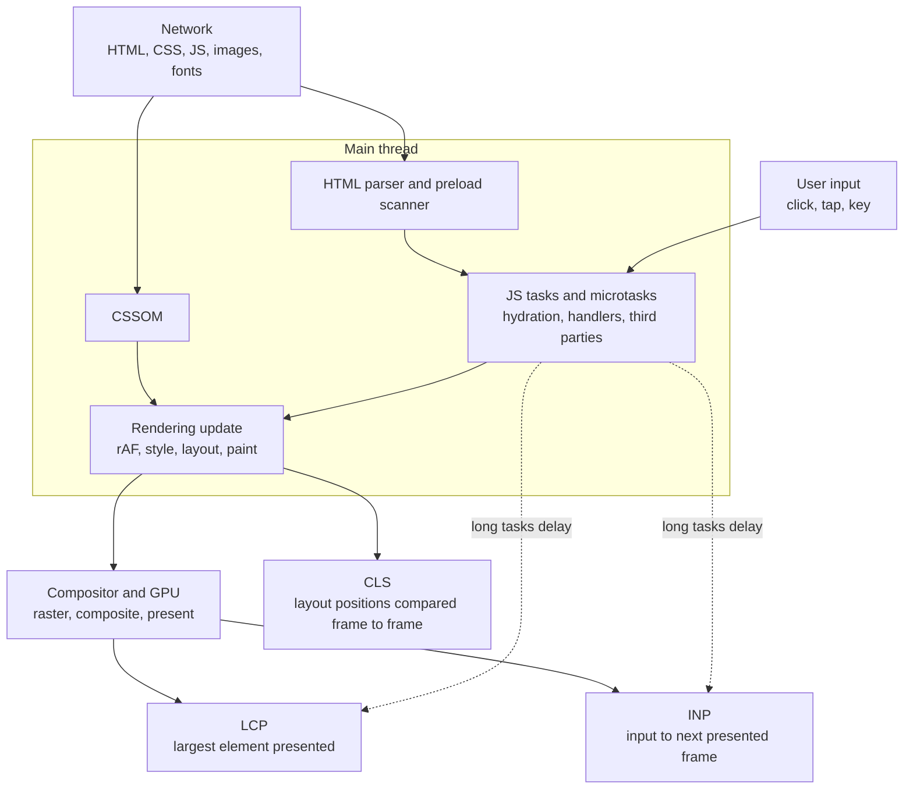

import Note from '../../components/Note.astro';

Ask ten engineers how fast a page is and you will get ten different numbers. One quotes the `load` event, another the server response time, a third the Lighthouse score, and a fourth says "it feels slow on my phone". All four are measuring something real, and none of them alone describes what the user experienced.

This post is about the metrics the web platform settled on to describe that experience, the **Core Web Vitals**, and about the machinery underneath them. It is not a checklist. The goal is to explain what the browser records, when it records it, how the numbers are aggregated, and why a given optimization moves a given number. With that model in hand, most performance advice becomes something you can derive and verify rather than memorize.

The post assumes you are comfortable with JavaScript, the DOM and CSS. It leans on two earlier posts for background: [Inside the browser rendering pipeline](/blog/inside-the-browser-rendering-pipeline-from-html-to-pixels) covers parsing, style, layout, paint and compositing in depth, and [How JavaScript works behind the scenes](/blog/how-javascript-works-behind-the-scenes) covers the engine and the event loop. Where those topics come up here, the focus is on how they show up in the metrics.

<Note>
  three kinds of statement appear in this post and they are labelled where it matters. **Specifications** (W3C and
  WHATWG documents such as Largest Contentful Paint, Event Timing and Layout Instability) define behaviour that any
  implementing browser should share. **Implementation details** (mostly Chromium's, because Chromium implemented these
  APIs first) can differ between browsers and change between versions. **Google's program definitions** (thresholds, the
  75th percentile, which metrics count as "Core") are policy, published on web.dev, and not part of any browser
  standard.
</Note>

## The problem with measuring web performance

### Page-load time is a single number for a multi-stage process

For a long time, "page speed" meant the time until the `load` event fired. That event marks a precise point in the document lifecycle: the document has been parsed, and every resource that delays the load event (images, synchronous scripts, stylesheets, iframes) has finished. It is easy to measure and easy to compare.

It also says very little about what the user saw. Consider three pages that all fire `load` at 4 seconds:

- **Page A** renders its headline and hero image at 800 ms. The remaining 3.2 seconds are spent on below-the-fold images and an analytics pixel. The user started reading almost immediately.
- **Page B** is a client-rendered single-page application. The HTML is an empty `<div id="root">`, so nothing is painted until a 600 KB JavaScript bundle downloads, parses, runs and fetches data. The first meaningful pixels appear at 3.9 seconds.
- **Page C** paints quickly, but a 900 ms hydration task runs at 1.5 seconds. A user who taps "Add to cart" at 1.6 seconds waits most of a second for anything to happen.

The `load` event is identical across all three, but the experiences are completely different. Page B could even fire `load` _before_ its main content appears, because content fetched by JavaScript after `load` is not tracked by it at all. Conversely, a page can delay `load` with a slow tracking pixel while being fully usable.

### Perceived versus measured performance

Users do not perceive a timestamp. They perceive a sequence of events: something appeared, the thing I came for appeared, the page responded when I touched it, and the content stayed where I was looking. Perceived performance is a property of that sequence, and it depends on the order and timing of visual feedback, not on when the network went quiet.

This is why metrics that are good for engineers ("all JavaScript executed by 2.1 s") can correlate poorly with satisfaction, and why the most useful metrics are anchored to things a user can see: a paint, a response to input, a movement on screen.

### Loading, responsiveness and visual stability are different problems

When you break down "the page felt slow", you usually find one of three distinct complaints:

1. **Loading**: "It took ages for anything useful to show up." This is about when the main content became visible.
2. **Responsiveness**: "I tapped the button and nothing happened." This is about how long the page took to give visual feedback after an input.
3. **Visual stability**: "I went to tap a link and the page jumped, so I tapped an ad instead." This is about content moving unexpectedly.

The three have different causes and different fixes. A page can load in one second and be unresponsive for the next five. A page can be instant to interact with and still shove the article down by 300 pixels when a banner arrives. A single number cannot capture all three, which is why there are three Core Web Vitals rather than one.

### The same page is a different page on every device

Performance is not a property of a page alone. It is a property of a page running on a particular device, over a particular network, in a particular state.

- **CPU.** JavaScript parsing, compilation and execution, style calculation and layout all scale with CPU speed. A task that takes 40 ms on a recent laptop can take 200 ms or more on a low-end Android phone, and that difference is often larger than any network difference.
- **Network.** Latency (round-trip time) matters more than bandwidth for most page loads, because a page load is many sequential round trips: DNS, TCP, TLS, the HTML request, then requests discovered in the HTML, then requests discovered in CSS or JavaScript.
- **Cache state.** A returning visitor with a warm HTTP cache, or a visitor arriving from a back-forward cache restore, sees a very different page from a first-time visitor.
- **Behaviour.** Users interact at different times. Someone who taps during hydration sees worse responsiveness than someone who waits.

A metric collected on one developer's machine is a sample of one point in that space.

### What synthetic benchmarks can and cannot tell you

A synthetic (lab) test loads a page in a controlled environment: a fixed device profile, a throttled network, an empty cache and a scripted or absent user. That control is valuable because it makes results repeatable, so you can compare before and after a change. It also has blind spots:

- It cannot know which interactions real users perform, so it cannot measure real responsiveness. Lighthouse, for example, does not interact with the page during a standard load.
- It tests one cache state, one viewport and one device profile.
- It usually stops measuring shortly after load, so it misses layout shifts and slow interactions that happen later in the session.
- It does not see personalization, A/B variants, logged-in states, consent banners or geography-dependent content unless you script them.

Lab data tells you what _can_ happen under specific conditions. It does not tell you what _did_ happen to your users. That difference is covered in [Lab data vs. field data](#lab-data-vs-field-data).

### Why standardized, user-centric metrics were needed

Before Core Web Vitals, the industry had many overlapping metrics: First Paint, First Meaningful Paint, Time to Interactive, First CPU Idle, Speed Index, and others. Several were hard to measure in the field, some were defined by heuristics in one tool, and teams picked whichever looked best.

Google introduced the [Web Vitals initiative](https://web.dev/articles/vitals) in 2020 to provide a small set of metrics that are:

- **User-centric**, anchored to things a user perceives.
- **Measurable in the field**, using browser APIs available to JavaScript on real users' devices, so they are not lab-only.
- **Stable and well-defined**, with published thresholds and an evolution process that announces changes in advance.

The "Core" subset is the handful that every site should measure. The set has changed once so far, and the change is instructive.

### From FID to INP

The original responsiveness metric was **First Input Delay (FID)**. It measured one thing: for the **first** discrete interaction on the page, the time from the input until the browser could _start_ running event handlers. It was cheap to measure and highlighted a real problem (main threads blocked during load), but it had two large gaps:

- It ignored **every interaction after the first**. A page that responds instantly to the first tap and takes 600 ms to respond to every later tap had a good FID.
- It ignored **processing time and rendering time**. It stopped the clock when handlers started, so a 400 ms click handler followed by a 100 ms render counted as zero, as long as the main thread was idle when the click arrived.

**Interaction to Next Paint (INP)** fixes both. It observes all qualifying interactions over the page's lifetime and measures each one from input until the next frame is presented, including handler execution and rendering. INP became a Core Web Vital on **12 March 2024**, replacing FID ([web.dev](https://web.dev/blog/inp-cwv-launch)). FID is now a deprecated, historical metric, and the web-vitals library removed `onFID()` in version 5 ([changelog](https://github.com/GoogleChrome/web-vitals/blob/main/CHANGELOG.md)).

### Three dimensions of experience

The current Core Web Vitals map directly onto the three complaints above:

- **Largest Contentful Paint (LCP)** measures **loading**: when the largest piece of content in the viewport was rendered.
- **Interaction to Next Paint (INP)** measures **responsiveness**: how long the page takes to visually respond to user input, across the whole visit.
- **Cumulative Layout Shift (CLS)** measures **visual stability**: how much visible content moves unexpectedly.

The rest of this post takes each one apart.

## Core Web Vitals overview

### The thresholds

Each metric has two thresholds that divide results into three ratings ([web.dev: Defining the Core Web Vitals thresholds](https://web.dev/articles/defining-core-web-vitals-thresholds)):

| Metric | Good     | Needs improvement     | Poor     |
| ------ | -------- | --------------------- | -------- |
| LCP    | ≤ 2.5 s  | > 2.5 s and ≤ 4 s     | > 4 s    |
| INP    | ≤ 200 ms | > 200 ms and ≤ 500 ms | > 500 ms |
| CLS    | ≤ 0.1    | > 0.1 and ≤ 0.25      | > 0.25   |

### The 75th percentile

The thresholds are not applied to a single page load. They are applied to the **75th percentile (p75)** of page visits, segmented by **mobile and desktop**. A page "passes" LCP on mobile if at least 75% of mobile page visits had an LCP of 2.5 s or less.

The choice of p75 is deliberate. The median would hide a large minority of poor experiences: if half of your users wait 2 s and the other half wait 8 s, the median looks fine. A very high percentile such as p95 or p99 is dominated by outliers you cannot control, such as users on a train passing through a tunnel, and it needs much more data to be stable. p75 is a compromise: most visits must be good, but the metric is not held hostage by the worst connections on the internet ([web.dev](https://web.dev/articles/defining-core-web-vitals-thresholds#choice_of_percentile)).

A page passes the Core Web Vitals assessment in Google's tools when all three metrics are "good" at p75.

### The metrics side by side

|                              | LCP                                                                                                 | INP                                                                                         | CLS                                                                           |
| ---------------------------- | --------------------------------------------------------------------------------------------------- | ------------------------------------------------------------------------------------------- | ----------------------------------------------------------------------------- |
| **Experience**               | Loading: is the main content visible?                                                               | Responsiveness: did the page react when I acted?                                            | Visual stability: did things stay where I was looking?                        |
| **What is measured**         | Render time of the largest image or text block in the viewport, relative to navigation start        | Latency from input to next frame presented, for (nearly) the worst interaction of the visit | Largest burst of unexpected layout shift scores, grouped into session windows |
| **Unit**                     | Milliseconds                                                                                        | Milliseconds                                                                                | Unitless score                                                                |
| **Browser API**              | Largest Contentful Paint API (`largest-contentful-paint` entries)                                   | Event Timing API (`event` entries with `interactionId`)                                     | Layout Instability API (`layout-shift` entries)                               |
| **When it stops**            | First user input (tap, keypress, scroll), or page hidden                                            | When the page is unloaded or hidden for the last time                                       | When the page is unloaded or hidden for the last time                         |
| **Typical causes when poor** | Slow server, late-discovered or large hero image, render-blocking CSS and JS, client-side rendering | Long tasks, expensive handlers, large re-renders, layout thrashing, big DOMs                | Unsized media, injected banners and ads, web font swaps, late components      |
| **Browser support (field)**  | Chromium, Firefox, Safari 26.2+                                                                     | Chromium, Firefox 144+, Safari 26.2+                                                        | Chromium only                                                                 |
| **Main limitation**          | One element's paint; says nothing about interactivity or what happens after                         | Needs a real interaction, so not available in a typical lab run; one value per visit        | Chromium-only; scores area and distance, not how annoying a shift felt        |

The browser support row changed recently. LCP and INP became [Baseline Newly available](https://web.dev/blog/lcp-and-inp-are-now-baseline-newly-available) when Safari 26.2 shipped the Largest Contentful Paint and Event Timing APIs in December 2025. Firefox had shipped LCP in version 122 and added `interactionId`, which INP depends on, in [Firefox 144](https://blog.mozilla.org/performance/2025/10/15/firefox-144-ships-interactionid-for-inp/). The Layout Instability API is still Chromium-only ([MDN](https://developer.mozilla.org/en-US/docs/Web/API/LayoutShift)).

That matters for field data. **CrUX, the public dataset behind PageSpeed Insights and Search Console, only collects data from Chrome users.** Your own RUM can now collect LCP and INP from all three engines, but CLS still comes only from Chromium browsers. Engines also differ in what they consider contentful and how they time paints, so treat cross-browser comparisons with care.

### What each metric is for, and what it misses

**LCP** quantifies "when did the page look loaded?" using one proxy: the paint time of the largest content element in the viewport. The Chrome team chose it after finding that the largest element's render time was a simpler and more reliable signal of "main content loaded" than earlier heuristics such as First Meaningful Paint ([web.dev](https://web.dev/articles/lcp)). It knows nothing about interactivity, about content below the fold, or about whether the largest element is the _important_ one. A huge decorative heading can be the LCP element while the price the user wanted loads two seconds later.

**INP** quantifies "does the page respond when I use it?" across all clicks, taps and key presses. It does not include scrolling, hovering or pinch-zoom, which are mostly handled off the main thread. It measures until the _next paint_, not until the work the interaction started is finished. A click that paints a spinner in 50 ms and then waits 5 s for a network response has a 50 ms interaction latency. That is a design choice: INP measures whether the page acknowledged the input, and the network wait is a different problem.

**CLS** quantifies "did content move when I didn't expect it?". It scores shifts by how much of the viewport moved and how far. It does not know whether a shift was annoying, whether the user was looking at that region, or whether a shift caused a misclick. It also ignores shifts that happen shortly after user input, on the assumption that the user expected them.

None of the three measure smoothness of animations and scrolling, memory usage, battery drain, or how long a background fetch takes. They are a minimum bar, not a complete description.

## Largest Contentful Paint (LCP)

### The LCP measurement model

#### What counts as a candidate

The [Largest Contentful Paint specification](https://w3c.github.io/largest-contentful-paint/) restricts candidates to a small set of element types ([web.dev](https://web.dev/articles/lcp#what-elements-are-considered)):

- `` elements. For animated images such as GIFs and animated PNGs, the presentation time of the first frame is used.
- `<image>` elements inside an `<svg>`.
- `<video>` elements. The poster image load time or the first-frame presentation time is used, whichever is earlier.
- Elements with a background image loaded through CSS `url()`. CSS gradients do not count.
- Block-level elements that contain text nodes or inline-level text children.

Everything else, such as a `<canvas>`, an inline `<svg>` drawing, or an iframe's contents as seen from the parent document, is not a candidate.

On top of the element types, Chromium applies heuristics to exclude content users are unlikely to consider "contentful":

- Elements with `opacity: 0`, which are invisible (since Chrome 86), and transparent text with no visible decoration such as a shadow or stroke (since Chrome 130).
- Elements that cover the full viewport, which are likely backgrounds (since Chrome 88).
- Placeholder images and other **low-entropy** images, which carry little information relative to their size (since Chrome 112). A 1,200 × 800 blurred placeholder or a solid-colour image falls into this category.

These are implementation heuristics, not spec text, and they can change. Chromium documents each change in its [LCP metric changelog](https://chromium.googlesource.com/chromium/src/+/main/docs/speed/metrics_changelog/lcp.md), which is worth checking when your LCP moves without a code change. They also differ from the heuristics for First Contentful Paint. FCP fires for _any_ contentful paint, so a full-viewport placeholder can trigger FCP while being ineligible for LCP.

One more exclusion catches people out: **text using a web font during its font block period is not painted**, so it cannot be a candidate until the font loads or the block period ends. With `font-display: block`, a hero heading's LCP time can be held hostage by the font download.

#### How size is determined

The size of a candidate is the area of the element **as visible in the viewport**:

- Parts of the element that are offscreen, clipped by `overflow`, or otherwise not visible do not count.
- Margin, padding and border are not included. For text, the size is the smallest rectangle that contains all of the element's text nodes.
- For images, the browser takes the smaller of the visible size and the **intrinsic** size. A 100 × 100 image stretched to 1,000 × 1,000 counts as 100 × 100. This stops low-resolution upscaled images from dominating, and it means an LCP image served smaller than its display size reports a smaller area.

#### How the candidate changes as the page renders

A page does not render in one step. HTML streams in, stylesheets apply, fonts load, images decode. The largest element painted after the first frame is often not the largest element painted after the tenth frame.

The browser handles this by **reporting a sequence of candidates**. When it paints the first frame, it dispatches a `largest-contentful-paint` performance entry for the largest contentful element painted so far. Whenever a later frame paints a contentful element that is larger than the current candidate, it dispatches a new entry. The LCP value is the `startTime` of the **last entry dispatched before measurement stops**.

A typical sequence on an article page:

1. Frame 1: the site header text is the largest element painted. Candidate: header, at 600 ms.
2. Frame 4: the article headline (an `h1` with a web font) paints after the font loads. It is larger. Candidate: headline, at 1,100 ms.
3. Frame 9: the hero image finishes downloading and decoding, then paints. It is larger still. Candidate: hero image, at 2,300 ms.

LCP is 2,300 ms. Two details are easy to miss:

- **Only a larger element produces a new entry.** If the hero image is _smaller_ than the headline, it never becomes a candidate, regardless of when it paints.
- **Comparison is against what has painted, not what is still loading.** Before Chrome 147, Chromium suppressed entries for smaller elements while a larger image was still downloading, so a `PerformanceObserver` could receive nothing until the slow hero arrived. Chrome 147 aligned with the specification: entries are emitted for each larger _painted_ element, so intermediate candidates now show up in RUM. The final LCP value is unchanged ([changelog](https://chromium.googlesource.com/chromium/src/+/main/docs/speed/metrics_changelog/2026_02_lcp.md)).
- **Removed elements still count.** If a large element paints and is later removed from the DOM (a carousel slide, an interstitial), it remains the LCP candidate unless something larger paints. Chromium changed to this behaviour in version 88. Before that, removing the element invalidated it, which made the metric depend on DOM churn rather than what the user saw.

#### When measurement stops

The browser stops reporting new LCP entries as soon as the user **interacts** with the page by tapping, clicking, scrolling or pressing a key. Interaction often changes what is visible (especially scrolling), so a "largest element" found afterwards would no longer describe the initial load ([web.dev](https://web.dev/articles/lcp#lcp-in-javascript)).

Two lifecycle cases need handling in measurement code:

- **Background tabs.** A page that loads in a background tab does not render content the user sees, so its LCP is not meaningful. Measurement code should ignore LCP entries that occur after the page was first hidden. The web-vitals library does this, and CrUX excludes these loads.
- **Back-forward cache restores.** A page restored from the bfcache does not reload, so no new `largest-contentful-paint` entries are created. From the user's perspective it is a new page visit, though, and CrUX counts it as one. The web-vitals library reports a new LCP after a restore, measured as the time from the `pageshow` event to the next frame.

Prerendered pages (via [Speculation Rules](https://developer.chrome.com/docs/web-platform/prerender-pages)) add a wrinkle. The page renders before the user navigates to it, so LCP is measured relative to `activationStart` (on the navigation timing entry) rather than to the start of the prerender. A prerendered page can have an LCP close to zero.

#### Why LCP is not DOMContentLoaded, load, or "page load time"

- **`DOMContentLoaded`** fires when the HTML document has been fully parsed and deferred scripts have run. It says nothing about paint. A page can reach `DOMContentLoaded` with nothing visible (render-blocked by CSS, or a client-rendered app with an empty shell). It can also paint its LCP element long before `DOMContentLoaded`, if a large document streams its above-the-fold content first.
- **`load`** waits for subresources, including below-the-fold images and iframes the user cannot see. LCP only cares about the largest element in the viewport.
- **Total page-load time** is not a defined quantity at all. When is a page with an infinite feed and polling analytics "loaded"?

#### DOM presence versus pixels on screen

A crucial distinction runs through all of the LCP model: **an element being in the DOM does not mean its pixels are on screen.** Between `appendChild()` (or the parser inserting a node) and a visible paint, several things must happen:

1. The element's styles must be resolvable. If a render-blocking stylesheet is still downloading, the browser will not render the page at all.
2. The browser needs a rendering opportunity, meaning the main thread is free to run style, layout and paint for a frame. A long task can delay that.
3. For images: the image bytes must download, and the image must decode. Decoding a large JPEG or AVIF is not free.
4. The compositor must rasterize the content and present a frame.

The LCP entry exposes several timestamps for this reason:

- `loadTime`: when the image resource finished loading. This is 0 for text.
- `renderTime`: when the element was painted. The [Paint Timing](https://w3c.github.io/paint-timing/) integration has since split this into `paintTime` (when the rendering update ran on the main thread) and `presentationTime` (when the frame was actually presented), shipped in Chrome 145 and available in browsers that implement them ([MDN](https://developer.mozilla.org/en-US/docs/Web/API/LargestContentfulPaint/renderTime)).
- `startTime`: `renderTime` if available, otherwise `loadTime`.

For cross-origin images served without a `Timing-Allow-Origin` header, `renderTime` used to be 0, which forced measurement code to fall back to `loadTime` and under-report LCP, sometimes to the point of LCP appearing earlier than FCP. Since Chrome 133, Chromium exposes a render time coarsened to a 4 ms multiple instead ([changelog](https://chromium.googlesource.com/chromium/src/+/main/docs/speed/metrics_changelog/2025_02_lcp.md)), and RUM LCP values rose slightly to match CrUX. Setting `Timing-Allow-Origin` on your image CDN still gives you precise values and full Resource Timing detail.

### The LCP critical path

#### The four sub-parts

For a page whose LCP element is an image, the time from navigation start to LCP can be divided into four non-overlapping sub-parts ([web.dev: Optimize LCP](https://web.dev/articles/optimize-lcp)):

1. **Time to First Byte (TTFB)**: from navigation start until the browser receives the first byte of the HTML response. This includes redirects, service worker startup, DNS, TCP and TLS, the request, and server processing.
2. **Resource load delay**: from TTFB until the browser **starts** loading the LCP resource. This is a discovery problem. If the image URL is in the initial HTML and the preload scanner finds it immediately, this is small. If the URL only appears after JavaScript runs or after CSS is applied, it is large.
3. **Resource load duration**: the time to download the LCP resource itself. This is a bytes-and-bandwidth problem, affected by file size, compression, HTTP priority and contention with other downloads.
4. **Element render delay**: from when the resource finishes loading until the element is rendered. This is a main-thread and render-blocking problem: the bytes are here, but something prevents the paint.

The four sum exactly to LCP. For a text LCP element (no resource), load delay and load duration are 0, and everything after TTFB is render delay.

web.dev suggests that, on a well-optimized page, TTFB and resource load duration each take roughly 40% of LCP, while load delay and render delay each stay under about 10%. Load delay and render delay are "waste": time when the browser could have been fetching or painting the image but was not.



#### Finding the guilty sub-part

Optimizing LCP without knowing which sub-part dominates is guesswork. A 3.8 s LCP made of 2.6 s TTFB needs server work. The same 3.8 s made of 1.9 s load delay needs a discovery fix, and compressing the image would barely help.

You can compute the breakdown yourself from the Navigation Timing, Resource Timing and LCP entries:

```js title="lcp-breakdown.js"
// Compute the four LCP sub-parts for the current page load.
// Paste into the console after the page has loaded, before interacting
// (any input stops LCP reporting).
new PerformanceObserver((list) => {
  const lcp = list.getEntries().at(-1); // latest candidate so far
  const nav = performance.getEntriesByType('navigation')[0];

  // Match the LCP image to its Resource Timing entry by URL.
  // Text elements have no URL, so there is no resource.
  const res = lcp.url ? performance.getEntriesByType('resource').find((r) => r.name === lcp.url) : undefined;

  // For prerendered pages, all times are relative to activation.
  const activationStart = nav.activationStart || 0;
  const ttfb = Math.max(0, nav.responseStart - activationStart);

  // requestStart is 0 for cross-origin resources without Timing-Allow-Origin,
  // so fall back to startTime (when the fetch was queued).
  const resStart = res ? Math.max(ttfb, (res.requestStart || res.startTime) - activationStart) : ttfb;
  const resEnd = res ? Math.max(resStart, res.responseEnd - activationStart) : ttfb;
  const lcpTime = Math.max(resEnd, lcp.startTime - activationStart);

  console.table({
    element: lcp.element?.tagName ?? '(removed)',
    url: lcp.url || '(text)',
    ttfb: Math.round(ttfb),
    resourceLoadDelay: Math.round(resStart - ttfb),
    resourceLoadDuration: Math.round(resEnd - resStart),
    elementRenderDelay: Math.round(lcpTime - resEnd),
    lcp: Math.round(lcpTime),
  });
}).observe({ type: 'largest-contentful-paint', buffered: true });
```

- `buffered: true` delivers entries that were recorded before the observer was created, so the snippet works after the fact.
- The `Math.max` clamps keep the sub-parts non-negative and ordered. Rounding and cross-origin restrictions can otherwise produce small negative values, a problem the web-vitals library itself fixed in version 6.2.3.
- The observer callback fires again for each new candidate, so you may see more than one table. The last one before you interact is the LCP.

In production you would use the web-vitals attribution build, which does this calculation for you (see [Production RUM](#production-real-user-monitoring-rum)).

### Browser and network internals behind LCP

#### The HTML parser and the preload scanner

The HTML parser builds the DOM incrementally as bytes arrive. When it reaches a classic `<script>` without `async` or `defer`, it must stop: the script might call `document.write()` and change the markup that follows. The parser cannot continue until the script has downloaded and executed, and the script cannot execute until preceding stylesheets have loaded, because it might read computed styles.

If that were the whole story, every image after a blocking script would be discovered late. Browsers solve this with a **preload scanner** (also called the speculative parser): a lightweight tokenizer that runs ahead of the main parser while it is blocked, looking for URLs in ``, ``, `<link rel=stylesheet>`, `<script src>`, `<link rel=preload>` and similar markup, and starting those fetches early ([web.dev: Don't fight the browser preload scanner](https://web.dev/articles/preload-scanner)).

The preload scanner only sees what is **in the markup**. It cannot find:

- Images inserted by JavaScript (including client-side rendered React or Vue components).
- CSS `background-image` URLs, which are only known after the stylesheet is parsed and a matching element has had its style computed.
- Images using `data-src` with a JavaScript lazy-loading library, because the real URL is not in `src`.
- Resources referenced from within other resources, such as fonts in CSS or modules imported by a script.

Every item on that list increases **resource load delay**.

#### The critical rendering path, CSSOM and render-blocking stylesheets

The browser will not render the page until it has a CSSOM for every stylesheet in the `<head>` that applies to the current media. Rendering with partial CSS would cause a flash of unstyled content followed by a large reflow, so stylesheets are **render-blocking** by default. Those mechanics are covered in [the rendering pipeline post](/blog/inside-the-browser-rendering-pipeline-from-html-to-pixels).

For LCP this means that even if the hero image has fully downloaded, it cannot be painted until every render-blocking stylesheet has arrived and been parsed. A 150 KB stylesheet from a slow third-party origin shows up as **element render delay** for an image LCP, and as most of the LCP time for a text LCP.

Stylesheets also block script execution: a classic script after a stylesheet waits for that stylesheet, because the script might query styles. So a slow stylesheet can delay a script, which delays the parser, which delays discovery of everything after it. These chains are why LCP problems rarely have a single cause.

#### JavaScript execution and parser blocking

Script loading attributes change the picture:

- A **classic** `<script src>` blocks the parser while it downloads and executes.
- **`defer`** downloads in parallel and executes, in document order, after parsing finishes and before `DOMContentLoaded`.
- **`async`** downloads in parallel and executes as soon as it arrives, interrupting the parser at an unpredictable point.
- **`type="module"`** is deferred by default.

Even non-blocking scripts compete for the main thread. A deferred 300 ms bundle evaluation that runs just as the hero image finishes downloading pushes the paint back: the frame that would show the image cannot be produced while the task runs. That cost lands in **element render delay**.

For client-rendered applications, JavaScript is on the critical path by definition. The LCP element does not exist until the framework runs, so the chain becomes: HTML, then JS bundle download, then parse and execute, then data fetch, then render, then image discovery, then image download, then paint. Each arrow is a delay that server rendering removes.

#### Network prioritization

Browsers do not fetch resources in arbitrary order. Each request gets a priority, and over HTTP/2 and HTTP/3 the browser signals that priority to the server, which uses it to decide how to share bandwidth between concurrent streams (HTTP/3 and recent HTTP/2 deployments use the [Extensible Priorities scheme, RFC 9218](https://www.rfc-editor.org/rfc/rfc9218)).

In Chromium, the defaults are roughly ([web.dev: Fetch Priority](https://web.dev/articles/fetch-priority)):

- Render-blocking CSS in the head, and fonts: Highest or High.
- Classic scripts in the head: High. Async and deferred scripts: Low.
- Images: Low by default. Chromium boosts images that turn out to be in the viewport to High once layout has run. As a further heuristic, it starts the first few large images in the document at Medium.

That boost is the key detail for LCP. The browser does not know the image is in the viewport until it has done layout, and layout requires CSS. Until then the hero image may sit at Low priority, sharing bandwidth with everything else. The `fetchpriority` attribute exists to close this gap.

#### Resource hints: preconnect, dns-prefetch and preload

Resource hints let you tell the browser about work it would otherwise discover late:

```html
<!-- Open a full connection (DNS + TCP + TLS) to an origin you will fetch from soon.
     Saves one to three round trips. Use for the one or two most critical origins. -->
<link rel="preconnect" href="https://images.example-cdn.com" />

<!-- Only resolve DNS. Cheaper than preconnect, useful for less critical origins. -->
<link rel="dns-prefetch" href="https://analytics.example.com" />

<!-- Fetch a specific resource now, at high priority, without executing or applying it.
     The `as` attribute sets the request's destination, priority and Accept header. -->
<link rel="preload" href="/fonts/inter-var.woff2" as="font" type="font/woff2" crossorigin />
```

- **`preconnect`** pays for connection setup in advance. Each preconnect holds a socket open, and Chromium closes unused connections after about 10 seconds, so preconnecting to many origins wastes effort and can compete with real requests.
- **`dns-prefetch`** is the lightweight version.
- **`preload`** is a mandatory fetch. It is the right tool for a resource the preload scanner cannot see, such as a CSS background image, a font, or an image rendered by JavaScript. The `crossorigin` attribute must match how the resource will be requested, or the browser fetches it twice. Fonts are always fetched in CORS mode, so font preloads always need `crossorigin`.

Preload is not free. Every preload competes for bandwidth with resources the browser had already prioritized. Preloading five images "just in case" can delay the stylesheet the page needs to render at all.

A related mechanism is **103 Early Hints**: the server or CDN sends an interim response with `Link: rel=preload` or `rel=preconnect` headers while it is still generating the HTML. The browser can start fetching critical resources during server think time. The `firstInterimResponseStart` field on the navigation timing entry records when it arrived in Chromium.

#### fetchpriority

The `fetchpriority` attribute ([HTML Standard](https://html.spec.whatwg.org/multipage/urls-and-fetching.html#fetch-priority-attributes)) adjusts a request's priority relative to the browser's default for that resource type. It is a hint, not a command:

```html
<!-- The hero image: start at high priority immediately,
     instead of waiting for layout to discover it is in the viewport. -->


<!-- A carousel image that is not visible initially: deprioritize it. -->

```

It works on ``, `<link rel=preload>`, `<script>` and `fetch()` (via the `priority` option). It is supported in Chromium, Safari and Firefox (Firefox since version 132). In browsers that do not support it, the attribute is ignored, which makes it a safe progressive enhancement.

#### Image loading and decoding

Once the bytes arrive, the image must be decoded into a bitmap before it can be painted. Decoding cost scales with pixel count, not file size: a 4,000 × 3,000 image is 12 million pixels to decode regardless of how well it compressed. In Chromium most image decoding happens off the main thread, during rasterization, but a very large image still adds time between "loaded" and "presented".

Progressive formats complicate this. A progressive JPEG can paint a low-quality version before it finishes downloading. The LCP spec currently times image candidates on the first paint after the image has fully loaded, so progressive rendering helps perceived speed without lowering LCP.

The `decoding` attribute (`sync`, `async`, `auto`) hints whether the browser may decode asynchronously. For an LCP image, leave it at the default. `decoding="async"` can let the browser present a frame without the image and paint it in a later frame.

#### Browser caching

Caching shortens LCP sub-parts directly: a cache hit on the HTML removes most of TTFB, and a cache hit on the hero image removes most of the resource load duration. Relevant layers:

- **HTTP cache**, controlled by `Cache-Control`. Fingerprinted static assets (`hero.3f2a1c.avif`) can use `max-age=31536000, immutable`. HTML usually needs revalidation, or `stale-while-revalidate` at the CDN.
- **CDN edge cache.** Serving HTML from the edge rather than the origin cuts TTFB by the round-trip distance to the origin plus origin processing time.
- **Service worker cache.** A service worker can serve the HTML shell from Cache Storage. The worker must start up first, which adds tens of milliseconds or more on a cold start. Navigation preload mitigates that by starting the network request in parallel.
- **Back-forward cache.** Restores the entire page from memory and is the fastest navigation there is. A page is only eligible if it does not do things that block the bfcache, such as registering an `unload` listener or responding with `Cache-Control: no-store`. The `notRestoredReasons` field on the navigation timing entry (Chromium) reports why a page was not restored.

Lab tools typically test with a cold cache, so they show worst-case LCP. Field data mixes cold and warm visits, which is one reason field LCP is often better than lab LCP for content sites with returning visitors.

#### Lazy loading

`loading="lazy"` on an image tells the browser to defer the fetch until the image is near the viewport. To decide that, the browser needs layout, which requires CSS. So a lazy image is never requested by the preload scanner. It waits for the stylesheet, a layout pass, and the intersection check.

For below-the-fold images, that is exactly what you want: those bytes stop competing with critical resources. For the LCP image, it is a self-inflicted resource load delay. The [HTTP Archive Web Almanac](https://almanac.httparchive.org/en/2024/performance) has repeatedly found a meaningful share of pages with a lazy-loaded LCP image. [Avoid lazy loading the LCP image](#avoid-lazy-loading-the-lcp-image) below covers how to prevent it.

#### CSS background images

A hero rendered as a CSS background is invisible to the preload scanner. Its timeline is:

1. HTML arrives and the parser reaches the `<link rel=stylesheet>`.
2. The stylesheet downloads and parses.
3. The parser creates the hero element, and style calculation matches the rule with `background-image: url(...)`.
4. Only now is the image requested.

Steps 1 to 3 are all resource load delay. If the image must stay a background (for `background-size: cover` tricks, say), preload it. Usually the better fix is a real `` with `object-fit: cover`, which gets you preload-scanner discovery, `srcset` and `fetchpriority` all at once.

### LCP optimization techniques

#### Optimize the LCP image itself

The goal is to minimize **resource load duration** by sending the fewest bytes that still look right at the size the image is displayed.

**Use modern formats.** AVIF and WebP usually compress photographic content much better than JPEG at similar visual quality. AVIF often gives the smaller file but is slower to encode, and on low-end devices it can be somewhat slower to decode. Serve with `<picture>` so each browser picks the best format it supports:

```html
<picture>
  <!-- The browser uses the first <source> whose type it supports. -->
  <source
    type="image/avif"
    srcset="/img/shoe-640.avif 640w, /img/shoe-960.avif 960w, /img/shoe-1280.avif 1280w"
    sizes="(min-width: 1024px) 50vw, 100vw"
  />
  <source
    type="image/webp"
    srcset="/img/shoe-640.webp 640w, /img/shoe-960.webp 960w, /img/shoe-1280.webp 1280w"
    sizes="(min-width: 1024px) 50vw, 100vw"
  />
  <!-- The  is the actual LCP element. Attributes such as width, height, alt
       and fetchpriority go here, not on <source>. -->
  
</picture>
```

**Responsive images with `srcset` and `sizes`.** `srcset` lists candidate files with their intrinsic widths (`640w`). `sizes` tells the browser how wide the image will be rendered at each breakpoint, _before_ CSS has loaded. The browser multiplies that width by the device pixel ratio and picks the smallest candidate that covers it. On a 390 px-wide phone at DPR 3, `100vw` means 1,170 device pixels, so the browser picks the 1,280w file. On a 1,440 px desktop at DPR 1, `50vw` means 720 pixels, so it picks 960w.

Two mistakes are common. The first is omitting `sizes`, which defaults to `100vw`, so a desktop sidebar thumbnail downloads a full-width file. The second is writing a `sizes` value that does not match the CSS. The browser trusts `sizes` and cannot check it against the layout.

Some teams cap the effective DPR at 2 for large images. At DPR 3 the extra pixels are rarely perceptible but cost about 2.25 times the bytes.

**Verify** in the DevTools Network panel: filter by Img, check which file was chosen and its transfer size, and use device emulation to check different DPRs. In the Performance panel, the LCP request's bar shows its download duration.

#### Preload important images

When the LCP image cannot be found by the preload scanner, preload it so discovery happens at the start of the HTML:

```html
<head>
  <!-- Responsive preload: imagesrcset and imagesizes mirror the  srcset and sizes,
       so the browser preloads the same candidate it will later use for the .
       Omit `href` so browsers that do not support imagesrcset do not fetch a wrong file. -->
  <link
    rel="preload"
    as="image"
    imagesrcset="/img/hero-640.avif 640w, /img/hero-1280.avif 1280w"
    imagesizes="100vw"
    type="image/avif"
    fetchpriority="high"
  />
  <link rel="stylesheet" href="/css/main.css" />
</head>
```

- The `type` attribute makes browsers that cannot decode AVIF skip the preload instead of downloading bytes they cannot use.
- If the `` is also in the HTML near the top, a preload is usually redundant: the preload scanner finds the `` just as quickly. Add `fetchpriority="high"` to the image instead.
- A preload that does not match the final request (a different URL from a different `srcset` candidate, or a different CORS mode) results in a double download. DevTools warns in the console when a preloaded resource is not used within a few seconds of the load event.

#### Use fetchpriority appropriately

`fetchpriority="high"` on the LCP image is one of the cheapest wins available: it removes the wait for layout before the priority boost. web.dev reports cases where it improved LCP by hundreds of milliseconds ([Fetch Priority](https://web.dev/articles/fetch-priority)).

It is a relative signal, though. If five images have `fetchpriority="high"`, none of them is prioritized, and all of them compete with your CSS. Reserve it for the one image that is likely the LCP element in the most common viewport. Use `fetchpriority="low"` for images that are in the markup but not visible (later carousel slides, images hidden behind tabs).

**Verify** in the Network panel with the Priority column enabled (right-click the column header). The hero image should show "High" from the start of its request, not "Low" changing to "High".

#### Avoid lazy loading the LCP image

```html
<!-- Before: a blanket lazy-loading policy from a CMS or component library. -->


<!-- After: eager (the default) plus high priority for the above-the-fold hero. -->

```

The same applies to JavaScript lazy-loading libraries that use `data-src`, and to framework image components that lazy-load by default. `next/image`, for example, lazy-loads unless you mark the image as high priority (the prop for this has changed across Next.js versions, so check the docs for your version).

The hard part is knowing which image is the LCP element, because it can change with viewport. A product grid might have a hero banner as LCP on desktop and the first product card on mobile. Use field attribution data (the `target` and `url` reported by web-vitals attribution) to find which elements actually end up as LCP across your users.

**Verify** in the Performance panel: the LCP image request should start shortly after the HTML, not after the stylesheet has finished.

#### Reduce TTFB

TTFB is the floor under every other metric. Nothing can paint before the first byte of HTML arrives. web.dev considers a TTFB of 0.8 s or less good, as a rough guide ([TTFB](https://web.dev/articles/ttfb)). The navigation timing entry breaks TTFB down, and the web-vitals TTFB attribution exposes the same pieces:

| Phase                    | Navigation Timing fields                                                   | Common causes when large                                               |
| ------------------------ | -------------------------------------------------------------------------- | ---------------------------------------------------------------------- |
| Redirects, waiting       | `redirectStart` to `redirectEnd`, plus browser startup before `fetchStart` | Marketing links with redirect chains, `http` to `https` to `www` hops  |
| Service worker and cache | `workerStart`, `fetchStart` to `domainLookupStart`                         | Cold service worker startup, slow `fetch` handler                      |
| DNS                      | `domainLookupStart` to `domainLookupEnd`                                   | Cold DNS cache, slow resolver                                          |
| Connection               | `connectStart` to `connectEnd` (TLS from `secureConnectionStart`)          | No connection reuse, distant server                                    |
| Request                  | `requestStart` to `responseStart`                                          | Slow server rendering, uncached database queries, origin far from user |

Fixes follow from the phase:

- **Remove redirects**, especially on landing-page links in ads and emails.
- **Cache HTML at the edge** where you can. For personalized pages, cache the anonymous shell and personalize at the edge or on the client.
- **Stream the response.** Send the `<head>` (with its stylesheets and preloads) before the body is ready, so the browser starts fetching critical resources while the server is still querying the database. This does not shorten TTFB, but it lets resource discovery overlap with server work.
- **Instrument server time** with the [`Server-Timing`](https://developer.mozilla.org/en-US/docs/Web/HTTP/Reference/Headers/Server-Timing) header. Its values appear in DevTools and on `navigationEntry.serverTiming` in RUM, so you can tell a slow database query from a slow network:

```http
Server-Timing: db;dur=182;desc="product query", render;dur=64, cache;desc="MISS"
```

#### Eliminate render-blocking resources

Every render-blocking stylesheet and parser-blocking script in the `<head>` sits on the critical path of the first paint. For each one, ask whether it is needed before the first frame:

```html
<head>
  <!-- Critical CSS for above-the-fold layout, inlined: no extra request on the critical path. -->
  <style>
    /* header, hero, product summary layout ... */
  </style>

  <!-- Full stylesheet: still render-blocking, but smaller now that critical rules are inlined
       and unused rules are removed. Keep it on your own origin to avoid an extra connection. -->
  <link rel="stylesheet" href="/css/main.4c1f.css" />

  <!-- Print styles: a non-matching media query makes the stylesheet non-render-blocking.
       It still downloads, at low priority. -->
  <link rel="stylesheet" href="/css/print.css" media="print" />

  <!-- Application code: deferred, so it does not block the parser. -->
  <script src="/js/app.9a2e.js" defer></script>
</head>
```

Trade-offs:

- **Inlined critical CSS** cannot be cached separately and bloats every HTML response. Keep it small, and remember to update it when layouts change. Stale critical CSS causes layout shifts when the full stylesheet arrives.
- **Async-loading the main stylesheet** (the `media="print" onload="this.media='all'"` trick) removes it from the critical path but risks a flash of unstyled content and a large layout shift. It only makes sense when the inlined critical CSS genuinely covers the first viewport.
- **Third-party stylesheets** on other origins add a connection setup to the critical path. Self-host where licensing allows.

**Verify** with the "Render-blocking requests" insight in the DevTools Performance panel or Lighthouse, and by checking that FCP moves earlier.

#### Reduce CSS and JavaScript overhead

Smaller CSS parses faster, and less JavaScript means less main-thread work competing with the LCP paint. For LCP specifically, the JavaScript that matters is whatever runs **before the LCP element paints**: analytics initialization, A/B testing scripts that hide the page until they decide on a variant, consent managers, and hydration.

A/B testing tools that use an anti-flicker snippet deserve special mention. They often set `opacity: 0` on the whole page until the experiment script loads. That hides every LCP candidate (opacity-0 elements are excluded) until the script has run, so the third-party script's latency is added directly to LCP. Server-side or edge-side experiment assignment avoids this.

Use the DevTools Coverage panel to find unused CSS and JavaScript on the initial load, and route-level code splitting so each page only ships what it needs.

#### Server rendering, SSG and streaming

Where the LCP element's HTML is generated decides how far down the critical chain it appears:

- **Client-side rendering (CSR):** the LCP element appears after JS download, execution and usually a data fetch. Resource load delay includes all of that. The image cannot be preload-scanned unless you add a preload, and you often cannot know the URL in advance because it comes from an API.
- **Server-side rendering (SSR):** the LCP element is in the HTML, so the preload scanner finds the image immediately. The cost moves into TTFB: the server must fetch data and render before sending bytes.
- **Static site generation (SSG):** HTML is built ahead of time and served from a CDN, giving low TTFB and immediate discovery. It only fits content that does not depend on the request, or that can be revalidated on a schedule.
- **Streaming SSR:** the server sends the shell (head, header, and ideally the hero) immediately and streams slower sections later. In React this is driven by `<Suspense>` boundaries. Done well, this gives you SSR's early discovery with less TTFB penalty. Done badly, with the hero inside a Suspense boundary waiting on a slow query, the LCP element arrives late in the stream, and render delay grows.

None of these is universally best. A logged-in dashboard with small, cacheable JS and fast APIs can have a fine LCP with CSR. A product page with a slow personalization service can have a poor LCP with SSR if that service blocks the response. Measure the sub-parts.

### LCP debugging

#### Chrome DevTools Performance panel

Open the Performance panel and you see **live metrics** for the current page: LCP, CLS and INP as you load and use it. If CrUX has data for the URL, field values appear next to the local values, which tells you whether your machine is representative ([Chrome DevTools: Performance panel](https://developer.chrome.com/docs/devtools/performance/overview)).

To investigate a load:

1. Enable CPU throttling (4× or 6× slowdown, or the calibrated "low-tier mobile" preset) and network throttling (for example "Slow 4G"). An unthrottled developer laptop hides most LCP problems.
2. Click **Record and reload**.
3. In the **Timings** track, find the **LCP** marker. Clicking it highlights the LCP element in the page and in the summary.
4. Open the **Insights** sidebar. The **LCP breakdown** insight shows the four sub-parts as bars on the timeline. **LCP request discovery** checks whether the LCP image was discoverable in the initial HTML, whether it was lazy-loaded, and whether it had `fetchpriority="high"`.
5. In the **Network** track, find the LCP request. Look at when it started relative to the HTML and stylesheet, its priority, and its duration.
6. In the **Main** track, look for long tasks between the image response finishing and the LCP marker. Those are render delay.

#### Lighthouse and PageSpeed Insights

Lighthouse runs a lab load with simulated throttling and reports LCP plus diagnostics. Since Lighthouse 13, its diagnostics are the same **insights** as the DevTools Performance panel (LCP breakdown, LCP request discovery, render-blocking requests, document request latency, image delivery and others), which makes it easier to move from a report to a trace ([Performance insights](https://developer.chrome.com/docs/performance/insights)).

[PageSpeed Insights](https://pagespeed.web.dev/) combines two things on one page: **field data from CrUX** at the top (the 28-day p75 for the URL, or for the whole origin if the URL lacks data), and a **Lighthouse lab run** below. When the field section says LCP is poor and the lab section says it is good, believe the field section and work out which conditions the lab is missing.

#### Observing LCP entries directly

```js title="observe-lcp.js"
// Log every LCP candidate with the element and timing details.
const po = new PerformanceObserver((list) => {
  for (const entry of list.getEntries()) {
    console.log('LCP candidate', {
      time: Math.round(entry.startTime),
      renderTime: Math.round(entry.renderTime), // may be 0 or coarsened for cross-origin images without TAO
      loadTime: Math.round(entry.loadTime), // 0 for text
      size: entry.size, // visible area in CSS pixels squared
      url: entry.url, // empty for text
      element: entry.element, // null if the element was removed
    });
  }
});

if (PerformanceObserver.supportedEntryTypes?.includes('largest-contentful-paint')) {
  po.observe({ type: 'largest-contentful-paint', buffered: true });
}
```

What to look for: the sequence of candidates, how `size` grows, and the gap between `loadTime` and `renderTime`. A large gap means render delay. Once you click or scroll, no further entries arrive, which you can confirm by scrolling and reloading.

#### Experiment: compare a page with and without image preloading

**Setup.** Create a page whose hero is a CSS background image, and serve it locally with any static server (for example `npx serve`):

```html title="bg-hero.html"
<!doctype html>
<html lang="en">
  <head>
    <meta name="viewport" content="width=device-width, initial-scale=1" />
    <!-- Variant B: uncomment the next line. -->
    <!-- <link rel="preload" as="image" href="hero.jpg" fetchpriority="high"> -->
    <link rel="stylesheet" href="hero.css" />
  </head>
  <body>
    <div class="hero"></div>
    <p>Some text below the hero.</p>
  </body>
</html>
```

```css title="hero.css"
.hero {
  height: 70vh;
  background: url('hero.jpg') center / cover no-repeat;
}
```

Use any photograph of a few hundred kilobytes as `hero.jpg`, and paste the `lcp-breakdown.js` snippet from earlier into the console after each load.

**Steps.**

1. In DevTools, set network throttling to "Slow 4G" and disable the cache.
2. Load variant A (no preload) three times. Record LCP and its sub-parts.
3. Uncomment the preload, reload three times, and record again.

**Expected observations.** In variant A, the Network track shows `hero.jpg` requested only after `hero.css` finishes, so resource load delay roughly equals the stylesheet's download time. In variant B, `hero.jpg` starts alongside `hero.css`, so resource load delay drops to near zero and LCP improves by roughly the stylesheet's download time.

**Explanation.** The preload scanner cannot see URLs inside CSS. The preload moves discovery from "after CSSOM and style calculation" to "while parsing the head". Load duration does not change, because the same bytes are downloaded either way. Only the start time moves.

## Interaction to Next Paint (INP)

### Understanding INP

#### What counts as an interaction

For INP, an **interaction** is one of the following ([web.dev: INP](https://web.dev/articles/inp#whats_in_an_interaction)):

- **Clicking** with a mouse.
- **Tapping** on a touchscreen.
- **Pressing a key** on a physical or on-screen keyboard.

Hovering and scrolling are not interactions for INP. Scrolling is mostly handled by the compositor thread and can stay smooth while the main thread is busy, which is a different experience from waiting for a click handler.

A single interaction usually dispatches **several events**. A tap dispatches `pointerdown`, `pointerup` and `click` (plus `touchstart`, `touchend`, `mousedown` and `mouseup` for compatibility). A key press dispatches `keydown`, `keypress` and `keyup`. A user perceives this as one action, so the Event Timing API groups those events under one **`interactionId`**. The latency of an interaction is the **longest duration** among its events.

#### How the browser observes interactions

The [Event Timing specification](https://w3c.github.io/event-timing/) has the browser record a `PerformanceEventTiming` entry for qualifying events, with these timestamps:

- `startTime`: the event's `timeStamp`, which is when the operating system delivered the input to the browser, or as close to that as the browser can measure.
- `processingStart`: when the browser began dispatching the event to listeners.
- `processingEnd`: when the last listener for this event finished.
- `duration`: from `startTime` until the **next frame was presented** after `processingEnd`, rounded to the nearest 8 ms. The rounding is a mitigation against timing attacks.
- `interactionId`: a non-zero number shared by all events belonging to the same interaction. It is 0 for events that are not part of an interaction, such as `mouseover`.
- `target`: the event target, if it is still connected to the document.

By default, entries are delivered to observers only when `duration` is at least **104 ms** (the first multiple of 8 above 100). You can lower this with the `durationThreshold` observer option down to a minimum of **16 ms**. Entries are only kept in the performance buffer when they reach 104 ms, so `buffered: true` will not return shorter entries recorded before the observer existed ([MDN](https://developer.mozilla.org/en-US/docs/Web/API/PerformanceEventTiming)).

That threshold has a practical consequence. Interactions faster than the threshold are invisible to a normal observer, so INP libraries also need the total interaction count to apply the percentile rule described next. Chromium exposes it as `performance.interactionCount`. Where it is not available, the web-vitals library estimates it from the `interactionId` values it observes.

#### Selecting the representative interaction

INP is not an average. Averages hide bad experiences: if nine interactions take 50 ms and one takes 900 ms, the average of 135 ms looks good, but the user will remember the 900 ms.

INP is (close to) the **worst** interaction of the visit:

- If the page has fewer than 50 interactions, INP is the **slowest** interaction.
- For pages with many interactions, the browser-agnostic measurement **ignores the single highest interaction for every 50 interactions**. With 120 interactions, the two slowest are ignored and INP is the third slowest.

The adjustment approximates a high percentile (roughly the 98th) of interaction latency for long-lived pages such as editors and dashboards, where a few unrelated outliers (a GC pause, a tab switch) would otherwise dominate. In code, this means you keep the N slowest interactions, not just the worst one. The web-vitals library keeps the 10 longest, which covers pages with up to 500 interactions.

If the page has **no** qualifying interactions, it has no INP. Many page views are like that: a user reads an article and leaves. This is one reason INP data has smaller sample sizes than LCP.

Two levels of aggregation are easy to confuse:

1. **Within a visit**: INP is the near-worst interaction, as above. This produces one INP value per page view.
2. **Across visits**: those per-visit values are aggregated at the 75th percentile to produce the number you compare against 200 ms.

#### Why FID was not enough

FID measured only the input delay of the first interaction. Data from the Chrome team showed that most pages had a good FID, yet users still experienced sluggish pages. The work happened _inside_ handlers and in rendering afterwards, or in interactions after the first. INP's definition maps to the full user-visible latency: input to pixels, for every interaction ([web.dev: INP](https://web.dev/articles/inp)).

#### Latency and perceived responsiveness

Human perception of "instant" is roughly 100 ms. Below that, a response feels like a direct consequence of the action. Above a few hundred milliseconds, users begin to wonder whether the input registered, tap again (sometimes causing double submissions), or give up. The 200 ms threshold leaves room for a frame or two beyond that perceptual limit on real devices.

The important word in INP is _next paint_. INP measures **feedback**, not completion. A handler that renders "Adding to cart…" within 50 ms and then waits two seconds for the server has excellent INP. That is intentional: it rewards giving immediate visual feedback and moving slow work out of the critical path.

### The three phases of interaction latency

Every interaction's latency can be divided into three consecutive phases ([web.dev: Optimize INP](https://web.dev/articles/optimize-inp)).

#### Input delay

**From the user's input until event handlers start running** (`processingStart - startTime`).

Event dispatch is a task on the main thread. If another task is running when the input arrives, such as a 300 ms hydration, a JSON parse, or a third-party script's initialization, the input event waits in a queue until that task finishes. The browser cannot interrupt a running JavaScript task to run your click handler.

Input delay is also affected by work queued just before the event: other event handlers, timers that fire first, and the rendering steps of a frame that started before the input. On pages that are still loading, input delay is often the largest phase, because parsing, script evaluation and hydration keep the main thread busy.

#### Processing duration

**From the start of the first event handler to the end of the last one** for the interaction (`processingEnd - processingStart`, extended across all events in the interaction).

This is your code: every listener for `pointerdown`, `pointerup`, `click` and so on, on the target and every ancestor it bubbles through, plus any microtasks they queue (promise callbacks run at the end of each listener callback). Framework work done synchronously in response to the event is here too. For React, a state update in a discrete event such as a click is processed synchronously, so the re-render of every affected component lands in processing duration.

Common causes:

- Expensive computation: filtering a large list, sorting, recomputing derived data.
- Synchronous storage: `localStorage` reads and writes, synchronous XHR (which should not exist anymore).
- Large framework updates: a state change at the top of the tree that re-renders thousands of components.
- Analytics and logging in the handler path, such as building and sending a tracking payload.
- **Forced synchronous layout**: reading `offsetHeight` or `getBoundingClientRect()` after writing styles forces style and layout to run inside the handler.

#### Presentation delay

**From the end of event processing until the next frame is presented.**

When handlers finish, the browser still has to produce a frame that shows their effect. That requires a **rendering opportunity** and the work in it:

1. `requestAnimationFrame` callbacks.
2. **Style recalculation** for elements whose styles may have changed.
3. **Layout** for anything whose geometry may have changed.
4. ResizeObserver and IntersectionObserver callbacks, which can trigger more style and layout.
5. **Paint**: recording display lists for invalidated regions.
6. **Commit and compositing**: handing the result to the compositor thread, rasterizing tiles (in Chromium, on raster worker threads) and presenting via the GPU process.

A big DOM makes steps 2, 3 and 5 expensive. An update that touches the class on `<body>` can force style recalculation for every element. A layout change near the root of the tree can force layout of the whole document.

Presentation delay also includes waiting: if another task gets scheduled before the rendering opportunity, the frame waits for it.



You can compute the phases for a single event entry:

```js
// Phases for one PerformanceEventTiming entry (all values in ms).
const inputDelay = entry.processingStart - entry.startTime;
const processingDuration = entry.processingEnd - entry.processingStart;
// duration runs to the next presented frame but is rounded to 8 ms, so clamp at 0.
const presentationDelay = Math.max(0, entry.startTime + entry.duration - entry.processingEnd);
```

For a whole interaction, take the earliest `processingStart` and the latest `processingEnd` among all entries with the same `interactionId` that were processed in the same frame. The web-vitals attribution build does this for you and reports `inputDelay`, `processingDuration` and `presentationDelay` directly.

### JavaScript and browser internals behind INP

#### The event loop, tasks and microtasks

The HTML Standard defines an [event loop](https://html.spec.whatwg.org/multipage/webappapis.html#event-loops) that each window runs. Simplified:

1. Choose a runnable **task** from one of the task queues and run it to completion. Event dispatch, `setTimeout` callbacks, `postMessage` handling, network callbacks and parser chunks are all tasks.
2. Run the **microtask checkpoint**: drain the microtask queue completely, including microtasks queued by microtasks. Promise reactions, `queueMicrotask()` and MutationObserver callbacks are microtasks.
3. If this is a **rendering opportunity**, run the "update the rendering" steps: resize and scroll steps, `requestAnimationFrame` callbacks, style and layout, observers, paint.
4. Repeat.

Three properties of this loop matter for INP:

- **Tasks are not preemptible.** Once a task starts, the input event cannot be handled until it ends, no matter how urgent.
- **Microtasks do not yield.** A promise chain that does 500 ms of work in `.then()` callbacks blocks rendering and input just as much as a 500 ms synchronous loop. `await` alone does not give the browser a chance to handle input, because the continuation is a microtask that runs before the event loop moves on. Only a real **task** boundary yields.
- **Task queue selection is up to the browser.** The specification lets a browser prefer some task sources over others. Chromium's scheduler gives input events and rendering high priority, which is why yielding (ending your task) is effective: the browser will typically handle a pending input before your next chunk of work.

#### Rendering opportunities and frames

A **rendering opportunity** is a point where the browser may update the rendering, typically aligned with the display's refresh (every ~16.7 ms at 60 Hz). Browsers can skip rendering opportunities when nothing has changed or the page is hidden. A **frame** is the output of one rendering update that gets presented.

So:

- A **task** is a unit of main-thread work.
- A **microtask** runs at the end of a task (or callback), before anything else.
- A **rendering opportunity** happens _between_ tasks, at most once per display refresh, and only if the main thread is free.
- A **frame** is what appears on screen as a result.

A 200 ms task spans about 12 rendering opportunities at 60 Hz. The browser cannot use any of them, so no frames are produced, animations driven by the main thread freeze, and any input that arrives waits.

#### Long tasks and Long Animation Frames

The [Long Tasks API](https://www.w3.org/TR/longtasks-1/) reports tasks longer than **50 ms** as `longtask` entries. The 50 ms figure comes from the RAIL model: if tasks stay under 50 ms, an input arriving at any moment waits at most 50 ms, leaving 50 ms to handle it within a 100 ms budget. Long Tasks has a significant blind spot, though. It reports _that_ a task was long, but gives almost no attribution (usually just the frame, not the script), and it does not include rendering work.

The [Long Animation Frames API](https://developer.chrome.com/docs/web-platform/long-animation-frames) (LoAF), shipped in Chrome 123, replaces it for diagnosis. A `long-animation-frame` entry covers a whole **frame's worth** of work: all tasks run before a rendering update, plus the rendering update itself, when the total exceeds 50 ms. Its fields include:

- `duration` and `blockingDuration`. `blockingDuration` estimates how long input would have been blocked: for each long task in the frame (over 50 ms), take the time beyond 50 ms, add the frame's rendering time to the longest task, and sum the results ([MDN](https://developer.mozilla.org/en-US/docs/Web/API/PerformanceLongAnimationFrameTiming/blockingDuration)).
- `renderStart` and `styleAndLayoutStart`, which separate script time from rendering time.
- `firstUIEventTimestamp`: the earliest input event that was queued during the frame.
- `scripts`: an array of `PerformanceScriptTiming` entries for scripts over 5 ms, with `invoker` (for example `BUTTON#buy.onclick` or `TimerHandler:setTimeout`), `sourceURL`, `sourceFunctionName`, `sourceCharPosition`, and `forcedStyleAndLayoutDuration`.

That last field lets you pinpoint which script caused a forced reflow, which was previously impossible in the field. LoAF is Chromium-only, so it is a diagnostic tool, not a basis for cross-browser metrics.

#### Event dispatch

When an input arrives, the browser's compositor thread receives it first (in Chromium). If the event could have listeners that affect default behaviour, such as a non-passive `touchstart` or `wheel` listener, the compositor must wait for the main thread before scrolling. That is why passive listeners matter for scroll performance. For INP-relevant events, the main thread dispatches the event: it determines the target via hit testing, then runs listeners along the capture and bubble path. Hit testing may itself need an up-to-date layout. If the DOM was modified since the last frame, the browser may have to run style and layout before it can even determine the target.

#### Style recalculation, layout and paint

These were covered in depth in the [rendering pipeline post](/blog/inside-the-browser-rendering-pipeline-from-html-to-pixels). For INP, the relevant questions are **how much** of each happens per interaction, and **when**:

- **How much**: style recalculation cost scales with the number of elements whose styles are invalidated and the complexity of matching selectors. Layout cost scales with the number of boxes that need layout. A huge DOM (thousands of rows in a table) makes every interaction pay.
- **When**: normally at the rendering opportunity after handlers (presentation delay). If your handler reads layout after writing styles, it moves into processing duration as a forced synchronous layout. Done repeatedly in a loop, this becomes layout thrashing.

#### requestAnimationFrame and frame scheduling

`requestAnimationFrame(cb)` schedules `cb` to run at the start of the next rendering update, before style and layout. It is the right place for visual updates that should land in the next frame, such as reading scroll position and updating a transform.

It is not a way to defer work until **after** a paint. Code in a rAF callback runs before the frame it is meant for is produced, so heavy work there goes straight into presentation delay. A common pattern to run something after the next paint is to combine rAF with a task:

```js
// Run `fn` after the browser has had the chance to present the next frame.
function afterNextPaint(fn) {
  requestAnimationFrame(() => {
    // We are now at the start of a rendering update. Scheduling a task here
    // means it runs after this frame's style, layout and paint have finished.
    setTimeout(fn, 0);
  });
}
```

`setTimeout(fn, 0)` is subject to clamping (4 ms after nested timeouts) and, in some browsers, lower scheduling priority. A `MessageChannel` posting a message to itself is a common alternative with less clamping.

#### How an innocent click becomes a slow interaction

Put the pieces together. A user clicks a size option on a product page. The handler is trivial: it sets a CSS class. But:

1. At the moment of the click, a deferred analytics bundle is evaluating, a 180 ms task. The click waits: **input delay ≈ 150 ms**.
2. The handler sets the class, and a React state update re-renders the product summary, variant images and recommendation carousel: **processing duration ≈ 90 ms**.
3. The class change invalidates styles for a large subtree, and the new images change the layout: **presentation delay ≈ 60 ms**.

INP ≈ 300 ms, "needs improvement", for a handler that took 2 ms of your own logic. This is why INP work is often about **everything else on the main thread** rather than the handler itself.

### INP optimization

#### Break up long tasks and yield to the main thread

If a task must do 500 ms of work, split it into chunks and **yield** between them, so pending input and rendering can run in the gaps.

**Before**: one long task.

```js
// Processes every row in one task. With 20,000 rows on a mid-range phone,
// this can block the main thread for hundreds of milliseconds.
function recalcAllRows(rows) {
  for (const row of rows) {
    row.total = row.quantity * row.unitPrice * (1 - row.discount);
    row.formatted = currency.format(row.total);
  }
  render(rows);
}
```

**After**: yield periodically.

```js
// Yield to the event loop. Uses scheduler.yield() where supported, because it
// resumes ahead of other queued tasks; falls back to a new macrotask elsewhere.
function yieldToMain() {
  if (globalThis.scheduler?.yield) {
    return scheduler.yield();
  }
  return new Promise((resolve) => setTimeout(resolve, 0));
}

async function recalcAllRows(rows) {
  let deadline = performance.now() + 50; // work in slices of up to ~50 ms
  for (const row of rows) {
    row.total = row.quantity * row.unitPrice * (1 - row.discount);
    row.formatted = currency.format(row.total);

    if (performance.now() >= deadline) {
      await yieldToMain(); // pending input and rendering can run here
      deadline = performance.now() + 50;
    }
  }
  render(rows);
}
```

Line by line:

- `yieldToMain()` ends the current task. Whatever is queued (an input event, a rendering update) can run before the continuation.
- Yielding by **time** instead of every N items adapts to device speed and avoids the overhead of yielding too often.
- `await` on the returned promise schedules the continuation. With `setTimeout`, the continuation goes to the back of the timer queue. With `scheduler.yield()`, it is prioritized ahead of other tasks of the same priority, so third-party work cannot jump in front of the rest of your loop.

**Availability**: `scheduler.yield()` is supported in Chromium 129+ and Firefox 142+, but not in Safari at the time of writing ([Chrome for Developers](https://developer.chrome.com/blog/use-scheduler-yield)). The feature detection above is required. A [scheduler polyfill](https://github.com/GoogleChromeLabs/scheduler-polyfill) exists but cannot reproduce the prioritized continuation.

**When it does not help**: yielding makes the total work take slightly longer, and it does not reduce work. If the result must be visible within one frame, yielding just spreads the latency across frames. It also introduces **interleaving**: other code can run between chunks and observe half-updated state. Guard against that, for example by aborting stale work when a new input arrives.

#### Do the visual update first, defer the rest

The most effective INP pattern is to split a handler into "what the user needs to see now" and "everything else":

**Before**:

```js
sizeSelect.addEventListener('change', (event) => {
  const size = event.target.value;
  updateSelectedSize(size); // visual: highlight the choice
  updatePriceAndStock(size); // visual: price may change
  recalculateRecommendations(size); // expensive, not urgent
  trackEvent('size_selected', { size }); // analytics: not urgent
  saveToLocalStorage('lastSize', size); // synchronous storage: not urgent
});
```

**After**:

```js
sizeSelect.addEventListener('change', async (event) => {
  const size = event.target.value;

  // 1. Only the visible, urgent updates happen before the next paint.
  updateSelectedSize(size);
  updatePriceAndStock(size);

  // 2. Yield so the browser can present a frame with the new selection.
  await yieldToMain();

  // 3. Everything else runs in later tasks.
  recalculateRecommendations(size);
  trackEvent('size_selected', { size });
  saveToLocalStorage('lastSize', size);
});
```

The interaction's latency now ends when the frame after step 1 is presented. The deferred work still costs main-thread time, so if the user interacts again immediately, it can show up as input delay for the _next_ interaction. Deferring moves work, it does not remove it.

#### Web Workers for CPU-heavy work

Work that does not need the DOM (parsing, searching, image processing, diffing) can run on a Web Worker, a separate thread with its own event loop:

```js title="search-worker.js"
// Runs on a worker thread: no access to the DOM, but no impact on main-thread latency.
let index = [];

self.onmessage = (event) => {
  const { type, payload } = event.data;
  if (type === 'load') {
    index = payload; // e.g. 50,000 product records
  } else if (type === 'query') {
    const q = payload.toLowerCase();
    const results = index.filter((p) => p.name.toLowerCase().includes(q)).slice(0, 50);
    self.postMessage({ type: 'results', payload: results });
  }
};
```

```js title="main.js"
const worker = new Worker(new URL('./search-worker.js', import.meta.url), { type: 'module' });
worker.postMessage({ type: 'load', payload: productIndex });

searchInput.addEventListener('input', (event) => {
  showSpinner(); // immediate feedback, cheap
  worker.postMessage({ type: 'query', payload: event.target.value });
});

worker.onmessage = (event) => {
  if (event.data.type === 'results') renderResults(event.data.payload);
};
```

**When it helps**: CPU-bound work with small inputs and outputs. **When it does not**: messages are copied with the structured clone algorithm, so posting a 50 MB object costs main-thread serialization time. Use transferable objects (`ArrayBuffer`) for large binary data. Workers also cannot touch the DOM, so rendering the results still happens on the main thread. Rendering 5,000 results is still slow, and the fix for that is virtualization, not a worker.

Module workers (`{ type: 'module' }`) are supported in all current major browsers.

#### Reduce React rendering work

React's model is to re-render a component and its descendants when state changes, then reconcile. The cost of an interaction is roughly the cost of every component function that runs plus the DOM mutations that result. (The [React rendering post](/blog/react-rendering-under-the-hood-fiber-reconciliation-and-scheduling) covers the scheduler and lanes in detail.)

Techniques, in order of how often they matter:

- **Put state where it is used.** A selected-size state stored in a page-level context re-renders the whole page. Moving it to the component that owns the selector narrows the re-render.
- **Avoid unnecessary state updates.** Derived values (a filtered list from a list plus a filter) should be computed during render or memoized, not stored in separate state and synchronized with effects. Each `useEffect` that sets state causes an extra render pass.
- **Memoize expensive subtrees** with `React.memo`, `useMemo` and `useCallback` where profiling shows wasted renders. The React Compiler can apply this automatically. Memoization has costs (comparisons, memory), so it should follow profiling, not precede it.
- **Mark non-urgent updates as transitions.** `startTransition` (or `useTransition`) tells React that an update can be interrupted and rendered without blocking. React renders the transition in time slices and yields to the browser between them, so urgent updates (the input's value) commit first:

```jsx
import { useState, useTransition } from 'react';

function ProductFilter({ products }) {
  const [query, setQuery] = useState(''); // urgent: the input's own value
  const [filterText, setFilterText] = useState(''); // non-urgent: drives the big list
  const [isPending, startTransition] = useTransition();

  function handleChange(event) {
    setQuery(event.target.value); // committed right away so typing feels instant
    startTransition(() => {
      setFilterText(event.target.value); // rendered interruptibly, in time slices
    });
  }

  const visible = products.filter((p) => p.name.toLowerCase().includes(filterText.toLowerCase()));

  return (
    <>
      <input value={query} onChange={handleChange} aria-busy={isPending} />
      <ProductGrid products={visible} dimmed={isPending} />
    </>
  );
}
```

`useDeferredValue` achieves the same with a single state value. Neither reduces the work. They make it interruptible, so the browser can present the urgent frame first. If the list render is 800 ms of work, it will still be 800 ms, just not in the path of the keystroke. Virtualizing the list (rendering only visible rows) reduces the work itself.

- **Watch hydration.** Before hydration, React has not attached event handlers. React 18+ uses selective hydration: it replays discrete events once the relevant boundary hydrates, and prioritizes hydrating the boundary the user interacted with. If hydration of the whole page is one long task, every early interaction pays for it as input delay.

#### Avoid forced synchronous layouts

**Before**: layout thrashing, where every iteration writes and then reads.

```js
// Each read of offsetWidth after a style write forces style and layout to run
// synchronously, so layout runs once per card instead of once per frame.
function equalizeCardHeights(cards) {
  for (const card of cards) {
    card.style.height = 'auto'; // write: invalidates layout
    const h = card.offsetHeight; // read: forces layout right now
    card.style.height = `${Math.ceil(h / 8) * 8}px`; // write again
  }
}
```

**After**: batch reads, then batch writes.

```js
function equalizeCardHeights(cards) {
  // Phase 1: one write pass to reset.
  for (const card of cards) card.style.height = 'auto';
  // Phase 2: one read pass. The first read forces a single layout, the rest are cheap.
  const heights = cards.map((card) => card.offsetHeight);
  // Phase 3: one write pass. Layout runs once more, at the next rendering opportunity.
  cards.forEach((card, i) => {
    card.style.height = `${Math.ceil(heights[i] / 8) * 8}px`;
  });
}
```

Better still is often to remove the JavaScript: CSS Grid with `grid-auto-rows` or `align-items: stretch` equalizes heights without any script. In the Performance panel, forced layouts show as purple **Layout** blocks inside a JavaScript call stack with a "Forced reflow" warning. The **Forced reflow** insight lists the responsible functions.

#### Reduce rendering cost for presentation delay

Presentation delay is often overlooked because it is not "your code". Ways to reduce it:

- **Smaller DOM.** Fewer elements means cheaper style, layout and paint. Virtualize long lists.
- **`content-visibility: auto`** on offscreen sections lets the browser skip their rendering work until they approach the viewport. Pair it with `contain-intrinsic-size` so skipped sections keep a placeholder size, otherwise scrollbars jump and you create layout shifts.
- **Scoped style changes.** Toggling a class on `<body>` or `<html>` invalidates styles for the whole document. Toggling it on the affected component limits the invalidation.
- **CSS containment** (`contain: layout paint` or `contain: content`) tells the browser that changes inside an element do not affect the outside, limiting layout and paint scope.

#### Prioritize user-triggered work

The main thread is shared, so reducing **other** work helps every interaction:

- Load third-party scripts after the page is interactive, or move them off the main thread where possible.
- Do not start heavy background tasks (prefetching, analytics flushing, cache warming) in a way that can produce long tasks. `requestIdleCallback` runs work when the browser is idle, but an idle callback that runs for 200 ms still blocks input arriving during it, so keep idle chunks small and check `deadline.timeRemaining()`.
- `scheduler.postTask()` (Chromium and Firefox) lets you assign explicit priorities: `user-blocking`, `user-visible` and `background`.

### INP debugging

#### Chrome DevTools Performance panel

1. Open the Performance panel. The **live metrics** view shows INP as you interact, along with a log of each interaction and its phases.
2. Enable CPU throttling to simulate a mid-range phone.
3. Click **Record**, perform the slow interaction, and stop.
4. The **Interactions** track shows each interaction as a bar, with whiskers marking input delay (left whisker), processing duration (solid bar) and presentation delay (right whisker). Interactions longer than 200 ms are flagged.
5. Select the interaction and look underneath it in the **Main** track: which tasks ran before processing started (input delay), which functions ran in the handlers (processing), and what style, layout and paint happened before the frame (presentation).
6. The **INP breakdown** insight summarizes the phases for the longest interaction.

#### Experiment: create a long task and observe its effect on responsiveness

**Setup.** Save this page and open it in Chrome:

```html title="long-task.html"
<!doctype html>
<html lang="en">
  <body>
    <button id="block">Block main thread for 500 ms</button>
    <button id="counter">Clicked 0 times</button>
    <script>
      // A busy-wait creates one 500 ms task that nothing can interrupt.
      document.getElementById('block').addEventListener('click', () => {
        const end = performance.now() + 500;
        while (performance.now() < end) {}
      });

      let n = 0;
      const counter = document.getElementById('counter');
      counter.addEventListener('click', () => {
        counter.textContent = `Clicked ${++n} times`;
      });

      // Log every interaction with its three phases.
      new PerformanceObserver((list) => {
        for (const e of list.getEntries()) {
          if (!e.interactionId) continue; // skip events that are not interactions
          console.log(e.name, e.target?.id, {
            duration: e.duration,
            inputDelay: Math.round(e.processingStart - e.startTime),
            processing: Math.round(e.processingEnd - e.processingStart),
            presentation: Math.max(0, Math.round(e.startTime + e.duration - e.processingEnd)),
          });
        }
      }).observe({ type: 'event', durationThreshold: 16, buffered: true });
    </script>
  </body>
</html>
```

**Steps.**

1. Click "Clicked 0 times" a few times. Note the logged durations.
2. Click "Block main thread", then immediately (within half a second) click the counter.
3. Repeat step 2 with a Performance recording running.

**Expected observations.** In step 1, the counter's events show a small duration (often 16 to 40 ms), almost all of it presentation. In step 2, the block button's `click` shows ~500 ms of **processing**, and the counter's `pointerdown` and `click` show a large **input delay** (up to ~500 ms) with tiny processing. The counter's label visibly updates late. The recording shows the counter's events queued behind the long task.

**Explanation.** The counter's handler was not slow. It waited for an unrelated task to finish. This is the most common form of poor INP on real pages: the interaction pays for work it did not cause. Firefox 144+ and Safari 26.2+ also report these entries, with `interactionId`.

#### Measuring INP with the Event Timing API

This is a minimal, readable INP implementation that shows the mechanics. In production, use the web-vitals library, which handles many edge cases this does not (bfcache, prerender, soft navigations, interaction counting without `performance.interactionCount`).

```js title="observe-inp.js"
// Track the slowest interaction per interactionId and compute INP.
const longestByInteraction = new Map(); // interactionId -> longest entry

function interactionCount() {
  // Chromium exposes the true count, including fast interactions below the threshold.
  // Elsewhere, fall back to the number of interactions we have observed (an undercount).
  return performance.interactionCount ?? longestByInteraction.size;
}

function computeINP() {
  const durations = [...longestByInteraction.values()].map((e) => e.duration).sort((a, b) => b - a);
  if (durations.length === 0) return undefined; // no interactions, no INP
  // Ignore one of the highest interactions for every 50 interactions.
  const skip = Math.min(durations.length - 1, Math.floor(interactionCount() / 50));
  return durations[skip];
}

function processEntries(entries) {
  for (const entry of entries) {
    if (!entry.interactionId) continue;
    const prev = longestByInteraction.get(entry.interactionId);
    if (!prev || entry.duration > prev.duration) {
      longestByInteraction.set(entry.interactionId, entry);
    }
  }
}

const observer = new PerformanceObserver((list) => processEntries(list.getEntries()));

if (PerformanceObserver.supportedEntryTypes?.includes('event')) {
  // 40 ms is the threshold web-vitals uses: low enough to capture most meaningful
  // interactions without recording every trivial one.
  observer.observe({ type: 'event', durationThreshold: 40, buffered: true });
}

// Report the final value when the page is hidden (see the RUM section).
addEventListener('visibilitychange', () => {
  if (document.visibilityState === 'hidden') {
    // Entries recorded but not yet delivered to the callback would otherwise be lost.
    processEntries(observer.takeRecords());
    console.log('INP', computeINP());
  }
});
```

`takeRecords()` returns entries that have been recorded but not yet delivered to the callback, and removes them from the observer's queue. Running them through the same `processEntries()` function means the final value includes an interaction that happened just before the page was hidden.

#### Long Tasks and Long Animation Frames in the field

To find out **what** was running during slow interactions in production, observe LoAF entries and join them with slow interactions by time:

```js title="observe-loaf.js"
// Collect long animation frames with their slowest scripts (Chromium 123+).
if (PerformanceObserver.supportedEntryTypes?.includes('long-animation-frame')) {
  new PerformanceObserver((list) => {
    for (const frame of list.getEntries()) {
      const scripts = frame.scripts
        .map((s) => ({
          invoker: s.invoker, // e.g. "BUTTON#add-to-cart.onclick" or "TimerHandler:setTimeout"
          source: `${s.sourceURL}:${s.sourceFunctionName}`,
          duration: Math.round(s.duration),
          forcedLayout: Math.round(s.forcedStyleAndLayoutDuration),
        }))
        .sort((a, b) => b.duration - a.duration)
        .slice(0, 3);

      console.log('LoAF', {
        start: Math.round(frame.startTime),
        duration: Math.round(frame.duration),
        blocking: Math.round(frame.blockingDuration),
        renderTime: Math.round(frame.startTime + frame.duration - frame.renderStart),
        hadInput: frame.firstUIEventTimestamp > 0,
        scripts,
      });
    }
  }).observe({ type: 'long-animation-frame', buffered: true });
}
```

`sourceURL` tells you which bundle or third-party domain was responsible. Third-party scripts show up by their URL, which is often enough to settle debates about which vendor is slowing the page down. Cross-origin scripts without CORS expose limited detail.

The older `longtask` entry type is still available in Chromium (`observe({ type: 'longtask' })`), but its `attribution` usually only identifies the frame, not the script. Prefer LoAF for diagnosis.

#### React Profiler

React DevTools' **Profiler** tab records each commit with the time spent rendering each component and, with "Record why each component rendered" enabled, the reason it re-rendered (props changed, state changed, parent rendered, context changed). For INP:

1. Record while performing the slow interaction.
2. Find the commit triggered by the interaction. The flame chart shows which subtrees rendered and how long each took.
3. Look for components that rendered but whose output did not change. Those are candidates for moving state or memoization.

The `<Profiler>` component (`onRender` callback) gives the same data programmatically, and React 19.2 added React-specific tracks to the Chrome Performance panel, which put component renders on the same timeline as the browser's tasks. Profiling builds of React add overhead, so use them for diagnosis, not as production measurement.

#### Production interaction attribution

Lab debugging finds problems you know how to trigger. Field attribution finds the ones your users trigger. The web-vitals attribution build reports, for the INP interaction:

- `interactionTarget`: a CSS selector for the element interacted with.
- `interactionType`: `pointer` or `keyboard`.
- `inputDelay`, `processingDuration`, `presentationDelay`.
- `loadState`: whether the page was still loading (`loading`, `dom-interactive`, `dom-content-loaded`) or `complete`. Interactions during load with high input delay point at load-time scripts and hydration.
- `longAnimationFrameEntries`, `longestScript` (with which phase it fell in), `totalScriptDuration`, `totalStyleAndLayoutDuration`: LoAF-derived attribution in Chromium.

Aggregating by `interactionTarget` and `longestScript.entry.sourceURL` across thousands of sessions usually reveals a short list of culprits. The [RUM section](#production-real-user-monitoring-rum) shows how to collect this.

## Cumulative Layout Shift (CLS)

### Understanding layout shifts

#### What counts as an unexpected layout shift

The [Layout Instability specification](https://wicg.github.io/layout-instability/) defines a **layout shift** as a visible element changing its **start position** (the top-left corner of its layout box, in writing-mode terms) between two rendered frames. Elements whose start position changes are **unstable elements**.

Several things follow from this definition:

- **Only elements that were already visible count.** Inserting a new element does not make _that_ element shift, because it had no previous position. It does cause a shift for every visible element it pushes down.
- **Size changes alone do not count.** An element that grows taller without its top-left corner moving is not unstable, although the elements below it that get pushed down are.
- **Transforms do not count.** Changing `transform` does not change an element's layout position, so `transform: translateY(100px)` causes no layout shift. This is why transform-based animations are CLS-safe.
- **Scrolling does not count.** Scrolling changes the viewport, not element positions in the document. Elements that move along with the scroll are not shifting.
- **Shifts in iframes** are reported to the iframe's own document. The parent page's Layout Instability API does not see them, though CrUX includes them in the page's CLS.

#### Recent input exclusion

Some movement is expected: you click "Show more" and content expands. To avoid penalizing that, layout shifts that occur **within 500 ms of a discrete user input** (a click, tap or key press) are flagged with `hadRecentInput: true` and excluded from CLS. Scrolling, mouse movement and pinch-zoom are **not** discrete inputs, so they do not open this window.

The window is 500 ms, so the response must arrive quickly. If clicking "Load more reviews" fires a fetch that takes 900 ms, the content inserted at 900 ms is not covered by the exemption, and every element it pushes counts toward CLS. The fix is to reserve space (or show a placeholder) synchronously in the click handler, so the shift happens inside the window, and fill the reserved space later.

#### Not every movement contributes

Putting the rules together, a moving element contributes to CLS only if it:

1. was visible in the viewport in the previous frame,
2. changed its layout start position (not just its transform or size),
3. moved in a way not explained by scrolling, and
4. moved more than 500 ms after the last discrete input.

Animating with `top`/`left` changes layout position and does count. A CSS transition on `height` pushes siblings down every frame, and each of those frames is a layout shift.

### CLS calculation

#### The layout shift score

Each frame that contains unstable elements produces one `layout-shift` entry with a score:

```
layout shift score = impact fraction × distance fraction
```

**Impact fraction**: the **impact region** is the union of the visible areas of all unstable elements in the previous frame and in the current frame. The impact fraction is that area divided by the viewport area.

**Distance fraction**: the greatest distance any unstable element moved, horizontally or vertically, divided by the viewport's largest dimension (width or height, whichever is larger).

The two factors capture different aspects of disruption. Impact fraction measures **how much** of the screen was affected. Distance fraction measures **how far** content moved. A large element moving 2 px barely registers. A small element moving across the whole screen registers modestly. A large element moving a long way scores high.

#### Worked example 1: a banner pushes the article down

The viewport is 400 × 800 (a phone in portrait). An article block occupies the top half of the viewport, from y = 0 to y = 400, full width. A 200 px-tall banner is inserted above it, pushing the article down to y = 200 to y = 600.

- **Impact region**: the union of the article's old position (0 to 400) and new position (200 to 600) is y = 0 to y = 600, full width. That is 400 × 600 = 240,000 px². The viewport is 400 × 800 = 320,000 px². **Impact fraction = 0.75.**
- **Distance fraction**: the article moved 200 px. The viewport's largest dimension is 800. **Distance fraction = 0.25.**
- **Score = 0.75 × 0.25 = 0.1875.**

That single shift is already above the 0.1 "good" threshold. The banner itself does not contribute, because it is new.

#### Worked example 2: a small element moves a long way

A 400 × 100 toast notification at the bottom of the same viewport (y = 700 to y = 800) jumps to the top (y = 0 to y = 100) because it switched from `bottom: 0` to `top: 0` with no transform.

- Impact region: two separate 400 × 100 rectangles, 80,000 px². Impact fraction = 0.25.
- Distance fraction: 700 / 800 = 0.875.
- Score = 0.25 × 0.875 ≈ 0.219.

If the toast had moved with `transform: translateY(...)`, the score would be 0.

#### Worked example 3: two elements in one frame

In one frame, element A (400 × 200) moves down 50 px and element B (400 × 100), lower on the page and not overlapping A, moves down 50 px too.

- Impact region: A's old and new positions union to 400 × 250. B's union to 400 × 150. Total 160,000 px². Impact fraction = 0.5.
- Distance fraction: both moved 50 px. The maximum is 50 / 800 = 0.0625.
- Score = 0.5 × 0.0625 = 0.03125.

Shifts within one frame are combined into a single entry with a single score. They are not scored per element.

#### From shift scores to CLS: session windows

Originally, CLS summed **every** layout shift over the page's entire lifetime. That penalized long-lived pages: a single-page app open for an hour accumulated small shifts into a large number even if the experience at any given moment was fine.

In 2021 the definition changed to use **session windows** ([web.dev: Evolving CLS](https://web.dev/blog/evolving-cls)):

- A **session window** is a burst of layout shifts where each shift occurs **less than 1 second** after the previous one, and the whole window lasts **at most 5 seconds**.
- When a shift arrives more than 1 second after the previous one, or would extend the current window beyond 5 seconds from its first shift, a new window starts.
- The score of a window is the **sum** of its shift scores.
- **CLS is the maximum session window score** over the page's lifetime.

So CLS is "the worst burst of instability", not the total. A page with a 0.08 burst during load and five scattered 0.02 shifts over the next ten minutes has a CLS of 0.08.

```mermaid title="Grouping layout shifts into session windows"
flowchart LR
    accTitle: Grouping layout shifts into session windows
    accDescr: Six layout shifts over time. Shifts at 0.4 s scoring 0.05, 0.9 s scoring 0.08 and 1.6 s scoring 0.02 are each less than one second apart, so they form window one with a total of 0.15. A gap of more than one second follows. Shifts at 4.0 s scoring 0.03 and 4.5 s scoring 0.01 form window two with 0.04. A shift at 9.0 s scoring 0.06 forms window three. CLS is the largest window total, 0.15, and not the sum of all shifts, which would be 0.25.
    subgraph W1["Window 1: total 0.15"]
        direction LR
        S1["0.4 s<br/>0.05"] --> S2["0.9 s<br/>0.08"] --> S3["1.6 s<br/>0.02"]
    end
    subgraph W2["Window 2: total 0.04"]
        direction LR
        S4["4.0 s<br/>0.03"] --> S5["4.5 s<br/>0.01"]
    end
    subgraph W3["Window 3: total 0.06"]
        S6["9.0 s<br/>0.06"]
    end
    W1 -- "gap over 1 s" --> W2
    W2 -- "gap over 1 s" --> W3
    W3 --> CLS["CLS = max of windows = 0.15<br/>not the sum 0.25"]
```



In this example, the sum of all shifts is 0.25 ("needs improvement"), but CLS is 0.15. The 1 s gap rule and the 5 s cap together mean that one terrible loading sequence decides the metric, which matches how users remember it.

#### How the measurement aggregates

Per page view:

1. The browser emits `layout-shift` entries per frame with shifts.
2. Measurement code discards entries with `hadRecentInput: true`.
3. It groups the remaining entries into session windows and keeps the maximum.
4. It reports the value when the page is hidden, because more shifts can happen until then. Unlike LCP, CLS keeps accumulating through the whole visit, including after interactions.

Across page views, the per-visit CLS values are aggregated at p75.

### Common causes of CLS

#### Images and videos without dimensions

When an `` has no `width` and `height` attributes and no CSS size, the browser does not know how much space to reserve. It lays the image out at 0 × 0 (or the alt text's size), then, when the image header arrives and the intrinsic size is known, it lays out again at full size, pushing everything below. Modern browsers compute a default `aspect-ratio` from the `width` and `height` **attributes**, which is why adding the attributes fixes this even when CSS makes the image responsive.

#### Dynamically injected content

Anything inserted above existing content after it has rendered (cookie notices in the document flow, "Download our app" banners, newsletter prompts, personalized recommendations) pushes content down. The mechanism is always the same: a new box appears, and every visible box below it changes its start position.

#### Advertisements and third-party embeds

Ads are the classic case. An ad slot often starts empty, a script runs an auction, and the winning creative is a different size from whatever was reserved, or the slot collapses entirely when there is no fill. Embeds (social posts, video players, maps) commonly start as a small placeholder and resize once their iframe loads and reports its height.

#### Web font swapping

With `font-display: swap`, text first renders in a fallback font and is re-rendered when the web font loads. If the two fonts have different metrics (x-height, character widths, ascent, descent, line gap), line lengths change, text re-wraps, and a paragraph can gain or lose lines. Everything below shifts. The more the fallback differs from the web font, the larger the shift.

#### Late-loading components and asynchronous API responses

A component that renders nothing until its data arrives, then renders a 300 px block, behaves like injected content. Client-rendered pages often show this as a cascade: the header renders, then the main content, then a sidebar, then a "related products" carousel, each pushing the footer down. If the footer is in the viewport, each step is a shift.

#### Sticky headers

A header that changes from `position: static` to `position: fixed` or `sticky` when the user scrolls removes it from the flow. The content below jumps up by the header's height, unless a spacer compensates. Shrinking headers that change height on scroll cause the same problem. Scroll does not open the 500 ms input window, so these shifts count.

#### Animations of layout properties

Animating `top`, `left`, `margin`, `height` or `width` changes layout on every frame. An expanding accordion animated via `height` shifts every element below it on every frame of the transition. If it is triggered by a click, the first 500 ms are exempt, but a slow or delayed animation is not.

#### Content inserted above the reading position

Infinite feeds that insert new items at the top while a user is reading, or chat interfaces that prepend history, move the content the user is looking at. Browsers implement **scroll anchoring** (`overflow-anchor`), which adjusts the scroll position to keep an anchor element in place when content is inserted above it. That often prevents a visible jump. Scroll anchoring does not apply in every situation, though: it can be disabled by `overflow-anchor: none`, and some layouts suppress it.

### CLS optimization

#### Give media explicit dimensions

```html
<!-- width and height give the browser an aspect ratio (1200/800) before the image loads. -->

```

```css
/* Responsive: the image scales with its container, and the aspect ratio from the
   attributes keeps space reserved during loading. */
img {
  max-width: 100%;
  height: auto;
}
```

The `width` and `height` attributes are used for the default aspect ratio, and CSS can still override the rendered size. This works in all current browsers. For `<picture>` with art direction, where sources have different aspect ratios, the `<source>` element also accepts `width` and `height` attributes in current browsers.

**Trade-off**: you must know the aspect ratio ahead of time. For user-generated images, store dimensions at upload time.

#### Use CSS aspect-ratio for containers

When the size of a box is determined by content that loads later (an embed, a video player, a chart), reserve space with `aspect-ratio`:

```css
/* A 16:9 video embed reserves its height from its width immediately. */
.video-embed {
  aspect-ratio: 16 / 9;
  width: 100%;
  background: var(--placeholder-bg);
}

/* Product images are cropped to a consistent 4:5 frame, regardless of the source image. */
.product-image {
  aspect-ratio: 4 / 5;
  width: 100%;
  object-fit: cover;
}
```

`aspect-ratio` is supported in all current major browsers. If the content's real ratio differs from the reserved one, use `object-fit` for images, or accept a final adjustment for embeds.

#### Reserve space for dynamic content

For banners, ads and components whose size you know in advance, reserve a minimum size:

```css
/* The promo slot always occupies 64px, whether or not a promotion is returned. */
.promo-slot {
  min-height: 64px;
}

/* Ad slot sized for the most common creative at each breakpoint. */
.ad-slot {
  min-height: 250px; /* 300x250 on mobile */
}
@media (min-width: 768px) {
  .ad-slot {
    min-height: 90px; /* 728x90 leaderboard on desktop */
  }
}
```

Trade-offs: if no content arrives, you have an empty gap. You can fill it with a neutral placeholder, or collapse it only when the slot is out of the viewport. If the content is taller than reserved, a smaller shift still happens. For ads, use historical fill data to pick the most likely size.

Another option is to **avoid inserting into the flow at all**: render notifications as overlays (`position: fixed`) that cover content rather than pushing it. That trades a shift for an occlusion, which may or may not be better for users, so it is a design decision.

#### Font loading strategies

The `font-display` descriptor controls what happens while a web font is loading:

| Value      | Block period                    | Swap period | Effect on CLS and LCP                                                                                |
| ---------- | ------------------------------- | ----------- | ---------------------------------------------------------------------------------------------------- |
| `block`    | ~3 s (invisible text)           | Infinite    | Fewer swaps, but text is invisible while loading, which can delay LCP for text elements              |
| `swap`     | ~0 (fallback shows immediately) | Infinite    | Fast text paint, but a late swap can shift layout                                                    |
| `fallback` | ~100 ms                         | ~3 s        | Short invisible period. If the font arrives late, the fallback stays for the page view               |
| `optional` | ~100 ms                         | None        | The font is only used if available almost immediately (typically from cache). Eliminates swap shifts |

`optional` is the most CLS-friendly. On a first visit with a slow network, the user sees the fallback, and the font is cached for the next page view. Combined with preloading the font, it often means the web font is used on the first view anyway.

#### Font metric overrides

The remaining source of shift with `swap` or `fallback` is the metric mismatch between fonts. CSS lets you adjust the fallback font to match the web font's metrics:

```css
/* The real web font. */
@font-face {
  font-family: 'Inter';
  src: url('/fonts/inter-var.woff2') format('woff2');
  font-display: swap;
}

/* A metrics-adjusted local fallback that occupies nearly the same space as Inter.
   The values here are illustrative; derive real values from the font files
   (tools such as Capsize or fontaine compute them). */
@font-face {
  font-family: 'Inter Fallback';
  src: local('Arial');
  size-adjust: 107%; /* scale glyph widths to match Inter's average width */
  ascent-override: 90%; /* match Inter's ascender */
  descent-override: 22%; /* match Inter's descender */
  line-gap-override: 0%;
}

body {
  font-family: 'Inter', 'Inter Fallback', sans-serif;
}
```

- `size-adjust` scales the fallback's glyphs so that line lengths, and therefore wrapping, match.
- The `*-override` descriptors set vertical metrics so that line heights match.

`size-adjust` and the override descriptors are supported in Chromium and Firefox, and Safari supports `size-adjust` (check MDN for the current status of the override descriptors in Safari). Frameworks can automate this: `next/font` generates adjusted fallbacks automatically. The trade-off is maintenance: the values depend on the specific fallback font installed, which differs by operating system.

#### Animate with transform and opacity

**Before**: animating `top` shifts layout every frame.

```css
.drawer {
  position: relative;
  top: -300px;
  transition: top 300ms ease-out;
}
.drawer.open {
  top: 0;
}
```

**After**: `transform` moves pixels without changing layout.

```css
.drawer {
  transform: translateY(-100%);
  transition: transform 300ms ease-out;
}
.drawer.open {
  transform: translateY(0);
}
```

Transforms and opacity are also cheap to animate because they can run on the compositor thread without main-thread layout or paint. If an element must change its in-flow size (an accordion), consider animating a wrapper with `transform: scaleY()` plus a counter-scale on content, or using `interpolate-size: allow-keywords` with `height: auto` (Chromium) while accepting that the expansion shifts the content below it.

#### Manage ads and embeds

- Reserve the slot size as above, ideally per breakpoint.
- Avoid placing ads near the top of the viewport, where shifts affect the most content. A shift at the bottom of the viewport has a smaller impact region.
- For embeds, use a facade: a static placeholder of the final size (a thumbnail with a play button for a video) that loads the real iframe on click. That helps LCP and INP too, because the third-party script does not load until needed.
- If an embed reports its height after load, set a sensible initial `min-height` based on typical sizes, so the final adjustment is small.

#### Skeleton loading patterns

A skeleton is a placeholder that matches the **final layout's dimensions**:

```html
<section class="reviews" aria-busy="true">
  <!-- Three skeleton rows the same height as real review rows. -->
  <div class="review-skeleton"></div>
  <div class="review-skeleton"></div>
  <div class="review-skeleton"></div>
</section>
```

```css
.review-skeleton {
  height: 96px; /* matches a single-line review card */
  margin-block-end: 16px;
  border-radius: 8px;
  background: var(--skeleton-bg);
}
```

Skeletons only prevent CLS if they are the same size as the content that replaces them. A 3-row skeleton replaced by 10 reviews still shifts the footer, though if the footer is offscreen, nothing visible moves and CLS is unaffected. Skeletons also add markup and can make LCP worse if they delay the real content's render, so they belong on content that genuinely loads late.

### CLS debugging

#### Layout Shift Regions

In Chrome DevTools, open the command menu (Ctrl+Shift+P or Cmd+Shift+P), type "Show Rendering", and enable **Layout Shift Regions**. Regions that shift are flashed with a blue overlay as you load and use the page. It is the fastest way to see where shifts happen, though it does not show scores.

#### The Performance panel

1. Record a page load (with throttling).
2. The **Layout shifts** track shows each shift as a diamond, grouped into clusters that correspond to session windows. The worst cluster is highlighted.
3. Select a shift to see its score, the elements that moved, and their before and after positions (hover the node to highlight it on the page).
4. The **Layout shift culprits** insight goes further and tries to identify **why** an element moved: an unsized image, an injected iframe, a web font load, or a late DOM insertion near the shift.

The live metrics view also logs layout shifts as you interact, with the elements that moved.

#### Observing layout shifts and computing CLS

```js title="observe-cls.js"
// Compute CLS with session windows, and log which elements moved.
let clsValue = 0; // largest session window so far
let sessionValue = 0; // current window
let sessionEntries = [];

const observer = new PerformanceObserver((list) => {
  for (const entry of list.getEntries()) {
    if (entry.hadRecentInput) continue; // expected shift, within 500 ms of input

    const first = sessionEntries[0];
    const last = sessionEntries.at(-1);
    // Continue the window if this shift is less than 1 s after the previous one
    // and less than 5 s after the window started. Otherwise start a new one.
    if (last && entry.startTime - last.startTime < 1000 && entry.startTime - first.startTime < 5000) {
      sessionValue += entry.value;
      sessionEntries.push(entry);
    } else {
      sessionValue = entry.value;
      sessionEntries = [entry];
    }

    if (sessionValue > clsValue) {
      clsValue = sessionValue;
      console.log('CLS now', clsValue.toFixed(4));
    }

    // entry.sources lists up to five shifted elements, with their rects before and after.
    for (const source of entry.sources ?? []) {
      console.log(
        '  shifted',
        source.node,
        source.previousRect,
        '->',
        source.currentRect,
        'score',
        entry.value.toFixed(4),
      );
    }
  }
});

if (PerformanceObserver.supportedEntryTypes?.includes('layout-shift')) {
  observer.observe({ type: 'layout-shift', buffered: true });
} else {
  console.log('Layout Instability API not supported in this browser (Chromium only).');
}
```

- `entry.value` is the frame's layout shift score.
- `entry.sources` contains `LayoutShiftAttribution` objects with `node`, `previousRect` and `currentRect`. It lists the elements with the biggest impact, up to five. `node` can be null if the element has since been removed.
- The element that moved is often not the element that caused the movement. If `sources[0]` is the article body, the cause is usually whatever was inserted or resized just above it.

#### Experiment: simulate an image-induced layout shift

**Setup.** Save this page, serve it locally, and add the `observe-cls.js` script from above (or paste it into the console and reload with the observer using `buffered: true`):

```html title="cls-image.html"
<!doctype html>
<html lang="en">
  <head>
    <meta name="viewport" content="width=device-width, initial-scale=1" />
    <style>
      img {
        max-width: 100%;
        height: auto;
        display: block;
      }
    </style>
  </head>
  <body>
    <h1>Product title</h1>
    <!-- Variant A: no dimensions. Variant B: add width="1200" height="800". -->
    
    <p>Product description. This paragraph moves when the image above it loads.</p>
    <button>Add to cart</button>
    <script src="observe-cls.js"></script>
  </body>
</html>
```

**Steps.**

1. Enable Layout Shift Regions and set network throttling to "Slow 4G". Disable cache.
2. Load variant A. Watch the paragraph and button jump when the image arrives. Note the logged CLS.
3. Add `width="1200" height="800"` to the image, and reload.

**Expected observations.** Variant A logs one shift whose sources include the paragraph and button, with a score that depends on your viewport (often well above 0.1 on a phone-sized viewport). The blue overlay flashes over the text. Variant B logs no shift: the space is reserved from the start, and the image fills it.

**Explanation.** Without dimensions, the image is laid out at zero height until its size is known. Once the image header arrives, layout runs again and every following element changes its start position. With the attributes, the browser computes the image's height from its width and the attribute ratio before any bytes arrive.

#### Reproducing shifts that only happen in the field

Many shifts depend on timing: a banner that arrives before the first paint on a fast connection causes no shift, but arrives after it on a slow one. If field data shows CLS that you cannot reproduce:

- Throttle network and CPU harder, and test with a cold cache.
- Test at the viewport sizes your users have (field attribution reports `largestShiftTarget`, which you can segment by device).
- Interact: scroll down, wait, and scroll more. Lab tools stop after load, but users trigger shifts from lazy-loaded content and sticky headers while scrolling.
- Check logged-in states, consent banners and geography-specific content.
- Use DevTools **network request blocking** or overrides to delay a specific script (an ad or A/B testing script) and see what happens when it arrives late.

## Performance metrics beyond Core Web Vitals

The three Core Web Vitals tell you **whether** a user had a good experience. Diagnostic metrics help you work out **why** not. None of the metrics in this section is a Core Web Vital.

### Time to First Byte (TTFB)

The time from navigation start (or `activationStart` for prerendered pages) to `responseStart`, when the first byte of the HTML response arrives. It covers redirects, service worker startup, DNS, connection, request and server time. It is measured from the Navigation Timing entry, in the field and in the lab.

TTFB is a foundational metric: it is the first sub-part of LCP and a lower bound for FCP. It is not a Core Web Vital, because a fast TTFB does not guarantee a good experience and some architectures (a CSR app served from a CDN) trade a fast TTFB for slow content later. web.dev suggests 0.8 s as a rough "good" guideline.

### First Contentful Paint (FCP)

The time when the browser first renders **any** text, image (including background images), non-white `<canvas>` or SVG, from the [Paint Timing API](https://w3c.github.io/paint-timing/) (`paint` entries with the name `first-contentful-paint`). It marks the end of the blank screen.

FCP is a diagnostic. The gap between FCP and LCP tells you whether the problem is "nothing renders" (render-blocking resources, slow TTFB) or "the main content renders late" (a late hero image, client-side data fetch). web.dev's guideline is 1.8 s or less.

### DOMContentLoaded

The `DOMContentLoaded` event fires when the HTML document has been fully parsed and all deferred and module scripts have executed. The Navigation Timing entry records `domContentLoadedEventStart` and `domContentLoadedEventEnd`. A late `DOMContentLoaded` usually means a large document, parser-blocking scripts, or expensive deferred scripts. It has no direct relationship to what the user sees, and it is not a user-centric metric.

### The load event

The `load` event fires when the document and all its dependent resources (images, stylesheets, scripts, iframes) have finished loading. Recorded as `loadEventStart` and `loadEventEnd`. It is useful for detecting slow subresources and as an operational signal, but, as discussed at the start, it can be much earlier or much later than what the user perceives as "loaded". It is not a Core Web Vital.

### Total Blocking Time (TBT)

The sum, over all long tasks between FCP and Time to Interactive, of the portion of each task beyond 50 ms. A 70 ms task contributes 20 ms. A 250 ms task contributes 200 ms.

TBT is a **lab** metric, computed by Lighthouse from a trace. It is the lab proxy for responsiveness because a lab run has no real user interactions to measure. High TBT means the main thread was often blocked during load, which predicts high input delay for anyone interacting then. It does not capture processing or presentation time of real interactions, or interactions after load, so a good TBT does not guarantee a good INP. TBT carries the largest weight (30%) in the Lighthouse performance score.

### Speed Index

A lab metric computed from a filmstrip of the page load: how quickly the visible content of the viewport is populated, averaged over time. Two pages with the same LCP can have different Speed Index values, if one renders progressively and the other shows nothing until everything appears at once. It needs video capture, so it is not measurable in the field.

### Long Tasks

`longtask` entries for tasks over 50 ms ([Long Tasks API](https://www.w3.org/TR/longtasks-1/), Chromium). Long tasks are the raw material of TBT, input delay and render delay. Counting them in the field (total long-task time per page view) is a useful health signal, but the entries carry little attribution.

### Long Animation Frames

`long-animation-frame` entries for frames whose work exceeds 50 ms (Chromium 123+), including rendering time and per-script attribution. LoAF is the best field diagnostic for **why** INP is slow, and LoAF-based attribution is built into the web-vitals INP attribution.

### Frame rate and dropped frames

How often the browser presents frames during an animation or scroll. Smoothness depends on whether frames are produced on time. Compositor-driven animations (transforms and opacity on composited layers) can stay smooth even when the main thread is busy, while main-thread-driven ones cannot. DevTools' Frames track shows dropped and partially presented frames, and the Rendering drawer offers a frame rendering stats overlay. There is no standardized field metric for smoothness. Chromium experimented with one internally, but it is not exposed to the web as a stable API.

### Comparison of supporting metrics

| Metric                | Measures                                     | Source             | Lab or field                           | Core Web Vital? | Diagnoses                                |
| --------------------- | -------------------------------------------- | ------------------ | -------------------------------------- | --------------- | ---------------------------------------- |
| TTFB                  | Navigation start to first response byte      | Navigation Timing  | Both                                   | No              | Server, CDN, redirects, connection setup |
| FCP                   | First text or image rendered                 | Paint Timing       | Both                                   | No              | Render-blocking resources, slow TTFB     |
| DOMContentLoaded      | HTML parsed and deferred scripts run         | Navigation Timing  | Both                                   | No              | Parser-blocking scripts, large documents |
| Load event            | Document and all subresources loaded         | Navigation Timing  | Both                                   | No              | Slow subresources, third-party pixels    |
| TBT                   | Sum of long-task time over 50 ms, FCP to TTI | Lighthouse trace   | Lab                                    | No              | Main-thread blocking during load         |
| Speed Index           | How quickly the viewport visually fills      | Video filmstrip    | Lab                                    | No              | Progressive versus all-at-once rendering |
| Long Tasks            | Tasks over 50 ms                             | Long Tasks API     | Both (Chromium)                        | No              | Main-thread congestion                   |
| Long Animation Frames | Frames over 50 ms, with script attribution   | LoAF API           | Both (Chromium 123+)                   | No              | Root causes of slow interactions         |
| Frame rate            | Frames presented per second, dropped frames  | DevTools trace     | Lab                                    | No              | Animation and scroll jank                |
| **LCP**               | Largest content element rendered             | LCP API            | Both                                   | **Yes**         | Loading                                  |
| **INP**               | Near-worst input-to-next-paint latency       | Event Timing       | Field (lab with scripted interactions) | **Yes**         | Responsiveness                           |
| **CLS**               | Largest burst of unexpected shifts           | Layout Instability | Both (Chromium)                        | **Yes**         | Visual stability                         |

## How browsers collect performance metrics

Everything so far depends on one piece of infrastructure: the browser measures itself, and exposes those measurements to JavaScript through the **Performance Timeline**. Understanding that layer separates what the browser measured from what your code computed.

### The Performance Timeline

The [Performance Timeline specification](https://w3c.github.io/performance-timeline/) defines a common shape for all performance data. Every measurement is a `PerformanceEntry` with four common fields:

- `entryType`: what kind of entry, such as `navigation`, `resource`, `paint`, `largest-contentful-paint`, `event`, `layout-shift`, `longtask`, `long-animation-frame`, `mark` or `measure`.
- `name`: meaning depends on type (a URL for resources, `first-contentful-paint` for paint, an event type for event timing).
- `startTime` and `duration`: `DOMHighResTimeStamp` values in milliseconds, relative to the document's **time origin**, which is roughly the start of navigation.

Each entry type extends this with its own fields. Entries are produced by the browser engine during loading, rendering and input handling, and queued for JavaScript. Your code does not create them, with the exception of `mark` and `measure` from the User Timing API.

You read entries in two ways:

- **`performance.getEntriesByType(type)`** returns entries already in the performance buffer. Not every type is available here: `largest-contentful-paint`, `layout-shift`, `event` and `long-animation-frame` entries are only available through observers.
- **`PerformanceObserver`** subscribes to entries as they are recorded. It is the recommended way for nearly everything.

Timestamps are deliberately coarsened (typically to around 100 µs, or 5 µs in cross-origin isolated contexts) to mitigate timing attacks, and some durations are rounded more aggressively (event timing durations to 8 ms).

### Navigation Timing

The [Navigation Timing Level 2](https://w3c.github.io/navigation-timing/) API produces one `PerformanceNavigationTiming` entry for the document's navigation, with timestamps for each phase: `redirectStart`, `workerStart`, `fetchStart`, `domainLookupStart`, `connectStart`, `secureConnectionStart`, `requestStart`, `responseStart`, `responseEnd`, `domInteractive`, `domContentLoadedEventStart`, `domComplete`, `loadEventStart` and others.

It also carries `type` (`navigate`, `reload` or `back_forward`), `activationStart` (non-zero when the page was prerendered and then activated, which is how measurement code detects prerendering), `transferSize` and `encodedBodySize` (a `transferSize` of 0 suggests the document came from the cache), `serverTiming` from the `Server-Timing` header, and in Chromium `notRestoredReasons` for bfcache diagnosis.

```js
const nav = performance.getEntriesByType('navigation')[0];
console.log({
  type: nav.type,
  ttfb: nav.responseStart - (nav.activationStart || 0),
  domContentLoaded: nav.domContentLoadedEventStart,
  load: nav.loadEventStart,
  serverTiming: nav.serverTiming?.map((s) => `${s.name}=${s.duration}`),
});
```

The older `performance.timing` object (Navigation Timing Level 1) is **deprecated**. It uses absolute epoch timestamps, which makes it awkward to combine with other entries.

### Resource Timing

The [Resource Timing](https://w3c.github.io/resource-timing/) API produces a `PerformanceResourceTiming` entry for each subresource fetch (scripts, stylesheets, images, fonts, `fetch()` and XHR) with the same phase timestamps as navigation timing, plus `initiatorType`, `transferSize`, `renderBlockingStatus` (Chromium) and `responseStatus`.

Two restrictions affect what you can see:

- **Cross-origin resources** expose only `startTime`, `duration` and `responseEnd`, with detailed phases set to 0, unless the response includes `Timing-Allow-Origin` for your origin.
- The **buffer is limited**, 250 entries by default. Long-lived pages can overflow it. Use a `PerformanceObserver` rather than reading the buffer late, or increase it with `performance.setResourceTimingBufferSize()`.

LCP attribution uses Resource Timing to find when the LCP image request started and ended.

### Paint Timing

The [Paint Timing](https://w3c.github.io/paint-timing/) API produces two `paint` entries: `first-paint` (any pixel that differs from the default background, not exposed by every browser) and `first-contentful-paint`. The specification also defines the paint timing mixin, which other APIs (LCP, Element Timing) share for their `paintTime` and `presentationTime` fields.

### Event Timing

The [Event Timing](https://w3c.github.io/event-timing/) API produces `event` entries for slow events (and `first-input` for the first input, retained for compatibility with FID). It also defines `performance.eventCounts`, a map of event types to counts, and (in Chromium) `performance.interactionCount`. Covered in detail in the INP section.

### Layout Instability

The [Layout Instability](https://wicg.github.io/layout-instability/) API produces `layout-shift` entries with `value`, `hadRecentInput`, `lastInputTime` and `sources`. It is a WICG draft implemented only in Chromium.

### PerformanceObserver in depth

```js
const observer = new PerformanceObserver((list, obs) => {
  // `list` is a PerformanceObserverEntryList: getEntries(), getEntriesByType(), getEntriesByName().
  for (const entry of list.getEntries()) {
    /* ... */
  }
});

// Form 1: one type per call, with type-specific options.
observer.observe({ type: 'event', buffered: true, durationThreshold: 40 });

// Form 2: several types, no per-type options and no `buffered`.
// observer.observe({ entryTypes: ['mark', 'measure'] });
```

Options worth knowing:

- **`type`** versus **`entryTypes`**: the `type` form takes one entry type and supports `buffered` and type-specific options. You can call `observe()` several times on the same observer with different types. The `entryTypes` form takes an array but does not support `buffered`. Do not mix the two forms on one observer.
- **`buffered: true`** asks for entries recorded before `observe()` was called. This is how analytics scripts loaded late still see the LCP entries from early in the load. Each entry type has its own buffer limit (for example, LCP and layout-shift entries have generous buffers, while event entries are only buffered at 104 ms or more).
- **`durationThreshold`**: Event Timing only. Minimum 16 ms, default 104 ms.

Feature detection and cleanup:

```js
// Observing an unsupported type does not throw, it is silently ignored (with a console
// warning in some browsers). So check support explicitly, and wrap in try/catch for
// older browsers that throw on unknown options.
function observe(type, callback, options = {}) {
  try {
    if (PerformanceObserver.supportedEntryTypes?.includes(type)) {
      const po = new PerformanceObserver((list) => callback(list.getEntries()));
      po.observe({ type, buffered: true, ...options });
      return po;
    }
  } catch {
    // Very old browsers: no PerformanceObserver or no `type` support.
  }
  return undefined;
}

const po = observe('layout-shift', (entries) => {
  /* ... */
});

// Later, for example when a component unmounts or after reporting:
// po?.takeRecords(); // returns and clears pending entries not yet delivered
// po?.disconnect();  // stop observing
```

`takeRecords()` matters when you report on page hide. Observer callbacks are delivered asynchronously, in a later task, so entries recorded just before the page is hidden may not have reached your callback yet.

### The Page Visibility API and lifecycle events

When to report a metric is as important as how to compute it. CLS and INP keep changing until the user leaves, and the user can leave at any moment: closing the tab, switching apps on mobile, navigating away. On mobile, the operating system may kill a backgrounded tab without firing any further events.

The reliable signal is the **`visibilitychange` event when `document.visibilityState` becomes `'hidden'`**. It fires when the user switches tabs, minimizes the browser, switches apps, or navigates away. It is the last event you can count on, and after it the page may never run code again ([web.dev: Page Lifecycle API](https://developer.chrome.com/docs/web-platform/page-lifecycle-api)).

- **`unload`** and **`beforeunload`** are unreliable on mobile, and an `unload` listener can make the page ineligible for the bfcache (Chrome on desktop and Firefox both treat it as a blocker). Chromium is in the process of deprecating `unload`. Do not use it for analytics.
- **`pagehide`** fires on navigation away and is bfcache-friendly. Some measurement code listens to it as a fallback, mainly for older Safari versions with `visibilitychange` bugs.
- **`pageshow`** with `event.persisted === true` indicates a bfcache restore, which should be treated as a new page view for metric purposes.

A page can be hidden and shown many times. Each `hidden` transition is a reporting opportunity, and the value may be reported more than once. This is why the web-vitals library reports a `delta` and an `id` for each metric, so the backend can deduplicate or sum.

For LCP, visibility matters for a different reason: if the page was hidden before the LCP paint, the LCP is not meaningful. The first-hidden time can be found from `document.visibilityState` at load plus the `visibilitychange` event, or with `visibility-state` performance entries in Chromium.

### Single-page application navigations

The Core Web Vitals APIs were defined around **document navigations** (hard navigations). In an SPA, clicking a link calls `history.pushState()` and renders a new view without a new document. Historically, this meant:

- **LCP** was only measured for the initial document load. Later routes got no LCP at all.
- **CLS** and **INP** accumulated across all routes for the life of the document and were attributed to the landing URL.

This is changing. The [Soft Navigations](https://developer.chrome.com/docs/web-platform/soft-navigations) feature, **enabled by default from Chrome 151**, lets the browser detect a soft navigation (a user interaction that changes the URL and paints something) and emit `soft-navigation` entries. LCP-equivalent measurement for the new view uses **Interaction Contentful Paint** entries. web-vitals v6 builds on this with a `reportSoftNavs: true` option, reporting metrics per soft navigation with `navigationType: 'soft-navigation'` and a `navigationURL` for the view the metric belongs to.

Caveats as of this writing: only Chromium 151+ supports it. CrUX's historical data is based on hard navigations. And the browser's heuristic decides what counts as a navigation, which may not match what your router considers a route change. Treat per-route SPA metrics from older browsers as approximations based on your own route-change instrumentation.

### Browser measurement versus application instrumentation

It is worth being precise about what produces each number:

- **The browser** produces the raw entries: a paint happened at time T for element E, an event took D ms, a frame shifted by score S. These are defined by specifications and implemented (and sometimes heuristically adjusted) by the engine.
- **Your instrumentation** (or a library such as web-vitals) turns entries into metrics: it selects the last LCP candidate before input, discards shifts with recent input, groups session windows, picks the near-worst interaction, handles visibility, bfcache and prerender, and decides when to report.
- **Your analytics backend** turns per-visit metrics into aggregates: p75 by URL, device class, country, release.

Each layer can introduce differences. Two RUM vendors can report different CLS for the same page because they handle bfcache restores differently, and both can differ from CrUX because CrUX includes iframe content and only Chrome users. When numbers disagree, work out which layer differs.

### Measurement APIs at a glance

| API                      | Entry types                                       | What it exposes                                                | Observer only?    | Support                                                |
| ------------------------ | ------------------------------------------------- | -------------------------------------------------------------- | ----------------- | ------------------------------------------------------ |
| Performance Timeline     | (framework)                                       | `PerformanceEntry`, `PerformanceObserver`, `getEntries*()`     | n/a               | All browsers                                           |
| Navigation Timing L2     | `navigation`                                      | Document fetch and lifecycle timestamps, TTFB, server timing   | No                | All browsers                                           |
| Resource Timing          | `resource`                                        | Per-subresource fetch timings (limited cross-origin)           | No                | All browsers                                           |
| Paint Timing             | `paint`                                           | `first-paint` (not in every browser), `first-contentful-paint` | No                | Chromium, Firefox, Safari (FCP)                        |
| Largest Contentful Paint | `largest-contentful-paint`                        | LCP candidates with element, size, URL, timings                | Yes               | Chromium, Firefox, Safari 26.2+                        |
| Event Timing             | `event`, `first-input`                            | Slow event timings, `interactionId`, event counts              | Yes (for `event`) | Chromium, Firefox (`interactionId` 144+), Safari 26.2+ |
| Layout Instability       | `layout-shift`                                    | Shift scores, sources, recent input flag                       | Yes               | Chromium only                                          |
| Long Tasks               | `longtask`                                        | Tasks over 50 ms, minimal attribution                          | Yes               | Chromium only                                          |
| Long Animation Frames    | `long-animation-frame`                            | Frames over 50 ms with script attribution                      | Yes               | Chromium 123+                                          |
| Element Timing           | `element`                                         | Render time of elements marked with `elementtiming`            | Yes               | Chromium only                                          |
| Soft Navigations         | `soft-navigation`, `interaction-contentful-paint` | SPA route changes and their contentful paints                  | Yes               | Chromium 151+                                          |
| User Timing              | `mark`, `measure`                                 | Your own named timestamps and durations                        | No                | All browsers                                           |

The **Element Timing** API deserves a mention: adding `elementtiming="hero-price"` to an element makes the browser report when it rendered. It is how you measure the paint time of the element **you** consider important, when that differs from the LCP element.

## Lab data vs. field data

### Lab data

Lab data comes from loading a page in a controlled environment.

- **Lighthouse** loads the page once in a fresh Chrome profile, records a trace, and computes FCP, LCP, TBT, CLS and Speed Index, plus the insight audits. It runs in DevTools, from the CLI or Node, in CI via Lighthouse CI, and inside PageSpeed Insights.
- **The DevTools Performance panel** records whatever you do, with full trace detail, at whatever throttling you set.
- **Other synthetic tools** (WebPageTest and commercial monitoring) run scripted loads from real devices or data centres on a schedule.

**Throttling** makes a fast machine imitate a slow one. Lighthouse's default in PageSpeed Insights and the CLI is **simulated throttling**: it loads the page unthrottled, then uses a model (Lantern) to estimate how long the load would have taken on a slow network and CPU. This is fast and reduces variability but is an estimate. **Applied throttling** (DevTools network throttling, `--throttling-method=devtools`) actually slows down the connection and CPU. It is more realistic but noisier. Neither reproduces a real low-end phone exactly. CPU throttling slows the entire renderer by a factor, but a real low-end device has different cache sizes, thermal throttling and memory pressure.

**Repeatability** is lab data's strength. With fixed conditions, you can measure the effect of a single change, bisect a regression, and gate merges in CI. Run several times and use the median, because even lab results vary by 5 to 10% or more between runs.

**Limitations**: one device profile, one network profile, one viewport, a cold cache, no real interactions (so no INP), usually no consent banners or logged-in states, and measurement that stops shortly after load, so shifts and slow interactions later in the session are missed.

### Field data

Field data comes from real users' browsers.

- **[Chrome User Experience Report (CrUX)](https://developer.chrome.com/docs/crux)**: Google's public dataset of Core Web Vitals and other metrics from Chrome users who have opted in to usage statistics. It is aggregated over a **rolling 28-day window**, segmented by form factor (phone, desktop, tablet), connection type and country (in BigQuery). It is available through the CrUX API (daily updates), CrUX History API, BigQuery (monthly) and the CrUX Vis dashboard. It is the data source for PageSpeed Insights' field section and Search Console's Core Web Vitals report.
- **PageSpeed Insights field data** shows the CrUX p75 for the URL, falling back to the origin when the URL lacks enough data.
- **Real User Monitoring (RUM)**: your own instrumentation on your own site, collecting metrics from every browser that supports the APIs, with whatever segmentation and attribution you add.

Field data reflects real devices, networks, cache states, geography, interaction patterns and page states. It is the ground truth for "how fast is the site for users", and it is the only source of real INP.

### Why Lighthouse and the field disagree

Disagreements are normal and expected. Common reasons:

- **Different populations.** Lighthouse emulates one mid-range mobile device on a slow 4G-like connection. Your users might be mostly on fast desktops (field better than lab) or on low-end phones in high-latency regions (field worse than lab).
- **Cache.** Lighthouse uses a cold cache. Returning users have warm caches and bfcache restores, so field LCP is often better.
- **Different LCP elements.** Personalization, A/B tests, consent banners and viewport sizes change which element is the LCP in the field.
- **Interactions.** Lighthouse does not interact, so it cannot see INP problems at all. TBT is a proxy for one cause (blocking during load).
- **Time window.** Lighthouse stops shortly after load. Field CLS includes shifts throughout the visit.
- **Aggregation.** Field data is a p75 over 28 days, so a fix shipped today takes up to four weeks to fully appear in CrUX.
- **Scope.** CrUX includes only Chrome users. Your RUM includes all browsers, but CLS only from Chromium.

A good lab result means the page **can** be fast under the tested conditions. It does not mean it is fast for the users you have.

### Why the 75th percentile, and mobile versus desktop

p75 balances "most users have a good experience" against sensitivity to uncontrollable outliers, as covered in the overview. Mobile and desktop are assessed **separately** because they are different populations with different hardware and networks. Combining them hides problems: a site whose traffic is 70% desktop could pass a combined assessment while failing badly for its mobile users.

### URL-level versus origin-level data

CrUX reports data at two levels:

- **URL level**: data for a specific page URL, available only when that URL has enough traffic to meet CrUX's eligibility thresholds.
- **Origin level**: data aggregated across all pages on the origin, which is always more available but blends pages with very different characteristics (a fast marketing page and a slow checkout).

Search Console groups similar URLs together to give page-group data. Your own RUM can segment by **route template** (`/product/:id`) rather than individual URL, which is usually the most actionable level.

### Data availability and sample limitations

- CrUX only includes pages and origins that are public, discoverable, and have enough traffic. Low-traffic pages, authenticated pages with little traffic, and new pages often have no data.
- INP has fewer samples than LCP, because many visits have no interactions.
- Small segments (a country, a browser version) have noisy percentiles. A p75 from 40 samples can swing widely day to day. Show sample counts next to percentiles and set minimum sample sizes before alerting.

### Lab versus field at a glance

|                           | Lab data                                                                              | Field data                                                           |
| ------------------------- | ------------------------------------------------------------------------------------- | -------------------------------------------------------------------- |
| **Examples**              | Lighthouse, DevTools Performance panel, WebPageTest, Lighthouse CI                    | CrUX, PageSpeed Insights field section, Search Console, your own RUM |
| **Environment**           | Controlled device, network, cache, viewport                                           | Real users' devices, networks, caches, viewports                     |
| **Repeatability**         | High; ideal for before/after and CI gating                                            | Low per sample; stable only in aggregate                             |
| **INP**                   | Not measured in a standard load (TBT as proxy); measurable with scripted interactions | Measured from real interactions                                      |
| **Coverage of the visit** | Usually load only                                                                     | Whole visit until the page is hidden                                 |
| **Diagnostic depth**      | Full traces, call stacks, network waterfalls                                          | Limited to what you instrument (attribution, LoAF)                   |
| **Latency of results**    | Immediate                                                                             | Minutes (RUM) to 28 days (CrUX)                                      |
| **Answers**               | "Why is it slow, and did my change help under these conditions?"                      | "Is it slow for real users, which ones, and where?"                  |
| **Main risk**             | Optimizing for conditions your users do not have                                      | Not knowing why a number moved                                       |

The two are complementary. Field data tells you **where** to look and whether a fix worked for users. Lab data tells you **why** and lets you iterate quickly.

## Production Real User Monitoring (RUM)

CrUX tells you how Chrome users experience your site, a month at a time, without telling you why. Your own RUM tells you how every user experiences it, today, with whatever context you choose to attach. You do not need a vendor to build a useful one.

### The architecture

```mermaid title="A self-hosted RUM pipeline"
flowchart LR
    accTitle: A self-hosted RUM pipeline
    accDescr: In the browser, the web-vitals library observes LCP, INP and CLS with attribution. A small reporter adds context such as route, release, device class and connection, batches metrics in memory, and sends them with sendBeacon when the page is hidden. An analytics endpoint validates, samples and enriches the payload and writes rows to columnar storage. Aggregation queries compute percentiles by route, device, browser and release, which feed a dashboard and alert rules. Alerts notify the team when p75 crosses a budget with enough samples.
    subgraph Browser
        WV["web-vitals attribution build<br/>onLCP, onINP, onCLS, onFCP, onTTFB"]
        R["Reporter<br/>adds route, release, device<br/>queues metrics"]
        WV --> R
    end
    R -- "sendBeacon on visibilitychange hidden" --> E["Analytics endpoint<br/>validate, sample, enrich"]
    E --> S[("Storage<br/>ClickHouse, BigQuery or Postgres")]
    S --> A["Aggregation<br/>p75 by route, device,<br/>browser, release"]
    A --> D["Dashboard"]
    A --> AL["Alert rules<br/>budget breach with<br/>minimum sample size"]
    AL --> N["Team notification"]
```



### Browser-side instrumentation with web-vitals

The [web-vitals library](https://github.com/GoogleChrome/web-vitals) is a small wrapper around the APIs described above, maintained by the Chrome team. It implements the metric definitions exactly as CrUX does (within the limits of what JavaScript can see), handles bfcache restores, prerendering, background tabs and the visibility lifecycle, and with the attribution build adds diagnostic data. The current major version is **v6**, which added soft navigation support. Install with `npm install web-vitals`.

```js title="rum.js"
// The attribution build adds an `attribution` object to each metric.
// It is larger than the standard build; load it after the page's critical work.
import { onCLS, onFCP, onINP, onLCP, onTTFB } from 'web-vitals/attribution';

const ENDPOINT = '/rum';
const queue = new Set();

// Static context that is the same for every metric on this page view.
const context = {
  release: document.documentElement.dataset.release, // e.g. set by the server: <html data-release="2026.11.03">
  // Route template, not the raw URL: '/product/:id' aggregates far better than '/product/8812'.
  route: document.documentElement.dataset.route ?? location.pathname,
  // Device signals. deviceMemory and connection are Chromium-only; treat them as optional.
  deviceMemory: navigator.deviceMemory,
  cpuCores: navigator.hardwareConcurrency,
  effectiveType: navigator.connection?.effectiveType, // '4g', '3g', ...
  saveData: navigator.connection?.saveData,
  viewport: `${innerWidth}x${innerHeight}`,
};

function pickAttribution(metric) {
  const a = metric.attribution;
  switch (metric.name) {
    case 'LCP':
      return {
        target: a.target,
        url: a.url,
        ttfb: a.timeToFirstByte,
        loadDelay: a.resourceLoadDelay,
        loadDuration: a.resourceLoadDuration,
        renderDelay: a.elementRenderDelay,
      };
    case 'INP':
      return {
        target: a.interactionTarget,
        type: a.interactionType,
        inputDelay: a.inputDelay,
        processing: a.processingDuration,
        presentation: a.presentationDelay,
        loadState: a.loadState,
        longestScript: a.longestScript && {
          url: a.longestScript.entry.sourceURL,
          fn: a.longestScript.entry.sourceFunctionName,
          invoker: a.longestScript.entry.invoker,
          subpart: a.longestScript.subpart,
          ms: Math.round(a.longestScript.intersectingDuration),
        },
      };
    case 'CLS':
      return {
        target: a.largestShiftTarget,
        value: a.largestShiftValue,
        time: a.largestShiftTime,
        loadState: a.loadState,
      };
    default:
      return undefined;
  }
}

function enqueue(metric) {
  queue.add({
    name: metric.name, // 'LCP' | 'INP' | 'CLS' | 'FCP' | 'TTFB'
    value: metric.value, // ms, or unitless for CLS
    delta: metric.delta, // change since the last report for this metric id
    id: metric.id, // unique per metric instance; use it to deduplicate
    rating: metric.rating, // 'good' | 'needs-improvement' | 'poor'
    navigationType: metric.navigationType, // 'navigate', 'reload', 'back-forward-cache', 'prerender', 'soft-navigation', ...
    // For soft navigations, the URL the metric belongs to (may differ from location.href when reported late).
    url: metric.navigationURL ?? location.href,
    attribution: pickAttribution(metric),
    ...context,
  });
}

function flush() {
  if (queue.size === 0) return;
  const body = JSON.stringify([...queue]);
  queue.clear();
  // sendBeacon survives the page being hidden or unloaded. Fall back to fetch with keepalive.
  if (!(navigator.sendBeacon && navigator.sendBeacon(ENDPOINT, body))) {
    fetch(ENDPOINT, { body, method: 'POST', keepalive: true, headers: { 'Content-Type': 'application/json' } });
  }
}

onTTFB(enqueue);
onFCP(enqueue);
onLCP(enqueue);
onINP(enqueue);
onCLS(enqueue);

// Report when the page is hidden: the last reliable lifecycle event.
// Registered after the on*() calls, so the library's own hidden-state handling
// (which finalizes CLS and INP) has already enqueued its values when this runs.
addEventListener('visibilitychange', () => {
  if (document.visibilityState === 'hidden') flush();
});
```

What each part does:

- **Each `on*()` function** registers observers and calls `enqueue` when the metric is ready to report. For CLS and INP, that is typically when the page is hidden. The flush listener is registered after them so the final values are queued before it sends. Load this script early so the library's visibility tracking (needed to discard LCP from background tabs) starts with the page.
- **`delta` and `id`**: a metric can be reported more than once (for example, CLS when the tab is hidden, then again after the user returns and more shifts happen). Either store every report and keep the last one per `id`, or sum the `delta` values per `id`.
- **`rating`** uses the standard thresholds, which saves recomputing them on the backend.
- **`navigationType`** distinguishes bfcache restores and prerenders, which have very different performance and should usually be analyzed separately.
- **`sendBeacon`** queues a POST that the browser sends even if the page is going away. Payloads are limited (about 64 KB across pending beacons in most browsers), which is one reason to send a compact attribution subset rather than whole entries. `sendBeacon` with a string body sends `text/plain`, which avoids a CORS preflight for cross-origin endpoints.

**Soft navigations.** To report per-route metrics in Chromium 151+, pass `{ reportSoftNavs: true }` to each `on*()` call. Metrics for the initial URL are then finalized when the first soft navigation occurs, and subsequent metrics carry `navigationType: 'soft-navigation'` and their own `navigationURL`. Store the route for each report from `navigationURL`, not from the static `context.route`, when this option is enabled. In other browsers, the option has no effect, so a dashboard that mixes both will compare per-route values from Chromium with whole-session values from others. Segment by browser when you analyze SPA routes.

### Privacy considerations

Performance data is personal data in some jurisdictions, and it is easy to leak more than you intend:

- **URLs** can contain email addresses, tokens or search terms in query strings. Strip query strings and fragments, or send a route template.
- **CSS selectors** from attribution can include user-generated IDs or class names. Truncate or normalize them.
- **IP addresses** reach your endpoint whether you want them or not. Do not store them, or truncate them at ingestion.
- **Device signals** such as `deviceMemory`, `hardwareConcurrency`, viewport and connection type contribute to fingerprinting. Bucket them (for example, "low", "mid", "high" device classes) instead of storing raw values.
- **Consent**: depending on your jurisdiction and legal basis, RUM may require consent like any other analytics. Performance measurement that stores no identifiers and no cookies is often treated more leniently, but that is a legal determination, not a technical one.
- **Sampling** reduces both cost and the amount of data held. Sample per page view (decide once, at load), not per metric, so metrics from the same view stay together.

### Ingestion, storage and aggregation

A minimal endpoint validates the payload shape, drops obviously bad values (negative durations, LCP over 60 s, CLS over 10), adds server-side context (a user-agent-derived browser and OS, a country from the IP before discarding the IP), and writes one row per metric report.

Columnar stores such as ClickHouse or BigQuery suit this workload: append-heavy writes and aggregations over a few columns. Postgres works at modest volume.

Percentiles must be computed from raw values or mergeable sketches, never by averaging per-day percentiles. In SQL, using ClickHouse syntax for illustration:

```sql
-- p75 of each Core Web Vital by route and device class over the last 7 days,
-- keeping only the final report per metric id, and only segments with enough samples.
WITH latest AS (
  SELECT
    name, route, device_class,
    argMax(value, received_at) AS value -- last report wins for each metric id
  FROM rum_metrics
  WHERE received_at >= now() - INTERVAL 7 DAY
    AND name IN ('LCP', 'INP', 'CLS')
    AND navigation_type IN ('navigate', 'reload') -- analyze bfcache and prerender separately
  GROUP BY id, name, route, device_class
)
SELECT
  route, device_class, name,
  quantile(0.75)(value) AS p75,
  count() AS samples
FROM latest
GROUP BY route, device_class, name
HAVING samples >= 200
ORDER BY route, device_class, name;
```

For dashboards, show p75 over time next to the sample count, the distribution (good, needs improvement, poor shares), and a breakdown by the attribution fields: the top LCP targets with their sub-parts, the top INP targets and longest-script sources, the top CLS shift targets.

### Detecting regressions

A regression is a sustained change in p75 for a segment that is not explained by a traffic mix shift. Practical approaches:

- **Compare by release.** Tag every metric with a release identifier. When a new release has rolled out to enough traffic, compare its p75 against the previous release for the same routes and device classes. This isolates code changes from traffic changes better than comparing time windows.
- **Compare against a baseline window.** Compare the last 24 hours with the same weekday in previous weeks, because traffic patterns vary by day.
- **Watch the distribution, not only p75.** A rise in the "poor" share often appears before p75 crosses a threshold.
- **Account for mix shifts.** A marketing campaign that brings mobile users from a high-latency region will move origin-level p75 without any code change. Segmenting by device class and country makes this visible.

### Performance budgets

A performance budget is a limit you commit to, enforced at two levels:

- **Lab budgets in CI**: Lighthouse CI or a similar tool asserts on metrics and resource sizes for key pages in every pull request. For example: LCP at most 2.5 s, TBT at most 200 ms, CLS at most 0.1 under the default mobile profile, and no more than 170 KB of compressed JavaScript on the product page. These catch regressions before release, with lab caveats.
- **Field budgets in production**: p75 thresholds per route and device class, evaluated on RUM data, for example INP p75 at most 200 ms on mobile for `/product/:id`.

A budget is only useful if someone acts when it fails. Make the failure visible in the pull request, and give it an owner.

### Alerting

Field alerting needs guardrails against noise:

- **Minimum samples**: do not evaluate a segment with fewer than a few hundred samples in the window.
- **Sustained breach**: require the breach to persist for several consecutive windows (for example, three hourly windows) before alerting.
- **Relative and absolute conditions**: alert when p75 exceeds the budget **and** has worsened by more than some percentage from the baseline, so a route that has always been slow does not page someone every hour.
- **Link to attribution**: an alert that says "INP p75 on /product/:id mobile rose from 180 to 290 ms after release 2026.11.03; top longest-script source: /js/recs.4f1a.js" is actionable. One that says "INP is high" is not.

### Doing it without a vendor

Everything above can be built from:

- The web-vitals library (open source) in the browser.
- A small HTTP endpoint, which can be a serverless function or an edge function that writes to a queue.
- A database that can compute quantiles.
- A dashboard tool that runs SQL (Grafana, Metabase, Superset or a notebook).
- A scheduled query that evaluates alert rules and posts to your chat or paging system.

Vendors add session replay, polished UIs, automatic correlation with errors and traces, and less maintenance. They are not required to get trustworthy Core Web Vitals data. If you do not want to run any infrastructure, the web-vitals README also shows how to send metrics to Google Analytics 4 and analyze them in BigQuery.

## Core Web Vitals in modern frontend architectures

Architecture decisions set the ceiling for each metric before any micro-optimization happens. This section connects common choices to their effects.

### Client-side rendering

In a CSR app, the server returns a minimal HTML shell and JavaScript renders everything.

- **LCP**: the LCP element cannot exist until the bundle downloads, parses, executes, and usually until a data fetch completes. Resource discovery for images happens even later. On slow devices, CSR LCP is dominated by JavaScript cost, and the critical chain is long.
- **INP**: once loaded, CSR apps can be very responsive, because there is no hydration step and the app is fully interactive when it renders. Large bundles still evaluate on the main thread during load, which hurts INP for early interactions.
- **CLS**: views that render progressively as data arrives cause shifts unless skeletons reserve space.

CSR fits apps behind a login where users stay for long sessions and caching amortizes the bundle cost. It is a poor fit for landing pages and SEO-critical content.

### Server-side rendering and hydration

SSR renders the HTML on the server, so the browser can paint content before any JavaScript runs.

- **LCP** improves because the LCP element and its image URL are in the HTML for the preload scanner. TTFB grows by the server render time.
- **INP** has a new hazard: **hydration**. The client must download the same component code, run it to rebuild the component tree, and attach event handlers. Until that finishes, the page **looks** interactive but is not. Clicks may do nothing (in frameworks without event replay) or wait. Hydration of a large page is often the longest task in the whole load, and it lands right when users start interacting.
- **CLS** is usually better, because the server-rendered layout is complete. Mismatches between server and client render (different content based on `window` width or local time) cause hydration errors and visible shifts when the client re-renders.

Hydration mitigations include **selective hydration** with Suspense boundaries (React 18+ hydrates boundaries independently and prioritizes the one the user interacts with), **islands** (frameworks such as Astro hydrate only interactive components, leaving the rest static HTML), **server components** (React Server Components render on the server and never ship their code to the client, so they never hydrate), and **resumability** (Qwik's approach of serializing state so no hydration replay is needed).

### Static site generation

SSG pre-renders HTML at build time and serves it from a CDN.

- **LCP**: excellent TTFB and immediate discovery, the best starting point for content pages.
- **INP**: hydration costs are the same as SSR if the page ships a full client framework.
- **CLS**: content that depends on the user (cart count, personalization) must be filled in on the client, which can cause shifts unless space is reserved.

Incremental static regeneration and stale-while-revalidate caching extend SSG to content that changes, at the cost of serving slightly stale pages.

### Streaming SSR

With streaming, the server flushes HTML in chunks: the shell immediately, then each Suspense boundary's content as its data resolves, inserted into place by small inline scripts.

- **LCP** benefits if the LCP element is in the early part of the stream. If it is inside a slow boundary, it arrives late, and the fallback might itself become the LCP candidate first (fine if it is small, problematic if it is a large skeleton that then gets replaced by an even larger image).
- **CLS** depends on fallbacks matching the size of their content. A spinner fallback replaced by a 600 px product grid is a large shift if it is in the viewport.
- **INP** benefits from progressive hydration of streamed boundaries, which avoids one big hydration task.

### Next.js rendering strategies

Next.js (App Router) combines these models per route and per component: static rendering at build time, dynamic rendering per request, streaming with `loading.js` and Suspense boundaries, Server Components by default with Client Components marked by `'use client'`, and partial prerendering, which combines a static shell with dynamic holes. The specific APIs and defaults have changed across major versions, so check the documentation for the version you run.

The performance implications follow from the general models above: static and streamed shells help LCP, Server Components reduce the client JavaScript that hydration must process (helping INP), and every Client Component boundary adds code to download and hydrate. Framework components handle some best practices for you: `next/image` generates `srcset`, `sizes` and dimensions (helping LCP and CLS), and `next/font` self-hosts fonts and generates metric-adjusted fallbacks (helping CLS).

### Client-side navigation and route transitions

After the first load, SPAs and frameworks with client-side routing navigate without a new document:

- Route transitions are **interactions** for INP. Clicking a link that synchronously renders a heavy new route produces a slow interaction. Showing immediate feedback (a pending state on the link, a progress bar) and rendering the new route in a transition keeps INP low.
- Historically, the new view's loading speed was not measured as LCP. With soft navigation support in Chromium 151+, it can be, via the browser's Interaction Contentful Paint entries.
- Layout shifts during route transitions count toward CLS if they happen more than 500 ms after the click, which is common when the new route fetches data.

### Code splitting and lazy loading

Splitting code by route and by feature reduces the JavaScript the browser must download and evaluate for any given page, which helps LCP (less contention, less render delay) and INP (less main-thread work during load). The trade-off is latency at the moment the split chunk is needed: clicking a button that lazily imports a 200 KB module adds the download and evaluation to the interaction's latency, or forces a loading state. Prefetching likely chunks on hover or when idle reduces that cost.

Lazy loading **components** below the fold is helpful. Lazy loading the component that renders the LCP element is the CSR problem in miniature: discovery waits for JavaScript.

### Third-party scripts and tag managers

Third-party scripts (analytics, ads, A/B testing, chat widgets, consent managers, session replay) run on your main thread with your page's priority, and you do not control their code. Tag managers make it easy for non-engineers to add more of them without review.

- **LCP**: synchronous scripts in the head, anti-flicker snippets and render-blocking third-party CSS delay rendering.
- **INP**: their tasks cause input delay, and some attach their own listeners to every click (session replay and analytics click tracking), adding processing duration to every interaction.
- **CLS**: injected widgets, banners and ads shift content.

Mitigations: audit them with LoAF attribution in the field (which shows their `sourceURL`), load non-critical ones after the page is interactive, use facades for heavy embeds, put consent banners in fixed overlays rather than the document flow, set a performance budget for third parties, and give someone the authority to remove tags that do not pay for themselves. Moving third-party scripts into a web worker (with tools such as Partytown) is possible for some scripts, but it relies on synchronous DOM access proxies and does not work for every script.

### CSS-in-JS

Runtime CSS-in-JS libraries generate and insert style rules while components render. That costs JavaScript time during render (processing duration and hydration), and inserting new rules into the document triggers style recalculation, potentially for the whole document (presentation delay). On the server, they must also inline the generated CSS into the HTML. Zero-runtime approaches (CSS Modules, Tailwind, vanilla-extract, Linaria, and similar libraries) extract styles at build time and avoid runtime cost. If you keep a runtime library, React's `useInsertionEffect` is the hook designed for injecting styles before layout effects read the DOM, and it avoids some forced layouts.

### Image optimization at scale

Image CDNs and framework image components automate format negotiation (serving AVIF or WebP based on the `Accept` header), resizing to a set of widths, quality tuning and caching. They help with resource load duration and CLS (by enforcing dimensions). They do not automatically fix discovery: an image component rendered by a client component deep in the tree is still discovered late, and a component that lazy-loads by default still lazy-loads your hero unless told otherwise.

### Responsive layouts

The LCP element, the shifts and even the slow interactions can differ between viewport sizes. A desktop layout with a hero image might have a text LCP on mobile where the image is hidden (and still downloaded if hidden with CSS rather than `<picture>` media conditions). A sidebar that loads late on desktop might not exist on mobile. Always segment field data by device class and test the viewports your users actually have.

### No universally superior strategy

| Strategy                    | LCP                                           | INP                                                    | CLS                                            | Typical fit                                |
| --------------------------- | --------------------------------------------- | ------------------------------------------------------ | ---------------------------------------------- | ------------------------------------------ |
| CSR                         | Weakest starting point; long critical chain   | Good after load; large bundles hurt early interactions | Risk of progressive shifts                     | Long-session apps behind auth              |
| SSR                         | Strong discovery; TTFB includes server render | Hydration is the main risk                             | Good, unless server and client output mismatch | Dynamic, personalized, SEO-relevant pages  |
| SSG                         | Strongest (CDN TTFB plus early discovery)     | Same hydration risk as SSR                             | Good; client personalization can shift         | Content and marketing pages                |
| Streaming SSR               | Strong if LCP is in the shell                 | Progressive hydration helps                            | Depends on fallback sizes                      | Pages mixing fast and slow data            |
| Islands / server components | Strong                                        | Less JS to hydrate                                     | Good                                           | Mostly static pages with interactive parts |

The right strategy depends on content dynamics, session length, device mix and team constraints. The metrics tell you whether the choice is working.

## Case study: investigating an e-commerce product page

This case study follows a hypothetical product detail page (PDP) for an online shoe store, through three independent problems. **All measurements below are illustrative numbers invented for this example, not real benchmark results.** They are chosen to be plausible and internally consistent, so the reasoning can be followed end to end.

The page is server-rendered by a React framework. It has a header, a hero product image gallery, the product title and price, a size and colour selector, an "Add to cart" button, a promotional banner area, reviews and recommendations.

### Problem 1: poor LCP from a late, inefficient hero image

**1. Observe the symptom.** Customer support relays complaints that "product photos take forever on mobile". The product team notices that mobile bounce rate on PDPs is higher than on category pages.

**2. Collect measurements.** _Hypothetical numbers._

- Field (RUM, mobile, `/product/:id`, 7 days): LCP p75 **4.6 s** (poor). 91% of LCP reports have the hero `` as target.
- RUM LCP attribution at p75: TTFB 0.9 s, resource load delay **1.9 s**, resource load duration **1.5 s**, element render delay 0.3 s.
- Lab (Lighthouse mobile): LCP 5.1 s. The "LCP request discovery" insight fails two checks: the image is not discoverable in the initial HTML, and `fetchpriority=high` is not applied.

The breakdown immediately rules out the server (0.9 s TTFB is not great but not the main problem) and points at discovery and download.

**3. Inspect the timeline.** A Performance panel recording under Slow 4G and 4× CPU throttling shows:

- The HTML arrives at ~0.9 s.
- The main JavaScript bundle (`gallery` code included) downloads from 1.0 to 2.2 s and evaluates until 2.6 s.
- Only then does the hero image request start, at **Low** priority, rising to High after layout.
- The image is a 1,600 × 1,600 JPEG of 410 KB, displayed at 390 CSS px wide on a DPR 3 phone.

**4. Identify the element.** The LCP marker highlights `img.gallery__main`. View-source shows the server HTML contains `` with no `src`. A client-side gallery component swaps `data-src` into `src` after hydration.

**5. Trace the mechanism.** Two causes stack:

- **Late discovery.** The preload scanner sees no `src`, so the image cannot be fetched until the gallery component runs. `loading="lazy"` adds a further wait for layout. That explains the 1.9 s resource load delay.
- **Inefficient download.** One JPEG size serves every device, so mobile users download roughly 2.5 megapixels of JPEG to fill a 1,170-device-pixel-wide slot. That explains much of the 1.5 s load duration.

**6. Implement the fix.**

```html
<!-- Server-rendered hero: real src and srcset in the HTML, eager, high priority. -->
<picture>
  <source
    type="image/avif"
    srcset="/img/p/8812/main-480.avif 480w, /img/p/8812/main-800.avif 800w, /img/p/8812/main-1200.avif 1200w"
    sizes="(min-width: 1024px) 560px, 100vw"
  />
  
</picture>
```

The gallery component was changed to **hydrate around** the existing image instead of creating it: thumbnails and swipe behaviour attach after hydration, but the main image is plain server HTML. Secondary gallery images keep `loading="lazy"`. The image CDN was also configured to cap generated widths at 1,200 px for this slot, and a `preconnect` to the image CDN origin was added because it differs from the page origin.

**7. Measure again.** _Hypothetical numbers._

- Lab: LCP 2.4 s. The image request now starts at ~1.0 s, at High priority, alongside the CSS. It transfers 96 KB (AVIF, 1,200w).
- Field, after the release reached all traffic and a week of data accumulated: LCP p75 **2.3 s**. Load delay p75 0.1 s, load duration 0.6 s.
- CrUX takes 28 days to fully reflect the change, so PageSpeed Insights' field section improves gradually over the following month.

**8. Side effects and trade-offs.**

- `fetchpriority="high"` on the hero slightly delays other early requests. Check that FCP and the main stylesheet did not regress (they did not in this example, because the CSS is requested earlier and has Highest priority).
- AVIF encoding is slower and costs more CPU at the image CDN. Cache hit rates matter.
- On desktop, a different layout makes the product title text the LCP element for some viewports. That is fine, but it means desktop LCP is now governed by font loading. Check desktop separately.
- Removing `data-src` lazy loading from the hero means a user who never scrolls the gallery still downloads the main image. That is the point: it is the most important pixel on the page.

### Problem 2: poor INP from the option selector

**1. Observe the symptom.** Session feedback mentions that "picking a size feels laggy", especially on Android.

**2. Collect measurements.** _Hypothetical numbers._

- Field (RUM, mobile): INP p75 **420 ms** (needs improvement), with a long tail into the poor range.
- Attribution: the top `interactionTarget` is `.size-selector button`, accounting for 64% of INP reports. Breakdown at p75: input delay 40 ms, **processing duration 330 ms**, presentation delay 50 ms.
- `longestScript.entry.invoker`: `BUTTON.size-selector__option.onclick`. `sourceURL`: `/js/pdp.71c2.js`.
- Lab: TBT is only 180 ms. The problem is not load-time blocking, which is why Lighthouse did not flag it.

**3. Inspect the timeline.** Recording a size click with 4× CPU throttling shows one ~330 ms task under the `click` event. Inside it: a React commit re-rendering most of the page, a `computeAvailability` function taking ~210 ms, and a forced layout in a `useLayoutEffect` measuring the price element.

**4. Identify the interaction.** The size selector updates a `selectedVariant` value stored in a page-level context provider. The click handler calls `computeAvailability(allVariants, inventory, selection)`, which recomputes availability for **every** colour-size combination (thousands of variants for this product, across warehouses) on each click, to grey out unavailable options.

**5. Trace the mechanism.** Processing duration dominates. Three costs stack in the handler's task:

- Unnecessary computation: a full availability matrix recomputed on every click, though inventory only changes on page load.
- An overly broad re-render: the context change re-renders the gallery, reviews and recommendations, none of which depend on the size.
- A forced synchronous layout: the price component reads `getBoundingClientRect()` in a layout effect to position a "price changed" tooltip, forcing layout during the commit.

**6. Implement the fix.**

```jsx
// Before (simplified): heavy work on every click, state at the page level.
function SizeSelector({ variants, inventory }) {
  const { selection, setSelection } = useContext(PageContext);
  const availability = computeAvailability(variants, inventory, selection); // ~210 ms
  return <Options availability={availability} onSelect={(size) => setSelection({ ...selection, size })} />;
}
```

```jsx
// After: precompute once, keep state local, defer non-urgent updates.
import { useMemo, useState, useTransition } from 'react';

function SizeSelector({ variants, inventory, onVariantChange }) {
  // 1. Build an index once per inventory (cheap lookups on every click afterwards).
  const availabilityIndex = useMemo(() => buildAvailabilityIndex(variants, inventory), [variants, inventory]);

  // 2. Selection state lives in the component that renders it.
  const [size, setSize] = useState(null);
  const [, startTransition] = useTransition();

  function handleSelect(nextSize) {
    setSize(nextSize); // urgent: highlight the chosen size in the next frame
    startTransition(() => {
      onVariantChange(nextSize); // non-urgent: price, stock message, gallery variant
    });
  }

  return <Options sizes={availabilityIndex.sizesFor(size)} selected={size} onSelect={handleSelect} />;
}
```

- `buildAvailabilityIndex` turns the per-click O(variants × warehouses) computation into a precomputed map with cheap lookups. It runs once when the component mounts, instead of on every click. Better still, the server can send the index precomputed, which removes the client cost entirely.
- Local state limits the urgent re-render to the selector.
- The transition lets React yield between rendering the price, stock and gallery updates.
- The tooltip positioning moved to CSS anchor positioning where supported, with a fallback that reads layout in a `requestAnimationFrame` callback rather than in the commit.

**7. Measure again.** _Hypothetical numbers._

- Lab interaction with 4× throttling: ~70 ms (input delay 10 ms, processing 25 ms, presentation 35 ms).
- Field: INP p75 **160 ms**. The size selector drops out of the top three INP targets. The new top target is the "Add to cart" button at ~150 ms, which becomes the next thing to look at.

**8. Side effects and trade-offs.**

- If the index is built on the client, it moves the computation (~120 ms in this example) to mount time, right after hydration. Anyone who clicks during it pays for it as input delay. That is why the team moved index construction to the server in a follow-up.
- With a transition, the price updates a frame or two after the size highlight. That is visible if you look for it. The team accepted it because the highlight confirms the click immediately.
- Memoization and the index use extra memory on a page with very large variant sets.

### Problem 3: poor CLS from the promotional banner

**1. Observe the symptom.** Users report accidentally tapping "Size guide" instead of the size buttons. Heatmaps show misclicks near the selector.

**2. Collect measurements.** _Hypothetical numbers._

- Field (Chromium RUM, mobile): CLS p75 **0.27** (poor). Attribution `largestShiftTarget`: `main > .product-summary`. `loadState`: `complete` for most reports. `largestShiftTime` p50 ~2.8 s.
- Lab (Lighthouse): CLS 0.03. The lab run usually finishes before the banner arrives, so it under-reports.

**3. Inspect the timeline.** With Slow 4G and a cold cache, the Layout shifts track shows a cluster of shifts around 3 s. Layout Shift Regions flash over the entire product summary. The **Layout shift culprits** insight points at a DOM insertion of `div.promo-banner` immediately before the shift.

**4. Identify the element.** A marketing script fetches active promotions from an API after `load`, then inserts a banner directly below the 56 px site header, above the product summary. The banner's text renders first at 56 px tall. Its promotional image (400 × 120) has no dimensions, so when the image loads a few hundred milliseconds later the banner grows by 120 px, to 176 px.

**5. Trace the mechanism.** The banner is new content in the flow, so it pushes every visible element below it: the product summary and everything under it, which is essentially the whole viewport below the header. It arrives seconds after any user input, so the 500 ms exemption does not apply. On a 400 × 800 viewport:

- **Shift 1, banner inserted (56 px)**: the moved content spans y = 56 to 800 before and y = 112 to 800 after (clipped to the viewport), so the impact region is 744 px tall. Impact fraction = 744 / 800 = 0.93. Distance fraction = 56 / 800 = 0.07. Score ≈ **0.065**.
- **Shift 2, banner image loads (+120 px)**: the content now moves from y = 112 to y = 232. The impact region runs from 112 to 800. Impact fraction = 688 / 800 = 0.86. Distance fraction = 120 / 800 = 0.15. Score ≈ **0.129**.
- **Shift 3, web font swap** in the product summary, re-wrapping the title: a smaller shift of about **0.03**.

All three fall within one second of each other, so they form one session window of about **0.22**. The same sequence on a shorter 390 × 664 viewport (a phone with its browser toolbars showing) scores higher, because the distance fractions are measured against a smaller dimension: about 0.077 + 0.150 + 0.03 ≈ **0.26**. That is how the field p75 lands in the poor range. In the lab, the banner API usually responded after Lighthouse stopped recording, so only the font shift was captured.

**6. Implement the fix.**

```html
<!-- The slot is server-rendered with a reserved height, whether or not a promotion exists. -->
<div class="promo-slot" aria-live="polite"></div>
```

```css
.promo-slot {
  min-height: 176px; /* the banner's full designed height on mobile: 56px text + 120px image */
}
.promo-slot img {
  width: 100%;
  height: auto;
  aspect-ratio: 10 / 3; /* 400x120: reserve the image's height before it loads */
}
@media (min-width: 768px) {
  .promo-slot {
    min-height: 72px; /* single-row desktop layout */
  }
}
```

The promotion lookup was moved to the server (at the edge, cached per segment for 60 seconds), so in most cases the banner is in the initial HTML. When no promotion is active, the slot shows a neutral free-shipping message rather than collapsing. The web font was switched to `font-display: optional` with a metric-adjusted fallback.

**7. Measure again.** _Hypothetical numbers._

- Lab with a script delaying the promo API by 3 s: no shift recorded for the banner.
- Field: CLS p75 **0.03**. `largestShiftTarget` is now scattered across minor elements in the reviews section.

**8. Side effects and trade-offs.**

- Reserved space is permanent: 176 px of every mobile PDP is now a banner slot, which pushes the selector lower for everyone and can push the "Add to cart" button below the fold on short screens. Design accepted this as a temporary trade for stability, and later replaced the mobile banner with a single 64 px text row.
- Server-side promotion lookup adds a dependency to the HTML response. It is cached at the edge and has a timeout with an empty fallback, so a slow promotion service cannot hurt TTFB by more than a small bound.
- `font-display: optional` means first-time visitors on slow connections may see the fallback font for the whole page view.

### A unified investigation checklist

1. **Start from field data.** Identify which metric fails, for which route template and device class, and how many samples you have.
2. **Read the attribution.** LCP: target, URL and the four sub-parts. INP: target, type, the three phases, load state and longest script. CLS: largest shift target, time and load state.
3. **Reproduce in the lab** under conditions that match the failing segment: throttled CPU and network, the right viewport, a cold cache, and the interaction or scroll behaviour users have.
4. **Find the dominant component.** Fix the sub-part or phase that takes the most time, not the one with the most familiar fix.
5. **Trace it to the mechanism**: discovery, priority, bytes, render blocking, main-thread contention, handler work, rendering cost, unreserved space.
6. **Make one change at a time** and verify it in the lab, in the same trace view that showed the problem.
7. **Ship and verify in the field** by release, with enough samples. Remember CrUX lags by up to 28 days.
8. **Check the other metrics** for regressions, and record trade-offs.
9. **Add a guard**: a lab budget in CI and a field alert for the segment, so the problem does not silently return.

## Common misconceptions and optimization mistakes

### "A Lighthouse score of 100 guarantees a good user experience"

The Lighthouse performance score is a weighted combination of lab metrics (FCP, Speed Index, LCP, TBT, CLS) from one simulated load on one device profile. It does not include INP, because no interaction happens. It does not include shifts after the load, users on slower devices, warm-cache behaviour or personalized content. A page can score 100 and fail INP for real users, or score 60 and pass all Core Web Vitals in the field. The score is a lab regression signal, not a user experience measurement.

### "Core Web Vitals measure every aspect of performance"

They measure three things: the timing of one paint, the near-worst input-to-paint latency, and the worst burst of layout instability. They do not measure animation smoothness, scrolling jank, memory, battery, the time until a data fetch finishes, accessibility, or whether a user completed their task. Long sessions in complex apps are particularly underserved. Use Core Web Vitals as a floor and add product-specific metrics, such as User Timing marks around your key flows.

### "Lazy loading every image improves performance"

Lazy loading defers fetches until layout shows an image is near the viewport. For below-the-fold images that saves bandwidth for critical resources. For above-the-fold images, and especially the LCP image, it removes preload-scanner discovery, waits for CSS and layout, and adds resource load delay. Lazy-load what is offscreen, and load what is visible eagerly.

### "Reducing bundle size automatically fixes INP"

Bundle size mainly affects download, parse and compile time during load. INP depends on what runs when an interaction happens: the handler's work, the re-render, the style and layout cost, and whatever task was already running. A small bundle can have a pathological click handler. A large bundle with well-split, lazily evaluated code can be responsive. Smaller bundles help INP indirectly (less main-thread work during load reduces input delay for early interactions), but they do not fix slow handlers or expensive rendering.

### "Every layout shift contributes to CLS"

Shifts within 500 ms of a discrete input are excluded. Transform-based movement is not a layout shift. Scrolling is not a shift. New elements do not shift themselves. Shifts of elements outside the viewport do not count. And CLS is the worst session window, not the sum, so shifts separated by more than a second fall into different windows and only the worst window counts.

### "FID and INP are interchangeable"

FID measured only the input delay of the first interaction. INP measures input delay plus processing plus presentation, for all interactions, reporting the near-worst. A page could have a near-perfect FID and a poor INP. FID was deprecated when INP became a Core Web Vital in March 2024, and it is no longer reported by Google's tools or by web-vitals v5 and later.

### "The load event means the page is ready"

The `load` event means the document's resources have finished loading. The page might still be hydrating (looking ready but not responding), fetching its real content from an API (not ready at all), or have been usable for seconds already. Neither readiness to read nor readiness to interact is tied to `load`.

### "Optimizing for desktop is sufficient"

Mobile devices typically have slower CPUs and higher-latency networks, and they are often most of the traffic. JavaScript-heavy pages degrade far more on mobile CPUs than network differences alone would suggest. Google assesses mobile and desktop separately, and mobile is usually where pages fail. Develop with CPU throttling on, and test on a real mid-range Android device.

### "Lab results represent every real user"

A lab run represents one simulated device, network and cache state. Your users span a distribution of devices, networks, locations, cache states and behaviours. The lab is for diagnosis and regression detection, and the field is for knowing what users experience. When they disagree, the field is right about users, and the lab is right about what happens under its specific conditions.

### "Optimizing one metric always improves the others"

Metrics can trade against each other:

- `fetchpriority="high"` on many images can delay CSS and hurt FCP and LCP.
- `font-display: block` avoids font-swap shifts (CLS) but can delay text LCP. `swap` does the opposite.
- Server rendering improves LCP but adds hydration, which can hurt INP.
- Deferring work out of a click handler improves that interaction's INP but can add input delay to the next interaction.
- Inlining all CSS removes a render-blocking request but grows HTML and removes caching.
- Reserving space for an ad that never fills prevents CLS but leaves a gap and pushes content down for everyone.

Every change should be checked against all three metrics.

## Bringing everything together

The three metrics observe the same pipeline from three angles:



- **Loading (LCP)** depends on how quickly the network delivers the right bytes in the right order, and how quickly the main thread can render once they arrive. It is governed by discovery, priority, bytes and render blocking.
- **Responsiveness (INP)** depends on whether the main thread is free when input arrives, how much work the input triggers, and how expensive the resulting frame is to produce. It is governed by the event loop.
- **Visual stability (CLS)** depends on whether the layout reserves space for everything that will eventually appear. It is governed by layout and by the order in which content arrives.

They interact through shared resources: one main thread, one network connection pool, one layout. A hydration task that holds the main thread delays the LCP paint and every early interaction. A late banner both shifts content and, if it is large enough, can become the LCP element. That is why the metrics are measured together and why a fix for one must be checked against the others.

### Continuous measurement over one-time optimization

Performance regresses through accumulation: a new tag here, a heavier component there, a larger image uploaded by a content editor. A one-time optimization project produces a good snapshot that decays. Teams that stay fast treat performance like correctness:

- **During development**: develop with CPU throttling, check the Performance panel's live metrics, and review new dependencies and third parties for their cost.
- **In CI**: Lighthouse CI or equivalent lab budgets on key templates, failing the build on regressions beyond a tolerance.
- **In production**: RUM with attribution, segmented by route, device and release, with alerts that link to the attribution data.
- **In planning**: performance work prioritized from field data, with owners for key templates and for third-party governance.

### Principles

- Measure in the field first. Optimize what real users experience, segmented by device.
- Diagnose by component: LCP sub-parts, INP phases, CLS shift targets. Fix the largest component first.
- Put the LCP resource in the initial HTML, give it high priority, and send the fewest bytes that look right.
- Keep the main thread available: break up long tasks, yield, defer non-urgent work, and question every third-party script.
- Give feedback in the next frame, and do the rest afterwards.
- Reserve space for everything that arrives late.
- Verify every change in the trace view that showed the problem, then in the field.
- Guard what you fixed with budgets and alerts, because regressions are the default.

## Further reading

**Specifications**

- [Largest Contentful Paint](https://w3c.github.io/largest-contentful-paint/), W3C
- [Event Timing API](https://w3c.github.io/event-timing/), W3C
- [Layout Instability API](https://wicg.github.io/layout-instability/), WICG
- [Performance Timeline](https://w3c.github.io/performance-timeline/), W3C
- [Navigation Timing Level 2](https://w3c.github.io/navigation-timing/), W3C
- [Resource Timing](https://w3c.github.io/resource-timing/), W3C
- [Paint Timing](https://w3c.github.io/paint-timing/), W3C
- [Long Tasks API](https://www.w3.org/TR/longtasks-1/), W3C
- [HTML Standard: event loops](https://html.spec.whatwg.org/multipage/webappapis.html#event-loops), WHATWG
- [HTML Standard: fetch priority attributes](https://html.spec.whatwg.org/multipage/urls-and-fetching.html#fetch-priority-attributes), WHATWG
- [Soft Navigations explainer](https://github.com/WICG/soft-navigations), WICG

**web.dev**

- [Web Vitals](https://web.dev/articles/vitals)
- [Largest Contentful Paint (LCP)](https://web.dev/articles/lcp) and [Optimize LCP](https://web.dev/articles/optimize-lcp)
- [Interaction to Next Paint (INP)](https://web.dev/articles/inp) and [Optimize INP](https://web.dev/articles/optimize-inp)
- [Cumulative Layout Shift (CLS)](https://web.dev/articles/cls) and [Optimize CLS](https://web.dev/articles/optimize-cls)
- [Defining the Core Web Vitals metrics thresholds](https://web.dev/articles/defining-core-web-vitals-thresholds)
- [Evolving the CLS metric](https://web.dev/blog/evolving-cls)
- [Time to First Byte (TTFB)](https://web.dev/articles/ttfb)
- [Optimize resource loading with the Fetch Priority API](https://web.dev/articles/fetch-priority)
- [Don't fight the browser preload scanner](https://web.dev/articles/preload-scanner)
- [Why lab and field data can be different](https://web.dev/articles/lab-and-field-data-differences)
- [LCP and INP are now Baseline Newly available](https://web.dev/blog/lcp-and-inp-are-now-baseline-newly-available)

**Chrome for Developers**

- [Long Animation Frames API](https://developer.chrome.com/docs/web-platform/long-animation-frames)
- [Use scheduler.yield() to break up long tasks](https://developer.chrome.com/blog/use-scheduler-yield)
- [Measuring soft navigations](https://developer.chrome.com/docs/web-platform/soft-navigations)
- [Page Lifecycle API](https://developer.chrome.com/docs/web-platform/page-lifecycle-api)
- [Performance panel overview](https://developer.chrome.com/docs/devtools/performance/overview)
- [Performance insights](https://developer.chrome.com/docs/performance/insights)
- [Chrome UX Report (CrUX)](https://developer.chrome.com/docs/crux)
- [Lighthouse performance scoring](https://developer.chrome.com/docs/lighthouse/performance/performance-scoring)

**MDN Web Docs**

- [Performance API](https://developer.mozilla.org/en-US/docs/Web/API/Performance_API)
- [PerformanceObserver](https://developer.mozilla.org/en-US/docs/Web/API/PerformanceObserver)
- [LargestContentfulPaint](https://developer.mozilla.org/en-US/docs/Web/API/LargestContentfulPaint)
- [PerformanceEventTiming](https://developer.mozilla.org/en-US/docs/Web/API/PerformanceEventTiming)
- [LayoutShift](https://developer.mozilla.org/en-US/docs/Web/API/LayoutShift)
- [Server-Timing](https://developer.mozilla.org/en-US/docs/Web/HTTP/Reference/Headers/Server-Timing)

**Libraries and tools**

- [web-vitals](https://github.com/GoogleChrome/web-vitals) and its [changelog](https://github.com/GoogleChrome/web-vitals/blob/main/CHANGELOG.md)
- [PageSpeed Insights](https://pagespeed.web.dev/) and [About PageSpeed Insights](https://developers.google.com/speed/docs/insights/v5/about)
- [Lighthouse](https://github.com/GoogleChrome/lighthouse)
- [Firefox 144 ships interactionId for INP](https://blog.mozilla.org/performance/2025/10/15/firefox-144-ships-interactionid-for-inp/), Mozilla Performance blog
