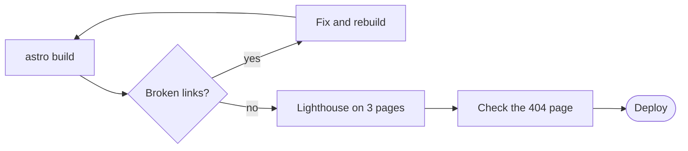

Most production bugs on a static site are not clever. They are a renamed page nobody redirected, an image that doubled in size, or a 404 page that itself 404s. A checklist catches them because it is boring.

The whole thing fits in one picture:



## The build output

Read the summary `astro build` prints. Two things matter: the number of pages (did it change when you didn’t expect it to?) and the size of `dist/_astro`. A new 200 kB chunk is a question worth answering before it ships.

## Broken links

Crawl the built site, not the dev server. Anything that only exists in dev — a draft, a page behind a flag — will show up as a broken link here.

```bash
npx astro build
npx linkinator ./dist --recurse --silent
```

## Lighthouse on three pages

Home, one article and the archive cover almost every layout on this site. Run Lighthouse in mobile mode against `astro preview`, not dev — dev serves unminified, unbundled code and the numbers mean nothing.

## The 404 page

Visit a URL that doesn’t exist. Check that it returns a real 404 status, uses the normal layout, and links somewhere useful. It is the page you test least and readers find most.

## Write it down

The checklist lives in the repo as a pull-request template. Ticking five boxes takes a minute; skipping them once is how a broken RSS feed stays broken for a month.
